# UI Motion Guide · 组件动效指南

一套按组件类别与交互意图选择过渡动效的 AI Skill。目前从按钮开始，后续扩展更多组件。

[Skill 入口](skills/component-motion-tree/SKILL.md) · [按钮决策树](skills/component-motion-tree/references/buttons.md) · [组件扩展规则](skills/component-motion-tree/references/components.md)

## 动效展示

使用完整面板录制。Before 为面板初始静态状态，After 为现有参考的实际交互；演示操作不调用真实发布或删除接口。

### 基础按钮

| Before | After |
| :---: | :---: |
| 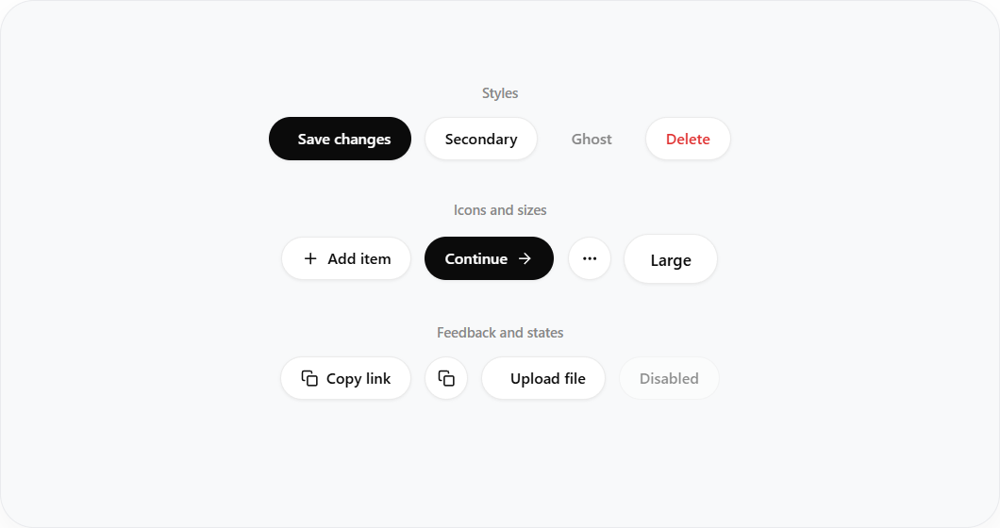 | 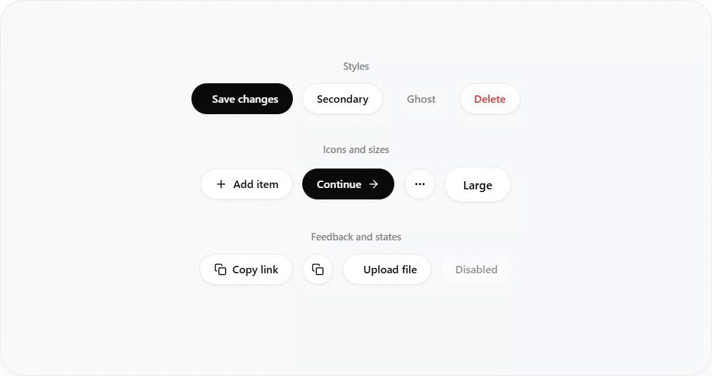 |

### 异步按钮

| Before | After |
| :---: | :---: |
| 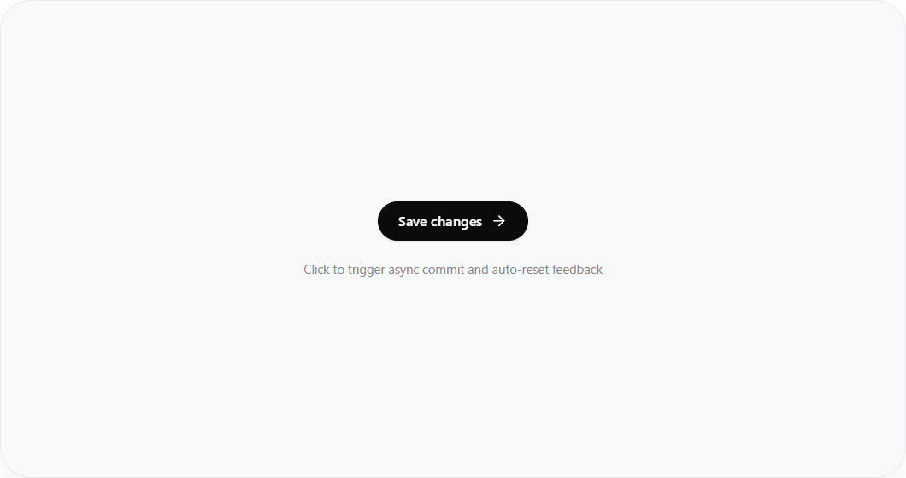 | 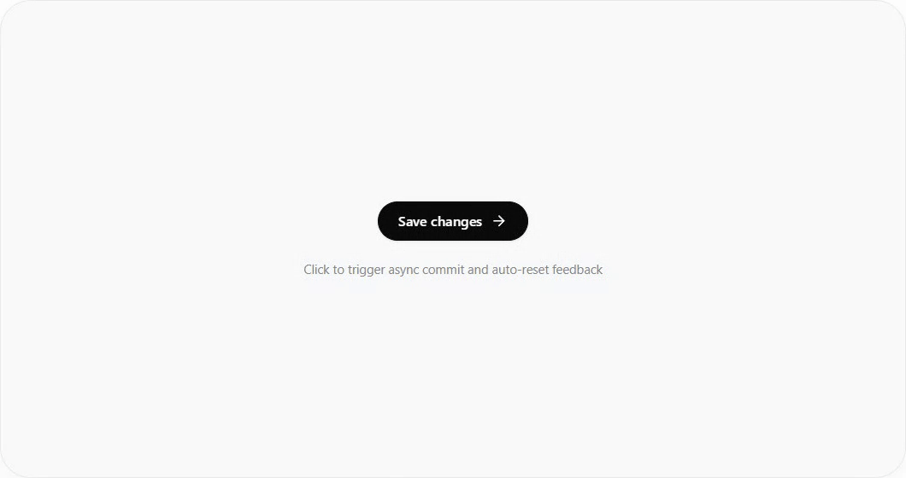 |

### 分割按钮

| Before | After |
| :---: | :---: |
| 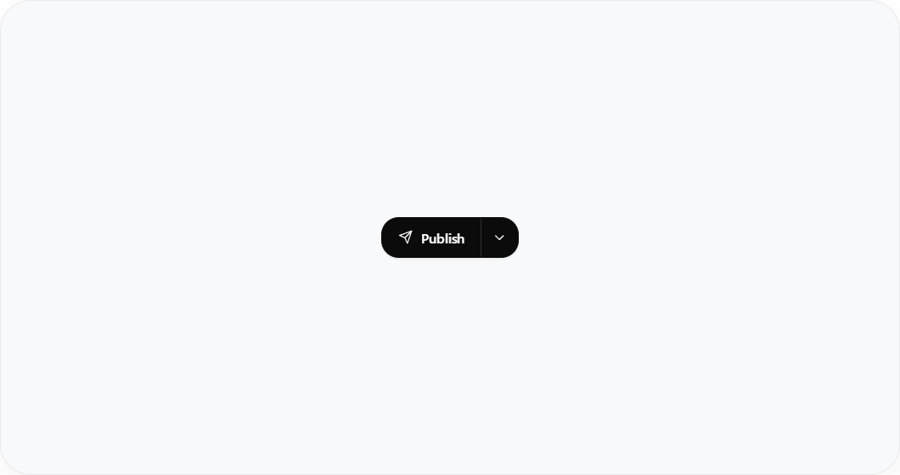 | 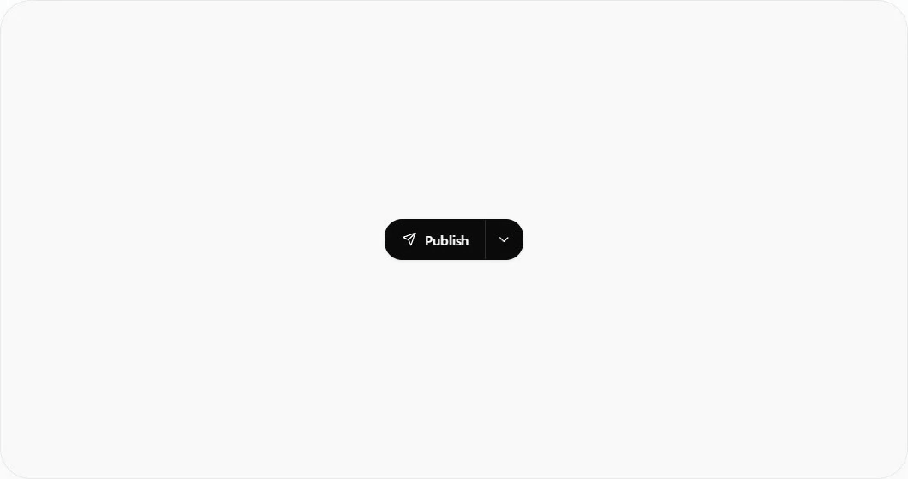 |

### 按钮组与数字滚动

| Before | After |
| :---: | :---: |
| 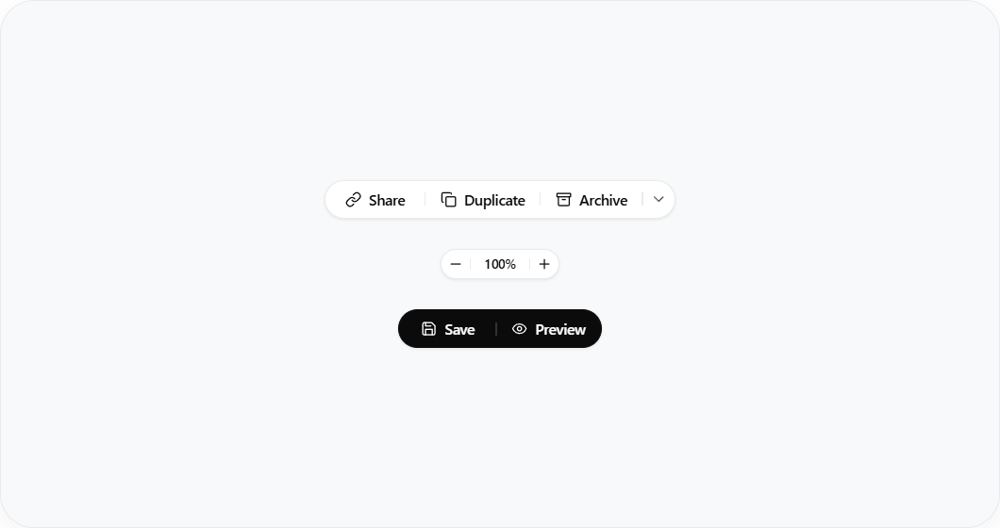 | 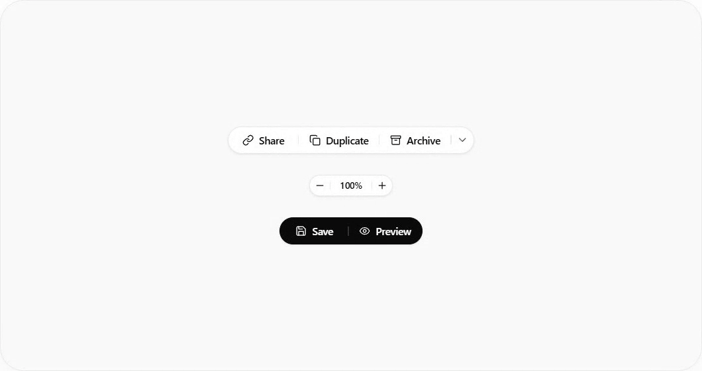 |

### 浮动工具栏

| Before | After |
| :---: | :---: |
| 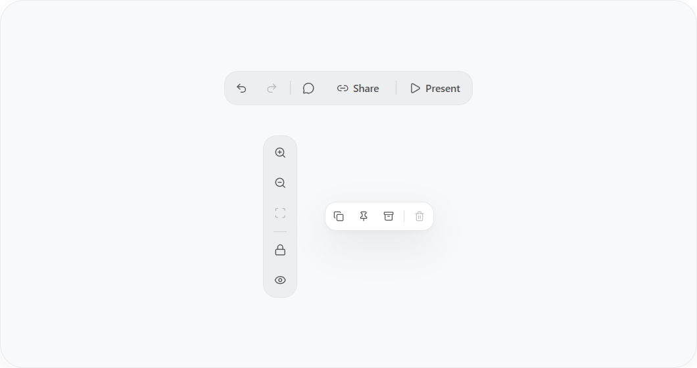 | 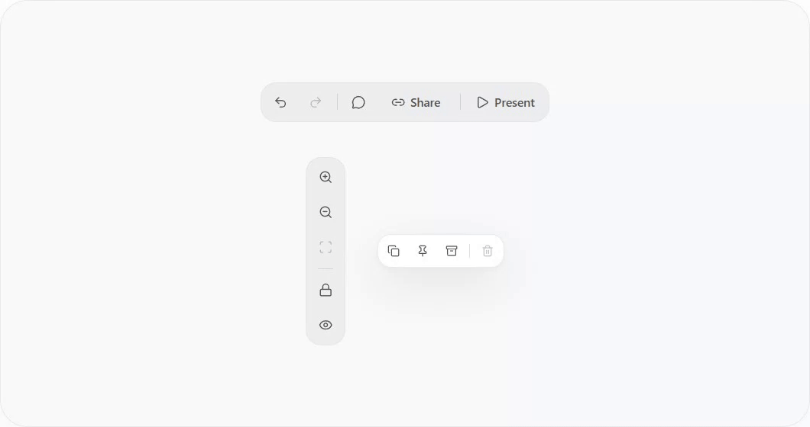 |

### 展开按钮组

| Before | After |
| :---: | :---: |
| 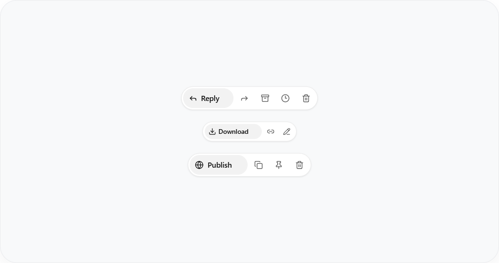 | 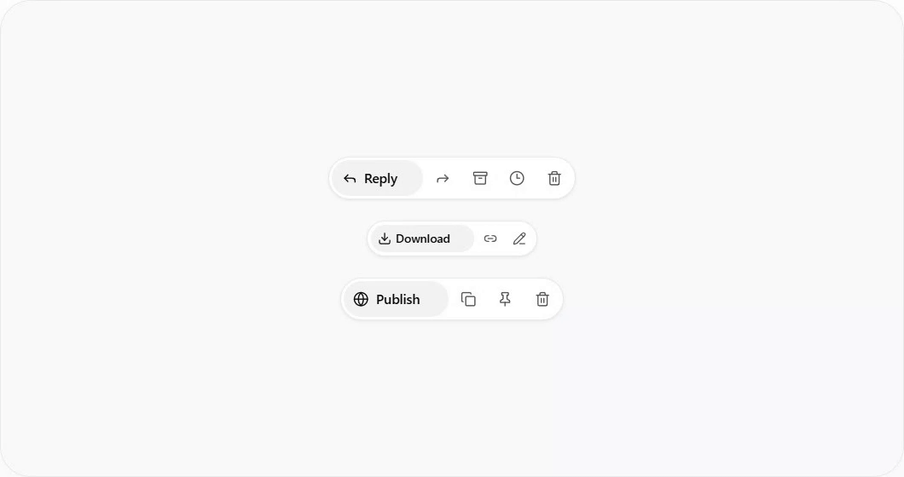 |

### 复制反馈

| Before | After |
| :---: | :---: |
| 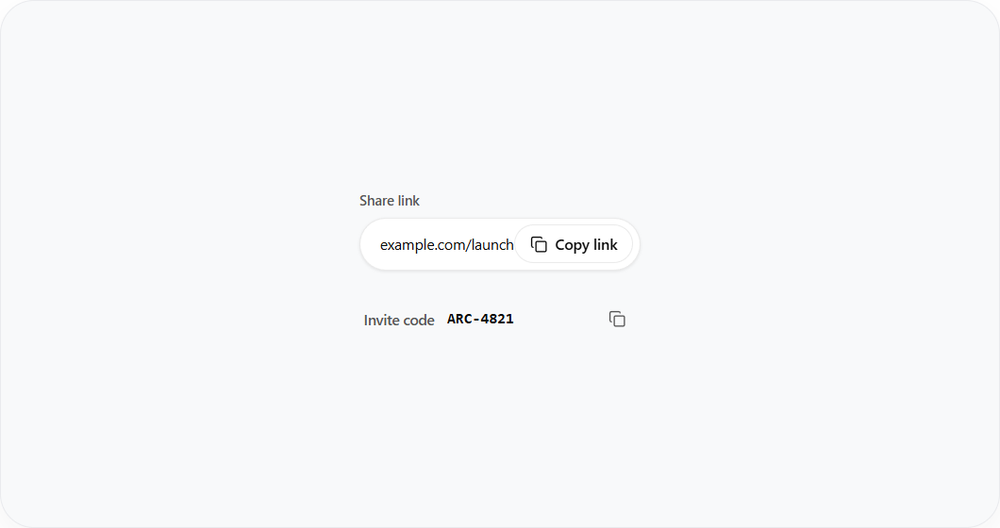 | 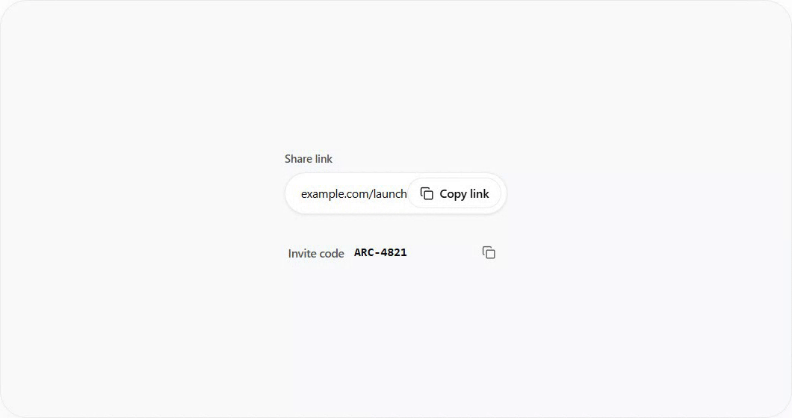 |

### 图标切换

| Before | After |
| :---: | :---: |
| 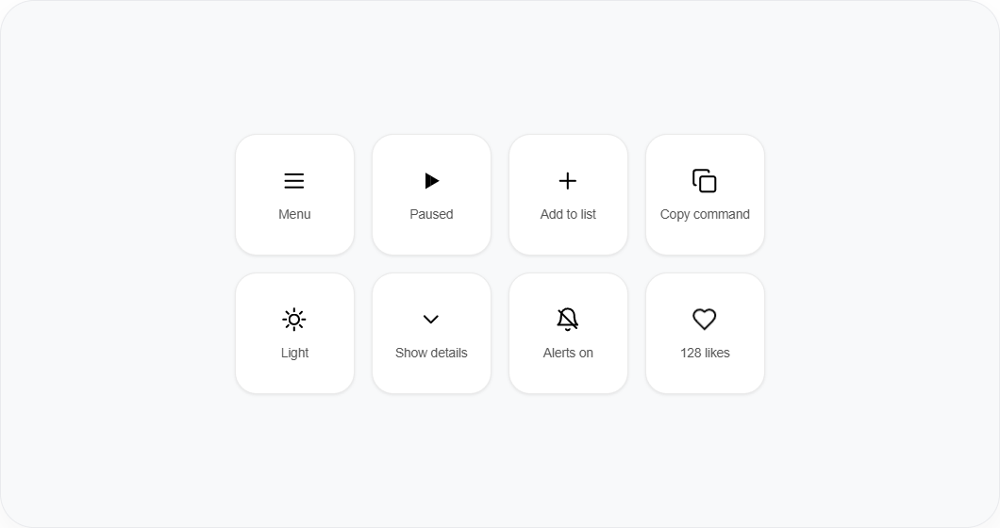 | 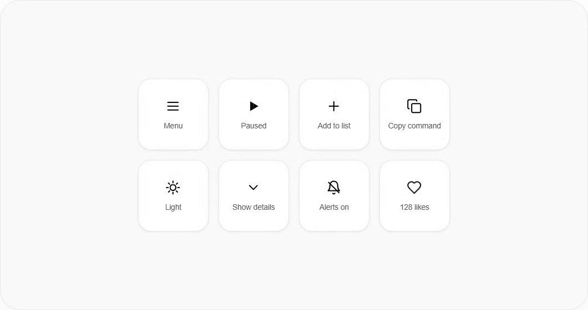 |

### 原地确认

| Before | After |
| :---: | :---: |
|  | 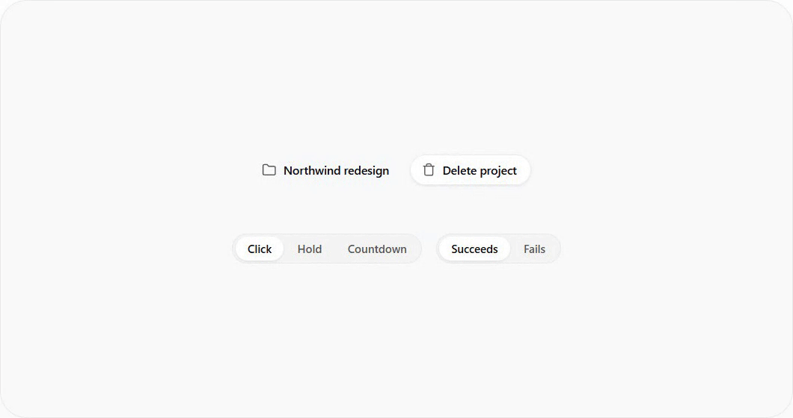 |

日月切换包含在图标面板中；当前没有独立动态 theme-switch 成品。

## 使用

```text
使用 $skill-installer，安装 Shark-Overlord/ui-motion-guide
中的 skills/component-motion-tree。
```

安装后，在目标项目中发送：

```text
使用 $component-motion-tree，为当前组件添加合适的动效过渡。
保留现有样式和业务逻辑，完成交互与状态验证。
```

也可以将 `skills/component-motion-tree` 整个目录放到目标项目的 `.agents/skills/`。调用方式见 [OpenAI 官方文档](https://learn.chatgpt.com/docs/build-skills)。

## 本地查看

```bash
python -m http.server 8000
```

打开 [组件面板](http://localhost:8000/examples/panels/index.html)，切换组件后即可操作。

## 源码与录制

- [9 个动态成品与 10 个静态毛坯](skills/component-motion-tree/assets/style-1)
- [本次按 Skill 生成的实际改造案例](examples/action-button/prompt.md)
- [面板录制记录](docs/panel-recordings.json) · [原始 WebM 录制](docs/recordings/panels)
- [录制脚本](scripts/record_panels.py)：需要 Python、Playwright、Pillow、Google Chrome 和 FFmpeg

```bash
python -m pip install playwright Pillow
python scripts/record_panels.py
```

原始参考保持不变，来源与哈希见 [source-integrity.json](skills/component-motion-tree/references/source-integrity.json)。
