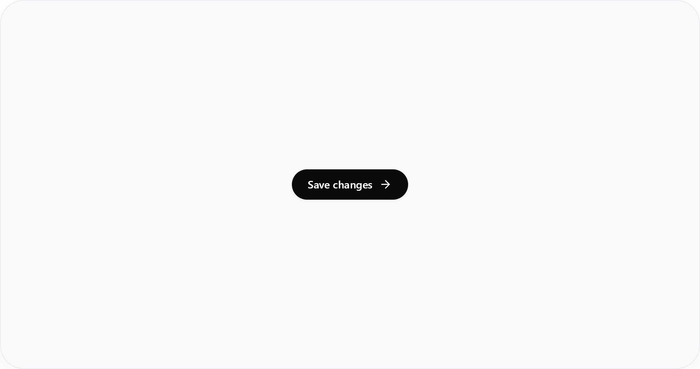
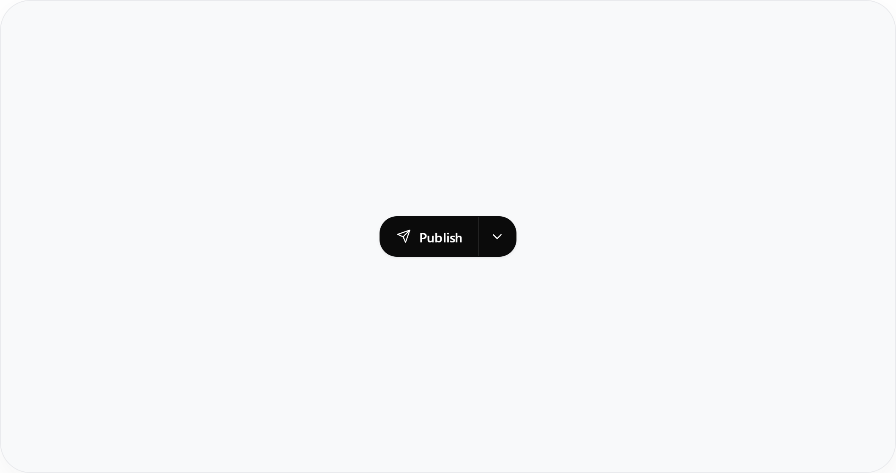
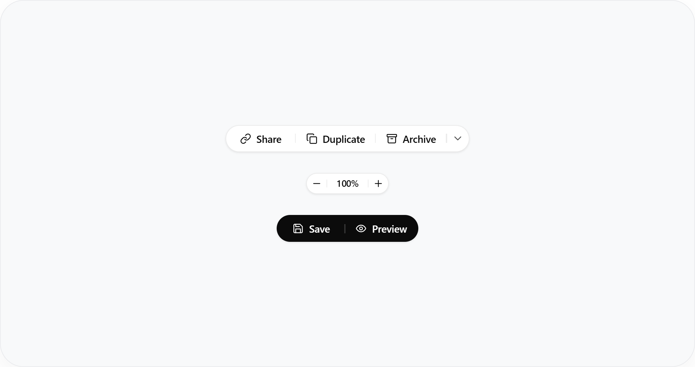
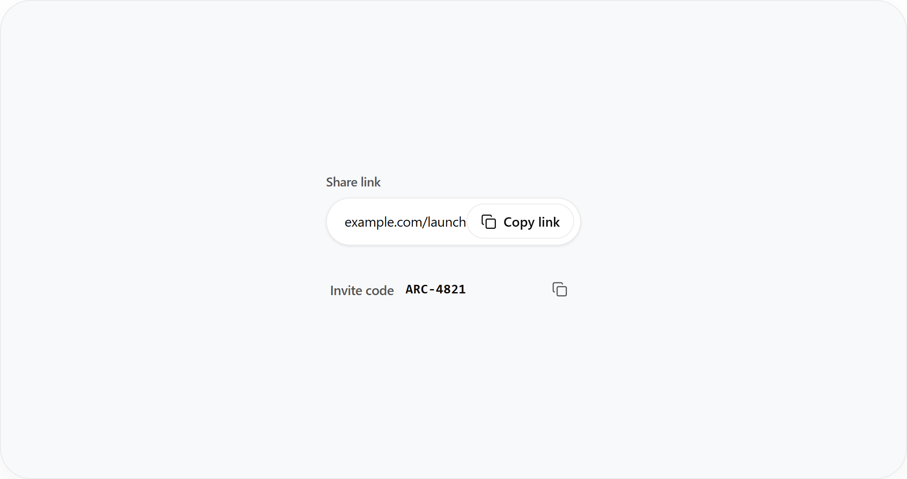
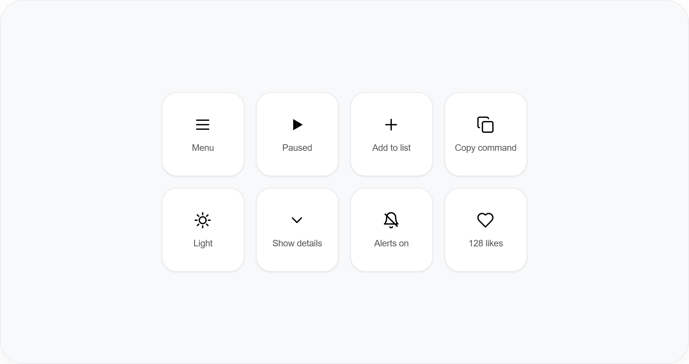
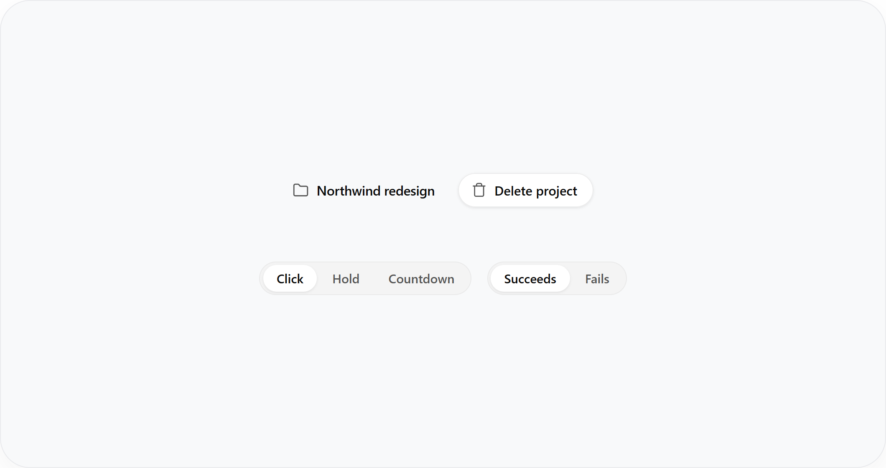

# UI Motion Guide · 组件动效指南

一套按组件类别与交互意图选择过渡动效的 AI Skill。目前从按钮开始，后续扩展更多组件。

[Skill 入口](skills/component-motion-tree/SKILL.md) · [按钮决策树](skills/component-motion-tree/references/buttons.md) · [组件扩展规则](skills/component-motion-tree/references/components.md)

## 动效展示

2120×1120 全宽展示，60fps 无损动画。Before 为初始静态状态，After 为参考交互；演示不调用真实发布或删除接口。

### 基础按钮

Before


After


### 异步按钮

Before



After


### 分割按钮

Before



After


### 按钮组与数字滚动

Before



After


### 浮动工具栏

Before


After


### 展开按钮组

Before


After


### 复制反馈

Before



After


### 图标切换

Before



After


### 原地确认

Before



After


日月切换包含在图标面板中；当前没有独立动态 theme-switch 成品。

## 使用

```text
使用 $skill-installer，安装 Shark-Overlord/ui-motion-guide
中的 skills/component-motion-tree。
```

安装后，在目标项目中发送：

```text
使用 $component-motion-tree，为当前组件添加合适的动效过渡。
保留现有样式和业务逻辑，完成交互与状态验证。
```

也可以将 `skills/component-motion-tree` 整个目录放到目标项目的 `.agents/skills/`。调用方式见 [OpenAI 官方文档](https://learn.chatgpt.com/docs/build-skills)。

## 本地查看

```bash
python -m http.server 8000
```

打开 [组件面板](http://localhost:8000/examples/panels/index.html)，切换组件后即可操作。

## 源码与录制

- [9 个动态成品与 10 个静态毛坯](skills/component-motion-tree/assets/style-1)
- [本次按 Skill 生成的实际改造案例](examples/action-button/prompt.md)
- [高清逐帧渲染记录](docs/panel-renders-hq.json) · [60fps 视频](docs/recordings/panels-hq)
- [帧率与四子帧混合验证](docs/temporal-verification.json)
- [早期面板录制](docs/panel-recordings.json) · [原始 WebM](docs/recordings/panels)
- [高清渲染脚本](scripts/render_panels_hq.py)：Playwright 240Hz 子帧采样，每 4 个子帧由 FFmpeg `tmix` 混合为 1 帧，输出 60fps APNG 与 MP4。
- 静态画面在确认 DOM、动画和指针状态相同后复用像素；CSS 和 JavaScript 使用同一受控时间轴。旧的 15fps GIF 仍保留。

运行需要 Python、Google Chrome、FFmpeg 和 FFprobe。

```bash
python -m pip install playwright Pillow
python scripts/render_panels_hq.py
```

原始参考保持不变，来源与哈希见 [source-integrity.json](skills/component-motion-tree/references/source-integrity.json)。
