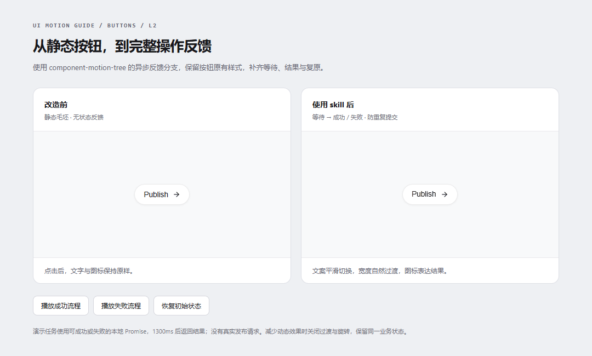
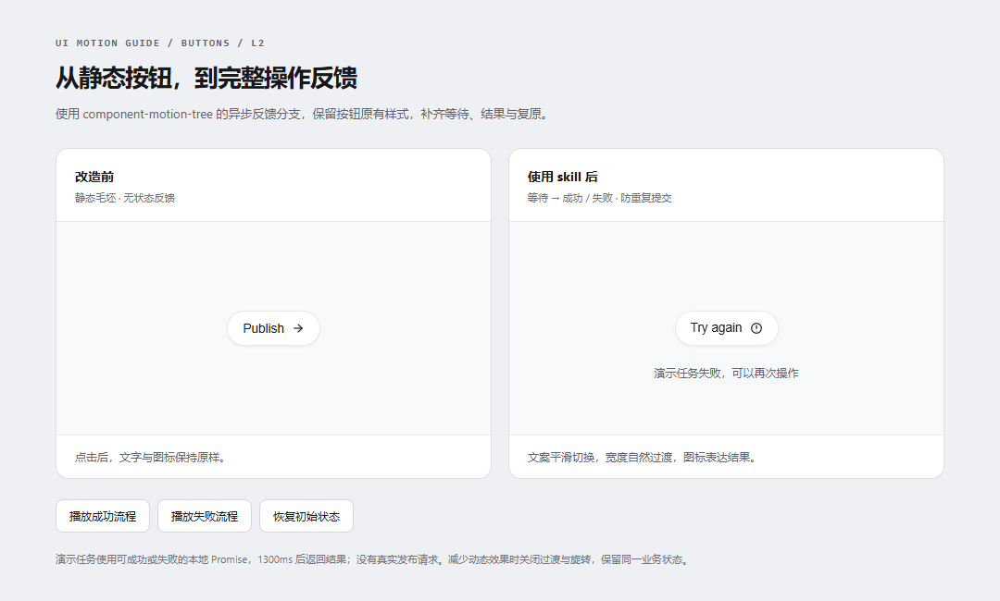
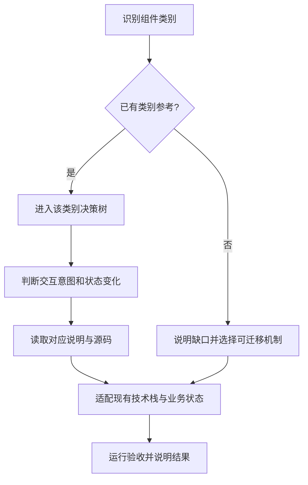

# UI Motion Guide · 组件动效指南

**一套用决策树为 Web 组件添加动效过渡的 AI Skill。**

从组件类别、交互意图和状态变化出发，选择参考机制，再适配到现有项目。当前从按钮开始，后续逐步接入更多组件类别。



## 仓库里有什么

- **可直接使用的 Skill**：[component-motion-tree](skills/component-motion-tree/SKILL.md)，包含总路由、共享实现规则和按需加载的参考。
- **按钮类别决策树**：[10 个交互分支](skills/component-motion-tree/references/buttons.md)，根据实际用途选择动效。
- **完整源码参考**：9 个动态成品、10 个静态毛坯，原样保存在 [assets/style-1](skills/component-motion-tree/assets/style-1)。
- **实际改造案例**：[静态按钮 → 异步反馈按钮](examples/action-button)，包含改造请求、前后 HTML、截图、动态图和可复跑的验证脚本。
- **扩展入口**：[组件类别索引](skills/component-motion-tree/references/components.md)，后续组件在同一个 Skill 中接入独立决策树。

参考以原生 HTML / CSS / JavaScript 实现；Skill 要求沿用目标项目的技术栈和状态管理，可将机制迁移到 React、Vue 等项目。

## 使用这个 Skill 后，组件发生了什么变化

下面是本仓库实际按 Skill 完成的改造，输入为静态 `Publish` 按钮。命中路径：

```text
buttons → 操作需要等待结果 → buttons/L2：异步状态流转
```

[查看本次改造请求与选择依据](examples/action-button/prompt.md) · [改造前源码](examples/action-button/before.html) · [改造后源码](examples/action-button/after.html) · [交互对照页面](examples/action-button/index.html)

| 对照项 | 改造前 | 使用 Skill 改造后 |
| --- | --- | --- |
| 点击反馈 | 文案与图标保持不变 | 按压微缩，进入等待状态 |
| 等待过程 | 无中间状态 | `Publishing` + spinner，`aria-busy=true` |
| 成功反馈 | 无结果状态 | `Published` + 对勾描边，2400ms 后复原 |
| 失败反馈 | 无失败状态 | `Try again` + 错误图标，允许重新操作 |
| 文案与尺寸 | 静态内容 | 文案交叉过渡，槽宽根据实际内容平滑变化 |
| 快速重复操作 | 无任务逻辑 | pending 时不重复发起任务，旧回调不能覆盖新状态 |
| 键盘与减少动态效果 | 原生静态按钮 | 支持键盘激活；减少动态效果时关闭过渡/旋转，保留业务状态 |
| 按钮视觉样式 | 浅色胶囊按钮 | 保留原配色、圆角、高度、字体、边框与阴影 |

### 成功流程动态图

上方 GIF 为浏览器实际录制：左侧保持静态，右侧完整展示 `idle → pending → success → idle`。

### 失败流程截图



本案例的任务适配器返回本地 Promise，1300ms 后模拟成功或失败，**没有真实发布请求**。业务项目接入时替换 `demoTask()`，让成功/失败状态跟随真实结果。本次改造结果与 Skill 内的原始参考分开保存。

### 已验证的行为

使用 Google Chrome + Playwright 检查了原始按钮样式保留、成功后复原、重复触发拦截、失败重试、键盘激活、取消后的旧回调、旧复原计时器、减少动态效果、对照页控制和 390px 页面布局。详细记录：[demo-verification.json](docs/demo-verification.json)。这些结果针对本次改造案例，不能代替其他目标项目的运行验收。

## 安装与使用

### 使用 Skill Installer

在支持 Skill Installer 的 Codex 环境中发送：

```text
使用 $skill-installer，安装 GitHub 仓库 Shark-Overlord/ui-motion-guide
中的 skills/component-motion-tree。
```

### 放入目标项目

也可以下载仓库，将 `skills/component-motion-tree` 整个文件夹放到目标项目的 `.agents/skills/component-motion-tree/`。保留 `references`、`assets` 和 `agents`，不要只复制 `SKILL.md`。Codex 的本地 Skill 发现位置与调用方式见 [OpenAI 官方文档](https://learn.chatgpt.com/docs/build-skills)。

然后发送一个具体任务：

```text
使用 $component-motion-tree，为当前保存按钮添加动效过渡。
保留现有样式和业务逻辑，跟随真实请求显示等待、成功与失败反馈，
并验证重复点击、键盘操作和减少动态效果。
```

其他例子：

```text
使用 $component-motion-tree，让工具栏高光在按钮之间连续移动。
```

```text
使用 $component-motion-tree，为缩放数字添加滚动过渡，
从 25% 变到 100% 时保持周围布局稳定。
```

Skill 会先说明命中的类别与分支，再读取对应参考并实现；只需要方案时，在请求中注明“先给方案，不修改代码”。

## 决策流程



当前按钮类别覆盖：

| 分支 | 场景 |
| --- | --- |
| buttons/L1 | 按压与轻量文本、图标反馈 |
| buttons/L2 | 异步操作的等待与结果 |
| buttons/L3 | 复制成功/失败反馈 |
| buttons/L4 | 分割按钮与菜单开合 |
| buttons/L5 | 常规按钮组共享高光 |
| buttons/L6 | 有方向的数字滚动 |
| buttons/L7 | 按钮组内的文字展开 |
| buttons/L8 | 浮动或纵向工具栏及提示 |
| buttons/L9 | 原地确认、取消与真实可用的撤销 |
| buttons/L10 | 图标形态变化与持久开关状态 |

独立的动态 `theme-switch` 在当前 `style-1` 中缺失；静态毛坯和 `icon-morph` 中的主题图标演示仍可参考。独立输入框、弹窗、列表、卡片与页面切换等类别属于后续扩展方向，尚未注册为完整覆盖。

## 本地查看与复现

在仓库根目录启动静态服务：

```bash
python -m http.server 8000
```

打开 [本地交互对照页](http://localhost:8000/examples/action-button/index.html)。可以点击“播放成功流程”“播放失败流程”，或直接点击右侧按钮。示例无 npm 依赖。

需要重新验证或录制时，先安装 Python 依赖，并确保本机安装了 Google Chrome：

```bash
python -m pip install playwright Pillow
python scripts/verify_demo.py
python scripts/verify_demo.py --record
```

脚本在 `127.0.0.1` 的临时端口启动静态服务；`--record` 会重新生成 `docs/images` 中的 PNG/GIF，并更新验证记录。

## 如何继续扩展

每接入一个新组件类别，就补充该类别的交互决策树、对应源码和验收点，再注册到组件索引。组件类别与视觉风格分别组织；同一种组件可以有多种风格，先选交互机制，再选参考风格。具体规则：[components.md](skills/component-motion-tree/references/components.md)。

## 目录

```text
ui-motion-guide/
├── README.md
├── skills/component-motion-tree/
│   ├── SKILL.md
│   ├── agents/openai.yaml
│   ├── references/             类别路由、按钮分支、来源和验收
│   └── assets/style-1/          原始成品与静态毛坯
├── examples/action-button/     本次实际使用 Skill 的前后改造案例
├── docs/images/                浏览器截图与动态图
├── docs/demo-verification.json
└── scripts/verify_demo.py       改造案例的验证与录制
```

原始参考的路径、大小与 SHA-256 记录在 [source-integrity.json](skills/component-motion-tree/references/source-integrity.json)，用于核对来源文件完整性。
