# UI Motion Guide · 组件动效指南

让 AI 为现有组件添加过渡动效，保留原有样式和业务逻辑。

目前支持按钮按压、加载反馈、复制提示、图标切换等交互，更多组件将陆续加入。

## 使用

克隆到你想存放的目录（替换 `<目标目录>`）：

```bash
git clone https://github.com/Shark-Overlord/ui-motion-guide.git "<目标目录>/ui-motion-guide"
```

然后告诉能读取本地文件的 AI：

```text
先读取 <目标目录>/ui-motion-guide/AGENTS.md，按索引选择 Skill，
给我的项目 src/components/SaveButton.tsx 中的按钮添加过渡，保留现有样式和业务逻辑。
```

未指定组件时，让 AI 先扫描当前界面，列出可修改组件，等你选择后再添加动效。

无需专用安装器；入口和参考都在仓库内。放在任意目录时，首次使用请明确给 AI 入口路径。

## 动效展示

原始页面录制，保留原有布局与样式，原速播放。Before 为初始静态状态，After 为带鼠标的主要过渡；演示不调用真实发布或删除接口。

### 基础按钮

Before

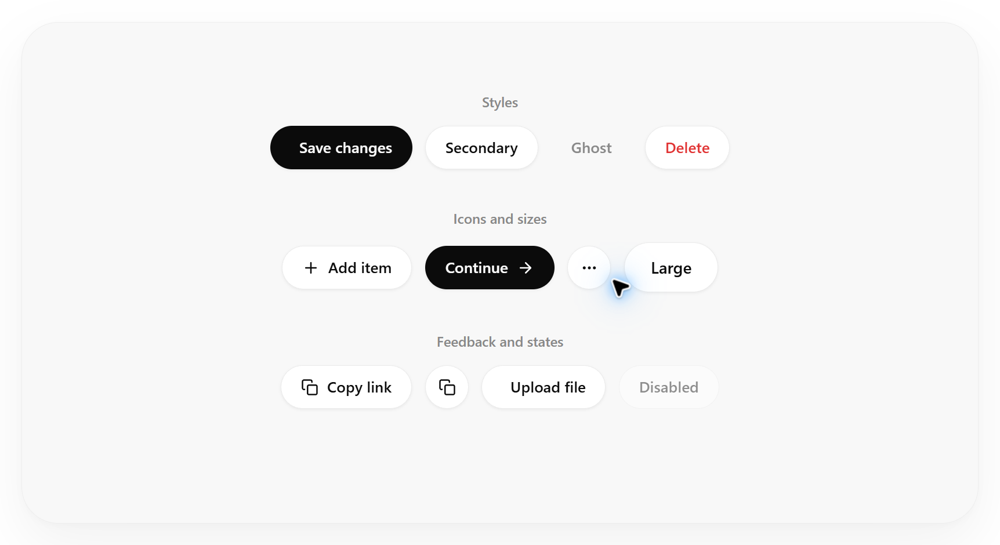

After

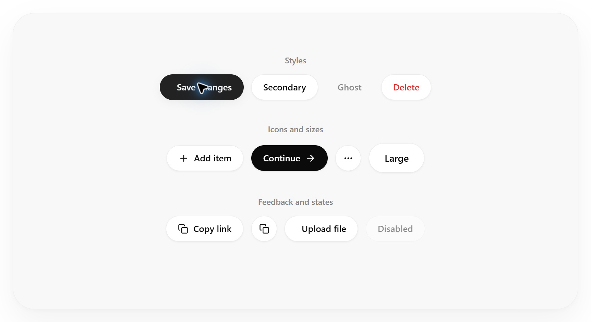

### 异步按钮

Before

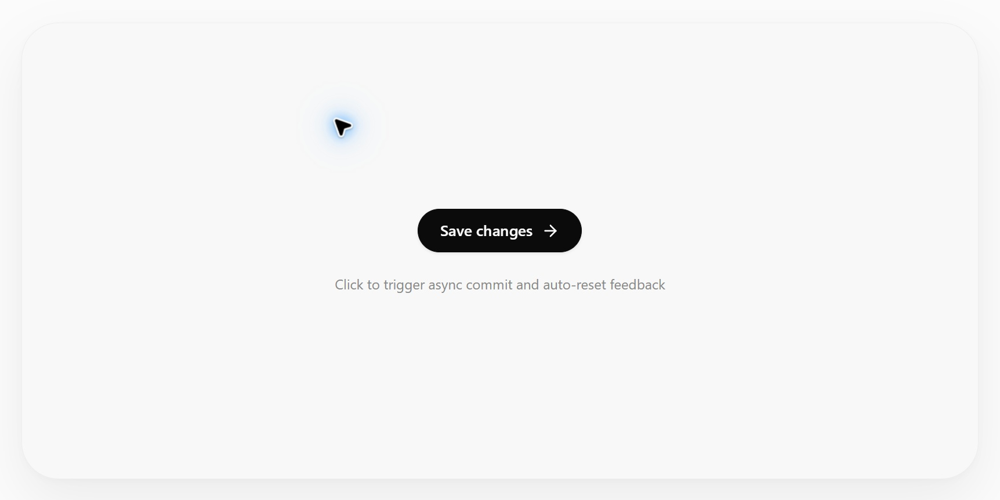

After


### 分割按钮

Before

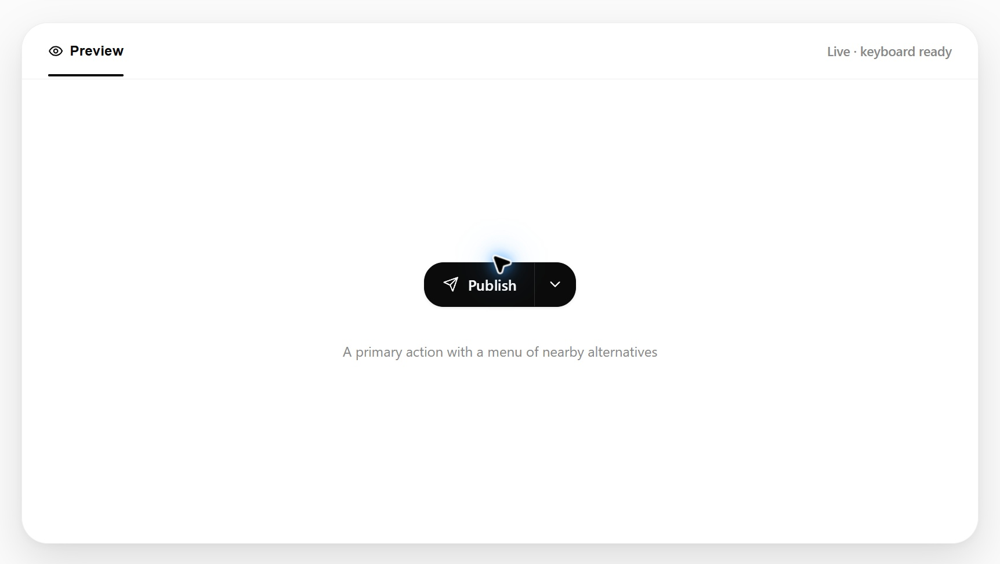

After

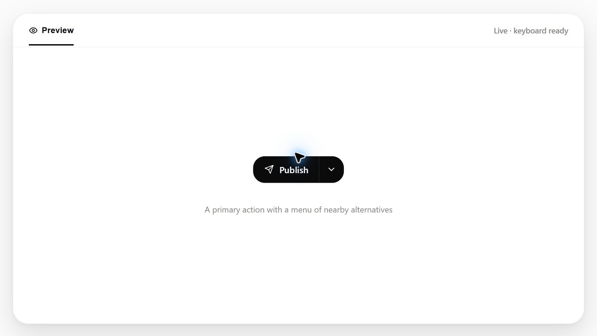

### 浮动工具栏

Before


After

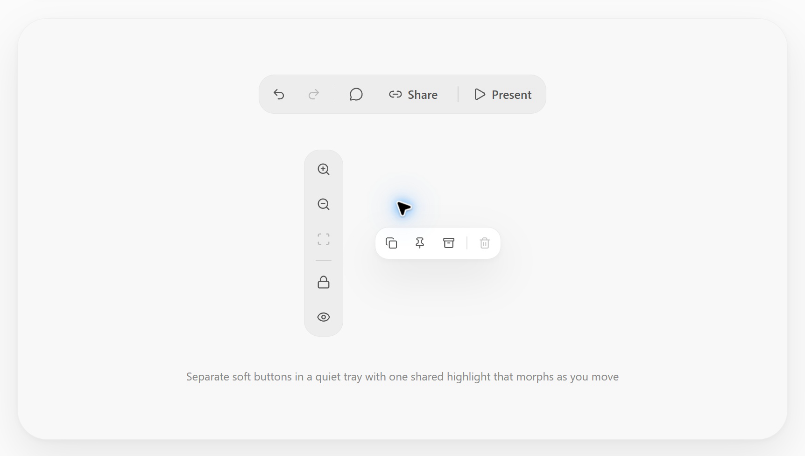

### 展开按钮组

Before

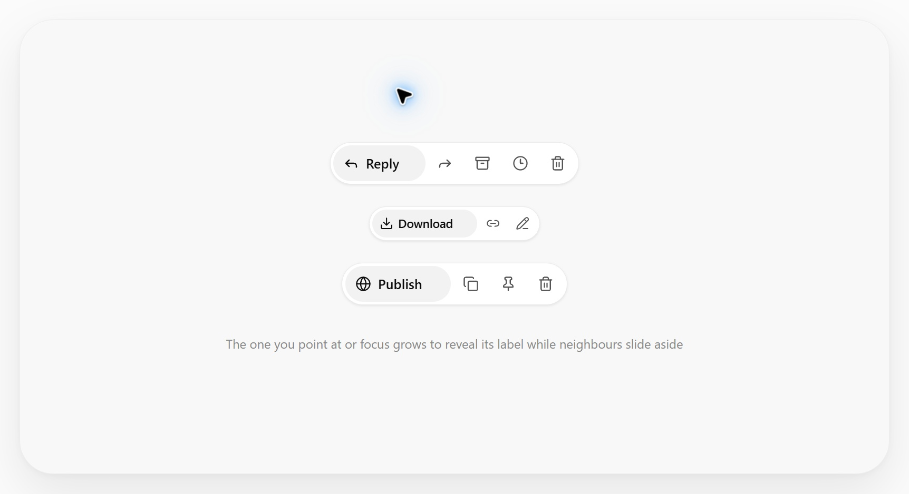

After


### 复制反馈

Before

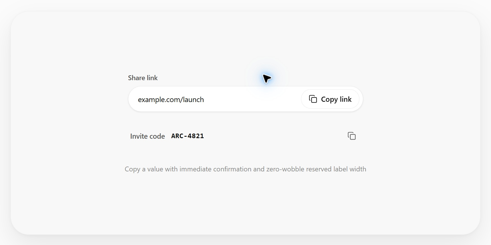

After

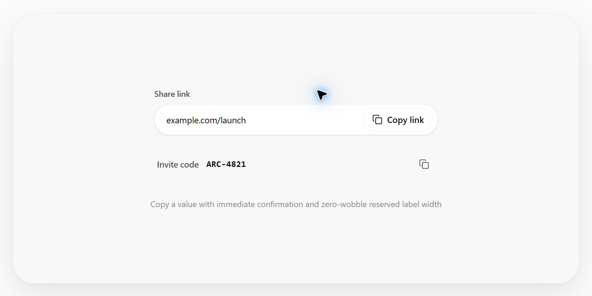

### 图标切换

Before


After

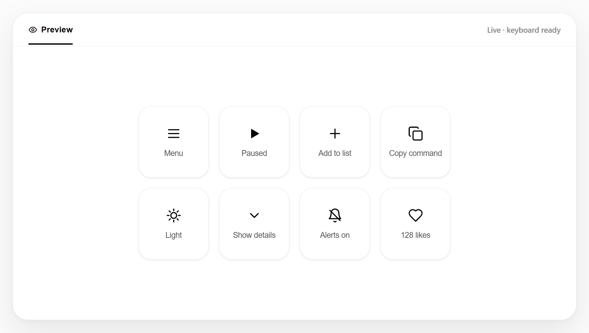

### 原地确认

Before


After

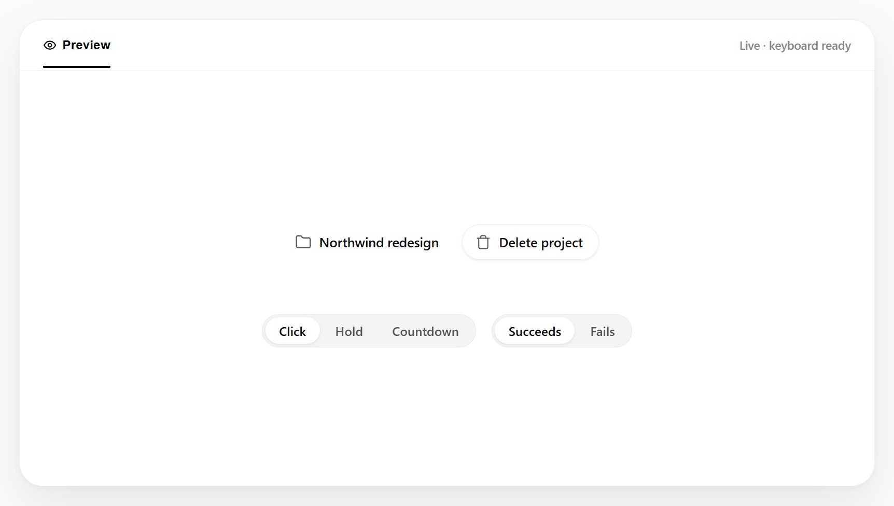
