# UI Motion Guide · 组件动效指南

一套按组件类别与交互意图选择过渡动效的 AI Skill。目前从按钮开始，后续扩展更多组件。

[Skill 入口](skills/component-motion-tree/SKILL.md) · [按钮决策树](skills/component-motion-tree/references/buttons.md) · [组件扩展规则](skills/component-motion-tree/references/components.md)

## 动效展示

2120×1120 全宽展示，中性灰背景、原速 60fps 无损动画。Before 为初始静态状态，After 为带鼠标的主要过渡；演示不调用真实发布或删除接口。

### 基础按钮

Before


After

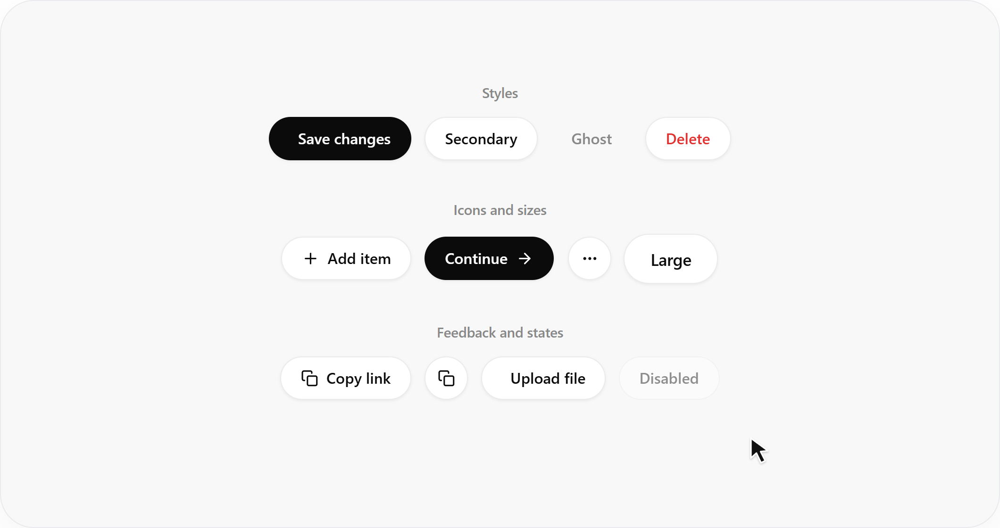

### 异步按钮

Before

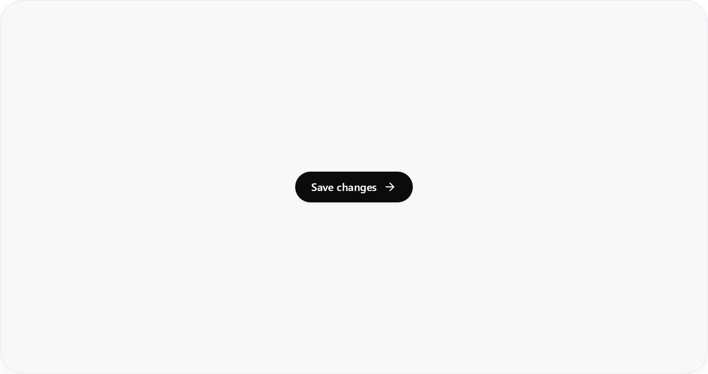

After

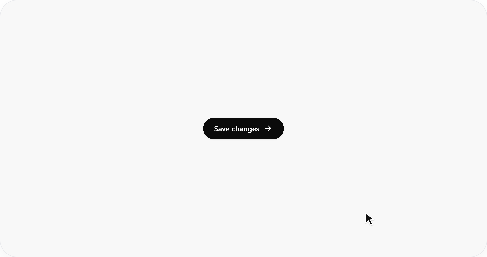

### 分割按钮

Before

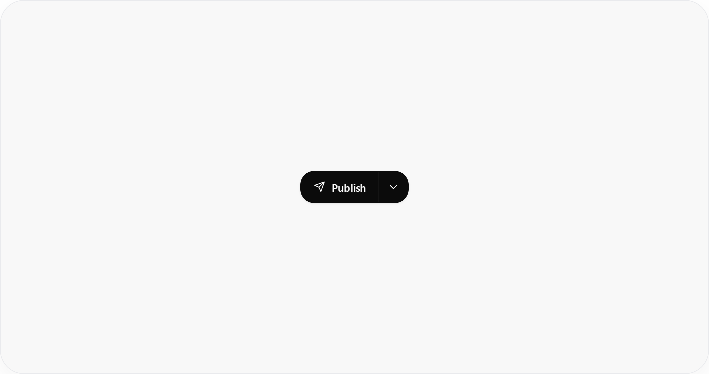

After

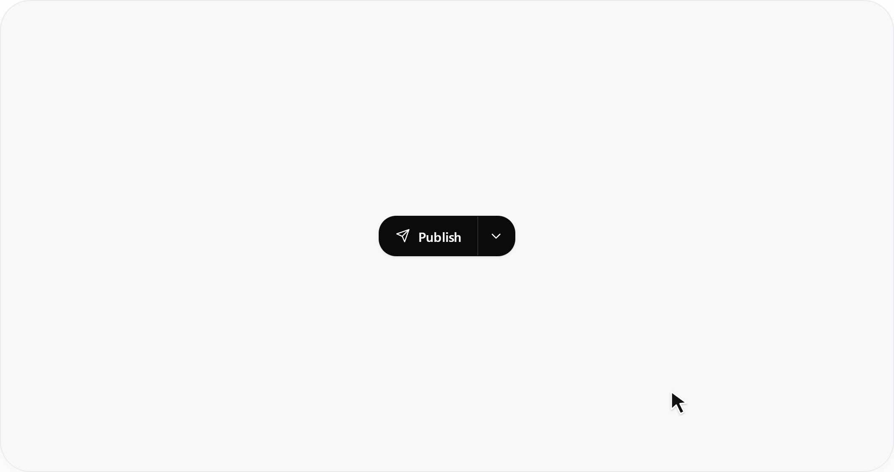

### 按钮组与数字滚动

Before

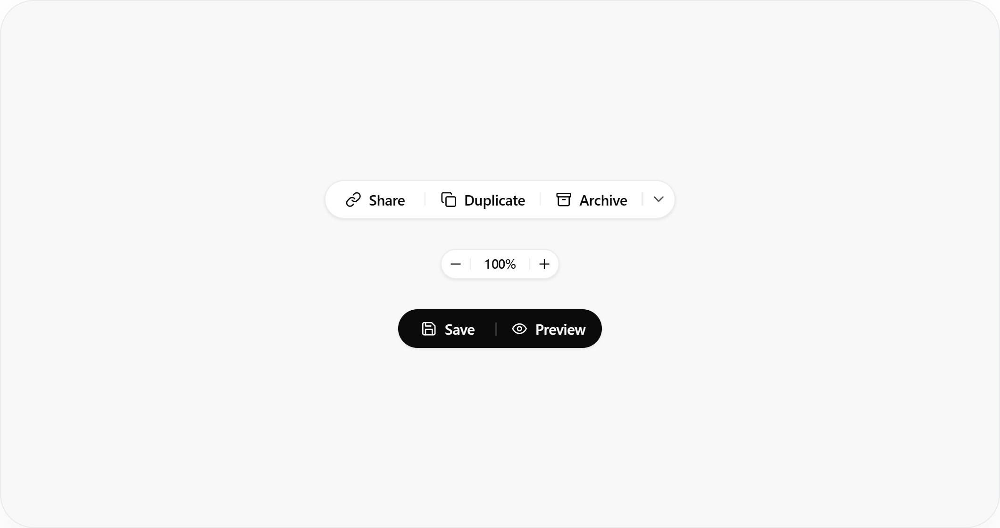

After

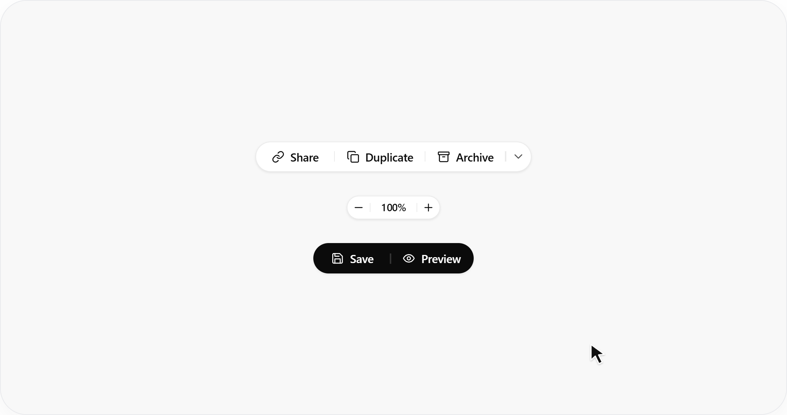

### 浮动工具栏

Before

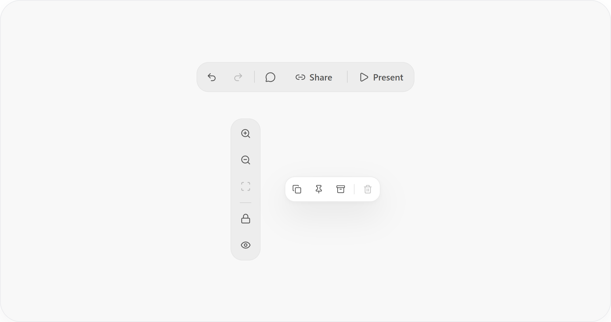

After

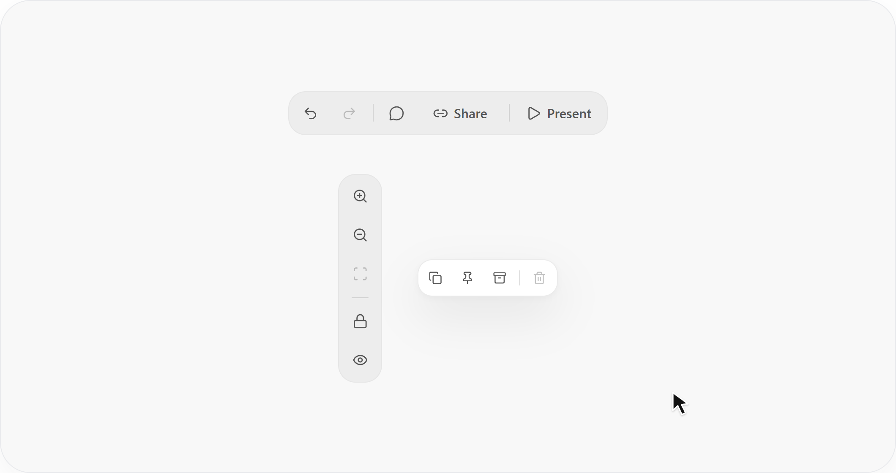

### 展开按钮组

Before

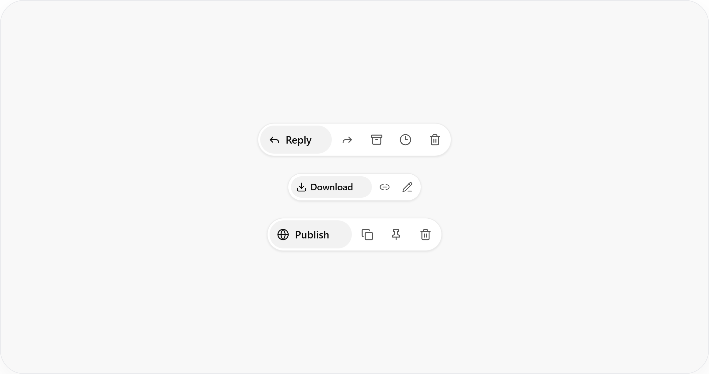

After

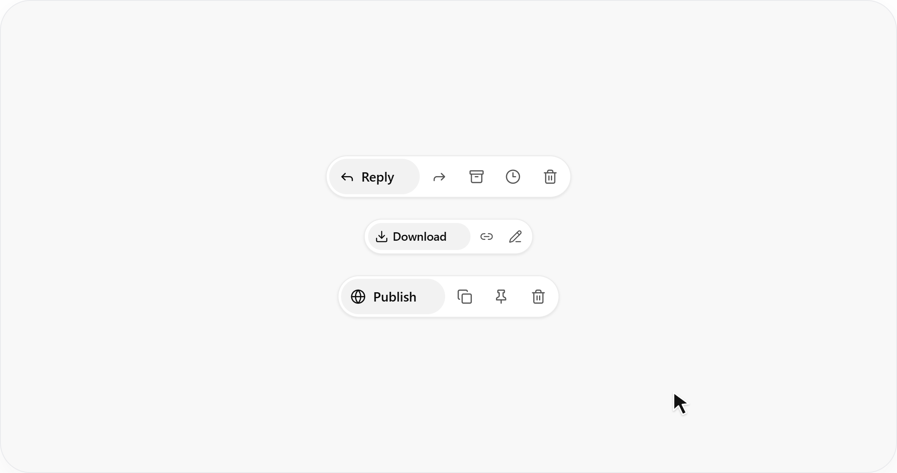

### 复制反馈

Before

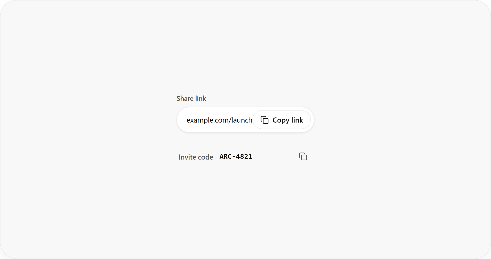

After

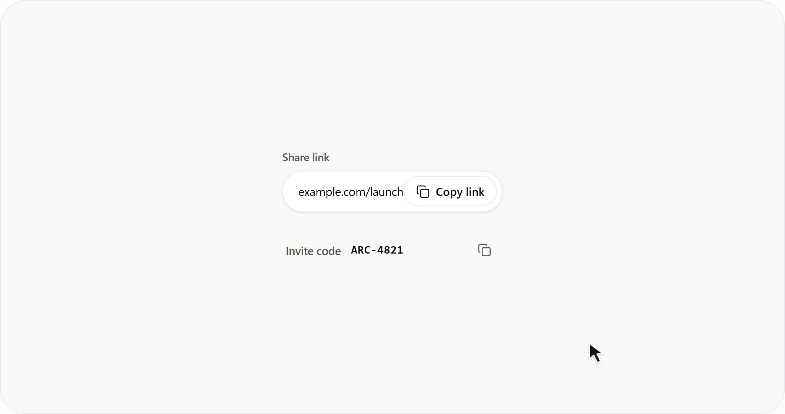

### 图标切换

Before

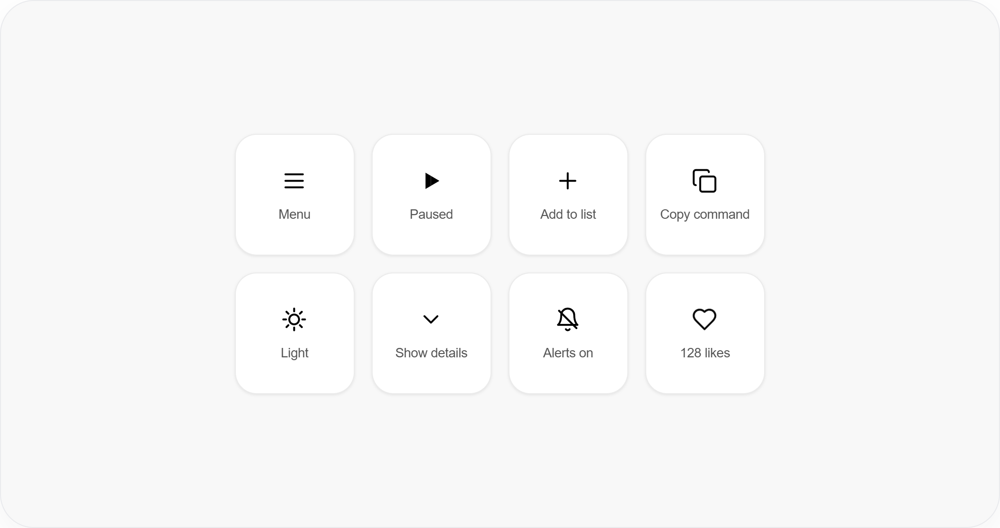

After

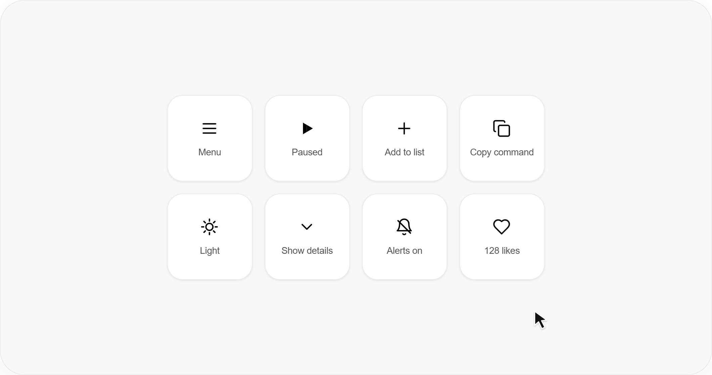

### 原地确认

Before

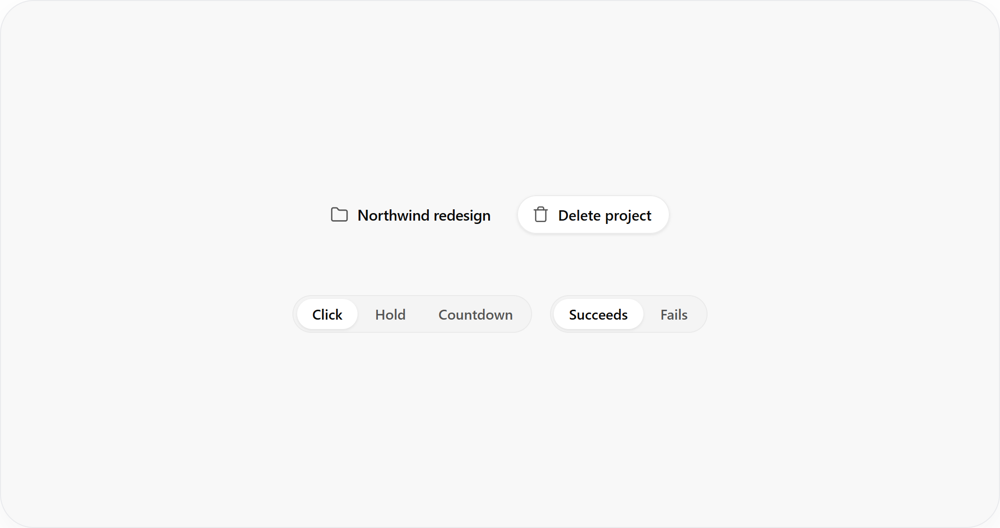

After

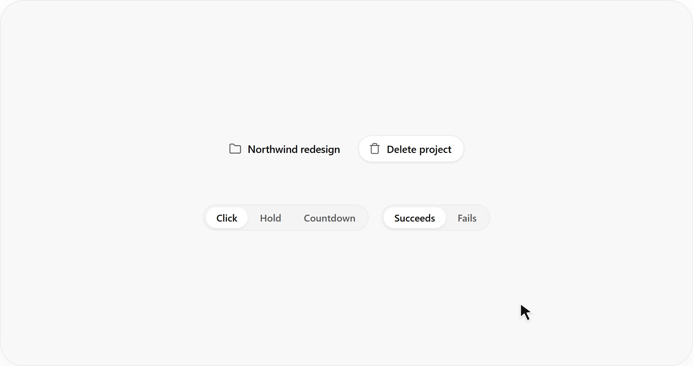


## 使用

```text
使用 $skill-installer，安装 Shark-Overlord/ui-motion-guide
中的 skills/component-motion-tree。
```

安装后，可指定组件直接修改：

```text
使用 $component-motion-tree，给 src/components/SaveButton.tsx 中的保存按钮添加过渡，保留现有样式和业务逻辑。
```

也可以先扫描界面，确认后再修改：

```text
使用 $component-motion-tree，先扫描当前页面，列出可以添加动效的组件，等我选择后再修改。
```

也可以将 `skills/component-motion-tree` 整个目录放到目标项目的 `.agents/skills/`。