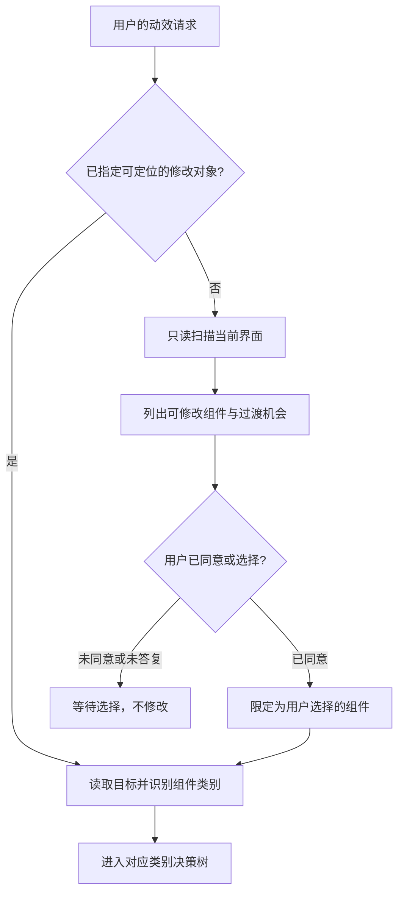
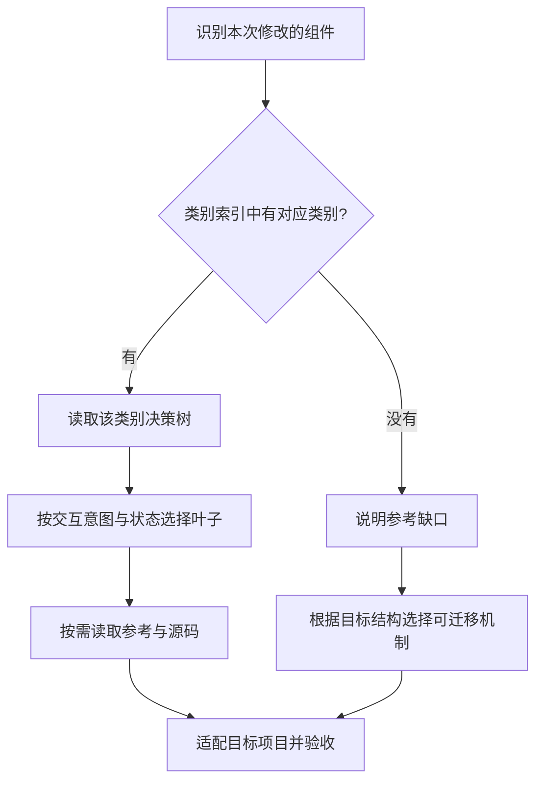

# 组件动效决策树

为已有组件选择并实现合适的过渡。先判断组件做什么、状态如何变化，再读取命中的参考；不要只根据外观选择动画。

采用可扩展的两层结构：**组件类别 → 类别内交互决策树 → 对应参考实现**。当前经过源码整理的第一个类别是按钮；实际覆盖范围以组件类别索引为准。

## 入口：先确定修改对象

先判断用户是否指定了可定位的本地修改对象，再进入组件类别决策树。

- **已指定组件**：组件名、组件文件、选择器、明确的页面区域或有边界的批量对象（如“这个工具栏的所有按钮”）能定位修改对象时，读取其代码，判断所属类别，直接进入该类别决策树并完成用户要求的修改。已有明确授权不重复确认。
- **未指定组件**：只有“给当前页面加动效”、页面路径或项目目录时，先按 [界面扫描与选择](references/scope-and-scan.md) 只读扫描当前界面，简短列出可以修改哪些组件。用户明确同意或选择后，才为这些组件匹配类别、交互分支和参考源码，并添加过渡。未收到答复时保持待选择状态，不修改项目。

用户只要检查或方案时保持只读；指定目标本身不把方案请求变成修改请求。

## 读取已确定的目标

读取目标组件、样式、事件和项目指令，确定：触发方式、原状态与目标状态、业务动作、技术栈、尺寸是否允许变化。能从代码判断的直接判断；只有影响选择的缺失信息才询问用户。

用户点名某个示例时优先使用该示例；复合组件可命中多个叶子，以业务目的为主分支，再组合必要的辅助过渡。只添加动效的请求不代表重做配色、布局、文案或业务操作。

## 第一层：选择组件类别

完成入口判断并确定修改范围后，先查 [组件类别索引](references/components.md) 中实际收录的类别，再进入对应类别的决策树。当前第一个类别是 **buttons：按钮及其关联交互**，入口为 [按钮决策树](references/buttons.md)。后续独立组件能力可以作为新的 Skill 接入仓库；本 Skill 内的类别扩展以自己的索引为准。

组件类别与视觉风格分开选择。先找组件，再确定交互机制，最后按用户指定风格选择对应参考。不能因为外观像按钮就把输入框、弹窗或其他类别强行路由到 buttons。

复合组件按本次修改的主要对象选择主类别，再组合所需的辅助分支。命中路径使用 `类别/叶子`，如 `buttons/L2`。不一次加载所有类别的完整树。

## 第二层：类别内选择动效

使用所选类别的决策树判断交互意图、状态变化与触发方式。用户指定成品时优先定位该成品，再核对它是否支持实际业务。命中叶子后读取对应说明与源码，再应用以下共享实现规则。

当前按钮类别包含按压、异步与复制反馈、菜单、共享高光、数字滚动、展开组、浮动工具栏、原地确认和图标切换。独立动态 theme-switch 的来源缺口在按钮参考里记录；不能据此限制未来其他类别的结构。

## 共享实现决策

1. **状态来源**：已有业务状态就订阅它。只有纯视觉 hover/press 用 CSS；需要异步、取消、倒计时或测量时使用项目现有状态与生命周期。源码的原生 JS 是参考机制，不要求项目改成原生技术栈。
2. **尺寸策略**：反馈需要固定位置时，用最大状态占位或固定槽；形态变化本来就需要伸缩时，测量自然内容后过渡到目标像素宽度。不要把“避免非预期抖动”误解成“所有组件禁止改变宽度”。
3. **内容策略**：整段交叉淡化优先用于简单文案；示例的逐字复用只在确有需要时移植。中文、emoji 等使用字素边界或整段替换，避免 UTF-16 逐字符拆分破坏文字。
4. **参数策略**：读取所选源码实际使用的 duration/easing/位移。不同文件同名 token 可能值不同；迁移时使用组件局部 token 或已有语义 token，不复制整段全局 `:root`。新增推导值要与源码值区分。
5. **兼容策略**：SVG 路径插值需要兼容的路径结构和运行环境；不支持时用双图标交叉淡化。`linear(...)` 是展开示例中的采样弹簧曲线，不是匀速 `linear`；按目标浏览器提供必要回退。
6. **减少动态效果**：降低缩放、位移、模糊、循环和错峰；JS 驱动的数字/形态动画也直接应用最终状态。保留业务状态、必要等待和取消窗口，不能通过减少动画改变业务语义。

## 移植边界

只提取组件的 DOM 槽、状态、选择器和动画机制。示例中的舞台、主题控制条、展示快捷键、演示延时、`embed` 检测和全页滚动限制不随组件搬入业务页面。

等待成功要绑定真实结果，错误要进入错误状态。重入时旧计时器/旧请求不能覆盖新状态；卸载时清理计时器、监听、观察器和动画帧。隐藏的面板/旧状态退出期间不应继续接收焦点或点击；保留目标组件已有的键盘与焦点语义。

不要为了重置过渡重复触发业务动作。状态变化可以驱动视觉反馈，视觉结束不能被当作业务完成。

## 实现与验收

简短说明命中的叶子及理由，然后按分支实现。使用类别自己的验收点和 [validation.md](references/validation.md) 的共同检查；该文件现有具体场景属于按钮类别。成功、失败、快速重入、尺寸变化和减少动态效果需要观察实际结果，文件存在或构建通过不能证明动画正确。

交付说明：选择的分支/组合、改动文件、参考来源、验证结果和未验证项。如果用户只要方案，输出同样的分支与状态描述，不擅自修改项目。

## 维护与扩展

用户要求接入新组件参考时，按 [组件类别索引与扩展规则](references/components.md) 判断是新增独立 Skill，还是补充本 Skill 的交互分支或类别；保留已有规则和参考。普通组件实现任务不自动修改 Skill。
