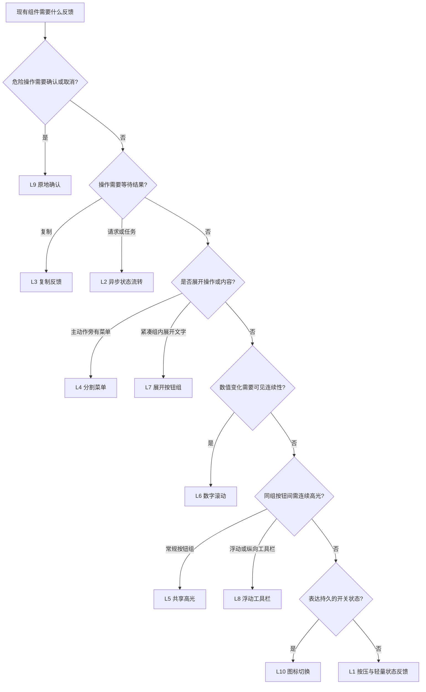

# 按钮类别：buttons

这是组件总决策树下的第一个类别。以下叶子只覆盖按钮及其关联交互；完整命中路径写为 `buttons/L1` 至 `buttons/L10`。先读取目标状态和业务语义，再进入本树。

## 按钮交互决策树

依次判断，首个命中项确定主分支。叶子编号与下面的参考表对应。

树的语义补充：

- 普通复制即使很快也走 L3：成功反馈必须跟随真实写入结果。
- “删除正在提交”先走 L9 确认，再组合 L2 等待和结果反馈；不凭动画新增确认规则。
- 数字组可组合 L6 + L5；工具栏复制可组合 L8 + L3。
- 只需要文本替换的微过渡可直接用 L1；数字直接更新已足够清晰时也用 L1，不强行滚动。
- 普通下拉可迁移 L4 的菜单进退场，不必新增分割按钮。弹窗、折叠面板、页面切换没有对应成品示例，按目标结构推导，不把它们硬套成按钮组。
- 主题切换的图标反馈可走 L10，但全站主题逻辑要沿用目标项目；`style-1` 没有独立的动态 `theme-switch` 成品。

## 命中叶子后再读取

| 叶子 | 机制 | 按需读取 | 对应成品源码 |
| --- | --- | --- | --- |
| L1 | 按压、原位文案/图标替换 | [feedback.md](feedback.md) 的 L1 | `assets/style-1/button/index.html` |
| L2 | idle → pending → success/error | [feedback.md](feedback.md) 的 L2 | `assets/style-1/action-button/index.html` |
| L3 | 复制 → 成功/失败 → 复原 | [feedback.md](feedback.md) 的 L3 | `assets/style-1/copy-button/index.html` |
| L4 | 菜单开合、箭头方向、主次动作隔离 | [groups.md](groups.md) 的 L4 | `assets/style-1/split-button/index.html` |
| L5 | 组内共享高光与局部按压 | [groups.md](groups.md) 的 L5 | `assets/style-1/button-group/index.html` |
| L6 | 有方向的数字滚动与稳定尺寸 | [numbers.md](numbers.md) | `assets/style-1/button-group/index.html` |
| L7 | 图标项展开成带文字的项 | [groups.md](groups.md) 的 L7 | `assets/style-1/expanding-button-group/index.html` |
| L8 | 浮动/纵向工具栏、高光与提示 | [groups.md](groups.md) 的 L8 | `assets/style-1/floating-button-group/index.html` |
| L9 | 原地确认、等待、取消/撤销 | [confirmation.md](confirmation.md) | `assets/style-1/confirm-morph/index.html` |
| L10 | 持久开关、SVG/图标状态变化 | [icons.md](icons.md) | `assets/style-1/icon-morph/index.html` |

不需要一次加载全部源码。先读分支说明，再用其中的选择器和函数名定位对应源码。需要毛坯、来源状态或精确 token 时查 [source-catalog.md](source-catalog.md)。表中的源码路径相对于 skill 根目录；文档链接相对于当前文件，迁移后仍可使用。

