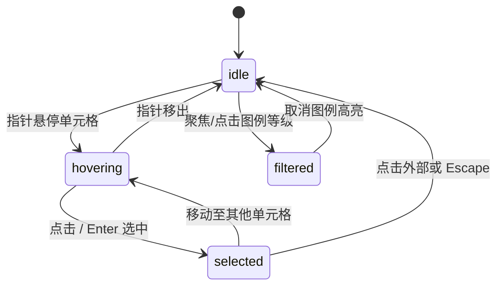

# Activity Heatmap · 活动热力图

展示全年或周期性贡献与活动分布的网格日历热力图。核心动效包括进入视口的对角线波浪着色展开、年份切换方向性重着色、光标吸附与平滑滑动的提示气泡、图例强度过滤渐暗、选中高亮框平滑位移以及统计数字滚轮递增。

## 原型清单

| 原型分组 | 原型元素 | 动效 / 状态变化 | 去向 |
| --- | --- | --- | --- |
| 核心日历网格 | 日历单元格（`.cell`） | 对角线波浪入场展开（`--wave` 时差计算）；等级色阶映射；图例筛选时非目标等级淡暗至 20% 透明度 | 日历单元格波浪与色阶过渡 |
| 交互指示 | 选中指示框（`.ring`） | 依据选中日期所属行列（`--col`, `--row`）平滑滑动与缩放定位 | 选中高亮框平滑位移 |
| 浮动气泡 | 悬停提示气泡（`.tip .bubble`） | 弹性跟随当前悬停/聚焦单元格坐标；内容宽度自适应弹性伸缩；微模糊与轻微缩放进退场 | 浮动提示气泡与宽度形变 |
| 图例筛选 | 等级色块按钮（`.swatch`） | 悬停临时高亮该等级全部日期；点击固定或取消固定过滤；键盘左右键导航 | 图例筛选与状态联动 |
| 汇总统计 | 顶部统计与周期文案（`.total`, `.period`） | 数量变更滚动递增，周期范围文字位移淡入淡出 | 汇总数值与标题切换 |
| 演示外壳 | 顶栏、年份切换按钮、明细折叠栏、主题切换 | 演示用途 | 演示外壳，已删除 |

## 适用

- 展现代码提交、运动打卡、系统访问频次等长周期时序密集型活动记录。
- 用户需要直观纵览全周期密度分布，并通过悬停/聚焦精确查看单日明细。
- 需要通过等级图例快速过滤识别高产日或空白日。
- 强调具有现代仪式感的初次入场波浪扩散反馈。

## 不适用

- 离散时序数值曲线与波动趋势呈现 → [line-chart](../charts/line-chart.md)
- 完整日历排期查看与日期范围选取 → [calendar](../pickers/calendar.md)
- 简单线性进度百分比计量 → [progress](../progress/progress.md)

## 状态机

| 状态 | 进入条件 | 视觉表现 | 退出到 |
| --- | --- | --- | --- |
| idle | 初始加载完成，无激活单元格 | 单元格展示默认等级颜色，选中框与提示气泡隐藏 | hovering / selected / filtered |
| hovering | 鼠标滑入有效单元格或键盘聚焦 | 目标单元格轻微提亮，提示气泡平滑滑动至上方并淡入显示详情 | idle / selected |
| selected | 点击单元格或键盘回车/空格选中 | 选中指示框（`.ring`）滑动并圈定目标格，提示气泡吸附显示选中详情 | idle / hovering |
| filtered | 悬停或点击图例等级按钮（`.swatch`） | 对应等级单元格保持明亮，其余所有单元格透明度降至 0.2 | idle / hovering |



## 最小 DOM

```html
<div class="arc-activity-heatmap" data-reveal="true">
  <div class="heatmap-header">
    <div class="heatmap-summary">
      <span class="heatmap-total">0 contributions</span>
      <span class="heatmap-period">in the last year</span>
    </div>
  </div>

  <div class="heatmap-scroller">
    <div class="heatmap-canvas">
      <div class="heatmap-weekdays" aria-hidden="true">
        <span></span><span>Mon</span><span></span><span>Wed</span><span></span><span>Fri</span><span></span>
      </div>
      <div class="heatmap-plot">
        <div class="heatmap-grid" role="grid" aria-label="Activity heatmap">
          <!-- 动态填充 7 行多列单元格 -->
        </div>
        <span class="heatmap-ring" aria-hidden="true"></span>
      </div>
    </div>
  </div>

  <div class="heatmap-legend">
    <span class="legend-caption" aria-live="polite">Activity levels</span>
    <div class="legend-scale">
      <span class="legend-label" aria-hidden="true">Less</span>
      <div class="legend-swatches" role="group" aria-label="Filter by level">
        <button class="legend-swatch" type="button" data-level="0" aria-label="Level 0"></button>
        <button class="legend-swatch" type="button" data-level="1" aria-label="Level 1"></button>
        <button class="legend-swatch" type="button" data-level="2" aria-label="Level 2"></button>
        <button class="legend-swatch" type="button" data-level="3" aria-label="Level 3"></button>
        <button class="legend-swatch" type="button" data-level="4" aria-label="Level 4"></button>
      </div>
      <span class="legend-label" aria-hidden="true">More</span>
    </div>
  </div>

  <div class="heatmap-tip" aria-hidden="true">
    <div class="tip-bubble">
      <span class="tip-body">
        <strong class="tip-count">0 activities</strong> on <span class="tip-date">Jan 1</span>
      </span>
    </div>
  </div>
</div>
```

- `.arc-activity-heatmap`：根容器，管理网格布局、图例与浮动提示层。
- `.heatmap-plot`：绘制区域，承载网格单元与绝对定位的高亮聚焦框。
- `.heatmap-grid`：7 行多列无障碍表格容器，单元格挂载 `role="gridcell"`。
- `.heatmap-ring`：跟随选中的外框指示器，通过 `--col` 与 `--row` 定位。
- `.legend-swatches`：等级过滤色块组，控制全图透明度过滤。
- `.heatmap-tip`：平滑跟随光标的绝对定位 Tooltip 气泡。

## 参数

| 名称 | 值 | 用于 | 来源 |
| --- | --- | --- | --- |
| 波浪时差最大跨度 | `420ms` | 对角线错峰延迟基准 | 原型 |
| 单步错峰递增 | `Math.min(12, 420 / (weeks + 6))ms` | `--wave` CSS 延迟变量计算 | 原型 |
| 单元格波浪入场时长 | `260ms` / `cubic-bezier(0.16, 1, 0.3, 1)` | 单元格缩放与颜色展开 | 原型 |
| 单元格基础尺寸 | `11px × 11px`，间距 `3px`，圆角 `2.5px` | 日历网格基本规整排版 | 原型 |
| 气泡位移平滑弹簧 | `240ms` / `cubic-bezier(0.18, 0.89, 0.32, 1.15)` | 提示气泡吸附移动 | 原型 |
| 气泡显隐微模糊 | `160ms` / `opacity 0 -> 1`，`blur(2px) -> 0` | 提示气泡淡入淡出 | 原型 |
| 选中指示框过渡 | `200ms` / `cubic-bezier(0.16, 1, 0.3, 1)` | `.heatmap-ring` transform 移动 | 原型 |
| 图例未选中单元格暗化 | `opacity: 0.2` / `200ms ease` | 激活特定等级时的降噪滤镜 | 原型 |

## CSS

```css
.arc-activity-heatmap {
  --cell-size: 11px;
  --cell-gap: 3px;
  --cell-radius: 2.5px;
  --level-0: #ebedf0;
  --level-1: #9be9a8;
  --level-2: #40c463;
  --level-3: #30a14e;
  --level-4: #216e39;

  position: relative;
  display: flex;
  flex-direction: column;
  gap: 12px;
  font-family: system-ui, -apple-system, sans-serif;
  font-size: 12px;
  color: #24292f;
  user-select: none;
}

.heatmap-header {
  display: flex;
  justify-content: space-between;
  align-items: center;
}

.heatmap-total {
  font-weight: 600;
  font-size: 14px;
}

.heatmap-period {
  color: #57606a;
  margin-left: 6px;
}

.heatmap-scroller {
  overflow-x: auto;
  padding-bottom: 4px;
}

.heatmap-canvas {
  display: flex;
  gap: 6px;
}

.heatmap-weekdays {
  display: grid;
  grid-template-rows: repeat(7, var(--cell-size));
  gap: var(--cell-gap);
  font-size: 9px;
  line-height: var(--cell-size);
  color: #57606a;
}

.heatmap-plot {
  position: relative;
}

.heatmap-grid {
  display: grid;
  grid-auto-flow: column;
  grid-template-rows: repeat(7, var(--cell-size));
  gap: var(--cell-gap);
}

.heatmap-cell {
  width: var(--cell-size);
  height: var(--cell-size);
  border-radius: var(--cell-radius);
  background-color: var(--level-0);
  outline: none;
  cursor: pointer;
  transform-origin: center center;
  transition: opacity 180ms ease, transform 160ms cubic-bezier(0.16, 1, 0.3, 1);
}

.arc-activity-heatmap[data-reveal="true"] .heatmap-cell {
  animation: cellReveal 320ms cubic-bezier(0.16, 1, 0.3, 1) backwards;
  animation-delay: var(--wave, 0ms);
}

@keyframes cellReveal {
  from {
    transform: scale(0.3);
    opacity: 0;
  }
  to {
    transform: scale(1);
    opacity: 1;
  }
}

.heatmap-cell[data-level="0"] { background-color: var(--level-0); }
.heatmap-cell[data-level="1"] { background-color: var(--level-1); }
.heatmap-cell[data-level="2"] { background-color: var(--level-2); }
.heatmap-cell[data-level="3"] { background-color: var(--level-3); }
.heatmap-cell[data-level="4"] { background-color: var(--level-4); }

.heatmap-cell:hover,
.heatmap-cell:focus-visible {
  transform: scale(1.25);
  z-index: 2;
  box-shadow: 0 0 0 1.5px #0969da;
}

/* 过滤变暗模式 */
.heatmap-grid[data-highlight] .heatmap-cell:not([data-matched="true"]) {
  opacity: 0.2;
}

/* 选中高亮环 */
.heatmap-ring {
  position: absolute;
  top: 0;
  left: 0;
  width: var(--cell-size);
  height: var(--cell-size);
  border: 1.5px solid #0969da;
  border-radius: var(--cell-radius);
  pointer-events: none;
  opacity: 0;
  transform: translate(
    calc(var(--col, 0) * (var(--cell-size) + var(--cell-gap))),
    calc(var(--row, 0) * (var(--cell-size) + var(--cell-gap)))
  );
  transition: transform 200ms cubic-bezier(0.16, 1, 0.3, 1), opacity 160ms ease;
}

.heatmap-ring[data-shown="true"] {
  opacity: 1;
}

/* 图例色块 */
.heatmap-legend {
  display: flex;
  align-items: center;
  justify-content: flex-end;
  gap: 8px;
  font-size: 11px;
  color: #57606a;
}

.legend-scale {
  display: inline-flex;
  align-items: center;
  gap: 4px;
}

.legend-swatches {
  display: inline-flex;
  gap: 3px;
}

.legend-swatch {
  width: var(--cell-size);
  height: var(--cell-size);
  border-radius: var(--cell-radius);
  border: 1px solid rgba(27, 31, 36, 0.08);
  padding: 0;
  cursor: pointer;
}

.legend-swatch[data-level="0"] { background-color: var(--level-0); }
.legend-swatch[data-level="1"] { background-color: var(--level-1); }
.legend-swatch[data-level="2"] { background-color: var(--level-2); }
.legend-swatch[data-level="3"] { background-color: var(--level-3); }
.legend-swatch[data-level="4"] { background-color: var(--level-4); }

.legend-swatch[aria-pressed="true"] {
  outline: 1.5px solid #0969da;
  outline-offset: 1px;
}

/* 提示气泡 */
.heatmap-tip {
  position: absolute;
  top: 0;
  left: 0;
  pointer-events: none;
  z-index: 10;
  opacity: 0;
  transform: translate(-50%, -100%) translateY(-6px);
  transition: opacity 160ms ease, transform 200ms cubic-bezier(0.18, 0.89, 0.32, 1.15);
}

.heatmap-tip[data-shown="true"] {
  opacity: 1;
  transform: translate(-50%, -100%) translateY(-8px);
}

.tip-bubble {
  background: #24292f;
  color: #ffffff;
  padding: 4px 8px;
  border-radius: 4px;
  font-size: 11px;
  white-space: nowrap;
  box-shadow: 0 4px 12px rgba(0, 0, 0, 0.15);
}

@media (prefers-reduced-motion: reduce) {
  .arc-activity-heatmap[data-reveal="true"] .heatmap-cell {
    animation: none;
  }
  .heatmap-cell,
  .heatmap-ring,
  .heatmap-tip {
    transition-duration: 0.01ms !important;
  }
}
```

## JS

```js
export function createActivityHeatmap(el, options = {}) {
  const root = el;
  const grid = root.querySelector('.heatmap-grid');
  const ring = root.querySelector('.heatmap-ring');
  const tip = root.querySelector('.heatmap-tip');
  const tipCount = tip?.querySelector('.tip-count');
  const tipDate = tip?.querySelector('.tip-date');
  const swatches = root.querySelectorAll('.legend-swatch');
  const totalLabel = root.querySelector('.heatmap-total');

  const weeks = options.weeks || 20;
  const rows = 7;
  const totalDays = weeks * rows;
  const step = Math.min(12, 420 / (weeks + 6));

  let selectedIndex = -1;
  let activeFilterLevel = null;
  const cells = [];

  // 清空并构建单元格
  if (grid) {
    grid.innerHTML = '';
    let totalCount = 0;
    for (let col = 0; col < weeks; col++) {
      for (let row = 0; row < rows; row++) {
        const index = col * rows + row;
        const cell = document.createElement('button');
        cell.type = 'button';
        cell.className = 'heatmap-cell';
        cell.setAttribute('role', 'gridcell');

        // 生成或读取活动数据
        const count = options.counts ? (options.counts[index] || 0) : Math.floor(Math.random() * 5);
        const level = count === 0 ? 0 : Math.min(4, Math.floor(count));
        cell.dataset.index = String(index);
        cell.dataset.col = String(col);
        cell.dataset.row = String(row);
        cell.dataset.level = String(level);
        cell.dataset.count = String(count);
        totalCount += count;

        const waveDelay = Math.round((col + row) * step);
        cell.style.setProperty('--wave', `${waveDelay}ms`);

        cell.setAttribute('aria-label', `${count} activities on day ${index + 1}`);
        grid.appendChild(cell);
        cells.push(cell);
      }
    }
    if (totalLabel) {
      totalLabel.textContent = `${totalCount} contributions`;
    }
  }

  function showTip(cell) {
    if (!tip || !cell) return;
    const col = parseInt(cell.dataset.col, 10);
    const row = parseInt(cell.dataset.row, 10);
    const count = cell.dataset.count;
    const index = cell.dataset.index;

    if (tipCount) tipCount.textContent = `${count} activities`;
    if (tipDate) tipDate.textContent = `Day ${parseInt(index, 10) + 1}`;

    const cellRect = cell.getBoundingClientRect();
    const rootRect = root.getBoundingClientRect();

    const x = cellRect.left - rootRect.left + cellRect.width / 2;
    const y = cellRect.top - rootRect.top;

    tip.style.left = `${x}px`;
    tip.style.top = `${y}px`;
    tip.dataset.shown = 'true';
  }

  function hideTip() {
    if (tip) tip.dataset.shown = 'false';
  }

  function selectCell(cell) {
    if (!cell) return;
    const col = cell.dataset.col;
    const row = cell.dataset.row;
    selectedIndex = parseInt(cell.dataset.index, 10);

    if (ring) {
      ring.style.setProperty('--col', col);
      ring.style.setProperty('--row', row);
      ring.dataset.shown = 'true';
    }
    showTip(cell);
  }

  function setFilterLevel(level) {
    if (activeFilterLevel === level) {
      activeFilterLevel = null;
    } else {
      activeFilterLevel = level;
    }

    if (activeFilterLevel === null) {
      grid?.removeAttribute('data-highlight');
      cells.forEach(c => c.removeAttribute('data-matched'));
      swatches.forEach(s => s.setAttribute('aria-pressed', 'false'));
    } else {
      grid?.setAttribute('data-highlight', 'true');
      cells.forEach(c => {
        if (c.dataset.level === String(activeFilterLevel)) {
          c.dataset.matched = 'true';
        } else {
          c.removeAttribute('data-matched');
        }
      });
      swatches.forEach(s => {
        s.setAttribute('aria-pressed', String(s.dataset.level === String(activeFilterLevel)));
      });
    }
  }

  // 事件委托绑定
  const handleGridClick = (e) => {
    const cell = e.target.closest('.heatmap-cell');
    if (cell) selectCell(cell);
  };

  const handleGridHover = (e) => {
    const cell = e.target.closest('.heatmap-cell');
    if (cell) showTip(cell);
  };

  const handleGridLeave = () => {
    if (selectedIndex === -1) hideTip();
    else if (cells[selectedIndex]) showTip(cells[selectedIndex]);
  };

  const handleKeydown = (e) => {
    if (selectedIndex === -1) return;
    let nextIndex = selectedIndex;
    if (e.key === 'ArrowUp') nextIndex = Math.max(0, selectedIndex - 1);
    else if (e.key === 'ArrowDown') nextIndex = Math.min(totalDays - 1, selectedIndex + 1);
    else if (e.key === 'ArrowLeft') nextIndex = Math.max(0, selectedIndex - rows);
    else if (e.key === 'ArrowRight') nextIndex = Math.min(totalDays - 1, selectedIndex + rows);
    else if (e.key === 'Escape') {
      hideTip();
      if (ring) ring.dataset.shown = 'false';
      selectedIndex = -1;
      return;
    }

    if (nextIndex !== selectedIndex && cells[nextIndex]) {
      e.preventDefault();
      cells[nextIndex].focus();
      selectCell(cells[nextIndex]);
    }
  };

  grid?.addEventListener('click', handleGridClick);
  grid?.addEventListener('mouseover', handleGridHover);
  grid?.addEventListener('mouseleave', handleGridLeave);
  grid?.addEventListener('keydown', handleKeydown);

  swatches.forEach(swatch => {
    swatch.addEventListener('click', () => {
      const level = parseInt(swatch.dataset.level, 10);
      setFilterLevel(level);
    });
  });

  return {
    destroy: () => {
      grid?.removeEventListener('click', handleGridClick);
      grid?.removeEventListener('mouseover', handleGridHover);
      grid?.removeEventListener('mouseleave', handleGridLeave);
      grid?.removeEventListener('keydown', handleKeydown);
    },
    selectCell: (idx) => {
      if (cells[idx]) selectCell(cells[idx]);
    },
    filterLevel: setFilterLevel
  };
}
```

## 接入目标项目

- 状态来源：
  - 数据由业务端长周期贡献或活动日志聚合并按天映射后传入 `options.counts`。
  - 用户选中的单日记录通过回调向父级同步。
- 尺寸策略：
  - 日历单元格采用固定 `11px` 网格结构，横向超出容器宽度时在 `.heatmap-scroller` 产生自然平滑横向滚动，无需压缩单元格形态。
- 驱动方式：
  - 容器挂载后调用 `const heatmap = createActivityHeatmap(container, options)`。
  - 组件卸载前调用 `heatmap.destroy()` 清理监听。

## 重入与清理

- 频繁重入：年份切换或数据刷新时，先清空现有单元格 DOM 节点，重算总数并重置 `--wave` 动画变量。
- 卸载清理：`destroy()` 移除网格点击、悬停、失焦与键盘监听，重置正在过渡的提示气泡样式。

## 减少动态效果

- 激活 `prefers-reduced-motion: reduce` 时：
  - 禁用 `.arc-activity-heatmap[data-reveal="true"]` 的对角线缩放展开动画，全部单元格直出渲染。
  - 提示气泡位移与选中高亮环移动的过渡时长强制归零，采用瞬时坐标更新，防止大面积位移造成眩晕。

## 焦点与键盘

- 网格遵循 WAI-ARIA 日历表格规范：
  - 上下箭头键（ArrowUp/ArrowDown）按日增减（±1）。
  - 左右箭头键（ArrowLeft/ArrowRight）按周跨越（±7）。
  - Escape 键撤销当前高亮选区并隐匿提示气泡。
- 等级图例色块使用原生 `<button>`，原生支持 Tab 键聚焦与回车触发。

## 兼容回退

| 特性 | 不支持时 |
| --- | --- |
| CSS Grid `grid-auto-flow: column` | 回退为行主序排列或 Flexbox 多列自适应容器。 |
| CSS 变量 `--wave` | 单元格无延迟一次性淡入，不破坏核心色阶信息展示。 |

## 验收清单

- [ ] 页面初次进入视口，日历单元格呈对角线波浪交替缩放展现。
- [ ] 鼠标悬停任意单元格，提示气泡平滑跟随并准确展示该单元格活动数。
- [ ] 点击单元格时高亮选中框定位精准，且键盘方向键能按日/周移动焦点。
- [ ] 点击图例等级色块，非对应等级单元格透明度降低至 20%，能清晰聚焦筛选结果。
- [ ] 启用减少动态效果偏好时，入场波浪关闭，直接瞬时显示最终色彩状态。
