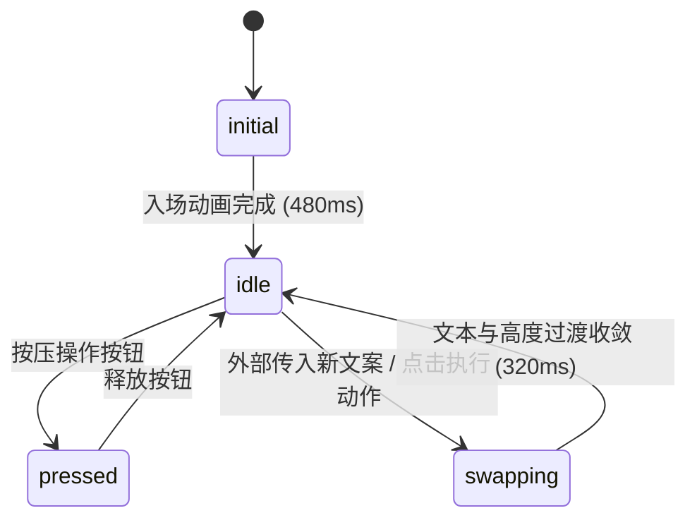

# Empty State · 空状态反馈

数据或任务为空时的引导与占位视图。核心动效包含图标与文案的键控微模糊交叉置换（Micro-blur State Swap）、外层卡片高度自适应平滑弹簧形变、入场缩放阻尼以及行动按钮物理微按压回弹。

## 原型清单

| 原型分组 | 原型元素 | 动效 / 状态变化 | 去向 |
| --- | --- | --- | --- |
| 引导图标 | 图标容器（`.empty-icon`） | 初次加载 480ms 缩放淡入；状态切换时旧图标模糊淡出、新图标 0.6 倍缩放配合 2px 高斯模糊交叉置换 | 图标容器入场与交叉置换 |
| 标题与文案 | 标题与描述（`.empty-title`, `.empty-desc`） | 文案变更时产生 0.3em 垂直位移与 4px 微模糊透明度淡入淡出，新旧文本平滑形变 | 键控文本微模糊置换 |
| 尺寸适应 | 容器高度过渡 | 文案长度变动时计算高度差，以 Calm Damping 弹簧过渡到新高度后恢复自动高度 | 卡片高度自适应弹簧 |
| 交互动作 | 核心操作按钮（`.empty-btn`） | 按压缩放 0.96，松开产生 1.01 轻微过冲回弹（Snappy Spring）；操作后文案切换 | 操作按钮物理触感与状态流转 |
| 演示外壳 | 顶部主题切换、预设场景切换选项卡、外部背景舞台 | 演示用途 | 演示外壳，已删除 |

## 适用

- 列表、表格或搜索过滤后无结果时呈现的空态占位。
- 引导用户执行首个创建动作（如“创建第一个项目”）。
- 用户完成清空、归档或重置操作后的正向确认占位。
- 空状态在不同子状态（如“暂无数据”与“网络离线”或“已完成全部任务”）之间平滑切换。

## 不适用

- 数据加载中的骨架屏占位 → [skeleton](../progress/skeleton.md)
- 简单通用按钮交互规范 → [button](../buttons/button.md)
- 异步保存提交并在按钮内展示成功反馈 → [action-button](../buttons/action-button.md)

## 状态机

| 状态 | 进入条件 | 视觉表现 | 退出到 |
| --- | --- | --- | --- |
| initial | 初始挂载进入视口 | 图标容器以 480ms 缓动平滑淡入并缩放归位，文案逐层就绪 | idle |
| idle | 静止展示空态引导 | 图标与引导文案稳定显示，操作按钮处于就绪交互态 | swapping / pressed |
| pressed | 用户按下操作按钮 | 按钮缩放至 0.96，阴影收缩 | idle / swapping |
| swapping | 业务数据状态变更（如清空或撤销） | 原文案与图标模糊淡出并退出布局，新状态自 0.3em 偏移处模糊渐显，卡片高度平滑自适应 | idle |



## 最小 DOM

```html
<div class="arc-empty-state" role="status" aria-live="polite">
  <div class="empty-icon-slot">
    <div class="empty-icon" data-icon="folder">
      <svg width="32" height="32" viewBox="0 0 24 24" fill="none" stroke="currentColor" stroke-width="1.75" stroke-linecap="round" stroke-linejoin="round" aria-hidden="true">
        <path d="M4 20h16a2 2 0 0 0 2-2V8a2 2 0 0 0-2-2h-7.93a2 2 0 0 1-1.66-.9l-.82-1.2A2 2 0 0 0 7.93 3H4a2 2 0 0 0-2 2v13c0 1.1.9 2 2 2Z" />
      </svg>
    </div>
  </div>

  <div class="empty-content">
    <h3 class="empty-title">
      <span class="text-stage">No views created yet</span>
    </h3>
    <p class="empty-desc">
      <span class="text-stage">Create and save custom views to organize your projects and access them quickly.</span>
    </p>
  </div>

  <div class="empty-actions">
    <button class="empty-btn" type="button">
      <span class="btn-label">Create new view</span>
    </button>
  </div>
</div>
```

- `.arc-empty-state`：核心容器，具备 `aria-live="polite"` 确保文案置换时无障碍设备能及时感知。
- `.empty-icon-slot`：固定高度的图标舞台，承载图标缩放与模糊交叉过渡。
- `.text-stage`：文本过渡阶段槽位，负责 `0.3em` 纵向位移与 `4px` 高斯模糊。
- `.empty-btn`：操作按钮，承载触感物理微回弹。

## 参数

| 名称 | 值 | 用于 | 来源 |
| --- | --- | --- | --- |
| 初次入场时长 | `480ms` / `cubic-bezier(0.16, 1, 0.3, 1)` | 初始挂载淡入与缩放落地 | 原型 |
| 文本位移距离 | `0.3em` | 文本切出与切入垂直起点/终点 | 原型 |
| 文本微模糊半径 | `4px` | 文本置换过程中的高斯模糊 | 原型 |
| 文本过渡时长 | `240ms` / `cubic-bezier(0.16, 1, 0.3, 1)` | `.text-stage` opacity/blur/transform | 原型 |
| 图标微模糊与缩放 | `2px` / `scale(0.6)` / `240ms` | 图标置换动画 | 原型 |
| 按钮按压缩放 | `scale(0.96)` | `.empty-btn:active` | 原型 |
| 按钮释放回弹 | `cubic-bezier(0.18, 0.89, 0.32, 1.15)` | 按钮弹性复原手感 | 原型 |
| 高度自适应时长 | `300ms` / `cubic-bezier(0.16, 1, 0.3, 1)` | 容器随文案高度伸缩 | 原型 |

## CSS

```css
.arc-empty-state {
  --ease-calm: cubic-bezier(0.16, 1, 0.3, 1);
  --ease-spring: cubic-bezier(0.18, 0.89, 0.32, 1.15);

  position: relative;
  display: flex;
  flex-direction: column;
  align-items: center;
  justify-content: center;
  text-align: center;
  padding: 48px 24px;
  max-width: 420px;
  margin: 0 auto;
  border-radius: 16px;
  background: #ffffff;
  border: 1px dashed #d0d7de;
  box-sizing: border-box;
  overflow: hidden;
  transition: height 300ms var(--ease-calm);
}

.empty-icon-slot {
  position: relative;
  width: 56px;
  height: 56px;
  margin-bottom: 16px;
  display: grid;
  place-items: center;
}

.empty-icon {
  display: flex;
  align-items: center;
  justify-content: center;
  width: 56px;
  height: 56px;
  border-radius: 12px;
  background: #f6f8fa;
  color: #57606a;
  transition: opacity 240ms var(--ease-calm),
              transform 240ms var(--ease-calm),
              filter 240ms var(--ease-calm);
}

.empty-icon.is-entering {
  animation: iconInitial 480ms var(--ease-calm) backwards;
}

@keyframes iconInitial {
  from {
    opacity: 0;
    transform: scale(0.7);
  }
  to {
    opacity: 1;
    transform: scale(1);
  }
}

.empty-icon.is-swapping {
  opacity: 0;
  transform: scale(0.6);
  filter: blur(2px);
}

.empty-content {
  display: flex;
  flex-direction: column;
  gap: 8px;
  margin-bottom: 24px;
}

.empty-title {
  margin: 0;
  font-size: 16px;
  font-weight: 600;
  color: #24292f;
  line-height: 1.4;
  overflow: hidden;
}

.empty-desc {
  margin: 0;
  font-size: 13px;
  color: #57606a;
  line-height: 1.5;
  overflow: hidden;
}

.text-stage {
  display: inline-block;
  transition: opacity 220ms var(--ease-calm),
              transform 220ms var(--ease-calm),
              filter 220ms var(--ease-calm);
}

.text-stage.text-out {
  opacity: 0;
  transform: translateY(-0.3em);
  filter: blur(4px);
}

.text-stage.text-in {
  opacity: 0;
  transform: translateY(0.3em);
  filter: blur(4px);
}

.empty-actions {
  display: flex;
  justify-content: center;
}

.empty-btn {
  display: inline-flex;
  align-items: center;
  justify-content: center;
  padding: 8px 16px;
  font-size: 13px;
  font-weight: 500;
  color: #ffffff;
  background-color: #0969da;
  border: 1px solid rgba(27, 31, 36, 0.15);
  border-radius: 6px;
  cursor: pointer;
  outline: none;
  transition: transform 140ms var(--ease-spring),
              background-color 160ms ease,
              box-shadow 160ms ease;
}

.empty-btn:hover {
  background-color: #0860ca;
}

.empty-btn:active {
  transform: scale(0.96);
}

.empty-btn:focus-visible {
  box-shadow: 0 0 0 3px rgba(9, 105, 218, 0.35);
}

@media (prefers-reduced-motion: reduce) {
  .empty-icon.is-entering {
    animation: none;
  }
  .empty-icon,
  .text-stage,
  .arc-empty-state,
  .empty-btn {
    transition: opacity 120ms ease !important;
    transform: none !important;
    filter: none !important;
  }
}
```

## JS

```js
export function createEmptyState(el, options = {}) {
  const root = el;
  const icon = root.querySelector('.empty-icon');
  const titleStage = root.querySelector('.empty-title .text-stage');
  const descStage = root.querySelector('.empty-desc .text-stage');
  const actionBtn = root.querySelector('.empty-btn');
  const btnLabel = actionBtn?.querySelector('.btn-label');

  let isUpdating = false;

  // 初始入场动效标记
  if (icon) {
    icon.classList.add('is-entering');
  }

  function swapText(stage, newText) {
    if (!stage || stage.textContent === newText) return;
    stage.classList.add('text-out');

    setTimeout(() => {
      stage.textContent = newText;
      stage.classList.remove('text-out');
      stage.classList.add('text-in');

      // 强制重绘以触发入场过渡
      void stage.offsetWidth;
      stage.classList.remove('text-in');
    }, 140);
  }

  function swapState(newState) {
    if (isUpdating) return;
    isUpdating = true;

    // 测量起始高度
    const startHeight = root.offsetHeight;
    root.style.height = `${startHeight}px`;

    // 图标微模糊置换
    if (icon) {
      icon.classList.add('is-swapping');
      setTimeout(() => {
        if (newState.iconSvg) {
          icon.innerHTML = newState.iconSvg;
        }
        icon.classList.remove('is-swapping');
      }, 140);
    }

    // 文案置换
    if (newState.title) swapText(titleStage, newState.title);
    if (newState.desc) swapText(descStage, newState.desc);
    if (newState.action && btnLabel) swapText(btnLabel, newState.action);

    // 重新测量并过渡高度
    setTimeout(() => {
      root.style.height = 'auto';
      const targetHeight = root.offsetHeight;
      root.style.height = `${startHeight}px`;

      void root.offsetWidth;
      root.style.height = `${targetHeight}px`;

      setTimeout(() => {
        root.style.height = 'auto';
        isUpdating = false;
      }, 300);
    }, 150);
  }

  const handleActionClick = (e) => {
    if (options.onAction) {
      options.onAction(e);
    }
  };

  actionBtn?.addEventListener('click', handleActionClick);

  return {
    destroy: () => {
      actionBtn?.removeEventListener('click', handleActionClick);
    },
    update: (patch) => {
      if (patch) swapState(patch);
    }
  };
}
```

## 接入目标项目

- 状态来源：
  - 数据由应用层查询结果（空列表、过滤无匹配项、网络异常）驱动，调用 `update(patch)` 传入对应的标题、说明与操作文案。
- 尺寸策略：
  - 空状态通常在父级容器中水平居中。容器高度由内容自适应决定；在文案变更期间，通过 JS 动态固定起始像素高度并在微模糊置换完成后平滑恢复 `auto`，避免页面发生生硬跳跃。
- 驱动方式：
  - 挂载时调用 `const emptyState = createEmptyState(container, { onAction })`。
  - 外部状态切换时执行 `emptyState.update({ title, desc, action })`。
  - 卸载时调用 `emptyState.destroy()` 移除所有事件监听。

## 重入与清理

- 重入保护：通过 `isUpdating` 标志位锁防抖，阻止动画未完成时连续触发产生 DOM 高度错乱。
- 卸载清理：`destroy()` 移除按钮点击事件监听，重置正在执行的高度过渡。

## 减少动态效果

- 激活 `prefers-reduced-motion: reduce` 时：
  - 移除初始挂载时的 `iconInitial` 480ms 放大缩放动画。
  - 移除文案切换时的 0.3em 垂直位移与高斯模糊滤镜，仅保留 120ms 纯透明度渐变。
  - 禁用容器高度弹簧过渡与按钮 `:active` 按压缩放，确保低刺激性与快速响应。

## 焦点与键盘

- 容器具备 `role="status"` 与 `aria-live="polite"`，保证文案切换时自动对屏幕阅读器发起礼貌朗读。
- 行动按钮原生支持 Tab 键聚焦与回车触发，保留标准 `:focus-visible` 轮廓光环。

## 兼容回退

| 特性 | 不支持时 |
| --- | --- |
| `color-mix()` / `oklab` | 回退至标准 Hex/RGBA 调色板。 |
| CSS 高斯模糊 `filter: blur()` | 回退为直接通过透明度 `opacity` 实现文字淡入淡出。 |

## 验收清单

- [ ] 首次加载时图标具备平滑缩放淡入效果，文案清晰无抖动。
- [ ] 调用 `update()` 切换状态时，文字与图标微模糊淡出并在新位置淡入，外层卡片高度平滑收敛。
- [ ] 按钮按压具有轻微微缩（0.96）与松开回弹触感。
- [ ] 开启减少动态偏好时，文字切换仅保留透明度渐隐渐显，无几何位移与模糊。
