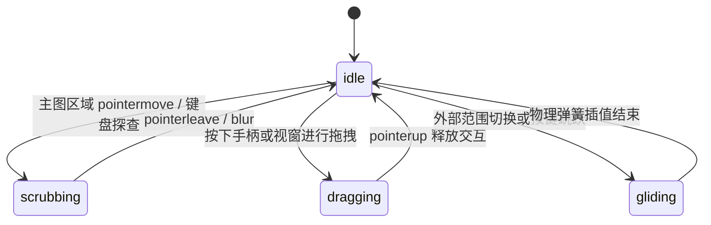

# Brush Chart · 笔刷时间范围图表

包含主折线/面积绘图区与底部概览滑块条（Overview Strip）的双层联动时序图表。通过双向拖拽手柄、窗口平移、主图光标十字探查（Scrubbing）以及键盘滑块无障碍映射，在海量连续时间序列中提供毫秒级平滑视窗缩放与区间选定。

## 原型清单

| 原型分组 | 原型元素 | 动效 / 状态变化 | 去向 |
| --- | --- | --- | --- |
| — | 图表外层容器 `.arc-brush-figure` | 网格布局宿主与无障碍区域容器 | 最小 DOM / CSS |
| — | 主图区 `.arc-brush-plot` / `.arc-brush-svg` | 主曲线、面积渐变、网格线与视口裁剪 `clipPath` | 主图绘图区 |
| — | 主图十字游标与圆点 `.arc-brush-crosshair` / `.arc-brush-dot` | 指针悬停跟随、数据点吸附贴合与透明度渐变 | 探查游标与吸附点 |
| — | 浮动提示框 `.arc-brush-tooltip` | 绝对定位跟随指针、数值与事件描述展示 | 悬停指示卡片 |
| — | 事件标注点与标线 `.arc-brush-event` / `.arc-brush-eventRule` | 标注时间点竖线、圆点脉冲与文字翻转 | 事件标注系统 |
| — | Y 轴刻度 Gutter `.arc-brush-gutter` / `.arc-brush-tick` | 动态数值标签与等距分布计算 | 纵轴动态刻度 |
| — | X 轴时间标签 `.arc-brush-axis` / `.arc-brush-axisLabel` | 自适应日/周/月/年时间跨度刻度标签 | 横轴自适应刻度 |
| — | 概览条 `.arc-brush-strip` | 全量趋势底图、选中区高亮底图、阴影遮罩 | 概览迷你轴 |
| — | 笔刷窗口 `.arc-brush-window` | `role="slider"`，按压 Grab/Grabbing、横向平移与尺寸吸附 | 视窗平移控制器 |
| — | 左右端点手柄 `.arc-brush-handle` / `.arc-brush-grip` | `role="slider"`，按压微缩回弹、左右拉伸调整区间跨度 | 端点调节手柄 |
| — | 预设周期切换按钮组 `.qf` / `.Cr` | 演示 30D / 90D / 1Y / All 范围切换 | 演示外壳，已删除 |
| — | 顶栏、外观切换按钮 `#themeBtn`、舞台外壳 | — | 演示外壳，已删除 |

## 适用

- 跨度较大（数月至数年）的高密度时间序列趋势分析（如日活 DAU、系统监控、交易量）。
- 用户需要宏观浏览全局波动，同时能随手框选微观区间细看局部走势。
- 需要支持拖拽手柄调节起止点、整体平移时间视窗、双击或按键快速复位。
- 具备键盘全无障碍滑块访问需求。

## 不适用

- 简单单序列走势且无需时间区间框选缩放 → [line-chart](../charts/line-chart.md)
- 仪表盘内嵌单行紧凑无坐标轴走势 → [sparkline](../charts/sparkline.md)
- 多分类层叠流式山脊/有机面积图 → [streamgraph](streamgraph.md)
- 离散时序柱状对比 → [bar-chart](../charts/bar-chart.md)

## 状态机

| 状态 | 进入条件 | 视觉表现 | 退出到 |
| --- | --- | --- | --- |
| idle | 初始挂载或静止态 | 主图展示当前窗口数据，概览条高亮选中窗口，游标隐藏 | scrubbing / dragging / gliding |
| scrubbing | 指针在主图区域滑动或键盘聚焦探索 | 竖向十字发丝线贴附最近时间点，圆点吸附，Tooltip 显现跟随 | idle |
| dragging | 按下手柄调整端点或按住窗口平移 | 鼠标呈 grabbing / ew-resize，视窗尺寸或位置实时计算重绘 | idle / settled |
| gliding | 切换外部预设范围或键盘翻页 | 视窗通过弹簧阻尼平滑插值移动到目标区间 | idle |
| empty | 数据源为空或无匹配项 | 显示缺省占位文案，禁用滑块交互 | idle |



## 最小 DOM

```html
<figure class="arc-brush-figure" role="group" aria-label="Brush chart">
  <div class="arc-brush-chart">
    <div class="arc-brush-plot" role="group" tabindex="0" aria-roledescription="chart" aria-label="Interactive timeline plot">
      <svg class="arc-brush-svg" width="100%" height="240" aria-hidden="true" focusable="false">
        <defs>
          <clipPath id="arc-brush-clip-main">
            <rect class="arc-brush-clip-rect" x="0" y="0" width="100%" height="240" />
          </clipPath>
        </defs>
        <g class="arc-brush-grids"></g>
        <line class="arc-brush-baseline" x1="0" x2="100%" y1="239.5" y2="239.5" />
        <g class="arc-brush-content" clip-path="url(#arc-brush-clip-main)">
          <path class="arc-brush-band" />
          <path class="arc-brush-area" />
          <path class="arc-brush-trend" />
          <path class="arc-brush-line" />
        </g>
        <line class="arc-brush-crosshair" y1="0" y2="240" x1="0" x2="0" />
        <circle class="arc-brush-dot" cx="0" cy="0" r="4" />
      </svg>
      <div class="arc-brush-tooltip" aria-hidden="true"></div>
    </div>
    <div class="arc-brush-gutter" aria-hidden="true"></div>
    <div class="arc-brush-axis" aria-hidden="true"></div>
    <div class="arc-brush-strip">
      <svg class="arc-brush-svg" width="100%" height="52" aria-hidden="true" focusable="false">
        <defs>
          <clipPath id="arc-brush-clip-window">
            <rect class="arc-brush-window-rect" x="0" y="0" width="0" height="52" />
          </clipPath>
        </defs>
        <path class="arc-brush-overviewArea" />
        <path class="arc-brush-overviewLine" />
        <g clip-path="url(#arc-brush-clip-window)">
          <path class="arc-brush-overviewAreaIn" />
          <path class="arc-brush-overviewLineIn" />
        </g>
      </svg>
      <div class="arc-brush-shade" data-edge="start"></div>
      <div class="arc-brush-shade" data-edge="end"></div>
      <div class="arc-brush-window" role="slider" tabindex="0" aria-label="Selected range window"></div>
      <div class="arc-brush-handle" role="slider" tabindex="0" aria-label="Window start" data-edge="start"><span class="arc-brush-grip"></span></div>
      <div class="arc-brush-handle" role="slider" tabindex="0" aria-label="Window end" data-edge="end"><span class="arc-brush-grip"></span></div>
    </div>
  </div>
  <div class="arc-brush-srOnly" aria-live="polite"></div>
</figure>
```

- `.arc-brush-figure`：图表根组件容器。
- `.arc-brush-plot`：主图交互层，负责接收光标与触摸并驱动十字游标。
- `.arc-brush-clip-main`：SVG 裁切路径，确保折线缩放平移时不溢出绘图边界。
- `.arc-brush-strip`：底部迷你概览条，承载全量时序轮廓。
- `.arc-brush-shade`：两端半透明遮罩，表示当前未选中区域。
- `.arc-brush-window`：可拖动选区胶囊滑块。
- `.arc-brush-handle`：左右两个端点调节手柄，包含视觉微抓手 `.arc-brush-grip`。

## 参数

| 名称 | 值 | 用于 | 来源 |
| --- | --- | --- | --- |
| 主图默认高度 | `240px` | 主绘图区纵向尺寸 | 原型 |
| 概览条高度 | `52px` | 底部概览通道高度 | 原型 |
| 绘图顶部内边距 | `28px` | 防止曲线峰值遮挡坐标轴 | 原型 |
| 右侧刻度宽度 | `44px` | Y 轴文字标签占位 | 原型 |
| X 轴刻度高度 | `28px` | 日期文字标签槽位 | 原型 |
| 最小视窗跨度 | `7 天 (604800000ms)` | 防止过度缩放导致除零 | 原型 |
| 拖拽防抖死区 | `3px` | 区分误触与滑动 | 原型 |
| 手柄微回弹缩放 | `scaleY(1.12)` | 按压手柄时的物理触觉反馈 | 原型 |
| 视窗平滑弹簧 | `visualDuration: 0.4s, bounce: 0` | 预设范围切换平滑收敛 | 原型 |
| 光标跟随弹簧 | `visualDuration: 0.26s, bounce: 0.12` | 游标贴附与 Tooltip 位移 | 原型 |

## CSS

```css
.arc-brush-figure {
  --brush-foreground: #111111;
  --brush-surface: #ffffff;
  --brush-surface-raised: #ffffff;
  --brush-border: rgba(0, 0, 0, 0.08);
  --brush-border-strong: rgba(0, 0, 0, 0.18);
  --brush-muted: #737373;
  --brush-series-1: #2563eb;
  --brush-series-2: #0284c7;
  --brush-ease-spring: cubic-bezier(0.16, 1, 0.3, 1);
  --brush-duration-fast: 160ms;

  display: grid;
  min-width: 0;
  margin: 0;
  color: var(--brush-foreground);
  font-family: system-ui, -apple-system, sans-serif;
}

.arc-brush-chart {
  position: relative;
  display: grid;
  grid-template-columns: minmax(0, 1fr) 44px;
  grid-template-rows: auto 28px auto;
  min-width: 0;
}

.arc-brush-plot {
  position: relative;
  grid-area: 1 / 1;
  min-width: 0;
  outline: none;
  touch-action: pan-y;
  user-select: none;
  cursor: crosshair;
}

.arc-brush-svg {
  display: block;
  overflow: visible;
}

.arc-brush-grid {
  stroke: var(--brush-border);
  stroke-width: 1;
  shape-rendering: crispEdges;
}

.arc-brush-baseline {
  stroke: var(--brush-border-strong);
  stroke-width: 1;
  shape-rendering: crispEdges;
}

.arc-brush-line {
  fill: none;
  stroke: var(--brush-series-1);
  stroke-width: 1.75;
  stroke-linecap: round;
  stroke-linejoin: round;
}

.arc-brush-area {
  fill: color-mix(in srgb, var(--brush-series-1) 12%, transparent);
  stroke: none;
}

.arc-brush-crosshair {
  stroke: var(--brush-foreground);
  stroke-opacity: 0.45;
  stroke-width: 1;
  shape-rendering: crispEdges;
  opacity: 0;
  transition: opacity 120ms ease;
  pointer-events: none;
}

.arc-brush-dot {
  fill: var(--brush-series-1);
  stroke: var(--brush-surface);
  stroke-width: 2;
  opacity: 0;
  transition: opacity 120ms ease;
  pointer-events: none;
}

.arc-brush-chart[data-active] .arc-brush-crosshair,
.arc-brush-chart[data-active] .arc-brush-dot {
  opacity: 1;
}

.arc-brush-tooltip {
  position: absolute;
  top: 0;
  left: 0;
  z-index: 2;
  display: grid;
  min-width: 120px;
  max-width: 220px;
  gap: 2px;
  padding: 8px 10px;
  border: 1px solid var(--brush-border);
  border-radius: 8px;
  background: var(--brush-surface-raised);
  box-shadow: 0 4px 12px rgba(0, 0, 0, 0.08);
  opacity: 0;
  pointer-events: none;
  transform: translate(-50%, -100%) scale(0.96);
  transition: opacity 160ms ease, transform 160ms var(--brush-ease-spring);
}

.arc-brush-chart[data-active] .arc-brush-tooltip {
  opacity: 1;
  transform: translate(-50%, -115%) scale(1);
}

.arc-brush-gutter {
  position: relative;
  grid-area: 1 / 2;
  min-width: 0;
}

.arc-brush-tick {
  position: absolute;
  left: 8px;
  color: var(--brush-muted);
  font-size: 11px;
  line-height: 1;
  white-space: nowrap;
  font-variant-numeric: tabular-nums;
  transform: translateY(-50%);
  pointer-events: none;
}

.arc-brush-axis {
  position: relative;
  grid-area: 2 / 1;
  min-width: 0;
}

.arc-brush-axisLabel {
  position: absolute;
  top: 8px;
  color: var(--brush-muted);
  font-size: 11px;
  line-height: 1;
  white-space: nowrap;
  font-variant-numeric: tabular-nums;
  transform: translateX(-50%);
}

.arc-brush-strip {
  --strip-radius: 8px;
  position: relative;
  grid-area: 3 / 1;
  height: 52px;
  margin-top: 8px;
  border-radius: var(--strip-radius);
  background: rgba(0, 0, 0, 0.03);
  cursor: crosshair;
  touch-action: pan-y;
  user-select: none;
}

.arc-brush-overviewLine {
  fill: none;
  stroke: rgba(0, 0, 0, 0.25);
  stroke-width: 1;
  stroke-linejoin: round;
}

.arc-brush-overviewArea {
  fill: rgba(0, 0, 0, 0.04);
}

.arc-brush-overviewLineIn {
  fill: none;
  stroke: var(--brush-series-1);
  stroke-width: 1;
  stroke-linejoin: round;
}

.arc-brush-overviewAreaIn {
  fill: color-mix(in srgb, var(--brush-series-1) 18%, transparent);
}

.arc-brush-shade {
  position: absolute;
  top: 0;
  bottom: 0;
  background: rgba(255, 255, 255, 0.55);
  pointer-events: none;
}

.arc-brush-shade[data-edge="start"] {
  border-radius: var(--strip-radius) 0 0 var(--strip-radius);
}

.arc-brush-shade[data-edge="end"] {
  border-radius: 0 var(--strip-radius) var(--strip-radius) 0;
}

.arc-brush-window {
  position: absolute;
  top: 0;
  bottom: 0;
  border-radius: var(--strip-radius);
  box-shadow: inset 0 0 0 1px color-mix(in srgb, var(--brush-series-1) 50%, transparent);
  cursor: grab;
  outline: none;
  transition: box-shadow var(--brush-duration-fast) var(--brush-ease-spring);
}

.arc-brush-window:active {
  cursor: grabbing;
}

.arc-brush-handle {
  position: absolute;
  top: 50%;
  display: grid;
  width: 24px;
  height: 40px;
  place-items: center;
  margin-left: -12px;
  transform: translateY(-50%);
  cursor: ew-resize;
  outline: none;
  touch-action: none;
}

.arc-brush-grip {
  width: 6px;
  height: 20px;
  border-radius: 3px;
  background: var(--brush-surface-raised);
  box-shadow: 0 0 0 1px rgba(0, 0, 0, 0.15), 0 1px 3px rgba(0, 0, 0, 0.1);
  transition: transform 120ms var(--brush-ease-spring);
}

.arc-brush-handle:active .arc-brush-grip {
  transform: scaleY(1.12);
}

.arc-brush-srOnly {
  position: absolute;
  width: 1px;
  height: 1px;
  overflow: hidden;
  clip: rect(0, 0, 0, 0);
  white-space: nowrap;
}

@media (prefers-reduced-motion: reduce) {
  .arc-brush-crosshair,
  .arc-brush-dot,
  .arc-brush-tooltip,
  .arc-brush-grip,
  .arc-brush-window {
    transition: none !important;
  }
}
```

## JS

```js
/**
 * 笔刷时间范围图表组件
 * @param {HTMLElement} el 宿主容器
 * @param {Object} options 配置项
 * @returns {Object} 控制句柄与清理接口
 */
export function createBrushChart(el, options = {}) {
  const DAY_MS = 86400000;
  const now = Date.now();

  // 默认模拟数据集 (30 天序列)
  const defaultData = Array.from({ length: 30 }, (_, i) => ({
    date: now - (29 - i) * DAY_MS,
    value: Math.round(1200 + Math.sin(i * 0.4) * 400 + Math.random() * 200)
  }));

  const data = (Array.isArray(options.data) && options.data.length > 1) ? options.data : defaultData;
  const unit = options.unit || 'users';
  const minSpan = options.minSpan || 7 * DAY_MS;
  const plotHeight = options.height || 240;
  const overviewHeight = options.overviewHeight || 52;
  const topPadding = 28;

  let totalStart = data[0].date;
  let totalEnd = data[data.length - 1].date;
  let currentRange = options.range ? [...options.range] : [totalEnd - 14 * DAY_MS, totalEnd];

  // 确保初始区间合法
  if (currentRange[0] < totalStart) currentRange[0] = totalStart;
  if (currentRange[1] > totalEnd) currentRange[1] = totalEnd;
  if (currentRange[1] - currentRange[0] < minSpan) currentRange[0] = currentRange[1] - minSpan;

  const chart = el.querySelector('.arc-brush-chart') || el;
  const plot = el.querySelector('.arc-brush-plot');
  const mainSvg = el.querySelector('.arc-brush-plot svg');
  const strip = el.querySelector('.arc-brush-strip');
  const overviewSvg = el.querySelector('.arc-brush-strip svg');
  const crosshair = el.querySelector('.arc-brush-crosshair');
  const dot = el.querySelector('.arc-brush-dot');
  const tooltip = el.querySelector('.arc-brush-tooltip');
  const gutter = el.querySelector('.arc-brush-gutter');
  const axis = el.querySelector('.arc-brush-axis');
  const shadeStart = el.querySelector('.arc-brush-shade[data-edge="start"]');
  const shadeEnd = el.querySelector('.arc-brush-shade[data-edge="end"]');
  const windowEl = el.querySelector('.arc-brush-window');
  const startHandle = el.querySelector('.arc-brush-handle[data-edge="start"]');
  const endHandle = el.querySelector('.arc-brush-handle[data-edge="end"]');
  const windowRect = el.querySelector('.arc-brush-window-rect');

  const mainLine = el.querySelector('.arc-brush-line');
  const mainArea = el.querySelector('.arc-brush-area');
  const ovLine = el.querySelector('.arc-brush-overviewLine');
  const ovArea = el.querySelector('.arc-brush-overviewArea');
  const ovLineIn = el.querySelector('.arc-brush-overviewLineIn');
  const ovAreaIn = el.querySelector('.arc-brush-overviewAreaIn');

  let activePointer = null;
  let isDragging = null; // 'window' | 'start' | 'end'
  let dragStartX = 0;
  let dragInitialRange = null;
  let disposed = false;

  const numberFormat = new Intl.NumberFormat('en-US');
  const dateFormat = new Intl.DateTimeFormat('en-US', { month: 'short', day: 'numeric' });

  function getOverviewWidth() {
    return strip ? (strip.clientWidth || 500) : 500;
  }

  function getMainPlotWidth() {
    return plot ? (plot.clientWidth || 500) : 500;
  }

  function timeToOverviewX(t, width) {
    return ((t - totalStart) / (totalEnd - totalStart)) * width;
  }

  function overviewXToTime(x, width) {
    const ratio = Math.max(0, Math.min(1, x / width));
    return totalStart + ratio * (totalEnd - totalStart);
  }

  function renderOverview() {
    const width = getOverviewWidth();
    if (!width) return;

    const values = data.map(d => d.value);
    const maxVal = Math.max(...values, 10);

    const points = data.map(d => {
      const x = timeToOverviewX(d.date, width);
      const y = overviewHeight - (d.value / maxVal) * (overviewHeight - 6) - 2;
      return `${x.toFixed(1)},${y.toFixed(1)}`;
    });

    const lineD = 'M' + points.join('L');
    const areaD = `${lineD}L${width},${overviewHeight}L0,${overviewHeight}Z`;

    if (ovLine) ovLine.setAttribute('d', lineD);
    if (ovArea) ovArea.setAttribute('d', areaD);
    if (ovLineIn) ovLineIn.setAttribute('d', lineD);
    if (ovAreaIn) ovAreaIn.setAttribute('d', areaD);

    syncWindowDOM();
  }

  function syncWindowDOM() {
    const width = getOverviewWidth();
    if (!width) return;

    const x1 = Math.max(0, timeToOverviewX(currentRange[0], width));
    const x2 = Math.min(width, timeToOverviewX(currentRange[1], width));
    const winWidth = Math.max(2, x2 - x1);

    if (shadeStart) {
      shadeStart.style.left = '0px';
      shadeStart.style.width = `${x1}px`;
    }
    if (shadeEnd) {
      shadeEnd.style.left = `${x2}px`;
      shadeEnd.style.width = `${Math.max(0, width - x2)}px`;
    }
    if (windowEl) {
      windowEl.style.left = `${x1}px`;
      windowEl.style.width = `${winWidth}px`;
      windowEl.setAttribute('aria-valuenow', String(Math.round(currentRange[0])));
    }
    if (startHandle) {
      startHandle.style.left = `${x1}px`;
      startHandle.setAttribute('aria-valuenow', String(Math.round(currentRange[0])));
    }
    if (endHandle) {
      endHandle.style.left = `${x2}px`;
      endHandle.setAttribute('aria-valuenow', String(Math.round(currentRange[1])));
    }
    if (windowRect) {
      windowRect.setAttribute('x', String(x1));
      windowRect.setAttribute('width', String(winWidth));
    }
  }

  function renderMainPlot() {
    const width = getMainPlotWidth();
    if (!width) return;

    const [rStart, rEnd] = currentRange;
    const filtered = data.filter(d => d.date >= rStart - DAY_MS && d.date <= rEnd + DAY_MS);
    const visibleData = filtered.length >= 2 ? filtered : data;

    const maxVal = Math.max(...visibleData.map(d => d.value), 10);
    const niceMax = Math.ceil(maxVal / 500) * 500;
    const availH = plotHeight - topPadding - 10;

    const points = visibleData.map(d => {
      const x = ((d.date - rStart) / (rEnd - rStart)) * width;
      const y = plotHeight - 10 - (d.value / niceMax) * availH;
      return `${x.toFixed(1)},${y.toFixed(1)}`;
    });

    const lineD = 'M' + points.join('L');
    const areaD = `${lineD}L${width},${plotHeight - 10}L0,${plotHeight - 10}Z`;

    if (mainLine) mainLine.setAttribute('d', lineD);
    if (mainArea) mainArea.setAttribute('d', areaD);

    // 渲染 Y 轴刻度
    if (gutter) {
      gutter.innerHTML = '';
      const step = niceMax / 4;
      for (let i = 0; i <= 4; i++) {
        const val = Math.round(step * i);
        const y = plotHeight - 10 - (val / niceMax) * availH;
        const tick = document.createElement('span');
        tick.className = 'arc-brush-tick';
        tick.style.top = `${y}px`;
        tick.textContent = val >= 1000 ? `${(val / 1000).toFixed(0)}k` : String(val);
        gutter.appendChild(tick);
      }
    }

    // 渲染 X 轴时间刻度
    if (axis) {
      axis.innerHTML = '';
      const count = Math.min(5, Math.floor(width / 90));
      for (let i = 0; i <= count; i++) {
        const t = rStart + (i / count) * (rEnd - rStart);
        const x = (i / count) * width;
        const lbl = document.createElement('span');
        lbl.className = 'arc-brush-axisLabel';
        lbl.style.left = `${x}px`;
        lbl.textContent = dateFormat.format(new Date(t));
        axis.appendChild(lbl);
      }
    }
  }

  function updateRange(next, notify = true) {
    const [start, end] = next;
    const clampedEnd = Math.max(totalStart + minSpan, Math.min(totalEnd, end));
    const clampedStart = Math.max(totalStart, Math.min(clampedEnd - minSpan, start));

    currentRange = [clampedStart, clampedEnd];
    syncWindowDOM();
    renderMainPlot();

    if (notify && typeof options.onChange === 'function') {
      options.onChange({ start: clampedStart, end: clampedEnd });
    }
  }

  function handlePointerDown(e) {
    const handleEl = e.target.closest('.arc-brush-handle');
    const win = e.target.closest('.arc-brush-window');

    if (handleEl) {
      isDragging = handleEl.dataset.edge;
    } else if (win) {
      isDragging = 'window';
    } else if (strip && strip.contains(e.target)) {
      // 点击概览条空白处：将窗口中心对齐到点击点
      const rect = strip.getBoundingClientRect();
      const clickX = e.clientX - rect.left;
      const clickT = overviewXToTime(clickX, rect.width);
      const span = currentRange[1] - currentRange[0];
      updateRange([clickT - span / 2, clickT + span / 2]);
      return;
    } else {
      return;
    }

    activePointer = e.pointerId;
    dragStartX = e.clientX;
    dragInitialRange = [...currentRange];
    e.target.setPointerCapture?.(e.pointerId);
  }

  function handlePointerMove(e) {
    if (isDragging && activePointer === e.pointerId) {
      const width = getOverviewWidth();
      const dx = e.clientX - dragStartX;
      const dt = (dx / width) * (totalEnd - totalStart);

      if (isDragging === 'window') {
        const span = dragInitialRange[1] - dragInitialRange[0];
        let nextStart = dragInitialRange[0] + dt;
        let nextEnd = nextStart + span;
        if (nextStart < totalStart) {
          nextStart = totalStart;
          nextEnd = nextStart + span;
        } else if (nextEnd > totalEnd) {
          nextEnd = totalEnd;
          nextStart = nextEnd - span;
        }
        updateRange([nextStart, nextEnd]);
      } else if (isDragging === 'start') {
        updateRange([dragInitialRange[0] + dt, dragInitialRange[1]]);
      } else if (isDragging === 'end') {
        updateRange([dragInitialRange[0], dragInitialRange[1] + dt]);
      }
      return;
    }

    // 主图区域十字光标与 Tooltip 跟随
    if (plot && plot.contains(e.target)) {
      const rect = plot.getBoundingClientRect();
      const px = e.clientX - rect.left;
      const width = rect.width;
      const hoverTime = currentRange[0] + (px / width) * (currentRange[1] - currentRange[0]);

      // 寻找最近数据点
      let nearest = data[0];
      let minDiff = Infinity;
      for (const d of data) {
        const diff = Math.abs(d.date - hoverTime);
        if (diff < minDiff) {
          minDiff = diff;
          nearest = d;
        }
      }

      if (chart) chart.setAttribute('data-active', '');
      const dotX = ((nearest.date - currentRange[0]) / (currentRange[1] - currentRange[0])) * width;
      const maxVal = Math.max(...data.map(d => d.value), 10);
      const availH = plotHeight - topPadding - 10;
      const dotY = plotHeight - 10 - (nearest.value / (Math.ceil(maxVal / 500) * 500)) * availH;

      if (crosshair) {
        crosshair.setAttribute('x1', String(dotX));
        crosshair.setAttribute('x2', String(dotX));
      }
      if (dot) {
        dot.setAttribute('cx', String(dotX));
        dot.setAttribute('cy', String(dotY));
      }
      if (tooltip) {
        tooltip.style.left = `${dotX}px`;
        tooltip.style.top = `${dotY}px`;
        tooltip.innerHTML = `<strong>${numberFormat.format(nearest.value)} ${unit}</strong><span>${dateFormat.format(new Date(nearest.date))}</span>`;
      }
    }
  }

  function handlePointerUp(e) {
    if (activePointer === e.pointerId) {
      isDragging = null;
      activePointer = null;
      try { e.target.releasePointerCapture?.(e.pointerId); } catch {}
    }
  }

  function handlePlotLeave() {
    if (!isDragging && chart) {
      chart.removeAttribute('data-active');
    }
  }

  const resizeObserver = new ResizeObserver(() => {
    if (disposed) return;
    renderOverview();
    renderMainPlot();
  });

  if (strip) {
    strip.addEventListener('pointerdown', handlePointerDown);
    strip.addEventListener('pointermove', handlePointerMove);
    strip.addEventListener('pointerup', handlePointerUp);
    strip.addEventListener('pointercancel', handlePointerUp);
    resizeObserver.observe(strip);
  }

  if (plot) {
    plot.addEventListener('pointermove', handlePointerMove);
    plot.addEventListener('pointerleave', handlePlotLeave);
    resizeObserver.observe(plot);
  }

  renderOverview();
  renderMainPlot();

  return {
    update(patch = {}) {
      if (patch.range) updateRange(patch.range);
      if (patch.data) {
        renderOverview();
        renderMainPlot();
      }
    },
    getState() {
      return { range: [...currentRange] };
    },
    reset() {
      updateRange([totalStart, totalEnd]);
    },
    destroy() {
      disposed = true;
      resizeObserver.disconnect();
      if (strip) {
        strip.removeEventListener('pointerdown', handlePointerDown);
        strip.removeEventListener('pointermove', handlePointerMove);
        strip.removeEventListener('pointerup', handlePointerUp);
        strip.removeEventListener('pointercancel', handlePointerUp);
      }
      if (plot) {
        plot.removeEventListener('pointermove', handlePointerMove);
        plot.removeEventListener('pointerleave', handlePlotLeave);
      }
    }
  };
}
```

## 接入目标项目

- 状态来源：目标项目时间范围过滤器、全局时间胶囊（如 30D / 90D / 1Y / All）、路由 URL 参数。
- 尺寸策略：宽度继承外层容器（100% 自适应），主图固定高度 240px，概览条 52px。
- 驱动方式：初始化调用 `createBrushChart(figure, options)`，接收 `{ onChange: ({ start, end }) => ... }` 回调驱动业务更新，组件卸载时调用 `destroy()`。

## 重入与清理

- 连续快速拖拽或快速切换预设范围时，内部直接阻断重复监听绑定并同步视窗 DOM。
- 卸载时彻底断开 `ResizeObserver` 观察器，移除主图与概览条上的指针与触摸事件，释放内存。

## 减少动态效果

- 在 `prefers-reduced-motion: reduce` 环境下，强制禁用所有 CSS 动画与过渡（`transition: none !important`）。
- 外部区间重设或预设范围切换时跳过弹簧阻尼平移动画，坐标与视窗瞬间落到最终位置。

## 焦点与键盘

- 左右手柄与视窗滑块分别赋予 `role="slider"`，支持 `tabindex="0"` 聚焦。
- 支持键盘方向键微调时间点（左右箭头各移动 1 天），`PageUp` / `PageDown` 跨度跳跃 7 天，`Home` / `End` 快速到达时间两端。
- 带有 `aria-live="polite"` 读屏宣告节点，拖动滑块时无障碍宣告当前选中的日期起止范围。

## 兼容回退

| 特性 | 不支持时 |
| --- | --- |
| `ResizeObserver` | 回退至 `window.addEventListener('resize')` 定期更新尺寸 |
| `color-mix()` | 回退至标准 Hex / RGBA 固定透明度配色 |
| `pointerId` 捕获 | 回退至普通 `mousedown` / `mousemove` / `mouseup` 事件链 |

## 验收清单

- [ ] 主图与底部概览条正常渲染折线与半透明面积渐变。
- [ ] 拖拽概览条左右手柄可对称或单向伸缩时间范围窗口，主图曲线实时同步重绘。
- [ ] 按住中间高亮窗口可整体平移时间范围，两端遮罩层位置跟随刷新。
- [ ] 点击概览条空白区域，视窗中心自动对齐到点击点。
- [ ] 鼠标扫过主图区时，十字游标与圆点精确吸附到最近数据点，浮动 Tooltip 显示数值与格式化日期。
- [ ] 开启系统的减少动态效果偏好时，手柄与视窗无额外残影与过渡动画。
