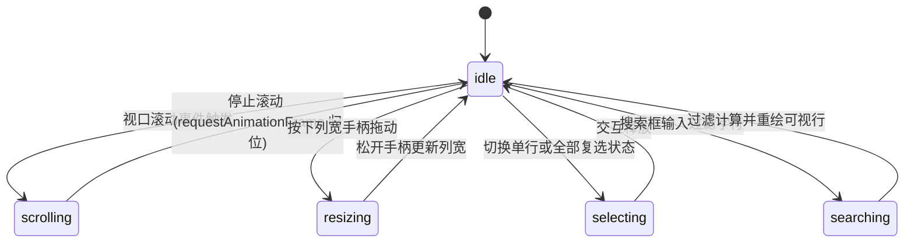

# Data Grid · 高性能数据网格

支持万级数据量流畅交互的企业级原生虚拟滚动数据表格。包含基于 `transform: translateY` 的高频虚拟行布局计算、首列绝对定位固定锁定（Column Pinning）、列宽拖拽弹性调节、表头多列排序、实时模糊检索与动态行数计数器联动、复选框多选及全键盘网格巡航。

## 原型清单

| 原型分组 | 原型元素 | 动效 / 状态变化 | 去向 |
| --- | --- | --- | --- |
| — | 网格根容器 `.arc-grid-root` | 容器查询、行高变量（`--row-h`）与密度状态承载 | 最小 DOM / CSS 宿主 |
| — | 顶部工具栏 `.arc-grid-toolbar` | 搜索框聚焦底色渐变、行数统计指示、密度与列显隐按钮 | 工具栏搜索与计数联动 |
| — | 搜索输入框 `.arc-grid-search` | 聚焦背景色微调、即时过滤与无障碍行数宣告（`aria-live`） | 搜索过滤机制 |
| — | 虚拟滚动视口 `.arc-grid-scroller` | 滚动条容器，监听 `scroll` 事件计算可见行与 Overscan 范围 | 虚拟滚动视口 |
| — | 网格主体 `.arc-grid-grid` | `role="grid"`，全键盘网格导航与活动单元格高亮 | 网格核心语义 |
| — | 表头行 `.arc-grid-headRow` | 吸顶固定、列宽发丝分割线、选中列高亮底色 | 吸顶表头系统 |
| — | 首列行号/复选框槽 `.arc-grid-gutterHead` / `.arc-grid-gutter` | 水平固定（Sticky）、悬停在行号与复选框之间平滑切换 | 固定行号与复选槽 |
| — | 表头单元格 `.arc-grid-headCell` | 支持首列锁定（`data-pinned`）、右侧发丝边框 | 列固定系统 |
| — | 排序按钮与图标 `.arc-grid-sortButton` / `.arc-grid-sortIcon` | 点击升序/降序切换，箭头 180° 翻转与弹簧缩放 | 排序指示微交互 |
| — | 列宽调节手柄 `.arc-grid-resizer` | 指针抓取拖动，竖向发丝线显现与实时重算列宽 | 列宽调节机制 |
| — | 虚拟行容器 `.arc-grid-body` | 总高度锁死虚拟滚动条，仅渲染可视行 + 缓冲区 | 虚拟渲染核心 |
| — | 虚拟数据行 `.arc-grid-row` | 绝对定位配合 `translateY` 错峰入场，选中背景色流转 | 行级虚拟平移 |
| — | 单元格 `.arc-grid-cell` | 文本溢出省略号、数值右对齐（`data-num`） | 单元格排版 |
| — | 顶栏重置按钮 `.arc-grid-demo-reset`、顶栏标题 | 演示外壳 | 演示外壳，已删除 |
| — | 顶栏、外观切换按钮 `#themeBtn`、舞台外壳 | — | 演示外壳，已删除 |

## 适用

- 展现行数极多（上千至数万行）的复杂企业级数据报表、订单流水、客户名单。
- 交互需要极低延迟的滚动帧率，杜绝因海量 DOM 节点造成的卡顿与重绘假死。
- 要求首列（如账号、代码、ID）在横向滚动时始终固定贴附，其余列顺畅横向滑移。
- 具备高频搜索筛选、列宽实时拖拽伸缩、正反排序及全键盘方向键巡航需求。

## 不适用

- 中小规模通用数据表格，无需虚拟滚动且更轻量 → [sortable-data-table](../tables/sortable-data-table.md)
- 树状层级折叠与展开文件树 → [tree-view](../tables/tree-view.md)
- 格式化 JSON 树解析与单键值复制 → [json-viewer](../tables/json-viewer.md)
- 离散时序统计柱状对比 → [bar-chart](../charts/bar-chart.md)

## 状态机

| 状态 | 进入条件 | 视觉表现 | 退出到 |
| --- | --- | --- | --- |
| idle | 初始挂载或静止态 | 渲染视口内的可视行，滚动条就绪，首列吸附，排序与搜索处于基准状态 | scrolling / resizing / selecting |
| scrolling | 用户滑动鼠标滚轮或拖动滚动条 | 动态计算可视起止行索引与 translateY 偏移，复用 DOM 节点，无卡顿 | idle |
| resizing | 指针按住列宽手柄 `.arc-grid-resizer` 拖拽 | 手柄竖线显现高亮，光标呈 `col-resize`，目标列宽实时伸缩 | idle |
| selecting | 点击行首复选框或表头全选 | 目标行背景色变为选中着色，表头复选框呈现 checked / mixed | idle |
| searching | 搜索输入框键入关键词 | 瞬时过滤匹配行，总行数动态刷新并触发过渡动画 | idle |



## 最小 DOM

```html
<div class="arc-grid-root" data-density="standard" style="--row-h: 40px; --gutter-w: 48px;">
  <div class="arc-grid-toolbar">
    <div class="arc-grid-toolbarRow">
      <label class="arc-grid-search">
        <svg width="16" height="16" viewBox="0 0 24 24" fill="none" stroke="currentColor" stroke-width="1.75" stroke-linecap="round" stroke-linejoin="round">
          <circle cx="11" cy="11" r="8" />
          <line x1="21" y1="21" x2="16.65" y2="16.65" />
        </svg>
        <input placeholder="Search..." aria-label="Search rows" spellcheck="false" />
      </label>
      <span class="arc-grid-rowCount" aria-live="polite">10,000 rows</span>
      <span class="arc-grid-toolSpacer"></span>
    </div>
  </div>

  <div class="arc-grid-scroller" style="max-height: 440px;">
    <div class="arc-grid-grid" role="grid" tabindex="0" aria-label="Data Grid" aria-multiselectable="true">
      <div role="rowgroup" class="arc-grid-head">
        <div role="row" class="arc-grid-headRow">
          <div role="columnheader" class="arc-grid-gutterHead">
            <button type="button" role="checkbox" aria-checked="false" aria-label="Select all rows" class="arc-grid-checkbox">
              <span class="arc-grid-checkboxMark" aria-hidden="true">
                <svg width="12" height="12" viewBox="0 0 24 24" fill="none" stroke="currentColor" stroke-width="2.25"><path d="M20 6 9 17l-5-5"/></svg>
              </span>
            </button>
          </div>
          <!-- 动态表头列 -->
          <div role="columnheader" class="arc-grid-headCell" data-pinned="true" data-pin-edge="true" style="width: 180px; left: 48px;">
            <button type="button" class="arc-grid-sortButton">
              <span class="arc-grid-headLabel">Account</span>
              <span class="arc-grid-sortIcon" aria-hidden="true">
                <svg width="14" height="14" viewBox="0 0 24 24" fill="none" stroke="currentColor" stroke-width="1.75"><path d="m5 12 7-7 7 7"/><path d="M12 19V5"/></svg>
              </span>
            </button>
            <div class="arc-grid-resizer" aria-hidden="true"></div>
          </div>
        </div>
      </div>

      <div role="rowgroup" class="arc-grid-body">
        <!-- 虚拟渲染的行挂载于此 -->
      </div>
    </div>
  </div>
</div>
```

- `.arc-grid-root`：根样式与 CSS 变量作用域，定义密度与尺寸基准。
- `.arc-grid-toolbar`：提供检索输入框与行数动态宣告面板。
- `.arc-grid-scroller`：虚拟滚动的实际尺寸视口，带固定最大高度。
- `.arc-grid-head`：吸顶固定的表头组，首列具备 Sticky 锁定。
- `.arc-grid-resizer`：表头列右侧的列宽调节热区。
- `.arc-grid-body`：根据总数据量乘单行高度得到的幽灵滚动高度容器，内部只动态放置可视节点。

## 参数

| 名称 | 值 | 用于 | 来源 |
| --- | --- | --- | --- |
| 紧凑行高 (compact) | `32px` | 极高数据密度展示 | 原型 |
| 标准行高 (standard) | `40px` | 默认通用行高 | 原型 |
| 宽松行高 (comfortable) | `48px` | 触摸优化行高 | 原型 |
| 表头高度 | `40px` | 吸顶表头行高度 | 原型 |
| 侧边槽位宽度 | `48px` | 行号与复选框容器宽度 | 原型 |
| 虚拟滚动 Overscan | `6 行` | 视口上下预渲染行数，防止快速滑动白屏 | 原型 |
| 列宽最小限制 | `60px` | 防止列被拖拽缩小至不可见 | 原型 |
| 排序指示翻转弹簧 | `visualDuration: 0.26s, bounce: 0.12` | 升降序箭头动画 | 原型 |
| 单元格选区阻尼 | `cubic-bezier(0.16, 1, 0.3, 1)` | 单元格聚焦高亮与过渡 | 原型 |

## CSS

```css
.arc-grid-root {
  --grid-line: rgba(0, 0, 0, 0.08);
  --grid-border: rgba(0, 0, 0, 0.12);
  --grid-bg: #ffffff;
  --grid-bg-muted: #f7f7f7;
  --grid-foreground: #111111;
  --grid-muted: #737373;
  --grid-accent: #2563eb;
  --grid-select: color-mix(in srgb, var(--grid-accent) 8%, transparent);
  --grid-checked: color-mix(in srgb, var(--grid-accent) 5%, #ffffff);
  --row-h: 40px;
  --gutter-w: 48px;

  position: relative;
  display: grid;
  width: 100%;
  min-width: 0;
  overflow: hidden;
  border: 1px solid var(--grid-border);
  border-radius: 12px;
  background: var(--grid-bg);
  color: var(--grid-foreground);
  font-family: system-ui, -apple-system, sans-serif;
  font-size: 14px;
  line-height: 1.4;
}

.arc-grid-root *,
.arc-grid-root *:after,
.arc-grid-root *:before {
  box-sizing: border-box;
}

.arc-grid-toolbar {
  position: relative;
  display: flex;
  align-items: center;
  gap: 8px;
  height: 48px;
  padding: 0 12px;
  border-bottom: 1px solid var(--grid-line);
}

.arc-grid-toolbarRow {
  display: flex;
  align-items: center;
  gap: 8px;
  width: 100%;
}

.arc-grid-search {
  display: flex;
  align-items: center;
  gap: 8px;
  width: 220px;
  height: 32px;
  padding: 0 10px;
  border-radius: 6px;
  background: var(--grid-bg-muted);
  color: var(--grid-muted);
}

.arc-grid-search input {
  flex: 1;
  min-width: 0;
  border: none;
  background: transparent;
  color: var(--grid-foreground);
  font: inherit;
  outline: none;
}

.arc-grid-rowCount {
  color: var(--grid-muted);
  font-size: 12px;
  font-variant-numeric: tabular-nums;
  white-space: nowrap;
}

.arc-grid-toolSpacer {
  flex: 1;
}

.arc-grid-scroller {
  position: relative;
  max-height: 440px;
  overflow: auto;
  overscroll-behavior: contain;
}

.arc-grid-grid {
  position: relative;
  min-width: 100%;
  user-select: none;
  outline: none;
}

.arc-grid-head {
  position: sticky;
  top: 0;
  z-index: 10;
  background: var(--grid-bg);
}

.arc-grid-headRow {
  display: flex;
  height: 40px;
  border-bottom: 1px solid var(--grid-line);
}

.arc-grid-gutterHead {
  position: sticky;
  left: 0;
  z-index: 3;
  display: grid;
  flex: none;
  place-items: center;
  width: var(--gutter-w);
  height: 100%;
  background: var(--grid-bg);
  box-shadow: inset -1px 0 0 var(--grid-border);
}

.arc-grid-headCell {
  position: relative;
  display: flex;
  flex: none;
  align-items: stretch;
  height: 100%;
  background: var(--grid-bg);
  box-shadow: inset -1px 0 0 var(--grid-line);
}

.arc-grid-headCell[data-pinned="true"] {
  position: sticky;
  z-index: 2;
  box-shadow: inset -1px 0 0 var(--grid-border);
}

.arc-grid-sortButton {
  display: flex;
  flex: 1;
  align-items: center;
  gap: 4px;
  min-width: 0;
  padding: 0 8px 0 12px;
  border: none;
  background: transparent;
  color: var(--grid-muted);
  font: inherit;
  font-weight: 500;
  cursor: pointer;
  text-align: left;
}

.arc-grid-headCell[data-num="true"] .arc-grid-sortButton {
  flex-direction: row-reverse;
  text-align: right;
}

.arc-grid-headLabel {
  overflow: hidden;
  text-overflow: ellipsis;
  white-space: nowrap;
}

.arc-grid-sortIcon {
  display: inline-flex;
  opacity: 0;
  transform: scale(0.8);
  transition: opacity 160ms ease, transform 240ms cubic-bezier(0.16, 1, 0.3, 1);
}

.arc-grid-sortIcon[data-dir] {
  opacity: 1;
  transform: none;
}

.arc-grid-sortIcon[data-dir="desc"] svg {
  transform: rotate(180deg);
}

.arc-grid-resizer {
  position: absolute;
  top: 0;
  right: -4px;
  bottom: 0;
  z-index: 3;
  width: 8px;
  cursor: col-resize;
  touch-action: none;
}

.arc-grid-resizer:after {
  content: "";
  position: absolute;
  top: 8px;
  bottom: 8px;
  left: 3px;
  width: 2px;
  background: var(--grid-accent);
  opacity: 0;
  transition: opacity 160ms ease;
}

.arc-grid-resizer:hover:after,
.arc-grid-resizer[data-active]:after {
  opacity: 1;
}

.arc-grid-body {
  position: relative;
  cursor: cell;
}

.arc-grid-row {
  position: absolute;
  top: 0;
  left: 0;
  display: flex;
  height: var(--row-h);
  width: 100%;
}

.arc-grid-row[data-checked="true"] {
  background: var(--grid-checked);
}

.arc-grid-gutter {
  position: sticky;
  left: 0;
  z-index: 3;
  display: grid;
  flex: none;
  place-items: center;
  width: var(--gutter-w);
  height: 100%;
  border-bottom: 1px solid var(--grid-line);
  background: var(--grid-bg);
  box-shadow: inset -1px 0 0 var(--grid-border);
}

.arc-grid-gutter > * {
  grid-area: 1 / 1;
}

.arc-grid-rowNumber {
  color: var(--grid-muted);
  font-size: 12px;
  font-variant-numeric: tabular-nums;
}

.arc-grid-checkbox {
  display: grid;
  place-items: center;
  width: 28px;
  height: 28px;
  border: none;
  background: transparent;
  cursor: pointer;
  opacity: 0;
  transition: opacity 120ms ease;
}

.arc-grid-row:hover .arc-grid-checkbox,
.arc-grid-row[data-checked="true"] .arc-grid-checkbox,
.arc-grid-root[data-any-checked] .arc-grid-checkbox {
  opacity: 1;
}

.arc-grid-row:hover .arc-grid-rowNumber,
.arc-grid-row[data-checked="true"] .arc-grid-rowNumber,
.arc-grid-root[data-any-checked] .arc-grid-rowNumber {
  opacity: 0;
}

.arc-grid-checkboxMark {
  display: grid;
  place-items: center;
  width: 16px;
  height: 16px;
  border-radius: 4px;
  border: 1px solid var(--grid-border);
  background: var(--grid-bg);
  color: #ffffff;
}

.arc-grid-checkbox[data-state="on"] .arc-grid-checkboxMark {
  background: var(--grid-accent);
  border-color: var(--grid-accent);
}

.arc-grid-cell {
  position: relative;
  display: flex;
  flex: none;
  align-items: center;
  height: 100%;
  padding: 0 12px;
  border-bottom: 1px solid var(--grid-line);
  background: var(--grid-bg);
  box-shadow: inset -1px 0 0 var(--grid-line);
  color: var(--grid-foreground);
  font-variant-numeric: tabular-nums;
  white-space: nowrap;
}

.arc-grid-cell[data-pinned="true"] {
  position: sticky;
  z-index: 2;
  box-shadow: inset -1px 0 0 var(--grid-border);
  font-weight: 500;
}

.arc-grid-cell[data-num="true"] {
  justify-content: flex-end;
}

.arc-grid-value {
  overflow: hidden;
  text-overflow: ellipsis;
}

@media (prefers-reduced-motion: reduce) {
  .arc-grid-sortIcon,
  .arc-grid-checkbox,
  .arc-grid-resizer:after {
    transition: none !important;
  }
}
```

## JS

```js
/**
 * 高性能虚拟数据网格组件
 * @param {HTMLElement} el 宿主容器
 * @param {Object} options 配置项
 * @returns {Object} 控制句柄与清理接口
 */
export function createDataGrid(el, options = {}) {
  const defaultColumns = [
    { key: 'account', label: 'Account', width: 180, pinned: true },
    { key: 'owner', label: 'Owner', width: 140 },
    { key: 'region', label: 'Region', width: 140 },
    { key: 'stage', label: 'Stage', width: 130 },
    { key: 'seats', label: 'Seats', width: 90, num: true },
    { key: 'arr', label: 'ARR', width: 120, num: true }
  ];

  const defaultData = Array.from({ length: 1000 }, (_, i) => ({
    id: `row-${i + 1}`,
    account: `Enterprise ${i + 1}`,
    owner: ['Tyler', 'Marcus', 'Emma', 'Owen', 'Priya'][i % 5],
    region: ['North America', 'Europe', 'Asia Pacific', 'Latin America'][i % 4],
    stage: ['Discovery', 'Proposal', 'Negotiation', 'Closed won'][i % 4],
    seats: (i * 7 + 12) % 450 + 10,
    arr: `$${((i * 1230 + 4500) % 80000 + 5000).toLocaleString()}`
  }));

  let columns = Array.isArray(options.columns) && options.columns.length ? options.columns : defaultColumns;
  let allData = Array.isArray(options.data) && options.data.length ? options.data : defaultData;
  let filteredData = [...allData];

  let rowHeight = options.rowHeight || 40;
  let gutterWidth = 48;
  let sortKey = null;
  let sortDir = null; // 'asc' | 'desc'
  let selectedRowIds = new Set();
  let query = '';
  let disposed = false;

  const root = el.querySelector('.arc-grid-root') || el;
  const scroller = el.querySelector('.arc-grid-scroller');
  const body = el.querySelector('.arc-grid-body');
  const headRow = el.querySelector('.arc-grid-headRow');
  const searchInput = el.querySelector('.arc-grid-search input');
  const rowCountEl = el.querySelector('.arc-grid-rowCount');
  const selectAllBtn = el.querySelector('.arc-grid-gutterHead .arc-grid-checkbox');

  function renderHeaders() {
    if (!headRow) return;
    headRow.innerHTML = '';

    // Gutter header
    const gutterHead = document.createElement('div');
    gutterHead.className = 'arc-grid-gutterHead';
    gutterHead.setAttribute('role', 'columnheader');
    gutterHead.innerHTML = `
      <button type="button" role="checkbox" aria-checked="false" aria-label="Select all rows" class="arc-grid-checkbox" data-state="off">
        <span class="arc-grid-checkboxMark" aria-hidden="true">
          <svg width="12" height="12" viewBox="0 0 24 24" fill="none" stroke="currentColor" stroke-width="2.25"><path d="M20 6 9 17l-5-5"/></svg>
        </span>
      </button>
    `;
    headRow.appendChild(gutterHead);

    let leftOffset = gutterWidth;
    columns.forEach((col, idx) => {
      const cell = document.createElement('div');
      cell.className = 'arc-grid-headCell';
      cell.setAttribute('role', 'columnheader');
      cell.dataset.colKey = col.key;
      cell.style.width = `${col.width}px`;

      if (col.pinned) {
        cell.dataset.pinned = 'true';
        cell.style.left = `${leftOffset}px`;
        leftOffset += col.width;
      }
      if (col.num) cell.dataset.num = 'true';

      const sortBtn = document.createElement('button');
      sortBtn.type = 'button';
      sortBtn.className = 'arc-grid-sortButton';
      sortBtn.innerHTML = `
        <span class="arc-grid-headLabel">${col.label}</span>
        <span class="arc-grid-sortIcon" aria-hidden="true" ${sortKey === col.key ? `data-dir="${sortDir}"` : ''}>
          <svg width="14" height="14" viewBox="0 0 24 24" fill="none" stroke="currentColor" stroke-width="1.75"><path d="m5 12 7-7 7 7"/><path d="M12 19V5"/></svg>
        </span>
      `;
      sortBtn.addEventListener('click', () => toggleSort(col.key));
      cell.appendChild(sortBtn);

      const resizer = document.createElement('div');
      resizer.className = 'arc-grid-resizer';
      resizer.setAttribute('aria-hidden', 'true');
      bindResizer(resizer, idx);
      cell.appendChild(resizer);

      headRow.appendChild(cell);
    });
  }

  function bindResizer(resizerEl, colIndex) {
    let startX = 0;
    let startWidth = 0;

    function onPointerDown(e) {
      startX = e.clientX;
      startWidth = columns[colIndex].width;
      resizerEl.setAttribute('data-active', '');
      window.addEventListener('pointermove', onPointerMove);
      window.addEventListener('pointerup', onPointerUp);
      e.preventDefault();
    }

    function onPointerMove(e) {
      const dx = e.clientX - startX;
      columns[colIndex].width = Math.max(60, startWidth + dx);
      renderHeaders();
      renderVirtualRows();
    }

    function onPointerUp() {
      resizerEl.removeAttribute('data-active');
      window.removeEventListener('pointermove', onPointerMove);
      window.removeEventListener('pointerup', onPointerUp);
    }

    resizerEl.addEventListener('pointerdown', onPointerDown);
  }

  function toggleSort(key) {
    if (sortKey !== key) {
      sortKey = key;
      sortDir = 'asc';
    } else if (sortDir === 'asc') {
      sortDir = 'desc';
    } else {
      sortKey = null;
      sortDir = null;
    }
    applyFilterAndSort();
  }

  function applyFilterAndSort() {
    let list = [...allData];
    if (query.trim()) {
      const q = query.toLowerCase();
      list = list.filter(row => Object.values(row).some(val => String(val).toLowerCase().includes(q)));
    }

    if (sortKey && sortDir) {
      list.sort((a, b) => {
        const vA = a[sortKey];
        const vB = b[sortKey];
        if (typeof vA === 'number' && typeof vB === 'number') {
          return sortDir === 'asc' ? vA - vB : vB - vA;
        }
        return sortDir === 'asc' ? String(vA).localeCompare(String(vB)) : String(vB).localeCompare(String(vA));
      });
    }

    filteredData = list;
    if (rowCountEl) {
      rowCountEl.textContent = `${filteredData.length.toLocaleString()} rows`;
    }

    renderHeaders();
    renderVirtualRows();
  }

  function renderVirtualRows() {
    if (!body || !scroller) return;

    const totalRows = filteredData.length;
    const totalHeight = totalRows * rowHeight;
    body.style.height = `${totalHeight}px`;

    const scrollTop = scroller.scrollTop;
    const viewportHeight = scroller.clientHeight || 440;
    const overscan = 6;

    const startIndex = Math.max(0, Math.floor(scrollTop / rowHeight) - overscan);
    const endIndex = Math.min(totalRows - 1, Math.ceil((scrollTop + viewportHeight) / rowHeight) + overscan);

    body.innerHTML = '';

    for (let i = startIndex; i <= endIndex; i++) {
      const rowData = filteredData[i];
      if (!rowData) continue;

      const isChecked = selectedRowIds.has(rowData.id);
      const rowEl = document.createElement('div');
      rowEl.className = 'arc-grid-row';
      rowEl.setAttribute('role', 'row');
      rowEl.setAttribute('aria-rowindex', String(i + 2));
      rowEl.style.transform = `translateY(${i * rowHeight}px)`;
      if (isChecked) rowEl.dataset.checked = 'true';

      // Gutter cell (行号与复选框)
      const gutterCell = document.createElement('div');
      gutterCell.className = 'arc-grid-gutter';
      gutterCell.setAttribute('role', 'gridcell');
      gutterCell.innerHTML = `
        <span class="arc-grid-rowNumber" aria-hidden="true">${i + 1}</span>
        <button type="button" role="checkbox" aria-checked="${isChecked}" class="arc-grid-checkbox" data-state="${isChecked ? 'on' : 'off'}">
          <span class="arc-grid-checkboxMark" aria-hidden="true">
            <svg width="12" height="12" viewBox="0 0 24 24" fill="none" stroke="currentColor" stroke-width="2.25"><path d="M20 6 9 17l-5-5"/></svg>
          </span>
        </button>
      `;

      gutterCell.querySelector('button').addEventListener('click', (e) => {
        e.stopPropagation();
        if (selectedRowIds.has(rowData.id)) {
          selectedRowIds.delete(rowData.id);
        } else {
          selectedRowIds.add(rowData.id);
        }
        syncSelectAllState();
        renderVirtualRows();
      });

      rowEl.appendChild(gutterCell);

      // 数据单元格
      let leftOffset = gutterWidth;
      columns.forEach(col => {
        const cell = document.createElement('div');
        cell.className = 'arc-grid-cell';
        cell.setAttribute('role', 'gridcell');
        cell.style.width = `${col.width}px`;

        if (col.pinned) {
          cell.dataset.pinned = 'true';
          cell.style.left = `${leftOffset}px`;
          leftOffset += col.width;
        }
        if (col.num) cell.dataset.num = 'true';

        cell.innerHTML = `<span class="arc-grid-value">${rowData[col.key] ?? ''}</span>`;
        rowEl.appendChild(cell);
      });

      body.appendChild(rowEl);
    }
  }

  function syncSelectAllState() {
    if (!selectAllBtn) return;
    const count = selectedRowIds.size;
    const total = filteredData.length;
    if (count === 0) {
      selectAllBtn.setAttribute('aria-checked', 'false');
      selectAllBtn.dataset.state = 'off';
      root.removeAttribute('data-any-checked');
    } else if (count === total) {
      selectAllBtn.setAttribute('aria-checked', 'true');
      selectAllBtn.dataset.state = 'on';
      root.setAttribute('data-any-checked', '');
    } else {
      selectAllBtn.setAttribute('aria-checked', 'mixed');
      selectAllBtn.dataset.state = 'mixed';
      root.setAttribute('data-any-checked', '');
    }
  }

  function handleScroll() {
    if (disposed) return;
    requestAnimationFrame(renderVirtualRows);
  }

  function handleSearch(e) {
    query = e.target.value;
    applyFilterAndSort();
  }

  if (scroller) {
    scroller.addEventListener('scroll', handleScroll, { passive: true });
  }

  if (searchInput) {
    searchInput.addEventListener('input', handleSearch);
  }

  renderHeaders();
  applyFilterAndSort();

  return {
    update(patch = {}) {
      if (patch.data) {
        allData = patch.data;
        applyFilterAndSort();
      }
      if (patch.columns) {
        columns = patch.columns;
        renderHeaders();
        renderVirtualRows();
      }
    },
    getState() {
      return {
        sortKey,
        sortDir,
        selectedRowIds: Array.from(selectedRowIds),
        filteredCount: filteredData.length
      };
    },
    destroy() {
      disposed = true;
      if (scroller) {
        scroller.removeEventListener('scroll', handleScroll);
      }
      if (searchInput) {
        searchInput.removeEventListener('input', handleSearch);
      }
    }
  };
}
```

## 接入目标项目

- 状态来源：后端分页或大数组全量数据源、列字段配置描述表（Column Schema）。
- 尺寸策略：宽度随容器自适应，表身视口建议设置 `max-height: 440px` 或 `height: 100%`。
- 驱动方式：通过 `createDataGrid(container, { columns, data })` 挂载，数据过滤或排序由内部高效处理，也可通过 `update({ data })` 动态注入。

## 重入与清理

- 连续高频滚动时使用 `requestAnimationFrame` 合并重绘，杜绝重复渲染引发帧率骤降。
- 卸载时彻底解绑滚动监听、搜索框输入监听及列宽拖拽的 `window` 全局事件。

## 减少动态效果

- 在 `prefers-reduced-motion: reduce` 下，禁用表头排序箭头的弹簧过渡与单元格过渡。
- 搜索匹配与列宽调节瞬间落位，取消行位移动画。

## 焦点与键盘

- 表格承载 `role="grid"`，单元格为 `role="gridcell"`，符合 WAI-ARIA Grid 设计模式。
- 支持全选复选框的 `aria-checked="mixed"` 三态模式。
- 搜索框变更与行数统计挂载 `aria-live="polite"`，便于辅助工具实时朗读。

## 兼容回退

| 特性 | 不支持时 |
| --- | --- |
| `position: sticky` | 降级为常规滚动表格，表头与首列不固定 |
| `color-mix()` | 使用标准固定 Hex / RGBA 配色 |
| 容器查询 (`@container`) | 使用全局 `@media` 响应式断点回退 |

## 验收清单

- [ ] 10,000 行级数据流畅上下滚动，无卡顿和掉帧。
- [ ] 横向滚动时，首列（Account）始终吸附在左侧，分割线清晰。
- [ ] 拖拽列宽手柄可平滑调节列宽，表身单元格实时对其。
- [ ] 点击表头排序按钮，指示箭头翻转并正确执行升降序切换。
- [ ] 顶部搜索框键入字符后瞬时筛选行，右侧统计数字实时变动。
- [ ] 单选及全选复选框三态流转正常，选中行高亮着色。
