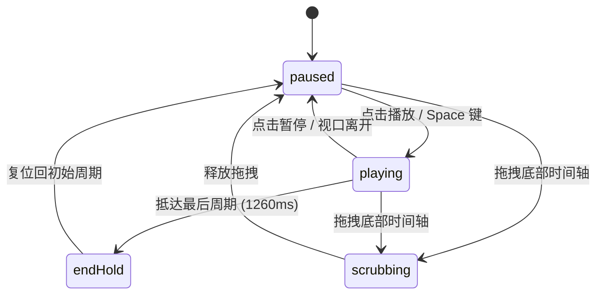

# Race Bar Chart · 动态竞速条形图

展示多分类或产品随时间推移的位次竞争与数值变迁的高表现力动态图表。通过物理阻尼弹性重排序（Row Reordering）、平滑插值数值滚动、时间线滑块巡航控制（Play/Pause/Scrubbing）以及视口可见性联动，在 60fps 下真实再现排名上下超车与柱宽动态伸缩。

## 原型清单

| 原型分组 | 原型元素 | 动效 / 状态变化 | 去向 |
| --- | --- | --- | --- |
| — | 图表外层容器 `.arc-race-figure` | 布局宿主与网格环境 | 最小 DOM / CSS |
| — | 周期展示顶栏 `.arc-race-head` | 月份名形态淡入淡出、总收入数值汇总更新 | 顶栏周期指示 |
| — | 绘图主视口 `.arc-race-plot` | 坐标轴网格线刻度随极值动态伸缩计算 | 绘图核心槽位 |
| — | 背景刻度网格 `.arc-race-grid` / `.arc-race-tick` | 柱宽基准线、X 轴数值标签横向平移 | 背景自适应网格 |
| — | 竞速行项目 `.arc-race-row` | Y 轴位次重排弹簧动画（500ms，bounce 0.14）、前 8 名透明度保持与退场 | 竞速行物理换位 |
| — | 项目条形柱体 `.arc-race-bar` | 柱宽像素随当前插值数值平滑伸长/收缩 | 柱宽动态插值 |
| — | 行末尾数值 `.arc-race-rowValue` | 紧随柱体右侧移动，数字自适应展示 | 跟随数值标签 |
| — | 播放/暂停按钮 `.arc-race-play` | 播放与暂停图标微模糊切换，Space/Enter 控制 | 播放控制组件 |
| — | 底部时间线滑块 `.arc-race-timeline` / `.arc-race-track` | `role="slider"`，滑块进度轨充盈与游标拖拽 | 时间轴控制器 |
| — | 分类图例 `.arc-race-legend` | 颜色色块指示多产品分类 | 图例说明 |
| — | 读屏无障碍表格 `.arc-race-srOnly` | 完整 12 个月二维数据表与 `aria-live` 宣告 | 无障碍表格 |
| — | 顶栏、外观切换按钮 `#themeBtn`、卡片外壳 | — | 演示外壳，已删除 |

## 适用

- 展现品牌、国家、产品线、销售代表等对象在连续周期（如年度 12 个月或季度）内的位次变迁与竞速排名。
- 强调视觉冲击力与叙事感，需要自动播放、暂停细看与时间轴任意节点倒回。
- 用户需要直观观察到各项目互相超越（Rank Swap）、柱高柱宽快速拉伸的物理手感。
- 适配键盘导航与读屏设备无障碍访问。

## 不适用

- 静态离散分类数据单次横向对比 → [bar-chart](../charts/bar-chart.md)
- 连续时间序列曲线的大跨度区间框选缩放 → [brush-chart](brush-chart.md)
- 前后两期固定多维斜率跃迁对比 → [slope-chart](../charts/slope-chart.md)
- 秒级高频监控流实时波形 → [realtime-stream](../charts/realtime-stream.md)

## 状态机

| 状态 | 进入条件 | 视觉表现 | 退出到 |
| --- | --- | --- | --- |
| paused | 初始挂载或点击暂停 | 动画帧停驻在当前时间步，播放按钮显示 Play 图标 | playing / scrubbing |
| playing | 点击播放或按 Space 键 | 时间以 1400ms/周期的速度向前推进，各条形按当前数值重新排序换位 | paused / endHold |
| scrubbing | 用户拖动底部时间线滑块 | 时间进度强制跟随光标指针，柱宽与行排位实时重新计算 | paused / playing |
| endHold | 播放抵达最后一个时间周期 | 停留在最后一月结果 1260ms，随后自动重置或显示 Replay | paused / playing |



## 最小 DOM

```html
<figure class="arc-race-figure" role="group" aria-label="Revenue by product race bar chart">
  <div class="arc-race-head" aria-hidden="true">
    <span class="arc-race-periodText">January</span>
    <span class="arc-race-total">Total $0K</span>
  </div>

  <div class="arc-race-plot" role="group" tabindex="0" aria-roledescription="bar chart race">
    <div class="arc-race-grid" aria-hidden="true"></div>
    <div class="arc-race-baseline" aria-hidden="true"></div>
    <div class="arc-race-rows" aria-hidden="true">
      <!-- 动态数据行 -->
    </div>
    <div class="arc-race-tooltip" aria-hidden="true"></div>
  </div>

  <div class="arc-race-controls">
    <button type="button" class="arc-race-play" aria-label="Play">
      <span class="arc-race-playIcon">
        <svg class="icon-play" width="16" height="16" viewBox="0 0 24 24" fill="currentColor">
          <polygon points="5 3 19 12 5 21 5 3"/>
        </svg>
        <svg class="icon-pause" width="16" height="16" viewBox="0 0 24 24" fill="currentColor" style="display: none;">
          <rect x="6" y="4" width="4" height="16" rx="1"/>
          <rect x="14" y="4" width="4" height="16" rx="1"/>
        </svg>
      </span>
    </button>
    <div class="arc-race-timeline">
      <div class="arc-race-track" role="slider" tabindex="0" aria-label="Time period slider" aria-valuemin="0" aria-valuemax="11" aria-valuenow="0">
        <span class="arc-race-rail" aria-hidden="true">
          <span class="arc-race-fill"></span>
        </span>
        <span class="arc-race-thumb" aria-hidden="true"></span>
      </div>
      <div class="arc-race-ends" aria-hidden="true">
        <span>Start</span>
        <span>End</span>
      </div>
    </div>
  </div>

  <div class="arc-race-srOnly" aria-live="polite"></div>
</figure>
```

- `.arc-race-figure`：根组件布局外壳。
- `.arc-race-periodText`：当前活动周期（如月份）标题。
- `.arc-race-plot`：竞速图主视口，绝对定位各竞速行。
- `.arc-race-rows`：各条形行容器，每个子行带有 `.arc-race-bar` 和 `.arc-race-rowValue`。
- `.arc-race-play`：播放/暂停控制按钮。
- `.arc-race-track`：无障碍时间线滑块，支持光标拖拽与键盘左右方向键步进。

## 参数

| 名称 | 值 | 用于 | 来源 |
| --- | --- | --- | --- |
| 周期推进速度 | `1400ms / 周期` | 默认单周期动画持续时间 | 原型 |
| 结尾停留时间 | `1260ms` | 最后一期展示完后自动复位延时 | 原型 |
| 显式展示行数 | `8 行` | 视口内展示前 8 位项目，淘汰者淡出 | 原型 |
| 行高与间距 | `行高 36px, 柱高 24px` | 纵向紧凑栅格布局 | 原型 |
| 标签保留宽度 | `128px` | 左侧文字标题宽度固定槽，杜绝跳抖 | 原型 |
| 行重排物理弹簧 | `visualDuration: 0.5s, bounce: 0.14` | 排名交换位移过度过冲与收敛 | 原型 |
| 时间线平滑弹簧 | `visualDuration: 0.42s, bounce: 0` | 游标插值跟随 | 原型 |

## CSS

```css
.arc-race-figure {
  --race-foreground: #111111;
  --race-surface: #ffffff;
  --race-border: rgba(0, 0, 0, 0.08);
  --race-border-strong: rgba(0, 0, 0, 0.18);
  --race-muted: #737373;
  --race-accent: #2563eb;
  --race-spring: cubic-bezier(0.18, 0.89, 0.32, 1.15);
  --race-series-1: #2563eb;
  --race-series-2: #0284c7;
  --race-series-3: #059669;
  --race-series-4: #d97706;

  position: relative;
  display: grid;
  min-width: 0;
  gap: 16px;
  color: var(--race-foreground);
  font-family: system-ui, -apple-system, sans-serif;
  user-select: none;
}

.arc-race-head {
  display: flex;
  align-items: baseline;
  justify-content: space-between;
  border-bottom: 1px solid var(--race-border);
  padding-bottom: 8px;
}

.arc-race-periodText {
  font-size: 20px;
  font-weight: 600;
  letter-spacing: -0.02em;
}

.arc-race-total {
  color: var(--race-muted);
  font-size: 13px;
  font-variant-numeric: tabular-nums;
}

.arc-race-plot {
  position: relative;
  height: 318px;
  outline: none;
}

.arc-race-baseline {
  position: absolute;
  top: 26px;
  left: 140px;
  bottom: 4px;
  width: 1px;
  background: var(--race-border-strong);
}

.arc-race-rows {
  position: absolute;
  top: 26px;
  left: 0;
  right: 0;
  bottom: 0;
}

.arc-race-row {
  position: absolute;
  left: 0;
  right: 0;
  display: flex;
  align-items: center;
  height: 36px;
  transition: transform 500ms var(--race-spring), opacity 320ms ease;
  will-change: transform, opacity;
}

.arc-race-rowLabel {
  width: 128px;
  overflow: hidden;
  text-overflow: ellipsis;
  white-space: nowrap;
  font-size: 13px;
  text-align: right;
  padding-right: 12px;
  color: var(--race-foreground);
}

.arc-race-bar {
  position: absolute;
  left: 140px;
  top: 6px;
  height: 24px;
  border-radius: 4px;
  background: var(--bar-color, var(--race-series-1));
  transition: width 240ms ease-out;
  min-width: 2px;
}

.arc-race-rowValue {
  position: absolute;
  left: 140px;
  font-size: 12px;
  font-weight: 500;
  font-variant-numeric: tabular-nums;
  color: var(--race-foreground);
  margin-left: 8px;
  white-space: nowrap;
  transition: transform 240ms ease-out;
}

.arc-race-controls {
  display: flex;
  align-items: center;
  gap: 12px;
}

.arc-race-play {
  display: grid;
  place-items: center;
  width: 36px;
  height: 36px;
  border: 1px solid var(--race-border);
  border-radius: 50%;
  background: var(--race-surface);
  color: var(--race-foreground);
  cursor: pointer;
  transition: transform 120ms ease, background-color 160ms ease;
}

.arc-race-play:active {
  transform: scale(0.92);
}

.arc-race-timeline {
  display: flex;
  flex: 1;
  flex-direction: column;
  gap: 4px;
}

.arc-race-track {
  position: relative;
  height: 20px;
  display: flex;
  align-items: center;
  cursor: pointer;
  outline: none;
}

.arc-race-rail {
  position: relative;
  width: 100%;
  height: 4px;
  border-radius: 2px;
  background: rgba(0, 0, 0, 0.08);
  overflow: hidden;
}

.arc-race-fill {
  position: absolute;
  top: 0;
  bottom: 0;
  left: 0;
  width: 100%;
  background: var(--race-accent);
  transform-origin: left center;
  transform: scaleX(0);
  transition: transform 100ms linear;
}

.arc-race-thumb {
  position: absolute;
  top: 50%;
  width: 14px;
  height: 14px;
  border-radius: 50%;
  background: var(--race-surface);
  box-shadow: 0 0 0 1px var(--race-border), 0 2px 4px rgba(0, 0, 0, 0.15);
  transform: translate(-50%, -50%);
  transition: left 100ms linear;
}

.arc-race-ends {
  display: flex;
  justify-content: space-between;
  font-size: 11px;
  color: var(--race-muted);
}

.arc-race-srOnly {
  position: absolute;
  width: 1px;
  height: 1px;
  overflow: hidden;
  clip: rect(0, 0, 0, 0);
  white-space: nowrap;
}

@media (prefers-reduced-motion: reduce) {
  .arc-race-row,
  .arc-race-bar,
  .arc-race-rowValue {
    transition: none !important;
  }
}
```

## JS

```js
/**
 * 动态竞速条形图组件
 * @param {HTMLElement} el 宿主容器
 * @param {Object} options 配置项
 * @returns {Object} 控制句柄与清理接口
 */
export function createRaceBarChart(el, options = {}) {
  const periods = options.periods || [
    'January', 'February', 'March', 'April', 'May', 'June',
    'July', 'August', 'September', 'October', 'November', 'December'
  ];

  const defaultItems = [
    { name: 'Linen throw', color: '#2563eb', values: [92, 170, 222, 256, 280, 296, 310, 326, 352, 400, 480, 598] },
    { name: 'Mushroom lamp', color: '#0284c7', values: [66, 128, 186, 240, 291, 339, 385, 435, 492, 560, 638, 728] },
    { name: 'Walnut sideboard', color: '#059669', values: [75, 138, 195, 246, 291, 330, 366, 399, 438, 483, 534, 588] },
    { name: 'Stoneware cups', color: '#d97706', values: [44, 86, 130, 171, 213, 253, 291, 331, 373, 418, 470, 540] },
    { name: 'Wool rug', color: '#7c3aed', values: [40, 74, 102, 122, 137, 148, 157, 168, 186, 216, 256, 306] },
    { name: 'Stacked bowls', color: '#db2777', values: [27, 53, 81, 110, 137, 165, 191, 218, 247, 277, 313, 360] },
    { name: 'Oak lounge chair', color: '#e11d48', values: [14, 30, 52, 86, 138, 208, 296, 400, 520, 658, 814, 992] },
    { name: 'Ceramic lamp', color: '#0891b2', values: [18, 38, 59, 79, 101, 122, 144, 168, 194, 222, 253, 287] }
  ];

  const items = Array.isArray(options.items) && options.items.length ? options.items : defaultItems;
  const periodDuration = options.periodMs || 1400;

  let currentPeriodIndex = 0;
  let isPlaying = false;
  let playTimer = null;
  let disposed = false;

  const rowHeight = 36;
  const maxVisibleRows = 8;

  const periodText = el.querySelector('.arc-race-periodText');
  const totalText = el.querySelector('.arc-race-total');
  const rowsContainer = el.querySelector('.arc-race-rows');
  const playBtn = el.querySelector('.arc-race-play');
  const playIcon = el.querySelector('.icon-play');
  const pauseIcon = el.querySelector('.icon-pause');
  const track = el.querySelector('.arc-race-track');
  const fill = el.querySelector('.arc-race-fill');
  const thumb = el.querySelector('.arc-race-thumb');

  // 构建持久化 DOM 行节点
  const rowElements = new Map();
  if (rowsContainer) {
    rowsContainer.innerHTML = '';
    items.forEach(item => {
      const row = document.createElement('div');
      row.className = 'arc-race-row';
      row.style.setProperty('--bar-color', item.color);
      row.innerHTML = `
        <span class="arc-race-rowLabel">${item.name}</span>
        <span class="arc-race-bar"></span>
        <span class="arc-race-rowValue">$0K</span>
      `;
      rowsContainer.appendChild(row);
      rowElements.set(item.name, row);
    });
  }

  function render(periodIdx) {
    currentPeriodIndex = Math.max(0, Math.min(periods.length - 1, periodIdx));
    const pName = periods[currentPeriodIndex];
    if (periodText) periodText.textContent = pName;

    // 获取当前周期所有数值并计算排名
    const ranked = items.map(item => ({
      name: item.name,
      val: item.values[currentPeriodIndex] || 0
    })).sort((a, b) => b.val - a.val);

    const maxVal = ranked[0]?.val || 100;
    const total = ranked.reduce((acc, cur) => acc + cur.val, 0);
    if (totalText) totalText.textContent = `Total $${total.toLocaleString()}K`;

    // 假设绘图区域可用宽度约 400px
    const availableWidth = 380;

    ranked.forEach((itemData, rankIndex) => {
      const rowEl = rowElements.get(itemData.name);
      if (!rowEl) return;

      if (rankIndex < maxVisibleRows) {
        rowEl.style.transform = `translateY(${rankIndex * rowHeight}px)`;
        rowEl.style.opacity = '1';
        rowEl.style.visibility = 'visible';

        const barWidth = Math.max(4, (itemData.val / maxVal) * availableWidth);
        const barEl = rowEl.querySelector('.arc-race-bar');
        const valEl = rowEl.querySelector('.arc-race-rowValue');

        if (barEl) barEl.style.width = `${barWidth}px`;
        if (valEl) {
          valEl.style.transform = `translateX(${barWidth}px)`;
          valEl.textContent = `$${itemData.val}K`;
        }
      } else {
        rowEl.style.opacity = '0';
        rowEl.style.visibility = 'hidden';
      }
    });

    // 更新时间轴进度
    const progress = currentPeriodIndex / (periods.length - 1);
    if (fill) fill.style.transform = `scaleX(${progress})`;
    if (thumb) thumb.style.left = `${progress * 100}%`;
    if (track) track.setAttribute('aria-valuenow', String(currentPeriodIndex));
  }

  function step() {
    if (!isPlaying) return;
    if (currentPeriodIndex >= periods.length - 1) {
      pause();
      return;
    }
    render(currentPeriodIndex + 1);
  }

  function play() {
    if (isPlaying) return;
    if (currentPeriodIndex >= periods.length - 1) {
      render(0);
    }
    isPlaying = true;
    if (playIcon) playIcon.style.display = 'none';
    if (pauseIcon) pauseIcon.style.display = 'block';
    if (playBtn) playBtn.setAttribute('aria-label', 'Pause');
    playTimer = setInterval(step, periodDuration);
  }

  function pause() {
    isPlaying = false;
    if (playTimer) clearInterval(playTimer);
    playTimer = null;
    if (playIcon) playIcon.style.display = 'block';
    if (pauseIcon) pauseIcon.style.display = 'none';
    if (playBtn) playBtn.setAttribute('aria-label', 'Play');
  }

  function togglePlay() {
    if (isPlaying) pause();
    else play();
  }

  function handleTrackClick(e) {
    if (!track) return;
    const rect = track.getBoundingClientRect();
    const ratio = Math.max(0, Math.min(1, (e.clientX - rect.left) / rect.width));
    const targetIdx = Math.round(ratio * (periods.length - 1));
    render(targetIdx);
  }

  if (playBtn) {
    playBtn.addEventListener('click', togglePlay);
  }

  if (track) {
    track.addEventListener('click', handleTrackClick);
  }

  render(0);

  return {
    play,
    pause,
    seek(idx) {
      render(idx);
    },
    getState() {
      return {
        currentPeriod: periods[currentPeriodIndex],
        periodIndex: currentPeriodIndex,
        isPlaying
      };
    },
    destroy() {
      disposed = true;
      pause();
      if (playBtn) playBtn.removeEventListener('click', togglePlay);
      if (track) track.removeEventListener('click', handleTrackClick);
    }
  };
}
```

## 接入目标项目

- 状态来源：时序排行数据对象列表、外部播放/时间步控制器。
- 尺寸策略：宽度继承外壳自适应（建议大于 480px），高度固定为 318px。
- 驱动方式：实例化调用 `createRaceBarChart(container, options)`，支持外部调用 `play()`、`pause()`、`seek(index)` 自由操控。

## 重入与清理

- 连续快速点击 Play/Pause 时立即重置 `setInterval`，避免多计时器重叠导致动画步进加速错乱。
- 组件卸载调用 `destroy()` 停止所有播放循环并解绑时间轴事件。

## 减少动态效果

- 在 `prefers-reduced-motion: reduce` 下，行位移与柱宽过渡动画关闭（`transition: none !important`）。
- 步进跳转时条形长度与排序瞬时重排到位。

## 焦点与键盘

- 播放按钮与时间线轨道均支持 `tabindex="0"` 聚焦。
- 支持键盘 `Space` / `Enter` 触发播放与暂停，左右方向键单步增减当前展示周期。
- 底部附带 `aria-live="polite"` 读屏宣告节点，周期切换时朗读最新领跑项目。

## 兼容回退

| 特性 | 不支持时 |
| --- | --- |
| CSS 变量 `--bar-color` | 使用行内 `style="background: ..."` 回退 |
| `scaleX()` 进度条 | 使用常规 `width: XX%` 设置填充轨 |

## 验收清单

- [ ] 点击 Play 按钮，条形图自动逐月推进，排名随数值变化上下平滑换位。
- [ ] 柱体增长平滑，数值标签紧贴柱体右侧跟随移动。
- [ ] 点击时间轴可直接跳转到指定月份，条形与位次立即响应刷新。
- [ ] 推进至 12 月结束时自动暂停，点击可重播。
- [ ] 开启系统的减少动态效果偏好时，条形换位无弹簧过冲。
