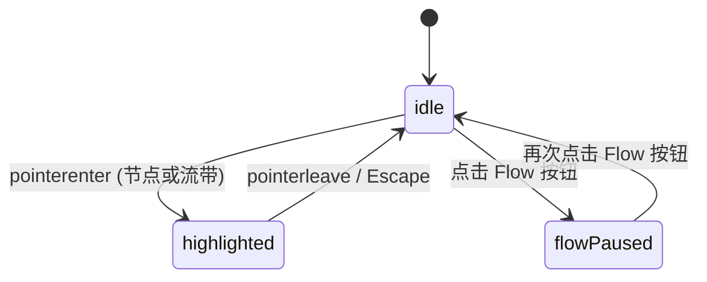

# Sankey Flow · 桑基流向图

展示用户转化路径、能量损耗或资金流向的多阶段有向流动图表。包含双向三次贝塞尔流带曲线（Cubic Bezier Ribbons）、前向与后向全链路高亮透镜（Forward/Backward Path Highlighting）、流带内部轻量级微粒子流动 Canvas 动画，以及响应式阶段自适应布局。

## 原型清单

| 原型分组 | 原型元素 | 动效 / 状态变化 | 去向 |
| --- | --- | --- | --- |
| — | 图表外层卡片 `.arc-sankey-card` | 布局宿主与网格环境 | 最小 DOM / CSS |
| — | 阶段标题栏 `.arc-sankey-stages` / `.arc-sankey-stage` | 水平/垂直自适应对齐的阶段名（Source / Activation / Plan 等） | 阶段标题定位 |
| — | 绘图主视口 `.arc-sankey-plot` | 承载 SVG 曲线层、Canvas 粒子层与 HTML 标签层 | 主图核心插槽 |
| — | 节点矩形 `.arc-sankey-node` | 垂直/水平圆角条形，悬停高亮与光晕扩展 | 节点实体系统 |
| — | 节点发光层 `.arc-sankey-nodeGlow` | 选中节点时的外发光脉冲遮罩 | 节点高亮光晕 |
| — | 贝塞尔流带 `.arc-sankey-band` | 三次贝塞尔曲线平滑封闭路径，透明度与流向宽度渐变 | 贝塞尔流带网络 |
| — | 流带高亮光晕 `.arc-sankey-glow` | 链路关联流带发光强化，非关联流带压暗至 0.08 | 全链路高亮机制 |
| — | 粒子流动画层 `.arc-sankey-canvas` | Canvas 60fps 沿流带路径行进的微粒子动效 | 流向微粒子系统 |
| — | 节点文本标签 `.arc-sankey-nodeLabel` | 紧随节点绝对定位，展示分类名与格式化数值 | 动态文字标签 |
| — | 浮动提示卡 `.arc-sankey-tooltip` | 跟随光标移动，指示流带两端名称、转化人数与百分比 | 浮动探查提示 |
| — | 流动开关按钮 `.arc-sankey-flowToggle` | 开启或关闭 Canvas 粒子流动，三点波浪图标动画 | 动效模式开关 |
| — | 季度切换分段按钮 `.bu` / `.ur` | 演示 Q2 / Q3 数据切换 | 演示外壳，已删除 |
| — | 顶栏、外观切换按钮 `#themeBtn`、舞台外壳 | — | 演示外壳，已删除 |

## 适用

- 多阶段用户行为转化分析（如广告来源 → 注册激活 → 付费订阅 → 90天留存/流失）。
- 资金/供应链多流向拆解，直观查看每一阶段的流转占比与损耗分布。
- 交互需要光标悬停某节点或某流带时，双向追溯“从哪来、到哪去”的完整高亮流向，其他非关联路径半透明静音。
- 强调视觉活化感，可通过微粒子流动增强对“流量”物理流动感的心智认知。

## 不适用

- 单一漏斗阶段阶梯收缩与转化损耗 → [funnel-chart](../charts/funnel-chart.md)
- 离散时序柱状或分类占比对比 → [bar-chart](../charts/bar-chart.md)
- 嵌套树状矩形面积切片 → [treemap](treemap.md)
- 径向多层级同心圆环切片 → [sunburst](sunburst.md)

## 状态机

| 状态 | 进入条件 | 视觉表现 | 退出到 |
| --- | --- | --- | --- |
| idle | 初始挂载或光标移出 | 所有节点与流带维持基准透明度，Canvas 粒子匀速流动 | highlighted / flowPaused |
| highlighted | 指针悬停在节点或某条流带上 | 目标对象及其上下游关联路径保持高亮，非关联流带与节点透明度降至 0.08，Tooltip 显现 | idle |
| flowPaused | 点击 Flow 切换按钮关闭流动 | Canvas 停止 requestAnimationFrame 循环，粒子隐藏 | idle / highlighted |
| resizing | 窗口宽度变化或小于 420px | 自动从横向多列转为纵向多阶段瀑布排列 | idle |



## 最小 DOM

```html
<figure class="arc-sankey-figure" role="group" aria-label="Signup journey flow diagram">
  <div class="arc-sankey-stages" aria-hidden="true">
    <span class="arc-sankey-stage">Source</span>
    <span class="arc-sankey-stage">Activation</span>
    <span class="arc-sankey-stage">Plan</span>
    <span class="arc-sankey-stage">90 days</span>
  </div>

  <div class="arc-sankey-chart">
    <div class="arc-sankey-plot" role="group" tabindex="0" aria-roledescription="flow diagram" style="height: 340px;">
      <svg class="arc-sankey-svg" width="100%" height="340" aria-hidden="true" focusable="false">
        <g class="arc-sankey-bands">
          <!-- 贝塞尔流带 paths -->
        </g>
        <g class="arc-sankey-nodes">
          <!-- 节点矩形 rects -->
        </g>
      </svg>
      <canvas class="arc-sankey-canvas" aria-hidden="true" width="600" height="340"></canvas>
      <div class="arc-sankey-labels" aria-hidden="true">
        <!-- 节点文字标签 -->
      </div>
      <div class="arc-sankey-tooltip" aria-hidden="true"></div>
    </div>
  </div>

  <div class="arc-sankey-footer">
    <button type="button" class="arc-sankey-flowToggle" aria-pressed="true">
      <span class="arc-sankey-flowIcon" aria-hidden="true">
        <span></span><span></span><span></span>
      </span>
      Flow
    </button>
  </div>

  <div class="arc-sankey-srOnly" aria-live="polite"></div>
</figure>
```

- `.arc-sankey-figure`：图表根组件宿主。
- `.arc-sankey-stages`：阶段列头标题栏。
- `.arc-sankey-plot`：核心绘图与交互容器。
- `.arc-sankey-svg`：绘制 SVG 贝塞尔流带与节点色块。
- `.arc-sankey-canvas`：独立绝对定位的微粒子流动图层。
- `.arc-sankey-labels`：浮动节点名称与数值。
- `.arc-sankey-flowToggle`：粒子流开关按钮。

## 参数

| 名称 | 值 | 用于 | 来源 |
| --- | --- | --- | --- |
| 横向默认高度 | `340px` | 桌面端标准绘图高度 | 原型 |
| 纵向切换阈值 | `420px` | 视口小于该宽度自动转为纵向流 | 原型 |
| 节点厚度 | `10px` | 矩形节点宽度 | 原型 |
| 节点圆角 | `2.5px` | 矩形两端微圆角 | 原型 |
| 节点纵向最小间距 | `14px` | 同列节点上下间隙 | 原型 |
| 非关联流带透明度 | `0.08` | 聚焦单链路时弱化其他背景 | 原型 |
| 关联流带透明度 | `0.65` | 高亮流带透明度 | 原型 |
| 粒子行进速度 | `0.008 步长/帧` | Canvas 粒子沿曲线位移 | 原型 |
| 粒子半径 | `1.5px` | 微粒子大小 | 原型 |

## CSS

```css
.arc-sankey-figure {
  --sankey-foreground: #111111;
  --sankey-surface: #ffffff;
  --sankey-surface-raised: #ffffff;
  --sankey-border: rgba(0, 0, 0, 0.08);
  --sankey-border-strong: rgba(0, 0, 0, 0.18);
  --sankey-muted: #737373;
  --sankey-accent: #2563eb;
  --sankey-series-1: #2563eb;
  --sankey-series-2: #0284c7;
  --sankey-series-3: #059669;
  --sankey-series-4: #d97706;

  position: relative;
  display: grid;
  min-width: 0;
  gap: 12px;
  color: var(--sankey-foreground);
  font-family: system-ui, -apple-system, sans-serif;
}

.arc-sankey-stages {
  display: flex;
  justify-content: space-between;
  padding: 0 4px;
  color: var(--sankey-muted);
  font-size: 12px;
  font-weight: 500;
  text-transform: uppercase;
  letter-spacing: 0.04em;
}

.arc-sankey-chart {
  position: relative;
  min-width: 0;
}

.arc-sankey-plot {
  position: relative;
  width: 100%;
  height: 340px;
  outline: none;
  user-select: none;
}

.arc-sankey-svg {
  position: absolute;
  inset: 0;
  display: block;
  overflow: visible;
}

.arc-sankey-band {
  fill: color-mix(in srgb, var(--band-color, var(--sankey-accent)) 25%, transparent);
  stroke: none;
  cursor: pointer;
  transition: fill 200ms ease, opacity 200ms ease;
}

.arc-sankey-band:hover {
  fill: color-mix(in srgb, var(--band-color, var(--sankey-accent)) 65%, transparent);
}

.arc-sankey-plot[data-has-active] .arc-sankey-band:not([data-active]) {
  opacity: 0.08;
}

.arc-sankey-node {
  fill: var(--node-color, var(--sankey-accent));
  cursor: pointer;
  transition: opacity 200ms ease, transform 200ms ease;
}

.arc-sankey-plot[data-has-active] .arc-sankey-node:not([data-active]) {
  opacity: 0.15;
}

.arc-sankey-canvas {
  position: absolute;
  inset: 0;
  pointer-events: none;
  opacity: 0.75;
  transition: opacity 200ms ease;
}

.arc-sankey-canvas[data-hidden] {
  opacity: 0;
}

.arc-sankey-labels {
  position: absolute;
  inset: 0;
  pointer-events: none;
}

.arc-sankey-nodeLabel {
  position: absolute;
  display: flex;
  flex-direction: column;
  gap: 1px;
  font-size: 11px;
  line-height: 1.2;
  white-space: nowrap;
  pointer-events: none;
  transform: translateY(-50%);
  transition: opacity 200ms ease;
}

.arc-sankey-nodeName {
  font-weight: 500;
  color: var(--sankey-foreground);
}

.arc-sankey-nodeValue {
  color: var(--sankey-muted);
  font-variant-numeric: tabular-nums;
}

.arc-sankey-tooltip {
  position: absolute;
  z-index: 5;
  display: grid;
  gap: 2px;
  padding: 8px 12px;
  border: 1px solid var(--sankey-border);
  border-radius: 8px;
  background: var(--sankey-surface-raised);
  box-shadow: 0 4px 16px rgba(0, 0, 0, 0.1);
  font-size: 12px;
  pointer-events: none;
  opacity: 0;
  transform: translate(-50%, -120%) scale(0.96);
  transition: opacity 120ms ease, transform 160ms cubic-bezier(0.16, 1, 0.3, 1);
}

.arc-sankey-tooltip[data-visible] {
  opacity: 1;
  transform: translate(-50%, -125%) scale(1);
}

.arc-sankey-footer {
  display: flex;
  justify-content: flex-end;
}

.arc-sankey-flowToggle {
  display: inline-flex;
  align-items: center;
  gap: 6px;
  height: 28px;
  padding: 0 10px;
  border: 1px solid var(--sankey-border);
  border-radius: 14px;
  background: var(--sankey-surface);
  color: var(--sankey-muted);
  font-size: 12px;
  font-weight: 500;
  cursor: pointer;
  transition: background-color 160ms ease, color 160ms ease;
}

.arc-sankey-flowToggle[aria-pressed="true"] {
  background: var(--sankey-foreground);
  color: var(--sankey-surface);
  border-color: var(--sankey-foreground);
}

.arc-sankey-flowIcon {
  display: inline-flex;
  gap: 2px;
  align-items: center;
}

.arc-sankey-flowIcon span {
  width: 3px;
  height: 3px;
  border-radius: 50%;
  background: currentColor;
  animation: sankey-drift 1.2s infinite ease-in-out;
}

.arc-sankey-flowIcon span:nth-child(2) { animation-delay: 0.2s; }
.arc-sankey-flowIcon span:nth-child(3) { animation-delay: 0.4s; }

@keyframes sankey-drift {
  0%, 100% { transform: translateY(0); }
  50% { transform: translateY(-2px); }
}

.arc-sankey-srOnly {
  position: absolute;
  width: 1px;
  height: 1px;
  overflow: hidden;
  clip: rect(0, 0, 0, 0);
  white-space: nowrap;
}

@media (prefers-reduced-motion: reduce) {
  .arc-sankey-band,
  .arc-sankey-node,
  .arc-sankey-tooltip,
  .arc-sankey-flowIcon span {
    transition: none !important;
    animation: none !important;
  }
}
```

## JS

```js
/**
 * 桑基流向图组件
 * @param {HTMLElement} el 宿主容器
 * @param {Object} options 配置项
 * @returns {Object} 控制句柄与清理接口
 */
export function createSankeyFlow(el, options = {}) {
  const defaultStages = [
    {
      id: 'source',
      title: 'Source',
      nodes: [
        { id: 'organic', label: 'Organic', value: 5200, color: '#2563eb' },
        { id: 'paid', label: 'Paid', value: 3900, color: '#0284c7' },
        { id: 'referral', label: 'Referral', value: 2100, color: '#059669' }
      ]
    },
    {
      id: 'activation',
      title: 'Activation',
      nodes: [
        { id: 'activated', label: 'Activated', value: 7010, color: '#2563eb' },
        { id: 'inactive', label: 'Not activated', value: 4190, color: '#94a3b8' }
      ]
    },
    {
      id: 'plan',
      title: 'Plan',
      nodes: [
        { id: 'free', label: 'Free', value: 3860, color: '#0284c7' },
        { id: 'pro', label: 'Pro', value: 2310, color: '#2563eb' },
        { id: 'team', label: 'Team', value: 840, color: '#d97706' }
      ]
    },
    {
      id: 'outcome',
      title: '90 days',
      nodes: [
        { id: 'retained', label: 'Retained', value: 4870, color: '#059669' },
        { id: 'churned', label: 'Churned', value: 2140, color: '#e11d48' }
      ]
    }
  ];

  const defaultLinks = [
    { from: 'organic', to: 'activated', value: 3380, color: '#2563eb' },
    { from: 'organic', to: 'inactive', value: 1820, color: '#94a3b8' },
    { from: 'paid', to: 'activated', value: 1990, color: '#0284c7' },
    { from: 'paid', to: 'inactive', value: 1910, color: '#94a3b8' },
    { from: 'referral', to: 'activated', value: 1640, color: '#059669' },
    { from: 'referral', to: 'inactive', value: 460, color: '#94a3b8' },
    { from: 'activated', to: 'free', value: 3860, color: '#0284c7' },
    { from: 'activated', to: 'pro', value: 2310, color: '#2563eb' },
    { from: 'activated', to: 'team', value: 840, color: '#d97706' },
    { from: 'free', to: 'retained', value: 2120, color: '#059669' },
    { from: 'free', to: 'churned', value: 1740, color: '#e11d48' },
    { from: 'pro', to: 'retained', value: 1960, color: '#059669' },
    { from: 'pro', to: 'churned', value: 350, color: '#e11d48' },
    { from: 'team', to: 'retained', value: 790, color: '#059669' },
    { from: 'team', to: 'churned', value: 50, color: '#e11d48' }
  ];

  const stages = options.stages || defaultStages;
  const links = options.links || defaultLinks;

  let activeElement = null; // { type: 'node' | 'band', id: string }
  let flowEnabled = true;
  let animFrameId = null;
  let disposed = false;

  const plot = el.querySelector('.arc-sankey-plot');
  const svg = el.querySelector('.arc-sankey-svg');
  const bandsGroup = el.querySelector('.arc-sankey-bands') || svg?.querySelector('g');
  const canvas = el.querySelector('.arc-sankey-canvas');
  const labelsContainer = el.querySelector('.arc-sankey-labels');
  const tooltip = el.querySelector('.arc-sankey-tooltip');
  const flowToggle = el.querySelector('.arc-sankey-flowToggle');

  const nodeThickness = 10;
  const plotHeight = 340;
  const topPadding = 12;
  const bottomPadding = 16;
  const availableH = plotHeight - topPadding - bottomPadding;

  const nodeMap = new Map();
  const bandList = [];
  const particles = [];

  function computeLayout() {
    if (!plot) return;
    const width = plot.clientWidth || 600;
    const stageCount = stages.length;
    const colSpacing = (width - nodeThickness) / (stageCount - 1);

    nodeMap.clear();
    bandList.length = 0;

    // 1. 计算每个节点位置
    stages.forEach((stage, sIdx) => {
      const x = sIdx * colSpacing;
      const totalVal = stage.nodes.reduce((acc, n) => acc + n.value, 0) || 1;
      const gap = 12;
      const totalGaps = (stage.nodes.length - 1) * gap;
      const scaleH = (availableH - totalGaps) / totalVal;

      let currentY = topPadding;
      stage.nodes.forEach(node => {
        const h = Math.max(8, node.value * scaleH);
        nodeMap.set(node.id, {
          ...node,
          x,
          y: currentY,
          width: nodeThickness,
          height: h,
          outY: currentY,
          inY: currentY
        });
        currentY += h + gap;
      });
    });

    // 2. 计算贝塞尔流带
    links.forEach(link => {
      const src = nodeMap.get(link.from);
      const dst = nodeMap.get(link.to);
      if (!src || !dst) return;

      const srcTotal = stages.find(s => s.nodes.some(n => n.id === link.from))?.nodes.find(n => n.id === link.from)?.value || 1;
      const dstTotal = stages.find(s => s.nodes.some(n => n.id === link.to))?.nodes.find(n => n.id === link.to)?.value || 1;

      const bandSrcH = (link.value / srcTotal) * src.height;
      const bandDstH = (link.value / dstTotal) * dst.height;

      const y0 = src.outY;
      const y1 = src.outY + bandSrcH;
      const y2 = dst.inY;
      const y3 = dst.inY + bandDstH;

      src.outY += bandSrcH;
      dst.inY += bandDstH;

      const x0 = src.x + src.width;
      const x1 = dst.x;
      const cpx = (x0 + x1) / 2;

      // 贝塞尔流带闭合路径
      const pathD = `M ${x0.toFixed(1)} ${y0.toFixed(1)} C ${cpx.toFixed(1)} ${y0.toFixed(1)}, ${cpx.toFixed(1)} ${y2.toFixed(1)}, ${x1.toFixed(1)} ${y2.toFixed(1)} L ${x1.toFixed(1)} ${y3.toFixed(1)} C ${cpx.toFixed(1)} ${y3.toFixed(1)}, ${cpx.toFixed(1)} ${y1.toFixed(1)}, ${x0.toFixed(1)} ${y1.toFixed(1)} Z`;

      bandList.push({
        id: `${link.from}>${link.to}`,
        from: link.from,
        to: link.to,
        value: link.value,
        color: link.color || src.color,
        pathD,
        x0, y0: (y0 + y1) / 2,
        x1, y1: (y2 + y3) / 2,
        cpx
      });
    });

    renderDOM();
    initParticles();
  }

  function renderDOM() {
    if (!svg || !labelsContainer) return;

    svg.innerHTML = '';
    labelsContainer.innerHTML = '';

    // 绘制流带
    const bandsG = document.createElementNS('http://www.w3.org/2000/svg', 'g');
    bandList.forEach(band => {
      const p = document.createElementNS('http://www.w3.org/2000/svg', 'path');
      p.className.baseVal = 'arc-sankey-band';
      p.setAttribute('d', band.pathD);
      p.style.setProperty('--band-color', band.color);
      p.dataset.bandId = band.id;

      p.addEventListener('mouseenter', (e) => onBandHover(band, e));
      p.addEventListener('mouseleave', onHoverLeave);
      bandsG.appendChild(p);
    });
    svg.appendChild(bandsG);

    // 绘制节点
    const nodesG = document.createElementNS('http://www.w3.org/2000/svg', 'g');
    nodeMap.forEach(node => {
      const rect = document.createElementNS('http://www.w3.org/2000/svg', 'rect');
      rect.className.baseVal = 'arc-sankey-node';
      rect.setAttribute('x', String(node.x));
      rect.setAttribute('y', String(node.y));
      rect.setAttribute('width', String(node.width));
      rect.setAttribute('height', String(node.height));
      rect.setAttribute('rx', '2.5');
      rect.style.setProperty('--node-color', node.color);
      rect.dataset.nodeId = node.id;

      rect.addEventListener('mouseenter', (e) => onNodeHover(node, e));
      rect.addEventListener('mouseleave', onHoverLeave);
      nodesG.appendChild(rect);

      // 标签
      const label = document.createElement('div');
      label.className = 'arc-sankey-nodeLabel';
      label.style.left = `${node.x + node.width + 6}px`;
      label.style.top = `${node.y + node.height / 2}px`;
      label.innerHTML = `
        <span class="arc-sankey-nodeName">${node.label}</span>
        <span class="arc-sankey-nodeValue">${node.value.toLocaleString()}</span>
      `;
      labelsContainer.appendChild(label);
    });
    svg.appendChild(nodesG);
  }

  function onNodeHover(node, e) {
    if (!plot) return;
    plot.setAttribute('data-has-active', '');

    // 高亮该节点以及与之相连的流带与相关节点
    const connectedBands = new Set();
    const connectedNodes = new Set([node.id]);

    bandList.forEach(b => {
      if (b.from === node.id || b.to === node.id) {
        connectedBands.add(b.id);
        connectedNodes.add(b.from);
        connectedNodes.add(b.to);
      }
    });

    svg.querySelectorAll('.arc-sankey-band').forEach(el => {
      if (connectedBands.has(el.dataset.bandId)) el.setAttribute('data-active', '');
      else el.removeAttribute('data-active');
    });

    svg.querySelectorAll('.arc-sankey-node').forEach(el => {
      if (connectedNodes.has(el.dataset.nodeId)) el.setAttribute('data-active', '');
      else el.removeAttribute('data-active');
    });

    if (tooltip) {
      tooltip.innerHTML = `<strong>${node.label}</strong><span>Total ${node.value.toLocaleString()}</span>`;
      tooltip.style.left = `${node.x + node.width / 2}px`;
      tooltip.style.top = `${node.y}px`;
      tooltip.setAttribute('data-visible', '');
    }
  }

  function onBandHover(band, e) {
    if (!plot) return;
    plot.setAttribute('data-has-active', '');

    svg.querySelectorAll('.arc-sankey-band').forEach(el => {
      if (el.dataset.bandId === band.id) el.setAttribute('data-active', '');
      else el.removeAttribute('data-active');
    });

    svg.querySelectorAll('.arc-sankey-node').forEach(el => {
      if (el.dataset.nodeId === band.from || el.dataset.nodeId === band.to) el.setAttribute('data-active', '');
      else el.removeAttribute('data-active');
    });

    if (tooltip) {
      const srcNode = nodeMap.get(band.from);
      const dstNode = nodeMap.get(band.to);
      tooltip.innerHTML = `<strong>${srcNode?.label || band.from} → ${dstNode?.label || band.to}</strong><span>${band.value.toLocaleString()} users</span>`;
      const rect = plot.getBoundingClientRect();
      tooltip.style.left = `${e.clientX - rect.left}px`;
      tooltip.style.top = `${e.clientY - rect.top}px`;
      tooltip.setAttribute('data-visible', '');
    }
  }

  function onHoverLeave() {
    if (!plot) return;
    plot.removeAttribute('data-has-active');
    svg.querySelectorAll('[data-active]').forEach(el => el.removeAttribute('data-active'));
    if (tooltip) tooltip.removeAttribute('data-visible');
  }

  // 粒子动画系统
  function initParticles() {
    particles.length = 0;
    if (!canvas) return;
    const ctx = canvas.getContext('2d');
    if (!ctx) return;

    bandList.forEach(band => {
      const count = Math.max(2, Math.floor(band.value / 600));
      for (let i = 0; i < count; i++) {
        particles.push({
          band,
          progress: Math.random(),
          speed: 0.004 + Math.random() * 0.004,
          radius: 1.5,
          color: band.color
        });
      }
    });
  }

  function animateParticles() {
    if (disposed) return;
    if (flowEnabled && canvas) {
      const ctx = canvas.getContext('2d');
      if (ctx) {
        ctx.clearRect(0, 0, canvas.width, canvas.height);
        particles.forEach(p => {
          p.progress += p.speed;
          if (p.progress > 1) p.progress = 0;

          const t = p.progress;
          const { x0, y0, x1, y1, cpx } = p.band;
          // 三次贝塞尔点计算
          const cx1 = cpx, cy1 = y0;
          const cx2 = cpx, cy2 = y1;

          const mt = 1 - t;
          const x = mt*mt*mt*x0 + 3*mt*mt*t*cx1 + 3*mt*t*t*cx2 + t*t*t*x1;
          const y = mt*mt*mt*y0 + 3*mt*mt*t*cy1 + 3*mt*t*t*cy2 + t*t*t*y1;

          ctx.beginPath();
          ctx.arc(x, y, p.radius, 0, Math.PI * 2);
          ctx.fillStyle = p.color;
          ctx.fill();
        });
      }
    }
    animFrameId = requestAnimationFrame(animateParticles);
  }

  function toggleFlow(enabled) {
    flowEnabled = (enabled !== undefined) ? enabled : !flowEnabled;
    if (flowToggle) {
      flowToggle.setAttribute('aria-pressed', String(flowEnabled));
    }
    if (canvas) {
      if (flowEnabled) canvas.removeAttribute('data-hidden');
      else canvas.setAttribute('data-hidden', '');
    }
  }

  if (flowToggle) {
    flowToggle.addEventListener('click', () => toggleFlow());
  }

  const resizeObserver = new ResizeObserver(() => {
    if (disposed) return;
    if (canvas && plot) {
      canvas.width = plot.clientWidth || 600;
      canvas.height = 340;
    }
    computeLayout();
  });

  if (plot) resizeObserver.observe(plot);

  computeLayout();
  animFrameId = requestAnimationFrame(animateParticles);

  return {
    highlightNode(id) {
      const node = nodeMap.get(id);
      if (node) onNodeHover(node);
      else onHoverLeave();
    },
    toggleFlow,
    getState() {
      return { flowEnabled };
    },
    destroy() {
      disposed = true;
      if (animFrameId) cancelAnimationFrame(animFrameId);
      resizeObserver.disconnect();
      if (flowToggle) {
        flowToggle.removeEventListener('click', () => toggleFlow());
      }
    }
  };
}
```

## 接入目标项目

- 状态来源：用户多阶段流转数据图（阶段 stages 包含节点列表，links 包含端对端连接和数量）。
- 尺寸策略：宽度随容器自适应（建议大于 520px），绘图区固定高度 340px。
- 驱动方式：调用 `createSankeyFlow(figure, { stages, links })` 进行初始化，返回 `destroy()` 卸载。

## 重入与清理

- 尺寸重算时平滑重新分配三次贝塞尔曲线坐标，不会破坏已有粒子实例。
- 卸载时取消 `requestAnimationFrame` 动画帧、清空 Canvas 画布、断开 `ResizeObserver` 监听。

## 减少动态效果

- 在 `prefers-reduced-motion: reduce` 下，禁用粒子 Canvas 绘制循环并关闭 CSS 悬停过渡。
- 节点与流带高亮切换瞬间完成，不产生延迟光晕。

## 焦点与键盘

- 绘图区具有 `tabindex="0"` 与 `role="group"`，支持键盘焦点。
- 支持 `Escape` 键一键清除当前高亮聚焦状态。
- 附带隐藏的语义 `<table>` 与 `aria-live="polite"` 标签，屏幕阅读器可完整读取转化率数据。

## 兼容回退

| 特性 | 不支持时 |
| --- | --- |
| `<canvas>` 2D 上下文 | 仅展示 SVG 贝塞尔流带，不显示移动粒子 |
| `ResizeObserver` | 降级监听窗口 resize 事件 |

## 验收清单

- [ ] 4 个阶段及对应节点垂直排列，流带以平滑 S 弯贝塞尔曲面自然过渡。
- [ ] 鼠标悬停在任一节点或流带上时，关联上下游链路高亮，非关联部分优雅淡化。
- [ ] Tooltip 贴合当前对象，展示双方名称、流转数量与百分比。
- [ ] 点击 Flow 按钮可自由启闭 Canvas 微粒子流动，按钮状态联动。
- [ ] 开启系统的减少动态效果偏好时，粒子自动隐退且无残影。
