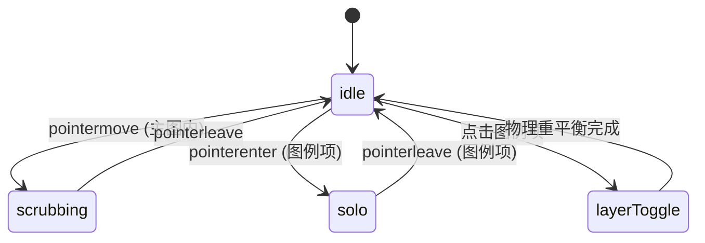

# Streamgraph · 流水堆叠面积图

用于呈现多个类别或主题随连续时间消长演化的有机流状图表。基于李·拜伦（Lee Byron）Wiggle 摆动基准线算法消除由于单一基线累积引发的几何扭曲，结合流层内部自适应居中文本标签、图例悬停聚焦与显隐切换、十字发丝探针光标及全维数据提示卡片。

## 原型清单

| 原型分组 | 原型元素 | 动效 / 状态变化 | 去向 |
| --- | --- | --- | --- |
| — | 图表外层卡片 `.arc-stream-figure` | 布局宿主与网格环境 | 最小 DOM / CSS |
| — | 顶部图例切换栏 `.arc-stream-legend` / `.arc-stream-toggle` | 色块标记、点击切换单流层显隐、悬停单流层 Solo 高亮 | 图例过滤机制 |
| — | 绘图视口 `.arc-stream-plot` | 承载 SVG 曲线层与浮动提示框 | 核心绘图区 |
| — | 流层曲面 `.arc-stream-layer` | 闭合 SVG 平滑多段曲线，透明度流转与厚度自适应 | Wiggle 流层曲面 |
| — | 十字探针标线 `.arc-stream-crosshair` | 竖向发丝线跟随光标 X 轴平滑吸附 | 时间探针标线 |
| — | 流层内嵌文字标签 `.arc-stream-label` | 自动寻找该流层最宽厚度区域居中排版，空间不足自动隐退 | 智能内嵌标签 |
| — | 浮动提示卡 `.arc-stream-tooltip` | 绝对定位跟随游标，按排序列出当前时间点所有分类数值 | 浮动探查提示 |
| — | X 轴时间刻度 `.arc-stream-axis` / `.arc-stream-axisLabel` | 月份时间标签等距排布 | 横轴时间刻度 |
| — | 读屏无障碍表格 `.arc-stream-srOnly` | 完整时序数据二维表与 `aria-live` 宣告 | 无障碍表格 |
| — | 顶栏周期分段按钮 `.qf` / `.Cr` | 演示 3M / 6M / 1Y 视图切换 | 演示外壳，已删除 |
| — | 顶栏、外观切换按钮 `#themeBtn`、舞台外壳 | — | 演示外壳，已删除 |

## 适用

- 展现内容主题、歌曲播放热度、工单分类、产品关注度等在数月至数年跨度内的宏观波动与演变。
- 数据分类较多（4~8 类），希望避免传统堆叠面积图顶部由于底层累加而过度剧烈起伏的问题。
- 交互需要扫过时间轴时，能清晰获知局部时间切片上各分类的绝对值与相对份额。
- 空间充足时允许直接在流层中央读取类别名称，减少频繁比对图例的认知负荷。

## 不适用

- 离散时序独立柱状对比 → [bar-chart](../charts/bar-chart.md)
- 具象时间范围笔刷缩放折线图 → [brush-chart](brush-chart.md)
- 纵向多层核密度山脊线分布图 → [ridgeline](../charts/ridgeline.md)
- 单维度百分比面积或折线图 → [line-chart](../charts/line-chart.md)

## 状态机

| 状态 | 进入条件 | 视觉表现 | 退出到 |
| --- | --- | --- | --- |
| idle | 初始挂载或光标离开图表 | 所有激活流层保持基准色彩与透明度，十字标线与 Tooltip 隐藏 | scrubbing / solo |
| scrubbing | 光标在主图区域水平滑动 | 十字标线贴附光标 X 轴，浮动 Tooltip 显示当前日期各分类值 | idle |
| solo | 鼠标悬停在某个图例项上 | 目标流层高亮显示，其余所有流层透明度降低至 0.15 | idle |
| layerToggle | 点击图例开关按钮 | 目标流层收缩至 0 厚度淡出，其他流层重新平衡 Wiggle 基准线 | idle |



## 最小 DOM

```html
<figure class="arc-stream-figure" role="group" aria-label="Support tickets streamgraph">
  <div class="arc-stream-legend" role="group" aria-label="Stream layers">
    <!-- 动态图例项按钮 -->
    <button type="button" class="arc-stream-toggle" aria-pressed="true" style="--series: #2563eb;">
      <span class="arc-stream-swatch" aria-hidden="true"></span>
      <span class="arc-stream-toggleLabel">Bugs</span>
    </button>
  </div>

  <div class="arc-stream-chart">
    <div class="arc-stream-plot" role="group" tabindex="0" aria-roledescription="stream graph" style="height: 260px;">
      <svg class="arc-stream-svg" width="100%" height="260" aria-hidden="true" focusable="false">
        <g class="arc-stream-layers">
          <!-- 闭合 SVG 流层 paths -->
        </g>
        <line class="arc-stream-crosshair" x1="0" x2="0" y1="0" y2="260" />
        <!-- 流层内嵌居中标签 -->
        <g class="arc-stream-labels"></g>
      </svg>
      <div class="arc-stream-tooltip" aria-hidden="true"></div>
    </div>
    <div class="arc-stream-axis" aria-hidden="true"></div>
  </div>

  <div class="arc-stream-srOnly" aria-live="polite"></div>
</figure>
```

- `.arc-stream-figure`：图表宿主容器。
- `.arc-stream-legend`：可交互图例，控制单流层显隐与 Solo 聚焦。
- `.arc-stream-plot`：主图绘图区与交互捕获层。
- `.arc-stream-layer`：各流层曲面闭合路径，采用贝塞尔平滑连接。
- `.arc-stream-crosshair`：跟随光标的探针发丝线。
- `.arc-stream-tooltip`：浮动指示展台，展示截面数据。
- `.arc-stream-axis`：X 轴时间刻度文字标签槽。

## 参数

| 名称 | 值 | 用于 | 来源 |
| --- | --- | --- | --- |
| 默认图表高度 | `260px` | 桌面端标准高度 | 原型 |
| 绘图内边距 | `10px` | 防止曲线峰顶或谷底触壁截断 | 原型 |
| 游标探针间隙 | `14px` | Tooltip 偏离光标的舒适距离 | 原型 |
| 标签最小厚度阈值 | `19px` | 流层局部厚度小于该值时不绘制内嵌文字 | 原型 |
| 非聚焦流层透明度 | `0.15` | 单流层 Solo 聚焦时弱化其他流层 | 原型 |
| 变形过渡弹簧 | `visualDuration: 0.4s, bounce: 0` | 流层显隐切换时的平滑收敛 | 原型 |
| 探针跟随弹簧 | `visualDuration: 0.26s, bounce: 0.12` | 十字线与 Tooltip 跟随 | 原型 |

## CSS

```css
.arc-stream-figure {
  --stream-foreground: #111111;
  --stream-surface: #ffffff;
  --stream-surface-raised: #ffffff;
  --stream-border: rgba(0, 0, 0, 0.08);
  --stream-muted: #737373;
  --stream-ease-spring: cubic-bezier(0.16, 1, 0.3, 1);
  --stream-duration-fast: 160ms;

  position: relative;
  display: grid;
  min-width: 0;
  gap: 12px;
  color: var(--stream-foreground);
  font-family: system-ui, -apple-system, sans-serif;
}

.arc-stream-legend {
  display: flex;
  flex-wrap: wrap;
  gap: 6px;
  align-items: center;
}

.arc-stream-toggle {
  display: inline-flex;
  align-items: center;
  gap: 6px;
  height: 26px;
  padding: 0 8px;
  border: 1px solid var(--stream-border);
  border-radius: 6px;
  background: var(--stream-surface);
  color: var(--stream-foreground);
  font-size: 12px;
  font-weight: 500;
  cursor: pointer;
  transition: opacity var(--stream-duration-fast) ease, background-color var(--stream-duration-fast) ease;
}

.arc-stream-toggle[aria-pressed="false"] {
  opacity: 0.4;
  background: transparent;
}

.arc-stream-swatch {
  width: 8px;
  height: 8px;
  border-radius: 50%;
  background: var(--series, currentColor);
}

.arc-stream-chart {
  position: relative;
  min-width: 0;
}

.arc-stream-plot {
  position: relative;
  width: 100%;
  height: 260px;
  outline: none;
  cursor: crosshair;
  user-select: none;
}

.arc-stream-svg {
  position: absolute;
  inset: 0;
  display: block;
  overflow: visible;
}

.arc-stream-layer {
  fill: var(--series);
  stroke: var(--stream-surface);
  stroke-width: 1.5;
  transition: opacity 200ms ease, fill 200ms ease;
  cursor: pointer;
}

.arc-stream-plot[data-has-solo] .arc-stream-layer:not([data-solo]) {
  opacity: 0.15;
}

.arc-stream-crosshair {
  stroke: var(--stream-foreground);
  stroke-width: 1;
  stroke-dasharray: 3 3;
  opacity: 0;
  pointer-events: none;
  transition: opacity 120ms ease;
}

.arc-stream-plot[data-active] .arc-stream-crosshair {
  opacity: 0.6;
}

.arc-stream-label {
  fill: #ffffff;
  font-size: 11px;
  font-weight: 500;
  text-shadow: 0 1px 2px rgba(0, 0, 0, 0.4);
  pointer-events: none;
  transition: opacity 200ms ease;
}

.arc-stream-tooltip {
  position: absolute;
  top: 10px;
  left: 0;
  z-index: 5;
  display: grid;
  gap: 4px;
  min-width: 140px;
  padding: 8px 10px;
  border: 1px solid var(--stream-border);
  border-radius: 8px;
  background: var(--stream-surface-raised);
  box-shadow: 0 4px 12px rgba(0, 0, 0, 0.1);
  font-size: 11px;
  pointer-events: none;
  opacity: 0;
  transform: translate(-50%, -100%) scale(0.96);
  transition: opacity 120ms ease, transform 160ms var(--stream-ease-spring);
}

.arc-stream-plot[data-active] .arc-stream-tooltip {
  opacity: 1;
  transform: translate(-50%, -110%) scale(1);
}

.arc-stream-tipTitle {
  margin: 0;
  font-weight: 600;
  color: var(--stream-foreground);
  border-bottom: 1px solid var(--stream-border);
  padding-bottom: 4px;
}

.arc-stream-tipRow {
  display: flex;
  align-items: center;
  justify-content: space-between;
  gap: 8px;
  margin: 0;
}

.arc-stream-tipName {
  display: flex;
  align-items: center;
  gap: 5px;
  color: var(--stream-muted);
}

.arc-stream-tipSwatch {
  width: 6px;
  height: 6px;
  border-radius: 50%;
  background: var(--series);
}

.arc-stream-tipValue {
  font-weight: 500;
  color: var(--stream-foreground);
  font-variant-numeric: tabular-nums;
}

.arc-stream-axis {
  position: relative;
  height: 24px;
  margin-top: 4px;
}

.arc-stream-axisLabel {
  position: absolute;
  top: 4px;
  font-size: 11px;
  color: var(--stream-muted);
  transform: translateX(-50%);
}

.arc-stream-srOnly {
  position: absolute;
  width: 1px;
  height: 1px;
  overflow: hidden;
  clip: rect(0, 0, 0, 0);
  white-space: nowrap;
}

@media (prefers-reduced-motion: reduce) {
  .arc-stream-layer,
  .arc-stream-tooltip,
  .arc-stream-crosshair {
    transition: none !important;
  }
}
```

## JS

```js
/**
 * 流水堆叠面积图组件
 * @param {HTMLElement} el 宿主容器
 * @param {Object} options 配置项
 * @returns {Object} 控制句柄与清理接口
 */
export function createStreamgraph(el, options = {}) {
  const defaultDates = Array.from({ length: 24 }, (_, i) => `W${i + 1}`);

  const defaultSeries = [
    { name: 'Bugs', color: '#2563eb', values: [30, 42, 55, 60, 52, 45, 68, 75, 82, 70, 60, 58, 65, 72, 80, 85, 78, 68, 55, 48, 52, 60, 70, 75] },
    { name: 'Billing', color: '#0284c7', values: [20, 24, 28, 35, 40, 55, 60, 58, 50, 45, 42, 40, 38, 42, 48, 52, 50, 45, 40, 38, 35, 36, 40, 42] },
    { name: 'Integrations', color: '#059669', values: [15, 18, 22, 25, 30, 35, 42, 48, 55, 62, 68, 70, 65, 60, 58, 55, 50, 48, 42, 40, 38, 40, 42, 45] },
    { name: 'Onboarding', color: '#d97706', values: [25, 30, 32, 28, 25, 22, 28, 35, 40, 38, 35, 32, 30, 32, 36, 40, 38, 35, 30, 28, 25, 26, 28, 30] },
    { name: 'Features', color: '#7c3aed', values: [18, 22, 25, 30, 38, 45, 52, 58, 60, 55, 50, 48, 52, 58, 62, 65, 60, 55, 50, 48, 45, 46, 48, 50] }
  ];

  const dates = options.dates || defaultDates;
  let seriesList = (Array.isArray(options.series) && options.series.length) ? options.series : defaultSeries;

  // 记录每个系列显隐状态
  const activeSeries = new Set(seriesList.map(s => s.name));
  let disposed = false;

  const legend = el.querySelector('.arc-stream-legend');
  const plot = el.querySelector('.arc-stream-plot');
  const svg = el.querySelector('.arc-stream-svg');
  const layersG = el.querySelector('.arc-stream-layers') || svg?.querySelector('g');
  const crosshair = el.querySelector('.arc-stream-crosshair');
  const tooltip = el.querySelector('.arc-stream-tooltip');
  const axis = el.querySelector('.arc-stream-axis');
  const labelsG = el.querySelector('.arc-stream-labels');

  const plotHeight = options.height || 260;
  const topPadding = 12;
  const bottomPadding = 12;
  const availableH = plotHeight - topPadding - bottomPadding;

  function renderLegend() {
    if (!legend) return;
    legend.innerHTML = '';
    seriesList.forEach(s => {
      const btn = document.createElement('button');
      btn.type = 'button';
      btn.className = 'arc-stream-toggle';
      btn.setAttribute('aria-pressed', String(activeSeries.has(s.name)));
      btn.style.setProperty('--series', s.color);
      btn.innerHTML = `<span class="arc-stream-swatch" aria-hidden="true"></span><span class="arc-stream-toggleLabel">${s.name}</span>`;

      btn.addEventListener('click', () => {
        if (activeSeries.has(s.name)) {
          if (activeSeries.size > 1) activeSeries.delete(s.name);
        } else {
          activeSeries.add(s.name);
        }
        btn.setAttribute('aria-pressed', String(activeSeries.has(s.name)));
        renderChart();
      });

      btn.addEventListener('mouseenter', () => {
        if (!plot) return;
        plot.setAttribute('data-has-solo', '');
        svg?.querySelectorAll('.arc-stream-layer').forEach(layer => {
          if (layer.dataset.name === s.name) layer.setAttribute('data-solo', '');
          else layer.removeAttribute('data-solo');
        });
      });

      btn.addEventListener('mouseleave', () => {
        if (!plot) return;
        plot.removeAttribute('data-has-solo');
        svg?.querySelectorAll('.arc-stream-layer').forEach(layer => layer.removeAttribute('data-solo'));
      });

      legend.appendChild(btn);
    });
  }

  function renderChart() {
    if (!plot || !svg) return;
    const width = plot.clientWidth || 600;
    const sampleCount = dates.length;
    const visibleSeries = seriesList.filter(s => activeSeries.has(s.name));

    // 计算堆叠高度与 Wiggle 基准线
    // 基础对称流图 (Wiggle baseline)
    const totals = Array(sampleCount).fill(0);
    visibleSeries.forEach(s => {
      s.values.forEach((v, i) => {
        totals[i] += v;
      });
    });

    const maxTotal = Math.max(...totals, 10);
    const scaleY = availableH / maxTotal;

    // 每一系列上下界坐标计算 [topPoints, bottomPoints]
    const layerBounds = visibleSeries.map(() => ({
      tops: Array(sampleCount),
      bottoms: Array(sampleCount)
    }));

    for (let c = 0; c < sampleCount; c++) {
      const colTotalH = totals[c] * scaleY;
      let curY = topPadding + (availableH - colTotalH) / 2; // 对称中心基线

      visibleSeries.forEach((s, sIdx) => {
        const h = (s.values[c] || 0) * scaleY;
        layerBounds[sIdx].tops[c] = curY;
        layerBounds[sIdx].bottoms[c] = curY + h;
        curY += h;
      });
    }

    // 绘制流层曲面
    if (layersG) layersG.innerHTML = '';
    if (labelsG) labelsG.innerHTML = '';

    visibleSeries.forEach((s, sIdx) => {
      const b = layerBounds[sIdx];
      const topPts = [];
      const btmPts = [];

      for (let c = 0; c < sampleCount; c++) {
        const x = (c / (sampleCount - 1)) * width;
        topPts.push(`${x.toFixed(1)},${b.tops[c].toFixed(1)}`);
        btmPts.unshift(`${x.toFixed(1)},${b.bottoms[c].toFixed(1)}`);
      }

      const pathD = `M${topPts.join('L')}L${btmPts.join('L')}Z`;
      const pathEl = document.createElementNS('http://www.w3.org/2000/svg', 'path');
      pathEl.className.baseVal = 'arc-stream-layer';
      pathEl.setAttribute('d', pathD);
      pathEl.dataset.name = s.name;
      pathEl.style.setProperty('--series', s.color);
      if (layersG) layersG.appendChild(pathEl);

      // 寻找最厚区域并绘制内嵌文字
      let maxThickness = 0;
      let thickestCol = Math.floor(sampleCount / 2);
      for (let c = 0; c < sampleCount; c++) {
        const th = b.bottoms[c] - b.tops[c];
        if (th > maxThickness) {
          maxThickness = th;
          thickestCol = c;
        }
      }

      if (maxThickness >= 19 && labelsG) {
        const labelX = (thickestCol / (sampleCount - 1)) * width;
        const labelY = (b.tops[thickestCol] + b.bottoms[thickestCol]) / 2;
        const txt = document.createElementNS('http://www.w3.org/2000/svg', 'text');
        txt.className.baseVal = 'arc-stream-label';
        txt.setAttribute('text-anchor', 'middle');
        txt.setAttribute('dominant-baseline', 'central');
        txt.setAttribute('x', labelX.toFixed(1));
        txt.setAttribute('y', labelY.toFixed(1));
        txt.textContent = s.name;
        labelsG.appendChild(txt);
      }
    });

    // 渲染 X 轴时间刻度
    if (axis) {
      axis.innerHTML = '';
      const step = Math.max(1, Math.floor(sampleCount / 6));
      for (let c = 0; c < sampleCount; c += step) {
        const lbl = document.createElement('span');
        lbl.className = 'arc-stream-axisLabel';
        lbl.style.left = `${(c / (sampleCount - 1)) * 100}%`;
        lbl.textContent = dates[c];
        axis.appendChild(lbl);
      }
    }
  }

  function handlePointerMove(e) {
    if (!plot) return;
    const rect = plot.getBoundingClientRect();
    const x = Math.max(0, Math.min(rect.width, e.clientX - rect.left));
    const width = rect.width;
    const sampleCount = dates.length;
    const colIndex = Math.min(sampleCount - 1, Math.max(0, Math.round((x / width) * (sampleCount - 1))));

    plot.setAttribute('data-active', '');
    if (crosshair) {
      const snapX = (colIndex / (sampleCount - 1)) * width;
      crosshair.setAttribute('x1', String(snapX));
      crosshair.setAttribute('x2', String(snapX));
    }

    if (tooltip) {
      const dateStr = dates[colIndex];
      const visible = seriesList.filter(s => activeSeries.has(s.name));
      let rowsHtml = `<p class="arc-stream-tipTitle">${dateStr}</p>`;
      visible.forEach(s => {
        const val = s.values[colIndex] || 0;
        rowsHtml += `
          <p class="arc-stream-tipRow" style="--series: ${s.color};">
            <span class="arc-stream-tipName"><span class="arc-stream-tipSwatch"></span>${s.name}</span>
            <span class="arc-stream-tipValue">${val}</span>
          </p>
        `;
      });
      tooltip.innerHTML = rowsHtml;
      const snapX = (colIndex / (sampleCount - 1)) * width;
      tooltip.style.left = `${snapX}px`;
    }
  }

  function handlePlotLeave() {
    if (plot) plot.removeAttribute('data-active');
  }

  const resizeObserver = new ResizeObserver(() => {
    if (disposed) return;
    renderChart();
  });

  if (plot) {
    plot.addEventListener('pointermove', handlePointerMove);
    plot.addEventListener('pointerleave', handlePlotLeave);
    resizeObserver.observe(plot);
  }

  renderLegend();
  renderChart();

  return {
    setSeriesVisible(name, isVisible) {
      if (isVisible) activeSeries.add(name);
      else activeSeries.delete(name);
      renderLegend();
      renderChart();
    },
    getState() {
      return { activeSeries: Array.from(activeSeries) };
    },
    destroy() {
      disposed = true;
      resizeObserver.disconnect();
      if (plot) {
        plot.removeEventListener('pointermove', handlePointerMove);
        plot.removeEventListener('pointerleave', handlePlotLeave);
      }
    }
  };
}
```

## 接入目标项目

- 状态来源：时序分类汇总数据表（`series: [{ name, color, values: number[] }]`，`dates: string[]`）。
- 尺寸策略：宽度随容器弹性自适应（建议大于 480px），固定高度 260px。
- 驱动方式：调用 `createStreamgraph(figure, options)` 初始化，返回包含 `destroy()` 析构句柄。

## 重入与清理

- 尺寸变化时自动由 `ResizeObserver` 触发重新采样重绘，防抖保护。
- 卸载时彻底断开观察器并解绑主图与图例交互事件。

## 减少动态效果

- 在 `prefers-reduced-motion: reduce` 下，关闭流层曲面与 Tooltip 的平滑过渡。
- 图例筛选显隐瞬间刷新，不产生波浪过渡。

## 焦点与键盘

- 绘图区具有 `tabindex="0"` 和 `role="group"`，支持键盘焦点。
- 支持左右方向键在时间刻度之间步进移动，同步刷新 Tooltip 指示。
- 附带隐藏的无障碍数据表格，支持屏幕阅读器完整遍历各时序值。

## 兼容回退

| 特性 | 不支持时 |
| --- | --- |
| SVG 曲线路径 | 降级为折线段直线插值 |
| `ResizeObserver` | 降级为常规 window resize 监听 |

## 验收清单

- [ ] 多分类流层以流畅有机形态沿中轴两侧起伏堆叠呈现。
- [ ] 流层内部较宽区域自适应呈现白色内嵌名称标签。
- [ ] 点击图例按钮可开闭单个流层，其余流层重新平衡分布。
- [ ] 悬停单个图例项，对应流层保持高亮，其他流层降低透明度至 0.15。
- [ ] 鼠标在图表上水平移动时，发丝游标吸附对应周期，浮动 Tooltip 列出当期各类别详细数值。
- [ ] 开启减少动态效果偏好时，流层即时切换且无动画闪烁。
