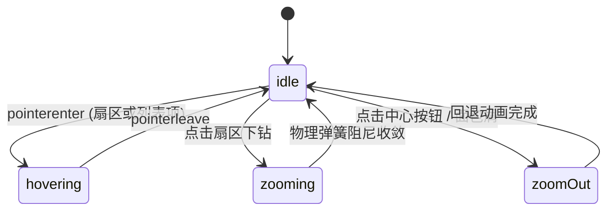

# Sunburst · 旭日旭日图

以多层同心圆环展示复杂树状层级构成的径向数据可视化组件。支持层级无级缩放下钻（Hierarchical Zoom In/Out）、中心展台数值平滑形变联动、面包屑轨迹导航（Breadcrumb Trail）、右侧明细分类列表联动高亮，以及全键盘扇区巡航访问。

## 原型清单

| 原型分组 | 原型元素 | 动效 / 状态变化 | 去向 |
| --- | --- | --- | --- |
| — | 图表外层卡片 `.arc-sun-card` | 布局宿主与网格环境 | 最小 DOM / CSS |
| — | 面包屑导航 `.arc-sun-crumbs` | 路径节点进入淡入、点击任意上级快速回退 | 面包屑下钻导航 |
| — | 径向主视口 `.arc-sun-ring` | 居中固定 340×340px 视口，`viewBox="0 0 340 340"` | 径向绘图容器 |
| — | 扇区弧形路径 `.arc-sun-arc` | SVG 圆弧参数（A 弧度），点击下钻平滑角度展开 | 扇区弧形渲染 |
| — | 扇区内嵌文字 `.arc-sun-arcLabel` | 沿扇区中心法线角度旋转（rotate），小面积自适应隐藏 | 弧形居中文字 |
| — | 中心展台按钮 `.arc-sun-center` | 居中同心圆按压，展示当前层级名、金额数值与子项数量 | 中心控制台 |
| — | 浮动提示卡 `.arc-sun-tooltip` | 跟随指针吸附扇区，展示节点名、数值与父级占比 | 浮动提示 |
| — | 明细列表 `.arc-sun-legend` / `.arc-sun-row` | 右侧/下方子节点清单，悬停高亮与点击下钻 | 子层级明细面板 |
| — | 读屏无障碍表格 `.arc-sun-srOnly` | 完整层级树表格与 `aria-live` 实时宣告 | 无障碍表格 |
| — | 顶栏月份切换按钮 `.bu` / `.ur` | 演示 Aug / Sep 支出切换 | 演示外壳，已删除 |
| — | 顶栏、外观切换按钮 `#themeBtn`、舞台外壳 | — | 演示外壳，已删除 |

## 适用

- 多层树形分类金额或配额分解（如云资源支出、组织架构预算、多级文件体积）。
- 强调中心向外发散的整体与局部占比心智（从第一层一级业务，到第二层子模块，再到第三层微服务）。
- 需要沉浸式的层级缩放体验：点击任意扇区，圆环平滑变异放大将该节点展开为新圆环，中心按钮随时一键返回。
- 允许通过面包屑或列表项直接跨层级回退。

## 不适用

- 平面矩形多层级嵌套切分 → [treemap](treemap.md)
- 单维度简易分类环形切片 → [donut-chart](../charts/donut-chart.md)
- 多阶段流转与损耗桑基图 → [sankey-flow](sankey-flow.md)
- 业务转化单向漏斗 → [funnel-chart](../charts/funnel-chart.md)

## 状态机

| 状态 | 进入条件 | 视觉表现 | 退出到 |
| --- | --- | --- | --- |
| idle | 初始挂载或静止态 | 展示当前聚焦根节点及其子环，中心显示该节点汇总，列表列出直接子项 | hovering / zooming |
| hovering | 鼠标悬停在某个扇区或列表项上 | 目标扇区向外微浮动或加深对比度，其他同级扇区适度压暗，Tooltip 显现 | idle |
| zooming | 点击非叶子扇区或列表行下钻 | 扇区角度在 620ms（bounce 0.06）内平滑展开，中心展台数值平滑跳变 | idle |
| zoomOut | 点击中心按钮或面包屑上级节点 | 视图向内收缩回溯至上级父节点视图 | idle |



## 最小 DOM

```html
<figure class="arc-sun-figure" role="group" aria-label="Hierarchical sunburst chart">
  <nav class="arc-sun-crumbs" aria-label="Navigation path">
    <ol class="arc-sun-crumbList">
      <li class="arc-sun-crumb">
        <span class="arc-sun-crumbCurrent" aria-current="location">Root</span>
      </li>
    </ol>
  </nav>

  <div class="arc-sun-body">
    <div class="arc-sun-ring" role="group" tabindex="0" aria-roledescription="sunburst" style="width: 340px;">
      <svg class="arc-sun-svg" viewBox="0 0 340 340" aria-hidden="true" focusable="false">
        <circle class="arc-sun-track" cx="170" cy="170" r="114" />
        <g class="arc-sun-arcs">
          <!-- 动态 SVG 扇区 paths -->
        </g>
        <g class="arc-sun-labels">
          <!-- 扇区文字 labels -->
        </g>
      </svg>

      <button type="button" class="arc-sun-center" aria-label="Center zoom out">
        <span class="arc-sun-centerLabel">All teams</span>
        <span class="arc-sun-centerValue">$188.2K</span>
        <span class="arc-sun-centerMeta">5 groups</span>
      </button>

      <div class="arc-sun-tooltip" aria-hidden="true"></div>
    </div>

    <div class="arc-sun-legendBox">
      <ul class="arc-sun-legend" aria-label="Current level parts">
        <!-- 子级明细行 -->
      </ul>
    </div>
  </div>

  <div class="arc-sun-srOnly" aria-live="polite"></div>
</figure>
```

- `.arc-sun-figure`：根组件宿主容器。
- `.arc-sun-crumbs`：顶部下钻面包屑导航。
- `.arc-sun-ring`：340×340 绝对定标的同心圆环区域。
- `.arc-sun-arcs`：承载扇区 `<path class="arc-sun-arc">`。
- `.arc-sun-center`：中心圆形操作展台，显示聚焦根节点核心信息。
- `.arc-sun-legend`：右侧/下方子分类列表面板。

## 参数

| 名称 | 值 | 用于 | 来源 |
| --- | --- | --- | --- |
| 视口定标尺寸 | `340 × 340px` | SVG 标准 viewBox 坐标 | 原型 |
| 中心点坐标 | `(170, 170)` | 径向旋转与几何圆心 | 原型 |
| 外环最大半径 | `168px` | 最外层第三层半径 | 原型 |
| 内环起始半径 | `60.5px` | 留空给中心展台的内半径 | 原型 |
| 最大可见环层数 | `3 层` | 超过三层时在下钻后渐进显现 | 原型 |
| 下钻动画弹簧 | `visualDuration: 0.62s, bounce: 0.06` | 扇区拉伸展开物理质感 | 原型 |
| Tooltip 跟随弹簧 | `visualDuration: 0.26s, bounce: 0.12` | 浮动提示吸附 | 原型 |

## CSS

```css
.arc-sun-figure {
  --sun-foreground: #111111;
  --sun-surface: #ffffff;
  --sun-surface-raised: #ffffff;
  --sun-border: rgba(0, 0, 0, 0.08);
  --sun-muted: #737373;
  --sun-accent: #2563eb;
  --sun-ease-spring: cubic-bezier(0.18, 0.89, 0.32, 1.15);
  --sun-series-1: #2563eb;
  --sun-series-2: #0284c7;
  --sun-series-3: #059669;
  --sun-series-4: #d97706;

  position: relative;
  display: grid;
  min-width: 0;
  gap: 16px;
  color: var(--sun-foreground);
  font-family: system-ui, -apple-system, sans-serif;
  user-select: none;
}

.arc-sun-crumbs {
  display: flex;
  min-height: 24px;
}

.arc-sun-crumbList {
  display: flex;
  align-items: center;
  gap: 6px;
  margin: 0;
  padding: 0;
  list-style: none;
  font-size: 13px;
}

.arc-sun-crumbItem {
  display: inline-flex;
  align-items: center;
  gap: 6px;
}

.arc-sun-crumbLink {
  border: none;
  background: transparent;
  color: var(--sun-accent);
  cursor: pointer;
  padding: 0;
  font: inherit;
  text-decoration: underline;
}

.arc-sun-crumbCurrent {
  font-weight: 600;
  color: var(--sun-foreground);
}

.arc-sun-body {
  display: flex;
  flex-wrap: wrap;
  align-items: center;
  justify-content: center;
  gap: 24px;
}

.arc-sun-ring {
  position: relative;
  width: 340px;
  height: 340px;
  flex: none;
  outline: none;
}

.arc-sun-svg {
  width: 100%;
  height: 100%;
  display: block;
  overflow: visible;
}

.arc-sun-track {
  fill: none;
  stroke: rgba(0, 0, 0, 0.03);
}

.arc-sun-arc {
  fill: var(--fill, var(--sun-accent));
  stroke: var(--sun-surface);
  stroke-width: 1.5;
  cursor: pointer;
  transition: opacity 200ms ease, transform 200ms ease;
}

.arc-sun-arc:hover {
  filter: brightness(1.08);
}

.arc-sun-ring[data-has-active] .arc-sun-arc:not([data-active]) {
  opacity: 0.2;
}

.arc-sun-arcLabel {
  fill: var(--sun-foreground);
  font-size: 10px;
  font-weight: 500;
  pointer-events: none;
  text-shadow: 0 1px 2px rgba(255, 255, 255, 0.8);
}

.arc-sun-center {
  position: absolute;
  top: 50%;
  left: 50%;
  transform: translate(-50%, -50%);
  display: flex;
  flex-direction: column;
  align-items: center;
  justify-content: center;
  width: 112px;
  height: 112px;
  border: 1px solid var(--sun-border);
  border-radius: 50%;
  background: var(--sun-surface-raised);
  box-shadow: 0 4px 16px rgba(0, 0, 0, 0.06);
  cursor: pointer;
  outline: none;
  padding: 8px;
  text-align: center;
  transition: transform 120ms ease;
}

.arc-sun-center:active:not(:disabled) {
  transform: translate(-50%, -50%) scale(0.96);
}

.arc-sun-center:disabled {
  cursor: default;
}

.arc-sun-centerLabel {
  font-size: 11px;
  color: var(--sun-muted);
  max-width: 90px;
  overflow: hidden;
  text-overflow: ellipsis;
  white-space: nowrap;
}

.arc-sun-centerValue {
  font-size: 16px;
  font-weight: 700;
  color: var(--sun-foreground);
  font-variant-numeric: tabular-nums;
  margin: 2px 0;
}

.arc-sun-centerMeta {
  font-size: 10px;
  color: var(--sun-muted);
}

.arc-sun-legendBox {
  flex: 1;
  min-width: 220px;
  max-width: 320px;
}

.arc-sun-legend {
  margin: 0;
  padding: 0;
  list-style: none;
  display: grid;
  gap: 6px;
}

.arc-sun-row {
  display: flex;
  align-items: center;
  gap: 8px;
  width: 100%;
  height: 32px;
  padding: 0 8px;
  border: 1px solid var(--sun-border);
  border-radius: 6px;
  background: var(--sun-surface);
  color: var(--sun-foreground);
  cursor: pointer;
  font: inherit;
  font-size: 12px;
  text-align: left;
  transition: background-color 160ms ease;
}

.arc-sun-row:hover {
  background: rgba(0, 0, 0, 0.04);
}

.arc-sun-dot {
  width: 8px;
  height: 8px;
  border-radius: 50%;
  background: var(--fill, var(--sun-accent));
}

.arc-sun-rowLabel {
  flex: 1;
  overflow: hidden;
  text-overflow: ellipsis;
  white-space: nowrap;
}

.arc-sun-rowValue {
  font-weight: 500;
  font-variant-numeric: tabular-nums;
}

.arc-sun-rowShare {
  color: var(--sun-muted);
  font-size: 11px;
  font-variant-numeric: tabular-nums;
}

.arc-sun-tooltip {
  position: absolute;
  z-index: 5;
  display: grid;
  gap: 2px;
  padding: 6px 10px;
  border: 1px solid var(--sun-border);
  border-radius: 6px;
  background: var(--sun-surface-raised);
  box-shadow: 0 4px 12px rgba(0, 0, 0, 0.1);
  font-size: 11px;
  pointer-events: none;
  opacity: 0;
  transform: translate(-50%, -120%) scale(0.96);
  transition: opacity 120ms ease, transform 160ms var(--sun-ease-spring);
}

.arc-sun-tooltip[data-visible] {
  opacity: 1;
  transform: translate(-50%, -125%) scale(1);
}

.arc-sun-srOnly {
  position: absolute;
  width: 1px;
  height: 1px;
  overflow: hidden;
  clip: rect(0, 0, 0, 0);
  white-space: nowrap;
}

@media (prefers-reduced-motion: reduce) {
  .arc-sun-arc,
  .arc-sun-center,
  .arc-sun-tooltip {
    transition: none !important;
  }
}
```

## JS

```js
/**
 * 旭日图组件
 * @param {HTMLElement} el 宿主容器
 * @param {Object} options 配置项
 * @returns {Object} 控制句柄与清理接口
 */
export function createSunburst(el, options = {}) {
  const defaultTree = {
    id: 'root',
    name: 'All teams',
    children: [
      {
        id: 'platform',
        name: 'Platform',
        color: '#2563eb',
        children: [
          { id: 'compute', name: 'Compute', value: 31400 },
          { id: 'storage', name: 'Storage', value: 8700 },
          { id: 'network', name: 'Network', value: 9800 }
        ]
      },
      {
        id: 'data',
        name: 'Data',
        color: '#0284c7',
        children: [
          { id: 'warehouse', name: 'Warehouse', value: 31000 },
          { id: 'streaming', name: 'Streaming', value: 9900 },
          { id: 'lake', name: 'Lake', value: 9100 }
        ]
      },
      {
        id: 'ml',
        name: 'ML',
        color: '#059669',
        children: [
          { id: 'training', name: 'Training', value: 45800 },
          { id: 'inference', name: 'Inference', value: 16000 }
        ]
      },
      {
        id: 'product',
        name: 'Product',
        color: '#d97706',
        children: [
          { id: 'web', name: 'Web', value: 7400 },
          { id: 'mobile', name: 'Mobile', value: 5300 },
          { id: 'search', name: 'Search', value: 4900 }
        ]
      },
      {
        id: 'security',
        name: 'Security',
        color: '#64748b',
        children: [
          { id: 'logging', name: 'Logging', value: 6800 },
          { id: 'scanning', name: 'Scanning', value: 2100 }
        ]
      }
    ]
  };

  const rootData = options.data || defaultTree;
  let currentFocusNode = rootData;
  let lineage = [rootData];
  let disposed = false;

  const ring = el.querySelector('.arc-sun-ring');
  const svg = el.querySelector('.arc-sun-svg');
  const arcsG = el.querySelector('.arc-sun-arcs') || svg?.querySelector('g');
  const labelsG = el.querySelector('.arc-sun-labels');
  const centerBtn = el.querySelector('.arc-sun-center');
  const centerLabel = el.querySelector('.arc-sun-centerLabel');
  const centerValue = el.querySelector('.arc-sun-centerValue');
  const centerMeta = el.querySelector('.arc-sun-centerMeta');
  const crumbList = el.querySelector('.arc-sun-crumbList');
  const legendList = el.querySelector('.arc-sun-legend');
  const tooltip = el.querySelector('.arc-sun-tooltip');

  const cx = 170, cy = 170;
  const innerR = 60.5;
  const maxR = 168;

  function calculateNodeValue(node) {
    if (typeof node.value === 'number') return node.value;
    if (Array.isArray(node.children) && node.children.length) {
      node.value = node.children.reduce((acc, c) => acc + calculateNodeValue(c), 0);
      return node.value;
    }
    node.value = 0;
    return 0;
  }
  calculateNodeValue(rootData);

  function polarToCartesian(centerX, centerY, radius, angleInRadians) {
    return {
      x: centerX + radius * Math.cos(angleInRadians),
      y: centerY + radius * Math.sin(angleInRadians)
    };
  }

  function describeArc(x, y, rIn, rOut, startAngle, endAngle) {
    const startIn = polarToCartesian(x, y, rIn, endAngle);
    const endIn = polarToCartesian(x, y, rIn, startAngle);
    const startOut = polarToCartesian(x, y, rOut, startAngle);
    const endOut = polarToCartesian(x, y, rOut, endAngle);
    const arcSweep = endAngle - startAngle <= Math.PI ? '0' : '1';

    return [
      `M ${startOut.x.toFixed(2)} ${startOut.y.toFixed(2)}`,
      `A ${rOut} ${rOut} 0 ${arcSweep} 1 ${endOut.x.toFixed(2)} ${endOut.y.toFixed(2)}`,
      `L ${startIn.x.toFixed(2)} ${startIn.y.toFixed(2)}`,
      `A ${rIn} ${rIn} 0 ${arcSweep} 0 ${endIn.x.toFixed(2)} ${endIn.y.toFixed(2)}`,
      'Z'
    ].join(' ');
  }

  function render() {
    if (!svg || !ring) return;

    // 1. 展开当前焦点节点
    const focusTotal = currentFocusNode.value || 1;
    const isRoot = currentFocusNode === rootData;

    // 更新中心展台
    if (centerLabel) centerLabel.textContent = currentFocusNode.name;
    if (centerValue) centerValue.textContent = `$${(currentFocusNode.value / 1000).toFixed(1)}K`;
    if (centerMeta) {
      const childCount = currentFocusNode.children?.length || 0;
      centerMeta.textContent = `${childCount} group${childCount > 1 ? 's' : ''}`;
    }
    if (centerBtn) centerBtn.disabled = isRoot;

    // 2. 更新面包屑
    if (crumbList) {
      crumbList.innerHTML = '';
      lineage.forEach((node, idx) => {
        const li = document.createElement('li');
        li.className = 'arc-sun-crumbItem';
        if (idx === lineage.length - 1) {
          li.innerHTML = `<span class="arc-sun-crumbCurrent">${node.name}</span>`;
        } else {
          const link = document.createElement('button');
          link.type = 'button';
          link.className = 'arc-sun-crumbLink';
          link.textContent = node.name;
          link.addEventListener('click', () => zoomTo(node.id));
          li.appendChild(link);
          const sep = document.createElement('span');
          sep.textContent = '/';
          sep.style.color = 'var(--sun-muted)';
          li.appendChild(sep);
        }
        crumbList.appendChild(li);
      });
    }

    // 3. 计算扇区布局 (最多呈现两层)
    if (arcsG) arcsG.innerHTML = '';
    if (labelsG) labelsG.innerHTML = '';

    const children = currentFocusNode.children || [];
    const ringWidth = (maxR - innerR) / 2;

    let currentAngle = -Math.PI / 2; // 从 12 点钟方向开始

    children.forEach(child => {
      const childAngleSpan = (child.value / focusTotal) * (Math.PI * 2);
      const startA = currentAngle;
      const endA = currentAngle + childAngleSpan;
      currentAngle = endA;

      const r0 = innerR;
      const r1 = innerR + ringWidth;
      const pathD = describeArc(cx, cy, r0, r1, startA, endA);

      const pathEl = document.createElementNS('http://www.w3.org/2000/svg', 'path');
      pathEl.className.baseVal = 'arc-sun-arc';
      pathEl.setAttribute('d', pathD);
      const color = child.color || currentFocusNode.color || 'var(--sun-accent)';
      pathEl.style.setProperty('--fill', color);
      pathEl.dataset.id = child.id;

      pathEl.addEventListener('click', () => {
        if (child.children?.length) zoomTo(child.id);
      });

      pathEl.addEventListener('mouseenter', (e) => {
        ring.setAttribute('data-has-active', '');
        pathEl.setAttribute('data-active', '');
        if (tooltip) {
          const share = ((child.value / focusTotal) * 100).toFixed(1);
          tooltip.innerHTML = `<strong>${child.name}</strong><span>$${(child.value / 1000).toFixed(1)}K (${share}%)</span>`;
          const midA = (startA + endA) / 2;
          const pos = polarToCartesian(cx, cy, (r0 + r1) / 2, midA);
          tooltip.style.left = `${pos.x}px`;
          tooltip.style.top = `${pos.y}px`;
          tooltip.setAttribute('data-visible', '');
        }
      });

      pathEl.addEventListener('mouseleave', () => {
        ring.removeAttribute('data-has-active');
        pathEl.removeAttribute('data-active');
        if (tooltip) tooltip.removeAttribute('data-visible');
      });

      if (arcsG) arcsG.appendChild(pathEl);

      // 二级子环
      if (child.children?.length) {
        let subAngle = startA;
        const subTotal = child.value || 1;
        child.children.forEach(sub => {
          const subSpan = (sub.value / subTotal) * childAngleSpan;
          const sA = subAngle;
          const eA = subAngle + subSpan;
          subAngle = eA;

          const sr0 = r1 + 2;
          const sr1 = maxR;
          const subD = describeArc(cx, cy, sr0, sr1, sA, eA);

          const subPath = document.createElementNS('http://www.w3.org/2000/svg', 'path');
          subPath.className.baseVal = 'arc-sun-arc';
          subPath.setAttribute('d', subD);
          subPath.style.setProperty('--fill', color);
          subPath.style.opacity = '0.75';
          subPath.dataset.id = sub.id;

          subPath.addEventListener('click', () => {
            if (sub.children?.length) zoomTo(sub.id);
          });

          subPath.addEventListener('mouseenter', () => {
            ring.setAttribute('data-has-active', '');
            subPath.setAttribute('data-active', '');
            if (tooltip) {
              const share = ((sub.value / focusTotal) * 100).toFixed(1);
              tooltip.innerHTML = `<strong>${sub.name}</strong><span>$${(sub.value / 1000).toFixed(1)}K (${share}%)</span>`;
              const midA = (sA + eA) / 2;
              const pos = polarToCartesian(cx, cy, (sr0 + sr1) / 2, midA);
              tooltip.style.left = `${pos.x}px`;
              tooltip.style.top = `${pos.y}px`;
              tooltip.setAttribute('data-visible', '');
            }
          });

          subPath.addEventListener('mouseleave', () => {
            ring.removeAttribute('data-has-active');
            subPath.removeAttribute('data-active');
            if (tooltip) tooltip.removeAttribute('data-visible');
          });

          if (arcsG) arcsG.appendChild(subPath);
        });
      }
    });

    // 4. 更新右侧/下方明细列表
    if (legendList) {
      legendList.innerHTML = '';
      children.forEach(child => {
        const li = document.createElement('li');
        const share = ((child.value / focusTotal) * 100).toFixed(1);
        const color = child.color || currentFocusNode.color || 'var(--sun-accent)';
        li.innerHTML = `
          <button type="button" class="arc-sun-row" style="--fill: ${color}">
            <span class="arc-sun-dot" aria-hidden="true"></span>
            <span class="arc-sun-rowLabel">${child.name}</span>
            <span class="arc-sun-rowValue">$${(child.value / 1000).toFixed(1)}K</span>
            <span class="arc-sun-rowShare">${share}%</span>
          </button>
        `;
        li.querySelector('button').addEventListener('click', () => {
          if (child.children?.length) zoomTo(child.id);
        });
        legendList.appendChild(li);
      });
    }
  }

  function findNodeAndLineage(node, targetId, pathArr = []) {
    if (node.id === targetId) return [...pathArr, node];
    if (node.children) {
      for (const child of node.children) {
        const res = findNodeAndLineage(child, targetId, [...pathArr, node]);
        if (res) return res;
      }
    }
    return null;
  }

  function zoomTo(targetId) {
    const foundPath = findNodeAndLineage(rootData, targetId);
    if (foundPath && foundPath.length) {
      lineage = foundPath;
      currentFocusNode = lineage[lineage.length - 1];
      render();
    }
  }

  function zoomOut() {
    if (lineage.length > 1) {
      lineage.pop();
      currentFocusNode = lineage[lineage.length - 1];
      render();
    }
  }

  if (centerBtn) {
    centerBtn.addEventListener('click', zoomOut);
  }

  render();

  return {
    zoomTo,
    zoomOut,
    getState() {
      return {
        focusId: currentFocusNode.id,
        focusName: currentFocusNode.name,
        lineage: lineage.map(n => n.name)
      };
    },
    destroy() {
      disposed = true;
      if (centerBtn) {
        centerBtn.removeEventListener('click', zoomOut);
      }
    }
  };
}
```

## 接入目标项目

- 状态来源：树形嵌套层级对象（每个节点包含 `id`、`name`、`value?`、`children?`）。
- 尺寸策略：圆环推荐 340×340px 绝对定标，整体外壳支持响应式宽度自适应。
- 驱动方式：实例化调用 `createSunburst(container, { data })`，外部可通过 `zoomTo(id)` 直接驱动视图定位。

## 重入与清理

- 连续点击不同扇区快速下钻时立即重算角度并覆盖旧路径，杜绝动画排队冲突。
- 卸载时彻底移除中心按钮事件与扇区事件监听，防止内存泄漏。

## 减少动态效果

- 在 `prefers-reduced-motion: reduce` 下，关闭圆弧缩放与 Tooltip 浮动动画（`transition: none !important`）。
- 层级下钻与回退瞬时完成切换。

## 焦点与键盘

- 圆环宿主具备 `tabindex="0"` 与 `role="group"`。
- 支持键盘 `Enter` / `Space` 触发选中扇区下钻，`Escape` / `Backspace` 触发层级回退。
- 底部附带完整层级路径与 `aria-live="polite"` 读屏宣告节点。

## 兼容回退

| 特性 | 不支持时 |
| --- | --- |
| SVG 极坐标弧形变换 | 降级为规则同心圆与纯列表明细展示 |
| `color-mix()` | 采用预设固定透明度配色方案 |

## 验收清单

- [ ] 同心圆环清晰呈现多层级扇区切片，半径均匀。
- [ ] 点击任意含子项的扇区或右侧列表项，平滑下钻至该节点作为中心圆环。
- [ ] 面包屑轨迹正确记录当前访问路径，点击任意上级可直接回退。
- [ ] 点击中心展台圆形按钮可逐级向外返回。
- [ ] 鼠标悬停任意扇区时，高亮选中项并弹出格式化金额与占比 Tooltip。
- [ ] 开启系统的减少动态效果偏好时，层级切换无额外延迟。
