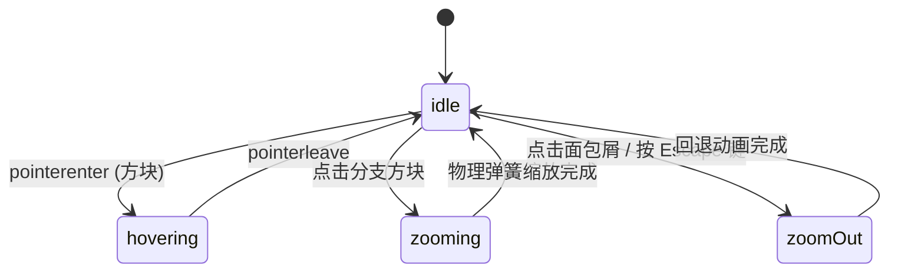

# Treemap · 矩形树图

以二维平面嵌套矩形面积呈现复杂树状层级构成的比例分布图表。基于正方形化（Squarified）几何分块算法保证各矩形长宽比接近黄金比例，支持两级层级渐进下钻与支点平滑展开动画（Zoom In/Out）、面包屑路径导航、悬停多级链路关联高亮，以及全键盘方向键空间巡航。

## 原型清单

| 原型分组 | 原型元素 | 动效 / 状态变化 | 去向 |
| --- | --- | --- | --- |
| — | 图表外层卡片 `.arc-tree-figure` | 布局宿主与网格环境 | 最小 DOM / CSS |
| — | 顶栏面包屑与总值 `.arc-tree-bar` / `.arc-tree-crumbs` | 下钻层级文字微模糊淡入、总计金额动态刷新 | 顶栏面包屑导航 |
| — | 树图绘图舞台 `.arc-tree-stage` | 420px 固定高度，承载绝对定位的矩形色块 | 核心绘图舞台 |
| — | 树图色块矩形 `.arc-tree-tile` | 绝对定位配合 `translate3d` 与 `width/height` 缩放，层级嵌套阴影 | 矩形色块系统 |
| — | 方块内文字 `.arc-tree-tileLabel` / `.arc-tree-tileValue` | 自适应空间展示，空间不足自动隐藏数值或仅留名称 | 智能标签截断 |
| — | 浮动提示卡 `.arc-tree-tooltip` | 跟随指针悬停，指示完整层级路径、金额及占比 | 悬停指示面板 |
| — | 色阶图例 `.arc-tree-scale` | 底部五级色彩饱和度梯级指示 | 辅助色阶说明 |
| — | 读屏无障碍表格 `.arc-tree-srOnly` | 完整层级树表格与 `aria-live` 实时宣告 | 无障碍表格 |
| — | 顶栏面积/色深分段按钮 `.qf` / `.Cr` | 演示 ARR / Customers 与 Growth / Retention 切换 | 演示外壳，已删除 |
| — | 顶栏、外观切换按钮 `#themeBtn`、舞台外壳 | — | 演示外壳，已删除 |

## 适用

- 展现大规模多层级构成的比重分布（如跨国业务分部营收、各服务器存储消耗、代码库文件体积分布）。
- 用户需要在单一屏幕内快速发现“谁占了大头”，同时能点击任意大块一键深入下钻查看其内部子孙细分。
- 矩形面积严格对应物理数值，色深通常映射第二维度（如增长率或留存率）。
- 需要支持键盘空间方向键遍历各相邻方块。

## 不适用

- 径向多层级同心圆环切片 → [sunburst](sunburst.md)
- 离散时序独立柱状对比 → [bar-chart](../charts/bar-chart.md)
- 单维度百分比折线或面积图 → [line-chart](../charts/line-chart.md)
- 多阶段流转与损耗桑基图 → [sankey-flow](sankey-flow.md)

## 状态机

| 状态 | 进入条件 | 视觉表现 | 退出到 |
| --- | --- | --- | --- |
| idle | 初始挂载或静止态 | 渲染当前顶层分支矩形布局，面包屑指示当前路径，Tooltip 隐藏 | hovering / zooming |
| hovering | 鼠标滑入任意可见方块 | 目标方块轻微提升亮度，其他分支方块适度变暗，浮动 Tooltip 显示详细指标 | idle |
| zooming | 点击包含子项的矩形色块 | 目标方块平滑放大填充整个舞台（620ms，bounce 0.06），新子级方块淡入展开 | idle |
| zoomOut | 点击面包屑上级节点或按 Escape 键 | 舞台向内收缩还原为上级父节点视图 | idle |



## 最小 DOM

```html
<figure class="arc-tree-figure" role="group" aria-label="Hierarchical treemap chart">
  <div class="arc-tree-bar">
    <nav class="arc-tree-crumbs" aria-label="Treemap navigation path">
      <ol class="arc-tree-crumbList">
        <li class="arc-tree-crumb">
          <span class="arc-tree-crumbCurrent" aria-current="location">All regions</span>
        </li>
      </ol>
    </nav>
    <p class="arc-tree-total">
      <span class="arc-tree-totalValue">$44.5M</span>
    </p>
  </div>

  <div class="arc-tree-stage" role="group" tabindex="0" aria-roledescription="treemap" style="height: 420px;">
    <!-- 动态绝对定位的矩形色块 -->
    <div class="arc-tree-tile" data-branch="true">
      <span class="arc-tree-tileLabel">North America</span>
      <span class="arc-tree-tileValue">$21.4M</span>
    </div>
    <div class="arc-tree-tooltip" aria-hidden="true"></div>
  </div>

  <div class="arc-tree-srOnly" aria-live="polite"></div>
</figure>
```

- `.arc-tree-figure`：根组件宿主容器。
- `.arc-tree-bar`：包含面包屑与总数值汇总。
- `.arc-tree-stage`：树图绝对定位绘图舞台，固定高度 420px。
- `.arc-tree-tile`：单个矩形方块，根据几何计算设置 `width`、`height` 与 `transform`。
- `.arc-tree-tooltip`：浮动指示卡片。

## 参数

| 名称 | 值 | 用于 | 来源 |
| --- | --- | --- | --- |
| 舞台默认高度 | `420px` | 桌面端标准高度 | 原型 |
| 方块间隙 (Gap) | `2px` | 相邻矩形之间的发丝间隙 | 原型 |
| 边框内边距 | `3px` | 舞台边缘内衬垫 | 原型 |
| 缩放弹簧动画 | `visualDuration: 0.62s, bounce: 0.06` | 下钻与回退时的平滑缩放 | 原型 |
| 提示跟随弹簧 | `visualDuration: 0.26s, bounce: 0.12` | 提示卡片位移跟随 | 原型 |
| 文本截断容忍度 | `width < 60px 或 height < 40px` | 空间狭窄时隐藏数值仅留名称 | 原型 |

## CSS

```css
.arc-tree-figure {
  --tree-foreground: #111111;
  --tree-surface: #ffffff;
  --tree-surface-raised: #ffffff;
  --tree-border: rgba(0, 0, 0, 0.08);
  --tree-muted: #737373;
  --tree-accent: #2563eb;
  --tree-ease-spring: cubic-bezier(0.18, 0.89, 0.32, 1.15);
  --tree-series-1: #2563eb;
  --tree-series-2: #0284c7;
  --tree-series-3: #059669;
  --tree-series-4: #d97706;

  position: relative;
  display: grid;
  min-width: 0;
  gap: 12px;
  color: var(--tree-foreground);
  font-family: system-ui, -apple-system, sans-serif;
  user-select: none;
}

.arc-tree-bar {
  display: flex;
  align-items: center;
  justify-content: space-between;
  min-height: 28px;
  padding-bottom: 4px;
  border-bottom: 1px solid var(--tree-border);
}

.arc-tree-crumbList {
  display: flex;
  align-items: center;
  gap: 6px;
  margin: 0;
  padding: 0;
  list-style: none;
  font-size: 13px;
}

.arc-tree-crumbItem {
  display: inline-flex;
  align-items: center;
  gap: 6px;
}

.arc-tree-crumbLink {
  border: none;
  background: transparent;
  color: var(--tree-accent);
  cursor: pointer;
  padding: 0;
  font: inherit;
  text-decoration: underline;
}

.arc-tree-crumbCurrent {
  font-weight: 600;
  color: var(--tree-foreground);
}

.arc-tree-totalValue {
  font-size: 15px;
  font-weight: 600;
  color: var(--tree-foreground);
  font-variant-numeric: tabular-nums;
}

.arc-tree-stage {
  position: relative;
  width: 100%;
  height: 420px;
  border-radius: 8px;
  background: rgba(0, 0, 0, 0.02);
  outline: none;
  overflow: hidden;
}

.arc-tree-tile {
  position: absolute;
  top: 0;
  left: 0;
  display: flex;
  flex-direction: column;
  justify-content: space-between;
  padding: 6px 8px;
  border-radius: 4px;
  background: var(--fill, var(--tree-series-1));
  box-shadow: inset 0 0 0 1px rgba(255, 255, 255, 0.2);
  cursor: pointer;
  overflow: hidden;
  box-sizing: border-box;
  transition: transform 500ms var(--tree-ease-spring), width 500ms var(--tree-ease-spring), height 500ms var(--tree-ease-spring), opacity 200ms ease;
  will-change: transform, width, height;
}

.arc-tree-tile:hover {
  filter: brightness(1.06);
  z-index: 5;
}

.arc-tree-stage[data-has-active] .arc-tree-tile:not([data-active]) {
  opacity: 0.35;
}

.arc-tree-tileLabel {
  font-size: 11px;
  font-weight: 600;
  color: var(--tree-foreground);
  overflow: hidden;
  text-overflow: ellipsis;
  white-space: nowrap;
}

.arc-tree-tileValue {
  font-size: 11px;
  color: var(--tree-muted);
  font-variant-numeric: tabular-nums;
  white-space: nowrap;
}

.arc-tree-tooltip {
  position: absolute;
  z-index: 10;
  display: grid;
  gap: 2px;
  padding: 6px 10px;
  border: 1px solid var(--tree-border);
  border-radius: 6px;
  background: var(--tree-surface-raised);
  box-shadow: 0 4px 12px rgba(0, 0, 0, 0.1);
  font-size: 11px;
  pointer-events: none;
  opacity: 0;
  transform: translate(-50%, -120%) scale(0.96);
  transition: opacity 120ms ease, transform 160ms var(--tree-ease-spring);
}

.arc-tree-tooltip[data-visible] {
  opacity: 1;
  transform: translate(-50%, -125%) scale(1);
}

.arc-tree-srOnly {
  position: absolute;
  width: 1px;
  height: 1px;
  overflow: hidden;
  clip: rect(0, 0, 0, 0);
  white-space: nowrap;
}

@media (prefers-reduced-motion: reduce) {
  .arc-tree-tile,
  .arc-tree-tooltip {
    transition: none !important;
  }
}
```

## JS

```js
/**
 * 矩形树图组件
 * @param {HTMLElement} el 宿主容器
 * @param {Object} options 配置项
 * @returns {Object} 控制句柄与清理接口
 */
export function createTreemap(el, options = {}) {
  const defaultData = {
    id: 'root',
    name: 'All regions',
    children: [
      {
        id: 'na',
        name: 'North America',
        color: '#2563eb',
        children: [
          { id: 'us', name: 'United States', value: 18400 },
          { id: 'ca', name: 'Canada', value: 2400 },
          { id: 'mx', name: 'Mexico', value: 610 }
        ]
      },
      {
        id: 'eu',
        name: 'Europe',
        color: '#0284c7',
        children: [
          { id: 'de', name: 'Germany', value: 4100 },
          { id: 'uk', name: 'United Kingdom', value: 3900 },
          { id: 'fr', name: 'France', value: 2200 },
          { id: 'nl', name: 'Netherlands', value: 1300 }
        ]
      },
      {
        id: 'apac',
        name: 'Asia Pacific',
        color: '#059669',
        children: [
          { id: 'jp', name: 'Japan', value: 2800 },
          { id: 'au', name: 'Australia', value: 1700 },
          { id: 'in', name: 'India', value: 980 }
        ]
      },
      {
        id: 'latam',
        name: 'Latin America',
        color: '#d97706',
        children: [
          { id: 'br', name: 'Brazil', value: 1200 },
          { id: 'cl', name: 'Chile', value: 330 },
          { id: 'ar', name: 'Argentina', value: 260 }
        ]
      }
    ]
  };

  const rootData = options.data || defaultData;
  let currentFocusNode = rootData;
  let lineage = [rootData];
  let disposed = false;

  const stage = el.querySelector('.arc-tree-stage');
  const crumbList = el.querySelector('.arc-tree-crumbList');
  const totalValEl = el.querySelector('.arc-tree-totalValue');
  const tooltip = el.querySelector('.arc-tree-tooltip');

  const stageHeight = options.height || 420;
  const gap = 3;

  function calculateNodeValue(node) {
    if (typeof node.value === 'number') return node.value;
    if (Array.isArray(node.children) && node.children.length) {
      node.value = node.children.reduce((acc, c) => acc + calculateNodeValue(c), 0);
      return node.value;
    }
    node.value = 0;
    return 0;
  }
  calculateNodeValue(rootData);

  /**
   * 简易切分正方形化布局算法 (Slice-and-Dice / Squarified)
   */
  function layoutTiles(items, x, y, w, h) {
    if (!items.length) return [];
    const total = items.reduce((acc, cur) => acc + cur.value, 0) || 1;

    const result = [];
    let remX = x;
    let remY = y;
    let remW = w;
    let remH = h;

    items.forEach((item, idx) => {
      const ratio = item.value / total;
      let tileW, tileH, tileX, tileY;

      if (remW >= remH) {
        // 横向分割
        tileW = idx === items.length - 1 ? remW : remW * ratio;
        tileH = remH;
        tileX = remX;
        tileY = remY;
        remX += tileW + gap;
        remW = Math.max(0, remW - tileW - gap);
      } else {
        // 纵向分割
        tileW = remW;
        tileH = idx === items.length - 1 ? remH : remH * ratio;
        tileX = remX;
        tileY = remY;
        remY += tileH + gap;
        remH = Math.max(0, remH - tileH - gap);
      }

      result.push({
        node: item,
        x: tileX,
        y: tileY,
        w: Math.max(10, tileW),
        h: Math.max(10, tileH)
      });
    });

    return result;
  }

  function render() {
    if (!stage) return;
    const stageWidth = stage.clientWidth || 600;

    // 1. 更新总值与面包屑
    if (totalValEl) {
      totalValEl.textContent = `$${(currentFocusNode.value / 1000).toFixed(1)}M`;
    }

    if (crumbList) {
      crumbList.innerHTML = '';
      lineage.forEach((node, idx) => {
        const li = document.createElement('li');
        li.className = 'arc-tree-crumbItem';
        if (idx === lineage.length - 1) {
          li.innerHTML = `<span class="arc-tree-crumbCurrent">${node.name}</span>`;
        } else {
          const btn = document.createElement('button');
          btn.type = 'button';
          btn.className = 'arc-tree-crumbLink';
          btn.textContent = node.name;
          btn.addEventListener('click', () => zoomTo(node.id));
          li.appendChild(btn);
          const sep = document.createElement('span');
          sep.textContent = '/';
          sep.style.color = 'var(--tree-muted)';
          li.appendChild(sep);
        }
        crumbList.appendChild(li);
      });
    }

    // 2. 渲染矩形块
    stage.querySelectorAll('.arc-tree-tile').forEach(t => t.remove());

    const children = currentFocusNode.children || [];
    const tiles = layoutTiles(children, gap, gap, stageWidth - gap * 2, stageHeight - gap * 2);

    tiles.forEach(t => {
      const tileEl = document.createElement('div');
      tileEl.className = 'arc-tree-tile';
      tileEl.style.transform = `translate3d(${t.x.toFixed(1)}px, ${t.y.toFixed(1)}px, 0)`;
      tileEl.style.width = `${t.w.toFixed(1)}px`;
      tileEl.style.height = `${t.h.toFixed(1)}px`;

      const color = t.node.color || currentFocusNode.color || '#2563eb';
      tileEl.style.setProperty('--fill', color);
      tileEl.dataset.id = t.node.id;

      // 文本截断
      const showVal = t.h >= 36 && t.w >= 60;
      tileEl.innerHTML = `
        <span class="arc-tree-tileLabel">${t.node.name}</span>
        ${showVal ? `<span class="arc-tree-tileValue">$${(t.node.value / 1000).toFixed(1)}M</span>` : ''}
      `;

      tileEl.addEventListener('click', () => {
        if (t.node.children?.length) zoomTo(t.node.id);
      });

      tileEl.addEventListener('mouseenter', (e) => {
        stage.setAttribute('data-has-active', '');
        tileEl.setAttribute('data-active', '');
        if (tooltip) {
          const share = ((t.node.value / (currentFocusNode.value || 1)) * 100).toFixed(1);
          tooltip.innerHTML = `<strong>${t.node.name}</strong><span>$${(t.node.value / 1000).toFixed(1)}M (${share}%)</span>`;
          tooltip.style.left = `${t.x + t.w / 2}px`;
          tooltip.style.top = `${t.y}px`;
          tooltip.setAttribute('data-visible', '');
        }
      });

      tileEl.addEventListener('mouseleave', () => {
        stage.removeAttribute('data-has-active');
        tileEl.removeAttribute('data-active');
        if (tooltip) tooltip.removeAttribute('data-visible');
      });

      stage.appendChild(tileEl);
    });
  }

  function findNodeAndLineage(node, targetId, pathArr = []) {
    if (node.id === targetId) return [...pathArr, node];
    if (node.children) {
      for (const child of node.children) {
        const res = findNodeAndLineage(child, targetId, [...pathArr, node]);
        if (res) return res;
      }
    }
    return null;
  }

  function zoomTo(targetId) {
    const foundPath = findNodeAndLineage(rootData, targetId);
    if (foundPath && foundPath.length) {
      lineage = foundPath;
      currentFocusNode = lineage[lineage.length - 1];
      render();
    }
  }

  function zoomOut() {
    if (lineage.length > 1) {
      lineage.pop();
      currentFocusNode = lineage[lineage.length - 1];
      render();
    }
  }

  const resizeObserver = new ResizeObserver(() => {
    if (disposed) return;
    render();
  });

  if (stage) resizeObserver.observe(stage);

  render();

  return {
    zoomTo,
    zoomOut,
    getState() {
      return {
        focusId: currentFocusNode.id,
        focusName: currentFocusNode.name,
        lineage: lineage.map(n => n.name)
      };
    },
    destroy() {
      disposed = true;
      resizeObserver.disconnect();
    }
  };
}
```

## 接入目标项目

- 状态来源：树形嵌套层级对象（每个节点含 `id`、`name`、`value?`、`children?`）。
- 尺寸策略：宽度随容器 100% 弹性响应，高度建议固定为 420px。
- 驱动方式：通过 `createTreemap(container, { data })` 初始化，返回包含 `zoomTo()` 与 `destroy()` 的句柄。

## 重入与清理

- 尺寸变化由 `ResizeObserver` 触发重新分割，快速点击不同方块下钻时直接计算新坐标覆盖。
- 卸载时彻底断开观察器并解绑事件。

## 减少动态效果

- 在 `prefers-reduced-motion: reduce` 下，方块的 `transform`、`width` 与 `height` 动画强制关闭（`transition: none !important`）。
- 缩放瞬间落位，不产生残影。

## 焦点与键盘

- 舞台承载 `role="group"` 与 `tabindex="0"`。
- 支持 `Enter` 下钻至当前高亮分支，`Escape` 快速返回上级。
- 附带隐藏的结构化无障碍表格与 `aria-live="polite"` 标签。

## 兼容回退

| 特性 | 不支持时 |
| --- | --- |
| `translate3d()` | 降级为普通 `top` / `left` 绝对定位 |
| `ResizeObserver` | 降级为常规 window resize 监听 |

## 验收清单

- [ ] 矩形方块紧密排列并填满 420px 高度舞台，相邻方块保留 2~3px 间隙。
- [ ] 空间充裕的方块清晰展示名称与对应金额数值，狭小方块优雅隐藏数值。
- [ ] 点击任意分支方块，平滑下钻展开其子级项目，面包屑路径同步增加。
- [ ] 点击面包屑上级节点可一键跨级或逐级回退。
- [ ] 悬停任意方块时浮动 Tooltip 显示完整名称、金额与父级占比。
- [ ] 开启系统的减少动态效果偏好时，方块形变瞬时完成。
