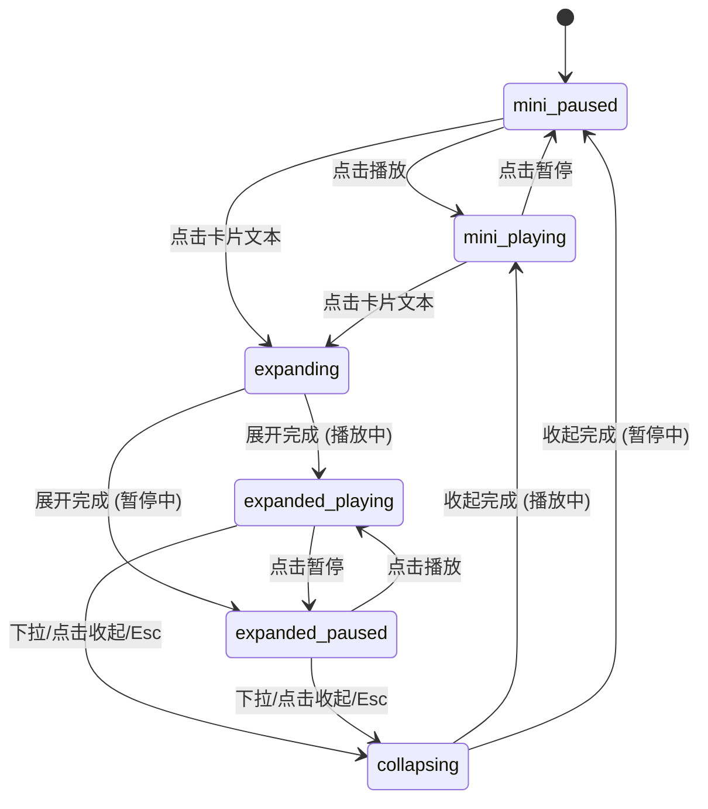

# Now Playing · 音乐播放胶囊与大卡片

用于流媒体音频、播客应用与背景音乐播放的高性能常驻迷你胶囊与大卡片展开组件。包含五大核心动效机制：

1. 迷你胶囊向大卡片的物理形态形变（Mini-to-Expanded Card Morph）：容器高度从 64px 弹性拉伸至大卡片高度，圆角从 22px 过渡至面板圆角，专辑封面由 48px 缩略图平滑膨胀放大为 240px 专辑大图（`visualDuration: 0.46s, bounce: 0.1`）。
2. 封面手势下拉阻尼收起（Pull-to-Collapse with Rubber Damping）：大卡片展开态下，支持按住封面向下拖拽，位移为实际手势位移的 0.6 倍；若位移超过 70px 或释放瞬时速度超过 0.5px/ms 顺势折叠收拢，未达阈值则弹簧弹性回弹复位。
3. 动态音频电平柱脉冲（Audio Level Equalizer Bars）：播放态下右侧电平跳动条执行高频缩放脉冲（`scaleY: 0.25 -> 1`），暂停态平滑降回静止状态。
4. 交互式声波进度条与弹性拉伸（Waveform Scrubber & Stretch）：支持在声波谱条上直接点击或拖拽寻轨，指针按下时波形柱纵向弹性拉伸 1.18 倍（`scaleY: 1.18`），越过首尾两端产生非线性橡皮筋形变。
5. 方向性感知的切歌滑动与微模糊置换（Directional Track Transition）：上一首/下一首切换时，专辑封面与曲目信息沿切歌方向（左/右）滑动错峰交替，播放/暂停图标执行微模糊形态置换。

## 原型清单

| 原型分组 | 原型元素 | 动效 / 状态变化 | 去向 |
| --- | --- | --- | --- |
| 外壳容器 | 播放器外壳（`.now-playing-shell`） | 高度从 64px 弹性拉伸，圆角同步过渡 | 迷你胶囊向大卡片形态形变 |
| 专辑封面 | 封面包装器与图片（`.now-playing-art`） | 48px 到大图尺寸的布局过渡，下拉位移 `translateY` | 迷你胶囊向大卡片形态形变 / 封面下拉阻尼收起 |
| 迷你信息 | 迷你曲名与艺术家（`.now-playing-mini-text`） | 展开时淡出，收起时淡入 | 最小 DOM / CSS |
| 动态电平 | 三根跳动音频电平柱（`.now-playing-levels`） | 播放时循环缩放脉冲，暂停时收平 | 动态音频电平柱脉冲 |
| 进度条 | 迷你进度细线与大卡片声波槽（`.now-playing-waveform`） | 播放时间推进，拖拽时 `scaleY: 1.18` 弹性拉伸 | 交互式声波进度条与弹性拉伸 |
| 播放按键 | 播放/暂停大按键（`.now-playing-btn-play`） | Play / Pause SVG 图标形态交替与微模糊置换 | 方向性感知的切歌滑动 |
| 前后切歌 | 上一曲与下一曲按钮（`.now-playing-btn-prev` / `.now-playing-btn-next`） | 窄屏时下一曲在迷你态隐藏，大卡片态全显 | 最小 DOM / CSS |
| 演示外壳 | 顶部主题切换按钮（`#themeBtn`）与顶栏 | 切换浅色/深色主题 | 演示外壳，已删除 |

## 适用

- 音乐播放器、播客应用、听书客户端的底部常驻微型控制器，点击后需要原地平滑展开为控制大卡片。
- 用户期望在展开卡片后通过下拉手势随手收回迷你条，兼具轻快流畅的物理回弹质感。
- 需要直观的声波跳动视觉反馈与高精度的波形寻轨控制。

## 不适用

- 全息智能语音助手光球交互 → [voice-orb](voice-orb.md)
- 会话窗口即时录音与语音气泡 → [voice-recorder](voice-recorder.md)
- 视频画廊与多机位视频进度条 → [product-gallery](../galleries/product-gallery.md)

## 状态机

| 状态 | 进入条件 | 视觉表现 | 退出到 |
| --- | --- | --- | --- |
| mini-paused | 初始状态；或暂停态收起 | 64px 紧凑胶囊，小封面，电平柱静止，播放键显示 Play 图标 | mini-playing / expanding |
| mini-playing | 迷你态下点击播放 | 电平柱跳动，底部细进度条前行 | mini-paused / expanding |
| expanding | 点击迷你文字展开 | 外壳高度伸展，封面膨胀，展开控制区与波形条淡入 | expanded-playing / expanded-paused |
| expanded-playing | 展开完成且处于播放态 | 大尺寸封面，电平柱与波形进度前行，显示大号暂停按钮 | expanded-paused / collapsing |
| expanded-paused | 展开态下点击暂停 | 进度推进挂起，电平柱降平 | expanded-playing / collapsing |
| collapsing | 点击收起按钮、向下轻扫或按 Esc | 外壳高度收缩，封面变小，控件淡出平滑归位至迷你胶囊 | mini-playing / mini-paused |



## 最小 DOM

```html
<div class="now-playing" role="region" aria-label="Now playing player">
  <div class="now-playing-shell" data-expanded="false" style="height: 64px;">
    <div class="now-playing-inner">
      <!-- 专辑封面 -->
      <div class="now-playing-art" role="button" aria-label="Album artwork" tabindex="0">
        
        <button type="button" class="now-playing-btn-collapse" aria-label="Collapse player" style="display: none;">
          <svg width="18" height="18" viewBox="0 0 24 24" fill="none" stroke="currentColor" stroke-width="2"><polyline points="6 9 12 15 18 9"/></svg>
        </button>
      </div>

      <!-- 迷你播放条主体文字 -->
      <button type="button" class="now-playing-mini-main" aria-label="Expand player, Undertow by Hollis Reed">
        <span class="now-playing-mini-title">Undertow</span>
        <span class="now-playing-mini-artist">Hollis Reed</span>
      </button>

      <!-- 动态电平跳动柱 -->
      <div class="now-playing-levels" aria-hidden="true">
        <span></span><span></span><span></span>
      </div>

      <!-- 迷你底部细线进度条 -->
      <div class="now-playing-mini-progress" aria-hidden="true">
        <div class="now-playing-mini-progress-fill" style="transform: scaleX(0);"></div>
      </div>

      <!-- 展开视图主体控制区 -->
      <div class="now-playing-expanded-content" style="display: none; opacity: 0;">
        <div class="now-playing-track-info">
          <h3 class="now-playing-expanded-title">Undertow</h3>
          <p class="now-playing-expanded-artist">Hollis Reed</p>
        </div>

        <!-- 声波寻轨进度条 -->
        <div class="now-playing-waveform-area">
          <div class="now-playing-waveform" role="slider" tabindex="0" aria-label="Track progress" aria-valuemin="0" aria-valuemax="210" aria-valuenow="0" aria-valuetext="0:00 of 3:30">
            <div class="now-playing-bars now-playing-bars-bg"></div>
            <div class="now-playing-bars now-playing-bars-fill"></div>
          </div>
          <div class="now-playing-times">
            <span class="now-playing-time-cur">0:00</span>
            <span class="now-playing-time-rem">-3:30</span>
          </div>
        </div>

        <!-- 展开视图播放控制键 -->
        <div class="now-playing-expanded-controls">
          <button type="button" class="now-playing-btn now-playing-btn-prev" aria-label="Previous track">
            <svg width="22" height="22" viewBox="0 0 24 24" fill="currentColor"><path d="m19 20-10-8 10-8v16zM5 19V5h2v14H5z"/></svg>
          </button>
          <button type="button" class="now-playing-btn now-playing-btn-play" aria-label="Play">
            <svg class="icon-play" width="24" height="24" viewBox="0 0 24 24" fill="currentColor"><path d="M5 3l14 9-14 9V3z"/></svg>
            <svg class="icon-pause" width="24" height="24" viewBox="0 0 24 24" fill="currentColor" style="display: none;"><path d="M6 19h4V5H6v14zm8-14v14h4V5h-4z"/></svg>
          </button>
          <button type="button" class="now-playing-btn now-playing-btn-next" aria-label="Next track">
            <svg width="22" height="22" viewBox="0 0 24 24" fill="currentColor"><path d="m5 4 10 8-10 8V4zM19 5v14h-2V5h2z"/></svg>
          </button>
        </div>
      </div>

      <!-- 迷你播放条右侧常驻播放与下一曲 -->
      <div class="now-playing-mini-actions">
        <button type="button" class="now-playing-mini-play" aria-label="Play">
          <svg class="icon-play" width="18" height="18" viewBox="0 0 24 24" fill="currentColor"><path d="M5 3l14 9-14 9V3z"/></svg>
          <svg class="icon-pause" width="18" height="18" viewBox="0 0 24 24" fill="currentColor" style="display: none;"><path d="M6 19h4V5H6v14zm8-14v14h4V5h-4z"/></svg>
        </button>
        <button type="button" class="now-playing-mini-next" aria-label="Next track">
          <svg width="18" height="18" viewBox="0 0 24 24" fill="currentColor"><path d="m5 4 10 8-10 8V4zM19 5v14h-2V5h2z"/></svg>
        </button>
      </div>
    </div>
  </div>
  <p class="now-playing-sr" role="status" aria-live="polite"></p>
</div>
```

- `.now-playing`：外部宿主定位容器。
- `.now-playing-shell`：动态高度形变外壳（64px $\leftrightarrow$ 420px）。
- `.now-playing-art`：封面图层，承载 48px 到大尺寸的平滑过渡与下拉折叠手势。
- `.now-playing-levels`：跳动的声波电平柱。
- `.now-playing-waveform`：交互式声波进度条。
- `.now-playing-expanded-content`：展开面板主体。

## 参数

| 名称 | 值 | 用于 | 来源 |
| --- | --- | --- | --- |
| 迷你胶囊高度 | `64px` | 收拢态高度 | 原型 |
| 展开面板高度 | `420px` | 展开态高度 | 原型 |
| 胶囊圆角 | `22px` | 迷你态 border-radius | 原型 |
| 展开圆角 | `28px` | 展开态 border-radius | 原型 |
| 形变弹簧时长 | `460ms` / `cubic-bezier(0.16, 1, 0.3, 1)` | 展开/折叠过渡 | 原型 |
| 下拉收起位移阈值 | `70px` | 手势下拉关闭触发距离 | 原型 |
| 波形拖拽拉伸缩放 | `scaleY(1.18)` | 波形按压寻轨反馈 | 原型 |
| 电平柱跳动时长 | `700ms` / `infinite alternate` | 播放时高度脉冲 | 原型 |

## CSS

```css
.now-playing {
  position: relative;
  width: 100%;
  max-width: 420px;
  margin-inline: auto;
  color: #111;
  user-select: none;
}

.now-playing-shell {
  position: relative;
  width: 100%;
  border-radius: 22px;
  background: #ffffff;
  border: 1px solid rgba(0, 0, 0, 0.08);
  box-shadow: 0 10px 30px rgba(0, 0, 0, 0.08), 0 1px 3px rgba(0, 0, 0, 0.04);
  overflow: hidden;
  transition: height 460ms cubic-bezier(0.16, 1, 0.3, 1), border-radius 460ms cubic-bezier(0.16, 1, 0.3, 1), transform 160ms ease;
  will-change: height, transform;
}

.now-playing-shell[data-expanded="true"] {
  border-radius: 28px;
}

.now-playing-inner {
  position: relative;
  display: grid;
  padding: 8px;
}

/* 封面容器 */
.now-playing-art {
  position: absolute;
  top: 8px;
  left: 8px;
  width: 48px;
  height: 48px;
  border-radius: 12px;
  overflow: hidden;
  background: #f0f0f0;
  cursor: pointer;
  z-index: 5;
  transition: width 460ms cubic-bezier(0.16, 1, 0.3, 1), height 460ms cubic-bezier(0.16, 1, 0.3, 1), border-radius 460ms ease;
}

.now-playing-shell[data-expanded="true"] .now-playing-art {
  position: relative;
  top: 0;
  left: 0;
  width: 100%;
  aspect-ratio: 1 / 1;
  height: auto;
  border-radius: 20px;
  cursor: grab;
}

.now-playing-shell[data-expanded="true"] .now-playing-art:active {
  cursor: grabbing;
}

.now-playing-art-img {
  width: 100%;
  height: 100%;
  object-fit: cover;
  pointer-events: none;
}

.now-playing-btn-collapse {
  position: absolute;
  top: 12px;
  right: 12px;
  display: grid;
  place-items: center;
  width: 32px;
  height: 32px;
  border: 0;
  border-radius: 50%;
  background: rgba(0, 0, 0, 0.45);
  color: #fff;
  cursor: pointer;
  outline: none;
  backdrop-filter: blur(4px);
  -webkit-backdrop-filter: blur(4px);
}

/* 迷你条主体 */
.now-playing-mini-main {
  display: flex;
  flex-direction: column;
  justify-content: center;
  align-items: flex-start;
  margin-left: 56px;
  margin-right: 110px;
  height: 48px;
  padding: 0 8px;
  border: 0;
  background: transparent;
  text-align: left;
  cursor: pointer;
  outline: none;
}

.now-playing-mini-title {
  font-size: 0.875rem;
  font-weight: 600;
  color: #111;
  white-space: nowrap;
  overflow: hidden;
  text-overflow: ellipsis;
  max-width: 160px;
}

.now-playing-mini-artist {
  font-size: 0.75rem;
  color: #666;
  white-space: nowrap;
  overflow: hidden;
  text-overflow: ellipsis;
  max-width: 160px;
}

/* 电平跳动柱 */
.now-playing-levels {
  position: absolute;
  top: 24px;
  right: 88px;
  display: flex;
  align-items: flex-end;
  gap: 2px;
  height: 16px;
  pointer-events: none;
}

.now-playing-levels span {
  width: 3px;
  height: 100%;
  border-radius: 999px;
  background: #111;
  transform-origin: bottom;
  transform: scaleY(0.25);
}

.now-playing-shell[data-playing="true"] .now-playing-levels span:nth-child(1) {
  animation: now-playing-bar 600ms ease infinite alternate;
}
.now-playing-shell[data-playing="true"] .now-playing-levels span:nth-child(2) {
  animation: now-playing-bar 750ms ease infinite alternate 150ms;
}
.now-playing-shell[data-playing="true"] .now-playing-levels span:nth-child(3) {
  animation: now-playing-bar 550ms ease infinite alternate 80ms;
}

@keyframes now-playing-bar {
  0% { transform: scaleY(0.25); }
  100% { transform: scaleY(1); }
}

/* 迷你底线进度条 */
.now-playing-mini-progress {
  position: absolute;
  right: 16px;
  bottom: 0;
  left: 16px;
  height: 2px;
  background: rgba(0, 0, 0, 0.06);
  border-radius: 999px;
  overflow: hidden;
}

.now-playing-mini-progress-fill {
  width: 100%;
  height: 100%;
  background: #111;
  transform-origin: left;
  transform: scaleX(0);
}

/* 迷你按键 */
.now-playing-mini-actions {
  position: absolute;
  top: 14px;
  right: 12px;
  display: flex;
  align-items: center;
  gap: 4px;
}

.now-playing-mini-play,
.now-playing-mini-next,
.now-playing-btn {
  display: grid;
  place-items: center;
  width: 36px;
  height: 36px;
  padding: 0;
  border: 0;
  border-radius: 50%;
  background: transparent;
  color: #111;
  cursor: pointer;
  outline: none;
  transition: transform 120ms ease;
}

.now-playing-mini-play:active,
.now-playing-mini-next:active,
.now-playing-btn:active {
  transform: scale(0.92);
}

/* 展开内容区 */
.now-playing-expanded-content {
  display: grid;
  gap: 16px;
  padding-top: 16px;
  transition: opacity 300ms ease;
}

.now-playing-track-info {
  display: grid;
  gap: 2px;
  text-align: center;
}

.now-playing-expanded-title {
  margin: 0;
  font-size: 1.25rem;
  font-weight: 600;
}

.now-playing-expanded-artist {
  margin: 0;
  font-size: 0.875rem;
  color: #666;
}

/* 波形区 */
.now-playing-waveform-area {
  display: grid;
  gap: 6px;
}

.now-playing-waveform {
  position: relative;
  width: 100%;
  height: 36px;
  cursor: pointer;
  outline: none;
  touch-action: none;
  transition: transform 200ms cubic-bezier(0.18, 0.89, 0.32, 1.15);
}

.now-playing-waveform:active {
  transform: scaleY(1.18);
}

.now-playing-bars {
  position: absolute;
  inset: 0;
  display: flex;
  align-items: center;
  justify-content: space-between;
  gap: 2px;
}

.now-playing-bars span {
  flex: 1;
  background: rgba(0, 0, 0, 0.16);
  border-radius: 999px;
  transition: height 160ms ease;
}

.now-playing-bars-fill {
  pointer-events: none;
  clip-path: inset(0 100% 0 0);
}

.now-playing-bars-fill span {
  background: #111;
}

.now-playing-times {
  display: flex;
  justify-content: space-between;
  font-size: 0.75rem;
  color: #888;
  font-variant-numeric: tabular-nums;
}

.now-playing-expanded-controls {
  display: flex;
  align-items: center;
  justify-content: center;
  gap: 24px;
  padding-bottom: 8px;
}

.now-playing-btn-play {
  width: 56px;
  height: 56px;
  background: #111;
  color: #fff;
  border-radius: 50%;
}

.now-playing-sr {
  position: absolute;
  width: 1px;
  height: 1px;
  overflow: hidden;
  clip-path: inset(50%);
  white-space: nowrap;
}

@media (prefers-reduced-motion: reduce) {
  .now-playing-shell,
  .now-playing-art,
  .now-playing-waveform,
  .now-playing-mini-play,
  .now-playing-btn {
    transition: none !important;
  }
  .now-playing-levels span {
    animation: none !important;
  }
}
```

## JS

```js
export function createNowPlaying(el, options = {}) {
  const root = el;
  const shell = root.querySelector('.now-playing-shell');
  const art = root.querySelector('.now-playing-art');
  const artImg = root.querySelector('.now-playing-art-img');
  const miniMain = root.querySelector('.now-playing-mini-main');
  const miniTitle = root.querySelector('.now-playing-mini-title');
  const miniArtist = root.querySelector('.now-playing-mini-artist');
  const miniProgressFill = root.querySelector('.now-playing-mini-progress-fill');
  const miniPlayBtn = root.querySelector('.now-playing-mini-play');
  const miniNextBtn = root.querySelector('.now-playing-mini-next');
  const btnCollapse = root.querySelector('.now-playing-btn-collapse');
  const expContent = root.querySelector('.now-playing-expanded-content');
  const expTitle = root.querySelector('.now-playing-expanded-title');
  const expArtist = root.querySelector('.now-playing-expanded-artist');
  const waveform = root.querySelector('.now-playing-waveform');
  const barsBg = root.querySelector('.now-playing-bars-bg');
  const barsFill = root.querySelector('.now-playing-bars-fill');
  const timeCur = root.querySelector('.now-playing-time-cur');
  const timeRem = root.querySelector('.now-playing-time-rem');
  const expPlayBtn = root.querySelector('.now-playing-btn-play');
  const expPrevBtn = root.querySelector('.now-playing-btn-prev');
  const expNextBtn = root.querySelector('.now-playing-btn-next');
  const srLive = root.querySelector('.now-playing-sr');

  const tracks = options.tracks || [
    { title: 'Undertow', artist: 'Hollis Reed', duration: 210 },
    { title: 'Golden Hour', artist: 'Kacey Groves', duration: 195 },
    { title: 'Night Drive', artist: 'Solaris', duration: 240 }
  ];

  let currentTrackIdx = 0;
  let isPlaying = false;
  let isExpanded = false;
  let progress = 0; // 0..1
  let disposed = false;
  let playAnimId = 0;
  let lastTime = 0;
  let artDrag = null;

  const clamp = (n, min, max) => Math.min(max, Math.max(min, n));
  const formatTime = (secs) => {
    const m = Math.floor(secs / 60);
    const s = Math.floor(secs % 60);
    return `${m}:${String(s).padStart(2, '0')}`;
  };

  function initWaveformBars() {
    if (!barsBg || !barsFill) return;
    const barCount = 42;
    const bgSpans = [];
    const fillSpans = [];
    for (let i = 0; i < barCount; i++) {
      const height = Math.round(20 + 75 * Math.abs(Math.sin((i / barCount) * Math.PI * 2.5)));
      const spanBg = document.createElement('span');
      spanBg.style.height = `${height}%`;
      bgSpans.push(spanBg);

      const spanFill = document.createElement('span');
      spanFill.style.height = `${height}%`;
      fillSpans.push(spanFill);
    }
    barsBg.replaceChildren(...bgSpans);
    barsFill.replaceChildren(...fillSpans);
  }

  function renderProgress() {
    const track = tracks[currentTrackIdx];
    const curSec = Math.floor(progress * track.duration);
    const remSec = Math.max(0, track.duration - curSec);

    if (miniProgressFill) miniProgressFill.style.transform = `scaleX(${progress})`;
    if (barsFill) barsFill.style.clipPath = `inset(0 ${(1 - progress) * 100}% 0 0)`;
    if (timeCur) timeCur.textContent = formatTime(curSec);
    if (timeRem) timeRem.textContent = `-${formatTime(remSec)}`;
    if (waveform) {
      waveform.setAttribute('aria-valuenow', String(curSec));
      waveform.setAttribute('aria-valuetext', `${formatTime(curSec)} of ${formatTime(track.duration)}`);
    }
  }

  function updateTrack(idx) {
    currentTrackIdx = clamp(idx, 0, tracks.length - 1);
    progress = 0;
    const cur = tracks[currentTrackIdx];
    if (miniTitle) miniTitle.textContent = cur.title;
    if (miniArtist) miniArtist.textContent = cur.artist;
    if (expTitle) expTitle.textContent = cur.title;
    if (expArtist) expArtist.textContent = cur.artist;
    if (srLive) srLive.textContent = `${cur.title} by ${cur.artist}, ${isPlaying ? 'playing' : 'paused'}`;
    renderProgress();
  }

  function setPlaying(play) {
    if (disposed) return;
    isPlaying = play;
    shell.dataset.playing = String(isPlaying);

    const playIcons = root.querySelectorAll('.icon-play');
    const pauseIcons = root.querySelectorAll('.icon-pause');
    playIcons.forEach(icon => icon.style.display = isPlaying ? 'none' : 'block');
    pauseIcons.forEach(icon => icon.style.display = isPlaying ? 'block' : 'none');

    const cur = tracks[currentTrackIdx];
    if (srLive) srLive.textContent = `${cur.title} by ${cur.artist}, ${isPlaying ? 'playing' : 'paused'}`;
  }

  function togglePlay() {
    setPlaying(!isPlaying);
  }

  function setExpanded(expanded) {
    if (disposed || isExpanded === expanded) return;
    isExpanded = expanded;
    shell.dataset.expanded = String(isExpanded);

    if (isExpanded) {
      shell.style.height = '420px';
      btnCollapse.style.display = 'grid';
      expContent.style.display = 'grid';
      setTimeout(() => {
        if (!disposed && isExpanded) expContent.style.opacity = '1';
      }, 50);
    } else {
      shell.style.height = '64px';
      expContent.style.opacity = '0';
      btnCollapse.style.display = 'none';
      setTimeout(() => {
        if (!disposed && !isExpanded) expContent.style.display = 'none';
      }, 350);
    }
  }

  function nextTrack(delta = 1) {
    let next = currentTrackIdx + delta;
    if (next < 0) next = tracks.length - 1;
    if (next >= tracks.length) next = 0;
    updateTrack(next);
  }

  function seek(val) {
    progress = clamp(val, 0, 1);
    renderProgress();
  }

  // Loop timer
  function tick(now) {
    if (disposed) return;
    if (!lastTime) lastTime = now;
    const delta = (now - lastTime) / 1000;
    lastTime = now;

    if (isPlaying && !artDrag) {
      const dur = tracks[currentTrackIdx].duration || 200;
      progress += delta / dur;
      if (progress >= 1) {
        nextTrack(1);
      } else {
        renderProgress();
      }
    }
    playAnimId = requestAnimationFrame(tick);
  }

  // Waveform click & scrub
  waveform?.addEventListener('pointerdown', (e) => {
    if (e.button !== 0) return;
    const rect = waveform.getBoundingClientRect();
    const scrub = (ev) => {
      const p = (ev.clientX - rect.left) / (rect.width || 1);
      seek(p);
    };
    scrub(e);
    waveform.setPointerCapture(e.pointerId);

    const onMove = (ev) => scrub(ev);
    const onUp = (ev) => {
      waveform.removeEventListener('pointermove', onMove);
      waveform.removeEventListener('pointerup', onUp);
    };
    waveform.addEventListener('pointermove', onMove);
    waveform.addEventListener('pointerup', onUp);
  });

  // Pull-down collapse gesture on album art
  art?.addEventListener('pointerdown', (e) => {
    if (!isExpanded || e.button !== 0) return;
    artDrag = { startY: e.clientY };
    art.setPointerCapture(e.pointerId);
  });

  art?.addEventListener('pointermove', (e) => {
    if (!artDrag) return;
    const dy = e.clientY - artDrag.startY;
    if (dy > 0) {
      shell.style.transform = `translateY(${dy * 0.6}px)`;
    }
  });

  const onArtRelease = (e) => {
    if (!artDrag) return;
    const dy = e.clientY - artDrag.startY;
    artDrag = null;
    shell.style.transform = 'none';
    if (dy > 70) {
      setExpanded(false);
    }
  };
  art?.addEventListener('pointerup', onArtRelease);
  art?.addEventListener('pointercancel', onArtRelease);

  miniMain?.addEventListener('click', () => setExpanded(true));
  btnCollapse?.addEventListener('click', () => setExpanded(false));
  miniPlayBtn?.addEventListener('click', togglePlay);
  expPlayBtn?.addEventListener('click', togglePlay);
  miniNextBtn?.addEventListener('click', () => nextTrack(1));
  expNextBtn?.addEventListener('click', () => nextTrack(1));
  expPrevBtn?.addEventListener('click', () => nextTrack(-1));

  root.addEventListener('keydown', (e) => {
    if (e.key === 'Escape' && isExpanded) {
      e.preventDefault();
      setExpanded(false);
    }
  });

  initWaveformBars();
  updateTrack(0);
  playAnimId = requestAnimationFrame(tick);

  return {
    setExpanded,
    setPlaying,
    nextTrack,
    seek,
    destroy() {
      disposed = true;
      if (playAnimId) cancelAnimationFrame(playAnimId);
    }
  };
}
```

## 接入目标项目

- 状态来源：与项目中的全局播放状态、音频上下文（如 HTML5 `<audio>` 或 Web Audio API）双向绑定；播放进度 `progress` 与切歌事件直接由业务层调度。
- 尺寸策略：定宽 360px–420px 居中卡片，或置于页面底部作为固定悬浮播放胶囊。
- 驱动方式：
  ```js
  import { createNowPlaying } from './now-playing.js';
  const player = createNowPlaying(document.querySelector('.now-playing'));
  // 外部控制
  player.setPlaying(true);
  player.setExpanded(true);
  // 卸载
  player.destroy();
  ```

## 重入与清理

- 连续快速展开/收起：高度过渡与透明度设定通过连续属性覆盖，杜绝布局抖动。
- 卸载销毁：`destroy()` 自动停止 `requestAnimationFrame` 播放时钟帧，移除全部手势与键盘监听。

## 减少动态效果

- 在 `prefers-reduced-motion: reduce` 环境下：
  - 迷你条向展开卡片的高度过渡直接瞬间就位（`transition: none`）。
  - 电平柱禁用 CSS 跳动动画，保持静态线段。
  - 封面下拉取消连续弹性位移，仅在释放超出阈值时即时收起。

## 焦点与键盘

- 键盘可访问性：
  - 展开与折叠按钮均支持 `Enter` / `Space` 触发，按 `Escape` 键直接收起卡片。
  - 声波进度条支持方向键步进微调进度。
- 屏幕阅读器语义：外壳设置 `role="region"`，状态区域以 `role="status"` 与 `aria-live="polite"` 播报当前曲目与播放/暂停状态。

## 兼容回退

| 特性 | 不支持时 |
| --- | --- |
| CSS `aspect-ratio` | 降级为固定等宽等高像素值 `width: 240px; height: 240px;` |
| `backdrop-filter` | 降级为半透明深色遮罩 `rgba(0, 0, 0, 0.75)` |

## 验收清单

- [ ] 初始状态以 64px 胶囊展示专辑缩略图与歌曲名，播放按钮可用。
- [ ] 点击播放，电平柱开始跳动，进度条向右推移。
- [ ] 点击歌曲文字，播放器平滑伸展展开为大卡片，大图与声波控制栏展开显现。
- [ ] 按住大图向下拖动超 70px 释放，大卡片顺畅收回为迷你胶囊。
- [ ] 按 Escape 键可立即收起卡片并恢复焦点。
