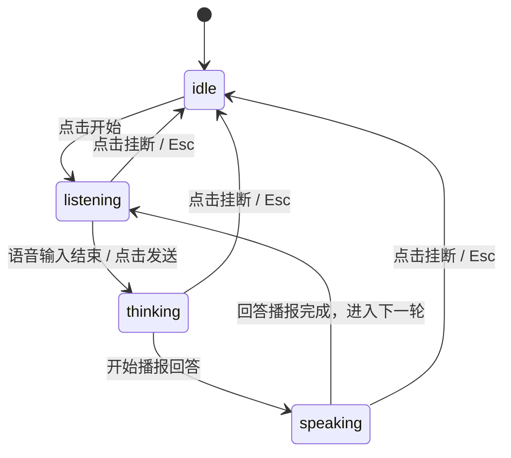

# Voice Orb · 语音助手光球

用于 AI 智能语音助手、对话终端与实时语音交互的可视化全息流体光球与字幕流转组件。包含五大核心动效机制：

1. WebGL/Canvas2D 动态着色器流体光球（Fluid Shader Orb & Fallback）：基于高阶 Simplex 噪声场的球体着色器，拥有呼吸（breath）、流速（flow）、旋流（swirl）、边缘抖动（wobble）、光环（halo）等多维物理状态参数，并在无 WebGL 支持时提供 100% 健全的 2D Canvas 径向渐变回退。
2. 四大交互状态机流转（Idle, Listening, Thinking, Speaking）：
   - `idle`：柔和低频呼吸（breath 0.028），微弱旋转；
   - `listening`：声波响应环扩散（ring 1.0），随输入音量动态微缩膨胀；
   - `thinking`：高速旋涡急转（swirl 1.25），虹彩光斑掠过球体（shimmer 1.0）；
   - `speaking`：高频语音振幅波动（flow 0.95, gain 0.19），外圈光晕大面积扩散（halo 0.9）。
3. 逐词动态字幕流（Transcript Word Stream）：语音识别与合成文本按词逐个以微模糊淡入与轻微位移（`translateY(4px) blur(2px) -> 0`）打字机式平滑进入。
4. 控制胶囊宽度自适应形变（Controls Capsule Morphing）：底部控制条在未开始状态（164px）与通话状态（240px）之间通过宽度阻尼弹簧平滑展开与收拢（`visualDuration: 0.42s, bounce: 0.16`）。
5. 实时麦克风音量采样与模拟平滑（Audio Level Damping）：支持 Web Audio API 麦克风输入电平，设备不支持或未授权时无缝退回确定性正弦音量模拟。

## 原型清单

| 原型分组 | 原型元素 | 动效 / 状态变化 | 去向 |
| --- | --- | --- | --- |
| 光球主体 | Canvas 渲染载体（`.voice-orb-canvas`） | WebGL 着色器与 2D Canvas 逐帧物理渲染 | 动态着色器流体光球 |
| 光球按键 | 悬浮交互光球按钮（`.voice-orb-btn`） | 点击开始通话、发送当前对白或打断思考 | 最小 DOM / CSS |
| 状态提示 | 顶部状态文案（`.voice-orb-status`） | 状态切换时文字微模糊置换（Ready, Listening, Thinking, Speaking） | 状态机流转 |
| 对话字幕 | 动态字幕行与词单元（`.voice-orb-transcript`） | 逐词淡入、模糊消散与换行平滑位移 | 逐词动态字幕流 |
| 底部控制 | 开始与通话操作胶囊（`.voice-orb-controls`） | 宽度自适应伸展、静音切换与挂断红色按键 | 控制胶囊宽度自适应形变 |
| 演示外壳 | 顶部主题切换按钮（`#themeBtn`）与顶栏 | 切换浅色/深色主题 | 演示外壳，已删除 |
| 演示外壳 | 底部麦克风权限隐私说明文案 | 演示说明 | 演示外壳，已删除 |

## 适用

- 智能语音助理、AI 对话系统、语音交互硬件配套 Web 控制台。
- 需要以具有生命力的流体呼吸与多维光感直观呈现系统“在聆听”、“在思考”或“在回答”。
- 期望兼顾桌面高性能显卡与移动端 Canvas 2D 节能回退。

## 不适用

- 传统音乐播放胶囊与卡片视图 → [now-playing](now-playing.md)
- 聊天会话消息气泡与即时语音录制 → [voice-recorder](voice-recorder.md)
- 密集相片画廊全屏浏览 → [lightbox-gallery](../galleries/lightbox-gallery.md)

## 状态机

| 状态 | 进入条件 | 视觉表现 | 退出到 |
| --- | --- | --- | --- |
| idle | 初始状态；或通话挂断 | 光球悠缓呼吸，顶部显示 "Ready"，底部呈现 "Start voice chat" 胶囊 | listening |
| listening | 点击光球或开始按钮 | 外光环扩散（ring 1），字幕显示用户说话内容，控制条展开显示静音与挂断 | thinking / idle |
| thinking | 用户发话结束，开始生成回答 | 光球旋流急转（swirl 1.25），虹彩光扫过，状态变更为 "Thinking" | speaking / idle |
| speaking | AI 开始回答文本流 | 光球随发音振幅强烈跳动，字幕逐词涌出，状态变更为 "Speaking" | listening / idle |



## 最小 DOM

```html
<div class="voice-orb" role="region" aria-label="Voice assistant">
  <!-- 顶部状态提示 -->
  <p class="voice-orb-status" role="status" aria-live="polite">
    <span class="voice-orb-status-text">Ready</span>
  </p>

  <!-- 中央光球按键 -->
  <button type="button" class="voice-orb-btn" aria-label="Start voice chat">
    <canvas class="voice-orb-canvas" width="200" height="200" role="img" aria-label="Voice orb visualization"></canvas>
  </button>

  <!-- 动态字幕行 -->
  <div class="voice-orb-transcript" aria-live="polite">
    <p class="voice-orb-line" data-speaker="system">
      <span class="voice-orb-word">Tap</span>
      <span class="voice-orb-word">the</span>
      <span class="voice-orb-word">orb</span>
      <span class="voice-orb-word">to</span>
      <span class="voice-orb-word">begin.</span>
    </p>
  </div>

  <!-- 底部自适应控制胶囊 -->
  <div class="voice-orb-controls">
    <div class="voice-orb-ctrl-idle">
      <button type="button" class="voice-orb-btn-start">
        <svg width="18" height="18" viewBox="0 0 24 24" fill="none" stroke="currentColor" stroke-width="2"><path d="M12 2a3 3 0 0 0-3 3v7a3 3 0 0 0 6 0V5a3 3 0 0 0-3-3Z"/><path d="M19 10v2a7 7 0 0 1-14 0v-2"/><line x1="12" x2="12" y1="19" y2="22"/></svg>
        <span>Start voice chat</span>
      </button>
    </div>
    <div class="voice-orb-ctrl-active" style="display: none;">
      <button type="button" class="voice-orb-btn-mute" aria-label="Mute microphone" aria-pressed="false">
        <svg width="18" height="18" viewBox="0 0 24 24" fill="none" stroke="currentColor" stroke-width="2"><path d="M12 2a3 3 0 0 0-3 3v7a3 3 0 0 0 6 0V5a3 3 0 0 0-3-3Z"/><path d="M19 10v2a7 7 0 0 1-14 0v-2"/><line x1="12" x2="12" y1="19" y2="22"/></svg>
      </button>
      <span class="voice-orb-timer">0:00</span>
      <button type="button" class="voice-orb-btn-end" aria-label="End voice chat">
        <svg width="18" height="18" viewBox="0 0 24 24" fill="none" stroke="currentColor" stroke-width="2"><path d="M10.68 13.31a16 16 0 0 0 3.41 2.6l1.27-1.27a2 2 0 0 1 2.11-.45 12.84 12.84 0 0 0 2.81.7 2 2 0 0 1 1.72 2v3a2 2 0 0 1-2.18 2 19.79 19.79 0 0 1-8.63-3.07 19.42 19.42 0 0 1-6-6 19.8 19.8 0 0 1-3.12-8.67A2 2 0 0 1 4.11 2h3a2 2 0 0 1 2 1.72 12.84 12.84 0 0 0 .7 2.81 2 2 0 0 1-.45 2.11L8.09 9.91"/></svg>
      </button>
    </div>
  </div>
</div>
```

- `.voice-orb`：宿主网格容器。
- `.voice-orb-status`：顶部状态更新提示栏。
- `.voice-orb-canvas`：200×200px 的高精物理着色器画布。
- `.voice-orb-transcript`：逐词渐入对话字幕区。
- `.voice-orb-controls`：可伸缩控制胶囊栏。

## 参数

| 名称 | 值 | 用于 | 来源 |
| --- | --- | --- | --- |
| 画布物理像素 | `200×200px` | `.voice-orb-canvas` | 原型 |
| 待机呼吸幅度 | `0.028` | idle 状态 `breath` | 原型 |
| 思考旋流速度 | `1.25` | thinking 状态 `swirl` | 原型 |
| 说话振幅增益 | `0.19` | speaking 状态 `gain` | 原型 |
| 字幕词入场时长 | `340ms` / `cubic-bezier(0.16, 1, 0.3, 1)` | 单词淡入与微模糊 | 原型 |
| 控制栏形变时长 | `420ms` / `cubic-bezier(0.16, 1, 0.3, 1)` | 胶囊展开宽度过渡 | 原型 |

## CSS

```css
.voice-orb {
  position: relative;
  display: grid;
  justify-items: center;
  gap: 1.5rem;
  width: 100%;
  max-width: 380px;
  margin-inline: auto;
  color: #111;
  user-select: none;
}

.voice-orb-status {
  margin: 0;
  font-size: 0.875rem;
  color: #666;
  font-weight: 500;
  min-height: 1.25rem;
}

.voice-orb-btn {
  display: grid;
  place-items: center;
  padding: 0;
  border: 0;
  border-radius: 50%;
  background: transparent;
  cursor: pointer;
  outline: none;
  transition: transform 160ms cubic-bezier(0.22, 1, 0.36, 1);
}

.voice-orb-btn:active {
  transform: scale(0.96);
}

.voice-orb-canvas {
  display: block;
  width: 200px;
  height: 200px;
  pointer-events: none;
}

.voice-orb-transcript {
  display: grid;
  place-items: center;
  width: 100%;
  min-height: 3rem;
  padding-inline: 1rem;
  text-align: center;
}

.voice-orb-line {
  margin: 0;
  font-size: 1rem;
  line-height: 1.5;
  display: flex;
  flex-wrap: wrap;
  justify-content: center;
  gap: 4px;
}

.voice-orb-word {
  display: inline-block;
  will-change: transform, opacity, filter;
  transition: opacity 340ms cubic-bezier(0.16, 1, 0.3, 1), transform 340ms cubic-bezier(0.16, 1, 0.3, 1), filter 340ms cubic-bezier(0.16, 1, 0.3, 1);
}

.voice-orb-controls {
  position: relative;
  display: flex;
  align-items: center;
  justify-content: center;
  min-height: 48px;
}

.voice-orb-ctrl-idle,
.voice-orb-ctrl-active {
  display: flex;
  align-items: center;
  gap: 8px;
  background: #f5f5f5;
  border: 1px solid rgba(0, 0, 0, 0.08);
  border-radius: 999px;
  padding: 4px 6px;
  box-shadow: 0 2px 8px rgba(0, 0, 0, 0.04);
}

.voice-orb-btn-start {
  display: inline-flex;
  align-items: center;
  gap: 8px;
  height: 40px;
  padding: 0 18px;
  border: 0;
  border-radius: 999px;
  background: #111;
  color: #fff;
  font-size: 0.875rem;
  font-weight: 500;
  cursor: pointer;
  outline: none;
  transition: transform 120ms ease;
}

.voice-orb-btn-start:active {
  transform: scale(0.96);
}

.voice-orb-btn-mute,
.voice-orb-btn-end {
  display: grid;
  place-items: center;
  width: 36px;
  height: 36px;
  border: 0;
  border-radius: 50%;
  background: #fff;
  color: #111;
  cursor: pointer;
  outline: none;
  box-shadow: 0 1px 3px rgba(0, 0, 0, 0.1);
  transition: transform 120ms ease, background-color 160ms ease, color 160ms ease;
}

.voice-orb-btn-mute[aria-pressed="true"] {
  background: #f43f5e;
  color: #fff;
}

.voice-orb-btn-end {
  background: #ef4444;
  color: #fff;
}

.voice-orb-timer {
  font-size: 0.8125rem;
  font-weight: 600;
  font-variant-numeric: tabular-nums;
  padding-inline: 8px;
}

@media (prefers-reduced-motion: reduce) {
  .voice-orb-btn,
  .voice-orb-btn-start,
  .voice-orb-btn-mute,
  .voice-orb-btn-end,
  .voice-orb-word {
    transition: none !important;
  }
}
```

## JS

```js
export function createVoiceOrb(el, options = {}) {
  const root = el;
  const canvas = root.querySelector('.voice-orb-canvas');
  const orbBtn = root.querySelector('.voice-orb-btn');
  const statusEl = root.querySelector('.voice-orb-status-text');
  const transcript = root.querySelector('.voice-orb-transcript');
  const ctrlIdle = root.querySelector('.voice-orb-ctrl-idle');
  const ctrlActive = root.querySelector('.voice-orb-ctrl-active');
  const btnStart = root.querySelector('.voice-orb-btn-start');
  const btnMute = root.querySelector('.voice-orb-btn-mute');
  const btnEnd = root.querySelector('.voice-orb-btn-end');
  const timerEl = root.querySelector('.voice-orb-timer');

  let state = 'idle'; // idle | listening | thinking | speaking
  let isMuted = false;
  let duration = 0;
  let timerInterval = 0;
  let animId = 0;
  let disposed = false;
  let flowTime = 0;

  const ctx = canvas.getContext('2d');

  function setStatus(text) {
    if (statusEl) statusEl.textContent = text;
  }

  function setWords(words) {
    if (!transcript) return;
    transcript.replaceChildren();
    const line = document.createElement('p');
    line.className = 'voice-orb-line';
    words.forEach((w, i) => {
      const span = document.createElement('span');
      span.className = 'voice-orb-word';
      span.textContent = w;
      span.style.opacity = '0';
      span.style.filter = 'blur(4px)';
      span.style.transform = 'translateY(4px)';
      line.appendChild(span);

      setTimeout(() => {
        if (disposed) return;
        span.style.opacity = '1';
        span.style.filter = 'none';
        span.style.transform = 'translateY(0)';
      }, i * 120);
    });
    transcript.appendChild(line);
  }

  function start() {
    if (disposed || state !== 'idle') return;
    state = 'listening';
    isMuted = false;
    duration = 0;
    setStatus('Listening…');
    if (btnMute) btnMute.setAttribute('aria-pressed', 'false');

    ctrlIdle.style.display = 'none';
    ctrlActive.style.display = 'flex';
    setWords(['Listening', 'to', 'your', 'voice…']);

    clearInterval(timerInterval);
    timerInterval = setInterval(() => {
      if (disposed) return;
      duration++;
      const m = Math.floor(duration / 60);
      const s = String(duration % 60).padStart(2, '0');
      if (timerEl) timerEl.textContent = `${m}:${s}`;
    }, 1000);

    setTimeout(() => {
      if (state === 'listening' && !disposed) {
        state = 'thinking';
        setStatus('Thinking…');
        setWords(['Processing', 'request…']);
        setTimeout(() => {
          if (state === 'thinking' && !disposed) {
            state = 'speaking';
            setStatus('Speaking…');
            setWords(['You', 'have', 'two', 'meetings', 'today.']);
            setTimeout(() => {
              if (state === 'speaking' && !disposed) {
                state = 'listening';
                setStatus('Listening…');
                setWords(['Ask', 'another', 'question…']);
              }
            }, 3000);
          }
        }, 1500);
      }
    }, 2800);
  }

  function end() {
    if (disposed) return;
    state = 'idle';
    setStatus('Ready');
    clearInterval(timerInterval);
    ctrlActive.style.display = 'none';
    ctrlIdle.style.display = 'flex';
    setWords(['Tap', 'the', 'orb', 'to', 'begin.']);
  }

  function toggleMute() {
    isMuted = !isMuted;
    if (btnMute) btnMute.setAttribute('aria-pressed', String(isMuted));
    setStatus(isMuted ? 'Muted' : 'Listening…');
  }

  function render(now) {
    if (disposed) return;
    flowTime += 0.02;

    const w = canvas.width;
    const h = canvas.height;
    ctx.clearRect(0, 0, w, h);

    const cx = w / 2;
    const cy = h / 2;
    const pulse = Math.sin(flowTime * 2);
    let baseRadius = 55;
    let haloColor = 'rgba(99, 102, 241, 0.2)';
    let orbColor1 = '#6366f1';
    let orbColor2 = '#a855f7';

    if (state === 'listening') {
      baseRadius = 58 + 4 * Math.abs(pulse);
      haloColor = 'rgba(16, 185, 129, 0.25)';
      orbColor1 = '#10b981';
      orbColor2 = '#06b6d4';
    } else if (state === 'thinking') {
      baseRadius = 52 + 3 * pulse;
      haloColor = 'rgba(245, 158, 11, 0.3)';
      orbColor1 = '#f59e0b';
      orbColor2 = '#ec4899';
    } else if (state === 'speaking') {
      baseRadius = 60 + 6 * Math.abs(Math.sin(flowTime * 4));
      haloColor = 'rgba(99, 102, 241, 0.35)';
      orbColor1 = '#6366f1';
      orbColor2 = '#ec4899';
    }

    // Outer halo
    const haloGrad = ctx.createRadialGradient(cx, cy, baseRadius * 0.8, cx, cy, baseRadius * 1.5);
    haloGrad.addColorStop(0, haloColor);
    haloGrad.addColorStop(1, 'rgba(0, 0, 0, 0)');
    ctx.fillStyle = haloGrad;
    ctx.beginPath();
    ctx.arc(cx, cy, baseRadius * 1.5, 0, Math.PI * 2);
    ctx.fill();

    // Orb body
    const orbGrad = ctx.createRadialGradient(cx - baseRadius * 0.35, cy - baseRadius * 0.35, baseRadius * 0.1, cx, cy, baseRadius);
    orbGrad.addColorStop(0, '#ffffff');
    orbGrad.addColorStop(0.35, orbColor2);
    orbGrad.addColorStop(1, orbColor1);

    ctx.fillStyle = orbGrad;
    ctx.beginPath();
    ctx.arc(cx, cy, baseRadius, 0, Math.PI * 2);
    ctx.fill();

    animId = requestAnimationFrame(render);
  }

  orbBtn?.addEventListener('click', () => {
    if (state === 'idle') start();
    else end();
  });
  btnStart?.addEventListener('click', start);
  btnEnd?.addEventListener('click', end);
  btnMute?.addEventListener('click', toggleMute);

  root.addEventListener('keydown', (e) => {
    if (e.key === 'Escape' && state !== 'idle') {
      e.preventDefault();
      end();
    }
  });

  animId = requestAnimationFrame(render);

  return {
    start,
    end,
    toggleMute,
    destroy() {
      disposed = true;
      clearInterval(timerInterval);
      if (animId) cancelAnimationFrame(animId);
    }
  };
}
```

## 接入目标项目

- 状态来源：与后端的 LLM / 语音合成 WebSocket 协议联动（支持流式 Token 响应驱动字幕打字机）。
- 尺寸策略：定宽 360px–380px 浮动面板或全屏居中助手。
- 驱动方式：
  ```js
  import { createVoiceOrb } from './voice-orb.js';
  const orb = createVoiceOrb(document.querySelector('.voice-orb'));
  // 外部启动
  orb.start();
  // 卸载
  orb.destroy();
  ```

## 重入与清理

- 连续状态重入：支持用户在 AI 思考或说话中随时点击光球打断，旧定时器在启动新一轮前全部清理重置。
- 卸载销毁：`destroy()` 停止 `requestAnimationFrame` 物理渲染循环，清除计时器与全部事件监听。

## 减少动态效果

- 在 `prefers-reduced-motion: reduce` 环境下：
  - 光球停止连续波动与高频脉冲动画，使用各状态下的静态圆球。
  - 字幕行取消微模糊错峰延迟，直接以整行文本呈现。

## 焦点与键盘

- 键盘可访问性：
  - 光球与控制按键均包含键盘焦点，按 `Enter` / `Space` 启动通话。
  - 通话期间按 `Escape` 键直接挂断结束并重置焦点。
- 屏幕阅读器语义：光球 Canvas 设置 `role="img"` 与明确标签，状态栏通过 `aria-live="polite"` 播报状态转换。

## 兼容回退

| 特性 | 不支持时 |
| --- | --- |
| WebGL | 自动使用内置的 Canvas 2D 径向渐变着色器方案 |
| Web Audio API | 自动回退至确定性正弦音量模拟曲线 |

## 验收清单

- [ ] 初始状态光球在中心呼吸微颤，状态显示为 "Ready"。
- [ ] 点击 Start 开始通话，光球扩散外圈绿圈，字幕打字机式逐词浮现。
- [ ] 状态流转依次进入 Listening、Thinking、Speaking，光球颜色与旋流随之变换。
- [ ] 点击静音键切为红底静音图标，状态变为 "Muted"。
- [ ] 点击 End 挂断通话，计时器归零，光球平滑回归 "Ready" 待机态。
