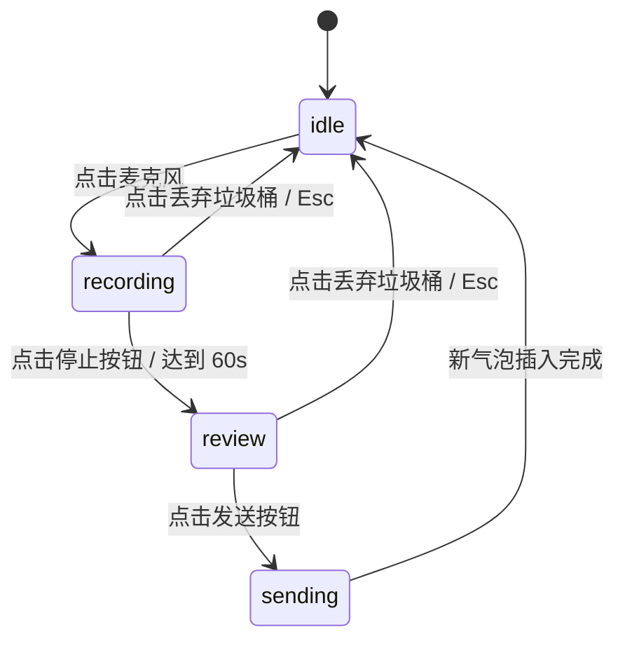

# Voice Recorder · 语音录音胶囊与气泡

用于即时通讯聊天面板、语音留言与备忘录应用的原生录制胶囊展开与消息气泡生成流转组件。包含五大核心动效机制：

1. 麦克风向录制胶囊共享表面形变（Mic to Capsule Morphing）：点击单点麦克风按钮，按钮以弹性弹簧双向横向拉伸展开为椭圆录音胶囊（`visualDuration: 0.42s, bounce: 0.16`），同时红色录音指示点闪动淡入。
2. 实时声波推移与计时器（Live Canvas Waveform & Timer）：录制过程中红色指示灯以 1.2s 周期呼吸闪动，声波电平柱每 90ms 实时推入，胶囊中心秒表数字同步累加。
3. 停止与试听平滑置换（Stop & Review State Swap）：点击停止按钮，胶囊内部由“录制中”无缝微模糊置换为“试听态”，显现试听播放按键、完整波形概览、垃圾桶丢弃键与发送键。
4. 发送飞跃追加会话气泡（Send Flight to Message Bubble）：点击发送，录制胶囊投影飞跃平滑缩入并追加至上方聊天消息列表末端，成为带有完整波形回放的新语音气泡，麦克风按钮以 `scale(0.8) -> 1` 弹回原位就绪。
5. 语音气泡内音频回放进度裁剪（Bubble Playback Clip-path）：点击任意历史语音气泡的播放按钮，气泡内高亮波形图层通过 `clip-path: inset(0 (1 - p)*100% 0 0)` 进行平滑裁切推进，时间数字倒计。

## 原型清单

| 原型分组 | 原型元素 | 动效 / 状态变化 | 去向 |
| --- | --- | --- | --- |
| 麦克风入口 | 底部麦克风圆形按钮（`.voice-recorder-mic`） | 按下微缩 `scale(0.94)`，点击横向膨胀为录音胶囊 | 麦克风向录制胶囊形变 |
| 录音胶囊 | 展开录制工具条（`.voice-recorder-capsule`） | 宽度弹性拉伸、录音红点 1.2s 周期呼吸 | 实时声波推移与计时器 |
| 录制声波 | 动态波形容器（`.voice-recorder-live-wave`） | 每 90ms 持续生成音量条并向左滚动推移 | 实时声波推移与计时器 |
| 试听状态 | 试听控制组（`.voice-recorder-review`） | 播放/暂停图标置换、垃圾桶与发送按钮缩放弹出 | 停止与试听平滑置换 |
| 消息列表 | 消息气泡列表容器（`.voice-recorder-thread`） | 新增气泡带轻微弹性缩放与下移淡入插入 | 发送飞跃追加会话气泡 |
| 语音气泡 | 历史语音气泡与进度（`.voice-recorder-bubble`） | 播放/暂停切换、`clip-path` 声波高亮推进与倒计时 | 语音气泡内音频回放进度裁剪 |
| 演示外壳 | 顶部主题切换按钮（`#themeBtn`）与顶栏 | 切换浅色/深色主题 | 演示外壳，已删除 |

## 适用

- 即时通讯 IM 聊天面板、社交网络私信对话框中的发语音体验。
- 用户期望录音操作直接在输入框区域就地展开，无任何生硬的弹窗或打断。
- 录音完毕后支持原地试听与重录，发送后具备清晰的由胶囊飞向会话消息列表的空间连续感。

## 不适用

- 音乐播放常驻卡片 → [now-playing](now-playing.md)
- 全息流体智能语音助手光球 → [voice-orb](voice-orb.md)
- 拖拽式多媒体文件上传区域 → [file-dropzone](../editors/file-dropzone.md)

## 状态机

| 状态 | 进入条件 | 视觉表现 | 退出到 |
| --- | --- | --- | --- |
| idle | 初始状态；或发送/丢弃完毕 | 呈现圆形麦克风按钮与提示文字 "Tap to record" | recording |
| recording | 点击麦克风按钮 | 麦克风膨胀为胶囊，红点闪动，实时波形向左流动，计时累加 | review / idle |
| review | 点击停止按钮；或达到 60 秒上限 | 红点消失，呈现试听播放键、完整声波图、丢弃垃圾桶与发送键 | recording / idle |
| sending | 点击发送按钮 | 胶囊飞向列表追加为新语音气泡，麦克风弹回，状态复原 | idle |



## 最小 DOM

```html
<div class="voice-recorder" role="region" aria-label="Voice messaging">
  <!-- 历史语音消息列表 -->
  <ol class="voice-recorder-thread" aria-label="Messages">
    <li class="voice-recorder-message">
      <div class="voice-recorder-bubble" data-msg-id="1">
        <button type="button" class="voice-recorder-bubble-play" aria-label="Play voice note, 14 seconds">
          <svg class="icon-play" width="16" height="16" viewBox="0 0 24 24" fill="currentColor"><path d="M5 3l14 9-14 9V3z"/></svg>
          <svg class="icon-pause" width="16" height="16" viewBox="0 0 24 24" fill="currentColor" style="display: none;"><path d="M6 19h4V5H6v14zm8-14v14h4V5h-4z"/></svg>
        </button>
        <div class="voice-recorder-bubble-wave">
          <div class="voice-recorder-bars-layer voice-recorder-bars-base"></div>
          <div class="voice-recorder-bars-layer voice-recorder-bars-played" style="clip-path: inset(0 100% 0 0);"></div>
        </div>
        <span class="voice-recorder-bubble-time">0:14</span>
      </div>
    </li>
  </ol>

  <!-- 底部录音操作栏 -->
  <div class="voice-recorder-composer" data-phase="idle">
    <!-- 未录音态 -->
    <div class="voice-recorder-idle-bar">
      <span class="voice-recorder-hint">Tap the mic to record a voice note</span>
      <button type="button" class="voice-recorder-mic" aria-label="Record voice note">
        <svg width="20" height="20" viewBox="0 0 24 24" fill="none" stroke="currentColor" stroke-width="2"><path d="M12 2a3 3 0 0 0-3 3v7a3 3 0 0 0 6 0V5a3 3 0 0 0-3-3Z"/><path d="M19 10v2a7 7 0 0 1-14 0v-2"/><line x1="12" x2="12" y1="19" y2="22"/></svg>
      </button>
    </div>

    <!-- 录音中胶囊 -->
    <div class="voice-recorder-capsule voice-recorder-rec-bar" style="display: none;">
      <span class="voice-recorder-rec-dot" aria-hidden="true"></span>
      <span class="voice-recorder-rec-time">0:00</span>
      <div class="voice-recorder-live-wave"></div>
      <button type="button" class="voice-recorder-btn-stop" aria-label="Stop recording">
        <svg width="18" height="18" viewBox="0 0 24 24" fill="currentColor"><rect x="4" y="4" width="16" height="16" rx="3"/></svg>
      </button>
    </div>

    <!-- 试听与发送胶囊 -->
    <div class="voice-recorder-capsule voice-recorder-review-bar" style="display: none;">
      <button type="button" class="voice-recorder-btn-discard" aria-label="Discard recording">
        <svg width="18" height="18" viewBox="0 0 24 24" fill="none" stroke="currentColor" stroke-width="2"><path d="M3 6h18"/><path d="M19 6v14a2 2 0 0 1-2 2H7a2 2 0 0 1-2-2V6"/><path d="M8 6V4a2 2 0 0 1 2-2h4a2 2 0 0 1 2 2v2"/></svg>
      </button>
      <button type="button" class="voice-recorder-btn-preview-play" aria-label="Preview recording">
        <svg class="icon-play" width="16" height="16" viewBox="0 0 24 24" fill="currentColor"><path d="M5 3l14 9-14 9V3z"/></svg>
        <svg class="icon-pause" width="16" height="16" viewBox="0 0 24 24" fill="currentColor" style="display: none;"><path d="M6 19h4V5H6v14zm8-14v14h4V5h-4z"/></svg>
      </button>
      <div class="voice-recorder-preview-wave"></div>
      <span class="voice-recorder-preview-time">0:00</span>
      <button type="button" class="voice-recorder-btn-send" aria-label="Send voice note">
        <svg width="18" height="18" viewBox="0 0 24 24" fill="currentColor"><path d="m22 2-7 20-4-9-9-4Z"/><path d="M22 2 11 13"/></svg>
      </button>
    </div>
  </div>
</div>
```

- `.voice-recorder`：消息器宿主。
- `.voice-recorder-thread`：会话列表容器。
- `.voice-recorder-bubble`：具备独立波形回放与剪切指示的历史语音气泡。
- `.voice-recorder-composer`：底部输入区，负责状态流转。
- `.voice-recorder-mic`：初始麦克风按钮。
- `.voice-recorder-rec-bar`：录音中展开胶囊。
- `.voice-recorder-review-bar`：试听与发送胶囊。

## 参数

| 名称 | 值 | 用于 | 来源 |
| --- | --- | --- | --- |
| 麦克风按压缩放 | `scale(0.94)` | `.voice-recorder-mic:active` | 原型 |
| 胶囊表面形变时长 | `420ms` / `cubic-bezier(0.16, 1, 0.3, 1)` | 麦克风到胶囊展开过渡 | 原型 |
| 操作按钮弹簧 | `visualDuration: 0.26s, bounce: 0.12` | 停止/发送/丢弃按钮弹入 | 原型 |
| 录音红点呼吸周期 | `1.2s` / `infinite ease-in-out` | `.voice-recorder-rec-dot` | 原型 |
| 声波生成步长 | `90ms` | 实时波形推进采样率 | 原型 |
| 录音最大上限 | `60s` | 到期自动转入试听态 | 原型 |

## CSS

```css
.voice-recorder {
  position: relative;
  display: flex;
  flex-direction: column;
  justify-content: space-between;
  width: 100%;
  max-width: 420px;
  min-height: 400px;
  margin-inline: auto;
  padding: 16px;
  background: #fdfdfd;
  border: 1px solid rgba(0, 0, 0, 0.08);
  border-radius: 24px;
  box-shadow: 0 8px 24px rgba(0, 0, 0, 0.04);
  color: #111;
  user-select: none;
}

.voice-recorder-thread {
  display: flex;
  flex-direction: column;
  gap: 12px;
  margin: 0;
  padding: 0;
  list-style: none;
  overflow-y: auto;
  flex: 1;
}

.voice-recorder-message {
  display: flex;
  justify-content: flex-start;
}

.voice-recorder-message[data-mine="true"] {
  justify-content: flex-end;
}

.voice-recorder-bubble {
  display: flex;
  align-items: center;
  gap: 8px;
  height: 44px;
  padding: 0 14px;
  background: #f0f0f0;
  border-radius: 22px;
  max-width: 280px;
  transition: transform 300ms cubic-bezier(0.16, 1, 0.3, 1);
}

.voice-recorder-message[data-mine="true"] .voice-recorder-bubble {
  background: #111;
  color: #fff;
}

.voice-recorder-bubble-play {
  display: grid;
  place-items: center;
  width: 28px;
  height: 28px;
  padding: 0;
  border: 0;
  border-radius: 50%;
  background: #fff;
  color: #111;
  cursor: pointer;
  outline: none;
}

.voice-recorder-message[data-mine="true"] .voice-recorder-bubble-play {
  background: rgba(255, 255, 255, 0.2);
  color: #fff;
}

.voice-recorder-bubble-wave {
  position: relative;
  width: 120px;
  height: 20px;
  overflow: hidden;
}

.voice-recorder-bars-layer {
  position: absolute;
  inset: 0;
  display: flex;
  align-items: center;
  gap: 2px;
}

.voice-recorder-bars-layer span {
  flex: 1;
  border-radius: 999px;
  background: rgba(0, 0, 0, 0.2);
}

.voice-recorder-message[data-mine="true"] .voice-recorder-bars-base span {
  background: rgba(255, 255, 255, 0.3);
}

.voice-recorder-bars-played {
  pointer-events: none;
}

.voice-recorder-bars-played span {
  background: #111;
}

.voice-recorder-message[data-mine="true"] .voice-recorder-bars-played span {
  background: #fff;
}

.voice-recorder-bubble-time {
  font-size: 0.75rem;
  font-variant-numeric: tabular-nums;
  opacity: 0.8;
}

/* 底部区域 */
.voice-recorder-composer {
  position: relative;
  margin-top: 16px;
  min-height: 48px;
}

.voice-recorder-idle-bar {
  display: flex;
  align-items: center;
  justify-content: space-between;
  height: 48px;
  padding-left: 16px;
  padding-right: 4px;
  background: #f5f5f5;
  border-radius: 999px;
}

.voice-recorder-hint {
  font-size: 0.875rem;
  color: #888;
}

.voice-recorder-mic {
  display: grid;
  place-items: center;
  width: 40px;
  height: 40px;
  border: 0;
  border-radius: 50%;
  background: #111;
  color: #fff;
  cursor: pointer;
  outline: none;
  transition: transform 120ms cubic-bezier(0.22, 1, 0.36, 1);
}

.voice-recorder-mic:active {
  transform: scale(0.94);
}

.voice-recorder-capsule {
  position: absolute;
  inset: 0;
  display: flex;
  align-items: center;
  gap: 10px;
  height: 48px;
  padding: 0 12px;
  background: #111;
  color: #fff;
  border-radius: 999px;
  box-shadow: 0 4px 16px rgba(0, 0, 0, 0.15);
}

.voice-recorder-rec-dot {
  width: 10px;
  height: 10px;
  border-radius: 50%;
  background: #ef4444;
  animation: voice-rec-pulse 1.2s infinite ease-in-out;
}

@keyframes voice-rec-pulse {
  0%, 100% { opacity: 1; transform: scale(1); }
  50% { opacity: 0.35; transform: scale(0.85); }
}

.voice-recorder-rec-time {
  font-size: 0.875rem;
  font-weight: 600;
  font-variant-numeric: tabular-nums;
}

.voice-recorder-live-wave {
  flex: 1;
  display: flex;
  align-items: center;
  gap: 3px;
  height: 24px;
  overflow: hidden;
}

.voice-recorder-live-wave span {
  width: 3px;
  border-radius: 999px;
  background: rgba(255, 255, 255, 0.6);
}

.voice-recorder-btn-stop,
.voice-recorder-btn-discard,
.voice-recorder-btn-preview-play,
.voice-recorder-btn-send {
  display: grid;
  place-items: center;
  width: 32px;
  height: 32px;
  border: 0;
  border-radius: 50%;
  background: rgba(255, 255, 255, 0.15);
  color: #fff;
  cursor: pointer;
  outline: none;
  transition: transform 120ms ease, background-color 160ms ease;
}

.voice-recorder-btn-stop:hover,
.voice-recorder-btn-discard:hover,
.voice-recorder-btn-preview-play:hover,
.voice-recorder-btn-send:hover {
  background: rgba(255, 255, 255, 0.3);
}

.voice-recorder-btn-send {
  background: #10b981;
}

.voice-recorder-preview-wave {
  flex: 1;
  display: flex;
  align-items: center;
  gap: 2px;
  height: 20px;
}

.voice-recorder-preview-wave span {
  flex: 1;
  border-radius: 999px;
  background: rgba(255, 255, 255, 0.5);
}

.voice-recorder-preview-time {
  font-size: 0.8125rem;
  font-variant-numeric: tabular-nums;
}

@media (prefers-reduced-motion: reduce) {
  .voice-recorder-rec-dot {
    animation: none !important;
  }
  .voice-recorder-bubble,
  .voice-recorder-mic,
  .voice-recorder-capsule {
    transition: none !important;
  }
}
```

## JS

```js
export function createVoiceRecorder(el, options = {}) {
  const root = el;
  const thread = root.querySelector('.voice-recorder-thread');
  const composer = root.querySelector('.voice-recorder-composer');
  const idleBar = root.querySelector('.voice-recorder-idle-bar');
  const recBar = root.querySelector('.voice-recorder-rec-bar');
  const reviewBar = root.querySelector('.voice-recorder-review-bar');
  const micBtn = root.querySelector('.voice-recorder-mic');
  const btnStop = root.querySelector('.voice-recorder-btn-stop');
  const btnDiscard = root.querySelector('.voice-recorder-btn-discard');
  const btnPreviewPlay = root.querySelector('.voice-recorder-btn-preview-play');
  const btnSend = root.querySelector('.voice-recorder-btn-send');
  const recTimeEl = root.querySelector('.voice-recorder-rec-time');
  const liveWave = root.querySelector('.voice-recorder-live-wave');
  const previewWave = root.querySelector('.voice-recorder-preview-wave');
  const previewTimeEl = root.querySelector('.voice-recorder-preview-time');

  let phase = 'idle'; // idle | recording | review
  let recordSeconds = 0;
  let recInterval = 0;
  let waveInterval = 0;
  let recordedBars = [];
  let disposed = false;

  const formatTime = (secs) => {
    const m = Math.floor(secs / 60);
    const s = String(Math.floor(secs % 60)).padStart(2, '0');
    return `${m}:${s}`;
  };

  function startRecord() {
    if (disposed || phase !== 'idle') return;
    phase = 'recording';
    recordSeconds = 0;
    recordedBars = [];
    recTimeEl.textContent = '0:00';
    liveWave.replaceChildren();

    idleBar.style.display = 'none';
    reviewBar.style.display = 'none';
    recBar.style.display = 'flex';
    composer.dataset.phase = 'recording';

    clearInterval(recInterval);
    recInterval = setInterval(() => {
      if (disposed) return;
      recordSeconds += 0.5;
      recTimeEl.textContent = formatTime(recordSeconds);
      if (recordSeconds >= 60) stopRecord();
    }, 500);

    clearInterval(waveInterval);
    waveInterval = setInterval(() => {
      if (disposed || phase !== 'recording') return;
      const h = Math.round(15 + Math.random() * 80);
      recordedBars.push(h);
      const span = document.createElement('span');
      span.style.height = `${h}%`;
      liveWave.appendChild(span);
      if (liveWave.children.length > 30) {
        liveWave.firstElementChild?.remove();
      }
    }, 120);
  }

  function stopRecord() {
    if (disposed || phase !== 'recording') return;
    phase = 'review';
    clearInterval(recInterval);
    clearInterval(waveInterval);

    recBar.style.display = 'none';
    reviewBar.style.display = 'flex';
    composer.dataset.phase = 'review';

    previewTimeEl.textContent = formatTime(recordSeconds);
    previewWave.replaceChildren();
    const displayBars = recordedBars.slice(-28);
    displayBars.forEach(h => {
      const span = document.createElement('span');
      span.style.height = `${h}%`;
      previewWave.appendChild(span);
    });
  }

  function discardRecord() {
    if (disposed) return;
    phase = 'idle';
    clearInterval(recInterval);
    clearInterval(waveInterval);

    recBar.style.display = 'none';
    reviewBar.style.display = 'none';
    idleBar.style.display = 'flex';
    composer.dataset.phase = 'idle';
  }

  function sendRecord() {
    if (disposed || phase !== 'review') return;
    const durSec = Math.max(1, Math.round(recordSeconds));
    const finalBars = [...recordedBars];

    // 追加到会话列表
    const li = document.createElement('li');
    li.className = 'voice-recorder-message';
    li.dataset.mine = 'true';

    const bubble = document.createElement('div');
    bubble.className = 'voice-recorder-bubble';

    const playBtn = document.createElement('button');
    playBtn.type = 'button';
    playBtn.className = 'voice-recorder-bubble-play';
    playBtn.setAttribute('aria-label', `Play voice note, ${durSec} seconds`);
    playBtn.innerHTML = `
      <svg class="icon-play" width="16" height="16" viewBox="0 0 24 24" fill="currentColor"><path d="M5 3l14 9-14 9V3z"/></svg>
      <svg class="icon-pause" width="16" height="16" viewBox="0 0 24 24" fill="currentColor" style="display: none;"><path d="M6 19h4V5H6v14zm8-14v14h4V5h-4z"/></svg>
    `;

    const waveBox = document.createElement('div');
    waveBox.className = 'voice-recorder-bubble-wave';
    const baseLayer = document.createElement('div');
    baseLayer.className = 'voice-recorder-bars-layer voice-recorder-bars-base';
    const playedLayer = document.createElement('div');
    playedLayer.className = 'voice-recorder-bars-layer voice-recorder-bars-played';
    playedLayer.style.clipPath = 'inset(0 100% 0 0)';

    finalBars.slice(-20).forEach(h => {
      const b1 = document.createElement('span');
      b1.style.height = `${h}%`;
      baseLayer.appendChild(b1);
      const b2 = document.createElement('span');
      b2.style.height = `${h}%`;
      playedLayer.appendChild(b2);
    });

    waveBox.appendChild(baseLayer);
    waveBox.appendChild(playedLayer);

    const timeSpan = document.createElement('span');
    timeSpan.className = 'voice-recorder-bubble-time';
    timeSpan.textContent = formatTime(durSec);

    bubble.appendChild(playBtn);
    bubble.appendChild(waveBox);
    bubble.appendChild(timeSpan);
    li.appendChild(bubble);
    thread.appendChild(li);

    // 绑定新气泡播放
    bindBubble(bubble, durSec, playedLayer, timeSpan);

    discardRecord();
    thread.scrollTop = thread.scrollHeight;
  }

  function bindBubble(bubble, durationSec, playedLayer, timeSpan) {
    const playBtn = bubble.querySelector('.voice-recorder-bubble-play');
    const playIcon = bubble.querySelector('.icon-play');
    const pauseIcon = bubble.querySelector('.icon-pause');
    let playing = false;
    let timer = 0;
    let elapsed = 0;

    playBtn?.addEventListener('click', () => {
      playing = !playing;
      playIcon.style.display = playing ? 'none' : 'block';
      pauseIcon.style.display = playing ? 'block' : 'none';

      if (playing) {
        clearInterval(timer);
        timer = setInterval(() => {
          elapsed += 0.2;
          const p = clamp(elapsed / durationSec, 0, 1);
          playedLayer.style.clipPath = `inset(0 ${(1 - p) * 100}% 0 0)`;
          timeSpan.textContent = formatTime(Math.max(0, durationSec - elapsed));
          if (p >= 1) {
            clearInterval(timer);
            playing = false;
            elapsed = 0;
            playIcon.style.display = 'block';
            pauseIcon.style.display = 'none';
            playedLayer.style.clipPath = 'inset(0 100% 0 0)';
            timeSpan.textContent = formatTime(durationSec);
          }
        }, 200);
      } else {
        clearInterval(timer);
      }
    });
  }

  // 初始列表气泡绑定
  thread.querySelectorAll('.voice-recorder-bubble').forEach(b => {
    const played = b.querySelector('.voice-recorder-bars-played');
    const t = b.querySelector('.voice-recorder-bubble-time');
    bindBubble(b, 14, played, t);
  });

  micBtn?.addEventListener('click', startRecord);
  btnStop?.addEventListener('click', stopRecord);
  btnDiscard?.addEventListener('click', discardRecord);
  btnSend?.addEventListener('click', sendRecord);

  root.addEventListener('keydown', (e) => {
    if (e.key === 'Escape' && phase !== 'idle') {
      e.preventDefault();
      discardRecord();
    }
  });

  return {
    startRecord,
    stopRecord,
    discardRecord,
    sendRecord,
    destroy() {
      disposed = true;
      clearInterval(recInterval);
      clearInterval(waveInterval);
    }
  };
}
```

## 接入目标项目

- 状态来源：可对接浏览器的 `MediaRecorder` API 与后端文件上传系统；录制完成后输出音频 Blob 或已上传 URL。
- 尺寸策略：宽度适合手机屏幕或桌面右侧悬浮聊天侧栏（360px–420px）。
- 驱动方式：
  ```js
  import { createVoiceRecorder } from './voice-recorder.js';
  const recorder = createVoiceRecorder(document.querySelector('.voice-recorder'));
  // 外部启动/停止/发送
  recorder.startRecord();
  // 卸载
  recorder.destroy();
  ```

## 重入与清理

- 连续操作重入：在录制中快速点击停止或丢弃，旧定时器和波形轮询立即中断重置，杜绝定时器泄露。
- 卸载销毁：`destroy()` 清理录音与波形发生计时器，解除全部音频播放监听。

## 减少动态效果

- 在 `prefers-reduced-motion: reduce` 环境下：
  - 录音红点取消呼吸发光动画，保持常亮红灯。
  - 胶囊展开与气泡插入取消弹性缩放与位移过渡，直接瞬时就位。

## 焦点与键盘

- 键盘可访问性：
  - 麦克风按钮处于 Tab 导航链，按 `Enter` / `Space` 开始录音。
  - 录音态与试听态均支持按 `Escape` 键快速丢弃并复原焦点。
- 屏幕阅读器语义：录音按钮标明“Record voice note”，播放气泡标明“Play voice note, X seconds”。

## 兼容回退

| 特性 | 不支持时 |
| --- | --- |
| CSS `clip-path` | 降级为横向进度条宽度 `width: X%` |

## 验收清单

- [ ] 点击麦克风按钮，按钮平滑向两侧展开为椭圆胶囊，红点闪动并计时。
- [ ] 录音期间波形向左流动累加。
- [ ] 点击停止按钮，胶囊转为试听面板，呈现试听播放键、完整声波图与发送键。
- [ ] 点击发送键，胶囊顺畅收起，新语音气泡追加到聊天列表中。
- [ ] 点击新气泡播放键，波形从左向右高亮推进，时间倒计。
