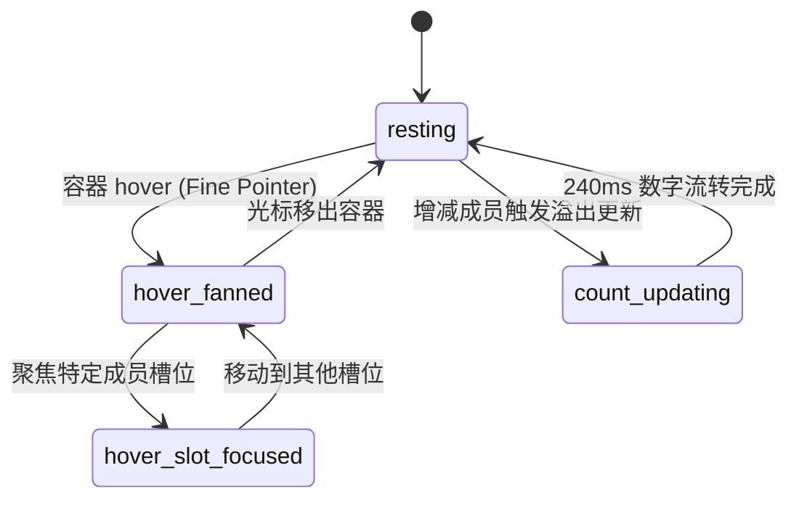

# Avatar Group · 头像组

用于团队协同、协作者列表以及多用户头像重叠排布场景。包含四大核心动效机制：

1. 悬停扇形展开与两翼让位（Hover Fan & Aside）：光标悬停在头像组上时，各头像按索引向两侧扇形展开（`--fan: calc((var(--index) - (var(--count) - 1) / 2) * 4px)`）；当前悬停项微幅上浮 2px，相邻前后项分别向左右侧向让位 3px，层次分明。
2. 智能名字提示浮层（Smart Tooltip）：悬停于特定头像时，带有 60ms 意图防抖延迟，向上浮现带圆角背景的姓名标签，移出后迅速淡出。
3. 溢出人数滚动切变（Overflow Counter Morph）：超过展示上限时显示 `+N` 胶囊，增减成员时数字带有方向性感知的垂直滚轮位移与模糊（入场 240ms，退场 160ms）。
4. 槽位增减物理弹性伸缩（Slot Spring Folding）：动态加入或移出成员时，槽位宽度（`width`）与缩放（`scale`）平滑展开或收拢，其余头像自动顺畅移位。

## 原型清单

| 原型分组 | 原型元素 | 动效 / 状态变化 | 去向 |
| --- | --- | --- | --- |
| 容器结构 | 头像组外框（`.arc-avatar-group`） | 管理 `--count` 变量，弹性对齐 | 最小 DOM / CSS |
| 成员槽位 | 槽位容器（`.arc-avatar-group-slot`） | 承载重叠负外边距、`--index` 索引与动态展开收拢 | 槽位增减物理弹性伸缩 |
| 浮动主体 | 提升容器（`.arc-avatar-group-lift`） | 承载扇形展开位移 `--fan`、浮起 `--rise` 与让位 `--aside` | 悬停扇形展开与两翼让位 |
| 提示组件 | 浮动姓名提示（`.arc-avatar-group-tip`） | 悬停 60ms 延迟淡入与向上微移 | 智能名字提示浮层 |
| 溢出计数 | 溢出徽标（`.arc-avatar-group-overflow`） | 垂直滚动切变展示 `+N` 溢出数量 | 溢出人数滚动切变 |
| 演示外壳 | 顶部主题切换按钮（`#themeBtn`） | 点击切换深浅色主题 | 演示外壳，已删除 |
| 演示外壳 | 底部增减成员控制按钮（`+/-`） | 仅用于演示增减数据的操作控件 | 演示外壳，已删除 |

## 适用

- 项目卡片、协作面板展示参与者或负责人列表。
- 头像展示空间有限，需要通过折叠重叠节省水平空间，并在交互时展开细节。
- 成员变动频繁，需要平滑的进场、离场与超额人数更新动效。

## 不适用

- 单个用户资料展示与独立在线状态标记 → [avatar](avatar.md)
- 通用信息标记、状态分类与纯文本徽标 → [badge](badge.md)
- 堆叠多张卡片并支持手势拖拽滑动决策 → [card-stack](../cards/card-stack.md)

## 状态机

| 状态 | 进入条件 | 视觉表现 | 退出到 |
| --- | --- | --- | --- |
| resting | 初始状态；光标未悬停 | 头像以 `-6px` 间距紧凑重叠，仅显示前 `max` 项与 `+N` | hover-fanned |
| hover-fanned | 光标移入头像组容器 | 全部头像按 `--fan` 计算微距横向展开，解除遮挡 | resting / hover-slot-focused |
| hover-slot-focused | 光标移入特定头像槽位 | 当前头像提升 `z-index: 1` 且 `--rise: -2px`，左右邻项 `--aside: ±3px` 让位，60ms 后浮现姓名气泡 | hover-fanned / resting |
| count-updating | 成员数量变动导致溢出数字变化 | 旧数字沿位移相反方向退出并模糊，新数字从对应方向进入 | count-idle |
| slot-entering | 插入新成员 | 新槽位在 420ms 内从 `width: 0; scale: 0.9; opacity: 0` 展开到位 | resting |



## 最小 DOM

```html
<div class="arc-avatar-group arc-avatar-group-md" role="group" aria-label="Team members" style="--count: 3;">
  <!-- 成员槽位 1 -->
  <span class="arc-avatar-group-slot" style="--index: 0;">
    <span class="arc-avatar-group-lift">
      <span class="arc-avatar arc-avatar-md arc-avatar-group-avatar" role="img" aria-label="Emma Collins, online">
        
        <i class="arc-avatar-status arc-avatar-online" aria-hidden="true"></i>
      </span>
      <span class="arc-avatar-group-tip" aria-hidden="true">Emma Collins</span>
    </span>
  </span>

  <!-- 成员槽位 2 -->
  <span class="arc-avatar-group-slot" style="--index: 1;">
    <span class="arc-avatar-group-lift">
      <span class="arc-avatar arc-avatar-md arc-avatar-group-avatar" role="img" aria-label="Marcus Johnson, offline">
        
        <i class="arc-avatar-status arc-avatar-offline" aria-hidden="true"></i>
      </span>
      <span class="arc-avatar-group-tip" aria-hidden="true">Marcus Johnson</span>
    </span>
  </span>

  <!-- 溢出计数器槽位 -->
  <span class="arc-avatar-group-slot" style="--index: 2;">
    <span class="arc-avatar-group-lift arc-avatar-group-overflow arc-avatar-group-md" role="img" aria-label="3 more team members">
      <span class="arc-avatar-group-count" aria-hidden="true">+3</span>
    </span>
  </span>
</div>
```

- `.arc-avatar-group`：头像组宿主容器，通过 CSS 变量 `--count` 为悬停扇形展开提供几何中线基准。
- `.arc-avatar-group-slot`：槽位隔离层，承载 `--index` 与重叠负间距，动态伸缩时约束内部元素。
- `.arc-avatar-group-lift`：运动承载层，应用 `transform: translate(calc(var(--fan) + var(--aside)), var(--rise))` 综合物理位移。
- `.arc-avatar-group-tip`：气泡提示层，通过 `opacity` 与 `translateY` 实现渐现吸附。
- `.arc-avatar-group-overflow`：溢出数字胶囊，展示多余人数。

## 参数

| 名称 | 值 | 用于 | 来源 |
| --- | --- | --- | --- |
| 默认最大可见数量（max） | `4` | 超出该数量后折叠为 `+N` | 原型 |
| 头像间距重叠度 | `-6px` | `.arc-avatar-group-lift { margin-left: -6px; }` | 原型 |
| 扇形展开位移公式 | `(index - (count - 1) / 2) * 4px` | `--fan` 展开计算 | 原型 |
| 邻项侧向避让位移 | `±3px` | `--aside` 左右让位 | 原型 |
| 悬停上浮位移 | `-2px` | `--rise` 抬升高度 | 原型 |
| 提示气泡距离 | `8px` | `bottom: calc(100% + 8px)` | 原型 |
| 提示气泡入场延迟 | `60ms` | `transition-delay: 60ms` | 原型 |
| 槽位弹簧展开时长 | `420ms` (`visualDuration: 0.42`) | 槽位进退场弹簧 | 原型 |
| 槽位弹簧回弹系数 | `0.16` (`bounce: 0.16`) | 槽位展开弹性幅度 | 原型 |
| 数字切换入场时长 | `240ms` / `cubic-bezier(0.16, 1, 0.3, 1)` | 溢出数字滚入 | 原型 |
| 数字切换退场时长 | `160ms` / `cubic-bezier(0.22, 1, 0.36, 1)` | 溢出数字滚出 | 原型 |
| 数字切换垂直偏移 | `0.4em` (带 `blur(2px)`) | 滚动进入/退出位移 | 原型 |

## CSS

```css
.arc-avatar-group {
  --avatar-size: 36px;
  --avatar-border-color: #ffffff;
  --avatar-shadow-color: rgba(0, 0, 0, 0.08);
  --tip-bg: #18181b;
  --tip-color: #fafafa;

  display: inline-flex;
  align-items: center;
  height: var(--avatar-size);
  padding-left: 6px;
  position: relative;
  box-sizing: border-box;
}

.arc-avatar-group.arc-avatar-group-sm {
  --avatar-size: 28px;
}

.arc-avatar-group.arc-avatar-group-lg {
  --avatar-size: 48px;
}

/* 槽位与伸展布局 */
.arc-avatar-group-slot {
  position: relative;
  display: inline-flex;
  align-items: center;
  height: var(--avatar-size);
  flex: 0 0 auto;
}

/* 运动提升层 */
.arc-avatar-group-lift {
  --fan: 0px;
  --aside: 0px;
  --rise: 0px;

  position: relative;
  display: inline-flex;
  margin-left: -6px;
  border-radius: 9999px;
  transform: translate(calc(var(--fan) + var(--aside)), var(--rise));
  transition: transform 240ms cubic-bezier(0.22, 1, 0.36, 1),
              box-shadow 160ms cubic-bezier(0.22, 1, 0.36, 1);
  will-change: transform;
}

/* 头像与边框阴影 */
.arc-avatar-group-avatar,
.arc-avatar-group-overflow {
  border: 2px solid var(--avatar-border-color);
  box-shadow: 0 0 0 1px var(--avatar-shadow-color);
  transition: box-shadow 160ms cubic-bezier(0.22, 1, 0.36, 1);
}

/* 溢出数字胶囊 */
.arc-avatar-group-overflow {
  position: relative;
  display: inline-grid;
  place-items: center;
  width: var(--avatar-size);
  height: var(--avatar-size);
  border-radius: 9999px;
  background: #f4f4f5;
  color: #52525b;
  font-size: 12px;
  font-weight: 500;
  font-variant-numeric: tabular-nums;
  overflow: hidden;
  user-select: none;
}

.arc-avatar-group-count {
  display: inline-block;
  line-height: 1;
}

/* 悬停姓名提示 */
.arc-avatar-group-tip {
  position: absolute;
  bottom: calc(100% + 8px);
  left: 50%;
  z-index: 10;
  padding: 4px 8px;
  border-radius: 9999px;
  background: var(--tip-bg);
  color: var(--tip-color);
  font-size: 11px;
  font-weight: 500;
  white-space: nowrap;
  pointer-events: none;
  opacity: 0;
  transform: translate(-50%, 3px);
  transition: opacity 160ms cubic-bezier(0.22, 1, 0.36, 1),
              transform 160ms cubic-bezier(0.22, 1, 0.36, 1);
}

/* 精确指针悬停交互 */
@media (hover: hover) and (pointer: fine) {
  .arc-avatar-group:hover .arc-avatar-group-lift {
    --fan: calc((var(--index) - (var(--count) - 1) / 2) * 4px);
  }

  .arc-avatar-group-slot:hover {
    z-index: 3;
  }

  .arc-avatar-group-slot:hover .arc-avatar-group-lift {
    --rise: -2px;
  }

  .arc-avatar-group-slot:hover ~ .arc-avatar-group-slot .arc-avatar-group-lift {
    --aside: 3px;
  }

  .arc-avatar-group-slot:has(~ .arc-avatar-group-slot:hover) .arc-avatar-group-lift {
    --aside: -3px;
  }

  .arc-avatar-group-slot:hover .arc-avatar-group-avatar,
  .arc-avatar-group-slot:hover .arc-avatar-group-overflow {
    box-shadow: 0 0 0 1.5px #18181b;
  }

  .arc-avatar-group-slot:hover .arc-avatar-group-tip {
    opacity: 1;
    transform: translate(-50%, 0);
    transition-delay: 60ms;
  }
}

/* 减少动态效果 */
@media (prefers-reduced-motion: reduce) {
  .arc-avatar-group-lift {
    transform: none !important;
    transition: none !important;
  }
  .arc-avatar-group-tip {
    transform: translate(-50%, 0) !important;
    transition: opacity 120ms linear !important;
  }
}
```

## JS

```js
/**
 * 纯原生 AvatarGroup 动效与生命周期控制器
 * @param {HTMLElement} el 头像组宿主容器
 * @param {Object} options 配置项
 * @param {Array<Object>} [options.members=[]] 成员列表 [{ name, src, status }]
 * @param {number} [options.max=4] 最大呈现头像数量
 * @param {string} [options.size='md'] 尺寸规格：sm | md | lg
 * @param {string} [options.label='Team members'] 分组可访问标签
 */
export function createAvatarGroup(el, options = {}) {
  let config = {
    members: [],
    max: 4,
    size: 'md',
    label: 'Team members',
    ...options
  };

  let disposed = false;
  let activeCounts = new Map();

  function render() {
    if (disposed) return;

    el.className = `arc-avatar-group arc-avatar-group-${config.size || 'md'}`;
    el.setAttribute('role', 'group');
    el.setAttribute('aria-label', config.label || 'Team members');

    const total = config.members.length;
    const maxVisible = Math.max(1, config.max || 4);
    const visibleMembers = config.members.slice(0, maxVisible);
    const overflowCount = Math.max(0, total - maxVisible);
    const totalSlots = visibleMembers.length + (overflowCount > 0 ? 1 : 0);

    el.style.setProperty('--count', totalSlots);
    el.innerHTML = '';

    // 渲染常规可见成员
    visibleMembers.forEach((member, index) => {
      const slot = document.createElement('span');
      slot.className = 'arc-avatar-group-slot';
      slot.style.setProperty('--index', index);

      const lift = document.createElement('span');
      lift.className = 'arc-avatar-group-lift';

      const avatar = document.createElement('span');
      avatar.className = `arc-avatar arc-avatar-${config.size || 'md'} arc-avatar-group-avatar`;
      avatar.setAttribute('role', 'img');
      avatar.setAttribute('aria-label', `${member.name}${member.status ? `, ${member.status}` : ''}`);

      if (member.src) {
        const img = document.createElement('img');
        img.className = 'arc-avatar-img';
        img.alt = '';
        img.src = member.src;
        img.loading = 'lazy';
        img.decoding = 'async';
        avatar.appendChild(img);
      } else {
        const fallback = document.createElement('span');
        fallback.className = 'arc-avatar-fallback';
        fallback.setAttribute('aria-hidden', 'true');
        fallback.textContent = (member.name || 'U').slice(0, 2).toUpperCase();
        avatar.appendChild(fallback);
      }

      if (member.status) {
        const status = document.createElement('i');
        status.className = `arc-avatar-status arc-avatar-${member.status}`;
        status.setAttribute('aria-hidden', 'true');
        avatar.appendChild(status);
      }

      const tip = document.createElement('span');
      tip.className = 'arc-avatar-group-tip';
      tip.setAttribute('aria-hidden', 'true');
      tip.textContent = member.name || 'Member';

      lift.appendChild(avatar);
      lift.appendChild(tip);
      slot.appendChild(lift);
      el.appendChild(slot);
    });

    // 渲染超额指示器
    if (overflowCount > 0) {
      const overflowSlot = document.createElement('span');
      overflowSlot.className = 'arc-avatar-group-slot';
      overflowSlot.style.setProperty('--index', visibleMembers.length);

      const overflowLift = document.createElement('span');
      overflowLift.className = `arc-avatar-group-lift arc-avatar-group-overflow arc-avatar-group-${config.size || 'md'}`;
      overflowLift.setAttribute('role', 'img');
      overflowLift.setAttribute('aria-label', `${overflowCount} more ${config.label || 'members'}`);

      const countSpan = document.createElement('span');
      countSpan.className = 'arc-avatar-group-count';
      countSpan.setAttribute('aria-hidden', 'true');
      countSpan.textContent = `+${overflowCount}`;

      overflowLift.appendChild(countSpan);
      overflowSlot.appendChild(overflowLift);
      el.appendChild(overflowSlot);
    }
  }

  render();

  return {
    setMembers(newMembers) {
      if (disposed) return;
      config.members = newMembers;
      render();
    },
    configure(patch) {
      if (disposed) return;
      config = { ...config, ...patch };
      render();
    },
    destroy() {
      if (disposed) return;
      disposed = true;
      activeCounts.clear();
      el.innerHTML = '';
    }
  };
}
```

## 接入目标项目

- 状态来源：
  - 绑定自协同工作流、任务看板协作者或评论区参与人列表。
- 尺寸策略：
  - 支持 `sm` (28px)、`md` (36px, 默认)、`lg` (48px)。组内所有头像保持等大，外层容器高度由 `--avatar-size` 锁死。
- 驱动方式：
  - 组件挂载时调用 `createAvatarGroup(el, { members, max })` 进行实例化。
  - 成员发生变动时，调用 `setMembers(updatedList)` 进行差量化响应式更新。

## 重入与清理

- 频繁增减人员防抖：重绘时复用已有 DOM 结构，清理旧微动画。
- 内存释放：调用 `destroy()` 清空内部全部插槽子节点与引用，避免 SPA 单页应用频繁切换导致内存泄漏。

## 减少动态效果

- 满足 `prefers-reduced-motion: reduce` 时：
  - 彻底停用 `--fan`、`--rise` 与 `--aside` 变换位移（`transform: none !important`）。
  - 气泡提示改为 120ms 纯透明度淡入，无位移浮动。

## 焦点与键盘

- 宿主容器标记 `role="group"`，并赋予有意义的 `aria-label="Team members"`。
- 溢出数量指示器带有 `role="img"` 并播报精确数量（如 `"3 more team members"`），内部 `+3` 文本设为 `aria-hidden="true"`。
- 若成员头像需要支持点击跳转或弹出卡片，应在每个槽位内提供带有键盘焦点的交互按钮。

## 兼容回退

| 特性 | 不支持时 |
| --- | --- |
| CSS `:has()` 选择器 | 旧浏览器无法向前一项赋予 `--aside: -3px`，但主项悬停与后项避让依然生效，不影响核心布局。 |
| CSS 变量计算 (`calc`) | 基础重叠间距保持有效，扇形微幅展开退化为静态等距排布。 |

## 验收清单

- [ ] 头像组以 `-6px` 间距紧凑重叠对齐。
- [ ] 光标悬停在头像组上时，各头像平滑呈扇形横向微展开。
- [ ] 光标停留在单个头像时，该头像抬升并显现姓名气泡提示，左右相邻项向外侧避让。
- [ ] 当成员数量超出 `max` 时，正确渲染 `+N` 溢出徽标。
- [ ] 开启系统减少动态效果时，所有物理位移与位移动画安全关闭。
