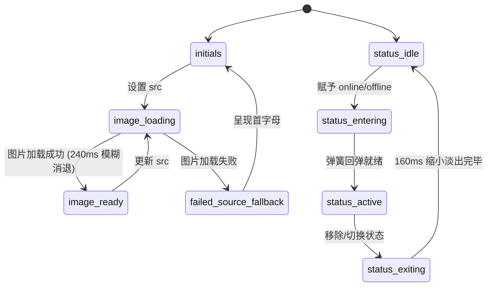

# Avatar · 头像

用于展示用户与实体形象、在线/离线实时状态指示以及图片失效时的首字母缩写兜底。包含三大核心动效机制：

1. 图片异步加载柔和渐入：图片加载期间保持高斯模糊占位（`blur(4px)`），加载完成后通过 240ms 平滑曲线解除模糊并淡入，杜绝加载过程中的生硬闪烁。
2. 首字母缩写兜底（Initials Fallback）：当无图片或加载失败时，自动提取姓名首字母，平滑淡入呈现。
3. 状态指示标记物理弹簧弹性入场：在线（Online）/ 离线（Offline）标记切换时，具备轻微回弹物理动效（`visualDuration: 0.26s`, `bounce: 0.12`）；退出时带有微缩缩小退场。

## 原型清单

| 原型分组 | 原型元素 | 动效 / 状态变化 | 去向 |
| --- | --- | --- | --- |
| 基础元素 | 头像宿主容器（`.arc-avatar`） | 统一圆角封装与尺寸定位，`role="img"` | 最小 DOM / CSS |
| 基础元素 | 真实图片（`img`） | 异步加载中 `blur(4px)` 占位，加载成功 240ms 淡入解除模糊 | 图片异步加载柔和渐入 |
| 基础元素 | 首字母缩写（`.arc-avatar-fallback`） | 图片不存在或加载失败时淡入展现 | 首字母缩写兜底 |
| 状态元素 | 状态指示器（`.arc-avatar-status`） | 在线绿色 / 离线灰色，弹性弹簧入场与微缩退场 | 状态指示标记物理弹簧弹性入场 |
| 尺寸变体 | sm / md / lg / xl 规格 | 适配 28px、36px、48px、88px 四档标准尺寸与状态点比例 | 参数与 CSS |
| 演示外壳 | 顶部主题切换按钮（`#themeBtn`） | 点击切换浅色/深色主题 | 演示外壳，已删除 |
| 演示外壳 | 舞台展示卡片与姓名展示行 | 仅用于展示多用户并排效果 | 演示外壳，已删除 |

## 适用

- 用户资料、列表项成员标识、协同工作台实时在线状态展示。
- 图片资源通过网络异步获取，需要防范图片撕裂、闪烁并提供清晰的首字母文本兜底。
- 业务系统需动态切换用户在线、离线或隐身状态，要求状态切换具备物理动效。

## 不适用

- 多个成员头像重叠堆叠展示、悬停扇形展开与多余人数计数器 → [avatar-group](avatar-group.md)
- 带边框色彩反馈、尺寸自适应与数字/文本滚动的轻量状态徽标 → [badge](badge.md)
- 包含卡片详情展开、大图预览与浮层交互的综合卡片 → [card](../cards/card.md)

## 状态机

头像组件内部管理图片状态（loading / ready / error）与用户在线状态（none / online / offline）的双轨状态：

| 状态 | 进入条件 | 视觉表现 | 退出到 |
| --- | --- | --- | --- |
| initials | 无图片 URL 或图片加载失败 | 居中展示 1~2 位大写首字母缩写 | image-loading |
| image-loading | 传入新图片 `src` 且处于加载中 | 图片绝对定位层叠，透明度为 0 并带有 4px 模糊，显示缩写 | image-ready / failed-source-fallback |
| image-ready | 图片 `load` 事件触发 | 240ms 内模糊消退至 0，透明度升至 1，覆盖缩写 | failed-source-fallback / image-loading |
| failed-source-fallback | 图片 `error` 事件触发 | 移除图片节点，平滑回退至 initials 首字母缩写 | image-loading |
| status-entering | 传入 `online` 或 `offline` | 标记从 `scale(0.6)` 与透明度 0 经轻量弹簧弹性放大至 1 | status-active |
| status-active | 弹簧动画落定 | 稳定停留在右下角（在线绿点 / 离线灰点） | status-exiting |
| status-exiting | 状态移除或变更 | 旧标记经 160ms 缩小至 `scale(0.6)` 并淡出销毁 | status-entering / 无状态 |



## 最小 DOM

```html
<span class="arc-avatar arc-avatar-md" role="img" aria-label="Emma Collins, online">
  <!-- 首字母缩写兜底文本 -->
  <span class="arc-avatar-fallback" aria-hidden="true">EC</span>
  <!-- 真实异步图片 -->
  
  <!-- 状态指示标记点 -->
  <i class="arc-avatar-status arc-avatar-online" aria-hidden="true"></i>
</span>
```

- `.arc-avatar`：头像宿主外框，设定圆形裁切（`border-radius: 9999px`）、网格居中与基础尺寸。
- `.arc-avatar-fallback`：首字母缩写文本层，在图片未就绪或加载失败时提供稳健内容占位。
- `.arc-avatar-img`：异步图片节点，采用 `position: absolute; inset: 0` 铺满，结合 `object-fit: cover` 防止形变。
- `.arc-avatar-status`：绝对定位在右下角的状态指示点，通过 `arc-avatar-online` 或 `arc-avatar-offline` 控制色值。

## 参数

| 名称 | 值 | 用于 | 来源 |
| --- | --- | --- | --- |
| 尺寸：sm | `28px` (字体 `10px`) | `.arc-avatar-sm` | 原型 |
| 尺寸：md（默认） | `36px` (字体 `12px`) | `.arc-avatar-md` | 原型 |
| 尺寸：lg | `48px` (字体 `14px`) | `.arc-avatar-lg` | 原型 |
| 尺寸：xl | `88px` (字体 `20px`) | `.arc-avatar-xl` | 原型 |
| 图片加载淡入时长 | `240ms` | 图片 load 后解除模糊与透明度过渡 | 原型 |
| 图片加载缓动曲线 | `cubic-bezier(0.16, 1, 0.3, 1)` | 图片渐现曲线 | 原型 |
| 图片预加载占位模糊 | `4px` | `img[data-loading]` 高斯模糊 | 原型 |
| 状态入场弹簧物理时长 | `260ms` (`visualDuration: 0.26`) | 状态标记入场弹簧 | 原型 |
| 状态入场阻尼反弹 | `0.12` (`bounce: 0.12`) | 状态标记入场弹性幅度 | 原型 |
| 状态入场起始缩放 | `scale(0.6)` / `opacity: 0` | 状态标记入场起点 | 原型 |
| 状态退场时长与曲线 | `160ms` / `cubic-bezier(0, 0, 0.58, 1)` | 旧状态标记退出 | 原型 |
| 状态点大小：sm | `8px` (边框 `1.5px`) | `.arc-avatar-sm .arc-avatar-status` | 原型 |
| 状态点大小：md | `10px` (边框 `2px`) | `.arc-avatar-md .arc-avatar-status` | 原型 |
| 状态点大小：lg | `12px` (边框 `2px`) | `.arc-avatar-lg .arc-avatar-status` | 原型 |
| 状态点大小：xl | `14px` (边框 `2px`, 偏移 `4px`) | `.arc-avatar-xl .arc-avatar-status` | 原型 |

## CSS

```css
.arc-avatar {
  --avatar-size: 36px;
  --avatar-font-size: 12px;
  --avatar-status-size: 10px;
  --avatar-status-border: 2px;
  --avatar-status-offset: 0px;
  
  --avatar-bg: #f4f4f5;
  --avatar-border: rgba(0, 0, 0, 0.08);
  --avatar-color: #18181b;
  --avatar-surface: #ffffff;
  --avatar-online: #16a34a;
  --avatar-offline: #71717a;

  position: relative;
  display: inline-grid;
  place-items: center;
  flex: 0 0 auto;
  width: var(--avatar-size);
  height: var(--avatar-size);
  border: 1px solid var(--avatar-border);
  border-radius: 9999px;
  background: var(--avatar-bg);
  color: var(--avatar-color);
  font-family: inherit;
  font-size: var(--avatar-font-size);
  font-weight: 500;
  user-select: none;
  box-sizing: border-box;
}

/* 尺寸变体 */
.arc-avatar.arc-avatar-sm {
  --avatar-size: 28px;
  --avatar-font-size: 10px;
  --avatar-status-size: 8px;
  --avatar-status-border: 1.5px;
}

.arc-avatar.arc-avatar-md {
  --avatar-size: 36px;
  --avatar-font-size: 12px;
  --avatar-status-size: 10px;
  --avatar-status-border: 2px;
}

.arc-avatar.arc-avatar-lg {
  --avatar-size: 48px;
  --avatar-font-size: 14px;
  --avatar-status-size: 12px;
  --avatar-status-border: 2px;
}

.arc-avatar.arc-avatar-xl {
  --avatar-size: 88px;
  --avatar-font-size: 20px;
  --avatar-status-size: 14px;
  --avatar-status-border: 2px;
  --avatar-status-offset: 4px;
}

/* 兜底首字母 */
.arc-avatar-fallback {
  display: inline-flex;
  align-items: center;
  justify-content: center;
  text-transform: uppercase;
  letter-spacing: -0.02em;
  line-height: 1;
}

/* 图片图层与异步加载 */
.arc-avatar-img {
  position: absolute;
  inset: 0;
  width: 100%;
  height: 100%;
  border-radius: inherit;
  object-fit: cover;
  pointer-events: none;
  transition: opacity 240ms cubic-bezier(0.16, 1, 0.3, 1),
              filter 240ms cubic-bezier(0.16, 1, 0.3, 1);
}

.arc-avatar-img[data-loading] {
  opacity: 0;
  filter: blur(4px);
  transition: none;
}

/* 状态指示点 */
.arc-avatar-status {
  position: absolute;
  right: var(--avatar-status-offset);
  bottom: var(--avatar-status-offset);
  z-index: 2;
  width: var(--avatar-status-size);
  height: var(--avatar-status-size);
  border: var(--avatar-status-border) solid var(--avatar-surface);
  border-radius: 9999px;
  box-shadow: 0 0 0 1px var(--avatar-border);
  box-sizing: border-box;
  transform-origin: center center;
}

.arc-avatar-status.arc-avatar-online {
  background: var(--avatar-online);
}

.arc-avatar-status.arc-avatar-offline {
  background: var(--avatar-offline);
}

/* 减少动态效果 */
@media (prefers-reduced-motion: reduce) {
  .arc-avatar-img {
    transition: none !important;
  }
  .arc-avatar-img[data-loading] {
    filter: none !important;
  }
  .arc-avatar-status {
    transition: none !important;
    animation: none !important;
  }
}
```

## JS

```js
/**
 * 提取姓名首字母（取前两个词的首字母大写）
 */
function extractInitials(name) {
  if (!name || typeof name !== 'string') return '';
  const parts = name.trim().split(/\s+/).filter(Boolean);
  if (parts.length === 0) return '';
  if (parts.length === 1) return parts[0].slice(0, 2).toUpperCase();
  return (parts[0][0] + parts[1][0]).toUpperCase();
}

/**
 * 纯原生 Avatar 状态与动效控制器
 * @param {HTMLElement} el 宿主容器节点
 * @param {Object} options 配置项
 * @param {string} [options.name='User'] 用户姓名
 * @param {string} [options.src] 头像图片地址
 * @param {string} [options.size='md'] 尺寸规格：sm | md | lg | xl
 * @param {string} [options.status] 状态标记：online | offline | null
 */
export function createAvatar(el, options = {}) {
  let config = {
    name: 'User',
    size: 'md',
    status: null,
    src: null,
    ...options
  };

  let disposed = false;
  let failedSrc = null;
  let imgEl = el.querySelector('.arc-avatar-img');
  let fallbackEl = el.querySelector('.arc-avatar-fallback');
  let statusEl = el.querySelector('.arc-avatar-status');
  let activeAnimation = null;

  function render() {
    if (disposed) return;

    // 1. 设置尺寸类名与 ARIA 标记
    el.classList.remove('arc-avatar-sm', 'arc-avatar-md', 'arc-avatar-lg', 'arc-avatar-xl');
    el.classList.add(`arc-avatar-${config.size || 'md'}`);
    el.setAttribute('role', 'img');
    const statusLabel = config.status ? `, ${config.status}` : '';
    el.setAttribute('aria-label', `${config.name || 'User'}${statusLabel}`);

    // 2. 渲染兜底首字母
    if (!fallbackEl) {
      fallbackEl = document.createElement('span');
      fallbackEl.className = 'arc-avatar-fallback';
      fallbackEl.setAttribute('aria-hidden', 'true');
      el.prepend(fallbackEl);
    }
    fallbackEl.textContent = extractInitials(config.name);

    // 3. 处理图片加载逻辑
    const shouldLoadImage = Boolean(config.src && config.src !== failedSrc);
    if (shouldLoadImage) {
      if (!imgEl || imgEl.getAttribute('src') !== config.src) {
        if (imgEl) imgEl.remove();
        imgEl = document.createElement('img');
        imgEl.className = 'arc-avatar-img';
        imgEl.alt = '';
        imgEl.decoding = 'async';
        imgEl.loading = 'lazy';
        imgEl.dataset.loading = 'true';

        imgEl.addEventListener('load', onImageLoad);
        imgEl.addEventListener('error', onImageError);
        imgEl.src = config.src;
        el.insertBefore(imgEl, fallbackEl.nextSibling);

        if (imgEl.complete && imgEl.naturalWidth > 0) {
          delete imgEl.dataset.loading;
        }
      }
    } else {
      if (imgEl) {
        imgEl.removeEventListener('load', onImageLoad);
        imgEl.removeEventListener('error', onImageError);
        imgEl.remove();
        imgEl = null;
      }
    }

    // 4. 处理状态指示器物理流转
    updateStatusIndicator(config.status);
  }

  function onImageLoad(e) {
    if (disposed || !imgEl || e.currentTarget !== imgEl) return;
    delete imgEl.dataset.loading;
  }

  function onImageError(e) {
    if (disposed || !imgEl || e.currentTarget !== imgEl) return;
    failedSrc = config.src;
    imgEl.remove();
    imgEl = null;
  }

  function updateStatusIndicator(nextStatus) {
    if (activeAnimation) {
      activeAnimation.cancel();
      activeAnimation = null;
    }

    if (!nextStatus) {
      if (statusEl) {
        const leavingNode = statusEl;
        statusEl = null;
        const prefersReduced = window.matchMedia('(prefers-reduced-motion: reduce)').matches;
        if (prefersReduced) {
          leavingNode.remove();
        } else {
          const anim = leavingNode.animate([
            { transform: 'scale(1)', opacity: 1 },
            { transform: 'scale(0.6)', opacity: 0 }
          ], {
            duration: 160,
            easing: 'cubic-bezier(0, 0, 0.58, 1)',
            fill: 'forwards'
          });
          anim.onfinish = () => leavingNode.remove();
        }
      }
      return;
    }

    const isNewNode = !statusEl;
    if (!statusEl) {
      statusEl = document.createElement('i');
      statusEl.setAttribute('aria-hidden', 'true');
      el.appendChild(statusEl);
    }

    statusEl.className = `arc-avatar-status arc-avatar-${nextStatus}`;

    const prefersReduced = window.matchMedia('(prefers-reduced-motion: reduce)').matches;
    if (!prefersReduced && isNewNode) {
      activeAnimation = statusEl.animate([
        { transform: 'scale(0.6)', opacity: 0 },
        { transform: 'scale(1.1)', opacity: 1, offset: 0.7 },
        { transform: 'scale(1)', opacity: 1 }
      ], {
        duration: 260,
        easing: 'cubic-bezier(0.16, 1, 0.3, 1)',
        fill: 'forwards'
      });
      activeAnimation.onfinish = () => { activeAnimation = null; };
    }
  }

  render();

  return {
    configure(patch) {
      if (disposed) return;
      config = { ...config, ...patch };
      render();
    },
    destroy() {
      if (disposed) return;
      disposed = true;
      if (activeAnimation) {
        activeAnimation.cancel();
        activeAnimation = null;
      }
      if (imgEl) {
        imgEl.removeEventListener('load', onImageLoad);
        imgEl.removeEventListener('error', onImageError);
      }
      el.innerHTML = '';
    }
  };
}
```

## 接入目标项目

- 状态来源：
  - 由用户数据模型（User Profile）直接驱动，如 `user.name`、`user.avatarUrl`、`user.onlineStatus`。
- 尺寸策略：
  - 默认为 `md` (36px)。在紧凑导航栏或表格内推荐使用 `sm` (28px)，在卡片头部使用 `md` 或 `lg` (48px)，在个人主页展示大图使用 `xl` (88px)。
- 驱动方式：
  - 挂载时调用 `createAvatar(el, options)` 传入初始属性，在网络请求或长连接（WebSocket）推送在线状态变更时调用 `configure({ status: 'online' })`，组件销毁时调用 `destroy()`。

## 重入与清理

- 连续切换状态重入保护：`updateStatusIndicator` 执行前主动调用 `activeAnimation.cancel()`，阻断未落定的旧动画。
- 图片错误记忆：记录 `failedSrc`，避免在网络不稳定时对同一个损坏的 URL 发起死循环重复请求。
- 卸载清理：`destroy()` 彻底注销图片 `load` 与 `error` 监听器，取消进行中的 Web Animation 并释放 DOM 引用。

## 减少动态效果

- 满足 `prefers-reduced-motion: reduce` 时：
  - 禁用图片的透明度与高斯模糊过渡动画，加载完成后瞬时呈现。
  - 状态指示标记停用弹性入场缩放动画，直接呈现实体色点；退出时直接移除节点，无缩放淡出延迟。

## 焦点与键盘

- 头像组件作为单纯的展示性元素时不设置 `tabindex`，不参与 Tab 键盘导航流。
- 带有 `role="img"` 语义，并通过 `aria-label` 输出形如 `"Emma Collins, online"` 的完整语义，屏幕阅读器可清晰播报。
- 内部图片带 `alt=""`，首字母与状态点均标记 `aria-hidden="true"`，杜绝屏幕阅读器产生重复冗余朗读。
- 若作为可交互控件（如点击查看个人主页），外层应包裹 `<button>` 或 `<a>` 标签承载键盘焦点与回车事件。

## 兼容回退

| 特性 | 不支持时 |
| --- | --- |
| `Element.animate()` (WAAPI) | 回退为直接设置内联样式的最终状态，不产生阻碍界面的脚本错误。 |
| `object-fit: cover` | 在旧版浏览器中图片拉伸填充，圆角裁切仍通过外层 `overflow: hidden` 保证形状。 |

## 验收清单

- [ ] 初始未提供图片或提供无效地址时，正确展示大写首字母缩写。
- [ ] 异步加载有效图片时，图片柔和淡入解除 4px 模糊并覆盖兜底缩写。
- [ ] 状态标记从无到有切换为 `online` 时，以轻量弹簧缩放平滑弹入右下角。
- [ ] 移除状态标记时，标记轻微缩小淡出并安全移除 DOM。
- [ ] 开启系统减少动态效果时，所有弹簧与渐入动画瞬时完成。
- [ ] 屏幕阅读器可正确朗读 `aria-label` 中的用户名与在线状态。
