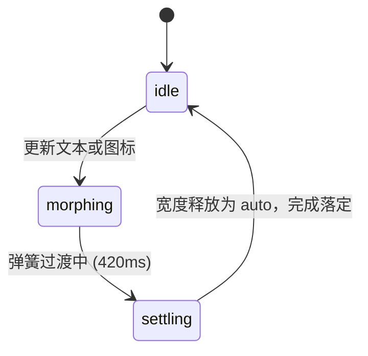

# Badge · 徽标

用于展示对象状态、分类标签、审阅阶段或数值指示的紧凑型徽标组件。包含三大核心动效机制：

1. 文本微模糊形态置换（Text Micro-Blur Morph）：文案更新时（如 "In review" → "Approved"），旧文案向上平移 `-0.3em` 携 2px 模糊退场（160ms），新文案从下方 `+0.3em` 携 4px 模糊升起淡入（240ms）。
2. 图标弹性形变流转（Icon Glyph Spring）：图标类型切换时，通过阻尼弹簧（`visualDuration: 0.26s`, `bounce: 0.12`）自 `scale(0.6)` 弹性升起并消退高斯模糊。
3. 容器宽度智能弹簧收敛（Intent Width Spring）：文案长短变动时，ResizeObserver 在 120ms 交互意图窗口内捕获宽度差，通过弹簧动画平滑过渡外宽（`visualDuration: 0.42s`），动画落定后恢复 `width: auto`。

## 原型清单

| 原型分组 | 原型元素 | 动效 / 状态变化 | 去向 |
| --- | --- | --- | --- |
| 宿主容器 | 徽标外框（`.arc-badge`） | 承载色调变体、圆角边框与悬停微反馈 | 最小 DOM / CSS |
| 测量外壳 | 宽度伸缩盒（`.arc-badge-body`） | 在文案变更时驱动像素宽度弹簧过渡，落定恢复 auto | 容器宽度智能弹簧收敛 |
| 内容插槽 | 内容排版容器（`.arc-badge-content`） | 水平排列图标与文案，供 ResizeObserver 测量自然尺寸 | 最小 DOM / JS |
| 图标插槽 | 图标图层（`.arc-badge-icon` / `.arc-badge-glyph`） | 图标变更时的缩放与弹簧显隐流转 | 图标弹性形变流转 |
| 文案插槽 | 文本图层（`.arc-badge-label` / `.arc-badge-text`） | 双图层绝对定位交替与垂直微模糊切变 | 文本微模糊形态置换 |
| 演示外壳 | 顶部主题切换按钮（`#themeBtn`） | 点击切换浅深色主题 | 演示外壳，已删除 |
| 演示外壳 | 审阅审批演示按钮（`Approve review`） | 用于触发状态反转与文案切换的演示开关 | 演示外壳，已删除 |

## 适用

- 流程节点与状态指示：如 "In review"、"Ready"、"Needs attention"。
- 分类标签、系统标签与功能标记。
- 文本或图标会根据业务状态即时更新，需要平滑的字符形变与宽度回弹。

## 不适用

- 单个用户或机器人的头像与在线状态指示 → [avatar](avatar.md)
- 多个头像重叠、带有扇形展开与气泡的协作者列表 → [avatar-group](avatar-group.md)
- 指标看板中带有大号滚动计数值与周期涨跌幅的卡片 → [metric-card](../cards/metric-card.md)

## 状态机

| 状态 | 进入条件 | 视觉表现 | 退出到 |
| --- | --- | --- | --- |
| idle | 初始状态或内容稳定 | 显示当前文案与图标，外宽为 `width: auto` | morphing |
| morphing | 业务变更文本或图标 | 旧内容向上退场，新内容自下方升起；外宽锁定像素值并执行弹簧宽度过渡 | settling |
| settling | 宽度弹簧与字符动画完成 | 释放内联宽度为 `auto`，彻底移除退场节点 | idle |



## 最小 DOM

```html
<span class="arc-badge arc-badge-success arc-badge-md">
  <span class="arc-badge-body" style="width: auto;">
    <span class="arc-badge-content">
      <!-- 矢量图标 -->
      <span class="arc-badge-icon" aria-hidden="true">
        <span class="arc-badge-glyph">
          <svg width="13" height="13" viewBox="0 0 24 24" fill="none" stroke="currentColor" stroke-width="2" stroke-linecap="round" stroke-linejoin="round">
            <polyline points="20 6 9 17 4 12"></polyline>
          </svg>
        </span>
      </span>
      <!-- 动态文案 -->
      <span class="arc-badge-label">
        <span class="arc-badge-text">Ready</span>
      </span>
    </span>
  </span>
</span>
```

- `.arc-badge`：徽标主外框，设定胶囊圆角（`border-radius: 9999px`）、色调与发丝边框。
- `.arc-badge-body`：弹性尺寸承载容器，由 JS 在形变时施加过渡宽度。
- `.arc-badge-content`：自然内容弹性排版容器，内含图标与文本。
- `.arc-badge-icon` / `.arc-badge-glyph`：图标承载层，支持同位交替与弹簧缩放。
- `.arc-badge-label` / `.arc-badge-text`：文本承载层，通过绝对定位实现退场旧文本与进场新文本的重叠平滑置换。

## 参数

| 名称 | 值 | 用于 | 来源 |
| --- | --- | --- | --- |
| 尺寸高度：md | `26px` (字号 `12px`, padding `0 10px`, gap `5px`) | `.arc-badge-md` | 原型 |
| 尺寸高度：sm | `22px` (字号 `11px`, padding `0 8px`, gap `4px`) | `.arc-badge-sm` | 原型 |
| 文本入场时长与曲线 | `240ms` / `cubic-bezier(0.16, 1, 0.3, 1)` | 新文本升起淡入 | 原型 |
| 文本入场位移与模糊 | `translateY(0.3em)` / `blur(4px)` | 进场初始状态 | 原型 |
| 文本退场时长与曲线 | `160ms` / `cubic-bezier(0.22, 1, 0.36, 1)` | 旧文本上升淡出 | 原型 |
| 文本退场位移与模糊 | `translateY(-0.3em)` / `blur(2px)` | 离场目标状态 | 原型 |
| 图标弹簧入场时长 | `260ms` (`visualDuration: 0.26`) | 图标弹性入场 | 原型 |
| 图标弹簧回弹系数 | `0.12` (`bounce: 0.12`) | 图标弹性幅度 | 原型 |
| 图标起始缩放与模糊 | `scale(0.6)` / `blur(2px)` | 新图标入场起点 | 原型 |
| 宽度弹簧时长与曲线 | `420ms` (`visualDuration: 0.42`, `bounce: 0.16`) | `.arc-badge-body` 宽度过渡 | 原型 |
| 交互意图捕获窗口 | `120ms` | 区分主动内容更新与被动布局变化 | 原型 |

## CSS

```css
.arc-badge {
  --badge-min-height: 26px;
  --badge-padding-x: 10px;
  --badge-font-size: 12px;
  --badge-gap: 5px;

  --badge-bg: #f4f4f5;
  --badge-color: #52525b;
  --badge-border: rgba(0, 0, 0, 0.08);

  display: inline-flex;
  min-height: var(--badge-min-height);
  align-items: center;
  border: 1px solid var(--badge-border);
  border-radius: 9999px;
  padding: 0 var(--badge-padding-x);
  color: var(--badge-color);
  background: var(--badge-bg);
  font-family: inherit;
  font-size: var(--badge-font-size);
  font-weight: 500;
  letter-spacing: -0.01em;
  line-height: 1;
  white-space: nowrap;
  box-sizing: border-box;
  overflow: clip;
  user-select: none;
  transition: border-color 220ms ease,
              background-color 220ms ease,
              color 220ms ease;
}

/* 尺寸变体 */
.arc-badge.arc-badge-sm {
  --badge-min-height: 22px;
  --badge-padding-x: 8px;
  --badge-font-size: 11px;
  --badge-gap: 4px;
}

/* 色调变体 */
.arc-badge.arc-badge-neutral {
  --badge-bg: #f4f4f5;
  --badge-color: #52525b;
  --badge-border: rgba(0, 0, 0, 0.08);
}

.arc-badge.arc-badge-success {
  --badge-bg: rgba(22, 163, 74, 0.1);
  --badge-color: #16a34a;
  --badge-border: rgba(22, 163, 74, 0.25);
}

.arc-badge.arc-badge-info {
  --badge-bg: rgba(37, 99, 235, 0.1);
  --badge-color: #2563eb;
  --badge-border: rgba(37, 99, 235, 0.25);
}

.arc-badge.arc-badge-warning {
  --badge-bg: rgba(217, 119, 6, 0.1);
  --badge-color: #d97706;
  --badge-border: rgba(217, 119, 6, 0.27);
}

.arc-badge.arc-badge-danger {
  --badge-bg: rgba(220, 38, 38, 0.1);
  --badge-color: #dc2626;
  --badge-border: rgba(220, 38, 38, 0.26);
}

/* 悬停微反馈 */
@media (hover: hover) and (pointer: fine) {
  .arc-badge:hover {
    filter: brightness(0.96);
  }
}

/* 内部结构 */
.arc-badge-body {
  display: block;
  overflow: visible;
  transition: width 420ms cubic-bezier(0.16, 1, 0.3, 1);
  will-change: width;
}

.arc-badge-content {
  position: relative;
  display: inline-flex;
  width: max-content;
  align-items: center;
  gap: var(--badge-gap);
}

.arc-badge-label,
.arc-badge-glyph {
  position: relative;
  display: inline-flex;
  align-items: center;
}

.arc-badge-text {
  display: inline-block;
  white-space: nowrap;
  transition: transform 240ms cubic-bezier(0.16, 1, 0.3, 1),
              opacity 240ms cubic-bezier(0.16, 1, 0.3, 1),
              filter 240ms cubic-bezier(0.16, 1, 0.3, 1);
}

.arc-badge-text.text-out {
  position: absolute;
  top: 0;
  left: 0;
  pointer-events: none;
  opacity: 0;
  transform: translateY(-0.3em);
  filter: blur(2px);
  transition: transform 160ms cubic-bezier(0.22, 1, 0.36, 1),
              opacity 160ms cubic-bezier(0.22, 1, 0.36, 1),
              filter 160ms cubic-bezier(0.22, 1, 0.36, 1) !important;
}

.arc-badge-icon {
  position: relative;
  display: inline-flex;
  align-items: center;
  justify-content: center;
  color: currentColor;
  line-height: 1;
}

/* 减少动态效果 */
@media (prefers-reduced-motion: reduce) {
  .arc-badge {
    transition: none !important;
  }
  .arc-badge-body {
    transition: none !important;
  }
  .arc-badge-text {
    transform: none !important;
    filter: none !important;
    transition: opacity 120ms linear !important;
  }
  .arc-badge-text.text-out {
    transform: none !important;
    filter: none !important;
  }
}
```

## JS

```js
/**
 * 纯原生 Badge 状态与动效控制器
 * @param {HTMLElement} el 徽标宿主节点
 * @param {Object} options 配置项
 * @param {string} [options.text='Badge'] 文本内容
 * @param {string} [options.tone='neutral'] 语意色调：neutral | success | info | warning | danger
 * @param {string} [options.size='md'] 规格大小：sm | md
 * @param {string|HTMLElement} [options.icon] 图标 SVG 字符或 DOM 节点
 */
export function createBadge(el, options = {}) {
  let config = {
    text: 'Badge',
    tone: 'neutral',
    size: 'md',
    icon: null,
    ...options
  };

  let disposed = false;
  let bodyEl = el.querySelector('.arc-badge-body');
  let contentEl = el.querySelector('.arc-badge-content');
  let labelEl = el.querySelector('.arc-badge-label');
  let textEl = el.querySelector('.arc-badge-text');
  let iconContainer = el.querySelector('.arc-badge-icon');
  let resizeObserver = null;
  let lastContentWidth = 0;
  let settleTimer = null;

  function ensureStructure() {
    if (!bodyEl) {
      bodyEl = document.createElement('span');
      bodyEl.className = 'arc-badge-body';
      bodyEl.style.width = 'auto';
      el.appendChild(bodyEl);
    }
    if (!contentEl) {
      contentEl = document.createElement('span');
      contentEl.className = 'arc-badge-content';
      bodyEl.appendChild(contentEl);
    }
    if (!labelEl) {
      labelEl = document.createElement('span');
      labelEl.className = 'arc-badge-label';
      contentEl.appendChild(labelEl);
    }
    if (!textEl) {
      textEl = document.createElement('span');
      textEl.className = 'arc-badge-text';
      textEl.textContent = config.text || '';
      labelEl.appendChild(textEl);
    }
  }

  function renderToneAndSize() {
    el.className = `arc-badge arc-badge-${config.tone || 'neutral'} arc-badge-${config.size || 'md'}`;
  }

  function updateIcon(iconContent) {
    if (!iconContent) {
      if (iconContainer) {
        iconContainer.remove();
        iconContainer = null;
      }
      return;
    }

    if (!iconContainer) {
      iconContainer = document.createElement('span');
      iconContainer.className = 'arc-badge-icon';
      iconContainer.setAttribute('aria-hidden', 'true');
      contentEl.insertBefore(iconContainer, labelEl);
    }

    const glyphSpan = document.createElement('span');
    glyphSpan.className = 'arc-badge-glyph';
    if (typeof iconContent === 'string') {
      glyphSpan.innerHTML = iconContent;
    } else if (iconContent instanceof Node) {
      glyphSpan.appendChild(iconContent);
    }

    iconContainer.innerHTML = '';
    iconContainer.appendChild(glyphSpan);
  }

  function updateTextMorph(newText) {
    if (textEl && textEl.textContent === newText) return;

    const oldTextSpan = textEl;
    if (oldTextSpan) {
      oldTextSpan.classList.add('text-out');
      oldTextSpan.setAttribute('aria-hidden', 'true');
      setTimeout(() => {
        if (!disposed && oldTextSpan.parentNode) {
          oldTextSpan.remove();
        }
      }, 160);
    }

    const nextTextSpan = document.createElement('span');
    nextTextSpan.className = 'arc-badge-text';
    nextTextSpan.textContent = newText;

    const prefersReduced = window.matchMedia('(prefers-reduced-motion: reduce)').matches;
    if (!prefersReduced) {
      nextTextSpan.style.opacity = '0';
      nextTextSpan.style.transform = 'translateY(0.3em)';
      nextTextSpan.style.filter = 'blur(4px)';
    }

    labelEl.appendChild(nextTextSpan);
    textEl = nextTextSpan;

    // 触发平滑进场
    requestAnimationFrame(() => {
      if (disposed) return;
      nextTextSpan.style.opacity = '1';
      nextTextSpan.style.transform = 'translateY(0)';
      nextTextSpan.style.filter = 'blur(0)';
    });

    // 触发宽度测量与弹簧伸展
    measureWidthMorph();
  }

  function measureWidthMorph() {
    if (!bodyEl || !contentEl) return;
    const currentWidth = contentEl.offsetWidth;
    if (lastContentWidth && lastContentWidth !== currentWidth) {
      bodyEl.style.width = `${lastContentWidth}px`;
      requestAnimationFrame(() => {
        if (disposed) return;
        bodyEl.style.width = `${currentWidth}px`;
      });

      clearTimeout(settleTimer);
      settleTimer = setTimeout(() => {
        if (!disposed && bodyEl) {
          bodyEl.style.width = 'auto';
        }
      }, 420);
    }
    lastContentWidth = currentWidth;
  }

  ensureStructure();
  renderToneAndSize();
  updateIcon(config.icon);
  updateTextMorph(config.text);

  return {
    update(patch) {
      if (disposed) return;
      config = { ...config, ...patch };
      renderToneAndSize();
      if ('icon' in patch) updateIcon(patch.icon);
      if ('text' in patch) updateTextMorph(patch.text);
    },
    destroy() {
      if (disposed) return;
      disposed = true;
      clearTimeout(settleTimer);
      if (resizeObserver) resizeObserver.disconnect();
      el.innerHTML = '';
    }
  };
}
```

## 接入目标项目

- 状态来源：
  - 绑定业务对象的状态枚举值，如审批流程中的状态机输出（`status: 'in-review' | 'approved' | 'rejected'`）。
- 尺寸策略：
  - 默认推荐 `md` (26px) 用于一般表单与页面；在数据表格密集行或列表副标题中推荐使用 `sm` (22px)。
- 驱动方式：
  - 调用 `createBadge(el, { text, tone, icon })` 初始化；业务状态更新时调用 `update({ text: 'Approved', tone: 'success' })`。

## 重入与清理

- 文本快速连切重入防护：新旧文本节点交替，旧节点立即赋予绝对定位脱离文档流并在 160ms 定时器触发后安全自 DOM 移除。
- 宽度过渡收敛：通过 `settleTimer` 确保在动画结束（420ms）后释放行内固定像素值，恢复为 `width: auto`，保障容器能自适应后续可能的动态字体缩放。
- 销毁清理：`destroy()` 阻断未结项的定时器并移除所有子节点。

## 减少动态效果

- 满足 `prefers-reduced-motion: reduce` 时：
  - 文本位移（`translateY`）与高斯模糊（`blur`）被重置为 `none`，改为 120ms 纯透明度交叉淡化。
  - 外宽弹簧过渡禁用，直接瞬时适应新文本宽度。

## 焦点与键盘

- 徽标默认属于纯呈现组件，不接受键盘 Tab 焦点。
- 图标节点显式声明 `aria-hidden="true"`，退场中的临时文本节点同步附加 `aria-hidden="true"`，杜绝无障碍辅助设备双重朗读。

## 兼容回退

| 特性 | 不支持时 |
| --- | --- |
| `overflow: clip` | 优雅回退为 `overflow: hidden`，同样支持胶囊形圆角裁切。 |
| WAAPI / CSS Transitions | 降级为直接显示新文本与固定背景色，核心业务状态可正常传达。 |

## 验收清单

- [ ] 初始渲染具有正确的胶囊圆角、字体排版以及对应的色调边框与底色。
- [ ] 动态更新文本时，新旧文案产生垂直交错微模糊形态变化，容器宽度平滑拉伸收缩。
- [ ] 动态更新完成后，容器宽度安全恢复为 `width: auto`。
- [ ] 开启系统级减少动态效果时，位移动画与宽度缓动立即关闭，呈快速透明度淡化。
