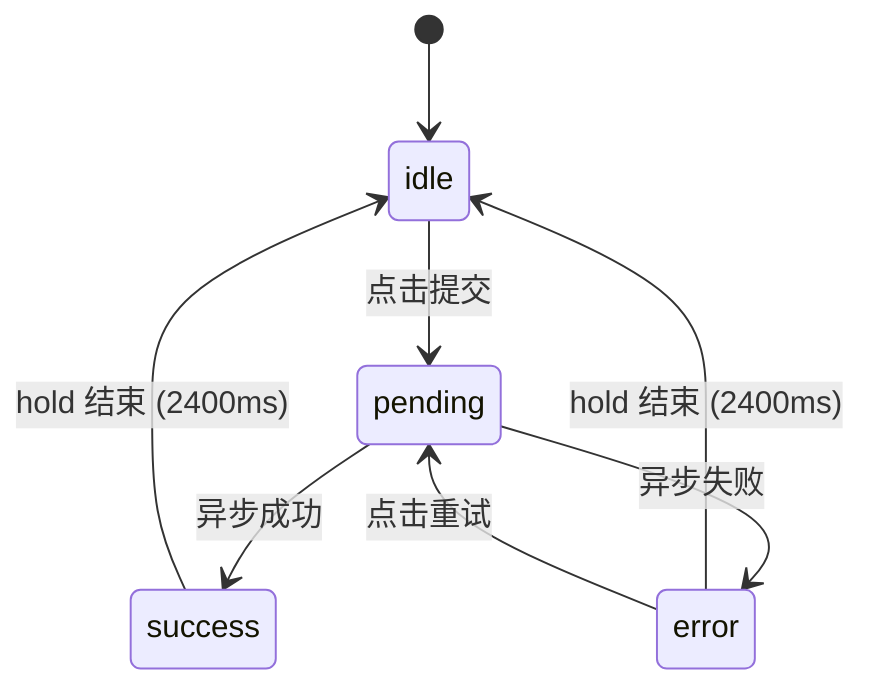

# Action Button · 异步操作按钮

执行异步提交操作的高反馈按钮。包含三大核心动效机制：

1. 逐字形变文案（popLayout）：新旧文案比对公共前后缀，退场字符在原绝对位置上移模糊淡出，进场字符带错峰延迟从下方升起淡入；容器自然测量宽度并平滑伸缩。
2. 方向性图标物理流转：静止态箭头向右飞出，中间态加载环显现旋转，成功态对勾笔触书写展开，复原态箭头从左侧穿入归位；补充失败态错误图标。
3. 按压与悬停反馈：轻量级缩放与弹性回弹，悬停阴影抬升。

## 原型清单

| 原型分组 | 原型元素 | 动效 / 状态变化 | 去向 |
| --- | --- | --- | --- |
| — | 主操作按钮（`#mainActionBtn`） | 悬停底色、边框与阴影；按压缩放 0.98；逐字文案形变；箭头/Spinner/对勾图标时序流转；成功停留 2400ms 后自动复原 | 按压与悬停 + 逐字形变文案 + 方向性图标物理流转 |
| — | 底部提示文案 `.hint-text` | 静态说明 | 演示外壳，已删除 |
| — | 顶栏、主题切换按钮、D 快捷键、舞台卡片、embed/postMessage 检测 | — | 演示外壳，已删除 |

## 适用

- 按钮触发具有网络延迟的异步保存、发布、提交、更新操作。
- 文案在状态切换时需要极具品质感的逐字平滑形变（例如 "Save changes" → "Saving" → "Saved"）。
- 图标需要明确指示出“向前推进 → 处理中 → 成功确认 → 归位就绪”的物理流转过程。
- 允许按钮根据文本长度自然测量伸缩。

## 不适用

- 简单异步操作，只需整段文字交叉淡化、不需要逐字形变 → [button](button.md)
- 写入系统剪贴板的复制操作 → [copy-button](copy-button.md)
- 两个固定图标之间的连续 SVG 路径形变 → [icon-morph](icon-morph.md)
- 危险操作需要原地二次展开确认与倒计时撤销 → [confirm-morph](confirm-morph.md)
- 长按手势确认 → [hold-to-confirm](../gestures/hold-to-confirm.md)

## 状态机

| 状态 | 进入条件 | 视觉表现 | 退出到 |
| --- | --- | --- | --- |
| idle | 初始；复原完成 | 箭头图标静止就绪，初始文案，按钮可点击 | pending |
| pending | 异步请求发起 | 箭头向右飞出淡出；80ms 后加载环显现旋转；文案逐字变为进行中文案；设置 `aria-busy="true"` | success / error |
| success | 请求成功返回 | 加载环淡出；60ms 后对勾滑入并书写笔触；文案逐字变为成功文案；停留 2400ms 后自动复原 | idle |
| error | 请求失败【补充】 | 加载环淡出；错误图标颤动显现；文案逐字变为失败文案；停留 2400ms 或点击重试 | idle / pending |



## 最小 DOM

```html
<button class="arc-action-btn" type="button" data-state="idle" aria-label="Save changes">
  <span class="btn-content" aria-hidden="true">
    <!-- 逐字形态文本槽 -->
    <span class="morph-slot">
      <span class="glyphs-row"></span>
    </span>

    <!-- 右侧固定 17×17 图标插槽 -->
    <span class="icon-slot">
      <!-- 1. Arrow Right (Idle 就绪) -->
      <svg class="phase-icon icon-arrow" width="17" height="17" viewBox="0 0 24 24" fill="none" stroke="currentColor" stroke-width="2" stroke-linecap="round" stroke-linejoin="round">
        <line x1="5" y1="12" x2="19" y2="12" />
        <polyline points="12 5 19 12 12 19" />
      </svg>
      <!-- 2. Spinner (Pending 进行中) -->
      <span class="phase-icon icon-spinner">
        <span class="spinner-ring"></span>
      </span>
      <!-- 3. DrawnCheck (Success 成功) -->
      <svg class="phase-icon icon-check" width="17" height="17" viewBox="0 0 24 24" fill="none" stroke="currentColor" stroke-width="2" stroke-linecap="round" stroke-linejoin="round">
        <path class="drawn-check-path" d="M4 12l5 5L20 6" />
      </svg>
      <!-- 4. ErrorIcon (Error 失败，补充) -->
      <svg class="phase-icon icon-error" width="17" height="17" viewBox="0 0 24 24" fill="none" stroke="currentColor" stroke-width="2" stroke-linecap="round" stroke-linejoin="round">
        <circle cx="12" cy="12" r="10" />
        <line x1="12" y1="8" x2="12" y2="12" />
        <line x1="12" y1="16" x2="12.01" y2="16" />
      </svg>
    </span>
  </span>
</button>
```

- `.arc-action-btn`：按钮宿主，承载按压缩放与悬停效果，`data-state` 驱动整体状态。
- `.btn-content`：内联弹性容器，居中布局文本槽与图标插槽。
- `.morph-slot`：宽度过渡容器，JS 动态计算内部排版后赋予精确像素宽度。
- `.glyphs-row`：字形承载行，字符的定位与离场挂载点。
- `.icon-slot`：固定 17×17px 的图标容器，各阶段图标绝对定位层叠于此。
- `.icon-arrow` / `.icon-spinner` / `.icon-check` / `.icon-error`：四阶段图标。对勾路径包含 `.drawn-check-path` 负责 SVG 虚线书写动画。

## 参数

| 名称 | 值 | 用于 | 来源 |
| --- | --- | --- | --- |
| 按钮按压缩放 | `scale(0.98)` | `.arc-action-btn:active` | 原型 |
| 按钮缩放过渡 | `120ms` / `cubic-bezier(0.22, 1, 0.36, 1)` | 按钮按压变换 | 原型 |
| 文本容器宽度伸缩 | `420ms` / `cubic-bezier(0.16, 1, 0.3, 1)` | `.morph-slot` width 过渡 | 原型 |
| 字符入场时长与曲线 | `240ms` / `cubic-bezier(0.16, 1, 0.3, 1)` | `.glyph-in -> .glyph-rest` | 原型 |
| 字符入场起点 | `translateY(7px) blur(2.5px)` / `opacity: 0` | `.glyph-in` | 原型 |
| 字符入场错峰 | `Math.min(index * 18, 100)ms` | transitionDelay | 原型 |
| 字符退场时长与曲线 | `160ms` / `cubic-bezier(0.22, 1, 0.36, 1)` | `.glyph-out` | 原型 |
| 字符退场位移 | `translateY(-7px) blur(2.5px)` / `opacity: 0` | `.glyph-out` | 原型 |
| 字符退场节点清理 | `180ms` 后 DOM 移除 | JS setTimeout | 原型 |
| 箭头飞出时长与位移 | `160ms` / `translateX(9px) blur(2px)` / `opacity: 0` | `.icon-arrow.arrow-leave` | 原型 |
| 箭头复原入场起点 | `translateX(-6px) blur(1.5px)` / `opacity: 0` | `.arrow-enter-from-behind` | 原型 |
| Spinner 延迟入场 | `80ms` | 进入 pending 后的延时 | 原型 |
| Spinner 旋转时长 | `700ms linear infinite` | `.spinner-ring` | 原型 |
| 对勾延迟入场 | `60ms` | 进入 success 后的延时 | 原型 |
| 对勾描边动画 | `stroke-dashoffset: 24 -> 0` / `240ms` | `.drawn-check-path` | 原型 |
| 成功展示停留时长 | `2400ms` | 成功态保持时间，到期自动还原 | 原型 |
| 原型模拟请求耗时 | `1300ms` | 仅演示用，**严禁移植** | 原型 |

## CSS

```css
.arc-action-btn {
  --motion-duration-instant: 120ms;
  --motion-duration-fast: 160ms;
  --motion-duration-exit: 180ms;
  --motion-duration-standard: 240ms;
  --motion-duration-spring: 420ms;

  --motion-ease-enter: cubic-bezier(0.16, 1, 0.3, 1);
  --motion-ease-exit: cubic-bezier(0.7, 0, 0.84, 0);
  --motion-ease-standard: cubic-bezier(0.22, 1, 0.36, 1);
  --motion-ease-snappy: cubic-bezier(0.18, 0.89, 0.32, 1.28);
  --motion-ease-morph: cubic-bezier(0.16, 1, 0.3, 1);

  display: inline-flex;
  align-items: center;
  justify-content: center;
  position: relative;
  cursor: pointer;
  user-select: none;
  border: 1px solid var(--btn-border, rgba(0, 0, 0, 0.1));
  background: var(--btn-bg, #0b0b0b);
  color: var(--btn-color, #ffffff);
  box-shadow: var(--shadow-resting, 0 1px 3px rgba(0, 0, 0, 0.04));
  transition:
    transform var(--motion-duration-instant) var(--motion-ease-standard),
    background-color var(--motion-duration-fast) var(--motion-ease-standard),
    border-color var(--motion-duration-fast) var(--motion-ease-standard),
    box-shadow var(--motion-duration-fast) var(--motion-ease-standard);
  will-change: transform;
}

.arc-action-btn:hover:not(:disabled) {
  box-shadow: var(--shadow-raised, 0 4px 14px rgba(0, 0, 0, 0.08));
}

.arc-action-btn:active:not(:disabled) {
  transform: scale(0.98);
}

.arc-action-btn[data-state="pending"] {
  cursor: wait;
}

.btn-content {
  display: inline-flex;
  align-items: center;
  justify-content: center;
  gap: 8px;
  position: relative;
}

/* 文本平滑伸缩容器 */
.morph-slot {
  display: inline-flex;
  align-items: center;
  position: relative;
  overflow: hidden;
  height: 20px;
  transition: width var(--motion-duration-spring) var(--motion-ease-morph);
  will-change: width;
}

.glyphs-row {
  display: inline-flex;
  align-items: center;
  position: relative;
  white-space: nowrap;
}

/* 字符排版与形变状态 */
.glyph-item {
  display: inline-block;
  position: relative;
  will-change: transform, opacity, filter;
  transition:
    transform var(--motion-duration-standard) var(--motion-ease-enter),
    opacity var(--motion-duration-standard) var(--motion-ease-enter),
    filter var(--motion-duration-standard) var(--motion-ease-enter);
}

.glyph-item.glyph-in {
  opacity: 0;
  transform: translateY(7px);
  filter: blur(2.5px);
}

.glyph-item.glyph-rest {
  opacity: 1;
  transform: translateY(0);
  filter: blur(0);
}

.glyph-item.glyph-out {
  position: absolute;
  top: 0;
  opacity: 0;
  transform: translateY(-7px);
  filter: blur(2.5px);
  pointer-events: none;
  transition:
    transform var(--motion-duration-fast) var(--motion-ease-standard),
    opacity var(--motion-duration-fast) var(--motion-ease-standard),
    filter var(--motion-duration-fast) var(--motion-ease-standard) !important;
}

/* 图标插槽与多阶段流转 */
.icon-slot {
  width: 17px;
  height: 17px;
  position: relative;
  display: inline-flex;
  align-items: center;
  justify-content: center;
  flex-shrink: 0;
}

.phase-icon {
  position: absolute;
  inset: 0;
  display: flex;
  align-items: center;
  justify-content: center;
  opacity: 0;
  pointer-events: none;
  transition:
    transform var(--motion-duration-standard) var(--motion-ease-snappy),
    opacity var(--motion-duration-fast) var(--motion-ease-enter),
    filter var(--motion-duration-fast) var(--motion-ease-enter);
  will-change: transform, opacity, filter;
}

/* 1. 箭头图标 */
.icon-arrow {
  opacity: 1;
  transform: translateX(0);
}

.icon-arrow.arrow-leave {
  opacity: 0;
  transform: translateX(9px);
  filter: blur(2px);
  transition:
    transform var(--motion-duration-fast) var(--motion-ease-standard),
    opacity var(--motion-duration-fast) var(--motion-ease-standard),
    filter var(--motion-duration-fast) var(--motion-ease-standard);
}

.icon-arrow.arrow-enter-from-behind {
  opacity: 0;
  transform: translateX(-6px);
  filter: blur(1.5px);
  transition: none !important;
}

/* 2. 加载环 */
.icon-spinner {
  transform: scale(0.65);
}

.icon-spinner.active {
  opacity: 1;
  transform: scale(1);
  filter: blur(0);
}

.spinner-ring {
  width: 15px;
  height: 15px;
  border: 1.75px solid currentColor;
  border-top-color: transparent;
  border-radius: 50%;
  animation: arc-spin 700ms linear infinite;
  box-sizing: border-box;
}

@keyframes arc-spin {
  to { transform: rotate(360deg); }
}

/* 3. 成功对勾 */
.icon-check {
  color: var(--success, #16a34a);
  transform: scale(0.65) rotate(-8deg);
}

.icon-check.active {
  opacity: 1;
  transform: scale(1) rotate(0deg);
  filter: blur(0);
}

.drawn-check-path {
  stroke-dasharray: 24;
  stroke-dashoffset: 24;
  transition: stroke-dashoffset var(--motion-duration-standard) var(--motion-ease-enter) 40ms;
}

.icon-check.active .drawn-check-path {
  stroke-dashoffset: 0;
}

/* 4. 失败图标 */
.icon-error {
  color: var(--danger, #ef4444);
  transform: scale(0.65);
}

.icon-error.active {
  opacity: 1;
  transform: scale(1);
  filter: blur(0);
}

/* 减少动态效果 */
@media (prefers-reduced-motion: reduce) {
  .arc-action-btn { transition: none !important; }
  .arc-action-btn:active:not(:disabled) { transform: none; }
  .morph-slot { transition: none !important; }
  .glyph-item {
    transition: opacity var(--motion-duration-fast) linear !important;
    transform: none !important;
    filter: none !important;
  }
  .glyph-item.glyph-in { transform: none; filter: none; }
  .glyph-item.glyph-out { transform: none; filter: none; }
  .phase-icon {
    transition: opacity var(--motion-duration-fast) linear !important;
    transform: none !important;
    filter: none !important;
  }
  .icon-arrow.arrow-leave { transform: none; filter: none; }
  .drawn-check-path { stroke-dashoffset: 0 !important; transition: none !important; }
}
```

## JS

```js
const EXIT_DURATION_MS = 180;

/**
 * 将字符串按人类感知字素安全拆分（支持中文多音字、复合 Emoji 等）
 */
function splitGraphemes(str) {
  if (typeof Intl !== 'undefined' && Intl.Segmenter) {
    const segmenter = new Intl.Segmenter(undefined, { granularity: 'grapheme' });
    return Array.from(segmenter.segment(str), s => s.segment);
  }
  return Array.from(str);
}

/**
 * 创建 ActionButton 动效控制器
 * @param {HTMLElement} btn 按钮 DOM 根节点
 * @param {Object} labels 阶段文本映射
 * @param {string} labels.idle 默认就绪文本 (如 'Save changes')
 * @param {string} labels.pending 进行中文本 (如 'Saving')
 * @param {string} labels.success 成功文本 (如 'Saved')
 * @param {string} [labels.error] 失败文本 (如 'Failed')
 * @param {Object} [options]
 * @param {number} [options.hold=2400] 成功/失败停留复原时长 (毫秒)
 */
function createActionButtonMotion(btn, labels, { hold = 2400 } = {}) {
  const morphSlot = btn.querySelector('.morph-slot');
  const glyphsRow = btn.querySelector('.glyphs-row');
  const iconArrow = btn.querySelector('.icon-arrow');
  const iconSpinner = btn.querySelector('.icon-spinner');
  const iconCheck = btn.querySelector('.icon-check');
  const iconError = btn.querySelector('.icon-error');

  let currentState = 'idle';
  const timers = new Set();
  const frames = new Set();

  function wait(ms) {
    return new Promise(resolve => {
      const id = setTimeout(() => {
        timers.delete(id);
        resolve();
      }, ms);
      timers.add(id);
    });
  }

  function frame() {
    return new Promise(resolve => {
      const id = requestAnimationFrame(() => {
        frames.delete(id);
        resolve();
      });
      frames.add(id);
    });
  }

  function cancelTimers() {
    timers.forEach(clearTimeout);
    frames.forEach(cancelAnimationFrame);
    timers.clear();
    frames.clear();
  }

  // 核心 popLayout 逐字形变
  function updateTextMorph(newText) {
    const currentSpans = Array.from(glyphsRow.children).filter(s => !s.classList.contains('glyph-out'));
    const oldGraphemes = currentSpans.map(s => s.textContent);
    const newGraphemes = splitGraphemes(newText);

    if (oldGraphemes.join('') === newText) return;

    let start = 0;
    while (start < oldGraphemes.length && start < newGraphemes.length && oldGraphemes[start] === newGraphemes[start]) {
      start++;
    }

    let end = 0;
    while (end < (oldGraphemes.length - start) && end < (newGraphemes.length - start) &&
           oldGraphemes[oldGraphemes.length - 1 - end] === newGraphemes[newGraphemes.length - 1 - end]) {
      end++;
    }

    // 1. 脱离流式定位，记录绝对偏移
    const leavingSpans = currentSpans.slice(start, oldGraphemes.length - end);
    leavingSpans.forEach(s => {
      const leftOffset = s.offsetLeft;
      s.style.left = `${leftOffset}px`;
      s.classList.remove('glyph-rest', 'glyph-in');
      s.classList.add('glyph-out');
    });

    // 2. 生成新字素节点
    const incomingChars = newGraphemes.slice(start, newGraphemes.length - end);
    const incomingSpans = incomingChars.map((ch, idx) => {
      const span = document.createElement('span');
      span.className = 'glyph-item glyph-in';
      span.textContent = ch;
      span.style.transitionDelay = `${Math.min(idx * 18, 100)}ms`;
      return span;
    });

    // 3. 挂载到对应锚点
    const insertAnchor = currentSpans[oldGraphemes.length - end] || null;
    incomingSpans.forEach(span => {
      glyphsRow.insertBefore(span, insertAnchor);
    });

    // 4. 计算自然宽度并平滑伸缩
    const targetWidth = glyphsRow.offsetWidth;
    morphSlot.style.width = `${targetWidth}px`;

    // 5. 下一帧激活升起动画
    frame().then(() => {
      incomingSpans.forEach(span => {
        span.classList.remove('glyph-in');
        span.classList.add('glyph-rest');
      });
    });

    // 6. 退场节点清理
    wait(EXIT_DURATION_MS).then(() => {
      leavingSpans.forEach(s => s.remove());
    });
  }

  // 初始化字符
  function initText(initialText) {
    glyphsRow.innerHTML = '';
    const chars = splitGraphemes(initialText);
    chars.forEach(ch => {
      const span = document.createElement('span');
      span.className = 'glyph-item glyph-rest';
      span.textContent = ch;
      glyphsRow.appendChild(span);
    });
    morphSlot.style.width = `${glyphsRow.offsetWidth}px`;
  }

  initText(labels.idle);

  // 状态流转执行
  async function setState(nextState) {
    if (currentState === nextState) return;
    cancelTimers();
    currentState = nextState;
    btn.dataset.state = nextState;

    if (nextState === 'pending') {
      btn.setAttribute('aria-busy', 'true');
      btn.setAttribute('aria-label', labels.pending);
      updateTextMorph(labels.pending);

      iconArrow?.classList.add('arrow-leave');
      await wait(80);
      iconSpinner?.classList.add('active');

    } else if (nextState === 'success') {
      btn.removeAttribute('aria-busy');
      btn.setAttribute('aria-label', labels.success);
      updateTextMorph(labels.success);

      iconSpinner?.classList.remove('active');
      iconError?.classList.remove('active');
      await wait(60);
      iconCheck?.classList.add('active');

      await wait(hold);
      if (currentState === 'success') {
        setState('idle');
      }

    } else if (nextState === 'error') {
      btn.removeAttribute('aria-busy');
      const errText = labels.error || 'Failed';
      btn.setAttribute('aria-label', errText);
      updateTextMorph(errText);

      iconSpinner?.classList.remove('active');
      iconCheck?.classList.remove('active');
      iconError?.classList.add('active');

      await wait(hold);
      if (currentState === 'error') {
        setState('idle');
      }

    } else if (nextState === 'idle') {
      btn.removeAttribute('aria-busy');
      btn.setAttribute('aria-label', labels.idle);
      updateTextMorph(labels.idle);

      iconCheck?.classList.remove('active');
      iconError?.classList.remove('active');
      iconSpinner?.classList.remove('active');

      if (iconArrow) {
        iconArrow.classList.remove('arrow-leave');
        iconArrow.classList.add('arrow-enter-from-behind');
        await frame();
        await frame();
        iconArrow.classList.remove('arrow-enter-from-behind');
      }
    }
  }

  return {
    show: (status) => setState(status),
    destroy: () => {
      cancelTimers();
      glyphsRow.querySelectorAll('.glyph-out').forEach(s => s.remove());
    }
  };
}
```

## 接入目标项目

- 状态来源：
  - 订阅目标项目的异步请求生命周期。在请求发起时调用 `show('pending')`，请求成功时调用 `show('success')`，捕获异常时调用 `show('error')`。
  - 原型中的 `1300ms` 演示延迟仅为模拟效果，**严禁移植**。
- 尺寸策略：
  - 原型使用了宽度动态计算与伸缩（`morphSlot.style.width`），按钮整体宽度会随文本增减弹性伸缩。
  - 若目标页面布局严禁宽度变动，可为 `.morph-slot` 设定固定宽度（如根据最宽文案设定的 `width`），此时宽度过渡属性可省略，仅保留逐字浮动淡入淡出。
- 驱动方式：
  - 组件挂载时调用 `createActionButtonMotion(btn, labels, { hold })` 创建实例，并在组件卸载时调用 `destroy()`。
  - 业务状态变化时调用 `show(status)`。
  - 按钮文案完全由字形管理引擎动态渲染，目标视图层**严禁同时在模板内用变量绑定渲染文本内容**，避免由于视图层重绘导致 DOM 树与动画状态冲突。

## 重入与清理

- 重入保护：每次调用 `show()` 均立即执行 `cancelTimers()`，阻断上一轮未完成的异步恢复计时与动画帧，彻底防止旧请求覆盖新状态。
- 原型在 `pending` 态阻止点击。业务层需在点击事件处理函数中加入状态校验（若 `btn.dataset.state !== 'idle'` 则直接返回），避免重复派发并发请求。
- 卸载清理：`destroy()` 会清空全部延迟器与 `requestAnimationFrame`，并清除正在动画中的残留 `.glyph-out` 临时 DOM 节点。

## 减少动态效果

- 满足 `prefers-reduced-motion: reduce` 时：
  - 停用按钮的 `transform: scale` 缩放效果与宽度过渡动画。
  - 字符的位移（translateY）与模糊滤镜（filter）均被置为 none，仅保留纯透明度（opacity）过渡。
  - 图标位移（translateX）与对勾书写动画被禁用，直接呈现透明度显隐切换。
  - 核心 Spinner 旋转动画保留，以维持必要的“正在加载中”交互感知。

## 焦点与键盘

- 目标组件原生的 `:focus-visible` 轮廓必须完好保留；不移植任何 `outline: none !important` 补丁。
- 在 `pending` 阶段，不可通过设置原生 `disabled` 属性来禁用按钮，否则会导致浏览器的键盘焦点丢失。应使用视觉上的 `data-state="pending"` 结合业务层逻辑阻止重复点击。
- 实时通过 `aria-busy="true"` 反映加载状态，并通过 `aria-label` 同步更新当前阶段的完整可读文案（例如当前正处于 "Saving" 还是 "Saved"）。

## 兼容回退

| 特性 | 不支持时 |
| --- | --- |
| `Intl.Segmenter` | JS 代码内置了基于 `Array.from(str)` 的字符拆分降级回退，覆盖常见 ASCII 及单字素语言。 |

其他属性（CSS Transforms, Transitions, `requestAnimationFrame`, `SVG stroke-dashoffset`）均为各主流现代浏览器通用标准，无需额外 Polyfill。

## 验收清单

- [ ] 静止态（idle）显示箭头与完整就绪文本，按压时产生微量弹性下压回弹。
- [ ] 发起异步请求：箭头向右平滑滑出，Spinner 随后淡入旋转，文本自局部差异处平滑形变为“进行中”文案，按钮自然适应宽度。
- [ ] 请求成功：Spinner 退出，绿色对勾滑入并完成笔触书写动画，文本平滑切换为成功文案；停留 2400ms 后箭头从左侧重新归位，自动恢复至初始态。
- [ ] 请求失败：显示错误状态图标与失败文案，停留指定时长后复原。
- [ ] 快速重入场景：在请求尚未完成或正处于成功展示时连续调用状态切换，计时器被正确重置，不会出现文案跳变或状态错乱。
- [ ] 开启系统级减少动态效果：动画位移与缩放全部关闭，改以轻量级交叉淡化呈现，Spinner 保持正常加载转动。
- [ ] 键盘使用 Tab 键聚焦正常显示系统/主题焦点环，在异步提交期间焦点稳定保留在按钮上。
