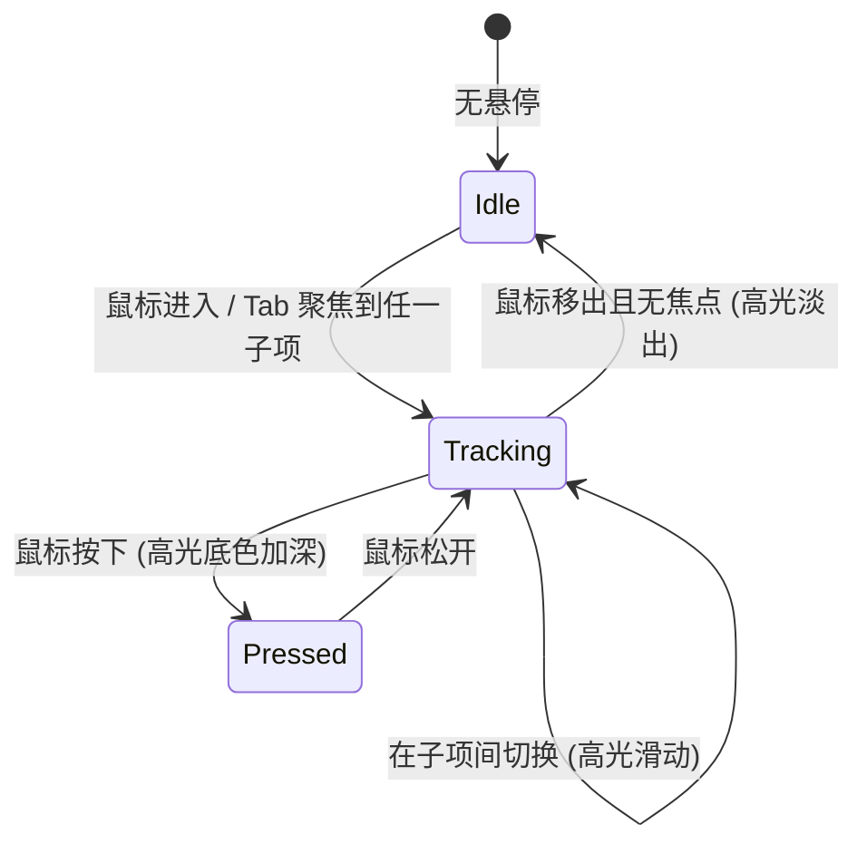

# Button Group · 按钮组

将多个关联操作紧凑并置于单一胶囊表面上的高级组合控件。包含四大核心动效机制：

1. 滑动高光胶囊（Gliding Highlight Pill）：鼠标悬停或键盘聚焦在组内项目间切换时，高光背景药丸以弹性缓动平滑滑动并自适应宽度；移出时淡出；按压时高光底色即时加深。
2. 邻近分割线自适应静音（Hairline Dividers）：组内按钮之间常驻纤细分割线，高光滑动至某项时，其左右相邻的分割线自动隐藏，避免视觉冲突。
3. 预留尺寸防抖槽（Sizer Slot）：多态操作（如 Share → Copied、Save → Saved!）采用叠层占位容器，以最长状态先行撑开宽度，文案切换时整体布局零跳动。
4. 滚轮数字计数器（Animated Rolling Counter）：步进操作（如缩放、数量调整）中的数字以垂直滚动列带弹性滚入滚出，附带最大极限值占位。

## 原型清单

| 原型分组 | 原型元素 | 动效 / 状态变化 | 去向 |
| --- | --- | --- | --- |
| Document actions | 组外壳 `#mainGroup` | 承载高光滑动与组内统一圆角边框 | 滑动高光胶囊 + 细发丝分割线 |
| Document actions | Share 操作项（`#btnShare`） | 悬停高光贴合；点击切换 Share → Copied，图标旋转切换，利用 Sizer 零抖动 | 预留尺寸防抖槽 + 滑动高光胶囊 |
| Document actions | Duplicate / Archive 操作项 | 悬停高光贴合，按压反馈 | 滑动高光胶囊 |
| Document actions | 菜单触发器（`#btnMenuTrigger`）及下拉菜单 | 悬停高光；点击展开下拉操作浮层；Chevron 旋转 | 下拉菜单交互 |
| Zoom | 组外壳 `#zoomGroup`（sm 尺寸 28px） | 小型按钮组，高光滑动 | 滑动高光胶囊 |
| Zoom | 减小/增大步进按钮（`#btnZoomOut`, `#btnZoomIn`） | 点击步进；到达极值时触发 disabled 与 aria-disabled | 滚轮数字计数器 |
| Zoom | 重置按钮与计数器（`#btnZoomReset`） | 嵌入 AnimatedCounter，数字以三列滚轮动画滚动；400% sizer 防抖 | 滚轮数字计数器 |
| Editor actions | 组外壳 `#solidGroup`（solid 深黑主题） | 实心深黑材质组，半透明高光滑动 | 滑动高光胶囊 |
| Editor actions | Save 操作项（`#btnSave`） | Save → Saved! 带有 Sizer 占位与图标翻转 | 预留尺寸防抖槽 + 滑动高光胶囊 |
| Editor actions | Preview 操作项 | 悬停高光贴合 | 滑动高光胶囊 |
| — | 底部提示文案 `.hint-text` | 静态说明 | 演示外壳，已删除 |
| — | 顶栏、主题切换按钮、D 快捷键、舞台卡片、embed/postMessage 检测 | — | 演示外壳，已删除 |

## 适用

- 工具栏、操作栏、分页器、步进器等多个紧邻的并列操作项。
- 需要极具连贯感与物理质感的悬停跟随体验（多按钮共享一个高光底块）。
- 按钮带有状态反馈或计数器，但严禁因为文字长度变化引起整行按钮的挤压跳动。

## 不适用

- 主操作与下拉选项完全融合为一个胶囊主副二段结构 → [split-button](split-button.md)
- 浮动在页面边缘的悬浮工具栏、带有独立弹簧 Tooltip 提示 → [floating-button-group](floating-button-group.md)
- 点击后横向抽屉式伸展展开附加按钮 → [expanding-button-group](expanding-button-group.md)

## 状态机



| 状态 | 进入条件 | 视觉表现 | 退出到 |
| --- | --- | --- | --- |
| idle | 鼠标不在组内且组内无焦点 | 高光透明度为 0，分割线全部可见 | tracking |
| tracking | 悬停或聚焦于某子项 | 高光处于目标子项背后，透明度为 1，目标项左右分割线隐藏 | tracking / idle / pressed |
| pressed | 按下某子项 | 高光附加 `data-pressed`，背景加深 | tracking |

## 最小 DOM

```html
<!-- 基础按钮组结构（带共享高光） -->
<div role="group" aria-label="Actions" class="btn-group">
  <!-- 共享滑动高光药丸 -->
  <div class="group-highlight" aria-hidden="true"></div>

  <!-- 子操作项 1：带尺寸防抖的反馈按钮 -->
  <button class="group-item" type="button" aria-label="Share">
    <span class="content">
      <span class="slot">
        <span class="slot-content">
          <!-- 静态占位隐藏文案（撑开网格容器） -->
          <span class="phase sizer" aria-hidden="true"><span class="group-icon"></span><span>Share</span></span>
          <span class="phase sizer" aria-hidden="true"><span class="group-icon"></span><span>Copied</span></span>
          <!-- 实际显示层 -->
          <span class="phase active-phase">
            <svg class="group-icon" viewBox="0 0 24 24"><path d="M10 13a5 5 0 0 0 7.54.54l3-3a5 5 0 0 0-7.07-7.07l-1.72 1.71"/></svg>
            <span class="label">Share</span>
          </span>
        </span>
      </span>
    </span>
  </button>

  <!-- 子操作项 2：普通项 -->
  <button class="group-item" type="button" aria-label="Duplicate">
    <span class="content">
      <svg class="group-icon" viewBox="0 0 24 24"><rect width="14" height="14" x="8" y="8" rx="2"/><path d="M4 16c-1.1 0-2-.9-2-2V4c0-1.1.9-2 2-2h10c1.1 0 2 .9 2 2"/></svg>
      <span>Duplicate</span>
    </span>
  </button>
</div>

<!-- 步进计数器按钮组结构 -->
<div role="group" aria-label="Zoom controls" class="btn-group sm">
  <div class="group-highlight" aria-hidden="true"></div>
  <button class="group-item icon-only" id="btnMinus" type="button" aria-label="Decrease">−</button>
  <button class="group-item" id="btnCounterReset" type="button" aria-label="Reset value">
    <span class="content">
      <span class="zoom-value">
        <span class="zoom-sizer" aria-hidden="true">400%</span>
        <span class="animated-counter">
          <span class="counter-sr-only">100%</span>
          <span class="counter-value" aria-hidden="true"></span>
        </span>
      </span>
    </span>
  </button>
  <button class="group-item icon-only" id="btnPlus" type="button" aria-label="Increase">+</button>
</div>
```

- `.btn-group`：主容器，采用 inline-flex 并置子项，`overflow: hidden` 与圆角胶囊外壳。
- `.group-highlight`：绝对定位的高光底板，JS 通过修改其 `style.transform`（translateX）与 `style.width` 控制其位置与大小。
- `.group-item`：组内按钮，带有微透明分割线伪元素 `::after`。
- `.slot` / `.slot-content`：网格重叠容器，内部的 `.sizer` 元素仅用于占据自然宽度，`.active-phase` 绝对定位居中显示。
- `.animated-counter`：滚动数字容器，JS 在内部挂载若干垂直排版的数字列。

## 参数

| 名称 | 值 | 用于 | 来源 |
| --- | --- | --- | --- |
| 高光首次出现淡入 | `160ms` / `cubic-bezier(0.22, 1, 0.36, 1)` | opacity 过渡 | 原型 |
| 高光跨项滑动形变 | `380ms` / `cubic-bezier(0.16, 1, 0.3, 1)` | transform, width | 原型 |
| 高光按压底色过渡 | `120ms` | `data-pressed` 激活 | 原型 |
| 分割线隐藏淡出 | `160ms` / `ease` | `quiet` 类切换 | 原型 |
| 数字滚轮过渡时长 | `400ms` / 弹簧曲线 | DigitColumn 滚动动画 | 原型 |
| 反馈成功保持时长 | `2000ms` | Share/Save 等状态恢复 | 原型 |

## CSS

```css
.btn-group {
  --motion-duration-instant: 120ms;
  --motion-duration-fast: 160ms;
  --motion-duration-morph: 380ms;
  --motion-ease-morph: cubic-bezier(0.16, 1, 0.3, 1);
  --motion-ease-standard: cubic-bezier(0.22, 1, 0.36, 1);

  position: relative;
  display: inline-flex;
  align-items: center;
  padding: 3px;
  border-radius: 9999px;
  background: var(--surface-raised, #ffffff);
  border: 1px solid var(--border, rgba(0, 0, 0, 0.08));
  box-shadow: var(--shadow-resting, 0 1px 3px rgba(0, 0, 0, 0.04));
  user-select: none;
  isolation: isolate;
}

.btn-group.sm {
  padding: 2px;
}

/* 滑动高光胶囊 */
.group-highlight {
  position: absolute;
  top: 3px;
  left: 0;
  height: calc(100% - 6px);
  border-radius: 9999px;
  pointer-events: none;
  z-index: 1;
  opacity: 0;
  transform: translate3d(0, 0, 0);
  transition: opacity var(--motion-duration-fast) var(--motion-ease-standard);
  will-change: transform, width, opacity;
}

.btn-group.sm .group-highlight {
  top: 2px;
  height: calc(100% - 4px);
}

.group-highlight::before {
  content: '';
  position: absolute;
  inset: 0;
  border-radius: inherit;
  background-color: var(--surface-muted, rgba(0, 0, 0, 0.05));
  transition: background-color var(--motion-duration-fast) var(--motion-ease-standard);
}

.group-highlight[data-pressed]::before {
  background-color: var(--surface-active, rgba(0, 0, 0, 0.1));
  transition-duration: var(--motion-duration-instant);
}

.group-highlight.is-moving {
  transition:
    transform var(--motion-duration-morph) var(--motion-ease-morph),
    width var(--motion-duration-morph) var(--motion-ease-morph),
    opacity var(--motion-duration-fast) var(--motion-ease-standard);
}

.group-highlight.active {
  opacity: 1;
}

/* 按钮组子项 */
.group-item {
  position: relative;
  display: inline-flex;
  align-items: center;
  justify-content: center;
  height: 32px;
  padding: 0 12px;
  border: none;
  background: transparent;
  color: var(--foreground, #111111);
  font-size: 13px;
  font-weight: 500;
  border-radius: 9999px;
  cursor: pointer;
  z-index: 2;
  outline: none;
  white-space: nowrap;
}

.btn-group.sm .group-item {
  height: 24px;
  padding: 0 8px;
  font-size: 12px;
}

.group-item.icon-only {
  width: 28px;
  padding: 0;
}

.group-item .content {
  display: inline-flex;
  align-items: center;
  gap: 6px;
}

.group-item .group-icon {
  width: 14px;
  height: 14px;
  stroke-width: 2;
}

/* 细发丝分割线 */
.group-item::after {
  content: '';
  position: absolute;
  right: 0;
  top: 20%;
  height: 60%;
  width: 1px;
  background-color: var(--border, rgba(0, 0, 0, 0.08));
  transition: opacity var(--motion-duration-fast) var(--motion-ease-standard);
}

.group-item:last-child::after,
.group-item.quiet::after,
.group-item.prev-quiet::after {
  opacity: 0;
}

/* 防抖尺寸插槽 (Sizer Slot) */
.slot {
  display: inline-grid;
  grid-template-areas: 'overlap';
  align-items: center;
}

.slot-content {
  display: contents;
}

.phase {
  grid-area: overlap;
  display: inline-flex;
  align-items: center;
  gap: 6px;
}

.phase.sizer {
  visibility: hidden;
  pointer-events: none;
  height: 0;
}

.phase:not(.sizer) {
  transition: opacity var(--motion-duration-fast) ease;
}

/* 数字滚轮容器 */
.zoom-value {
  display: inline-grid;
  grid-template-areas: 'overlap';
  align-items: center;
}

.zoom-sizer {
  grid-area: overlap;
  visibility: hidden;
}

.animated-counter {
  grid-area: overlap;
  display: inline-flex;
  align-items: center;
  justify-content: center;
  overflow: hidden;
  height: 1.2em;
  line-height: 1.2em;
}

.counter-sr-only {
  position: absolute;
  width: 1px;
  height: 1px;
  clip: rect(0, 0, 0, 0);
  overflow: hidden;
}

.counter-column {
  display: inline-block;
  height: 100%;
  will-change: transform;
}

.counter-digit {
  display: block;
  height: 1.2em;
  text-align: center;
}

/* 减少动态效果 */
@media (prefers-reduced-motion: reduce) {
  .group-highlight.is-moving {
    transition: opacity var(--motion-duration-fast) linear !important;
  }
  .counter-column {
    transition: none !important;
    transform: none !important;
  }
}
```

## JS

```js
/**
 * 按钮组共享高光与分割线控制器
 * @param {HTMLElement} group 按钮组 DOM 节点
 */
function createButtonGroupHighlight(group) {
  const highlight = group.querySelector('.group-highlight');
  const items = Array.from(group.querySelectorAll('.group-item'));
  let activeItem = null;

  function measure(item) {
    return {
      left: item.offsetLeft,
      width: item.offsetWidth
    };
  }

  function updateDividers(activeIdx) {
    items.forEach((item, idx) => {
      item.classList.remove('quiet', 'prev-quiet');
      if (activeIdx !== -1) {
        if (idx === activeIdx) item.classList.add('quiet');
        if (idx === activeIdx - 1) item.classList.add('quiet');
      }
    });
  }

  function placeHighlight(item, immediate = false) {
    if (!item || item.disabled) {
      highlight.classList.remove('active');
      updateDividers(-1);
      return;
    }

    const { left, width } = measure(item);
    activeItem = item;

    if (immediate || !highlight.classList.contains('active')) {
      highlight.classList.remove('is-moving');
      highlight.style.transform = `translate3d(${left}px, 0, 0)`;
      highlight.style.width = `${width}px`;
      requestAnimationFrame(() => {
        highlight.classList.add('active');
        highlight.classList.add('is-moving');
      });
    } else {
      highlight.classList.add('is-moving');
      highlight.style.transform = `translate3d(${left}px, 0, 0)`;
      highlight.style.width = `${width}px`;
      highlight.classList.add('active');
    }

    updateDividers(items.indexOf(item));
  }

  function fadeLeave() {
    activeItem = null;
    highlight.classList.remove('active');
    updateDividers(-1);
  }

  // 绑定事件
  items.forEach(item => {
    item.addEventListener('mouseenter', () => placeHighlight(item));
    item.addEventListener('focus', () => placeHighlight(item));
    item.addEventListener('mousedown', () => highlight.setAttribute('data-pressed', ''));
  });

  window.addEventListener('mouseup', () => highlight.removeAttribute('data-pressed'));
  group.addEventListener('mouseleave', () => {
    // 若组内无焦点项，则淡出
    if (!group.contains(document.activeElement)) {
      fadeLeave();
    }
  });

  return {
    place: (idx) => placeHighlight(items[idx]),
    clear: fadeLeave,
    destroy: () => {
      highlight.classList.remove('active', 'is-moving');
    }
  };
}

/**
 * 垂直滚轮单列数字
 */
class DigitColumn {
  constructor(digit) {
    this.currentDigit = digit;
    this.dom = document.createElement('span');
    this.dom.className = 'counter-column';
    this.render();
  }

  render() {
    this.dom.innerHTML = '';
    // 渲染 0-9 数字列
    for (let i = 0; i <= 9; i++) {
      const d = document.createElement('span');
      d.className = 'counter-digit';
      d.textContent = i;
      this.dom.appendChild(d);
    }
    this.setDigit(this.currentDigit, false);
  }

  setDigit(targetDigit, animate = true) {
    this.currentDigit = targetDigit;
    const offsetPercent = targetDigit * 10; // 每个字符占 10%
    if (!animate || window.matchMedia('(prefers-reduced-motion: reduce)').matches) {
      this.dom.style.transition = 'none';
      this.dom.style.transform = `translateY(-${targetDigit * 1.2}em)`;
    } else {
      this.dom.style.transition = 'transform 380ms cubic-bezier(0.16, 1, 0.3, 1)';
      this.dom.style.transform = `translateY(-${targetDigit * 1.2}em)`;
    }
  }
}

/**
 * 弹性滚轮计数器控制器
 * @param {HTMLElement} container 挂载节点
 * @param {number} initialValue 初始数值
 * @param {string} suffix 后缀（如 '%'）
 */
function createRollingCounter(container, initialValue = 100, suffix = '%') {
  container.innerHTML = '';
  const digitsWrapper = document.createElement('span');
  digitsWrapper.style.display = 'inline-flex';
  digitsWrapper.style.overflow = 'hidden';
  digitsWrapper.style.height = '1.2em';
  container.appendChild(digitsWrapper);

  const suffixSpan = document.createElement('span');
  suffixSpan.textContent = suffix;
  container.appendChild(suffixSpan);

  let columns = [];

  function setValue(val) {
    const str = String(Math.abs(val));
    // 列数不足时补充
    while (columns.length < str.length) {
      const col = new DigitColumn(0);
      columns.unshift(col);
      digitsWrapper.insertBefore(col.dom, digitsWrapper.firstChild);
    }
    // 列数多余时移除
    while (columns.length > str.length) {
      const col = columns.shift();
      col.dom.remove();
    }
    // 分配数字
    for (let i = 0; i < str.length; i++) {
      columns[i].setDigit(parseInt(str[i], 10));
    }
  }

  setValue(initialValue);

  return {
    setValue
  };
}
```

## 接入目标项目

- 状态来源：子按钮触发事件由业务逻辑主导，高光滑动自动由原生 DOM 的 mouseenter/focus 事件捕捉。
- 尺寸策略：各子项宽度根据内容自适应。带多状态文案的子项必须使用 `.slot` 内嵌 `.phase.sizer` 声明最长文案，以彻底保证切换时整体组宽度坚如盘石。
- 驱动方式：组件挂载后，调用 `createButtonGroupHighlight(group)` 激活高光引擎，调用 `createRollingCounter` 激活数字滚轮。

## 重入与清理

- 高光位置切换基于精确坐标计算，支持在任意子项间超高速往返穿梭，不会产生动画中断或样式错乱。
- 组件销毁时调用返回的 `destroy()` 方法，解除高光状态。

## 减少动态效果

- 遇到 `prefers-reduced-motion: reduce` 时，高光位移过渡被关闭，直接变为即时透明度显隐；数字列直接跳转到目标位移，禁用垂直滚动动画。

## 焦点与键盘

- 组内所有子按钮均支持 Tab / Shift+Tab 线性导航；获得焦点时自动调用 `placeHighlight(item)`，使键盘焦点框与高光完美重合。

## 兼容回退

CSS Transform, Transition, `translate3d` 均为全平台标准支持，无特殊兼容性风险。

## 验收清单

- [ ] 鼠标移入子项时高光药丸淡入；在相邻子项滑动时，高光药丸平滑横向伸缩位移跟随。
- [ ] 鼠标按下子项时高光颜色加深，松开后恢复。
- [ ] 鼠标移出按钮组后高光平滑淡出。
- [ ] 高光滑入某子项时，该子项左右的细分割线自动隐去。
- [ ] 点击 Share/Save 等操作时文案就地更新，按钮及邻近按钮宽度完全不发生抖动。
- [ ] 步进增减时数字平滑垂直滚动翻转。
- [ ] 开启系统的“减少动态效果”：高光与数字滚动动画停用，改为即时显示。
