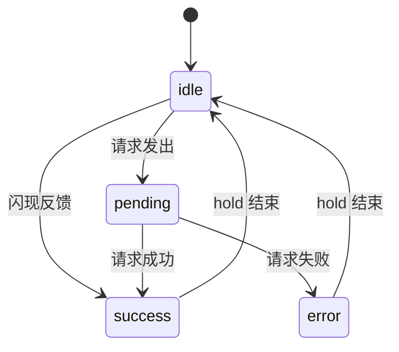

# Button · 基础按钮

基础按钮集合，包含四种机制：

1. 按压与悬停：各变体的按压缩放回弹，以及悬停时的背景、边框、阴影过渡。
2. 异步状态槽：在按钮内展开前置状态槽，显示"进行中 → 成功"后自动复原。
3. 闪现反馈：操作完成后图标旋转替换成对勾。
4. 按钮下方提示：点击后在按钮下方淡入一行提示，过一段时间淡出。

文字统一用"上移模糊淡出 → 下方淡入归位"的整段替换。

## 原型清单

| 原型分组 | 原型元素 | 动效 / 状态变化 | 去向 |
| --- | --- | --- | --- |
| Styles | Save changes（`#saveChangesBtn`，primary） | 按压透明度；状态槽 spinner → 对勾；文字替换；成功停留 1800ms | 按压与悬停 + 异步状态槽 |
| Styles | Secondary（默认 `.arc-btn`） | 悬停背景与阴影抬升；按压缩放 0.97 | 按压与悬停 |
| Styles | Ghost（`.arc-btn-ghost`） | 悬停出现背景，文字颜色变化（无过渡）；无阴影；按压缩放 | 按压与悬停 |
| Styles | Delete（`.arc-btn-delete`） | 悬停与按压时边框变为危险色、背景变为弱底色；阴影不抬升；按压缩放 | 按压与悬停 |
| Styles | 主按钮内的对勾（`#saveCheck`） | 深色背景上改用对比度更高的成功色 | 异步状态槽 |
| Icons and sizes | Add item（图标 + 文字） | 同默认按钮 | 按压与悬停 |
| Icons and sizes | Continue（`#continueBtn`，primary + 箭头） | 按压透明度；点击后下方提示淡入，2000ms 后淡出 | 按压与悬停 + 按钮下方提示 |
| Icons and sizes | More options（`.arc-btn-icon-only`） | 按压缩放 0.96 | 按压与悬停 |
| Icons and sizes | Large（`.arc-btn-lg`） | 只有尺寸差异，动效与默认按钮相同 | 按压与悬停 |
| Icons and sizes | Continuing 提示（`#continueHint`） | 上移 + 去模糊 + 淡入；到时后反向淡出 | 按钮下方提示 |
| Feedback and states | Copy link（`#copyLinkBtn`） | 图标旋转替换成对勾；文字替换；停留 2200ms | 闪现反馈 |
| Feedback and states | 纯图标 Copy（`#iconCopyBtn`） | 图标旋转替换成对勾；停留 2200ms | 闪现反馈 |
| Feedback and states | Upload file（`#uploadFileBtn`） | 状态槽 spinner → 对勾；文字替换；成功停留 2200ms | 异步状态槽 |
| Feedback and states | Disabled（`:disabled`） | 半透明，不响应指针，无阴影 | 按压与悬停 |
| — | 顶栏、主题切换按钮、舞台卡片、分组标题 | — | 演示外壳，已删除 |

## 适用

- 普通按钮需要按压、悬停反馈，包括主按钮、次按钮、幽灵按钮、危险按钮、纯图标按钮和禁用态。
- 按钮触发短异步操作（保存、上传），需要在按钮内显示 spinner 和"进行中"文案，成功后显示对勾和"已完成"文案，然后自动复原。
- 操作瞬间完成，只需要在按钮上闪现成功反馈：图标从原图标旋转替换成对勾，文案同步替换，过一段时间后复原。
- 点击按钮后需要在按钮附近短暂显示一行状态提示。
- 文案按整段替换即可，不需要逐字形变。

## 不适用

- 文案需要逐字形变，或箭头图标需要离场再回场的异步按钮 → [action-button](action-button.md)
- 需要真实写入剪贴板并处理降级的复制按钮 → [copy-button](copy-button.md)
- 两个图标之间的路径变形（播放/暂停、加号/对勾）→ [icon-morph](icon-morph.md)
- 危险操作需要在按钮内原地二次确认 → [confirm-morph](confirm-morph.md)
- 需要长按才触发的确认 → [hold-to-confirm](../gestures/hold-to-confirm.md)

## 状态机

按钮状态：

| 状态 | 进入条件 | 视觉表现 | 退出到 |
| --- | --- | --- | --- |
| idle | 初始；复原完成 | 状态槽收起，显示初始文案 | pending / success |
| pending | 业务请求发出 | 状态槽展开显示 spinner，文案换成"进行中"，`aria-busy="true"` | success / error |
| success | 业务请求成功；或闪现反馈触发 | 状态槽内 spinner 换成对勾（无过渡，直接替换）；图标替换器旋转换成对勾；文案换成"已完成" | 停留 `hold` 后复原到 idle |
| error | 业务请求失败【补充】 | 状态槽收起，文案换成失败文案 | 停留 `hold` 后复原到 idle |



按钮下方提示：

| 状态 | 进入条件 | 视觉表现 | 退出到 |
| --- | --- | --- | --- |
| hidden | 初始；显示时长结束 | 透明，下移 4px，模糊 2px | shown |
| shown | 点击按钮；显示期间再次点击会重新计时 | 不透明，归位，清晰 | 2000ms 后回到 hidden |

## 最小 DOM

```html
<!-- 变体：在 .arc-btn 上叠加类名 -->
<button class="arc-btn" type="button">Secondary</button>
<button class="arc-btn arc-btn-primary" type="button">Primary</button>
<button class="arc-btn arc-btn-ghost" type="button">Ghost</button>
<button class="arc-btn arc-btn-delete" type="button">Delete</button>
<button class="arc-btn arc-btn-icon-only" type="button" aria-label="More options"><!-- svg --></button>
<button class="arc-btn" type="button" disabled>Disabled</button>

<!-- 异步按钮：前置状态槽 + 文案 -->
<button class="arc-btn" type="button" data-state="idle">
  <span class="btn-state-slot" aria-hidden="true">
    <span class="spinner"></span>
    <svg class="check" viewBox="0 0 24 24" width="16" height="16" fill="none" stroke="currentColor" stroke-width="2" stroke-linecap="round" stroke-linejoin="round">
      <polyline points="20 6 9 17 4 12" />
    </svg>
  </span>
  <span class="btn-label-swap">Save changes</span>
</button>

<!-- 闪现反馈按钮：图标替换器 + 文案；纯图标按钮去掉 .btn-label-swap -->
<button class="arc-btn" type="button" data-state="idle">
  <span class="icon-swap-wrapper" aria-hidden="true">
    <span class="icon-state icon-a"><!-- 原图标 svg --></span>
    <span class="icon-state icon-b"><!-- 成功图标 svg --></span>
  </span>
  <span class="btn-label-swap">Copy link</span>
</button>

<!-- 按钮下方提示 -->
<button class="arc-btn arc-btn-primary" type="button">Continue</button>
<div class="btn-hint" role="status">Continuing</div>
```

- `.arc-btn`：按压缩放与悬停过渡的承载元素；`data-state` 驱动状态槽图标和图标替换器。
- `.arc-btn-primary` / `.arc-btn-ghost` / `.arc-btn-delete` / `.arc-btn-icon-only`：变体，只改变悬停和按压时变化的属性，过渡参数沿用 `.arc-btn`。
- `.btn-state-slot`：前置状态槽，收起时宽度为 0，展开时显示 spinner 或对勾。原型类名为 `.upload-state-slot`，原型用内联 `style.display` 切换 spinner 和对勾。【修正】改为由 `data-state` 控制，业务状态可以直接写入这个属性。
- `.spinner` / `.check`：pending 时显示 spinner，success 时显示对勾。
- `.btn-label-swap`：整段文字替换的承载元素，必须是 `inline-block`，否则 transform 不生效。
- `.icon-swap-wrapper`：两个图标叠放的 16×16 容器；`.icon-a` 是原图标，`.icon-b` 是成功图标。原型由 `.is-copied` / `.is-success` 类触发。【修正】统一改为 `[data-state="success"]` 触发。
- `.btn-hint`：按钮下方提示，原型类名为 `.continue-hint`。`role="status"`【补充】。

## 参数

| 名称 | 值 | 用于 | 来源 |
| --- | --- | --- | --- |
| 按压缩放 | `scale(0.97)`，纯图标按钮 `scale(0.96)` | `.arc-btn:active` | 原型 |
| 按压时长 / 曲线 | `150ms` / `cubic-bezier(0.18, 0.89, 0.32, 1.28)` | transform，带回弹过冲 | 原型 |
| 主按钮按压透明度 | `0.84`，无过渡，直接跳变 | `.arc-btn-primary:active` | 原型 |
| 悬停过渡 | `250ms ease` | background-color / border-color / box-shadow | 原型 |
| 默认悬停 | 背景 → 悬停底色；阴影 → 抬升阴影 | `.arc-btn:hover` | 原型 |
| 主按钮悬停 | 背景 → 主按钮悬停底色 | `.arc-btn-primary:hover` | 原型 |
| 幽灵按钮 | 静止时透明背景、无边框、无阴影、弱文字色；悬停与按压时出现悬停底色，文字变为前景色。文字颜色不在过渡列表里，直接跳变 | `.arc-btn-ghost` | 原型 |
| 危险按钮 | 悬停与按压时边框 → 危险色，背景 → 弱底色，阴影保持静止阴影（不抬升）；按压缩放 0.97 | `.arc-btn-delete` | 原型 |
| 禁用 | `opacity: 0.45`，`pointer-events: none`，无阴影 | `.arc-btn:disabled` | 原型 |
| 文字淡出位移 | `translateY(-5px)` + `blur(2.5px)` + `opacity: 0` | `.swap-out` | 原型 |
| 文字淡入起点 | `translateY(5px)` + `blur(2.5px)` + `opacity: 0` | `.swap-in` | 原型 |
| 文字过渡 | opacity / filter `220ms`，transform `260ms`，均为 `cubic-bezier(0.22, 1, 0.36, 1)` | `.btn-label-swap` | 原型 |
| 文字替换时机 | 加 `.swap-out` 后 `160ms` 替换文字；换成 `.swap-in` 后等两帧，再等 `40ms` 移除 | JS `swapText` | 原型 |
| 状态槽展开 | `max-width: 0 → 22px`，`380ms cubic-bezier(0.34, 1.36, 0.64, 1)`（回弹） | `.btn-state-slot` | 原型 |
| 状态槽透明度 | `300ms cubic-bezier(0.22, 1, 0.36, 1)` | `.btn-state-slot` | 原型 |
| 状态槽间距 | 收起 `margin-right: -8px`，展开 `0`，与 max-width 同曲线 | 抵消按钮 `gap` | 【修正】原型为 `0 → 8px` |
| spinner | `14px`，`2px` 边框，`0.75s linear infinite` | `.spinner` | 原型 |
| 图标替换 | opacity / filter `320ms cubic-bezier(0.22, 1, 0.36, 1)`；transform `380ms cubic-bezier(0.34, 1.36, 0.64, 1)` | `.icon-state` | 原型 |
| 图标离场 / 入场 | 离场 `scale(0.5) rotate(45deg) blur(2.5px)`；入场起点 `scale(0.5) rotate(-45deg) blur(2.5px)` | `.icon-a` / `.icon-b` | 原型 |
| 成功停留 `hold` | 保存 `1800ms`，上传 `2200ms`，闪现反馈 `2200ms` | JS | 原型 |
| 提示隐藏态 | `opacity: 0`，`translateY(4px)`，`blur(2px)` | `.btn-hint` | 原型 |
| 提示过渡 | opacity / filter `220ms ease`；transform `260ms cubic-bezier(0.16, 1, 0.3, 1)` | `.btn-hint` | 原型 |
| 提示显示时长 | `2000ms`，再次点击重新计时 | JS | 原型 |
| 主按钮上的对勾颜色 | 浅色主题 `oklch(72% 0.19 145)`，深色主题 `oklch(50% 0.20 145)` | `.arc-btn-primary .check` | 原型 |
| 原型的模拟等待 | 保存 `1400ms`，上传 `1800ms` | 演示用，**不得移植** | 原型 |

【修正】状态槽间距的原因：原型按钮 `gap: 8px`。状态槽收起时宽度为 0，但它仍是 flex 子项，gap 照样生效。实测结果（Chrome，按钮文案 "Save changes"）：

- 收起时：左内边距 27px、右内边距 19px，按钮比不带状态槽的同文案按钮宽 8px。
- 展开时：spinner 与文字间距 16px，等于 gap 8px 加 margin 8px。

改为收起 `-8px`、展开 `0` 之后：收起时左右各 19px，宽度与不带状态槽的按钮一致；展开时间距 8px。

## CSS

只包含动效和状态变化相关的属性。按钮的尺寸、圆角、字体沿用目标组件自己的样式。`--btn-*`、`--shadow-*`、`--surface-muted`、`--foreground`、`--text-muted`、`--success` 都要映射到目标项目已有的 token。

```css
.arc-btn {
  --motion-ease-snappy: cubic-bezier(0.18, 0.89, 0.32, 1.28);
  --motion-ease-out: cubic-bezier(0.22, 1, 0.36, 1);
  --motion-ease-bounce: cubic-bezier(0.34, 1.36, 0.64, 1);
  --motion-gap: 8px; /* 必须等于按钮自身的 gap */

  transition:
    transform 150ms var(--motion-ease-snappy),
    background-color 250ms ease,
    border-color 250ms ease,
    box-shadow 250ms ease;
  will-change: transform;
}

/* 按压与悬停：默认 */
.arc-btn:hover { background: var(--btn-hover-bg); box-shadow: var(--shadow-raised); }
.arc-btn:active { transform: scale(0.97); }
.arc-btn-icon-only:active { transform: scale(0.96); }

/* 按压与悬停：主按钮 */
.arc-btn-primary:hover { background: var(--btn-primary-hover-bg); }
.arc-btn-primary:active { opacity: 0.84; }

/* 按压与悬停：幽灵按钮 */
.arc-btn-ghost { background: transparent; border-color: transparent; box-shadow: none; color: var(--text-muted); }
.arc-btn-ghost:hover,
.arc-btn-ghost:active { background: var(--btn-hover-bg); color: var(--foreground); box-shadow: none; }

/* 按压与悬停：危险按钮 */
.arc-btn-delete:hover:not(:disabled) {
  border-color: var(--btn-delete-color);
  background: var(--surface-muted);
  box-shadow: var(--shadow-resting);
}
.arc-btn-delete:active:not(:disabled) {
  border-color: var(--btn-delete-color);
  background: var(--surface-muted);
  transform: scale(0.97);
}

/* 禁用 */
.arc-btn:disabled { opacity: 0.45; cursor: not-allowed; pointer-events: none; box-shadow: none; }

/* 文字整段替换 */
.btn-label-swap {
  display: inline-block;
  white-space: nowrap;
  will-change: transform, opacity, filter;
  transition:
    opacity 220ms var(--motion-ease-out),
    transform 260ms var(--motion-ease-out),
    filter 220ms var(--motion-ease-out);
}
.btn-label-swap.swap-out { opacity: 0; transform: translateY(-5px); filter: blur(2.5px); }
.btn-label-swap.swap-in { opacity: 0; transform: translateY(5px); filter: blur(2.5px); }

/* 异步状态槽 */
.btn-state-slot {
  display: inline-flex;
  align-items: center;
  justify-content: center;
  flex-shrink: 0;
  max-width: 0;
  opacity: 0;
  overflow: hidden;
  margin-right: calc(-1 * var(--motion-gap));
  transition:
    max-width 380ms var(--motion-ease-bounce),
    opacity 300ms var(--motion-ease-out),
    margin-right 380ms var(--motion-ease-bounce);
  will-change: max-width, opacity, margin-right;
}
.btn-state-slot.show-slot { max-width: 22px; opacity: 1; margin-right: 0; }

.btn-state-slot > * { display: none; }
.arc-btn[data-state="pending"] .btn-state-slot > .spinner,
.arc-btn[data-state="success"] .btn-state-slot > .check { display: inline-block; }

.btn-state-slot > .spinner {
  width: 14px;
  height: 14px;
  border: 2px solid currentColor;
  border-right-color: transparent;
  border-radius: 50%;
  box-sizing: border-box;
  animation: btn-spin 0.75s linear infinite;
}
.btn-state-slot > .check { color: var(--success); }
/* 主按钮背景上的对勾：浅色主题主按钮为深色底，深色主题主按钮为浅色底 */
.arc-btn-primary .btn-state-slot > .check { color: #43c251; color: oklch(72% 0.19 145); }
[data-theme="dark"] .arc-btn-primary .btn-state-slot > .check { color: #007d00; color: oklch(50% 0.2 145); }
@keyframes btn-spin { to { transform: rotate(360deg); } }

/* 闪现反馈：图标替换器 */
.icon-swap-wrapper {
  position: relative;
  display: inline-flex;
  align-items: center;
  justify-content: center;
  flex-shrink: 0;
  width: 16px;
  height: 16px;
}
.icon-swap-wrapper .icon-state {
  position: absolute;
  inset: 0;
  display: flex;
  align-items: center;
  justify-content: center;
  transition:
    opacity 320ms var(--motion-ease-out),
    transform 380ms var(--motion-ease-bounce),
    filter 320ms var(--motion-ease-out);
  will-change: transform, opacity, filter;
}
.icon-swap-wrapper .icon-a { opacity: 1; transform: scale(1) rotate(0deg); filter: blur(0); }
.icon-swap-wrapper .icon-b {
  opacity: 0;
  transform: scale(0.5) rotate(-45deg);
  filter: blur(2.5px);
  pointer-events: none;
  color: var(--success);
}
.arc-btn[data-state="success"] .icon-swap-wrapper .icon-a {
  opacity: 0;
  transform: scale(0.5) rotate(45deg);
  filter: blur(2.5px);
}
.arc-btn[data-state="success"] .icon-swap-wrapper .icon-b {
  opacity: 1;
  transform: scale(1) rotate(0deg);
  filter: blur(0);
}

/* 按钮下方提示 */
.btn-hint {
  opacity: 0;
  transform: translateY(4px);
  filter: blur(2px);
  pointer-events: none;
  transition:
    opacity 220ms ease,
    transform 260ms cubic-bezier(0.16, 1, 0.3, 1),
    filter 220ms ease;
}
.btn-hint.show { opacity: 1; transform: translateY(0); filter: blur(0); }

/* 减少动态效果，说明见下文 */
@media (prefers-reduced-motion: reduce) {
  .arc-btn { transition: background-color 250ms ease, border-color 250ms ease, box-shadow 250ms ease; }
  .arc-btn:active,
  .arc-btn-icon-only:active,
  .arc-btn-delete:active:not(:disabled) { transform: none; }
  .btn-label-swap { transition: opacity 220ms var(--motion-ease-out); }
  .btn-label-swap.swap-out,
  .btn-label-swap.swap-in { transform: none; filter: none; }
  .btn-state-slot { transition: opacity 300ms var(--motion-ease-out); }
  .icon-swap-wrapper .icon-state {
    transition: opacity 320ms var(--motion-ease-out);
    transform: none !important;
    filter: none !important;
  }
  .btn-hint { transition: opacity 220ms ease; transform: none; filter: none; }
}
```

## JS

由状态驱动，不负责发起业务动作。业务层在请求发出、成功、失败时调用 `show()`；按钮下方提示在点击时调用 `hint.show()`。

【修正】原型用嵌套回调和 `saving` 标志位串联时序，没有取消机制。这里改为每次 `show()` 先取消上一轮的全部计时器和动画帧，时序参数不变。

```js
const SWAP_OUT_MS = 160;
const SWAP_SETTLE_MS = 40;

/**
 * 异步状态槽 + 闪现反馈
 * @param {HTMLElement} btn
 * @param {{ idle: string, pending?: string, success?: string, error?: string }} labels
 * @param {{ hold?: number, flash?: boolean }} options
 *   hold：成功/失败文案停留时长。
 *   flash：闪现反馈模式，hold 从触发时开始计时，复原时图标与文字同时开始复原（原型复制按钮的行为）；
 *          默认模式下 hold 从成功文案替换完成后开始计时，复原时对勾在状态槽收起完成后才消失（原型保存按钮的行为）。
 */
function createButtonMotion(btn, labels, { hold = 1800, flash = false } = {}) {
  const label = btn.querySelector('.btn-label-swap');
  const slot = btn.querySelector('.btn-state-slot');
  const timers = new Set();
  const frames = new Set();

  const wait = (ms) =>
    new Promise((resolve) => {
      const id = setTimeout(() => {
        timers.delete(id);
        resolve();
      }, ms);
      timers.add(id);
    });

  const frame = () =>
    new Promise((resolve) => {
      const id = requestAnimationFrame(() => {
        frames.delete(id);
        resolve();
      });
      frames.add(id);
    });

  // 清除计时器后，上一轮未完成的 await 永远不会继续，也就不会覆盖新状态
  function cancel() {
    timers.forEach(clearTimeout);
    frames.forEach(cancelAnimationFrame);
    timers.clear();
    frames.clear();
  }

  async function swapText(text) {
    if (!label || text == null) return;
    if (label.textContent === text) {
      label.classList.remove('swap-out', 'swap-in');
      return;
    }
    label.classList.remove('swap-in');
    label.classList.add('swap-out');
    await wait(SWAP_OUT_MS);
    label.textContent = text;
    label.classList.replace('swap-out', 'swap-in');
    await frame();
    await frame();
    await wait(SWAP_SETTLE_MS);
    label.classList.remove('swap-in');
  }

  /** @param {'idle' | 'pending' | 'success' | 'error'} status */
  async function show(status) {
    cancel();

    if (status === 'pending') {
      btn.dataset.state = 'pending';
      btn.setAttribute('aria-busy', 'true');
      slot?.classList.add('show-slot');
      await swapText(labels.pending);
      return;
    }

    btn.removeAttribute('aria-busy');

    if (status === 'success' || status === 'error') {
      btn.dataset.state = status;
      if (status === 'error') slot?.classList.remove('show-slot');
      if (flash) {
        await Promise.all([swapText(labels[status]), wait(hold)]);
      } else {
        await swapText(labels[status]);
        await wait(hold);
      }
    }

    slot?.classList.remove('show-slot');
    if (flash) btn.dataset.state = 'idle';
    await swapText(labels.idle);
    btn.dataset.state = 'idle';
  }

  return { show, destroy: cancel };
}

/**
 * 按钮下方提示
 * @param {HTMLElement} hint
 * @param {{ duration?: number }} options
 */
function createHint(hint, { duration = 2000 } = {}) {
  let timer = null;

  function show() {
    clearTimeout(timer);
    hint.classList.add('show');
    timer = setTimeout(() => hint.classList.remove('show'), duration);
  }

  return { show, destroy: () => clearTimeout(timer) };
}
```

## 接入目标项目

- 状态来源：
  - 异步状态槽：订阅目标项目已有的请求状态，比如请求的 status、表单的 submitting 标志，状态变化时调用 `show(status)`。成功态只能在请求真正 resolve 后进入，原型里的 `1400ms` / `1800ms` 模拟等待不得移植。
  - 闪现反馈：业务动作确认完成后调用 `show('success')`。
  - 按钮下方提示：在按钮的点击处理中调用 `hint.show()`。
  - 变体与禁用：纯 CSS，由目标按钮已有的变体类名和 `disabled` 属性驱动。
- 尺寸策略：
  - 状态槽采用测量宽度的伸缩方案，按钮会随状态变宽，这是有意的形变。如果目标布局不允许按钮宽度变化，给按钮设置能容纳最长状态的 `min-width`。
  - `--motion-gap` 必须等于按钮自身的 `gap`。如果目标按钮不用 gap、改用 margin 排列子元素，把 `--motion-gap` 设为 `0`，并把 `.show-slot` 的 `margin-right` 改为图标与文字的间距。
  - `max-width: 22px` 是上限，实际宽度由内容决定（spinner 14px、对勾 16px）。图标超过 22px 时要同步调大。
  - 按钮下方提示在隐藏时仍占据布局空间（只是透明），不会造成布局跳动。
  - 主按钮背景色深，对勾要换用对比度足够的成功色，原型取值见参数表。
- 驱动方式：
  - 按钮挂载后调用 `createButtonMotion()` / `createHint()` 创建实例，卸载时调用 `destroy()`。
  - 业务状态变化时调用 `show(status)`。
  - 文案由 `swapText` 直接写入 `textContent`，目标项目的渲染层不能再用状态去渲染这段文字，否则重新渲染会覆盖动画中的文案。初始文案只渲染一次，之后都交给 `labels` 管理。

## 重入与清理

- 每次 `show()` 都会先取消上一轮的全部计时器和动画帧。请求极快完成（不到 160ms）时，"进行中"文案可能还没出现就直接切到"已完成"，最终文案始终和最后一次状态一致。
- 原型在 pending 和 success 停留期间会忽略点击。移植时由业务层决定：如果要保持原型行为，点击处理里判断 `btn.dataset.state !== 'idle'` 就直接返回。error 状态建议允许立即重试。
- pending 期间不要给按钮加 `disabled`，否则焦点会丢失；用上面的判断阻止重复提交。
- 提示显示期间再次点击，会清掉旧计时器重新计时，不会提前消失。
- 卸载时调用 `destroy()`。

## 减少动态效果

- 去掉按压缩放（包括危险按钮）、文字位移与模糊、图标旋转缩放与模糊、状态槽宽度的回弹过渡（宽度直接跳变）、提示的位移与模糊。
- 保留透明度淡入淡出和悬停颜色过渡，JS 时序不变，不需要分支。
- 【修正】原型用全局 `*` 选择器把所有动画压到 `0.01ms`、只播放 1 次，spinner 因此变成静止的圆环，失去"进行中"的含义。这里改为只作用于本组件，spinner 保留旋转。
- 成功和失败的停留时长、提示显示时长都保持不变。

## 焦点与键盘

- 【修正】原型给 `.arc-btn` 设了 `outline: none`，还附带全局清除所有 focus 轮廓、并在 pointerup 后自动 blur 的补丁。全部不移植，目标组件现有的 `:focus-visible` 样式保持不动。
- 在 Chrome 和 Firefox 中，按住空格键也会触发 `:active`，按压缩放对键盘操作同样生效。
- 禁用按钮设置了 `pointer-events: none`，鼠标悬停和点击都不会有反馈。原生 `disabled` 按钮本来就不能聚焦。
- pending 期间设置 `aria-busy="true"`。按钮内文案变化通常不会被读屏器播报。如果需要播报"已保存"或"保存失败"，用目标项目已有的 `aria-live` 区域。
- 状态槽和图标替换器都设了 `aria-hidden="true"`，按钮的可访问名称来自文案。纯图标按钮需要在按钮上设置 `aria-label`。
- 按钮下方提示设置了 `role="status"`【补充】。原型的提示文案是固定的，只切换透明度，读屏器不会播报。需要播报时，在 `show()` 里写入文案。

## 兼容回退

| 特性 | 不支持时 |
| --- | --- |
| `oklch()`（主按钮上的对勾颜色） | 写在 `oklch()` 声明之前，先给一个 hex 色值兜底：浅色主题 `#43c251`，深色主题 `#007d00`（Chrome 换算到 sRGB 的结果，深色主题的值超出 sRGB 色域，已被截断）【补充】 |

其余只用到 transition、transform、opacity、`filter: blur()`、`requestAnimationFrame` 和 `classList.replace`，主流浏览器都支持，无需回退。

## 验收清单

- [ ] 静止时带状态槽的按钮与同文案的普通按钮宽度一致，左右内边距相等。
- [ ] 按下时缩小到 0.97（纯图标按钮 0.96），松开时有轻微过冲回弹；主按钮按下时透明度变为 0.84。
- [ ] 悬停：默认按钮背景变化、阴影抬升；幽灵按钮出现底色，文字变为前景色；危险按钮边框变为危险色，阴影不抬升。
- [ ] 禁用按钮半透明，悬停和点击都没有反馈。
- [ ] 发起请求：状态槽向右展开出现 spinner，文案上移模糊淡出，新文案从下方淡入。
- [ ] 请求成功：spinner 换成对勾，文案换成"已完成"，停留 `hold` 后状态槽收起，文案复原；对勾在收起完成后才消失。
- [ ] 请求失败：状态槽收起，显示失败文案，停留后复原，全程不出现对勾。
- [ ] 请求在 160ms 内完成：最终文案正确，没有残留 `swap-out` / `swap-in` 类，文字没有停在透明状态。
- [ ] 动画进行中快速切换状态或卸载组件：控制台无报错，没有旧计时器把文案改回旧值。
- [ ] 闪现反馈：原图标旋转淡出，对勾旋转淡入，大约 `hold` 后同时复原。
- [ ] 按钮下方提示：点击后从下方上移淡入，2000ms 后淡出；显示期间再次点击会重新计时。
- [ ] 开启减少动态效果：没有缩放、位移、模糊、旋转，只有透明度变化；spinner 仍在旋转。
- [ ] 用 Tab 聚焦时焦点样式可见；回车或空格触发后焦点仍在按钮上。
