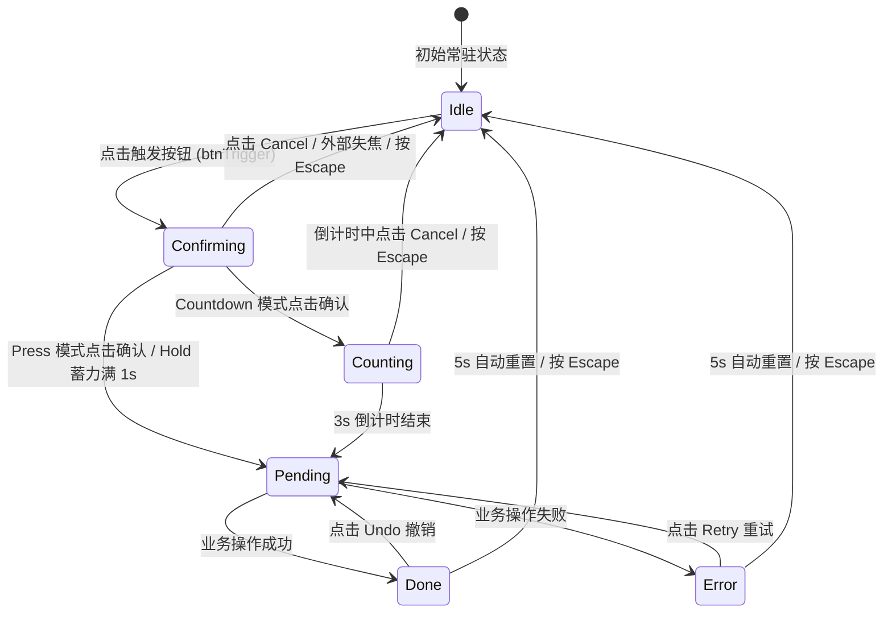

# Confirm Morph · 原位确认变形按钮

高风险或不可逆操作的原位流转按钮。点击时不弹出打断心流的模态对话框，而是在按钮当前药丸容器内原地平滑伸展变形，承载二次确认、倒计时撤销、异步处理以及可撤回反馈。涵盖四大核心机制：

1. 表面宽度平滑形变（Surface Morph）：外层容器高度锁定 36px，切换状态时通过测量目标内容自然宽度，动态以 400ms 弹簧曲线驱动 `width`，实现无缝横向伸缩。
2. 跨阶段面切换（Face Cross-Blur Swap）：上一阶段面叠加微模糊与透明度渐隐（`opacity: 0; filter: blur(2px)`）并绝对定位脱流，新阶段面即时进驻排版。
3. 三种防误触模式（Press / Hold / Countdown）：
   - Click 单击确认：原地展开“Prompt + Cancel + Delete”双按钮。
   - Hold 长按确认：按住确认按钮时，红色背景通过 `clip-path: inset(...)` 沿 1000ms 线性蓄力填充，中途松开立即回退。
   - Countdown 倒计时确认：展示 3 秒环形 SVG 进度条与递减数字，给予用户充裕的反应期与取消机会。
4. 闭环操作与可逆撤销（Done with Undo & Retry）：执行成功后提供 5 秒 "Undo" 撤销窗口；失败时提供 "Retry" 重试入口。

## 原型清单

| 原型分组 | 原型元素 | 动效 / 状态变化 | 去向 |
| --- | --- | --- | --- |
| Northwind redesign | 变形根容器 `#morphRoot` | 承载药丸外形与语义状态属性 `[data-state]` | 表面宽度平滑形变 |
| Northwind redesign | 动态表面外壳 `#morphSurface` | 400ms 宽度平滑过渡与阴影/边框承载 | 表面宽度平滑形变 |
| Northwind redesign | 初始触发面 `#faceIdle` | 点击进入确认态；展示垃圾桶图标与文字 | 跨阶段面切换 |
| Northwind redesign | 确认询问面 `#faceConfirming` | 提示文案 + 取消按钮 + 确认按钮；长按蓄力填色 | 跨阶段面切换 + 三种防误触模式 |
| Northwind redesign | 倒计时确认面 `#faceCounting` | 3 秒 SVG 环形动画与数字递减 + Cancel 按钮 | 三种防误触模式 |
| Northwind redesign | 处理中面 `#facePending` | 顺时针旋转 Spinner + "Deleting..." / "Restoring..." | 跨阶段面切换 |
| Northwind redesign | 成功完成面 `#faceDone` | 绿色圆盘 Check 勾选动画 + "Deleted" + Undo 按钮 | 闭环操作与可逆撤销 |
| Northwind redesign | 失败异常面 `#faceError` | 红色感叹号警告 + "Couldn't finish" + Retry 按钮 | 闭环操作与可逆撤销 |
| Northwind redesign | 项目标题 `#projectRow` | 静态项目行演示文字与图标 | 演示外壳，已删除 |
| 底部控制器 | 确认模式切换器 `#modeSelector` | Click / Hold / Countdown 演示切换 | 演示外壳，已删除（机制收录进参数与 JS） |
| 底部控制器 | 模拟结果切换器 `#resultSelector` | Succeeds / Fails 演示切换 | 演示外壳，已删除 |
| — | 顶栏、主题切换、快捷键 D、舞台卡片、embed 检测、全局 blur 补丁 | — | 演示外壳，已删除 |

## 适用

- 破坏性或高风险操作（如删除资源、注销账户、重置密钥、清理数据库），需要防误触但又不希望被粗暴的模态弹窗阻断工作流。
- 需要提供短暂“反悔期”（3~5 秒 Undo 撤回）的即时操作。
- 空间有限的列表行（Data Table / List Row）末尾行内操作。

## 不适用

- 纯手势驱动的屏幕级移动端长按确认交互 → [hold-to-confirm](../gestures/hold-to-confirm.md)
- 仅需展示常规异步请求加载态、无需二次确认与撤销的普通按钮 → [action-button](action-button.md)
- 仅需弹出常规下拉菜单选择扩展项的组合按钮 → [split-button](split-button.md)

## 状态机



| 状态 | 进入条件 | 视觉表现 | 退出到 |
| --- | --- | --- | --- |
| `idle` | 初始载入 / 取消 / 自动重置 | 单个触发按钮（垃圾桶图标 + 标题文字） | `confirming` |
| `confirming` | 点击触发按钮 | 原地伸长展开，显露确认提示语、Cancel 按钮及确认/删除按钮 | `idle`, `pending`, `counting` |
| `counting` | 处于 Countdown 模式并点击确认 | 显露 3 秒环形倒计时动画、倒数数字与 Cancel 按钮 | `idle`, `pending` |
| `pending` | 确认达成 / 点击 Undo / 点击 Retry | 显露旋转 Spinner 与动态文本（Deleting... / Restoring...） | `done`, `error`, `idle` |
| `done` | 异步请求返回成功 | 显露绿色勾选圆盘、Deleted 文本与 Undo 按钮 | `idle`, `pending` |
| `error` | 异步请求返回失败 | 显露红色错误图标、失败文案与 Retry 按钮 | `idle`, `pending` |

## 最小 DOM

```html
<div class="morph-root" data-state="idle" role="region" aria-label="Action confirmation">
  <div class="morph-surface">

    <!-- 1. Idle 初始面 -->
    <div class="morph-face" data-face="idle">
      <button class="morph-trigger" type="button">
        <span class="morph-icon" aria-hidden="true">
          <svg viewBox="0 0 24 24"><path d="M3 6h18"/><path d="M19 6v14c0 1-1 2-2 2H7c-1 0-2-1-2-2V6"/><path d="M8 6V4c0-1 1-2 2-2h4c1 0 2 1 2 2v2"/></svg>
        </span>
        <span>Delete project</span>
      </button>
    </div>

    <!-- 2. Confirming 询问面 -->
    <div class="morph-face is-exiting" data-face="confirming" style="display:none;">
      <span class="morph-prompt">Delete project?</span>
      <button class="morph-btn-secondary btn-cancel" type="button">Cancel</button>
      <button class="morph-btn-confirm btn-confirm" type="button">
        <span>Delete</span>
        <span class="morph-fill" aria-hidden="true"><span>Delete</span></span>
      </button>
    </div>

    <!-- 3. Counting 倒计时面 -->
    <div class="morph-face is-exiting" data-face="counting" style="display:none;">
      <div class="morph-status" aria-live="polite">
        <svg class="countdown-ring-svg" viewBox="0 0 16 16" fill="none" aria-hidden="true">
          <circle class="ring-track" cx="8" cy="8" r="6.25" />
          <circle class="ring-fill" cx="8" cy="8" r="6.25" />
        </svg>
        <span>Deleting in <span class="countdown-number">3</span></span>
      </div>
      <button class="morph-btn-secondary btn-cancel-counting" type="button">Cancel</button>
    </div>

    <!-- 4. Pending 正在处理面 -->
    <div class="morph-face is-exiting" data-face="pending" style="display:none;">
      <div class="morph-status" role="status" aria-live="polite">
        <svg class="morph-spinner" viewBox="0 0 24 24" fill="none" stroke="currentColor" stroke-width="1.75" aria-hidden="true">
          <path d="M21 12a9 9 0 1 1-6.219-8.56" />
        </svg>
        <span class="pending-text">Deleting...</span>
      </div>
    </div>

    <!-- 5. Done 成功面 -->
    <div class="morph-face is-exiting" data-face="done" style="display:none;">
      <div class="morph-status" role="status">
        <svg class="check-disc-svg" viewBox="0 0 18 18" fill="none" aria-hidden="true">
          <circle class="check-disc" cx="9" cy="9" r="8" />
          <path class="check-tick" d="M5.6 9.3 7.8 11.4 12.4 6.7" />
        </svg>
        <span>Deleted</span>
      </div>
      <button class="morph-btn-secondary btn-undo" type="button">Undo</button>
    </div>

    <!-- 6. Error 失败面 -->
    <div class="morph-face is-exiting" data-face="error" style="display:none;">
      <div class="morph-status" role="alert">
        <svg width="16" height="16" viewBox="0 0 24 24" fill="none" stroke="currentColor" stroke-width="1.75" aria-hidden="true">
          <circle cx="12" cy="12" r="10" /><line x1="12" y1="8" x2="12" y2="12" /><line x1="12" y1="16" x2="12.01" y2="16" />
        </svg>
        <span>Couldn’t finish</span>
      </div>
      <button class="morph-btn-secondary btn-retry" type="button">Retry</button>
    </div>

  </div>
</div>
```

- `.morph-surface`：外部药丸轨道，执行宽度补间过渡。
- `.morph-face`：对应各交互阶段的子视口。
- `.morph-fill`：Hold 模式下的进度裁剪填充层，利用 `clip-path` 实现从左到右填满效果。
- `.ring-fill`：Countdown 模式下的 SVG 倒计时描边圆环。

## 参数

| 名称 | 值 | 用于 | 来源 |
| --- | --- | --- | --- |
| 容器高度 | `36px` | `.morph-surface` 恒定高度 | 原型 |
| 宽度变形过渡 | `400ms cubic-bezier(0.16, 1, 0.3, 1)` | 表面横向自适应伸展曲线 | 原型 |
| 阶段切换淡出 | `160ms` | 旧面淡出 (`filter: blur(2px); opacity: 0`) | 原型 |
| 长按蓄力时长 | `1000ms` | Hold 模式蓄力至触发阈值 | 原型 |
| 倒计时时长 | `3000ms` | Countdown 模式倒计时时长 | 原型 |
| 撤回/自动重置窗口 | `5000ms` | Done 与 Error 停留窗口 | 原型 |
| 倒计时圆环周长 | `~40px` (半径 6.25) | `stroke-dasharray: 40` | 原型 |
| 成功圆盘图标动画 | `360ms cubic-bezier(0.18, 0.89, 0.32, 1.28)` | Check 成功图标弹性缩放 | 原型 |
| 危险色 `--danger` | `#f43f5e` | 删除按钮及警示状态色 | 原型 |
| 成功色 `--success` | `#10b981` | 完成圆盘高亮色 | 原型 |

## CSS

```css
.morph-root {
  --duration-fast: 160ms;
  --duration-standard: 240ms;
  --duration-spring: 360ms;
  --ease-standard: cubic-bezier(0.22, 1, 0.36, 1);
  --ease-snappy: cubic-bezier(0.18, 0.89, 0.32, 1.28);
  --ease-enter: cubic-bezier(0.16, 1, 0.3, 1);
  --danger: #f43f5e;
  --success: #10b981;
  --border: rgba(0, 0, 0, 0.08);
  --surface-raised: #ffffff;
  --foreground: #0b0b0b;
  --text-secondary: #555555;
  --radius-pill: 9999px;

  position: relative;
  display: inline-flex;
  min-width: 0;
  max-width: 100%;
  vertical-align: middle;
  color: var(--foreground);
  font-size: 13.5px;
  line-height: 20px;
  user-select: none;
}

.morph-surface {
  position: relative;
  display: flex;
  height: 36px;
  max-width: 100%;
  justify-content: flex-start;
  overflow: clip;
  border-radius: var(--radius-pill);
  background: var(--surface-raised);
  box-shadow: 0 1px 3px rgba(0, 0, 0, 0.05), 0 1px 2px rgba(0, 0, 0, 0.03);
  transition: width 400ms cubic-bezier(0.16, 1, 0.3, 1),
              background-color var(--duration-standard) var(--ease-standard),
              box-shadow var(--duration-standard) var(--ease-standard);
  will-change: width;
}

.morph-surface::after {
  content: "";
  position: absolute;
  inset: 0;
  border: 1px solid var(--border);
  border-radius: inherit;
  pointer-events: none;
}

/* 各阶段形态容器 (Face) */
.morph-face {
  display: inline-flex;
  flex: none;
  height: 100%;
  align-items: center;
  gap: 2px;
  padding: 0 4px;
  white-space: nowrap;
  transition: opacity var(--duration-fast) var(--ease-standard),
              transform var(--duration-fast) var(--ease-standard),
              filter var(--duration-fast) var(--ease-standard);
}

.morph-face[data-face="idle"] {
  padding: 0;
}

.morph-face.is-exiting {
  position: absolute;
  top: 0;
  left: 0;
  opacity: 0;
  filter: blur(2px);
  pointer-events: none;
}

/* 触发按钮 */
.morph-trigger {
  display: inline-flex;
  height: 100%;
  align-items: center;
  gap: 8px;
  padding: 0 16px 0 14px;
  border: 0;
  border-radius: var(--radius-pill);
  background: transparent;
  color: var(--foreground);
  cursor: pointer;
  font: inherit;
  font-weight: 500;
  outline: none;
  transition: background-color var(--duration-fast) var(--ease-standard);
}
.morph-trigger:hover {
  background: rgba(0, 0, 0, 0.05);
}
.morph-trigger:focus-visible {
  outline: 2px solid currentColor;
  outline-offset: -2px;
}

.morph-icon {
  display: grid;
  width: 16px;
  height: 16px;
  place-items: center;
  color: var(--text-secondary);
}
.morph-icon svg {
  width: 16px;
  height: 16px;
  stroke: currentColor;
  stroke-width: 1.75;
  fill: none;
}

/* 提示文案 */
.morph-prompt {
  max-width: 16rem;
  overflow: hidden;
  padding: 0 8px 0 12px;
  color: var(--foreground);
  font-weight: 500;
}

/* 辅助与取消按钮 */
.morph-btn-secondary {
  position: relative;
  display: inline-flex;
  flex: none;
  height: 28px;
  align-items: center;
  justify-content: center;
  padding: 0 12px;
  border: 0;
  border-radius: var(--radius-pill);
  background: transparent;
  color: var(--text-secondary);
  cursor: pointer;
  font: inherit;
  font-size: 13px;
  font-weight: 500;
  outline: none;
  transition: background-color var(--duration-fast) var(--ease-standard),
              color var(--duration-fast) var(--ease-standard);
}
.morph-btn-secondary:hover {
  background: rgba(0, 0, 0, 0.07);
  color: var(--foreground);
}
.morph-btn-secondary:focus-visible {
  outline: 2px solid currentColor;
  outline-offset: -2px;
}

/* 确认执行危险按钮 */
.morph-btn-confirm {
  position: relative;
  display: inline-flex;
  flex: none;
  height: 28px;
  align-items: center;
  justify-content: center;
  padding: 0 12px;
  border: 0;
  border-radius: var(--radius-pill);
  background: rgba(244, 63, 94, 0.13);
  color: var(--danger);
  cursor: pointer;
  font: inherit;
  font-size: 13px;
  font-weight: 500;
  outline: none;
  overflow: clip;
  user-select: none;
  transition: background-color var(--duration-fast) var(--ease-standard);
}
.morph-btn-confirm:hover {
  background: rgba(244, 63, 94, 0.18);
}
.morph-btn-confirm:focus-visible {
  outline: 2px solid var(--danger);
  outline-offset: -2px;
}

/* Hold 长按蓄力填色层 */
.morph-fill {
  position: absolute;
  inset: 0;
  display: inline-flex;
  align-items: center;
  justify-content: center;
  background: var(--danger);
  color: #ffffff;
  pointer-events: none;
  clip-path: inset(0 100% 0 0 round 999px);
  transition: clip-path 0.05s linear;
}

/* 状态展示项 */
.morph-status {
  display: inline-flex;
  align-items: center;
  gap: 8px;
  padding: 0 12px 0 14px;
  color: var(--foreground);
  font-weight: 500;
}

/* 成功圆盘图标 */
.check-disc-svg {
  width: 18px;
  height: 18px;
  flex-shrink: 0;
}
.check-disc {
  fill: var(--success);
  transform-origin: 9px 9px;
  transition: transform var(--duration-spring) var(--ease-snappy);
}
.check-tick {
  stroke: #ffffff;
  stroke-width: 1.9;
  stroke-linecap: round;
  stroke-linejoin: round;
  stroke-dasharray: 12;
  stroke-dashoffset: 0;
  transition: stroke-dashoffset 0.3s var(--ease-enter) 0.1s;
}

/* Spinner 旋转动画 */
.morph-spinner {
  width: 16px;
  height: 16px;
  animation: morphSpin 0.7s linear infinite;
  color: var(--text-secondary);
  flex-shrink: 0;
}
@keyframes morphSpin {
  to { transform: rotate(360deg); }
}

/* 倒计时圆环 */
.countdown-ring-svg {
  width: 16px;
  height: 16px;
  transform: rotate(-90deg);
  flex-shrink: 0;
}
.ring-track {
  stroke: var(--border);
  stroke-width: 1.75;
}
.ring-fill {
  stroke: var(--danger);
  stroke-width: 1.75;
  stroke-linecap: round;
  stroke-dasharray: 40;
  stroke-dashoffset: 0;
  transition: stroke-dashoffset 0.1s linear;
}
.countdown-number {
  font-variant-numeric: tabular-nums;
  font-weight: 600;
}
```

## JS

```js
/**
 * 原位确认变形按钮控制器
 * @param {HTMLElement} rootEl .morph-root 根容器
 * @param {Object} options 配置项
 * @param {'press'|'hold'|'countdown'} [options.mode='press'] 防误触模式
 * @param {(action: 'confirm'|'undo') => Promise<void>} options.onAction 执行动作的异步回调
 * @returns {{ toIdle: Function, destroy: Function }} 控制接口
 */
export function createConfirmMorph(rootEl, { mode = 'press', onAction } = {}) {
  const surface = rootEl.querySelector('.morph-surface');
  const faces = {
    idle: rootEl.querySelector('[data-face="idle"]'),
    confirming: rootEl.querySelector('[data-face="confirming"]'),
    counting: rootEl.querySelector('[data-face="counting"]'),
    pending: rootEl.querySelector('[data-face="pending"]'),
    done: rootEl.querySelector('[data-face="done"]'),
    error: rootEl.querySelector('[data-face="error"]')
  };

  const btnTrigger = rootEl.querySelector('.morph-trigger');
  const btnCancel = rootEl.querySelector('.btn-cancel');
  const btnConfirm = rootEl.querySelector('.btn-confirm');
  const morphFill = rootEl.querySelector('.morph-fill');
  const btnCancelCounting = rootEl.querySelector('.btn-cancel-counting');
  const countdownNumber = rootEl.querySelector('.countdown-number');
  const ringFill = rootEl.querySelector('.ring-fill');
  const pendingText = rootEl.querySelector('.pending-text');
  const btnUndo = rootEl.querySelector('.btn-undo');
  const btnRetry = rootEl.querySelector('.btn-retry');

  let activeFace = faces.idle;
  let currentState = 'idle';
  let autoResetTimer = null;
  let countdownInterval = null;
  let holdAnimFrame = null;
  let holdStartTime = 0;

  function syncSurfaceWidth(targetFace) {
    targetFace.style.display = 'inline-flex';
    const w = targetFace.getBoundingClientRect().width;
    surface.style.width = `${Math.ceil(w)}px`;
  }

  function switchFace(nextFace) {
    if (activeFace === nextFace) return;
    const prevFace = activeFace;
    activeFace = nextFace;

    prevFace.classList.add('is-exiting');
    nextFace.style.display = 'inline-flex';
    syncSurfaceWidth(nextFace);

    requestAnimationFrame(() => {
      nextFace.classList.remove('is-exiting');
    });

    setTimeout(() => {
      if (activeFace !== prevFace) {
        prevFace.style.display = 'none';
      }
    }, 180);
  }

  function cancelHold() {
    if (holdAnimFrame) cancelAnimationFrame(holdAnimFrame);
    holdAnimFrame = null;
    if (morphFill) morphFill.style.clipPath = 'inset(0 100% 0 0 round 999px)';
  }

  function toIdle() {
    currentState = 'idle';
    rootEl.setAttribute('data-state', 'idle');
    if (autoResetTimer) clearTimeout(autoResetTimer);
    if (countdownInterval) clearInterval(countdownInterval);
    cancelHold();
    switchFace(faces.idle);
  }

  function toConfirming() {
    currentState = 'confirming';
    rootEl.setAttribute('data-state', 'confirming');
    cancelHold();
    switchFace(faces.confirming);
  }

  function toCounting() {
    currentState = 'counting';
    rootEl.setAttribute('data-state', 'counting');
    switchFace(faces.counting);

    let sec = 3;
    if (countdownNumber) countdownNumber.textContent = sec;
    const totalLen = 40;
    if (ringFill) ringFill.style.strokeDashoffset = '0';

    const start = performance.now();
    const duration = 3000;

    countdownInterval = setInterval(() => {
      const elapsed = performance.now() - start;
      const progress = Math.min(elapsed / duration, 1);
      if (ringFill) ringFill.style.strokeDashoffset = `${progress * totalLen}`;

      const currentSec = Math.max(1, Math.ceil(3 * (1 - progress)));
      if (countdownNumber) countdownNumber.textContent = currentSec;

      if (progress >= 1) {
        clearInterval(countdownInterval);
        toPending('confirm');
      }
    }, 30);
  }

  async function toPending(actionKind) {
    currentState = 'pending';
    rootEl.setAttribute('data-state', 'pending');
    if (pendingText) {
      pendingText.textContent = actionKind === 'undo' ? 'Restoring...' : 'Deleting...';
    }
    switchFace(faces.pending);

    try {
      if (typeof onAction === 'function') {
        await onAction(actionKind);
      }
      if (actionKind === 'undo') {
        toIdle();
      } else {
        toDone();
      }
    } catch {
      toError();
    }
  }

  function toDone() {
    currentState = 'done';
    rootEl.setAttribute('data-state', 'done');
    switchFace(faces.done);
    autoResetTimer = setTimeout(() => toIdle(), 5000);
  }

  function toError() {
    currentState = 'error';
    rootEl.setAttribute('data-state', 'error');
    switchFace(faces.error);
    autoResetTimer = setTimeout(() => toIdle(), 5000);
  }

  function startHold() {
    if (mode !== 'hold' || currentState !== 'confirming') return;
    holdStartTime = performance.now();
    const holdDuration = 1000;

    function step() {
      const elapsed = performance.now() - holdStartTime;
      const pct = Math.min(elapsed / holdDuration, 1);
      if (morphFill) {
        morphFill.style.clipPath = `inset(0 ${(1 - pct) * 100}% 0 0 round 999px)`;
      }

      if (pct >= 1) {
        cancelHold();
        toPending('confirm');
      } else {
        holdAnimFrame = requestAnimationFrame(step);
      }
    }
    holdAnimFrame = requestAnimationFrame(step);
  }

  // 事件监听绑定
  btnTrigger?.addEventListener('click', toConfirming);
  btnCancel?.addEventListener('click', (e) => { e.stopPropagation(); toIdle(); });
  btnCancelCounting?.addEventListener('click', (e) => { e.stopPropagation(); toIdle(); });

  btnConfirm?.addEventListener('click', () => {
    if (mode === 'press') toPending('confirm');
    else if (mode === 'countdown') toCounting();
  });

  const onPointerDownConfirm = (e) => {
    if (mode === 'hold' && e.button === 0) startHold();
  };
  btnConfirm?.addEventListener('pointerdown', onPointerDownConfirm);
  window.addEventListener('pointerup', cancelHold);

  btnUndo?.addEventListener('click', () => {
    if (autoResetTimer) clearTimeout(autoResetTimer);
    toPending('undo');
  });

  btnRetry?.addEventListener('click', () => {
    if (autoResetTimer) clearTimeout(autoResetTimer);
    toPending('confirm');
  });

  const onDocPointerDown = (e) => {
    if (currentState === 'confirming' && !rootEl.contains(e.target)) {
      toIdle();
    }
  };
  document.addEventListener('pointerdown', onDocPointerDown);

  const onKeyDown = (e) => {
    if (e.key === 'Escape') {
      if (currentState === 'confirming' || currentState === 'counting' || currentState === 'done' || currentState === 'error') {
        toIdle();
      }
    }
  };
  window.addEventListener('keydown', onKeyDown);

  // 初始化初态自然尺寸
  syncSurfaceWidth(faces.idle);

  return {
    toIdle,
    destroy() {
      if (autoResetTimer) clearTimeout(autoResetTimer);
      if (countdownInterval) clearInterval(countdownInterval);
      cancelHold();
      window.removeEventListener('pointerup', cancelHold);
      document.removeEventListener('pointerdown', onDocPointerDown);
      window.removeEventListener('keydown', onKeyDown);
    }
  };
}
```

## 接入目标项目

- 状态来源：绑定目标删除或修改操作的 Promise。`onAction('confirm')` 驱动真实后端接口，`onAction('undo')` 驱动撤销还原接口。
- 尺寸策略：各面均为纯文字与图标自然排版尺寸，外层宽度由 `syncSurfaceWidth()` 计算并在 `surface.style.width` 上赋予像素值，触发 CSS 的 400ms 补间。
- 驱动方式：通过实例化 `createConfirmMorph(element, { mode, onAction })` 进行托管，可根据业务敏感等级传入 `'press'`、`'hold'` 或 `'countdown'`。

## 重入与清理

- 计时器与动画帧防重：进入新状态前显式执行 `clearTimeout(autoResetTimer)`、`clearInterval(countdownInterval)` 及 `cancelAnimationFrame(holdAnimFrame)`，彻底阻断旧倒计时跨阶段执行。
- 销毁机制：组件提供 `destroy()` 接口，在 SPA 路由卸载或数据行销毁时解除 `document` 与 `window` 上的全局指针与键盘监听器。

## 减少动态效果

系统开启 `prefers-reduced-motion: reduce` 时：
1. 取消 `.morph-surface` 400ms 宽度平滑过渡与旧面的 `filter: blur(2px)` 滤镜，直接瞬时变更宽度。
2. 禁用 Spinner 旋转关键帧动画，改用静态沙漏或常规加载图标。

```css
@media (prefers-reduced-motion: reduce) {
  .morph-surface,
  .morph-face,
  .check-disc,
  .check-tick {
    transition-duration: 0.01ms !important;
  }

  .morph-face.is-exiting {
    filter: none !important;
  }

  .morph-spinner {
    animation: none !important;
  }
}
```

## 焦点与键盘

- 键盘激活：各个状态下的按钮均使用原生 `<button>`，支持 Tab 顺序遍历与 Space/Enter 激活。
- Escape 键防险退出：处于确认询问（`confirming`）、倒计时（`counting`）、完成（`done`）或报错（`error`）时，按下 `Escape` 键可立即重置并回到初始 `idle` 状态。
- 屏幕阅读器朗读：倒计时与处理中状态添加 `aria-live="polite"`，错误态设置 `role="alert"`。

## 兼容回退

| 特性 | 不支持时 |
| --- | --- |
| CSS `clip-path: inset(...)` (老旧移动端) | 【降级方案】Hold 模式的进度条改用绝对定位子元素的 `transform: scaleX(...)` 与 `transform-origin: left`。 |
| CSS `color-mix()` | 样式中提供纯十六进制透明度色值 `#f43f5e21` 作为回退。 |

## 验收清单

- [ ] 点击触发按钮，外层药丸平滑横向延展（400ms 缓动），无卡顿地展开提示文字与 Cancel/Delete 按钮。
- [ ] 点击 Cancel 或点击组件外部区域，按钮平滑收缩回归初始状态。
- [ ] 在 Hold 模式下，按住 Delete 按钮显示红色由左至右 1000ms 蓄力填色；中途释放立即复位；蓄满自动进入 Pending。
- [ ] 在 Countdown 模式下，圆环沿逆时针顺滑消减，数字由 3 倒数至 1；点击 Cancel 随时中止。
- [ ] 进入 Pending 态展示平滑旋转的 Spinner；请求成功平滑切换至 Done 态并展示对勾弹性动效。
- [ ] 在 Done 态点击 Undo 触发反向恢复流程；不操作时 5 秒后自动平滑回归 Idle 态。
- [ ] 按下键盘 Escape 键，可从任何非 Pending 状态安全回归 Idle 态。
- [ ] 开启减弱动态效果时，所有宽度形变和模糊滤镜立即瞬切，不产生眩晕。
