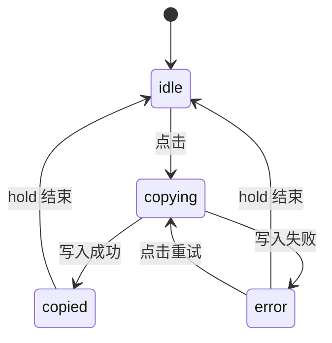

# Copy Button · 复制按钮

点击后把文本真实写入剪贴板，按写入结果切换成功或失败反馈。包含四种机制：

1. 剪贴板写入与状态绑定：优先 `navigator.clipboard.writeText`，失败时降级到 `execCommand('copy')`，成功态和失败态都由写入结果决定。
2. 按压与悬停：按压缩放，悬停底色、边框、文字色过渡。
3. 图标替换：复制图标缩小模糊淡出，对勾放大淡入并描边绘制；失败时换成失败图标。
4. 逐字形变文案：只替换新旧文案之间不同的字符，旧字符上移淡出，新字符依次从下方淡入；用隐藏的占位文案预留最大宽度，按钮宽度不抖动。

## 原型清单

| 原型分组 | 原型元素 | 动效 / 状态变化 | 去向 |
| --- | --- | --- | --- |
| Share link | Copy link（`#copyLinkBtn`，图标 + 文字） | 悬停底色与边框；按压缩放 0.97；复制图标替换成对勾，对勾描边绘制；文案逐字形变 Copy link → Copied；停留 1900ms 后复原；文案宽度预留 | 剪贴板写入与状态绑定 + 按压与悬停 + 图标替换 + 逐字形变文案 |
| Invite code | 纯图标复制按钮（`#copyCodeBtn`，`.icon-only`） | 悬停底色与文字色；按压缩放 0.97；图标替换成对勾；停留 1900ms 后复原 | 剪贴板写入与状态绑定 + 按压与悬停 + 图标替换 |
| Share link | 链接框 `.share-box` 与链接文字 | 无状态变化 | 演示外壳，已删除（复制内容由目标项目提供） |
| Invite code | 邀请码文字 `.invite-code` | 无状态变化 | 演示外壳，已删除 |
| — | 底部说明文字 `.hint-text` | 无状态变化 | 演示外壳，已删除 |
| — | 顶栏、主题切换按钮、D 快捷键、舞台卡片、embed/postMessage 检测 | — | 演示外壳，已删除 |

## 适用

- 用户要把一段文本（链接、邀请码、令牌、代码片段）复制到剪贴板，需要立即得到"已复制"或"复制失败"的确认。
- 复制结果必须如实反映：写入成功才显示对勾和"已复制"，写入失败显示失败图标和失败文案。
- 文案只有局部字符变化（Copy link → Copied），希望逐字形变，并且按钮宽度保持不变。
- 纯图标的复制按钮，只靠图标替换给出反馈。

## 不适用

- 不涉及剪贴板，只是在操作完成后闪现成功反馈 → [button](button.md)
- 操作需要等待请求、有"进行中"阶段的异步按钮 → [action-button](action-button.md)
- 两个图标之间的路径变形（播放/暂停、加号/对勾）→ [icon-morph](icon-morph.md)
- 危险操作需要在按钮内原地二次确认 → [confirm-morph](confirm-morph.md)

## 状态机

| 状态 | 进入条件 | 视觉表现 | 退出到 |
| --- | --- | --- | --- |
| idle | 初始；停留结束 | 复制图标，初始文案 | copying |
| copying | 点击，开始写入剪贴板 | 与 idle 相同，忽略重复点击【修正】 | copied / error |
| copied | 写入成功 | 复制图标缩小模糊淡出，对勾放大淡入并描边绘制；文案逐字形变成"已复制"；停留期间忽略点击 | 停留 1900ms 后回到 idle |
| error | 写入失败【补充】 | 复制图标淡出，失败图标淡入；文案逐字形变成失败文案；可立即点击重试 | 停留 1900ms 后回到 idle；或点击重试进入 copying |



## 最小 DOM

```html
<!-- 图标 + 文字 -->
<button class="arc-copy-btn" type="button" data-state="idle" aria-label="Copy link">
  <span class="copy-icon-slot" aria-hidden="true">
    <span class="copy-icon-inner icon-normal"><!-- 复制图标 svg --></span>
    <span class="copy-icon-inner icon-check">
      <svg width="16" height="16" viewBox="0 0 24 24" fill="none" stroke="currentColor" stroke-width="2" stroke-linecap="round" stroke-linejoin="round">
        <path class="drawn-check-path" d="M4 12l5 5L20 6" />
      </svg>
    </span>
    <span class="copy-icon-inner icon-error"><!-- 失败图标 svg --></span>
  </span>
  <span class="label-measure-grid" aria-hidden="true">
    <span class="measure-ghost">Copy link</span>
    <span class="measure-ghost">Copied</span>
    <span class="measure-ghost">Failed</span>
    <span class="morph-text-layer"></span>
  </span>
</button>

<!-- 纯图标：去掉 .label-measure-grid -->
<button class="arc-copy-btn icon-only" type="button" data-state="idle" aria-label="Copy invite code">
  <span class="copy-icon-slot" aria-hidden="true"><!-- 同上三个 .copy-icon-inner --></span>
</button>

<!-- 可选：读屏播报区域，用目标项目的视觉隐藏类 -->
<span class="visually-hidden" role="status"></span>
```

- `.arc-copy-btn`：按压与悬停过渡的承载元素；`data-state`（`idle` / `copying` / `copied` / `error`）驱动图标替换。
- `.icon-only`：纯图标变体，静止时透明底、弱文字色，悬停时出现底色、文字变为前景色。
- `.copy-icon-slot`：三个图标叠放在同一个 grid 格子里的 16×16 容器。`aria-hidden="true"`【补充】，原型没有设置；按钮的可访问名称来自 `aria-label`。
- `.icon-normal` / `.icon-check`：复制图标与对勾。对勾路径必须带 `.drawn-check-path`，描边绘制依赖它。
- `.icon-error`：失败图标【补充】，原型没有失败态。
- `.label-measure-grid`：文案宽度预留器。所有 `.measure-ghost` 与 `.morph-text-layer` 叠在同一个 grid 格子里，格子宽度取最长的占位文案，形变过程中按钮宽度不变。
- `.measure-ghost`：隐藏的占位文案，必须列出全部状态文案；原型只有 Copy link 和 Copied，`Failed` 是【补充】。
- `.morph-text-layer`：逐字形变的承载元素，由 JS 填入每个字符一个 `.c-glyph`，初始为空。
- `role="status"` 播报区域【补充】：可选，传给 JS 的 `announce` 后写入成功/失败文案。

## 参数

| 名称 | 值 | 用于 | 来源 |
| --- | --- | --- | --- |
| 按压缩放 | `scale(0.97)`，`120ms cubic-bezier(0.22, 1, 0.36, 1)` | `.arc-copy-btn:active` | 原型 |
| 悬停过渡 | background-color / border-color / color `160ms cubic-bezier(0.22, 1, 0.36, 1)` | `.arc-copy-btn` | 原型 |
| 悬停生效条件 | `@media (hover: hover) and (pointer: fine)`，触屏不出现悬停态 | 悬停规则 | 原型 |
| 默认悬停 | 背景 → `--surface-muted`；边框 → `--border-strong` | `.arc-copy-btn:hover` | 原型 |
| 纯图标按钮 | 静止透明底、文字色 `--text-secondary`；悬停背景 → `--surface-muted`，文字色 → `--foreground` | `.icon-only` | 原型 |
| 图标过渡 | transform `240ms`，opacity / filter `160ms`，均为 `cubic-bezier(0.16, 1, 0.3, 1)` | `.copy-icon-inner` | 原型 |
| 图标隐藏态 | `opacity: 0`，`scale(0.6)`，`blur(2px)` | 未激活的图标 | 原型 |
| 对勾颜色 | `--success`（原型浅色 `#10b981`，深色 `#34d399`） | `.icon-check` | 原型 |
| 失败图标颜色 | `--danger` | `.icon-error` | 【补充】 |
| 对勾描边绘制 | `stroke-dasharray: 24`，`stroke-dashoffset: 24 → 0`，`340ms cubic-bezier(0.16, 1, 0.3, 1)`，延迟 `50ms` | `.drawn-check-path` | 原型 |
| 字符入场 | 起点 `opacity: 0`，`translateY(5px)`，`blur(3px)`；`240ms cubic-bezier(0.16, 1, 0.3, 1)` 归位 | `.c-glyph.in → .rest` | 原型 |
| 字符入场错开 | 第 i 个新字符延迟 `min(i × 18, 100)ms` | JS `morph` | 原型 |
| 字符离场 | 固定在原位置（`position: absolute` + 原 `offsetLeft`），`opacity: 0`，`translateY(-4px)`，`blur(2px)`；`160ms cubic-bezier(0.22, 1, 0.36, 1)`，无延迟 | `.c-glyph.out` | 原型 |
| 离场字符移除 | `180ms` 后从 DOM 移除 | JS `morph` | 原型 |
| 字符差异算法 | 新旧文案取最长公共前缀和公共后缀，只替换中间部分 | JS `morph` | 原型 |
| 成功停留 `hold` | `1900ms`，从写入成功时开始计时 | JS | 原型 |
| 失败停留 | 与 `hold` 相同 `1900ms` | JS | 【补充】 |
| 文案 | `Copy link` / `Copied`；失败文案 `Failed` | `labels` | 原型；失败文案【补充】 |
| 原型的复制内容 | `https://example.com/launch`、`ARC-4821` | 演示数据，由目标项目的 `getText` 提供 | 原型 |

原型没有模拟等待，复制结果来自真实的剪贴板调用。

## CSS

只包含动效和状态变化相关的属性。按钮的尺寸、圆角、字体、边框宽度沿用目标组件自己的样式。`--surface-muted`、`--border-strong`、`--foreground`、`--text-secondary`、`--success`、`--danger` 都要映射到目标项目已有的 token。

```css
.arc-copy-btn {
  --motion-ease-enter: cubic-bezier(0.16, 1, 0.3, 1);
  --motion-ease-standard: cubic-bezier(0.22, 1, 0.36, 1);

  transition:
    background-color 160ms var(--motion-ease-standard),
    border-color 160ms var(--motion-ease-standard),
    color 160ms var(--motion-ease-standard),
    transform 120ms var(--motion-ease-standard);
  will-change: transform;
}

/* 按压与悬停 */
@media (hover: hover) and (pointer: fine) {
  .arc-copy-btn:hover { background: var(--surface-muted); border-color: var(--border-strong); }
  .arc-copy-btn.icon-only:hover { background: var(--surface-muted); color: var(--foreground); }
}
.arc-copy-btn:active { transform: scale(0.97); }
.arc-copy-btn.icon-only { background: transparent; color: var(--text-secondary); }

/* 图标替换 */
.copy-icon-slot {
  display: grid;
  place-items: center;
  flex: none;
  width: 16px;
  height: 16px;
}
.copy-icon-inner {
  grid-area: 1 / 1;
  display: flex;
  align-items: center;
  justify-content: center;
  pointer-events: none;
  will-change: transform, opacity, filter;
  transition:
    transform 240ms var(--motion-ease-enter),
    opacity 160ms var(--motion-ease-enter),
    filter 160ms var(--motion-ease-enter);
}
.icon-normal { opacity: 1; transform: scale(1); filter: blur(0); }
.icon-check,
.icon-error { opacity: 0; transform: scale(0.6); filter: blur(2px); }
.icon-check { color: var(--success); }
.icon-error { color: var(--danger); }

.arc-copy-btn[data-state="copied"] .icon-normal,
.arc-copy-btn[data-state="error"] .icon-normal { opacity: 0; transform: scale(0.6); filter: blur(2px); }
.arc-copy-btn[data-state="copied"] .icon-check,
.arc-copy-btn[data-state="error"] .icon-error { opacity: 1; transform: scale(1); filter: blur(0); }

.drawn-check-path {
  stroke: currentColor;
  stroke-dasharray: 24;
  stroke-dashoffset: 24;
  transition: stroke-dashoffset 340ms var(--motion-ease-enter) 50ms;
}
.arc-copy-btn[data-state="copied"] .drawn-check-path { stroke-dashoffset: 0; }

/* 文案宽度预留 */
.label-measure-grid {
  display: grid;
  min-width: 0;
  text-align: left;
  white-space: nowrap;
}
.measure-ghost,
.morph-text-layer { grid-area: 1 / 1; }
.measure-ghost { visibility: hidden; pointer-events: none; user-select: none; }

/* 逐字形变 */
.morph-text-layer {
  position: relative;
  display: inline-flex;
  align-items: center;
  white-space: pre;
}
.c-glyph {
  display: inline-block;
  white-space: pre;
  transition:
    transform 240ms var(--motion-ease-enter),
    opacity 240ms var(--motion-ease-enter),
    filter 240ms var(--motion-ease-enter);
}
.c-glyph.in { opacity: 0; transform: translateY(5px); filter: blur(3px); }
.c-glyph.rest { opacity: 1; transform: translateY(0); filter: blur(0); }
/* !important 用于压过 JS 写在行内的入场延迟，离场一律无延迟 */
.c-glyph.out {
  position: absolute;
  top: 0;
  opacity: 0 !important;
  transform: translateY(-4px) !important;
  filter: blur(2px) !important;
  pointer-events: none;
  transition:
    transform 160ms var(--motion-ease-standard),
    opacity 160ms var(--motion-ease-standard),
    filter 160ms var(--motion-ease-standard) !important;
}

/* 减少动态效果，说明见下文 */
@media (prefers-reduced-motion: reduce) {
  .arc-copy-btn {
    transition:
      background-color 160ms var(--motion-ease-standard),
      border-color 160ms var(--motion-ease-standard),
      color 160ms var(--motion-ease-standard);
  }
  .arc-copy-btn:active { transform: none; }
  .copy-icon-inner {
    transition: opacity 160ms var(--motion-ease-enter);
    transform: none !important;
    filter: none !important;
  }
  .drawn-check-path { stroke-dashoffset: 0; transition: none; }
  .c-glyph,
  .c-glyph.out { transform: none !important; filter: none !important; }
  .c-glyph { transition: opacity 240ms var(--motion-ease-enter); }
  .c-glyph.out { transition: opacity 160ms var(--motion-ease-standard) !important; }
}
```

## JS

`copyText()` 负责写入剪贴板并返回是否成功；`createCopyButton()` 绑定点击、调用 `copyText()`，按结果切换状态。要复制的文本由业务层通过 `getText` 提供。

【修正】原型的三个缺陷，均已实测（Chrome headless）：

- 写入结果被忽略：原型 `await copyToClipboard()` 后无条件进入 copied。另外 `execCommand('copy')` 失败时返回 `false` 而不是抛错，原型只在抛错时判定失败。实测让 `writeText` 拒绝、`execCommand` 返回 `false`，原型仍显示对勾和 Copied。这里成功态只在写入真正成功时进入，否则进入 error。
- 降级写入抢走焦点：原型的临时 textarea 调用 `select()` 时获得焦点，移除后焦点落到 `body`。实测聚焦按钮后走降级路径，`document.activeElement` 变成 `BODY`。这里在写入前记下焦点元素，移除 textarea 后还原。
- 写入期间重复点击会泄漏计时器：原型只在 copied 时忽略点击，写入期间状态仍是 idle。实测 `writeText` 耗时 1500ms，在 0ms 和 1000ms 各点一次，剪贴板被写了两次，第一轮的复原计时器没有被清掉，第二轮的成功态提前 1000ms 结束。这里写入期间进入 copying 并忽略点击，每轮用序号丢弃过期结果。

【修正】原型按 UTF-16 码元拆分字符，emoji 等代理对会被拆成两个乱码字符。这里改用 `Array.from` 按码点拆分。

```js
const GLYPH_STAGGER_MS = 18;
const GLYPH_STAGGER_MAX_MS = 100;
const GLYPH_REMOVE_MS = 180;

/** 写入剪贴板，返回是否成功 */
async function copyText(text) {
  if (navigator.clipboard && navigator.clipboard.writeText) {
    try {
      await navigator.clipboard.writeText(text);
      return true;
    } catch {
      // 权限被拒、页面未聚焦等，继续降级
    }
  }
  return legacyCopy(text);
}

function legacyCopy(text) {
  const active = document.activeElement;
  const ta = document.createElement('textarea');
  ta.value = text;
  ta.setAttribute('readonly', ''); // 【补充】避免移动端弹出键盘
  ta.style.cssText = 'position:fixed;top:0;left:0;opacity:0;pointer-events:none;'; // top/left 为【补充】，避免插入位置引起滚动
  document.body.appendChild(ta);
  ta.select();
  let ok = false;
  try {
    ok = document.execCommand('copy'); // 失败时返回 false，不一定抛错
  } catch {
    ok = false;
  }
  ta.remove();
  if (active instanceof HTMLElement) active.focus({ preventScroll: true });
  return ok;
}

/** 逐字形变 */
function createMorphText(layer) {
  const frames = new Set();
  const timers = new Set();
  const glyph = (ch, cls) => {
    const s = document.createElement('span');
    s.className = 'c-glyph ' + cls;
    s.textContent = ch;
    return s;
  };

  function set(str) {
    layer.textContent = '';
    Array.from(str).forEach((ch) => layer.appendChild(glyph(ch, 'rest')));
  }

  function morph(next) {
    const current = Array.from(layer.children).filter((s) => !s.classList.contains('out'));
    const oldChars = current.map((s) => s.textContent);
    const newChars = Array.from(next);
    if (oldChars.join('') === next) return;

    let start = 0;
    while (start < oldChars.length && start < newChars.length && oldChars[start] === newChars[start]) start++;
    let end = 0;
    while (
      end < oldChars.length - start &&
      end < newChars.length - start &&
      oldChars[oldChars.length - 1 - end] === newChars[newChars.length - 1 - end]
    ) end++;

    // 离场字符固定在原位置，脱离文档流
    const leaving = current.slice(start, oldChars.length - end);
    leaving.forEach((s) => {
      s.style.left = `${s.offsetLeft}px`;
      s.classList.remove('rest', 'in');
      s.classList.add('out');
    });

    const incoming = newChars.slice(start, newChars.length - end).map((ch, i) => {
      const s = glyph(ch, 'in');
      s.style.transitionDelay = `${Math.min(i * GLYPH_STAGGER_MS, GLYPH_STAGGER_MAX_MS)}ms`;
      return s;
    });
    const anchor = current[oldChars.length - end] || null;
    incoming.forEach((s) => layer.insertBefore(s, anchor));

    const f = requestAnimationFrame(() => {
      frames.delete(f);
      incoming.forEach((s) => s.classList.replace('in', 'rest'));
    });
    frames.add(f);

    const t = setTimeout(() => {
      timers.delete(t);
      leaving.forEach((s) => s.remove());
    }, GLYPH_REMOVE_MS);
    timers.add(t);
  }

  // 直接落到最终文案：移除离场字符，入场字符归位
  function destroy() {
    frames.forEach(cancelAnimationFrame);
    timers.forEach(clearTimeout);
    frames.clear();
    timers.clear();
    layer.querySelectorAll('.c-glyph.out').forEach((s) => s.remove());
    layer.querySelectorAll('.c-glyph.in').forEach((s) => s.classList.replace('in', 'rest'));
  }

  return { set, morph, destroy };
}

/**
 * 复制按钮
 * @param {HTMLButtonElement} btn
 * @param {{
 *   getText: () => string,
 *   labels?: { idle?: string, copied?: string, error?: string },
 *   hold?: number,
 *   announce?: HTMLElement | null,
 * }} options
 *   getText：同步返回要复制的文本。
 *   labels：按钮文案；纯图标按钮没有文案层，labels 只用于读屏播报。
 *   announce：可选的 role="status" 元素【补充】。
 */
function createCopyButton(btn, { getText, labels = {}, hold = 1900, announce = null }) {
  const layer = btn.querySelector('.morph-text-layer');
  const text = layer ? createMorphText(layer) : null;
  let timer = null;
  let seq = 0;

  if (text) text.set(labels.idle ?? '');
  btn.dataset.state = 'idle';

  function apply(status) {
    clearTimeout(timer);
    timer = null;
    btn.dataset.state = status;
    if (status === 'copying') return; // 视觉与 idle 相同

    if (text && labels[status] != null) text.morph(labels[status]);
    if (announce) announce.textContent = status === 'idle' ? '' : labels[status] ?? '';
    if (status === 'copied' || status === 'error') {
      timer = setTimeout(() => apply('idle'), hold);
    }
  }

  async function copy() {
    const state = btn.dataset.state;
    if (state === 'copying' || state === 'copied') return;
    const id = ++seq;
    apply('copying');
    let ok = false;
    try {
      ok = await copyText(String(getText()));
    } catch {
      ok = false;
    }
    if (id !== seq) return; // 已被新一轮、外部 show() 或 destroy() 取代
    apply(ok ? 'copied' : 'error');
  }

  /** 外部直接指定状态（业务层自己完成写入时使用），会作废进行中的 copy() 结果 */
  function show(status) {
    seq++;
    apply(status);
  }

  const onClick = () => copy();
  btn.addEventListener('click', onClick);

  function destroy() {
    seq++;
    clearTimeout(timer);
    timer = null;
    btn.removeEventListener('click', onClick);
    if (text) text.destroy();
  }

  return { copy, show, destroy };
}
```

## 接入目标项目

- 状态来源：
  - 默认由点击驱动：组件调用 `copyText(getText())`，按返回结果进入 copied 或 error。成功态只能来自写入结果，不要在写入前先显示对勾。
  - 业务层需要自己写入（比如复制富文本、图片，用 `ClipboardItem`）时，不调用 `copy()`，写入完成后调用 `show('copied')` 或 `show('error')`。
  - `getText` 必须同步返回文本。Safari 要求 `clipboard.writeText` 在用户手势内调用，先 await 网络请求再写入，可能被拒绝并走到失败态（推测，未实测 Safari）。需要异步取值时，提前取好再渲染按钮。
- 尺寸策略：
  - 固定槽：`.label-measure-grid` 按最长的占位文案预留宽度，按钮宽度在所有状态下一致。新增或修改文案时，必须同步更新 `.measure-ghost`，否则最长文案会撑宽按钮。
  - 占位文案左对齐，短文案（Copied）右侧会留白，这是有意的。
  - 纯图标按钮尺寸固定，不涉及文案宽度。
- 驱动方式：
  - 按钮挂载后调用 `createCopyButton()`，卸载时调用 `destroy()`。
  - `.morph-text-layer` 的内容由 JS 管理，目标项目的渲染层不能再渲染这段文字，否则重新渲染会覆盖形变中的字符。初始文案通过 `labels.idle` 传入。
  - 按钮不要绑定其他点击复制逻辑，避免重复写入。

## 重入与清理

- 写入期间状态为 copying，重复点击直接忽略；copied 停留期间也忽略点击（原型行为）。error 状态允许立即点击重试。
- 每次写入都有序号。写入完成时，如果期间调用过 `show()` 或 `destroy()`，或者已经开始新一轮写入，结果直接丢弃，不会覆盖新状态。
- 每次切换状态都会先清掉上一轮的复原计时器。
- 快速连续形变时，上一轮的入场帧和离场移除计时器不会被取消：入场帧只把新字符归位，离场计时器只移除已经离场的字符，两者都不会改动最新文案。
- 卸载时调用 `destroy()`：移除点击监听，清掉复原计时器，取消入场帧和离场计时器，同时移除残留的离场字符、把未归位的入场字符直接归位。写入中途卸载，写入完成后不再改动 DOM。

## 减少动态效果

- 去掉按压缩放、图标的缩放与模糊、对勾的描边绘制（直接完整显示）、字符的位移与模糊。
- 保留图标和字符的透明度淡入淡出、字符错开、悬停颜色过渡。JS 时序不变，不需要分支。
- 【修正】原型用全局 `*` 选择器把所有过渡和动画压到 `0.01ms`，影响整个页面。这里改为只作用于本组件，并保留透明度过渡。
- 停留时长 1900ms 不变。

## 焦点与键盘

- 【修正】原型给 `.arc-copy-btn` 设了 `outline: none`，还附带全局清除 focus 轮廓、pointerup 后自动 blur 的补丁。全部不移植，目标组件现有的 `:focus-visible` 样式保持不动。
- 【修正】降级写入后焦点还原到写入前的元素，键盘用户按回车或空格复制后焦点仍在按钮上。
- 所有状态下按钮都可聚焦、可点击；图标层设了 `pointer-events: none`，离场字符同样不接收指针。
- 按钮的可访问名称来自 `aria-label`，图标与文案层都是 `aria-hidden="true"`，按钮内的状态变化读屏器不会播报。需要播报时，传入 `announce`（`role="status"` 的视觉隐藏元素）【补充】，进入 copied / error 时写入对应文案，回到 idle 时清空，保证下次相同文案仍会播报。
- 在 Chrome 和 Firefox 中，按住空格键也会触发 `:active`，按压缩放对键盘操作同样生效。

## 兼容回退

| 特性 | 不支持时 |
| --- | --- |
| `navigator.clipboard.writeText` | 仅在安全上下文（HTTPS、localhost）可用，还可能因权限或页面未聚焦被拒绝。不可用或被拒绝时降级到 `execCommand('copy')` |
| `document.execCommand('copy')` | 已废弃但主流浏览器仍支持。返回 `false` 或抛错时进入 error 态。两种方式都失败时，建议目标项目把原文选中或显示出来，方便用户手动复制【补充】 |
| `@media (hover: hover) and (pointer: fine)` | 不支持的浏览器不出现悬停态，按压与复制反馈不受影响 |

其余只用到 transition、transform、opacity、`filter: blur()`、`stroke-dashoffset`、CSS grid 和 `requestAnimationFrame`，主流浏览器都支持，无需回退。

## 验收清单

- [ ] 静止、已复制、失败三种状态以及形变过程中，带文字的按钮宽度完全一致。
- [ ] 悬停时背景和边框变化（纯图标按钮为底色和文字色变化）；触屏不出现悬停态；按下时缩小到 0.97。
- [ ] 复制成功：剪贴板里是 `getText()` 的内容；复制图标缩小模糊淡出，对勾放大淡入并从左到右描边；文案只替换不同的字符，旧字符上移淡出，新字符依次从下方淡入；1900ms 后复原。
- [ ] 复制失败（例如在 HTTP 页面拒绝权限，或在开发者工具里让 `writeText` 拒绝、`execCommand` 返回 `false`）：显示失败图标和失败文案，全程不出现对勾；可立即点击重试。
- [ ] 走降级路径复制后，焦点仍在按钮上。
- [ ] 写入期间连续点击：剪贴板只写入一次，成功态完整停留 1900ms。
- [ ] 快速连续切换状态后：最终文案正确，没有残留的离场字符，没有停在透明状态的字符。
- [ ] 写入中途或形变中途卸载：控制台无报错，之后不再改动按钮。
- [ ] 开启减少动态效果：没有缩放、位移、模糊和描边绘制，只有透明度变化；成功和失败状态仍能分辨。
- [ ] 用 Tab 聚焦时焦点样式可见；传入 `announce` 时读屏器播报"已复制"或失败文案。
