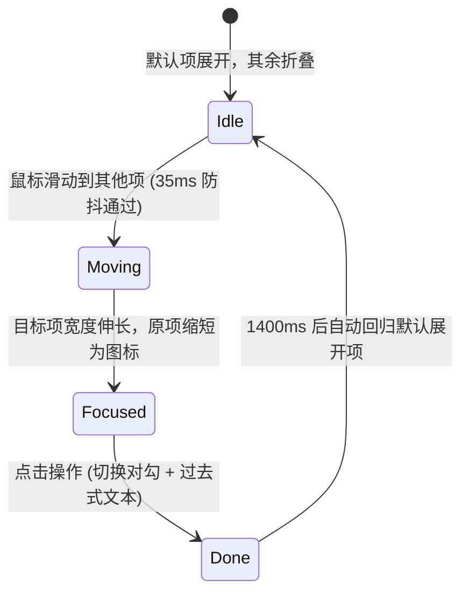

# Expanding Button Group · 展开按钮组

空间紧凑的手风琴式横向伸展按钮组。默认仅激活项（或首项）完整展开显示“图标 + 文本”，其余各项收缩为纯图标；当光标指向或键盘聚焦于其他项时，目标项横向伸展显露文本，邻近按钮顺畅推移让位。包含四大核心机制：

1. 智能测量手风琴展开（Accordion Expansion）：通过测量各状态文本的最宽预留尺寸，动态计算并驱动当前项的 `width`，带 4px 移动滞后保护与 35ms 意图防抖。
2. 高阶弹簧曲线（Linear Spring Curve）：采用高保真采样弹簧缓动，并提供标准贝塞尔曲线作为浏览器兼容回退。
3. 动作确认与对勾书写（Action Done & DrawnCheck）：点击某项时切换为 `done` 状态，图标旋转变为绿色对勾，文字原地切换为过去分词（如 Reply → Replied），1400ms 后平滑还原。
4. 全键盘 Roving Tabindex 巡航：方向键左右巡航并在项间同步切换展开状态。

## 原型清单

| 原型分组 | 原型元素 | 动效 / 状态变化 | 去向 |
| --- | --- | --- | --- |
| Message actions | 按钮组托盘 `.ebg-group` | 承载手风琴伸展平移与圆角外壳 | 智能测量手风琴展开 |
| Message actions | Reply 子项（`data-id="reply"`） | 默认展开；点击切 Replied + 对勾书写 | 智能测量手风琴展开 + 动作确认与对勾书写 |
| Message actions | Forward / Archive 子项 | 默认纯图标收缩；悬停/聚焦展开为文字；点击切对勾 | 智能测量手风琴展开 + 动作确认与对勾书写 |
| Message actions | Delete 危险子项（`data-tone="danger"`） | 危险色悬停底色与文字色；伸展展开 | 智能测量手风琴展开 |
| Document actions | 第二行整组（Publish, Duplicate, Pin, Delete） | 同上机制 | 智能测量手风琴展开 |
| — | 底部提示文案 `.hint-text` | 静态说明 | 演示外壳，已删除 |
| — | 顶栏、主题切换按钮、D 快捷键、舞台卡片、embed/postMessage 检测 | — | 演示外壳，已删除 |

## 适用

- 页面横向空间有限，但又需要同时容纳 3~5 个高频操作（例如消息卡片悬浮操作栏）。
- 希望界面视觉极度精炼干净，仅在用户发生明确交互意图（指向或聚焦）时才动态拓展文字提示。
- 允许组件整体或局部产生横向伸缩动效。

## 不适用

- 所有按钮必须永久常驻显示文字的静态工具栏 → [button-group](button-group.md)
- 仅通过浮动 Tooltip 显示文字说明，按钮自身尺寸保持不变 → [floating-button-group](floating-button-group.md)
- 主动作带独立下拉菜单的分割结构 → [split-button](split-button.md)

## 状态机



## 最小 DOM

```html
<div role="toolbar" aria-label="Actions" aria-orientation="horizontal" class="ebg-group md">
  <!-- 项 1: 默认展开项 -->
  <button type="button" class="ebg-item" data-id="reply" data-expanded="true" aria-label="Reply" tabindex="0">
    <span class="icon-slot" aria-hidden="true">
      <span class="glyph glyph-normal">
        <svg viewBox="0 0 24 24"><path d="M20 18v-2a4 4 0 0 0-4-4H4"/><path d="m9 17-5-5 5-5"/></svg>
      </span>
      <span class="glyph glyph-check">
        <svg viewBox="0 0 24 24"><path class="drawn-check-path" d="M4 12.5l5 5L20 6.5"/></svg>
      </span>
    </span>
    <span class="label-slot" aria-hidden="true">
      <span class="word text-rest">Reply</span>
      <span class="sizer">Reply</span>
      <span class="sizer">Replied</span>
    </span>
  </button>

  <!-- 项 2: 默认折叠项 -->
  <button type="button" class="ebg-item" data-id="archive" aria-label="Archive" tabindex="-1">
    <span class="icon-slot" aria-hidden="true">
      <span class="glyph glyph-normal">
        <svg viewBox="0 0 24 24"><rect width="20" height="5" x="2" y="3" rx="1"/><path d="M4 8v11a2 2 0 0 0 2 2h12a2 2 0 0 0 2-2V8"/><path d="M10 12h4"/></svg>
      </span>
      <span class="glyph glyph-check">
        <svg viewBox="0 0 24 24"><path class="drawn-check-path" d="M4 12.5l5 5L20 6.5"/></svg>
      </span>
    </span>
    <span class="label-slot" aria-hidden="true">
      <span class="word text-rest">Archive</span>
      <span class="sizer">Archive</span>
      <span class="sizer">Archived</span>
    </span>
  </button>
</div>
```

- `.ebg-group`：弹性横向排列托盘。
- `.ebg-item`：子按钮，通过 JS 计算的 inline `style.width` 执行伸展与折叠。
- `.label-slot`：包含实际显示的 `.word` 和两份隐藏的 `.sizer` 测绘文本。
- `.glyph-normal` / `.glyph-check`：常规图标与动作确认完成对勾。

## 参数

| 名称 | 值 | 用于 | 来源 |
| --- | --- | --- | --- |
| 按钮伸展弹簧曲线 | `linear(0 0%, ... 1 100%)`；回退 `cubic-bezier(0.16, 1, 0.3, 1)` | `width` 伸长缩短 | 原型 |
| 按钮伸展时长 | `420ms` | `--duration-morph` | 原型 |
| 文本透明度与位移 | `240ms` / `cubic-bezier(0.22, 1, 0.36, 1)` | `.label-slot` | 原型 |
| 光标意图防抖延时 | `35ms` | 快速划过不触发跳变 | 原型 |
| 对勾书写动画 | `240ms` / `stroke-dashoffset: 24 -> 0` | `.drawn-check-path` | 原型 |
| 动作完成保持时长 | `1400ms` | 保持 `done` 状态后自动重置 | 原型 |

## CSS

```css
.ebg-group {
  --motion-duration-fast: 160ms;
  --motion-duration-standard: 240ms;
  --motion-duration-morph: 420ms;
  --motion-ease-standard: cubic-bezier(0.22, 1, 0.36, 1);
  --motion-ease-spring-fallback: cubic-bezier(0.16, 1, 0.3, 1);
  --motion-ease-morph-spring: linear(
    0 0%, 0.0258 2.78%, 0.09 5.56%, 0.1763 8.33%, 0.2732 11.11%,
    0.3724 13.89%, 0.4683 16.67%, 0.5573 19.44%, 0.6376 22.22%,
    0.7082 25%, 0.7689 27.78%, 0.8202 30.56%, 0.8628 33.33%,
    0.8976 36.11%, 0.9256 38.89%, 0.9476 41.67%, 0.9648 44.44%,
    0.9778 47.22%, 0.9875 50%, 0.9945 52.78%, 0.9994 55.56%,
    1.0026 58.33%, 1.0047 61.11%, 1.0058 63.89%, 1.0062 66.67%,
    1.0062 69.44%, 1.0059 72.22%, 1.0055 75%, 1.0049 77.78%,
    1.0043 80.56%, 1.0036 83.33%, 1.0031 86.11%, 1.0025 88.89%,
    1.002 91.67%, 1.0016 94.44%, 1.0013 97.22%, 1 100%
  );

  display: inline-flex;
  align-items: center;
  gap: 3px;
  padding: 3px;
  border-radius: 9999px;
  background: var(--surface-raised, rgba(255, 255, 255, 0.92));
  border: 1px solid var(--border, rgba(0, 0, 0, 0.08));
  box-shadow: 0 4px 14px rgba(0, 0, 0, 0.05);
  user-select: none;
}

.ebg-item {
  position: relative;
  display: inline-flex;
  align-items: center;
  justify-content: flex-start;
  height: 36px;
  padding: 0 10px;
  border-radius: 9999px;
  border: none;
  background: transparent;
  color: var(--foreground, #111111);
  font-size: 13px;
  font-weight: 500;
  cursor: pointer;
  overflow: hidden;
  outline: none;
  box-sizing: border-box;

  /* 优雅弹簧回退写法：先声明标准贝塞尔，支持 linear() 的浏览器覆写 */
  transition:
    width var(--motion-duration-morph) var(--motion-ease-spring-fallback),
    background-color var(--motion-duration-fast) var(--motion-ease-standard);
  transition-timing-function: var(--motion-ease-morph-spring), var(--motion-ease-standard);
  will-change: width;
}

.ebg-item:hover,
.ebg-item:focus-visible {
  background-color: var(--surface-muted, rgba(0, 0, 0, 0.05));
}

.ebg-item[data-expanded] {
  background-color: var(--surface-active, rgba(0, 0, 0, 0.08));
}

/* 图标插槽 */
.icon-slot {
  width: 16px;
  height: 16px;
  position: relative;
  display: inline-flex;
  align-items: center;
  justify-content: center;
  flex-shrink: 0;
}

.glyph {
  position: absolute;
  inset: 0;
  display: flex;
  align-items: center;
  justify-content: center;
  transition:
    transform var(--motion-duration-standard) var(--motion-ease-standard),
    opacity var(--motion-duration-fast) var(--motion-ease-standard);
}

.glyph-normal {
  opacity: 1;
  transform: scale(1);
}

.glyph-check {
  opacity: 0;
  transform: scale(0.6) rotate(-15deg);
  color: var(--success, #16a34a);
}

.drawn-check-path {
  stroke-dasharray: 24;
  stroke-dashoffset: 24;
  stroke-width: 2;
  stroke: currentColor;
  fill: none;
  stroke-linecap: round;
  stroke-linejoin: round;
}

/* 状态切换为 done */
.ebg-item[data-state="done"] .glyph-normal {
  opacity: 0;
  transform: scale(0.6) rotate(15deg);
}

.ebg-item[data-state="done"] .glyph-check {
  opacity: 1;
  transform: scale(1) rotate(0deg);
}

.ebg-item[data-state="done"] .drawn-check-path {
  stroke-dashoffset: 0;
  transition: stroke-dashoffset 240ms var(--motion-ease-standard) 50ms;
}

/* 文本插槽与展开平移 */
.label-slot {
  position: relative;
  display: inline-flex;
  align-items: center;
  margin-left: 8px;
  white-space: nowrap;
  overflow: hidden;
  opacity: 0;
  transform: translateX(-4px);
  transition:
    opacity var(--motion-duration-standard) var(--motion-ease-standard),
    transform var(--motion-duration-standard) var(--motion-ease-standard);
}

.ebg-item[data-expanded] .label-slot {
  opacity: 1;
  transform: translateX(0);
}

.sizer {
  visibility: hidden;
  height: 0;
  pointer-events: none;
  display: block;
}

/* 减少动态效果 */
@media (prefers-reduced-motion: reduce) {
  .ebg-item {
    transition: none !important;
  }
  .label-slot {
    transform: none !important;
  }
  .drawn-check-path {
    stroke-dashoffset: 0 !important;
    transition: none !important;
  }
}
```

## JS

```js
/**
 * 展开按钮组控制器
 * @param {HTMLElement} group 按钮组容器
 * @param {Object} [options]
 * @param {string} [options.defaultId] 默认展开项的 data-id
 * @param {number} [options.hold=1400] 成功态保持时长
 */
function createExpandingButtonGroup(group, { defaultId = null, hold = 1400 } = {}) {
  const items = Array.from(group.querySelectorAll('.ebg-item'));
  const defaultItem = (defaultId ? items.find(it => it.dataset.id === defaultId) : null) || items[0];

  let currentActive = null;
  let doneItem = null;
  let hoverTimer = null;
  let doneTimer = null;

  // 测量计算某项完整展开所需的像素宽度
  function calculateExpandedWidth(item) {
    const sizers = Array.from(item.querySelectorAll('.sizer'));
    let maxTextWidth = 0;
    sizers.forEach(sz => {
      const w = sz.getBoundingClientRect().width;
      if (w > maxTextWidth) maxTextWidth = w;
    });
    // 基础固定宽度：左右 padding (20px) + 图标宽 (16px) + 图标文本间距 (8px) + 文本最大宽度 + 缓冲 (4px)
    return Math.ceil(44 + maxTextWidth + 4);
  }

  const collapsedWidth = 36; // 折叠时的正方形/圆形宽度 (与高度相同)

  function applyLayout(activeItem) {
    currentActive = activeItem;
    items.forEach(it => {
      if (it === activeItem) {
        it.setAttribute('data-expanded', 'true');
        it.tabIndex = 0;
        const targetW = calculateExpandedWidth(it);
        it.style.width = `${targetW}px`;
      } else {
        it.removeAttribute('data-expanded');
        it.tabIndex = -1;
        it.style.width = `${collapsedWidth}px`;
      }
    });
  }

  // 初始化布局
  applyLayout(defaultItem);

  // 鼠标交互与 35ms 意图防抖
  group.addEventListener('pointermove', (e) => {
    const target = e.target.closest('.ebg-item');
    if (!target || target === currentActive) return;
    clearTimeout(hoverTimer);
    hoverTimer = setTimeout(() => {
      applyLayout(target);
    }, 35);
  });

  group.addEventListener('pointerleave', (e) => {
    if (e.pointerType !== 'mouse') return;
    clearTimeout(hoverTimer);
    applyLayout(doneItem || defaultItem);
  });

  // 点击触发完成态
  items.forEach(item => {
    item.addEventListener('focus', () => {
      clearTimeout(hoverTimer);
      applyLayout(item);
    });

    item.addEventListener('click', () => {
      if (item.dataset.state === 'done') return;
      clearTimeout(doneTimer);
      if (doneItem) {
        doneItem.dataset.state = 'idle';
      }

      item.dataset.state = 'done';
      doneItem = item;
      const word = item.querySelector('.word');
      const origText = word.textContent;
      const sizers = Array.from(item.querySelectorAll('.sizer'));
      if (sizers.length > 1) {
        word.textContent = sizers[1].textContent;
      }

      doneTimer = setTimeout(() => {
        item.dataset.state = 'idle';
        word.textContent = origText;
        doneItem = null;
        applyLayout(defaultItem);
      }, hold);
    });
  });

  // 键盘方向键巡航
  group.addEventListener('keydown', (e) => {
    const idx = items.indexOf(document.activeElement);
    if (idx === -1) return;
    if (e.key === 'ArrowRight') {
      e.preventDefault();
      const next = items[(idx + 1) % items.length];
      next.focus();
      applyLayout(next);
    } else if (e.key === 'ArrowLeft') {
      e.preventDefault();
      const prev = items[(idx - 1 + items.length) % items.length];
      prev.focus();
      applyLayout(prev);
    }
  });

  return {
    expand: (id) => {
      const it = items.find(x => x.dataset.id === id);
      if (it) applyLayout(it);
    },
    destroy: () => {
      clearTimeout(hoverTimer);
      clearTimeout(doneTimer);
    }
  };
}
```

## 接入目标项目

- 状态来源：点击动作触发具体的业务逻辑，组件自主控制展开收缩与动画反馈。
- 尺寸策略：按钮组通过动态设置每个子按钮的 `style.width` 完成手风琴过渡，外层容器宽度会随之自然微调。若外层容器宽度固定，收缩与展开此消彼长，总宽度守恒。
- 驱动方式：组件挂载时调用 `createExpandingButtonGroup(group)`，卸载时调用 `destroy()`。

## 重入与清理

- 连续在多个按钮间极速划过时，35ms 防抖计时器持续刷新，仅在光标稳定落在目标上时触发宽度过渡，杜绝剧烈频繁抖动。
- 组件销毁时彻底注销两个延时定时器。

## 减少动态效果

- 开启系统的减少动态效果时，停用按钮的所有 `width` 过渡与弹簧插值，直接呈现即时尺寸变化与纯透明度切换。

## 焦点与键盘

- 采用标准的 Roving Tabindex，方向键左右无缝切换聚焦项，聚焦项获得焦点同时自动伸展显示文字。

## 兼容回退

| 特性 | 不支持时 |
| --- | --- |
| `linear(...)` 弹簧缓动 | CSS 中已先置声明 `cubic-bezier(0.16, 1, 0.3, 1)` 标准三次方贝塞尔曲线，老旧浏览器自动采用平滑贝塞尔曲线回退，动画效果依然顺滑。 |

## 验收清单

- [ ] 初始化时默认激活项完整展示文字，其余项折叠为正圆/方角图标。
- [ ] 鼠标移入其他折叠项时，目标项顺畅向外弹簧伸长展现文字，旧项同步收短，相邻项平滑平移让位。
- [ ] 鼠标离开按钮组后，自动复原至默认展开项。
- [ ] 点击某项时触发对勾笔触书写动画，文字切换为完成态分词，1400ms 后自动复原。
- [ ] 键盘左右方向键平滑导航，焦点与展开状态严格同步。
- [ ] 开启系统的“减少动态效果”：取消所有平移和伸长动画，尺寸即时切换。
