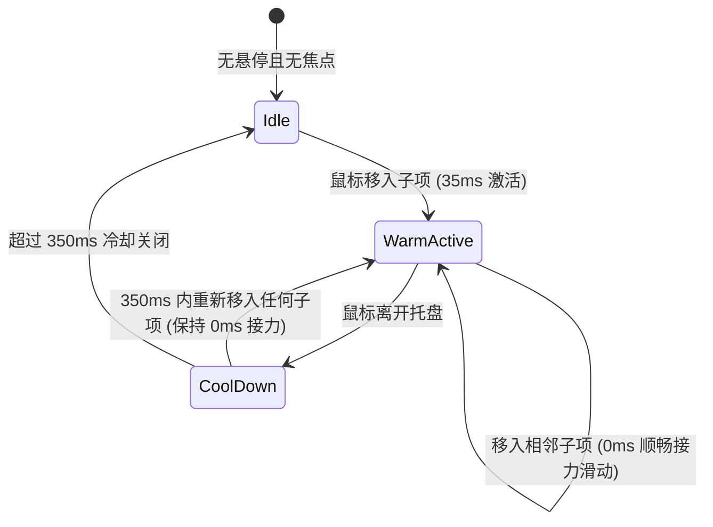

# Floating Button Group · 浮动工具栏组

适用于画布控制、文档工具栏、消息浮动操作的高质感多按钮悬浮工具组。包含四大核心动效机制：

1. 智能单例 Tooltip（Smart Warm Tooltip）：全局单例气泡，带快捷键徽标 `<kbd>`；首次悬停 35ms 微延时唤出，并在 350ms 预热窗口期内实现跨按钮 0ms 瞬间平滑滑动接力。
2. 弹性悬浮高光（Gliding Highlight）：高光药丸在子项移动时自适应长宽尺寸与坐标平滑滑动形变；按压时即刻加深底色；移出时原地渐隐。
3. 巡航焦点导航（Roving Tabindex）：遵循 WAI-ARIA Toolbar 规范，使用方向键在工具项间穿梭焦点，自动联动高光与 Tooltip，保证全键盘无障碍操作。
4. 原位 Sizer 尺寸防抖：多态反馈按钮（如 Share → Copied）使用隐形占位节点提前撑开槽位宽度，切换文案绝不发生抖动挤压。

## 原型清单

| 原型分组 | 原型元素 | 动效 / 状态变化 | 去向 |
| --- | --- | --- | --- |
| Editor actions (md) | 顶部主工具栏 `#trayEditor` | 承载水平高光与工具子项 | 浮动工具栏底座 + 弹性悬浮高光 |
| Editor actions | Share 按钮（`#btnShareItem`） | 嵌入 Share / Copied 双态 Sizer，点击切文案与图标 | 原位 Sizer 尺寸防抖 |
| Editor actions | Undo / Comment / Present 等子项 | 悬停高光贴合；Tooltip 浮现展示说明与快捷键 | 智能单例 Tooltip + 弹性悬浮高光 |
| Canvas tools (vertical) | 左侧纵向工具栏 `#trayVertical` | 垂直高光跟随、垂直方向键导航 | 巡航焦点导航 + 弹性悬浮高光 |
| Message actions (sm) | 右侧悬浮操作栏 `#trayMessage` | 紧凑型尺寸 sm，带毛玻璃浮动底板 | 浮动工具栏底座 |
| — | 全局 Tooltip 浮层 `#globalTooltip` | 智能预热、弹性位移与淡入淡出 | 智能单例 Tooltip |
| — | 底部提示文案 `.hint-text` | 静态说明 | 演示外壳，已删除 |
| — | 顶栏、主题切换按钮、D 快捷键、舞台卡片、embed/postMessage 检测 | — | 演示外壳，已删除 |

## 适用

- 悬浮在页面或画布特定区域的多功能动作托盘（Toolbar）。
- 按钮需要展示功能说明及快捷键提示，且希望在邻近按钮切换时提示框如丝般连贯滑动，拒绝频繁闪烁销毁。
- 需要完全符合桌面级规范的键盘方向键导航与焦点管理。

## 不适用

- 主次操作紧密结合的一体化下拉胶囊 → [split-button](split-button.md)
- 普通内嵌在表单或弹窗内的基础按钮组 → [button-group](button-group.md)
- 点击后抽屉式向外展开子项的折叠按钮组 → [expanding-button-group](expanding-button-group.md)

## 状态机



## 最小 DOM

```html
<!-- 水平/垂直浮动工具栏容器 -->
<div role="toolbar" aria-label="Editor actions" aria-orientation="horizontal" class="fbg-group md" data-variant="muted">
  <!-- 共享高光药丸 -->
  <div class="fbg-highlight" aria-hidden="true"></div>

  <!-- 工具项 1: 普通图标按钮 -->
  <button type="button" class="fbg-item" aria-label="Undo" data-tip="Undo" data-shortcut="⌘Z" tabindex="0">
    <span class="fbg-slot">
      <span class="fbg-phase">
        <svg class="fbg-icon" viewBox="0 0 24 24"><path d="M9 14 4 9l5-5"/><path d="M4 9h10.5a5.5 5.5 0 0 1 5.5 5.5 5.5 5.5 0 0 1-5.5 5.5H11"/></svg>
      </span>
    </span>
  </button>

  <!-- 工具项 2: 禁用状态项 -->
  <button type="button" class="fbg-item" aria-label="Redo" aria-disabled="true" data-tip="Redo" data-shortcut="⌘⇧Z" tabindex="-1">
    <span class="fbg-slot">
      <span class="fbg-phase">
        <svg class="fbg-icon" viewBox="0 0 24 24"><path d="m15 14 5-5-5-5"/><path d="M20 9H9.5A5.5 5.5 0 0 0 4 14.5A5.5 5.5 0 0 0 9.5 20H13"/></svg>
      </span>
    </span>
  </button>

  <span class="fbg-separator" role="separator" aria-orientation="vertical"></span>

  <!-- 工具项 3: 带有 Sizer 防抖的文本按钮 -->
  <button type="button" class="fbg-item" aria-label="Share" tabindex="-1">
    <span class="fbg-slot">
      <span class="fbg-ghost" aria-hidden="true"><span class="fbg-iconSpace"></span><span class="fbg-text">Share</span></span>
      <span class="fbg-ghost" aria-hidden="true"><span class="fbg-iconSpace"></span><span class="fbg-text">Copied</span></span>
      <span class="fbg-phase">
        <svg class="fbg-icon" viewBox="0 0 24 24"><path d="M9 17H7A5 5 0 0 1 7 7h2"/><path d="M15 7h2a5 5 0 1 1 0 10h-2"/><line x1="8" x2="16" y1="12" y2="12"/></svg>
        <span class="fbg-text">Share</span>
      </span>
    </span>
  </button>
</div>

<!-- 全局共享单例 Tooltip 浮层 (建议置于 body 底部) -->
<div class="fbg-tooltip" role="tooltip" aria-hidden="true"></div>
```

## 参数

| 名称 | 值 | 用于 | 来源 |
| --- | --- | --- | --- |
| 高光跨项滑动时长 | `400ms` / `cubic-bezier(0.16, 1, 0.3, 1)` | `.fbg-highlight.fbg-morphing` | 原型 |
| 高光首次入场时长 | `260ms` / `cubic-bezier(0.18, 0.89, 0.32, 1.12)` | `.fbg-highlight.fbg-entering` | 原型 |
| 高光按下过渡 | `120ms` | `.fbg-highlight.pressing` | 原型 |
| Tooltip 首次唤出延时 | `35ms` | 鼠标停留后快速出现 | 原型 |
| Tooltip 预热保持窗口 | `350ms` | 离开发生后在此时间内重新移入直接 0ms 瞬间接力 | 原型 |
| Tooltip 滑动跟随过渡 | `280ms` / `cubic-bezier(0.16, 1, 0.3, 1)` | 跨按钮移动时的 transform 平滑插值 | 原型 |

## CSS

```css
.fbg-group {
  --motion-duration-instant: 120ms;
  --motion-duration-fast: 160ms;
  --motion-duration-morph: 400ms;
  --motion-duration-snappy: 260ms;
  --motion-ease-enter: cubic-bezier(0.16, 1, 0.3, 1);
  --motion-ease-standard: cubic-bezier(0.22, 1, 0.36, 1);
  --motion-ease-morph: cubic-bezier(0.16, 1, 0.3, 1);
  --motion-ease-snappy: cubic-bezier(0.18, 0.89, 0.32, 1.12);

  position: relative;
  display: inline-flex;
  align-items: center;
  gap: 2px;
  padding: 4px;
  border-radius: 9999px;
  background: var(--surface-raised, rgba(255, 255, 255, 0.9));
  border: 1px solid var(--border, rgba(0, 0, 0, 0.08));
  box-shadow: 0 4px 16px rgba(0, 0, 0, 0.06);
  user-select: none;
  isolation: isolate;
}

.fbg-group[aria-orientation="vertical"] {
  flex-direction: column;
}

/* 高光滑块 */
.fbg-highlight {
  position: absolute;
  top: 0;
  left: 0;
  border-radius: 9999px;
  pointer-events: none;
  z-index: 1;
  opacity: 0;
  background-color: var(--surface-muted, rgba(0, 0, 0, 0.06));
  transition:
    background-color var(--motion-duration-fast) var(--motion-ease-standard),
    opacity var(--motion-duration-fast) var(--motion-ease-standard);
  will-change: transform, width, height, opacity;
}

.fbg-highlight.active {
  opacity: 1;
}

.fbg-highlight.pressing {
  background-color: var(--surface-active, rgba(0, 0, 0, 0.12));
  transition-duration: var(--motion-duration-instant);
}

.fbg-highlight.fbg-morphing {
  transition:
    transform var(--motion-duration-morph) var(--motion-ease-morph),
    width var(--motion-duration-morph) var(--motion-ease-morph),
    height var(--motion-duration-morph) var(--motion-ease-morph),
    background-color var(--motion-duration-fast) var(--motion-ease-standard),
    opacity var(--motion-duration-fast) var(--motion-ease-standard);
}

.fbg-highlight.fbg-entering {
  transition:
    transform var(--motion-duration-snappy) var(--motion-ease-snappy),
    opacity var(--motion-duration-fast) var(--motion-ease-standard),
    background-color var(--motion-duration-fast) var(--motion-ease-standard);
}

/* 工具栏子项 */
.fbg-item {
  position: relative;
  display: inline-flex;
  align-items: center;
  justify-content: center;
  height: 32px;
  padding: 0 8px;
  border: none;
  background: transparent;
  color: var(--foreground, #111111);
  border-radius: 9999px;
  cursor: pointer;
  z-index: 2;
  outline: none;
  font-size: 13px;
  font-weight: 500;
  white-space: nowrap;
}

.fbg-item[aria-disabled="true"] {
  opacity: 0.35;
  cursor: not-allowed;
}

.fbg-slot {
  display: inline-grid;
  grid-template-areas: 'overlap';
  align-items: center;
}

.fbg-ghost {
  grid-area: overlap;
  visibility: hidden;
  display: inline-flex;
  align-items: center;
  gap: 6px;
}

.fbg-phase {
  grid-area: overlap;
  display: inline-flex;
  align-items: center;
  gap: 6px;
}

.fbg-icon {
  width: 15px;
  height: 15px;
  stroke-width: 2;
}

.fbg-separator {
  width: 1px;
  height: 16px;
  background: var(--border, rgba(0, 0, 0, 0.08));
  margin: 0 2px;
}

/* 单例全局气泡 Tooltip */
.fbg-tooltip {
  position: fixed;
  top: 0;
  left: 0;
  z-index: 1000;
  display: inline-flex;
  align-items: center;
  gap: 6px;
  padding: 4px 8px;
  font-size: 11px;
  font-weight: 500;
  color: #ffffff;
  background: rgba(15, 15, 15, 0.92);
  backdrop-filter: blur(12px);
  border-radius: 6px;
  box-shadow: 0 4px 12px rgba(0, 0, 0, 0.15);
  pointer-events: none;
  opacity: 0;
  transform: translate3d(0, 0, 0) scale(0.96);
  filter: blur(2px);
  transition:
    opacity 160ms var(--motion-ease-standard),
    filter 160ms var(--motion-ease-standard),
    transform 160ms var(--motion-ease-standard);
  will-change: transform, opacity;
}

.fbg-tooltip.is-visible {
  opacity: 1;
  transform: translate3d(0, 0, 0) scale(1);
  filter: blur(0);
}

.fbg-tooltip.is-moving {
  transition:
    transform 280ms var(--motion-ease-morph),
    opacity 160ms var(--motion-ease-standard);
}

.fbg-tooltip kbd {
  font-family: inherit;
  font-size: 10px;
  color: rgba(255, 255, 255, 0.6);
  padding: 1px 4px;
  border-radius: 3px;
  background: rgba(255, 255, 255, 0.15);
}

/* 减少动态效果 */
@media (prefers-reduced-motion: reduce) {
  .fbg-highlight.fbg-morphing,
  .fbg-highlight.fbg-entering,
  .fbg-tooltip.is-moving {
    transition: none !important;
  }
}
```

## JS

```js
/**
 * 创建浮动工具栏控制器（集成高光跟随、单例 Tooltip、Roving Tabindex）
 * @param {HTMLElement} tray 工具栏 DOM 节点
 * @param {HTMLElement} [tooltipEl] 全局单例 Tooltip DOM 节点
 */
function createFloatingButtonGroup(tray, tooltipEl = null) {
  const highlight = tray.querySelector('.fbg-highlight');
  const items = Array.from(tray.querySelectorAll('.fbg-item'));
  const isVertical = tray.getAttribute('aria-orientation') === 'vertical';

  let currentTarget = null;
  let isVisible = false;
  let isPressing = false;

  // Tooltip 预热机制
  let tipTimer = null;
  let activeWarmTimer = null;
  let isTipActive = false;

  function measure(target) {
    const outer = tray.getBoundingClientRect();
    const box = target.getBoundingClientRect();
    return {
      left: box.left - outer.left,
      top: box.top - outer.top,
      width: box.width,
      height: box.height
    };
  }

  function place(target, mode) {
    if (!target || target.getAttribute('aria-disabled') === 'true') {
      fadeLeave();
      return;
    }

    const rect = measure(target);
    const wasVisible = isVisible;
    isVisible = true;
    currentTarget = target;

    highlight.style.transform = `translate3d(${rect.left}px, ${rect.top}px, 0)`;
    highlight.style.width = `${rect.width}px`;
    highlight.style.height = `${rect.height}px`;

    let cls = 'fbg-highlight active';
    if (isPressing) cls += ' pressing';
    if (wasVisible && mode === 'move') {
      cls += ' fbg-morphing';
    } else {
      cls += ' fbg-entering';
    }
    highlight.className = cls;
  }

  function fadeLeave() {
    if (!isVisible) return;
    isVisible = false;
    currentTarget = null;
    isPressing = false;
    highlight.className = 'fbg-highlight';
  }

  // Tooltip 处理
  function renderTooltip(target, isMoving = false) {
    if (!tooltipEl) return;
    const tipText = target.dataset.tip;
    if (!tipText) {
      dismissTooltip();
      return;
    }
    const shortcut = target.dataset.shortcut;
    tooltipEl.innerHTML = `<span>${tipText}</span>${shortcut ? `<kbd>${shortcut}</kbd>` : ''}`;

    const r = target.getBoundingClientRect();
    const tipW = tooltipEl.offsetWidth || 80;
    const tipH = tooltipEl.offsetHeight || 26;

    let x, y;
    if (isVertical) {
      x = r.right + 8;
      y = r.top + (r.height - tipH) / 2;
    } else {
      x = r.left + (r.width - tipW) / 2;
      y = r.bottom + 8;
    }

    tooltipEl.style.transform = `translate3d(${x}px, ${y}px, 0)`;
    tooltipEl.className = 'fbg-tooltip is-visible' + (isMoving ? ' is-moving' : '');
    isTipActive = true;
  }

  function queueTooltip(target, immediate = false) {
    clearTimeout(tipTimer);
    clearTimeout(activeWarmTimer);
    if (immediate || isTipActive) {
      renderTooltip(target, isTipActive);
    } else {
      tipTimer = setTimeout(() => renderTooltip(target, false), 35);
    }
  }

  function dismissTooltip() {
    clearTimeout(tipTimer);
    if (tooltipEl) tooltipEl.className = 'fbg-tooltip';
    clearTimeout(activeWarmTimer);
    activeWarmTimer = setTimeout(() => {
      isTipActive = false;
    }, 350);
  }

  // 键盘 Roving Tabindex 巡航
  function focusItem(item) {
    items.forEach(it => it.setAttribute('tabindex', it === item ? '0' : '-1'));
    item.focus();
    place(item, 'move');
    queueTooltip(item, true);
  }

  items.forEach(item => {
    item.addEventListener('mouseenter', () => {
      place(item, currentTarget ? 'move' : 'enter');
      queueTooltip(item);
    });
    item.addEventListener('focus', () => {
      place(item, 'move');
      queueTooltip(item, true);
    });
    item.addEventListener('blur', () => dismissTooltip());
    item.addEventListener('pointerdown', (e) => {
      if (e.button === 0 && item.getAttribute('aria-disabled') !== 'true') {
        isPressing = true;
        place(item, 'move');
      }
    });
  });

  window.addEventListener('pointerup', () => {
    if (isPressing) {
      isPressing = false;
      if (currentTarget) place(currentTarget, 'move');
    }
  });

  tray.addEventListener('mouseleave', () => {
    fadeLeave();
    dismissTooltip();
  });

  tray.addEventListener('keydown', (e) => {
    const usable = items.filter(it => it.getAttribute('aria-disabled') !== 'true');
    const idx = usable.indexOf(document.activeElement);
    if (idx === -1) return;

    const prevKey = isVertical ? 'ArrowUp' : 'ArrowLeft';
    const nextKey = isVertical ? 'ArrowDown' : 'ArrowRight';

    if (e.key === nextKey) {
      e.preventDefault();
      focusItem(usable[(idx + 1) % usable.length]);
    } else if (e.key === prevKey) {
      e.preventDefault();
      focusItem(usable[(idx - 1 + usable.length) % usable.length]);
    } else if (e.key === 'Home') {
      e.preventDefault();
      focusItem(usable[0]);
    } else if (e.key === 'End') {
      e.preventDefault();
      focusItem(usable[usable.length - 1]);
    }
  });

  return {
    destroy: () => {
      fadeLeave();
      dismissTooltip();
    }
  };
}
```

## 接入目标项目

- 状态来源：子按钮自身触发原生 click 事件，工具栏高光与气泡均基于事件委托与 DOM 状态自闭环运作。
- 尺寸策略：按钮可带文字亦可纯图标，文案有变化时配合 `.fbg-slot` 和 `.fbg-ghost` 预先固定尺寸。
- 驱动方式：组件挂载后执行 `createFloatingButtonGroup(tray, tooltipEl)`，卸载时执行 `destroy()`。

## 重入与清理

- 预热计时器与 Tooltip 动画帧自管理，组件卸载时取消全部延迟器，移除悬浮 Tooltip DOM 节点上的类名。

## 减少动态效果

- 激活 `prefers-reduced-motion: reduce` 时，高光及 Tooltip 的横向/纵向滑动插值被停用，直接完成位置吸附与淡入淡出。

## 焦点与键盘

- 全面支持符合 W3C 标准的 Roving Tabindex。方向键在可用项之间循环巡回，自动忽略 `aria-disabled="true"` 的项；按键切换项时实时把焦点同步移动到对应 DOM 上。

## 兼容回退

原生标准 DOM 属性，全现代浏览器支持，无需额外 Polyfill。

## 验收清单

- [ ] 鼠标在工具栏子项间划过时，高光药丸平滑伸缩移动贴合。
- [ ] 停留 35ms 唤出带有快捷键的深色气泡；350ms 内移向相邻项时气泡不闪烁消失，而是 0ms 瞬间接力平滑移动。
- [ ] 鼠标按下项时高光颜色加深。
- [ ] 使用键盘左右/上下方向键能够顺畅巡航焦点，高光及气泡跟随焦点移动。
- [ ] 离开工具栏后高光及气泡顺畅淡出。
- [ ] 系统减少动态效果开启后，高光与气泡位移动画关闭，直接就地显隐。
