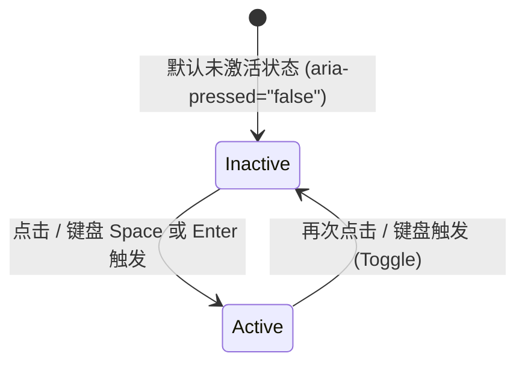

# Icon Morph · 图标形变按钮

通过 SVG 矢量几何形变实现状态流转的图标交互集合。避免了传统直接替换图标的生硬视觉跳跃，通过平滑的矢量形态过渡、遮罩移位与笔触擦除传达前后状态的连续性。涵盖 8 类微动效机制：

1. 汉堡折叠 (Menu ↔ Close)：三线平移旋转形变，中线淡出收缩。
2. 播放状态 (Play ↔ Pause)：SVG `d` 路径数据插值连续变形。
3. 添加清单 (Plus ↔ Check)：十字笔触插值变形为长短勾，伴随成功色彩过渡。
4. 复制确认 (Copy ↔ Check)：双卡片折叠淡出，绿色矢量描边笔触延时画出 (`stroke-dashoffset`)。
5. 昼夜模式 (Sun ↔ Moon)：SVG 遮罩移动裁剪生成月牙，太阳光芒旋转收缩淡出。
6. 折叠展开 (Chevron 180°)：单箭头以几何中心为轴心 180° 翻转。
7. 通知提醒 (Bell Ring & Slash)：多频衰减物理摆动 (`bellSwing`) 与对角斜线划入/划出。
8. 收藏点赞 (Heart Burst)：心形弹跳缩放 (`heartPop`)、环形膨胀波纹 (`burstRing`) 与 7 向粒子溅射 (`sparkBurst`)。

## 原型清单

| 原型分组 | 原型元素 | 动效 / 状态变化 | 去向 |
| --- | --- | --- | --- |
| 4 列网格卡片 | 汉堡菜单卡片 `#cardMenu` | 汉堡三线 ↔ 叉号关闭平移旋转 | 汉堡折叠机制 |
| 4 列网格卡片 | 播放控制卡片 `#cardPlay` | 双梯形/矩形路径插值形态变形 | 播放状态机制 |
| 4 列网格卡片 | 添加清单卡片 `#cardPlus` | 十字线 ↔ 勾选线路径变形 + 变绿 | 添加清单机制 |
| 4 列网格卡片 | 复制按钮卡片 `#cardCopy` | 图标缩放淡出 + 绿色对勾动态画出 | 复制确认机制 |
| 4 列网格卡片 | 昼夜模式卡片 `#cardTheme` | 遮罩位移出月牙 + 光芒旋转收敛淡出 | 昼夜模式机制 |
| 4 列网格卡片 | 详情展开卡片 `#cardChevron` | V 字折角箭头 180° 旋转 | 折叠展开机制 |
| 4 列网格卡片 | 通知提醒卡片 `#cardBell` | 铃铛多频阻尼摇摆 + 斜线切入/切出 | 通知提醒机制 |
| 4 列网格卡片 | 收藏点赞卡片 `#cardHeart` | 心形缩放弹跳 + 环形光圈膨胀 + 7 点粒子迸发 | 收藏点赞机制 |
| — | 顶栏与独立切换工具条 `.arc-standalone-bar` | 标题与快捷键 D 切换演示主题 | 演示外壳，已删除 |
| — | 舞台外壳与卡片 `.arc-stage-card` | 演示区域居中与阴影外框 | 演示外壳，已删除 |
| — | 舞台标签栏 `.stage-toolbar` | 预览标签与 "Live · keyboard ready" 提示 | 演示外壳，已删除 |
| — | 宿主嵌入检测与 postMessage 监听 | iframe 适配逻辑 | 演示外壳，已删除 |
| — | 全局失去焦点补丁 `__arc_blur_installed` | 点击后强制执行 blur() | 演示外壳，已删除 |

## 适用

- 具有强对应关系的两态切换操作（播放/暂停、展开/收起、开启/关闭）。
- 操作需要即时、具趣味性的触觉式微动效确认（如点赞、收藏、复制成功）。
- 空间紧凑、无法容纳常驻长文本标签的高频操作栏、浮动工具条或卡片角标。

## 不适用

- 涉及长耗时异步请求及多阶段流转的状态按钮 → [action-button](action-button.md)
- 需要弹窗确认、原地二次确认或倒计时撤销的高风险操作 → [confirm-morph](confirm-morph.md)
- 依赖持续长按以防止误触的破坏性操作 → [hold-to-confirm](../gestures/hold-to-confirm.md)
- 全局系统级昼夜切换需要带动整屏扩散遮罩与跨视图转场 → [theme-switch](theme-switch.md)

## 状态机

8 类图标虽然几何形态变化不同，但均遵循统一的双态触发模型：



| 状态 | 进入条件 | 视觉表现 | 退出到 |
| --- | --- | --- | --- |
| Inactive | 初始加载 / 处于关闭态 | 呈现基础图标形态（菜单三线、播放三角形、十字加号、折叠箭头等） | Active |
| Active | 点击激活 / 处于开启态 | 触发形态插值、旋转翻转、描边划入或粒子爆破；应用激活强调色 | Inactive |

## 最小 DOM

8 种形态的独立最小 DOM 结构如下：

### 1. Menu ↔ Close (汉堡折叠)
```html
<button class="icon-card" type="button" aria-label="Toggle menu" aria-expanded="false">
  <svg class="morph-svg" viewBox="0 0 24 24" aria-hidden="true">
    <line class="menu-line menu-line-top" x1="4" y1="6" x2="20" y2="6" />
    <line class="menu-line menu-line-mid" x1="4" y1="12" x2="20" y2="12" />
    <line class="menu-line menu-line-bot" x1="4" y1="18" x2="20" y2="18" />
  </svg>
  <span class="card-label">Menu</span>
</button>
```

### 2. Play ↔ Pause (播放状态)
```html
<button class="icon-card" type="button" aria-label="Toggle play" aria-pressed="false">
  <svg class="morph-svg" viewBox="0 0 24 24" aria-hidden="true">
    <path class="play-left" d="M7 4.5 L12 7.42 L12 16.58 L7 19.5 Z" />
    <path class="play-right" d="M12 7.42 L19.5 11.8 L19.5 12.2 L12 16.58 Z" />
  </svg>
  <span class="card-label">Paused</span>
</button>
```

### 3. Plus ↔ Check (添加清单)
```html
<button class="icon-card" type="button" aria-label="Add to list" aria-pressed="false">
  <svg class="morph-svg" viewBox="0 0 24 24" aria-hidden="true">
    <path class="plus-leg plus-v" d="M12 5 L12 19" />
    <path class="plus-leg plus-h" d="M5 12 L19 12" />
  </svg>
  <span class="card-label">Add to list</span>
</button>
```

### 4. Copy ↔ Check (复制确认)
```html
<button class="icon-card" type="button" aria-label="Copy command" aria-pressed="false">
  <svg class="morph-svg" viewBox="0 0 24 24" aria-hidden="true">
    <path class="copy-back" d="M4 16c-1.1 0-2-.9-2-2V4c0-1.1.9-2 2-2h10c1.1 0 2 .9 2 2" />
    <rect class="copy-front" x="8" y="8" width="14" height="14" rx="2" />
    <path class="copy-check-stroke" d="M5 12.5 L9.5 17 L19 7.5" />
  </svg>
  <span class="card-label">Copy command</span>
</button>
```

### 5. Sun ↔ Moon (昼夜模式)
```html
<button class="icon-card" type="button" aria-label="Toggle theme" aria-pressed="false">
  <svg class="morph-svg" viewBox="0 0 24 24" aria-hidden="true">
    <defs>
      <mask id="morphMoonMask">
        <rect x="-8" y="-8" width="40" height="40" fill="white" />
        <circle class="moon-shadow-mask" cx="30" cy="-6" r="6.5" fill="black" />
      </mask>
    </defs>
    <circle class="sun-core-crescent" cx="12" cy="12" r="4.5" mask="url(#morphMoonMask)" />
    <g class="sun-rays">
      <line x1="12" y1="2" x2="12" y2="4.5" /><line x1="12" y1="19.5" x2="12" y2="22" />
      <line x1="2" y1="12" x2="4.5" y2="12" /><line x1="19.5" y1="12" x2="22" y2="12" />
      <line x1="4.93" y1="4.93" x2="6.7" y2="6.7" /><line x1="17.3" y1="17.3" x2="19.07" y2="19.07" />
      <line x1="4.93" y1="19.07" x2="6.7" y2="17.3" /><line x1="17.3" y1="6.7" x2="19.07" y2="4.93" />
    </g>
  </svg>
  <span class="card-label">Light</span>
</button>
```

### 6. Chevron (折叠展开)
```html
<button class="icon-card" type="button" aria-label="Toggle details" aria-expanded="false">
  <svg class="morph-svg" viewBox="0 0 24 24" aria-hidden="true">
    <polyline class="chevron-morph" points="6 9 12 15 18 9" />
  </svg>
  <span class="card-label">Show details</span>
</button>
```

### 7. Bell (通知提醒)
```html
<button class="icon-card" type="button" aria-label="Toggle notifications" aria-pressed="false">
  <svg class="morph-svg" viewBox="0 0 24 24" aria-hidden="true">
    <g class="bell-group">
      <path d="M18 8A6 6 0 0 0 6 8c0 7-3 9-3 9h18s-3-2-3-9" />
      <path d="M13.73 21a2 2 0 0 1-3.46 0" />
    </g>
    <line class="bell-slash" x1="4" y1="4" x2="20" y2="20" />
  </svg>
  <span class="card-label">Alerts on</span>
</button>
```

### 8. Heart (收藏点赞)
```html
<button class="icon-card" type="button" aria-label="Like" aria-pressed="false">
  <div class="heart-svg-frame">
    <svg class="morph-svg" viewBox="0 0 24 24" aria-hidden="true">
      <circle class="burst-circle" cx="12" cy="12" r="4" />
      <circle class="spark-dot" cx="12" cy="12" r="1.4" style="--sx: 0; --sy: -1;" />
      <circle class="spark-dot" cx="12" cy="12" r="1.0" style="--sx: 0.782; --sy: -0.624;" />
      <circle class="spark-dot" cx="12" cy="12" r="1.4" style="--sx: 0.975; --sy: 0.223;" />
      <circle class="spark-dot" cx="12" cy="12" r="1.0" style="--sx: 0.434; --sy: 0.901;" />
      <circle class="spark-dot" cx="12" cy="12" r="1.4" style="--sx: -0.434; --sy: 0.901;" />
      <circle class="spark-dot" cx="12" cy="12" r="1.0" style="--sx: -0.975; --sy: 0.223;" />
      <circle class="spark-dot" cx="12" cy="12" r="1.4" style="--sx: -0.782; --sy: -0.624;" />
      <path class="heart-shape" d="M19 14c1.49-1.46 3-3.21 3-5.5A5.5 5.5 0 0 0 16.5 3c-1.76 0-3 .5-4.5 2-1.5-1.5-2.74-2-4.5-2A5.5 5.5 0 0 0 2 8.5c0 2.3 1.5 4.05 3 5.5l7 7Z" />
    </svg>
  </div>
  <span class="card-label">128 likes</span>
</button>
```

- `.icon-card`：主按钮外壳，承载点击交互、按压缩放及状态属性 `[data-active="true"]`。
- `.morph-svg`：统一 24×24 viewBox 矢量画板，设置 `overflow: visible` 确保动效不被裁剪。
- `.moon-shadow-mask`：遮罩圆，通过位移 (`cx`, `cy`) 在中心圆上动态切出月牙轮廓。
- `.burst-circle` & `.spark-dot`：点赞爆裂波纹环与按角度向量扩散的粒子点。

## 参数

| 名称 | 值 | 用于 | 来源 |
| --- | --- | --- | --- |
| `--duration-instant` | `120ms` | 按钮点击下压瞬态 | 原型 |
| `--duration-fast` | `160ms` | 元素淡出、描边色过渡 | 原型 |
| `--duration-standard` | `240ms` | 基础形态与背景颜色过渡 | 原型 |
| `--duration-spring` | `360ms` | 核心形态形变与旋转持续时间 | 原型 |
| `--ease-standard` | `cubic-bezier(0.22, 1, 0.36, 1)` | 基础顺滑进出曲线 | 原型 |
| `--ease-snappy` | `cubic-bezier(0.18, 0.89, 0.32, 1.28)` | 带微小回弹的翻转曲线 | 原型 |
| `--ease-morph` | `cubic-bezier(0.34, 1.25, 0.64, 1)` | 矢量形态插值弹簧曲线 | 原型 |
| `--ease-enter` | `cubic-bezier(0.16, 1, 0.3, 1)` | 粒子爆发与弹跳曲线 | 原型 |
| `--success` | `#10b981` | 成功态勾选指示色 | 原型 |
| `--icon-morph-like` | `#f43f5e` | 点赞激活核心高亮粉红色 | 原型 |
| `copy-check-stroke` dash | `22` | 复制对勾笔画长度 | 原型 |
| `bell-slash` dash | `26` | 铃铛斜线笔画长度 | 原型 |
| 按钮尺寸 | `110px × 112px` | 原型网格卡片尺寸（可根据项目自适应） | 原型 |
| 焦点环轮廓 | `2px solid currentColor` | 键盘聚焦轮廓 | 【补充】 |

## CSS

```css
.icon-card {
  --duration-instant: 120ms;
  --duration-fast: 160ms;
  --duration-standard: 240ms;
  --duration-spring: 360ms;
  --ease-enter: cubic-bezier(0.16, 1, 0.3, 1);
  --ease-standard: cubic-bezier(0.22, 1, 0.36, 1);
  --ease-snappy: cubic-bezier(0.18, 0.89, 0.32, 1.28);
  --ease-morph: cubic-bezier(0.34, 1.25, 0.64, 1);
  --success: #10b981;
  --icon-morph-like: #f43f5e;

  position: relative;
  display: inline-flex;
  flex-direction: column;
  align-items: center;
  justify-content: center;
  gap: 12px;
  min-width: 88px;
  min-height: 88px;
  padding: 16px;
  background: var(--surface, #ffffff);
  border: 1px solid var(--border, rgba(0, 0, 0, 0.08));
  border-radius: 20px;
  cursor: pointer;
  user-select: none;
  outline: none;
  color: var(--foreground, #0b0b0b);
  transition: background-color var(--duration-fast) var(--ease-standard),
              border-color var(--duration-fast) var(--ease-standard),
              transform var(--duration-instant) var(--ease-standard);
  will-change: transform;
}

.icon-card:hover {
  background: var(--surface-muted, #f4f4f4);
}

.icon-card:active {
  transform: scale(0.95);
}

.icon-card:focus-visible {
  outline: 2px solid currentColor;
  outline-offset: 2px;
}

.card-label {
  font-size: 12px;
  font-weight: 500;
  color: var(--text-secondary, #555555);
  transition: color var(--duration-fast) var(--ease-standard);
  white-space: nowrap;
}

.morph-svg {
  width: 24px;
  height: 24px;
  stroke-width: 1.75;
  stroke: currentColor;
  fill: none;
  stroke-linecap: round;
  stroke-linejoin: round;
  overflow: visible;
  display: block;
  flex: none;
}

/* 1. Menu to Close */
.menu-line {
  transition: transform var(--duration-spring) var(--ease-morph),
              opacity var(--duration-fast) var(--ease-standard);
  transform-origin: center;
}
.icon-card[data-active="true"] .menu-line-top {
  transform: translateY(6px) rotate(45deg);
}
.icon-card[data-active="true"] .menu-line-mid {
  opacity: 0;
  transform: scaleX(0.2);
}
.icon-card[data-active="true"] .menu-line-bot {
  transform: translateY(-6px) rotate(-45deg);
}

/* 2. Play to Pause */
.play-left, .play-right {
  fill: currentColor;
  stroke: none;
  transition: d var(--duration-spring) var(--ease-morph);
}

/* 3. Plus to Check */
.plus-leg {
  transition: d var(--duration-spring) var(--ease-morph),
              stroke var(--duration-fast) var(--ease-standard);
}
.icon-card[data-active="true"] .plus-leg {
  stroke: var(--success);
}
.icon-card[data-active="true"] .card-label {
  color: inherit;
}
.icon-card[data-active="true"] .card-label-check,
.icon-card[data-active="true"] .card-label-copy {
  color: var(--success);
}

/* 4. Copy to Check */
.copy-back, .copy-front {
  transition: transform var(--duration-fast) var(--ease-standard),
              opacity var(--duration-fast) var(--ease-standard);
}
.icon-card[data-active="true"] .copy-back {
  opacity: 0;
  transform: translate(4px, 4px);
}
.icon-card[data-active="true"] .copy-front {
  opacity: 0;
  transform: scale(0.7);
}
.copy-check-stroke {
  stroke-dasharray: 22;
  stroke-dashoffset: 22;
  stroke: var(--success);
  opacity: 0;
  transition: stroke-dashoffset var(--duration-spring) var(--ease-morph) 0.05s,
              opacity var(--duration-instant) var(--ease-standard);
}
.icon-card[data-active="true"] .copy-check-stroke {
  opacity: 1;
  stroke-dashoffset: 0;
}

/* 5. Theme Sun to Moon */
.sun-rays {
  transition: transform var(--duration-spring) var(--ease-morph),
              opacity var(--duration-fast) var(--ease-standard);
  transform-origin: center;
}
.icon-card[data-active="true"] .sun-rays {
  transform: rotate(90deg) scale(0.3);
  opacity: 0;
}
.sun-core-crescent {
  transition: r var(--duration-spring) var(--ease-morph);
}
.moon-shadow-mask {
  transition: cx var(--duration-spring) var(--ease-morph),
              cy var(--duration-spring) var(--ease-morph);
}
.icon-card[data-active="true"] .moon-shadow-mask {
  cx: 18;
  cy: 6;
}
.icon-card[data-active="true"] .sun-core-crescent {
  r: 8.5;
}

/* 6. Chevron 180 Flip */
.chevron-morph {
  transition: transform var(--duration-spring) var(--ease-snappy);
  transform-origin: center;
}
.icon-card[data-active="true"] .chevron-morph {
  transform: rotate(180deg);
}

/* 7. Bell Ring & Slash */
.bell-group {
  transform-origin: 12px 2px;
  transition: transform var(--duration-spring) var(--ease-snappy);
}
.icon-card[data-active="true"] .bell-group {
  animation: bellSwing 0.85s ease-out;
}
@keyframes bellSwing {
  0% { transform: rotate(0); }
  15% { transform: rotate(16deg); }
  30% { transform: rotate(-13deg); }
  45% { transform: rotate(9deg); }
  60% { transform: rotate(-6deg); }
  75% { transform: rotate(3deg); }
  100% { transform: rotate(0); }
}
.bell-slash {
  stroke-dasharray: 26;
  stroke-dashoffset: 0;
  opacity: 1;
  transition: stroke-dashoffset var(--duration-fast) var(--ease-standard),
              opacity var(--duration-fast) var(--ease-standard);
}
.icon-card[data-active="true"] .bell-slash {
  stroke-dashoffset: 26;
  opacity: 0;
}

/* 8. Heart Burst & Pop */
.heart-svg-frame {
  position: relative;
  width: 24px;
  height: 24px;
  display: flex;
  align-items: center;
  justify-content: center;
  overflow: visible;
}
.heart-shape {
  transform-origin: 12px 12px;
  fill: transparent;
  stroke: currentColor;
  transition: fill var(--duration-fast) var(--ease-standard),
              stroke var(--duration-fast) var(--ease-standard);
  will-change: transform, fill, stroke;
}
.icon-card[data-active="true"] .heart-shape {
  fill: var(--icon-morph-like);
  stroke: var(--icon-morph-like);
  animation: heartPop 0.45s var(--ease-enter) forwards;
}
@keyframes heartPop {
  0% { transform: scale(0.72); }
  50% { transform: scale(1.14); }
  100% { transform: scale(1); }
}
.burst-circle {
  opacity: 0;
  fill: none;
  stroke: var(--icon-morph-like);
}
.icon-card[data-active="true"] .burst-circle {
  animation: burstRing 0.5s var(--ease-enter) forwards;
}
@keyframes burstRing {
  0% { r: 4px; stroke-width: 3px; opacity: 0.6; }
  100% { r: 13px; stroke-width: 0px; opacity: 0; }
}
.spark-dot {
  opacity: 0;
  fill: var(--icon-morph-like);
  transform-origin: 12px 12px;
}
.icon-card[data-active="true"] .spark-dot {
  animation: sparkBurst 0.55s var(--ease-enter) 0.04s forwards;
}
@keyframes sparkBurst {
  0% {
    transform: translate(calc(var(--sx) * 7px), calc(var(--sy) * 7px)) scale(1);
    opacity: 1;
  }
  100% {
    transform: translate(calc(var(--sx) * 14px), calc(var(--sy) * 14px)) scale(0.3);
    opacity: 0;
  }
}
.icon-card[data-active="true"] .card-label-heart {
  color: var(--icon-morph-like);
  font-weight: 600;
}
```

## JS

```js
/**
 * 矢量图标形变绑定
 * @param {HTMLElement} cardEl 按钮元素
 * @param {Object} options 配置项
 * @param {string} options.type 变体类型: 'menu'|'play'|'plus'|'copy'|'theme'|'chevron'|'bell'|'heart'
 * @param {Function} [options.onChange] 状态变化回调 (isActive: boolean) => void
 * @returns {Function} cleanup 卸载监听
 */
export function createIconMorph(cardEl, { type, onChange } = {}) {
  let isActive = cardEl.getAttribute('data-active') === 'true';

  // 预定义路径插值常量 (用于 play 与 plus 形态)
  const PLAY_D = [
    "M7 4.5 L12 7.42 L12 16.58 L7 19.5 Z",
    "M12 7.42 L19.5 11.8 L19.5 12.2 L12 16.58 Z"
  ];
  const PAUSE_D = [
    "M6.5 5 L10 5 L10 19 L6.5 19 Z",
    "M14 5 L17.5 5 L17.5 19 L14 19 Z"
  ];
  const PLUS_V = ["M12 5 L12 19", "M20 6.5 L9.5 17"];
  const PLUS_H = ["M5 12 L19 12", "M4.5 12 L9.5 17"];

  function updateVisuals(next) {
    cardEl.setAttribute('data-active', String(next));

    // 根据 ARIA 规范维护语义状态
    if (type === 'menu' || type === 'chevron') {
      cardEl.setAttribute('aria-expanded', String(next));
    } else {
      cardEl.setAttribute('aria-pressed', String(next));
    }

    // 路径插值类型需要同步更新 d 属性以驱动 CSS transition: d
    if (type === 'play') {
      const pLeft = cardEl.querySelector('.play-left');
      const pRight = cardEl.querySelector('.play-right');
      if (pLeft && pRight) {
        pLeft.setAttribute('d', next ? PAUSE_D[0] : PLAY_D[0]);
        pRight.setAttribute('d', next ? PAUSE_D[1] : PLAY_D[1]);
      }
    } else if (type === 'plus') {
      const pV = cardEl.querySelector('.plus-v');
      const pH = cardEl.querySelector('.plus-h');
      if (pV && pH) {
        pV.setAttribute('d', next ? PLUS_V[1] : PLUS_V[0]);
        pH.setAttribute('d', next ? PLUS_H[1] : PLUS_H[0]);
      }
    }
  }

  function handleClick() {
    isActive = !isActive;
    updateVisuals(isActive);
    if (typeof onChange === 'function') {
      onChange(isActive);
    }
  }

  cardEl.addEventListener('click', handleClick);

  // 初始化视效
  updateVisuals(isActive);

  return function cleanup() {
    cardEl.removeEventListener('click', handleClick);
  };
}
```

## 接入目标项目

- 状态来源：布尔型业务状态（播放中/已暂停、抽屉开启/关闭、已收藏/未收藏）。状态可由父组件受控下发，也可由按钮内部派发 `change` 动作驱动。
- 尺寸策略：图标部分严格基于 `24×24` 视口；外层包裹按钮可按需设置为紧凑型纯图标按钮（例如 `40×40px` 圆形）或带文字标签的卡片。
- 驱动方式：通过切换 `cardEl.dataset.active = "true" | "false"` 即可激活对应的 CSS 规则；涉及 `play` 和 `plus` 的路径插值形态，需同时赋值目标 `d` 属性触发 CSS 路径过渡。

## 重入与清理

- 连续高频点击：CSS 针对粒子与点赞使用了独立关键帧动画。为避免连续点击出现动画跳帧，在快速反复点击时，CSS 依靠标准 `data-active` 属性覆盖立即生效，动画随类名切出自动复位。
- 资源与监听清理：调用返回的 `cleanup()` 函数注销 `click` 监听器，防止单页应用 SPA 路由切换时产生内存泄露。

## 减少动态效果

在系统偏好开启 `prefers-reduced-motion: reduce` 时：
1. 彻底禁用 SVG `d` 路径过渡、旋转、摆动和粒子迸发动画，防止眩晕感。
2. 保留状态指示色切换（如激活时的 `--success` 绿色与 `--icon-morph-like` 红色）与基础 `opacity` 瞬态。

```css
@media (prefers-reduced-motion: reduce) {
  .icon-card,
  .menu-line,
  .play-left, .play-right,
  .plus-leg,
  .copy-back, .copy-front, .copy-check-stroke,
  .sun-rays, .sun-core-crescent, .moon-shadow-mask,
  .chevron-morph,
  .bell-group, .bell-slash,
  .heart-shape {
    transition-duration: 0.01ms !important;
    animation: none !important;
  }

  .icon-card[data-active="true"] .bell-group {
    animation: none !important;
  }

  .icon-card[data-active="true"] .burst-circle,
  .icon-card[data-active="true"] .spark-dot {
    display: none !important;
  }
}
```

## 焦点与键盘

- 键盘激活：使用原生 `<button>` 元素，默认支持 `Space` 和 `Enter` 键触发 `click` 事件。
- 语义属性：
  - 展开/折叠类变体（`Menu`, `Chevron`）配置 `aria-expanded="true|false"`。
  - 开关切换类变体（`Play`, `Theme`, `Bell`, `Heart`, `Plus`）配置 `aria-pressed="true|false"`。
- 焦点轮廓：通过 `:focus-visible` 提供清晰的 2px 轮廓，鼠标点击时通过 `:focus:not(:focus-visible)` 避免原生焦点黑框干扰。

## 兼容回退

| 特性 | 不支持时 |
| --- | --- |
| CSS `transition: d` (部分旧版 Safari / WebKit) | 【降级方案】在容器内并列放置起始与结束两个静态 SVG `<path>`，通过 CSS `opacity` 做 160ms 交叉淡化 (cross-fade)，视觉同样自然顺畅。 |
| SVG `mask` (极老旧嵌入式 WebView) | 遮罩月牙效果降级为太阳图标与月亮图标的双元素交叉淡化。 |
| CSS `color-mix()` | 直接使用十六进制颜色 `#10b981` 与 `#f43f5e`，不依赖高级色彩函数。 |

## 验收清单

- [ ] 点击 Menu 按钮，中间横线淡出并水平收缩，上下横线平滑倾斜交叉成“×”号。
- [ ] 点击 Play 按钮，三角形双多边形平滑插值演变为暂停双矩形，无撕裂或突变。
- [ ] 点击 Plus 按钮，十字笔画顺滑演变为对勾笔画，线条与文字颜色同步渐变为绿色。
- [ ] 点击 Copy 按钮，双层卡片平滑淡出，绿色对勾沿笔触动态画出 (`stroke-dashoffset` 归零)。
- [ ] 点击 Theme 按钮，太阳中心圆随阴影遮罩切出月牙，8 条光芒顺时针旋转并向中心收缩淡出。
- [ ] 点击 Chevron 按钮，箭头以几何中心为圆心翻转 180°。
- [ ] 点击 Bell 按钮，铃铛主体触发递减摇摆动画，斜划线顺滑消失。
- [ ] 点击 Heart 按钮，心形缩放弹跳并填满红色，伴随外层光环膨胀与 7 颗火花点向外迸射。
- [ ] 在系统的减少动态效果偏好下，所有变形动画和粒子特效均关闭，状态瞬时落定。
- [ ] 键盘使用 Tab 键可正常聚焦，通过 Space 和 Enter 可顺畅切换状态并读出正确的 `aria-pressed`/`aria-expanded`。
