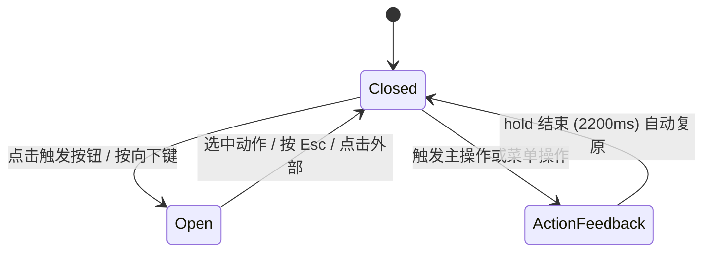

# Split Button · 分割按钮

将主操作按钮与下拉次要动作菜单紧密组合的分割按钮。包含四大核心动效机制：

1. 整体联动按压：点击主按钮时整个胶囊组件同步按压缩放，保持视觉一体性。
2. 文本逐字形变（popLayout）：主按钮文案切换时比对前后缀，退出字符就地绝对定位淡出，新字符错峰入场升起。
3. 宽度弹性自适应（ResizeObserver）：根据文案实际排版宽度自动驱动外层宽度弹簧缓动，平滑伸缩不突兀。
4. 下拉动作菜单展开与收起：以右上角为变换原点，带微缩放、位移和模糊的弹性展开；带焦点捕捉与键盘 Esc 关闭。

## 原型清单

| 原型分组 | 原型元素 | 动效 / 状态变化 | 去向 |
| --- | --- | --- | --- |
| — | 主操作按钮（`#splitPrimaryBtn`） | 按压时触发胶囊整体 scale(0.98)；执行主操作文案与图标切换 | 整体联动按压 + 文本逐字形变 + 图标切换 |
| — | 下拉触发按钮（`#splitTriggerBtn`） | 悬停背景；点击旋转/展开菜单，切换 aria-expanded | 下拉动作菜单展开与收起 |
| — | 主按钮内容容器（`#splitPrimarySlot`） | 基于 ResizeObserver 测量的宽度过渡 | 宽度弹性自适应 |
| — | 多图标插槽（Send, Check, Draft, Trash） | 状态切换时对应图标 scale(1) opacity(1)，其余 scale(0.6) opacity(0) | 图标切换 |
| — | 下拉菜单（`#splitMenu`）及菜单项 | 弹出与淡出收拢；悬停高光；点击选择后触发主按钮形变并关闭菜单 | 下拉动作菜单展开与收起 |
| — | 底部提示文案 `.hint-caption` | 静态说明 | 演示外壳，已删除 |
| — | 顶栏、主题切换按钮、D 快捷键、舞台卡片、embed/postMessage 检测 | — | 演示外壳，已删除 |

## 适用

- 操作存在一个明确的高频主动作（如“直接发布”），同时附带若干临近的派生选项（如“发布并通知”、“存为草稿”、“删除草稿”）。
- 点击某菜单项后，希望主按钮就地展示该动作的反馈文案与对应图标，并在一定延迟后自动平滑复原。
- 主按钮需要根据当前操作文案长度自然伸缩宽度，且动画顺滑不卡顿。

## 不适用

- 单个独立按钮的异步加载与提交反馈 → [action-button](action-button.md)
- 仅需要悬停高光跟随时滑动的多按钮工具栏 → [floating-button-group](floating-button-group.md)
- 点击后横向抽屉式展开额外按钮组 → [expanding-button-group](expanding-button-group.md)
- 纯手势或危险操作原地二次确认 → [confirm-morph](confirm-morph.md)

## 状态机



| 状态 | 进入条件 | 视觉表现 | 退出到 |
| --- | --- | --- | --- |
| closed | 初始；菜单收起 | 菜单隐藏，触发器 Chevron 向下，主按钮处于就绪文案 | open / actionFeedback |
| open | 点击下拉触发按钮 | 菜单自右上角展开，Chevron 旋转，`aria-expanded="true"` | closed / actionFeedback |
| actionFeedback | 点击主按钮或选择菜单项 | 主按钮文案与图标平滑形变为目标操作状态；菜单关闭；维持 2200ms | closed |

## 最小 DOM

```html
<div class="split-wrapper" data-state="closed">
  <!-- 胶囊主体 -->
  <div class="split-group">
    <!-- 主操作按钮 -->
    <button class="split-primary" type="button" aria-label="Publish">
      <span class="split-primary-slot">
        <span class="split-primary-content">
          <span class="split-main-icon" aria-hidden="true">
            <svg class="icon-svg icon-send" viewBox="0 0 24 24"><path d="m22 2-7 20-4-9-9-4Z"/><path d="M22 2 11 13"/></svg>
            <svg class="icon-svg icon-check" viewBox="0 0 24 24"><polyline points="20 6 9 17 4 12"/></svg>
            <svg class="icon-svg icon-draft" viewBox="0 0 24 24"><path d="M14.5 2H6a2 2 0 0 0-2 2v16a2 2 0 0 0 2 2h12a2 2 0 0 0 2-2V7.5L14.5 2z"/><polyline points="14 2 14 8 20 8"/></svg>
            <svg class="icon-svg icon-trash" viewBox="0 0 24 24"><path d="M3 6h18"/><path d="M19 6v14c0 1-1 2-2 2H7c-1 0-2-1-2-2V6"/><path d="M8 6V4c0-1 1-2 2-2h4c1 0 2 1 2 2v2"/></svg>
          </span>
          <span class="split-glyphs" aria-hidden="true"></span>
        </span>
      </span>
    </button>

    <!-- 下拉触发器 -->
    <button class="split-trigger" type="button" aria-label="More actions" aria-haspopup="true" aria-expanded="false">
      <svg class="split-chevron" width="16" height="16" viewBox="0 0 24 24" fill="none" stroke="currentColor" stroke-width="1.75" stroke-linecap="round" stroke-linejoin="round">
        <polyline points="6 9 12 15 18 9" />
      </svg>
    </button>
  </div>

  <!-- 下拉菜单 -->
  <div class="split-menu" role="menu" aria-orientation="vertical">
    <button class="split-item" role="menuitem" data-action="publish-notify" type="button">
      <span>Publish and notify</span>
    </button>
    <button class="split-item" role="menuitem" data-action="save-draft" type="button">
      <span>Save as draft</span>
    </button>
    <button class="split-item destructive" role="menuitem" data-action="delete-draft" type="button">
      <span>Delete draft</span>
    </button>
  </div>
</div>
```

- `.split-wrapper`：根相对定位容器，承载菜单绝对定位对齐。
- `.split-group`：胶囊整体外壳，响应联动按压缩放 `main-pressed`。
- `.split-primary-slot`：宽度过渡宿主，由 ResizeObserver 监听内部排版并赋予像素宽度。
- `.split-glyphs`：逐字形变承载节点，动态插入字符。
- `.split-trigger`：菜单切换开关，维护 `aria-expanded`。
- `.split-menu`：弹出菜单卡片，负责淡入浮动动画。

## 参数

| 名称 | 值 | 用于 | 来源 |
| --- | --- | --- | --- |
| 整体联动按压缩放 | `scale(0.98)` / `120ms` / `cubic-bezier(0.22, 1, 0.36, 1)` | `.split-group.main-pressed` | 原型 |
| 主按钮宽度自适应过渡 | `360ms` / `cubic-bezier(0.34, 1.25, 0.64, 1)` | `.split-primary-slot` width | 原型 |
| 字符入场时长与曲线 | `240ms` / `cubic-bezier(0.16, 1, 0.3, 1)` | `.glyph-in -> .glyph-rest` | 原型 |
| 字符入场错峰 | `Math.min(index * 16, 80)ms` | transitionDelay | 原型 |
| 字符退场时长与位移 | `160ms` / `translateY(-6px) blur(2.5px)` / `opacity: 0` | `.glyph-out` | 原型 |
| 图标显隐切换 | `opacity 160ms` / `scale 360ms cubic-bezier(0.18, 0.89, 0.32, 1.28)` | `.split-main-icon svg` | 原型 |
| 菜单展开动画 | `opacity 160ms` / `transform 360ms cubic-bezier(0.18, 0.89, 0.32, 1.28)` / `blur 2px -> 0` | `.split-menu.is-open` | 原型 |
| 菜单收起动画 | `opacity 130ms` / `transform 130ms cubic-bezier(0.22, 1, 0.36, 1)` | `.split-menu.is-closing` | 原型 |
| 动作反馈展示停留 | `2200ms` | 成功/反馈文案展示时长，之后自动复原 | 原型 |

## CSS

```css
.split-wrapper {
  --motion-duration-fast: 160ms;
  --motion-duration-standard: 240ms;
  --motion-duration-spring: 360ms;

  --motion-ease-enter: cubic-bezier(0.16, 1, 0.3, 1);
  --motion-ease-standard: cubic-bezier(0.22, 1, 0.36, 1);
  --motion-ease-spring: cubic-bezier(0.18, 0.89, 0.32, 1.28);
  --motion-ease-morph: cubic-bezier(0.34, 1.25, 0.64, 1);

  position: relative;
  display: inline-block;
}

/* 胶囊主体与按压联动 */
.split-group {
  display: inline-flex;
  align-items: center;
  position: relative;
  border-radius: 9999px;
  background: var(--btn-primary-bg, #0b0b0b);
  border: 1px solid var(--btn-border, rgba(0, 0, 0, 0.08));
  box-shadow: var(--shadow-raised, 0 4px 14px rgba(0, 0, 0, 0.08));
  transition: transform var(--motion-duration-spring) var(--motion-ease-spring);
  will-change: transform;
}

.split-group.main-pressed {
  transform: scale(0.98);
  transition-duration: 120ms;
  transition-timing-function: var(--motion-ease-standard);
}

.split-primary,
.split-trigger {
  border: none;
  background: transparent;
  color: var(--btn-primary-color, #ffffff);
  cursor: pointer;
  display: inline-flex;
  align-items: center;
  justify-content: center;
  padding: 0;
  outline: none;
  transition: background-color var(--motion-duration-fast) var(--motion-ease-standard);
}

.split-primary {
  height: 40px;
  padding-left: 18px;
  padding-right: 12px;
  border-top-left-radius: 9999px;
  border-bottom-left-radius: 9999px;
}

.split-primary:hover {
  background-color: rgba(255, 255, 255, 0.08);
}

.split-trigger {
  height: 40px;
  width: 36px;
  border-top-right-radius: 9999px;
  border-bottom-right-radius: 9999px;
  border-left: 1px solid rgba(255, 255, 255, 0.15);
}

.split-trigger:hover {
  background-color: rgba(255, 255, 255, 0.08);
}

.split-chevron {
  transition: transform var(--motion-duration-spring) var(--motion-ease-spring);
}

.split-wrapper[data-state="open"] .split-chevron {
  transform: rotate(180deg);
}

/* 宽度自适应过渡 */
.split-primary-slot {
  display: inline-flex;
  align-items: center;
  overflow: hidden;
  height: 20px;
  transition: width var(--motion-duration-spring) var(--motion-ease-morph);
  will-change: width;
}

.split-primary-content {
  display: inline-flex;
  align-items: center;
  gap: 8px;
  white-space: nowrap;
}

/* 图标多态淡化与缩放 */
.split-main-icon {
  width: 16px;
  height: 16px;
  position: relative;
  display: inline-flex;
  align-items: center;
  justify-content: center;
  flex-shrink: 0;
}

.split-main-icon svg {
  position: absolute;
  inset: 0;
  width: 16px;
  height: 16px;
  stroke-width: 2;
  transition:
    opacity var(--motion-duration-fast) var(--motion-ease-standard),
    transform var(--motion-duration-spring) var(--motion-ease-spring);
  will-change: transform, opacity;
}

/* 逐字排版与形变 */
.split-glyphs {
  display: inline-flex;
  align-items: center;
  position: relative;
}

.split-glyph {
  display: inline-block;
  will-change: transform, opacity, filter;
  transition:
    transform var(--motion-duration-standard) var(--motion-ease-enter),
    opacity var(--motion-duration-standard) var(--motion-ease-enter),
    filter var(--motion-duration-standard) var(--motion-ease-enter);
}

.split-glyph.glyph-in {
  opacity: 0;
  transform: translateY(6px);
  filter: blur(2px);
}

.split-glyph.glyph-rest {
  opacity: 1;
  transform: translateY(0);
  filter: blur(0);
}

.split-glyph.glyph-out {
  position: absolute;
  opacity: 0;
  transform: translateY(-6px);
  filter: blur(2.5px);
  pointer-events: none;
  transition:
    transform var(--motion-duration-fast) var(--motion-ease-standard),
    opacity var(--motion-duration-fast) var(--motion-ease-standard),
    filter var(--motion-duration-fast) var(--motion-ease-standard) !important;
}

/* 下拉菜单浮层 */
.split-menu {
  position: absolute;
  top: calc(100% + 6px);
  right: 0;
  z-index: 50;
  min-width: 12rem;
  padding: 6px;
  border-radius: 14px;
  background: var(--surface, #ffffff);
  border: 1px solid var(--border, rgba(0, 0, 0, 0.08));
  box-shadow: 0 10px 30px rgba(0, 0, 0, 0.12);
  transform-origin: top right;
  opacity: 0;
  transform: translateY(-5px) scale(0.97);
  pointer-events: none;
  filter: blur(2px);
  transition:
    opacity var(--motion-duration-fast) var(--motion-ease-enter),
    transform var(--motion-duration-spring) var(--motion-ease-spring),
    filter var(--motion-duration-fast) var(--motion-ease-enter);
}

.split-menu.is-open {
  opacity: 1;
  transform: translateY(0) scale(1);
  filter: blur(0);
  pointer-events: auto;
}

.split-menu.is-closing {
  opacity: 0;
  transform: translateY(-3px) scale(0.985);
  filter: blur(1px);
  pointer-events: none;
  transition:
    opacity 130ms var(--motion-ease-standard),
    transform 130ms var(--motion-ease-standard);
}

.split-item {
  display: flex;
  width: 100%;
  min-height: 32px;
  align-items: center;
  gap: 8px;
  padding: 0 10px;
  border: none;
  background: transparent;
  color: var(--foreground, #111111);
  border-radius: 8px;
  font-size: 13px;
  cursor: pointer;
  text-align: left;
  transition: background-color 120ms ease;
}

.split-item:hover,
.split-item:focus-visible {
  background-color: var(--surface-muted, #f4f4f5);
}

.split-item.destructive {
  color: var(--danger, #ef4444);
}

/* 减少动态效果 */
@media (prefers-reduced-motion: reduce) {
  .split-group,
  .split-primary-slot,
  .split-chevron,
  .split-main-icon svg,
  .split-menu {
    transition: none !important;
  }
  .split-group.main-pressed { transform: none !important; }
  .split-glyph {
    transition: opacity var(--motion-duration-fast) linear !important;
    transform: none !important;
    filter: none !important;
  }
}
```

## JS

```js
function splitGraphemes(str) {
  if (typeof Intl !== 'undefined' && Intl.Segmenter) {
    const s = new Intl.Segmenter(undefined, { granularity: 'grapheme' });
    return Array.from(s.segment(str), x => x.segment);
  }
  return Array.from(str);
}

/**
 * 创建 SplitButton 动效与交互控制器
 * @param {HTMLElement} wrapper 根节点 (.split-wrapper)
 * @param {Object} options 配置项
 * @param {string} [options.initialLabel='Publish'] 初始主按钮文案
 * @param {string} [options.initialIcon='send'] 初始图标键名
 * @param {Object} options.actions 动作映射配置：{ [actionKey]: { label: string, icon: string } }
 * @param {Function} [options.onSelect] 动作选择回调
 * @param {number} [options.hold=2200] 反馈停留时长
 */
function createSplitButtonMotion(wrapper, {
  initialLabel = 'Publish',
  initialIcon = 'send',
  actions = {},
  onSelect = null,
  hold = 2200
} = {}) {
  const group = wrapper.querySelector('.split-group');
  const primaryBtn = wrapper.querySelector('.split-primary');
  const triggerBtn = wrapper.querySelector('.split-trigger');
  const primarySlot = wrapper.querySelector('.split-primary-slot');
  const primaryContent = wrapper.querySelector('.split-primary-content');
  const glyphsRow = wrapper.querySelector('.split-glyphs');
  const menu = wrapper.querySelector('.split-menu');
  const icons = Array.from(wrapper.querySelectorAll('.split-main-icon svg'));

  let resetTimer = null;
  let isMenuOpen = false;

  // 1. 监听内容尺寸自动撑开槽位
  const observer = new ResizeObserver(([entry]) => {
    if (!entry) return;
    const w = Math.ceil(entry.contentRect.width);
    if (w > 0) primarySlot.style.width = `${w}px`;
  });
  observer.observe(primaryContent);

  // 2. 逐字形变引擎
  function updateMorphText(newText) {
    const currentSpans = Array.from(glyphsRow.children).filter(s => !s.classList.contains('glyph-out'));
    const oldGraphemes = currentSpans.map(s => s.textContent);
    const newGraphemes = splitGraphemes(newText);
    if (oldGraphemes.join('') === newText) return;

    let start = 0;
    while (start < oldGraphemes.length && start < newGraphemes.length && oldGraphemes[start] === newGraphemes[start]) start++;
    let end = 0;
    while (end < (oldGraphemes.length - start) && end < (newGraphemes.length - start) &&
           oldGraphemes[oldGraphemes.length - 1 - end] === newGraphemes[newGraphemes.length - 1 - end]) end++;
    if (start < 2) start = 0;
    if (end < 2) end = 0;

    const exiting = currentSpans.slice(start, oldGraphemes.length - end);
    exiting.forEach(span => {
      span.style.left = `${span.offsetLeft}px`;
      span.classList.remove('glyph-rest', 'glyph-in');
      span.classList.add('glyph-out');
    });

    const incoming = newGraphemes.slice(start, newGraphemes.length - end);
    const incomingSpans = incoming.map((ch, idx) => {
      const span = document.createElement('span');
      span.className = 'split-glyph glyph-in';
      span.textContent = ch;
      span.style.transitionDelay = `${Math.min(idx * 16, 80)}ms`;
      return span;
    });

    const anchor = currentSpans[oldGraphemes.length - end] || null;
    incomingSpans.forEach(s => glyphsRow.insertBefore(s, anchor));

    requestAnimationFrame(() => {
      incomingSpans.forEach(s => {
        s.classList.remove('glyph-in');
        s.classList.add('glyph-rest');
      });
    });

    setTimeout(() => exiting.forEach(s => s.remove()), 180);
  }

  function initLabel(text) {
    glyphsRow.innerHTML = '';
    splitGraphemes(text).forEach(ch => {
      const s = document.createElement('span');
      s.className = 'split-glyph glyph-rest';
      s.textContent = ch;
      glyphsRow.appendChild(s);
    });
  }

  // 3. 显式控制图标显隐
  function showIcon(name) {
    icons.forEach(icon => {
      const match = icon.classList.contains(`icon-${name}`);
      icon.style.opacity = match ? '1' : '0';
      icon.style.transform = match ? 'scale(1)' : 'scale(0.6)';
    });
  }

  initLabel(initialLabel);
  showIcon(initialIcon);

  // 4. 菜单显隐控制
  function openMenu() {
    isMenuOpen = true;
    menu.classList.remove('is-closing');
    menu.classList.add('is-open');
    wrapper.setAttribute('data-state', 'open');
    triggerBtn.setAttribute('aria-expanded', 'true');
  }

  function closeMenu() {
    if (!isMenuOpen) return;
    isMenuOpen = false;
    menu.classList.remove('is-open');
    menu.classList.add('is-closing');
    wrapper.setAttribute('data-state', 'closed');
    triggerBtn.setAttribute('aria-expanded', 'false');
    setTimeout(() => menu.classList.remove('is-closing'), 130);
  }

  // 5. 触发动作与反馈自动复原
  function triggerAction(actionKey) {
    if (resetTimer) clearTimeout(resetTimer);
    closeMenu();

    const config = actions[actionKey];
    if (config) {
      if (config.label) updateMorphText(config.label);
      if (config.icon) showIcon(config.icon);
    }

    if (onSelect) onSelect(actionKey);

    resetTimer = setTimeout(() => {
      updateMorphText(initialLabel);
      showIcon(initialIcon);
    }, hold);
  }

  // 事件绑定
  const handlePrimaryMouseDown = () => group.classList.add('main-pressed');
  const handleWindowMouseUp = () => group.classList.remove('main-pressed');
  const handlePrimaryClick = () => triggerAction('primary');
  const handleTriggerClick = (e) => {
    e.stopPropagation();
    isMenuOpen ? closeMenu() : openMenu();
  };
  const handleDocClick = (e) => {
    if (!wrapper.contains(e.target)) closeMenu();
  };
  const handleKeyDown = (e) => {
    if (e.key === 'Escape' && isMenuOpen) {
      closeMenu();
      triggerBtn.focus();
    }
  };

  primaryBtn.addEventListener('mousedown', handlePrimaryMouseDown);
  window.addEventListener('mouseup', handleWindowMouseUp);
  primaryBtn.addEventListener('click', handlePrimaryClick);
  triggerBtn.addEventListener('click', handleTriggerClick);
  document.addEventListener('click', handleDocClick);
  window.addEventListener('keydown', handleKeyDown);

  const menuItems = Array.from(menu.querySelectorAll('.split-item'));
  menuItems.forEach(item => {
    item.addEventListener('click', () => {
      const act = item.dataset.action;
      if (act) triggerAction(act);
    });
  });

  return {
    triggerAction,
    openMenu,
    closeMenu,
    destroy: () => {
      if (resetTimer) clearTimeout(resetTimer);
      observer.disconnect();
      primaryBtn.removeEventListener('mousedown', handlePrimaryMouseDown);
      window.removeEventListener('mouseup', handleWindowMouseUp);
      primaryBtn.removeEventListener('click', handlePrimaryClick);
      triggerBtn.removeEventListener('click', handleTriggerClick);
      document.removeEventListener('click', handleDocClick);
      window.removeEventListener('keydown', handleKeyDown);
    }
  };
}
```

## 接入目标项目

- 状态来源：主按钮动作或菜单选中的派生动作发出业务请求时，驱动相应的动作反馈。
- 尺寸策略：内部依靠 ResizeObserver 自动测量内容文本宽度，不需要硬编码写死按钮宽度；如果业务场景需要固定按钮尺寸，可直接限制 `.split-group` 的固定宽度。
- 驱动方式：组件挂载时调用 `createSplitButtonMotion(wrapper, options)`，卸载时调用 `destroy()`。

## 重入与清理

- 连续多次点击动作时，`resetTimer` 会自动被清除并重新计时，避免反馈文案中途异常复原。
- 卸载时彻底移除全局 window/document 事件监听，并切断 `ResizeObserver` 观测以防内存泄露。

## 减少动态效果

- 满足 `prefers-reduced-motion: reduce` 时：
  - 取消胶囊按压缩放与下拉菜单的缩放/模糊，菜单直接通过纯透明度切换显隐。
  - 文本与图标切换动画取消形变位移，直接呈现文本的简单淡入淡出。

## 焦点与键盘

- 触发器按钮带有清晰的 `aria-haspopup="true"` 和动态的 `aria-expanded`。
- 按下 `Escape` 键可立即关闭打开的菜单，并平滑将焦点返还给下拉触发按钮。

## 兼容回退

| 特性 | 不支持时 |
| --- | --- |
| `ResizeObserver` | 若目标运行环境不支持，可通过在文案切换时直接根据文本长度评估设置 `primarySlot.style.width`，或让槽位保持自然 auto 宽度。 |

## 验收清单

- [ ] 按下主按钮时，整个胶囊联动按压缩放 0.98，松开后平滑回弹。
- [ ] 点击触发按钮，菜单平滑自右上角弹性弹出，Chevron 箭头旋转 180°；再次点击或点击外部区域菜单平滑收回。
- [ ] 点击菜单任一操作项：菜单即刻收起，主按钮文案与图标顺滑切换为目标反馈形态，按钮整体宽度根据新文案自然伸缩。
- [ ] 保持 2200ms 后主按钮文案与图标平滑回归默认就绪状态。
- [ ] 菜单展开时按 Escape 键能够迅速关闭菜单，焦点归位回触发按钮。
- [ ] 启用系统的减少动态效果后，无缩放与位移，菜单与文案仅做透明度切换。
