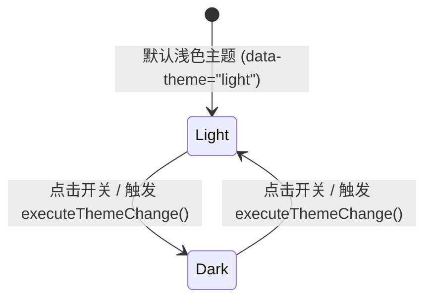

# Theme Switch · 主题切换按钮

用于深色/浅色模式切换的交互控件与全屏视图过渡机制。按钮内部通过太阳与月亮双图层的旋转与微模糊顺滑互换；全局借助原生 View Transition API 与 Web Animations API (WAAPI)，提供四种不同几何维度的全屏遮罩展开效果。涵盖三大核心机制：

1. 按钮内双图层旋转换位（ThemeIcon Spin & Micro-Blur）：太阳与月亮图标基于绝对定位同轴层叠，切换时沿顺时针/逆时针方向产生 30° 旋转、缩放与 2px 动态高斯模糊退场。
2. 四种全屏视图转场动画（View Transition 4 变体）：
   - Reveal（圆周波纹扩散）：以点击处按钮为几何中心，通过动态计算外接圆半径，向外圆形扩散展现新主题。
   - Eclipse（月食掠影）：自左至右的双曲线椭圆阴影横扫页面。
   - Split（帘幕对开）：以垂直中轴线为基准，向两侧水平推开遮罩。
   - Rise（黎明升起）：从视口底部向顶部垂直拉升展开。
3. 双形态规格支持（Standard / Icon-Only）：提供 38px 高度的常驻文本胶囊与 38×38px 的紧凑型方圆（Squircle）纯图标按钮。

## 原型清单

| 原型分组 | 原型元素 | 动效 / 状态变化 | 去向 |
| --- | --- | --- | --- |
| 舞台核心区 | 标准带文本胶囊 `#mainThemeSwitch` | 点击切换主题；太阳/月亮旋转互换；根据变体产生微位移 | 按钮内双图层旋转换位 + 双形态规格支持 |
| 舞台核心区 | 紧凑型纯图标按钮 `#iconOnlyThemeSwitch` | 38×38px 方圆形态；同上动效 | 双形态规格支持 |
| 舞台核心区 | 图标包裹轨道 `.iconWrap` | 暗黑模式激活时的微缩放/微偏移（Nudges） | 按钮内双图层旋转换位 |
| 舞台核心区 | 太阳图层 `.icon-sun` | 浅色常驻；深色时顺时针旋转 30° + 缩小 + 2px 模糊淡出 | 按钮内双图层旋转换位 |
| 舞台核心区 | 月亮图层 `.icon-moon` | 深色常驻；浅色时逆时针旋转 30° + 缩小 + 2px 模糊淡出 | 按钮内双图层旋转换位 |
| 舞台工具栏 | 变体选择器 `#variantSelector` | Reveal / Eclipse / Split / Rise 切换 | 四种全屏视图转场动画 |
| 舞台核心区 | 底部说明文字 `.hint-caption` | 静态说明文案 | 演示外壳，已删除 |
| — | 独立顶栏与快捷键 D 监听 | 标题栏与演示控制 | 演示外壳，已删除 |
| — | 舞台外壳 `.arc-stage-card` 与 Tab 栏 | 演示居中外壳 | 演示外壳，已删除 |
| — | embed/postMessage 监听 | iframe 适配 | 演示外壳，已删除 |
| — | 全局失去焦点补丁 `__arc_blur_installed` | 焦点清除逻辑 | 演示外壳，已删除 |

## 适用

- 站点级或应用级暗黑/浅色模式切换开关。
- 支持现代浏览器原生 View Transition API（Chrome 111+、Safari 18+）的大师级全屏视觉转场。
- 导航栏右侧、设置面板或悬浮快捷操作坞。

## 不适用

- 仅局限于单个按钮内部的图标形变、不涉及全屏页面级色彩反转 → [icon-morph](icon-morph.md)
- 仅作为下拉菜单中的选项之一 → [split-button](split-button.md)
- 需要原地展开二次确认的高危配置切换 → [confirm-morph](confirm-morph.md)

## 状态机



| 状态 | 进入条件 | 视觉表现 | 退出到 |
| --- | --- | --- | --- |
| `light` | 初始浅色或从深色切入 | 按钮内呈现太阳图标（0°）；月亮图标淡出隐藏；根容器无暗色类名 | `dark` |
| `dark` | 点击切换触发 | 按钮内呈现月亮图标（0°）；太阳图标淡出；执行所选变体的全屏遮罩展开 | `light` |

## 最小 DOM

### 1. 标准胶囊形态（带文本）
```html
<button class="theme-switch reveal" type="button" data-theme="light" aria-label="Switch to dark mode" aria-pressed="false">
  <span class="icon-wrap" aria-hidden="true">
    <span class="theme-icon-layer icon-sun">
      <svg width="16" height="16" viewBox="0 0 24 24" fill="none" stroke="currentColor" stroke-width="1.75" stroke-linecap="round" stroke-linejoin="round">
        <circle cx="12" cy="12" r="4" /><path d="M12 2v2" /><path d="M12 20v2" /><path d="m4.93 4.93 1.41 1.41" /><path d="m17.66 17.66 1.41 1.41" /><path d="M2 12h2" /><path d="M20 12h2" /><path d="m6.34 17.66-1.41 1.41" /><path d="m19.07 4.93-1.41 1.41" />
      </svg>
    </span>
    <span class="theme-icon-layer icon-moon">
      <svg width="16" height="16" viewBox="0 0 24 24" fill="none" stroke="currentColor" stroke-width="1.75" stroke-linecap="round" stroke-linejoin="round">
        <path d="M12 3a6 6 0 0 0 9 9 9 9 0 1 1-9-9Z" />
      </svg>
    </span>
  </span>
  <span class="label">Switch theme</span>
</button>
```

### 2. 紧凑纯图标形态 (Icon-Only)
```html
<button class="theme-switch icon-only reveal" type="button" data-theme="light" aria-label="Switch to dark mode" aria-pressed="false">
  <span class="icon-wrap" aria-hidden="true">
    <span class="theme-icon-layer icon-sun">
      <!-- 太阳 SVG 见上 -->
    </span>
    <span class="theme-icon-layer icon-moon">
      <!-- 月亮 SVG 见上 -->
    </span>
  </span>
</button>
```

- `.theme-switch`：主交互按钮，携带 `data-theme="light|dark"` 与变体类名（`reveal`, `eclipse`, `split`, `rise`）。
- `.icon-wrap`：双图标几何容器，承载暗色激活时的微位移（Nudge）。
- `.icon-sun` / `.icon-moon`：分别承载绝对定位的太阳与月亮矢量图层。

## 参数

| 名称 | 值 | 用于 | 来源 |
| --- | --- | --- | --- |
| 按钮标准高度 | `38px` | 胶囊与方圆统一高度 | 原型 |
| 纯图标按钮尺寸 | `38px × 38px` | `icon-only` 方圆尺寸（圆角 12px） | 原型 |
| 图标旋转过渡 | `360ms cubic-bezier(0.18, 0.89, 0.32, 1.28)` | 图标旋转换位缓动 | 原型 |
| 图标微模糊时长 | `160ms cubic-bezier(0.16, 1, 0.3, 1)` | 图标虚化淡出 | 原型 |
| Reveal 转场时长 | `480ms cubic-bezier(0.16, 1, 0.3, 1)` | 全屏圆形波纹扩散 | 原型 |
| Eclipse 转场时长 | `520ms cubic-bezier(0.22, 1, 0.36, 1)` | 全屏椭圆月食掠影 | 原型 |
| Split 转场时长 | `440ms cubic-bezier(0.18, 0.89, 0.32, 1)` | 全屏双向帘幕展开 | 原型 |
| Rise 转场时长 | `460ms cubic-bezier(0.16, 1, 0.3, 1)` | 全屏垂直升起展开 | 原型 |

## CSS

```css
.theme-switch {
  --duration-instant: 120ms;
  --duration-fast: 160ms;
  --duration-spring: 360ms;
  --ease-standard: cubic-bezier(0.22, 1, 0.36, 1);
  --ease-spring: cubic-bezier(0.18, 0.89, 0.32, 1.28);
  --ease-enter: cubic-bezier(0.16, 1, 0.3, 1);
  --border: rgba(0, 0, 0, 0.08);
  --surface: #ffffff;
  --surface-muted: #f4f4f4;
  --foreground: #0b0b0b;
  --radius-pill: 9999px;

  position: relative;
  display: inline-flex;
  align-items: center;
  justify-content: center;
  gap: 8px;
  height: 38px;
  padding: 0 16px;
  border: 1px solid var(--border);
  border-radius: var(--radius-pill);
  background: var(--surface);
  color: var(--foreground);
  font: inherit;
  font-size: 13.5px;
  font-weight: 500;
  line-height: 1;
  cursor: pointer;
  user-select: none;
  outline: none;
  box-shadow: 0 1px 3px rgba(0, 0, 0, 0.05);
  transition: border-color var(--duration-fast) var(--ease-standard),
              background-color var(--duration-fast) var(--ease-standard),
              transform var(--duration-instant) var(--ease-standard);
  will-change: transform;
}

.theme-switch:hover:not(:disabled) {
  background: var(--surface-muted);
}

.theme-switch:active {
  transform: scale(0.96);
}

.theme-switch:focus-visible {
  outline: 2px solid currentColor;
  outline-offset: 2px;
}

/* 纯图标变体 */
.theme-switch.icon-only {
  width: 38px;
  min-width: 38px;
  height: 38px;
  min-height: 38px;
  border-radius: 12px;
  padding: 0;
}

.icon-wrap {
  position: relative;
  display: inline-grid;
  width: 20px;
  height: 20px;
  flex: 0 0 20px;
  place-items: center;
  transition: transform var(--duration-spring) var(--ease-spring);
}

/* 变体微位移 (Nudges) */
.theme-switch.reveal[data-theme="dark"] .icon-wrap { transform: scale(1.08); }
.theme-switch.eclipse[data-theme="dark"] .icon-wrap { transform: translateX(-2px); }
.theme-switch.split[data-theme="dark"] .icon-wrap { transform: translateX(1px); }
.theme-switch.rise[data-theme="dark"] .icon-wrap { transform: translateY(-2px); }

/* 图标层叠与旋转 */
.theme-icon-layer {
  position: absolute;
  display: grid;
  width: 18px;
  height: 18px;
  place-items: center;
  pointer-events: none;
  will-change: transform, opacity, filter;
  transition: transform var(--duration-spring) var(--ease-spring),
              opacity var(--duration-fast) var(--ease-enter),
              filter var(--duration-fast) var(--ease-enter);
}

/* 太阳图标 */
.icon-sun {
  opacity: 1;
  transform: scale(1) rotate(0deg);
  filter: blur(0px);
}
[data-theme="dark"] .icon-sun,
.theme-switch[data-theme="dark"] .icon-sun {
  opacity: 0;
  transform: scale(0.7) rotate(30deg);
  filter: blur(2px);
}

/* 月亮图标 */
.icon-moon {
  opacity: 0;
  transform: scale(0.7) rotate(-30deg);
  filter: blur(2px);
}
[data-theme="dark"] .icon-moon,
.theme-switch[data-theme="dark"] .icon-moon {
  opacity: 1;
  transform: scale(1) rotate(0deg);
  filter: blur(0px);
}

.label {
  white-space: nowrap;
}

/* ── 全局 View Transition 配置层 ── */
::view-transition-old(root),
::view-transition-new(root) {
  animation: none;
  mix-blend-mode: normal;
}
::view-transition-old(root) {
  z-index: 1;
}
::view-transition-new(root) {
  z-index: 9999;
}
```

## JS

```js
/**
 * 主题切换控制器
 * @param {HTMLElement} switchEl 触发按钮元素
 * @param {Object} options 配置项
 * @param {'reveal'|'eclipse'|'split'|'rise'} [options.variant='reveal'] 转场变体
 * @param {(theme: 'light'|'dark') => void} [options.onThemeChange] 主题更迭业务回调
 * @returns {{ switchTheme: Function, destroy: Function }} 控制句柄
 */
export function createThemeSwitch(switchEl, { variant = 'reveal', onThemeChange } = {}) {
  const root = document.documentElement;

  function getNextTheme() {
    const current = root.getAttribute('data-theme') || 'light';
    return current === 'dark' ? 'light' : 'dark';
  }

  function syncSwitchVisuals(theme) {
    switchEl.setAttribute('data-theme', theme);
    const isDark = theme === 'dark';
    switchEl.setAttribute('aria-pressed', String(isDark));
    switchEl.setAttribute('aria-label', `Switch to ${isDark ? 'light' : 'dark'} mode`);
    switchEl.classList.remove('reveal', 'eclipse', 'split', 'rise');
    switchEl.classList.add(variant);
  }

  function applyTheme(nextTheme) {
    root.setAttribute('data-theme', nextTheme);
    try {
      localStorage.setItem('app_theme', nextTheme);
    } catch {}
    syncSwitchVisuals(nextTheme);
    if (typeof onThemeChange === 'function') {
      onThemeChange(nextTheme);
    }
  }

  function switchTheme() {
    const nextTheme = getNextTheme();
    const prefersReducedMotion = window.matchMedia('(prefers-reduced-motion: reduce)').matches;

    // 若系统开启减弱动态效果或浏览器不支持 View Transition，直接应用
    if (prefersReducedMotion || !document.startViewTransition) {
      applyTheme(nextTheme);
      return;
    }

    const rect = switchEl.getBoundingClientRect();
    const x = rect.left + rect.width / 2;
    const y = rect.top + rect.height / 2;

    const transition = document.startViewTransition(() => {
      applyTheme(nextTheme);
    });

    transition.ready.then(() => {
      if (variant === 'reveal') {
        const endRadius = Math.hypot(
          Math.max(x, window.innerWidth - x),
          Math.max(y, window.innerHeight - y)
        );
        document.documentElement.animate(
          {
            clipPath: [
              `circle(0px at ${x}px ${y}px)`,
              `circle(${endRadius}px at ${x}px ${y}px)`
            ]
          },
          {
            duration: 480,
            easing: 'cubic-bezier(0.16, 1, 0.3, 1)',
            pseudoElement: '::view-transition-new(root)'
          }
        );
      } else if (variant === 'eclipse') {
        document.documentElement.animate(
          {
            clipPath: [
              'ellipse(0% 150% at 0% 50%)',
              'ellipse(150% 150% at 50% 50%)'
            ]
          },
          {
            duration: 520,
            easing: 'cubic-bezier(0.22, 1, 0.36, 1)',
            pseudoElement: '::view-transition-new(root)'
          }
        );
      } else if (variant === 'split') {
        document.documentElement.animate(
          {
            clipPath: [
              'inset(0 50% 0 50%)',
              'inset(0 0% 0 0%)'
            ]
          },
          {
            duration: 440,
            easing: 'cubic-bezier(0.18, 0.89, 0.32, 1)',
            pseudoElement: '::view-transition-new(root)'
          }
        );
      } else if (variant === 'rise') {
        document.documentElement.animate(
          {
            clipPath: [
              'inset(100% 0 0 0)',
              'inset(0% 0 0 0)'
            ]
          },
          {
            duration: 460,
            easing: 'cubic-bezier(0.16, 1, 0.3, 1)',
            pseudoElement: '::view-transition-new(root)'
          }
        );
      }
    });
  }

  const handleClick = () => switchTheme();
  switchEl.addEventListener('click', handleClick);

  // 初始化当前视图
  const initialTheme = root.getAttribute('data-theme') || 'light';
  syncSwitchVisuals(initialTheme);

  return {
    switchTheme,
    destroy() {
      switchEl.removeEventListener('click', handleClick);
    }
  };
}
```

## 接入目标项目

- 状态来源：目标项目全局状态。通常托管在 `<html>` 标签的 `data-theme` 属性或项目的主题 Context / Store 中。
- 尺寸策略：标准胶囊自适应文字宽度（`height: 38px`）；纯图标形态锁定 `38×38px` 方圆。
- 驱动方式：通过绑定原生按钮并调用 `createThemeSwitch(btn, { variant, onThemeChange })` 接入。项目已有的主题存储逻辑在 `onThemeChange` 中同步更新。

## 重入与清理

- 连续快速切换防护：`document.startViewTransition` 在前一个转场未完成前再次触发时，浏览器底层会自动中止前一个 transition 并在完成后结算最新 DOM，无需手动防抖。
- 卸载清理：组件提供 `destroy()` 方法，用于移除绑定在按钮上的 `click` 监听。

## 减少动态效果

在系统偏好开启 `prefers-reduced-motion: reduce` 时：
1. 立即降级跳过 `document.startViewTransition` 全屏动画，直接同步修改主题属性。
2. 按钮内部去除旋转与模糊，保持 `0.01ms` 瞬时切换：

```css
@media (prefers-reduced-motion: reduce) {
  .theme-switch,
  .icon-wrap,
  .theme-icon-layer {
    transition-duration: 0.01ms !important;
  }
  .theme-icon-layer {
    filter: none !important;
  }
}
```

## 焦点与键盘

- 键盘激活：原生 `<button>` 支持 Tab 键聚焦与 Enter/Space 键触发。
- ARIA 语义：配置 `aria-pressed="false|true"` 表示暗黑模式开启状态，并随状态动态维护 `aria-label="Switch to dark/light mode"`。
- 焦点轮廓：支持 `:focus-visible` 2px 原生对比度焦点外框。

## 兼容回退

| 特性 | 不支持时 |
| --- | --- |
| `document.startViewTransition` (Firefox, 旧版 Safari) | 【降级方案】JS 内置特征检测，直接走 `applyTheme()` 执行即时 DOM 属性变更，按钮自身图标依然拥有平滑旋转与淡入淡出。 |
| CSS `clip-path` 复合图形 | 若浏览器不支持 `ellipse()` 动画，建议使用基础的 `circle()` 或直接走降级分支。 |

## 验收清单

- [ ] 点击按钮，太阳图标顺时针 30° 旋转并伴随模糊渐隐，月亮图标顺时针由负角旋转至 0° 展现实体。
- [ ] 在支持 View Transition 的浏览器中，Reveal 模式以按钮坐标为中心产生平滑圆周波纹扩散遮罩。
- [ ] 切换至 Eclipse 变体，呈现自左至右的椭圆阴影横扫页面。
- [ ] 切换至 Split 变体，呈现自中轴线向两侧对开的帘幕转场。
- [ ] 切换至 Rise 变体，呈现自视口底部向上升起的地平线转场。
- [ ] 开启系统减弱动态效果时，全屏视图转场动画自动跳过，主题瞬时完成切换。
- [ ] 纯图标变体保持标准 38×38px 方圆外形，键盘焦点环清晰包裹无溢出。
