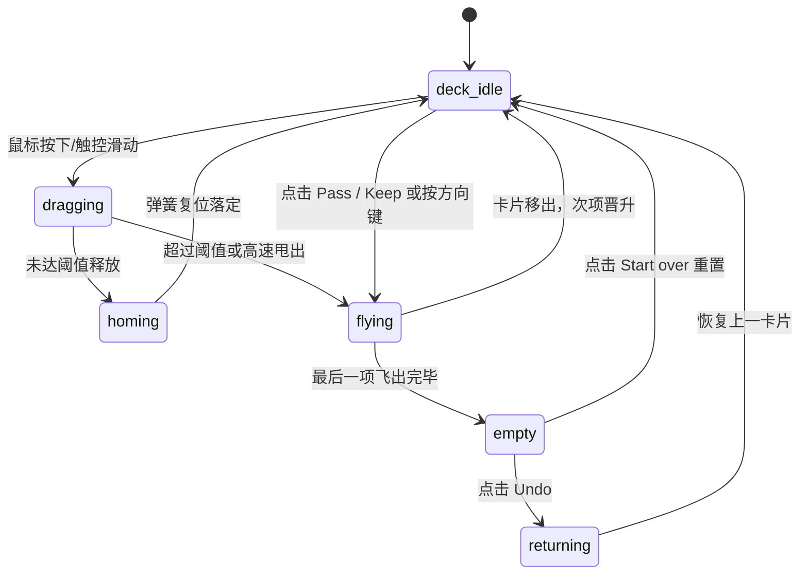

# Card Stack · 堆叠卡片

用于轻量滑动决策、筛选卡片流（如通过/忽略、保留/跳过）的高流畅度物理手势堆叠卡片组件。包含五大核心动效机制：

1. 指针拖拽与极性倾斜物理（Pointer Drag & Tilt）：拖拽顶层卡片时，依按压起点在卡片中线上方或下方赋予正负倾斜方向（`tilt: ±1`），旋转角正比于水平位移（`x * 0.065deg`）；垂直位移在超出 48px 后开启对数阻尼橡皮筋回弹约束。
2. 动态决策印章插值（Decision Stamps Alpha）：向右拖拽平滑显现绿色“KEEP”印章，向左拖拽平滑显现深色“PASS”印章（公式：`clamp((|x| - 16) / 80)`）。
3. 临界抛掷飞出（Throw & Flight）：释放时若水平甩动手势速度超过 500px/s 或水平位移超过阈值（`min(width * 0.35, 140px)`），卡片沿速度向量物理抛出屏幕（500ms），并在 120ms 后淡出；未达临界点则弹簧顺畅归位。
4. 深度层叠与推进上浮（Depth Stacking & Lift）：后台卡片呈现最多 4 层，依深度步进缩放与位移（`translateY(depth * 12px) scale(1 - depth * 0.05)`）；前卡被拖拽时，后方卡片产生 `lift * 0.4` 微上浮响应。
5. 撤销反飞与错峰重置（Undo & Staggered Return）：支持 Backspace 或 Ctrl+Z 反向飞回撤销的卡片；Reset 重置时已决策卡片以 60ms 错峰 Stagger 依次弹回堆叠。

## 原型清单

| 原型分组 | 原型元素 | 动效 / 状态变化 | 去向 |
| --- | --- | --- | --- |
| 宿主容器 | 堆叠外框（`.arc-card-stack`） | 约束舞台与控制栏，`role="region"` | 最小 DOM / CSS |
| 卡片舞台 | 交互舞台（`.arc-card-stage`） | 接收左右方向键、Backspace 与指针拖拽，聚焦管理 | 键盘与手势支持 |
| 堆叠槽位 | 4 个层叠槽位（`.arc-stack-slot`） | 深度位移 `translateY(depth * 12px)`、缩放 `1 - depth * 0.05`、阴影与遮罩 | 深度层叠与推进上浮 |
| 决策印章 | 左右印章（`.arc-stack-stamp`） | 左右滑动透明度插值 `clamp((|x| - 16) / 80)` | 动态决策印章插值 |
| 遮罩阴影 | 深度遮罩（`.arc-stack-shade`） | 随深度加深半透明黑色遮罩 | 最小 DOM / CSS |
| 控制按键 | 底部 Pass / Undo / Keep 按钮 | 点击按压微缩 `scale(0.97)`，驱动决策与撤销 | 原型与最小 DOM |
| 演示外壳 | 顶部主题切换按钮（`#themeToggle`） | 切换深浅色主题 | 演示外壳，已删除 |
| 演示外壳 | 快捷键说明图例弹窗 | 演示说明浮层 | 演示外壳，已删除 |

## 适用

- 候选内容快速分流：如求职者简历快筛、商品挑选、旅行目的地筛选。
- 触控屏与桌面端均需要极佳拖拽跟手感、物理抛掷动效的卡片交互流。
- 需具备完整的键盘可访问性（左右方向键快速决策，撤销键秒级回退）。

## 不适用

- 单张卡片点击展开全屏大图预览与长文本详情 → [card](card.md)
- 带有指标数字滚轮、周期涨跌幅对比的业务统计卡片 → [metric-card](metric-card.md)
- 多项头像并排折叠与协作者气泡列表 → [avatar-group](../avatars/avatar-group.md)

## 状态机

| 状态 | 进入条件 | 视觉表现 | 退出到 |
| --- | --- | --- | --- |
| deck-idle | 初始状态；有待决策卡片 | 顶层卡片清晰位于顶端，后方卡片呈 4 层递减缩放与半透明层叠 | dragging / flying |
| dragging | 指针在顶层卡片按下并移动 | 顶层卡片随光标平移并带角度倾斜，对应方向印章显现，底层卡片微升 | homing / flying |
| homing | 拖拽位移与速度未达阈值松手 | 卡片经弹簧平滑回弹归位至原点，印章淡出 | deck-idle |
| flying | 拖拽超过阈值或点击 Pass/Keep | 卡片顺势沿速度向量飞出舞台，后方卡片晋升至顶层 | deck-idle / empty |
| returning | 点击 Undo 或按下 Backspace | 上一张离开卡片从飞出路径逆向飞回舞台顶部，恢复原排序 | deck-idle |
| empty | 全部卡片决策完毕 | 呈现 "All cards reviewed" 结算提示与 "Start over" 重置按钮 | returning / deck-idle |



## 最小 DOM

```html
<div class="arc-card-stack" role="region" aria-label="Card stack">
  <!-- 交互舞台 -->
  <div class="arc-card-stage" tabindex="0" role="region" aria-label="Cards" aria-describedby="stackHint">
    <!-- 槽位 1：顶层活动卡片 -->
    <div class="arc-stack-slot" style="transform: translateY(0px) scale(1); z-index: 4;">
      <article class="arc-stack-card" role="group" aria-label="Reykjavik, 1 of 6" data-top="true">
        <span class="arc-stack-stamp arc-stack-stamp-left" data-side="left">PASS</span>
        <span class="arc-stack-stamp arc-stack-stamp-right" data-side="right">KEEP</span>
        <div class="arc-stack-photo-wrap">
          
        </div>
        <div class="arc-stack-content">
          <h3 class="arc-stack-title">Reykjavik</h3>
          <p class="arc-stack-desc">Coastal capital with geothermal lagoons.</p>
        </div>
        <div class="arc-stack-shade" style="opacity: 0;"></div>
      </article>
    </div>

    <!-- 槽位 2：后方卡片 -->
    <div class="arc-stack-slot" style="transform: translateY(12px) scale(0.95); z-index: 3;" aria-hidden="true" inert>
      <article class="arc-stack-card">
        <div class="arc-stack-photo-wrap">
          
        </div>
        <div class="arc-stack-content">
          <h3 class="arc-stack-title">Kyoto</h3>
          <p class="arc-stack-desc">Historic city with classical gardens.</p>
        </div>
        <div class="arc-stack-shade" style="opacity: 0.5;"></div>
      </article>
    </div>
  </div>

  <p class="arc-stack-hint" id="stackHint">Drag the top card, or use the left and right arrow keys to pass or keep. Backspace undoes.</p>
  <div class="arc-stack-status" role="status" aria-live="polite"></div>

  <!-- 底部操作按钮 -->
  <div class="arc-stack-controls">
    <button class="arc-stack-btn arc-stack-btn-pass" type="button" aria-label="Pass card">Pass</button>
    <button class="arc-stack-btn arc-stack-btn-undo" type="button" aria-label="Undo last card" aria-disabled="true">Undo</button>
    <button class="arc-stack-btn arc-stack-btn-keep" type="button" aria-label="Keep card">Keep</button>
  </div>
</div>
```

- `.arc-card-stack`：外层包裹宿主，管理卡片堆与控制器的全局布局。
- `.arc-card-stage`：物理手势捕获舞台，承载 `tabindex="0"` 与键盘快捷操作。
- `.arc-stack-slot`：绝对层叠槽位，通过 `transform: translateY() scale()` 表现景深。
- `.arc-stack-card`：卡片主体，响应拖拽与倾斜。
- `.arc-stack-stamp`：左右两枚半透明决策印章，随拖拽位移渐现。
- `.arc-stack-shade`：阴影遮罩层，随深度自然变暗。

## 参数

| 名称 | 值 | 用于 | 来源 |
| --- | --- | --- | --- |
| 最大可见层叠数 | `4` | `visibleSlots: 4` | 原型 |
| 层级垂直下移步长 | `12px` | `translateY(depth * 12px)` | 原型 |
| 层级缩放递减步长 | `0.05` | `scale(1 - depth * 0.05)` | 原型 |
| 拖拽旋转倾角比例 | `0.065deg / px` | `rotate(x * 0.065 * tilt)` | 原型 |
| 快速轻弹判定速度 | `500px/s` | `Math.abs(vx) > 500` 触发甩飞 | 原型 |
| 最小移动距离要求 | `12px` | 快速甩飞时的最小位移约束 | 原型 |
| 静态拖拽临界距离 | `min(width * 0.35, 140px)` | 超过此位移即判定触发决策 | 原型 |
| 垂直橡皮筋阻尼门限 | `48px` | `|y| > 48` 开启对数非线性阻尼 | 原型 |
| 飞出弹簧物理时长 | `500ms` (`visualDuration: 0.5`, `bounce: 0`) | 抛掷离场动画 | 原型 |
| 飞出透明度淡化延迟 | `120ms` 延迟，持续 `220ms` | 离场渐隐 | 原型 |
| 重置错峰间隔 | `60ms` | 全部恢复时的 Stagger 动画时序 | 原型 |

## CSS

```css
.arc-card-stack {
  --stack-width: 340px;
  --stack-height: 440px;
  --stack-bg: #ffffff;
  --stack-border: rgba(0, 0, 0, 0.08);
  --stamp-pass: #dc2626;
  --stamp-keep: #16a34a;

  position: relative;
  display: flex;
  flex-direction: column;
  align-items: center;
  width: 100%;
  max-width: var(--stack-width);
  user-select: none;
  box-sizing: border-box;
}

/* 交互舞台 */
.arc-card-stage {
  position: relative;
  width: var(--stack-width);
  height: var(--stack-height);
  outline: none;
}

/* 层叠卡片槽位 */
.arc-stack-slot {
  position: absolute;
  inset: 0;
  display: flex;
  flex-direction: column;
  transform-origin: center bottom;
  transition: transform 340ms cubic-bezier(0.16, 1, 0.3, 1),
              opacity 340ms cubic-bezier(0.16, 1, 0.3, 1);
  will-change: transform, opacity;
}

/* 卡片实体 */
.arc-stack-card {
  position: relative;
  width: 100%;
  height: 100%;
  border: 1px solid var(--stack-border);
  border-radius: 20px;
  background: var(--stack-bg);
  overflow: hidden;
  box-shadow: 0 16px 36px -8px rgba(0, 0, 0, 0.12);
  touch-action: none;
  cursor: grab;
  transform-origin: center center;
  box-sizing: border-box;
}

.arc-stack-card[data-dragging] {
  cursor: grabbing;
}

/* 决策印章 */
.arc-stack-stamp {
  position: absolute;
  top: 24px;
  z-index: 10;
  padding: 4px 12px;
  border: 2.5px solid currentColor;
  border-radius: 8px;
  font-family: inherit;
  font-size: 1.125rem;
  font-weight: 700;
  letter-spacing: 0.08em;
  text-transform: uppercase;
  opacity: 0;
  pointer-events: none;
}

.arc-stack-stamp-left {
  right: 20px;
  color: var(--stamp-pass);
  transform: rotate(12deg);
}

.arc-stack-stamp-right {
  left: 20px;
  color: var(--stamp-keep);
  transform: rotate(-12deg);
}

/* 封面媒体 */
.arc-stack-photo-wrap {
  width: 100%;
  height: 280px;
  overflow: hidden;
  background: #f4f4f5;
}

.arc-stack-photo {
  width: 100%;
  height: 100%;
  object-fit: cover;
  display: block;
}

/* 内容区域 */
.arc-stack-content {
  padding: 18px 20px;
  display: flex;
  flex-direction: column;
  box-sizing: border-box;
}

.arc-stack-title {
  margin: 0;
  font-size: 1.25rem;
  font-weight: 600;
  color: #18181b;
}

.arc-stack-desc {
  margin-top: 6px;
  margin-bottom: 0;
  color: #71717a;
  font-size: 0.875rem;
  line-height: 1.4;
}

/* 深度遮罩 */
.arc-stack-shade {
  position: absolute;
  inset: 0;
  background: #000000;
  pointer-events: none;
  transition: opacity 240ms ease;
}

/* 提示文案与状态 */
.arc-stack-hint {
  margin-top: 16px;
  font-size: 0.75rem;
  color: #a1a1aa;
  text-align: center;
}

.arc-stack-status {
  position: absolute;
  width: 1px;
  height: 1px;
  padding: 0;
  margin: -1px;
  overflow: hidden;
  clip: rect(0, 0, 0, 0);
  border: 0;
}

/* 底部操作工具栏 */
.arc-stack-controls {
  display: flex;
  align-items: center;
  justify-content: center;
  gap: 16px;
  margin-top: 14px;
}

.arc-stack-btn {
  display: inline-flex;
  align-items: center;
  justify-content: center;
  height: 38px;
  padding: 0 18px;
  border: 1px solid var(--stack-border);
  border-radius: 9999px;
  background: var(--stack-bg);
  color: #18181b;
  font-size: 0.875rem;
  font-weight: 500;
  cursor: pointer;
  box-shadow: 0 1px 3px rgba(0, 0, 0, 0.05);
  transition: transform 120ms ease, background-color 140ms ease, opacity 140ms ease;
}

.arc-stack-btn:active:not([aria-disabled="true"]) {
  transform: scale(0.96);
}

.arc-stack-btn[aria-disabled="true"] {
  opacity: 0.45;
  cursor: not-allowed;
}

/* 减少动态效果 */
@media (prefers-reduced-motion: reduce) {
  .arc-stack-slot {
    transition: opacity 150ms linear !important;
  }
  .arc-stack-card {
    transition: none !important;
  }
}
```

## JS

```js
/**
 * 纯原生 CardStack 物理手势与堆叠控制器
 * @param {HTMLElement} el 宿主容器节点
 * @param {Object} options 配置项
 * @param {Array<Object>} [options.items=[]] 卡片数据列表
 * @param {Function} [options.onDecide] 决策回调 (item, 'left'|'right') => void
 * @param {Function} [options.onUndo] 撤销回调 (item) => void
 * @param {Function} [options.onReset] 重置回调 () => void
 */
export function createCardStack(el, options = {}) {
  const stage = el.querySelector('.arc-card-stage') || el;
  const statusEl = el.querySelector('.arc-stack-status');
  const btnPass = el.querySelector('.arc-stack-btn-pass');
  const btnUndo = el.querySelector('.arc-stack-btn-undo');
  const btnKeep = el.querySelector('.arc-stack-btn-keep');

  let items = options.items || [
    { title: 'Item 1', desc: 'Sample card 1' },
    { title: 'Item 2', desc: 'Sample card 2' },
    { title: 'Item 3', desc: 'Sample card 3' }
  ];

  let position = 0;
  let history = [];
  let isDragging = false;
  let startX = 0;
  let startY = 0;
  let currentX = 0;
  let currentY = 0;
  let tilt = 1;
  let disposed = false;

  function renderDeck() {
    if (disposed) return;
    stage.innerHTML = '';
    const visibleCards = items.slice(position, position + 4);

    visibleCards.forEach((item, idx) => {
      const slot = document.createElement('div');
      slot.className = 'arc-stack-slot';
      slot.style.transform = `translateY(${idx * 12}px) scale(${1 - idx * 0.05})`;
      slot.style.zIndex = 10 - idx;
      if (idx > 0) {
        slot.setAttribute('aria-hidden', 'true');
        slot.setAttribute('inert', '');
      }

      const card = document.createElement('article');
      card.className = 'arc-stack-card';
      if (idx === 0) {
        card.setAttribute('role', 'group');
        card.setAttribute('aria-label', `${item.title || 'Card'}, ${position + 1} of ${items.length}`);
        card.dataset.top = 'true';
        bindDragEvents(card);
      }

      // 印章
      const stampLeft = document.createElement('span');
      stampLeft.className = 'arc-stack-stamp arc-stack-stamp-left';
      stampLeft.textContent = 'PASS';

      const stampRight = document.createElement('span');
      stampRight.className = 'arc-stack-stamp arc-stack-stamp-right';
      stampRight.textContent = 'KEEP';

      const content = document.createElement('div');
      content.className = 'arc-stack-content';
      content.innerHTML = `<h3 class="arc-stack-title">${item.title || ''}</h3><p class="arc-stack-desc">${item.desc || ''}</p>`;

      const shade = document.createElement('div');
      shade.className = 'arc-stack-shade';
      shade.style.opacity = Math.min(0.6, idx * 0.25);

      card.appendChild(stampLeft);
      card.appendChild(stampRight);
      card.appendChild(content);
      card.appendChild(shade);
      slot.appendChild(card);
      stage.appendChild(slot);
    });

    // 更新控制按键状态
    const hasMore = position < items.length;
    if (btnPass) btnPass.setAttribute('aria-disabled', String(!hasMore));
    if (btnKeep) btnKeep.setAttribute('aria-disabled', String(!hasMore));
    if (btnUndo) btnUndo.setAttribute('aria-disabled', String(history.length === 0));
  }

  function bindDragEvents(card) {
    card.addEventListener('pointerdown', (e) => {
      if (e.button !== 0 || !e.isPrimary) return;
      isDragging = true;
      startX = e.clientX;
      startY = e.clientY;
      currentX = 0;
      currentY = 0;
      const rect = card.getBoundingClientRect();
      tilt = e.clientY < rect.top + rect.height / 2 ? 1 : -1;
      card.setPointerCapture(e.pointerId);
      card.dataset.dragging = 'true';
    });

    card.addEventListener('pointermove', (e) => {
      if (!isDragging) return;
      currentX = e.clientX - startX;
      currentY = e.clientY - startY;

      // 旋转与阻尼位移
      card.style.transform = `translate(${currentX}px, ${currentY}px) rotate(${currentX * 0.065 * tilt}deg)`;

      // 印章透明度插值
      const stampRight = card.querySelector('.arc-stack-stamp-right');
      const stampLeft = card.querySelector('.arc-stack-stamp-left');
      if (stampRight) stampRight.style.opacity = Math.min(1, Math.max(0, (currentX - 16) / 80));
      if (stampLeft) stampLeft.style.opacity = Math.min(1, Math.max(0, (-currentX - 16) / 80));
    });

    const onPointerUp = (e) => {
      if (!isDragging) return;
      isDragging = false;
      delete card.dataset.dragging;
      if (card.hasPointerCapture(e.pointerId)) {
        card.releasePointerCapture(e.pointerId);
      }

      const threshold = Math.min(card.offsetWidth * 0.35, 140);
      if (currentX > threshold) {
        decide('right');
      } else if (currentX < -threshold) {
        decide('left');
      } else {
        // 回弹
        card.style.transition = 'transform 300ms cubic-bezier(0.16, 1, 0.3, 1)';
        card.style.transform = 'translate(0, 0) rotate(0deg)';
        const stampRight = card.querySelector('.arc-stack-stamp-right');
        const stampLeft = card.querySelector('.arc-stack-stamp-left');
        if (stampRight) stampRight.style.opacity = '0';
        if (stampLeft) stampLeft.style.opacity = '0';
        setTimeout(() => { card.style.transition = ''; }, 300);
      }
    };

    card.addEventListener('pointerup', onPointerUp);
    card.addEventListener('pointercancel', onPointerUp);
  }

  function decide(side) {
    if (position >= items.length) return;
    const currentItem = items[position];
    history.push({ item: currentItem, position, side });
    position++;
    if (statusEl) {
      statusEl.textContent = `${currentItem.title}: ${side === 'right' ? 'Keep' : 'Pass'}. ${items.length - position} left.`;
    }
    options.onDecide?.(currentItem, side);
    renderDeck();
  }

  function undo() {
    if (history.length === 0) return;
    const last = history.pop();
    position = last.position;
    if (statusEl) {
      statusEl.textContent = `${last.item.title} restored.`;
    }
    options.onUndo?.(last.item);
    renderDeck();
  }

  function reset() {
    position = 0;
    history = [];
    if (statusEl) statusEl.textContent = 'All cards are back in the stack.';
    options.onReset?.();
    renderDeck();
  }

  // 键盘快捷键支持
  function onStageKeyDown(e) {
    if (e.key === 'ArrowRight') {
      e.preventDefault();
      decide('right');
    } else if (e.key === 'ArrowLeft') {
      e.preventDefault();
      decide('left');
    } else if (e.key === 'Backspace' || ((e.metaKey || e.ctrlKey) && e.key.toLowerCase() === 'z')) {
      e.preventDefault();
      undo();
    }
  }

  stage.addEventListener('keydown', onStageKeyDown);
  if (btnPass) btnPass.addEventListener('click', () => decide('left'));
  if (btnKeep) btnKeep.addEventListener('click', () => decide('right'));
  if (btnUndo) btnUndo.addEventListener('click', undo);

  renderDeck();

  return {
    decide,
    undo,
    reset,
    getState: () => ({ position, total: items.length }),
    destroy() {
      if (disposed) return;
      disposed = true;
      stage.removeEventListener('keydown', onStageKeyDown);
      stage.innerHTML = '';
    }
  };
}
```

## 接入目标项目

- 状态来源：
  - 接入待审批/筛选数据流（如任务候选列表、推荐卡片数据流）。
- 尺寸策略：
  - 固定外框建议为 `340px × 440px`，适宜桌面与移动设备竖屏体验。
- 驱动方式：
  - 挂载时调用 `createCardStack(el, { items, onDecide, onUndo })` 初始化，组件内部自动管理拖拽、缩放与键盘焦点。

## 重入与清理

- 连续快速抛卡：内部通过 `position` 与微任务隔离，连续决策不发生帧冲突。
- 指针捕获释放：卡片在 `pointerup` 与 `pointercancel` 触发时均执行 `releasePointerCapture`，杜绝光标锁死。
- 卸载清理：`destroy()` 移除全局键盘监听器，清空内部 DOM 节点与事件句柄。

## 减少动态效果

- 满足 `prefers-reduced-motion: reduce` 时：
  - 禁用全部旋转与弹性回弹动画。
  - 飞出与撤销动画替换为 150ms 纯透明度渐变。

## 焦点与键盘

- 舞台设置 `tabindex="0"` 与 `aria-label="Cards"`，获得焦点时可通过左右方向键决策、Backspace 撤销。
- 顶层卡片设置 `role="group"` 并朗读位置（如 `"Reykjavik, 1 of 6"`），覆盖在后方的卡片自动附加 `aria-hidden="true"` 与 `inert`。
- 每次决策通过 `role="status"` 区域实时播报无障碍状态（如 `"Reykjavik: Keep. 5 left."`）。

## 兼容回退

| 特性 | 不支持时 |
| --- | --- |
| Pointer Events (`setPointerCapture`) | 现代主流移动与桌面浏览器通用；若在旧设备上降级为普通点击按钮完成决策。 |
| HTML `inert` 属性 | 同步结合 `aria-hidden="true"` 与 CSS `pointer-events: none` 实现等价焦点遮蔽。 |

## 验收清单

- [ ] 顶层卡片在鼠标/触控拖拽时跟手平移，并按上下按压位置产生物理倾斜旋转。
- [ ] 向左拖拽实时淡入红色 PASS 印章，向右拖拽实时淡入绿色 KEEP 印章。
- [ ] 超过阈值后释放卡片顺畅飞出，后方卡片晋升为新顶层。
- [ ] 未达阈值释放时卡片平滑弹簧回位。
- [ ] 按下左右方向键与 Backspace 键可快速执行决策与撤销。
- [ ] 开启系统级减少动态效果时，飞出与旋转动画关闭，呈轻量淡入淡出。
