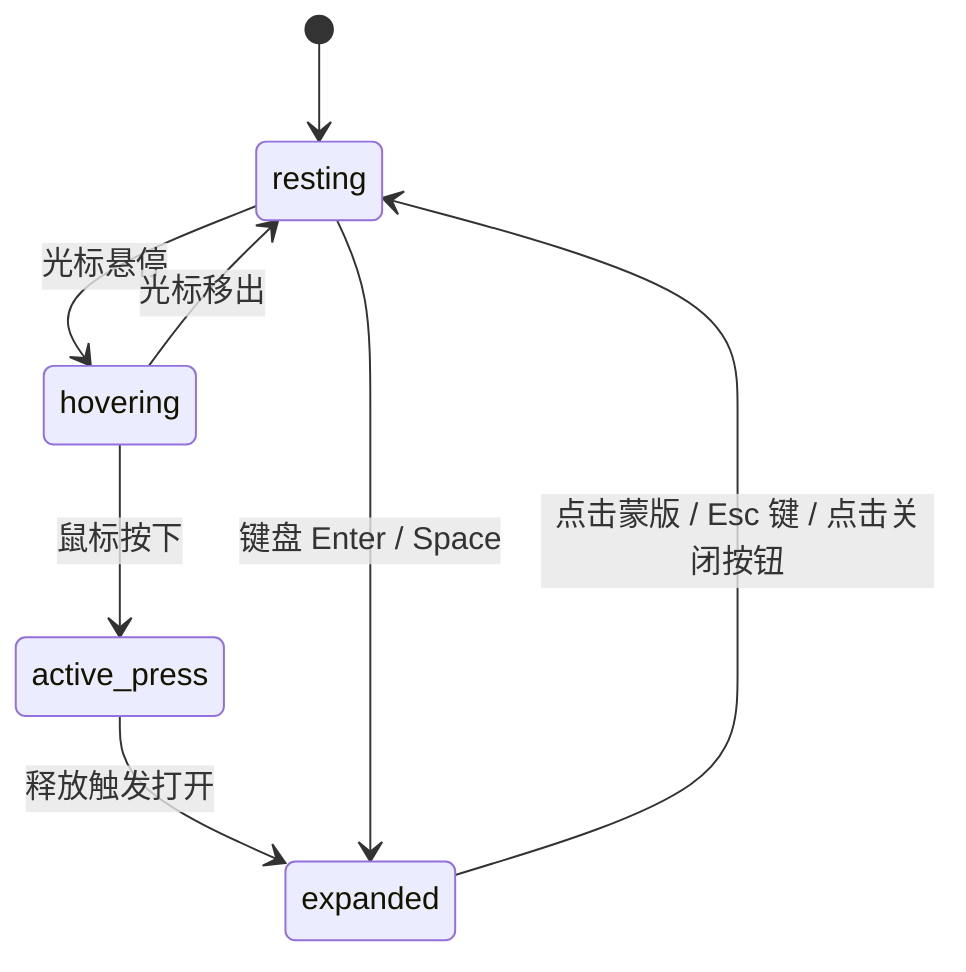

# Card · 交互式卡片

集合封面图片、元数据排版、状态操作与沉浸式全屏快速预览（Quick Look）的高品质内容卡片。包含四大核心动效机制：

1. 悬停浮起与主图平滑变焦：悬停时卡片整体微升 `translateY(-2px)`，投射深层漫反射阴影；内部图片在 600ms 内微缩放至 1.03 倍，呈现呼吸感层次。
2. 背景高斯景深与全屏磨砂转场：点击卡片后，背景舞台以 340ms 执行 `blur(14px) saturate(160%)` 景深虚化与 `scale(0.985)` 沉降；全屏半透明蒙版淡入（`backdrop-filter: blur(16px)`）。
3. 详情弹层弹簧膨胀进场：弹层自 `scale(0.94)` 经弹簧动效（320ms `cubic-bezier(0.16, 1, 0.3, 1)`）放大至 1.0 展开呈现详细参数。
4. 原地内联状态同步与 Esc 焦点闭环：卡片内与弹层内的收藏动作保持双向同步；按下 Esc 或点击关闭按钮平滑复原。

## 原型清单

| 原型分组 | 原型元素 | 动效 / 状态变化 | 去向 |
| --- | --- | --- | --- |
| 宿主外框 | 卡片容器（`.arc-card`） | 悬停 `translateY(-2px)`，按压 `scale(0.99)`，阴影抬升 | 最小 DOM / CSS |
| 封面媒体 | 卡片图片（`.arc-card-photo`） | 悬停 600ms 平滑缩放至 `scale(1.03)` | 悬停浮起与主图平滑变焦 |
| 内联动作 | 收藏按钮（`.arc-card-btn-save`） | 按压 `scale(0.96)`，收藏状态文案置换 | 原地内联状态同步 |
| 背景景深 | 磨砂蒙版（`.arc-card-overlay`） | 全屏 16px 高斯模糊淡入，宿主 14px 景深模糊 | 背景高斯景深与全屏磨砂转场 |
| 展开弹层 | 详情面板（`.arc-card-modal`） | 自 `scale(0.94)` 弹簧放大进场，展示属性表格 | 详情弹层弹簧膨胀进场 |
| 关闭控件 | 磨砂关闭按钮（`.arc-card-btn-close`） | 玻璃拟态半透明圆形按钮，悬停微扩 `scale(1.05)` | 原型与最小 DOM |
| 演示外壳 | 顶部主题切换按钮（`#themeToggle`） | 切换浅色/暗色主题 | 演示外壳，已删除 |
| 演示外壳 | 页面主舞台容器（`.stage`） | 仅作为页面展示中心对齐外壳 | 演示外壳，已删除 |

## 适用

- 灵感图库、电商商品陈列、文章画报索引卡片。
- 需要在列表页直接提供沉浸式“快速预览（Quick Look）”，而无需跳转新页面。
- 卡片内部具备轻量级交互（如收藏、点赞、加入看板），并需与弹层详情双向实时联动。

## 不适用

- 多张卡片重叠成堆、通过手势左右拖拽滑出进行快速归档/通过决策 → [card-stack](card-stack.md)
- 带有指标数字滚轮、百分比涨跌幅及时间周期切换的仪表盘看板卡片 → [metric-card](metric-card.md)
- 纯展示性用户头像与状态指示徽标 → [avatar](../avatars/avatar.md)

## 状态机

| 状态 | 进入条件 | 视觉表现 | 退出到 |
| --- | --- | --- | --- |
| resting | 初始常态 | 基础卡片在流内呈现，图片处于 1.0 比例，阴影为静止态 | hovering |
| hovering | 光标悬停在卡片上 | 卡片上浮 2px，图片平滑放大至 1.03 倍，边框加深 | resting / active-press / expanded |
| active-press | 光标或触摸按下卡片 | 卡片下压 `scale(0.99)` | hovering / expanded |
| expanded | 点击卡片或按下 Enter/Space | 背景执行景深虚化与沉降，蒙版淡入，详情弹层自 0.94 弹簧放大并获得焦点 | resting |



## 最小 DOM

```html
<div class="arc-card-container">
  <!-- 流内交互卡片 -->
  <article class="arc-card" role="button" aria-haspopup="dialog" aria-expanded="false" tabindex="0">
    <div class="arc-card-photo-wrap">
      
    </div>
    <div class="arc-card-content">
      <h3 class="arc-card-title">Lobby lounge</h3>
      <p class="arc-card-desc">A deep armchair and ottoman against dark green walls, lit by one window.</p>
      <div class="arc-card-footer">
        <div class="arc-card-byline">
          <span class="arc-card-author">Sofia Ramirez</span>
          <span class="arc-card-status">Updated 2 hours ago</span>
        </div>
        <button class="arc-card-btn-save" type="button">Save</button>
      </div>
    </div>
  </article>

  <!-- 全屏高斯景深蒙版 -->
  <div class="arc-card-overlay" aria-hidden="true"></div>

  <!-- 展开详情面板 (Quick Look Dialog) -->
  <div class="arc-card-modal" role="dialog" aria-modal="true" aria-labelledby="modalCardTitle">
    <button class="arc-card-btn-close" type="button" aria-label="Close dialog">
      <svg width="15" height="15" viewBox="0 0 24 24" fill="none" stroke="currentColor" stroke-width="2.2" stroke-linecap="round" stroke-linejoin="round">
        <line x1="18" y1="6" x2="6" y2="18"></line>
        <line x1="6" y1="6" x2="18" y2="18"></line>
      </svg>
    </button>
    <div class="arc-card-modal-photo-wrap">
      
    </div>
    <div class="arc-card-modal-content">
      <h2 class="arc-card-modal-title" id="modalCardTitle">Lobby lounge</h2>
      <p class="arc-card-modal-desc">A deep armchair and ottoman against dark green walls, lit by one window.</p>
      <div class="arc-card-modal-footer">
        <span class="arc-card-modal-status">Updated 2 hours ago</span>
        <button class="arc-card-modal-btn-save" type="button">Save</button>
      </div>
      <div class="arc-card-details">
        <div class="arc-card-detail-row">
          <span class="arc-card-detail-key">Space</span>
          <span class="arc-card-detail-val">Lobby, level 2</span>
        </div>
        <div class="arc-card-detail-row">
          <span class="arc-card-detail-key">Materials</span>
          <span class="arc-card-detail-val">Wool, velvet, smoked oak</span>
        </div>
      </div>
    </div>
  </div>
</div>
```

- `.arc-card-container`：组件封装容器，承载卡片与弹层蒙版生命周期。
- `.arc-card`：流式卡片，承载 `tabindex="0"` 与 `aria-haspopup="dialog"`。
- `.arc-card-photo-wrap` / `.arc-card-photo`：图片遮罩容器与平滑缩放主图。
- `.arc-card-overlay`：全屏模糊磨砂蒙版。
- `.arc-card-modal`：沉浸式详情弹层，居中弹簧缩放展现。

## 参数

| 名称 | 值 | 用于 | 来源 |
| --- | --- | --- | --- |
| 卡片悬停位移 | `translateY(-2px)` | `.arc-card:hover` | 原型 |
| 卡片悬停弹簧时长 | `340ms` / `cubic-bezier(0.16, 1, 0.3, 1)` | 卡片浮起过渡 | 原型 |
| 封面图变焦时长 | `600ms` / `cubic-bezier(0.2, 0, 0, 1)` | `.arc-card:hover .arc-card-photo` 放大至 1.03 | 原型 |
| 卡片按下缩放 | `scale(0.99)` | `.arc-card:active` | 原型 |
| 背景景深虚化与缩放 | `blur(14px) saturate(160%)` / `scale(0.985)` | 蒙版激活时宿主虚化 | 原型 |
| 蒙版高斯模糊 | `backdrop-filter: blur(16px) saturate(180%)` | `.arc-card-overlay` | 原型 |
| 蒙版淡入时长 | `280ms` / `cubic-bezier(0.2, 0, 0, 1)` | `.arc-card-overlay` opacity 过渡 | 原型 |
| 弹层弹簧膨胀时长 | `320ms` / `cubic-bezier(0.16, 1, 0.3, 1)` | 弹层从 `scale(0.94)` 膨胀至 1.0 | 原型 |
| 弹层最大宽度 | `min(calc(100vw - 32px), 480px)` | `.arc-card-modal` 宽度限制 | 原型 |
| 收藏按钮按压缩放 | `scale(0.96)` | `.arc-card-btn-save:active` | 原型 |

## CSS

```css
.arc-card-container {
  --card-bg: #ffffff;
  --card-foreground: #18181b;
  --card-secondary: #71717a;
  --card-border: rgba(0, 0, 0, 0.08);
  --card-border-strong: rgba(0, 0, 0, 0.16);
  --card-accent: #18181b;
  --card-accent-text: #ffffff;
  --card-shadow: 0 20px 48px -12px rgba(0, 0, 0, 0.08), 0 4px 16px -2px rgba(0, 0, 0, 0.03);
  --card-shadow-hover: 0 24px 56px -12px rgba(0, 0, 0, 0.12);
  --modal-shadow: 0 28px 72px -16px rgba(0, 0, 0, 0.22);

  position: relative;
  display: inline-flex;
  box-sizing: border-box;
}

/* 基础流内卡片 */
.arc-card {
  position: relative;
  display: flex;
  flex-direction: column;
  width: 100%;
  max-width: 368px;
  border: 1px solid var(--card-border);
  border-radius: 20px;
  background: var(--card-bg);
  overflow: hidden;
  cursor: pointer;
  box-shadow: var(--card-shadow);
  transition: transform 340ms cubic-bezier(0.16, 1, 0.3, 1),
              box-shadow 220ms cubic-bezier(0.2, 0, 0, 1),
              border-color 140ms cubic-bezier(0.2, 0, 0, 1);
  will-change: transform;
  outline: none;
}

.arc-card:hover {
  transform: translateY(-2px);
  box-shadow: var(--card-shadow-hover);
  border-color: var(--card-border-strong);
}

.arc-card:active {
  transform: scale(0.99);
}

/* 卡片封面图变焦 */
.arc-card-photo-wrap {
  position: relative;
  width: 100%;
  height: 236px;
  overflow: hidden;
  background: #f4f4f5;
}

.arc-card-photo {
  width: 100%;
  height: 100%;
  object-fit: cover;
  display: block;
  transition: transform 600ms cubic-bezier(0.2, 0, 0, 1);
}

.arc-card:hover .arc-card-photo {
  transform: scale(1.03);
}

/* 内容排版 */
.arc-card-content {
  padding: 20px;
  display: flex;
  flex-direction: column;
  box-sizing: border-box;
}

.arc-card-title {
  font-size: 1.125rem;
  font-weight: 500;
  color: var(--card-foreground);
  margin: 0;
  line-height: 1.3;
}

.arc-card-desc {
  margin-top: 8px;
  color: var(--card-secondary);
  font-size: 0.875rem;
  line-height: 1.45;
  margin-bottom: 0;
}

/* 卡片底部操作 */
.arc-card-footer {
  display: flex;
  align-items: center;
  justify-content: space-between;
  gap: 12px;
  margin-top: 20px;
}

.arc-card-byline {
  display: flex;
  flex-direction: column;
  min-width: 0;
}

.arc-card-author {
  font-size: 0.75rem;
  font-weight: 500;
  color: var(--card-foreground);
}

.arc-card-status {
  font-size: 0.75rem;
  color: var(--card-secondary);
  margin-top: 1px;
}

.arc-card-btn-save {
  display: inline-flex;
  height: 30px;
  align-items: center;
  justify-content: center;
  padding: 0 14px;
  border: 0;
  border-radius: 9999px;
  background: var(--card-accent);
  color: var(--card-accent-text);
  font-size: 0.75rem;
  font-weight: 500;
  cursor: pointer;
  transition: transform 80ms cubic-bezier(0.2, 0, 0, 1),
              background-color 140ms cubic-bezier(0.2, 0, 0, 1);
}

.arc-card-btn-save:hover {
  background: rgba(24, 24, 27, 0.88);
}

.arc-card-btn-save:active {
  transform: scale(0.96);
}

/* 磨砂蒙版 */
.arc-card-overlay {
  position: fixed;
  inset: 0;
  z-index: 1000;
  background: rgba(10, 10, 10, 0.46);
  -webkit-backdrop-filter: blur(16px) saturate(180%);
  backdrop-filter: blur(16px) saturate(180%);
  opacity: 0;
  pointer-events: none;
  transition: opacity 280ms cubic-bezier(0.2, 0, 0, 1);
}

.arc-card-overlay.is-active {
  opacity: 1;
  pointer-events: auto;
}

/* 沉浸式详情弹层 */
.arc-card-modal {
  position: fixed;
  top: 50%;
  left: 50%;
  transform: translate(-50%, -50%) scale(0.94);
  z-index: 1001;
  width: min(calc(100vw - 32px), 480px);
  max-height: calc(100vh - 48px);
  overflow-y: auto;
  border: 1px solid var(--card-border);
  border-radius: 24px;
  background: var(--card-bg);
  box-shadow: var(--modal-shadow);
  opacity: 0;
  pointer-events: none;
  transition: opacity 280ms cubic-bezier(0.2, 0, 0, 1),
              transform 320ms cubic-bezier(0.16, 1, 0.3, 1);
}

.arc-card-modal.is-active {
  opacity: 1;
  pointer-events: auto;
  transform: translate(-50%, -50%) scale(1);
}

/* 弹层关闭按钮 */
.arc-card-btn-close {
  position: absolute;
  top: 16px;
  right: 16px;
  z-index: 10;
  display: grid;
  place-items: center;
  width: 32px;
  height: 32px;
  padding: 0;
  border: 1px solid rgba(255, 255, 255, 0.3);
  border-radius: 9999px;
  background: rgba(255, 255, 255, 0.75);
  -webkit-backdrop-filter: blur(12px);
  backdrop-filter: blur(12px);
  color: #18181b;
  cursor: pointer;
  box-shadow: 0 2px 8px rgba(0, 0, 0, 0.12);
  transition: transform 80ms ease, background-color 140ms ease;
}

.arc-card-btn-close:hover {
  transform: scale(1.05);
}

.arc-card-modal-photo-wrap {
  width: 100%;
  height: 280px;
  overflow: hidden;
}

.arc-card-modal-photo {
  width: 100%;
  height: 100%;
  object-fit: cover;
  display: block;
}

.arc-card-modal-content {
  padding: 24px;
}

.arc-card-modal-title {
  font-size: 1.25rem;
  font-weight: 500;
  margin: 0;
}

.arc-card-modal-desc {
  margin-top: 8px;
  color: var(--card-secondary);
  font-size: 0.875rem;
}

.arc-card-modal-footer {
  display: flex;
  align-items: center;
  justify-content: space-between;
  margin-top: 20px;
}

.arc-card-modal-status {
  font-size: 0.75rem;
  color: var(--card-secondary);
}

.arc-card-modal-btn-save {
  display: inline-flex;
  height: 30px;
  align-items: center;
  justify-content: center;
  padding: 0 14px;
  border: 0;
  border-radius: 9999px;
  background: var(--card-accent);
  color: var(--card-accent-text);
  font-size: 0.75rem;
  font-weight: 500;
  cursor: pointer;
}

.arc-card-details {
  margin-top: 20px;
  padding-top: 16px;
  border-top: 1px solid var(--card-border);
  display: flex;
  flex-direction: column;
  gap: 12px;
}

.arc-card-detail-row {
  display: flex;
  align-items: center;
  justify-content: space-between;
  font-size: 0.875rem;
}

.arc-card-detail-key {
  color: var(--card-secondary);
}

.arc-card-detail-val {
  color: var(--card-foreground);
  font-weight: 500;
}

/* 减少动态效果 */
@media (prefers-reduced-motion: reduce) {
  .arc-card {
    transition: none !important;
  }
  .arc-card:hover {
    transform: none !important;
  }
  .arc-card-photo {
    transition: none !important;
  }
  .arc-card:hover .arc-card-photo {
    transform: none !important;
  }
  .arc-card-modal {
    transform: translate(-50%, -50%) !important;
    transition: opacity 140ms linear !important;
  }
  .arc-card-overlay {
    transition: opacity 140ms linear !important;
  }
}
```

## JS

```js
/**
 * 纯原生 Card 交互与 Quick Look 动效控制器
 * @param {HTMLElement} el 组件宿主容器
 * @param {Object} [options] 配置项
 * @param {Function} [options.onSaveChange] 收藏状态回调 (isSaved) => void
 */
export function createCard(el, options = {}) {
  const cardTrigger = el.querySelector('.arc-card') || el;
  const overlay = el.querySelector('.arc-card-overlay');
  const modal = el.querySelector('.arc-card-modal');
  const btnClose = el.querySelector('.arc-card-btn-close');
  const btnSave = el.querySelector('.arc-card-btn-save');
  const modalBtnSave = el.querySelector('.arc-card-modal-btn-save');
  const statusText = el.querySelector('.arc-card-status');
  const modalStatusText = el.querySelector('.arc-card-modal-status');

  let isSaved = false;
  let isOpen = false;
  let disposed = false;

  function openModal() {
    if (isOpen || !modal || !overlay) return;
    isOpen = true;
    cardTrigger.setAttribute('aria-expanded', 'true');
    overlay.classList.add('is-active');
    modal.classList.add('is-active');
    if (btnClose) btnClose.focus();
  }

  function closeModal() {
    if (!isOpen || !modal || !overlay) return;
    isOpen = false;
    cardTrigger.setAttribute('aria-expanded', 'false');
    modal.classList.remove('is-active');
    overlay.classList.remove('is-active');
    if (cardTrigger && typeof cardTrigger.focus === 'function') {
      cardTrigger.focus();
    }
  }

  function toggleSave(e) {
    if (e) e.stopPropagation();
    isSaved = !isSaved;
    const text = isSaved ? 'Saved to your board' : 'Updated 2 hours ago';
    if (statusText) statusText.textContent = text;
    if (modalStatusText) modalStatusText.textContent = text;
    const btnLabel = isSaved ? 'Saved' : 'Save';
    if (btnSave) btnSave.textContent = btnLabel;
    if (modalBtnSave) modalBtnSave.textContent = btnLabel;
    options.onSaveChange?.(isSaved);
  }

  function onCardClick(e) {
    if (e.target.closest('.arc-card-btn-save')) return;
    openModal();
  }

  function onCardKeyDown(e) {
    if (e.key === 'Enter' || e.key === ' ') {
      e.preventDefault();
      openModal();
    }
  }

  function onWindowKeyDown(e) {
    if (e.key === 'Escape' && isOpen) {
      closeModal();
    }
  }

  // 绑定事件
  cardTrigger.addEventListener('click', onCardClick);
  cardTrigger.addEventListener('keydown', onCardKeyDown);
  if (btnClose) btnClose.addEventListener('click', closeModal);
  if (overlay) overlay.addEventListener('click', closeModal);
  if (btnSave) btnSave.addEventListener('click', toggleSave);
  if (modalBtnSave) modalBtnSave.addEventListener('click', toggleSave);
  window.addEventListener('keydown', onWindowKeyDown);

  return {
    open: openModal,
    close: closeModal,
    toggleSave,
    destroy() {
      if (disposed) return;
      disposed = true;
      closeModal();
      cardTrigger.removeEventListener('click', onCardClick);
      cardTrigger.removeEventListener('keydown', onCardKeyDown);
      if (btnClose) btnClose.removeEventListener('click', closeModal);
      if (overlay) overlay.removeEventListener('click', closeModal);
      if (btnSave) btnSave.removeEventListener('click', toggleSave);
      if (modalBtnSave) modalBtnSave.removeEventListener('click', toggleSave);
      window.removeEventListener('keydown', onWindowKeyDown);
    }
  };
}
```

## 接入目标项目

- 状态来源：
  - 由内容卡片数据模型直接驱动（如文章标题、封面图、作者、发布状态）。
- 尺寸策略：
  - 默认卡片最大宽度为 368px，高度自适应内容。可放入 CSS Grid 栅格自适应流式排布。
- 驱动方式：
  - 在卡片挂载时调用 `createCard(el)` 绑定交互；支持外部调用 `open()` 或 `close()` 编程式控制。

## 重入与清理

- 连续快速点击：通过内部 `isOpen` 标记与类名控制防重入，避免动画帧叠加。
- 焦点管理与卸载：`destroy()` 自动解除全局 `window.addEventListener('keydown')` 监听，保证单页应用路由切换无残留事件泄露。

## 减少动态效果

- 满足 `prefers-reduced-motion: reduce` 时：
  - 卡片悬停 `translateY(-2px)` 与主图 `scale(1.03)` 放大被禁用。
  - 详情弹层关闭 `scale(0.94)` 弹簧缩放，改为 140ms 纯透明度渐变切换。

## 焦点与键盘

- 卡片外框具备 `role="button"`、`tabindex="0"` 与 `aria-haspopup="dialog"`。
- 打开弹层时，键盘焦点主动移至弹层内的关闭按钮（`.arc-card-btn-close`）。
- 全局监听 `Escape` 键，按下时关闭弹层并将焦点无损返还至原卡片触发器。

## 兼容回退

| 特性 | 不支持时 |
| --- | --- |
| `backdrop-filter: blur()` | 回退为半透明深色纯色背景遮罩，不影响弹层前景文字与图像可读性。 |
| CSS Grid / Flexbox | 流式排版降级，弹层通过传统绝对居中正常展示。 |

## 验收清单

- [ ] 光标悬停在卡片上产生微上浮与主图平滑轻微变焦放大。
- [ ] 点击卡片触发全屏高斯磨砂蒙版淡入，详情面板自 0.94 弹簧平滑放大至 1.0 展现。
- [ ] 点击保存按钮，卡片与弹层内的文案及按钮状态同步更新。
- [ ] 按下 Esc 键或点击关闭按钮，弹层平滑收缩关闭，键盘焦点精准返还。
- [ ] 开启系统减少动态效果时，所有缩放与位移动画安全关闭，呈纯透明度淡化。
