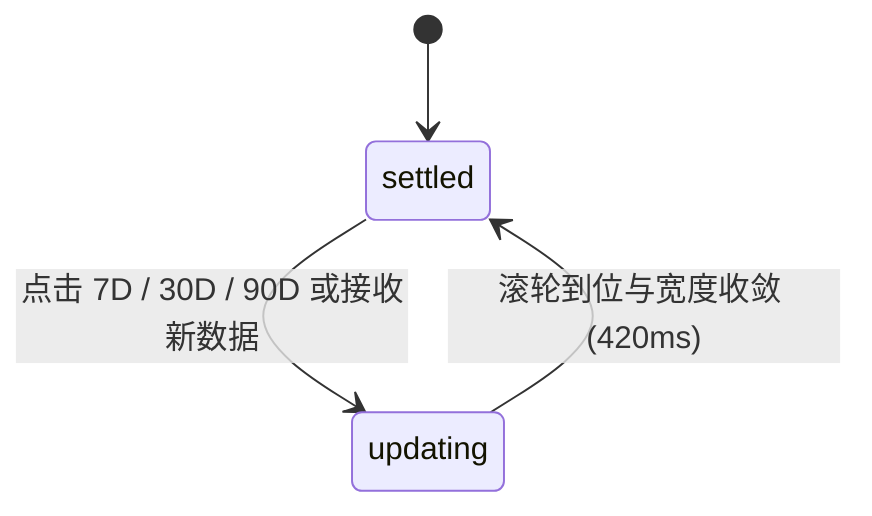

# Metric Card · 指标统计卡片

集成机械垂直数字滚轮计数器、平滑自适应涨跌幅胶囊与分段周期切换的高性能指标卡片。包含四大核心动效机制：

1. 零抖动垂直滚轮计数器（Ghost Sizer & Odometer Rolling）：数值变化时（如 `2,486` → `12,940`），每个数字槽位通过幽灵占位符（Ghost Sizer）锁死物理宽度；各数字列垂直滚动至目标字形（`translateY(-${digit * 10}%)`），并带 25ms 错峰时序，外框绝对 0 像素抖动。
2. 涨跌幅胶囊弹簧形变（Change Pill Width & Spring Morph）：显示 `+18.4%`（绿）或 `-5.2%`（红）趋势标签；数值位宽变动时，胶囊宽度以弹簧动效（`visualDuration: 0.42s, bounce: 0.16`）平滑舒展收缩。
3. 文案微模糊形态置换（Micro-Blur Text Swap）：周期切换时，标题与比较说明文案经 240ms/160ms 高斯微模糊在原位垂直淡化过渡，杜绝 DOM 硬切闪烁。
4. 分段周期切换联动（Roving Tabindex Range Bar）：提供 7D / 30D / 90D 周期切换按钮组，支持全键盘左右方向键导航与激活状态平滑指示。

## 原型清单

| 原型分组 | 原型元素 | 动效 / 状态变化 | 去向 |
| --- | --- | --- | --- |
| 宿主外框 | 统计卡片（`.arc-metric-card`） | 圆角卡片容器与自适应排版 | 最小 DOM / CSS |
| 顶部区域 | 标题与趋势胶囊（`.arc-metric-top`） | 标题文字微模糊置换，涨跌胶囊弹簧宽度伸缩 | 涨跌幅胶囊弹簧形变 |
| 核心指标 | 数字计数器（`.arc-metric-counter`） | 垂直 Odometer 滚轮，幽灵占位符防抖 | 零抖动垂直滚轮计数器 |
| 比较说明 | 上下文文案（`.arc-metric-context`） | 微模糊垂直形态切换 | 文案微模糊形态置换 |
| 周期控制 | 范围切换栏（`.arc-metric-ranges`） | 7D/30D/90D 键盘 Roving Tabindex 与联动 | 分段周期切换联动 |
| 演示外壳 | 顶部主题切换按钮（`#themeBtn`） | 切换深浅色主题 | 演示外壳，已删除 |

## 适用

- 运营后台、财务分析、系统监控等核心数据大屏与看板卡片。
- 数值频繁刷新或在不同时间跨度间切换，要求数值过渡平稳无外框抖动。
- 需要清晰展示正负涨跌幅趋势与时间对比说明。

## 不适用

- 单张图文卡片点击展开全屏大图预览与长文详情 → [card](card.md)
- 堆叠多张卡片进行手势拖拽滑动筛选决策 → [card-stack](card-stack.md)
- 独立单状态徽标或分类标签 → [badge](../avatars/badge.md)

## 状态机

| 状态 | 进入条件 | 视觉表现 | 退出到 |
| --- | --- | --- | --- |
| settled | 初始加载完成或切换完毕 | 滚轮静止于当前数值，趋势胶囊呈现对应涨跌样式 | updating |
| updating | 用户切换时间范围或后端推送新数据 | 数字滚轮依位移差错峰滚动，趋势胶囊执行宽度弹簧伸缩，标题与说明微模糊切换 | settled |



## 最小 DOM

```html
<article class="arc-metric-card">
  <!-- 顶部标题与涨跌趋势胶囊 -->
  <div class="arc-metric-top">
    <div class="arc-metric-label-host">
      <span class="arc-metric-label">Weekly active users</span>
    </div>
    <small class="arc-metric-change" data-trend="up">
      <span class="arc-metric-change-sizer" aria-hidden="true">+18.4%</span>
      <span class="arc-metric-change-text">+18.4%</span>
    </small>
  </div>

  <!-- 核心机械数字滚轮 -->
  <div class="arc-metric-counter" role="text" aria-label="2,486">
    <div class="arc-counter-odometer">
      <span class="arc-counter-col" data-value="2">
        <span class="arc-counter-sizer" aria-hidden="true">0</span>
        <span class="arc-counter-strip">0123456789</span>
      </span>
      <span class="arc-counter-symbol">,</span>
      <span class="arc-counter-col" data-value="4">
        <span class="arc-counter-sizer" aria-hidden="true">0</span>
        <span class="arc-counter-strip">0123456789</span>
      </span>
      <span class="arc-counter-col" data-value="8">
        <span class="arc-counter-sizer" aria-hidden="true">0</span>
        <span class="arc-counter-strip">0123456789</span>
      </span>
      <span class="arc-counter-col" data-value="6">
        <span class="arc-counter-sizer" aria-hidden="true">0</span>
        <span class="arc-counter-strip">0123456789</span>
      </span>
    </div>
  </div>

  <!-- 底部对比上下文说明 -->
  <p class="arc-metric-context">
    <span class="arc-metric-context-text">Compared with the last 7 days</span>
  </p>

  <!-- 周期切换分段器 -->
  <div class="arc-metric-ranges" role="group" aria-label="Metric range">
    <button class="arc-metric-range-btn" type="button" data-range="7D" aria-pressed="true" tabindex="0">7D</button>
    <button class="arc-metric-range-btn" type="button" data-range="30D" aria-pressed="false" tabindex="-1">30D</button>
    <button class="arc-metric-range-btn" type="button" data-range="90D" aria-pressed="false" tabindex="-1">90D</button>
  </div>
</article>
```

- `.arc-metric-card`：主卡片容器，具有固定圆角、边框与内边距。
- `.arc-metric-top`：顶栏容器，弹性对齐标题与涨跌胶囊。
- `.arc-metric-change`：涨跌幅趋势胶囊，`data-trend="up"` 或 `data-trend="down"`。
- `.arc-counter-odometer`：垂直滚轮宿主，包含各数字列与分隔符。
- `.arc-counter-sizer`：幽灵占位符，锁定固定宽度杜绝晃动。
- `.arc-counter-strip`：垂直连续数字条，通过 `translateY` 滚动。
- `.arc-metric-ranges`：周期切换分段控制条。

## 参数

| 名称 | 值 | 用于 | 来源 |
| --- | --- | --- | --- |
| 滚轮数字列切换时长 | `320ms` | `transition: transform 320ms` | 原型 |
| 滚轮弹簧回弹曲线 | `cubic-bezier(0.18, 0.89, 0.32, 1.15)` | 数字滚动缓动 | 原型 |
| 滚轮数字列错峰延迟 | `25ms / col` | `transition-delay: ${i * 25}ms` | 原型 |
| 胶囊宽度弹簧时长 | `420ms` (`visualDuration: 0.42`, `bounce: 0.16`) | `.arc-metric-change` width 伸缩 | 原型 |
| 胶囊进场起始缩放 | `scale(0.96)` | 胶囊新增时初始缩放 | 原型 |
| 文案形态切换时长 | 进场 `240ms`，退场 `160ms` | 标题与副标题微模糊置换 | 原型 |
| 文案形态位移与模糊 | `translateY(0.3em)` / `blur(4px)` | 进场初值 | 原型 |
| 减少动态效果淡化时长 | `120ms` | prefers-reduced-motion 模式 | 原型 |

## CSS

```css
.arc-metric-card {
  --card-width: 320px;
  --card-bg: #ffffff;
  --card-border: rgba(0, 0, 0, 0.08);
  --card-foreground: #18181b;
  --card-secondary: #71717a;
  --card-trend-up: #16a34a;
  --card-trend-down: #dc2626;

  position: relative;
  display: flex;
  flex-direction: column;
  width: 100%;
  max-width: var(--card-width);
  border: 1px solid var(--card-border);
  border-radius: 20px;
  background: var(--card-bg);
  padding: 24px;
  box-shadow: 0 4px 16px -2px rgba(0, 0, 0, 0.05);
  box-sizing: border-box;
  user-select: none;
}

/* 顶部标题与胶囊 */
.arc-metric-top {
  display: flex;
  align-items: center;
  justify-content: space-between;
  gap: 12px;
  position: relative;
  min-height: 24px;
}

.arc-metric-label {
  font-size: 0.875rem;
  font-weight: 500;
  color: var(--card-secondary);
  transition: opacity 240ms ease, filter 240ms ease;
}

/* 涨跌幅胶囊 */
.arc-metric-change {
  display: inline-flex;
  align-items: center;
  justify-content: center;
  position: relative;
  padding: 2px 8px;
  border-radius: 9999px;
  font-size: 0.75rem;
  font-weight: 600;
  line-height: 1;
  transition: width 420ms cubic-bezier(0.16, 1, 0.3, 1),
              background-color 220ms ease,
              color 220ms ease;
  will-change: width;
}

.arc-metric-change[data-trend="up"] {
  background: rgba(22, 163, 74, 0.1);
  color: var(--card-trend-up);
}

.arc-metric-change[data-trend="down"] {
  background: rgba(220, 38, 38, 0.1);
  color: var(--card-trend-down);
}

.arc-metric-change-sizer {
  visibility: hidden;
  user-select: none;
}

.arc-metric-change-text {
  position: absolute;
  inset: 0;
  display: flex;
  align-items: center;
  justify-content: center;
  transition: opacity 240ms ease, filter 240ms ease;
}

/* 核心数字滚轮 */
.arc-metric-counter {
  margin-top: 14px;
  display: flex;
  align-items: baseline;
  font-family: ui-monospace, SFMono-Regular, Menlo, Monaco, Consolas, monospace;
  font-size: 2.25rem;
  font-weight: 700;
  color: var(--card-foreground);
  line-height: 1.1;
  letter-spacing: -0.03em;
}

.arc-counter-odometer {
  display: inline-flex;
  align-items: baseline;
  position: relative;
  overflow: hidden;
  height: 1.1em;
}

.arc-counter-col {
  position: relative;
  display: inline-flex;
  overflow: hidden;
  height: 1.1em;
}

.arc-counter-sizer {
  visibility: hidden;
  user-select: none;
}

.arc-counter-strip {
  position: absolute;
  top: 0;
  left: 0;
  display: flex;
  flex-direction: column;
  transition: transform 320ms cubic-bezier(0.18, 0.89, 0.32, 1.15);
  will-change: transform;
}

.arc-counter-symbol {
  display: inline-block;
  user-select: none;
}

/* 底部说明 */
.arc-metric-context {
  margin-top: 10px;
  margin-bottom: 0;
  font-size: 0.8125rem;
  color: var(--card-secondary);
  line-height: 1.4;
}

.arc-metric-context-text {
  display: inline-block;
  transition: opacity 240ms ease, filter 240ms ease;
}

/* 周期切换栏 */
.arc-metric-ranges {
  display: inline-flex;
  align-items: center;
  gap: 4px;
  margin-top: 20px;
  padding: 3px;
  border-radius: 9999px;
  background: #f4f4f5;
  width: fit-content;
}

.arc-metric-range-btn {
  display: inline-flex;
  align-items: center;
  justify-content: center;
  padding: 4px 12px;
  border: 0;
  border-radius: 9999px;
  background: transparent;
  color: var(--card-secondary);
  font-size: 0.75rem;
  font-weight: 500;
  cursor: pointer;
  transition: background-color 160ms ease, color 160ms ease;
  outline: none;
}

.arc-metric-range-btn[aria-pressed="true"] {
  background: #ffffff;
  color: var(--card-foreground);
  box-shadow: 0 1px 3px rgba(0, 0, 0, 0.08);
}

/* 减少动态效果 */
@media (prefers-reduced-motion: reduce) {
  .arc-counter-strip {
    transition: none !important;
  }
  .arc-metric-change {
    transition: none !important;
  }
  .arc-metric-label,
  .arc-metric-change-text,
  .arc-metric-context-text {
    transition: opacity 120ms linear !important;
    filter: none !important;
  }
}
```

## JS

```js
/**
 * 纯原生 MetricCard 数据联动与滚轮动效控制器
 * @param {HTMLElement} el 宿主容器节点
 * @param {Object} options 配置项
 * @param {string} [options.label='Weekly active users'] 标题
 * @param {string} [options.value='2,486'] 核心数值
 * @param {string} [options.change='+18.4%'] 涨跌趋势
 * @param {string} [options.context='Compared with the last 7 days'] 补充说明
 * @param {Function} [options.onRangeChange] 周期切换回调 (range) => void
 */
export function createMetricCard(el, options = {}) {
  let config = {
    label: 'Weekly active users',
    value: '2,486',
    change: '+18.4%',
    context: 'Compared with the last 7 days',
    ...options
  };

  const labelEl = el.querySelector('.arc-metric-label');
  const changeEl = el.querySelector('.arc-metric-change');
  const changeSizer = el.querySelector('.arc-metric-change-sizer');
  const changeText = el.querySelector('.arc-metric-change-text');
  const odometerEl = el.querySelector('.arc-counter-odometer');
  const counterContainer = el.querySelector('.arc-metric-counter');
  const contextTextEl = el.querySelector('.arc-metric-context-text');
  const rangeBtns = el.querySelectorAll('.arc-metric-range-btn');

  let disposed = false;

  function setNumberValue(numStr) {
    if (!odometerEl) return;
    odometerEl.innerHTML = '';
    const chars = String(numStr).split('');

    chars.forEach((char, i) => {
      if (/\d/.test(char)) {
        const col = document.createElement('span');
        col.className = 'arc-counter-col';
        col.dataset.value = char;

        const sizer = document.createElement('span');
        sizer.className = 'arc-counter-sizer';
        sizer.setAttribute('aria-hidden', 'true');
        sizer.textContent = '0';

        const strip = document.createElement('span');
        strip.className = 'arc-counter-strip';
        strip.textContent = '0123456789';

        const targetDigit = parseInt(char, 10);
        strip.style.transitionDelay = `${i * 25}ms`;
        strip.style.transform = `translateY(-${targetDigit * 10}%)`;

        col.appendChild(sizer);
        col.appendChild(strip);
        odometerEl.appendChild(col);
      } else {
        const sym = document.createElement('span');
        sym.className = 'arc-counter-symbol';
        sym.textContent = char;
        odometerEl.appendChild(sym);
      }
    });

    if (counterContainer) {
      counterContainer.setAttribute('aria-label', String(numStr));
    }
  }

  function updateChange(changeStr) {
    if (!changeEl) return;
    const isUp = /^\+/.test(changeStr);
    const isDown = /^[-−]/.test(changeStr);
    changeEl.dataset.trend = isUp ? 'up' : isDown ? 'down' : 'neutral';

    if (changeSizer) changeSizer.textContent = changeStr;
    if (changeText) changeText.textContent = changeStr;
  }

  function swapTextWithBlur(element, nextText) {
    if (!element || element.textContent === nextText) return;
    element.style.opacity = '0';
    element.style.filter = 'blur(2px)';
    setTimeout(() => {
      if (disposed) return;
      element.textContent = nextText;
      element.style.opacity = '1';
      element.style.filter = 'blur(0)';
    }, 120);
  }

  function applyState(nextState) {
    config = { ...config, ...nextState };
    if (labelEl && nextState.label) swapTextWithBlur(labelEl, nextState.label);
    if (contextTextEl && nextState.context) swapTextWithBlur(contextTextEl, nextState.context);
    if (nextState.change) updateChange(nextState.change);
    if (nextState.value) setNumberValue(nextState.value);
  }

  // 绑定时间周期切换
  rangeBtns.forEach((btn, index) => {
    btn.addEventListener('click', () => {
      rangeBtns.forEach(b => {
        b.setAttribute('aria-pressed', 'false');
        b.setAttribute('tabindex', '-1');
      });
      btn.setAttribute('aria-pressed', 'true');
      btn.setAttribute('tabindex', '0');
      const range = btn.dataset.range;
      options.onRangeChange?.(range);
    });

    btn.addEventListener('keydown', (e) => {
      if (e.key === 'ArrowRight' || e.key === 'ArrowDown') {
        e.preventDefault();
        const next = rangeBtns[(index + 1) % rangeBtns.length];
        next.focus();
        next.click();
      } else if (e.key === 'ArrowLeft' || e.key === 'ArrowUp') {
        e.preventDefault();
        const prev = rangeBtns[(index - 1 + rangeBtns.length) % rangeBtns.length];
        prev.focus();
        prev.click();
      }
    });
  });

  // 初始化首次状态
  setNumberValue(config.value);
  updateChange(config.change);

  return {
    update: applyState,
    destroy() {
      if (disposed) return;
      disposed = true;
      if (odometerEl) odometerEl.innerHTML = '';
    }
  };
}
```

## 接入目标项目

- 状态来源：
  - 由仪表盘后端指标聚合接口驱动（提供当前周期累计数值、同比环比涨跌幅及计算周期文案）。
- 尺寸策略：
  - 默认推荐最大宽度 320px，高度自然收纳各文本行与控制栏，适配响应式栅格布局。
- 驱动方式：
  - 挂载时调用 `createMetricCard(el, options)`；当选择不同的聚合周期时调用 `update({ value, change, context, label })`。

## 重入与清理

- 快速切换周期防抖：`setNumberValue` 重新挂载字素条并根据新值即刻计算目标位移，杜绝旧周期动画悬挂冲突。
- 销毁安全：`destroy()` 清理内部生成的 DOM 滚轮节点与计时器，防止未落定的模糊状态持续占用内存。

## 减少动态效果

- 满足 `prefers-reduced-motion: reduce` 时：
  - 彻底停用数字条垂直滚动，新数字直接呈现在最终位置。
  - 文案切换的高斯模糊（`blur`）被重置为 `none`，改以 120ms 纯透明度渐变切换。

## 焦点与键盘

- 核心指标采用 `role="text"` 并结合 `aria-label="2,486"`，向屏幕阅读器朗读完整格式化数字。
- 时间周期切换栏应用标准 Roving Tabindex 模式：激活项为 `tabindex="0"`，其余为 `-1`；支持左右方向键在各范围按钮间平滑循环切换并激活。

## 兼容回退

| 特性 | 不支持时 |
| --- | --- |
| CSS `ui-monospace` | 回退至标准 `monospace` 等宽字体族，确保字符列宽严格一致。 |
| WAAPI / Transitions | 回退为静态数值直切，所有商业数据与无障碍语义保持 100% 完好。 |

## 验收清单

- [ ] 初始渲染数值、涨跌幅、说明文案排版严谨，外框无任何晃动。
- [ ] 切换数值时，各数字列带错峰延迟垂直滚动到位，外框宽度保持 0 像素抖动锁定。
- [ ] 涨跌幅胶囊依据正负值正确展示红绿状态，宽度平滑自适应拉伸。
- [ ] 切换时间范围时，标题与对比文案通过轻微模糊平滑置换。
- [ ] 支持通过左右方向键在时间周期按钮间移动焦点并触发更新。
- [ ] 开启系统减少动态效果时，数字滚动与高斯模糊自动关闭。
