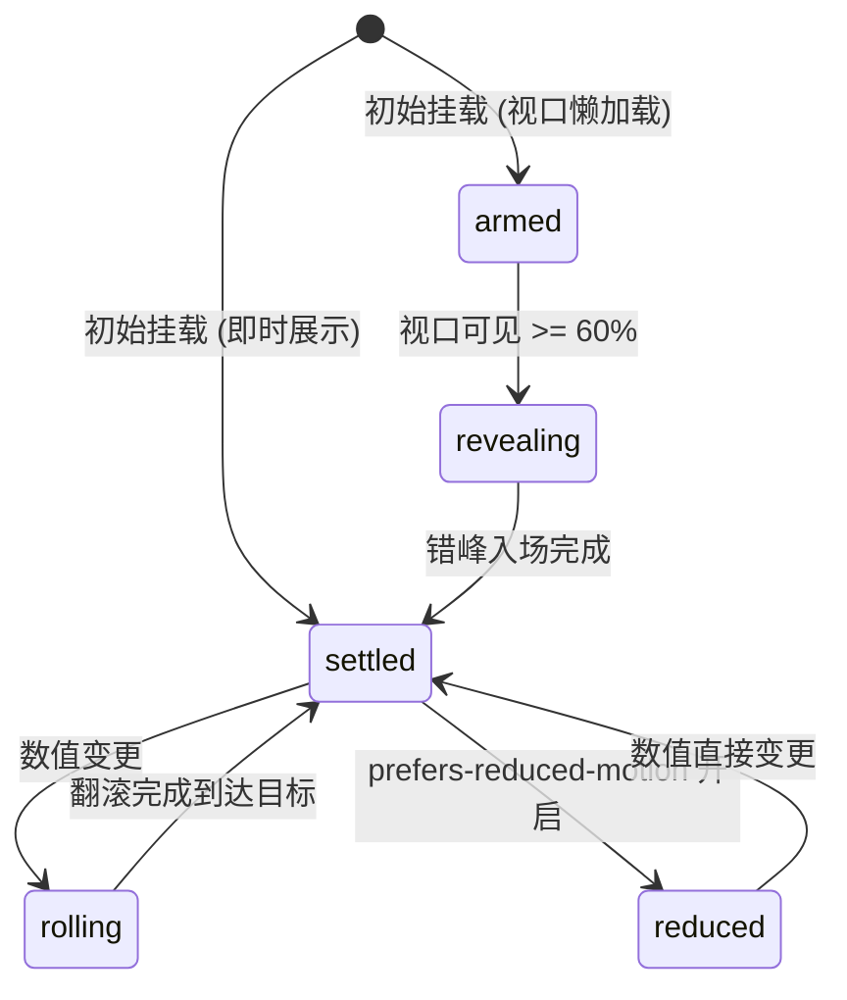

# Animated Counter · 数字翻滚计数器

用于统计指标、财务数据、计数器及实时响应量动态递增/递减时的机械数字轮盘翻滚动效。通过 Ghost Sizer（隐形占位符）锁死字符列物理几何尺寸，杜绝数字跳变引发的外框横向抖动与重排抖动；配合垂直滚轮与运动模糊模拟真实机械翻牌器质感。

## 原型清单

| 原型分组 | 原型元素 | 动效 / 状态变化 | 去向 |
| --- | --- | --- | --- |
| — | 计数器主容器 `.arc-counter-counter` | 宿主弹性布局、尺寸稳定承载与数值状态同步 | 最小 DOM / CSS 宿主 |
| — | 统计标签 `.arc-counter-label` | 标签文案 popLayout 错峰升降与高斯微模糊（swapText） | popLayout 标签切换 |
| — | 无障碍读屏标签 `.arc-counter-srOnly` | 实时同步无障碍千分位格式化纯文本 | 读屏同步槽位 |
| — | 滚轮数值容器 `.arc-counter-value` | 视觉层 `aria-hidden="true"`，承载多列数字轮盘与符号 | 滚轮视觉槽位 |
| — | 数字滚轮列 `.arc-counter-column` | 相对定位列、垂直溢出遮罩（羽化渐变）与数字定位 | 垂直 Odometer 轮盘 |
| — | 隐形占位符 `.arc-counter-sizer` | `visibility: hidden` 锁死列宽与行高，彻底消除抖动 | Ghost Sizer 机制 |
| — | 滚轮数字字素 `.arc-counter-glyph` | 0-9 垂直位移、透明度梯级衰减与动态运动模糊 | 数字轮盘插值算法 |
| — | 格式化分隔符号 `.arc-counter-symbol` | 千分位逗号、小数点、正负号与单位前后缀平滑入场 | 分隔符平滑挂载 |
| — | 外壳包裹按钮 `.previews-data_counterButton__hPDcx` | 演示点击触发数值递增 +240 | 演示外壳，已删除 |
| — | 提示文本 `.previews-data_counterHint__5NCTO` | 静态说明图标与文案 | 演示外壳，已删除 |
| — | 顶栏、主题切换按钮 `#themeBtn`、舞台卡片 | — | 演示外壳，已删除 |

## 适用

- 仪表盘 KPI 指标展示、营收数据增长、点赞/响应计数器等动态数值更新。
- 数值频繁变动时需要高质感机械轮盘翻滚，且要求外层容器保持 0 像素物理稳定。
- 需要支持多语言本地化数字格式化（千分位、浮点小数、货币前后缀）。
- 支持进入视口（IntersectionObserver 60% 阈值）时自动触发初次翻滚展示。

## 不适用

- 圆弧与表盘指针角度物理阻尼旋转 → [gauge](gauge.md)
- 迷你时间序列走势与极值点标注 → [sparkline](sparkline.md)
- 多段占比横向伸缩与分割线重平衡 → [split-bar](split-bar.md)
- 完整坐标轴与密集点集连续插值折线图 → [line-chart](line-chart.md)

## 状态机

| 状态 | 进入条件 | 视觉表现 | 退出到 |
| --- | --- | --- | --- |
| armed | 初始挂载（开启视口懒加载且未进入视口） | 数字归零就绪，等待触发信号 | revealing |
| settled | 初始直接展示或翻滚动画结束 | 目标数字完全居中静止，滤镜归零，透明度 100% | rolling |
| revealing | 滚动进入视口（达到 60% 曝光） | 各位数字按权重错峰升起展开（0.48s 舒缓收敛） | settled |
| rolling | 传入新数值（递增或递减） | 轮盘沿目标方向滚动，非活动数字位移+透明度衰减+微模糊 | settled |
| reduced | 触发系统减少动态效果模式 | 停用任何垂直位移与高斯模糊，数值直接跳变就位 | settled |



## 最小 DOM

```html
<div class="arc-counter-counter" role="status" aria-live="polite">
  <div class="arc-counter-label">
    <span class="arc-counter-labelSwap">
      <span class="arc-counter-labelText">Total responses</span>
    </span>
  </div>
  <span class="arc-counter-srOnly">12,840</span>
  <div class="arc-counter-value" aria-hidden="true">
    <span class="arc-counter-column">
      <span class="arc-counter-sizer">0</span>
      <span class="arc-counter-glyph" data-digit="0">0</span>
      <span class="arc-counter-glyph" data-digit="1">1</span>
      <span class="arc-counter-glyph" data-digit="2">2</span>
      <span class="arc-counter-glyph" data-digit="3">3</span>
      <span class="arc-counter-glyph" data-digit="4">4</span>
      <span class="arc-counter-glyph" data-digit="5">5</span>
      <span class="arc-counter-glyph" data-digit="6">6</span>
      <span class="arc-counter-glyph" data-digit="7">7</span>
      <span class="arc-counter-glyph" data-digit="8">8</span>
      <span class="arc-counter-glyph" data-digit="9">9</span>
    </span>
  </div>
</div>
```

- `.arc-counter-counter`：计数器宿主，承载 tabular-nums 等宽字体与主排版布局。
- `.arc-counter-label` / `.arc-counter-labelText`：指标标题，用于文本原地微模糊切换。
- `.arc-counter-srOnly`：供屏幕阅读器读出的标准格式化文本（如 `12,840`），避免轮盘干扰辅助技术。
- `.arc-counter-value`：视觉展示容器，标记 `aria-hidden="true"`。
- `.arc-counter-column`：单列滚轮视口，应用上下两端羽化遮罩。
- `.arc-counter-sizer`：隐形占位符（Ghost Sizer），锁定单列物理宽度与行高。
- `.arc-counter-glyph`：0-9 绝对定位数字字素，负责接收 translateY 翻滚插值。

## 参数

| 名称 | 值 | 用于 | 来源 |
| --- | --- | --- | --- |
| 滚轮数字槽位 | `10` (0~9) | 每列包含字符量 | 原型 |
| 入场收敛曲线 | `cubic-bezier(0.16, 1, 0.3, 1)` | 翻滚及展开过渡 | 原型 |
| 入场总持续时间 | `480ms` | 视口首次展开时长 | 原型 |
| 错峰步进延迟 | `35ms` (上限 250ms) | 多列之间错峰启动 | 原型 |
| 最大运动模糊 | `2px` | 翻滚时最高模糊量 | 原型 |
| 文本切换时长 | `240ms` / `160ms` | 进场与退场动画时长 | 原型 |
| 文本切换位移 | `0.3em` | 标签字素上下滑动距离 | 原型 |
| 遮罩羽化尺寸 | `0.16em` | 上下边缘透明度遮罩 | 原型 |
| 视口触发阈值 | `0.6` (60%) | IntersectionObserver 曝光率 | 原型 |

## CSS

```css
.arc-counter-counter {
  --counter-font-display: system-ui, -apple-system, sans-serif;
  --counter-font-size: 2.25rem;
  --counter-color: inherit;
  --counter-muted: #737373;
  --counter-duration: 400ms;
  --counter-ease: cubic-bezier(0.16, 1, 0.3, 1);
  --counter-feather: 0.16em;

  position: relative;
  display: inline-flex;
  flex-direction: column;
  color: var(--counter-color);
  font-family: var(--counter-font-display);
  font-size: var(--counter-font-size);
  font-weight: 600;
  letter-spacing: -0.03em;
  line-height: 1;
  font-variant-numeric: tabular-nums;
}

.arc-counter-label {
  margin-bottom: 0.5rem;
  color: var(--counter-muted);
  font-size: 0.75rem;
  font-weight: 500;
  line-height: 1.4;
  letter-spacing: normal;
}

.arc-counter-labelSwap {
  position: relative;
  display: block;
}

.arc-counter-labelText {
  display: inline-block;
  transition: opacity 240ms ease, transform 240ms var(--counter-ease), filter 240ms ease;
}

.arc-counter-value {
  display: inline-flex;
  align-items: baseline;
  white-space: nowrap;
  user-select: none;
}

.arc-counter-column {
  position: relative;
  display: inline-block;
  overflow: hidden;
  margin-block: calc(var(--counter-feather) * -1);
  padding-block: var(--counter-feather);
  mask-image: linear-gradient(
    to bottom,
    transparent,
    #000 calc(var(--counter-feather) * 1.5),
    #000 calc(100% - var(--counter-feather) * 1.5),
    transparent
  );
  -webkit-mask-image: linear-gradient(
    to bottom,
    transparent,
    #000 calc(var(--counter-feather) * 1.5),
    #000 calc(100% - var(--counter-feather) * 1.5),
    transparent
  );
}

.arc-counter-sizer {
  visibility: hidden;
  user-select: none;
  font-variant-numeric: tabular-nums;
}

.arc-counter-glyph {
  position: absolute;
  inset: var(--counter-feather) 0;
  text-align: center;
  font-variant-numeric: tabular-nums;
  will-change: transform, opacity, filter;
  transition: transform var(--counter-duration) var(--counter-ease),
              opacity var(--counter-duration) ease,
              filter var(--counter-duration) ease;
}

.arc-counter-symbol {
  display: inline-block;
  font-variant-numeric: tabular-nums;
  color: inherit;
  transition: opacity 160ms ease, transform 160ms var(--counter-ease);
}

.arc-counter-srOnly {
  position: absolute;
  width: 1px;
  height: 1px;
  padding: 0;
  margin: -1px;
  overflow: hidden;
  clip: rect(0, 0, 0, 0);
  white-space: nowrap;
  border-width: 0;
}

@media (prefers-reduced-motion: reduce) {
  .arc-counter-glyph,
  .arc-counter-labelText,
  .arc-counter-symbol {
    transition: none !important;
    filter: none !important;
  }
}
```

## JS

```js
/**
 * 格式化数值为部件（支持整数、小数、千分符、前后缀）
 */
function getParts(value, locale = 'en-US', decimals = 0) {
  const num = typeof value === 'number' ? value : parseFloat(value) || 0;
  const formatter = new Intl.NumberFormat(locale, {
    minimumFractionDigits: decimals,
    maximumFractionDigits: decimals,
    useGrouping: true
  });
  return formatter.formatToParts(num);
}

/**
 * 创建数字翻滚计数器实例
 * @param {HTMLElement} el 宿主容器
 * @param {Object} options 配置项
 * @param {number} [options.value=0] 初始数值
 * @param {string} [options.label=''] 指标标签
 * @param {number} [options.decimals=0] 保留小数位数
 * @param {string} [options.locale='en-US'] 语言区域
 * @param {string} [options.prefix=''] 前缀 (如 '$')
 * @param {string} [options.suffix=''] 后缀 (如 '%')
 * @param {boolean} [options.animateOnView=true] 是否在进入视口时初次触发
 */
export function createAnimatedCounter(el, options = {}) {
  let currentValue = typeof options.value === 'number' ? options.value : 0;
  let currentLabel = options.label || (options.labels && options.labels.idle) || '';
  const decimals = typeof options.decimals === 'number' ? options.decimals : 0;
  const locale = options.locale || 'en-US';
  const prefix = options.prefix || '';
  const suffix = options.suffix || '';
  let disposed = false;
  let observer = null;

  // 保证核心 DOM 结构存在
  let srEl = el.querySelector('.arc-counter-srOnly');
  let valEl = el.querySelector('.arc-counter-value');
  let labelTextEl = el.querySelector('.arc-counter-labelText');

  if (!valEl) {
    el.innerHTML = `
      <div class="arc-counter-label"><span class="arc-counter-labelSwap"><span class="arc-counter-labelText"></span></span></div>
      <span class="arc-counter-srOnly"></span>
      <div class="arc-counter-value" aria-hidden="true"></div>
    `;
    srEl = el.querySelector('.arc-counter-srOnly');
    valEl = el.querySelector('.arc-counter-value');
    labelTextEl = el.querySelector('.arc-counter-labelText');
  }

  // 渲染指定数值与字符列
  function render(targetVal, targetLabel) {
    if (disposed) return;
    const parts = getParts(targetVal, locale, decimals);
    const formattedStr = `${prefix}${parts.map(p => p.value).join('')}${suffix}`;

    if (srEl) srEl.textContent = formattedStr;
    if (labelTextEl && targetLabel !== undefined) {
      labelTextEl.textContent = targetLabel;
    }

    valEl.innerHTML = '';

    if (prefix) {
      const pSpan = document.createElement('span');
      pSpan.className = 'arc-counter-symbol';
      pSpan.textContent = prefix;
      valEl.appendChild(pSpan);
    }

    let digitIndex = 0;
    parts.forEach(part => {
      if (part.type === 'integer' || part.type === 'fraction') {
        for (const char of part.value) {
          const targetDigit = parseInt(char, 10);
          const col = document.createElement('span');
          col.className = 'arc-counter-column';

          const sizer = document.createElement('span');
          sizer.className = 'arc-counter-sizer';
          sizer.textContent = '0';
          col.appendChild(sizer);

          for (let d = 0; d <= 9; d++) {
            const glyph = document.createElement('span');
            glyph.className = 'arc-counter-glyph';
            glyph.dataset.digit = String(d);
            glyph.textContent = String(d);

            // 计算相对位移与透明度
            const offset = ((((d - targetDigit) % 10) + 15) % 10) - 5;
            glyph.style.transform = `translateY(${offset}em)`;
            glyph.style.opacity = Math.abs(offset) === 0 ? '1' : '0';
            glyph.style.visibility = Math.abs(offset) >= 2 ? 'hidden' : 'visible';
            glyph.style.filter = Math.abs(offset) === 0 ? 'none' : 'blur(2px)';
            glyph.style.transitionDelay = `${Math.min(digitIndex * 35, 250)}ms`;

            col.appendChild(glyph);
          }

          valEl.appendChild(col);
          digitIndex++;
        }
      } else {
        const sym = document.createElement('span');
        sym.className = 'arc-counter-symbol';
        sym.textContent = part.value;
        valEl.appendChild(sym);
      }
    });

    if (suffix) {
      const sSpan = document.createElement('span');
      sSpan.className = 'arc-counter-symbol';
      sSpan.textContent = suffix;
      valEl.appendChild(sSpan);
    }
  }

  // 初始渲染
  render(currentValue, currentLabel);

  // 视口懒加载观察
  if (options.animateOnView !== false && typeof IntersectionObserver !== 'undefined') {
    observer = new IntersectionObserver((entries) => {
      if (entries.some(e => e.isIntersecting && e.intersectionRatio >= 0.5)) {
        render(currentValue, currentLabel);
        if (observer) {
          observer.disconnect();
          observer = null;
        }
      }
    }, { threshold: 0.5 });
    observer.observe(el);
  }

  // 点击微交互：模拟递增
  const handleClick = () => {
    currentValue += 100;
    render(currentValue);
  };
  el.addEventListener('click', handleClick);

  return {
    update(patch = {}) {
      if (disposed) return;
      if (typeof patch.value === 'number') currentValue = patch.value;
      if (patch.label !== undefined) currentLabel = patch.label;
      render(currentValue, currentLabel);
    },
    destroy() {
      disposed = true;
      if (observer) {
        observer.disconnect();
        observer = null;
      }
      el.removeEventListener('click', handleClick);
    }
  };
}
```

## 接入目标项目

- 状态来源：
  - 由业务指标数据（如 WebSocket 推送、轮询接口或统计状态管理库）驱动。调用 `update({ value, label })` 实时推入最新值。
- 尺寸策略：
  - 列宽通过内置透明 Ghost Sizer 元素锁定为单个数字字符的最大宽度，避免数字从 `1` 变为 `8` 时发生晃动。
  - 容器默认使用 `inline-flex`，可由外部卡片或 Grid 自由包裹。
- 驱动方式：
  - 挂载时调用 `const counter = createAnimatedCounter(container, options)`。
  - 组件销毁时调用 `counter.destroy()` 释放监听与观察器。

## 重入与清理

- 频繁数值变更重入保护：内部基于 `transitionDelay` 错峰延迟与当前目标数值覆盖，旧帧由 CSS transition 自然插值接管，无多余未完成的定时器泄露。
- 卸载清理：`destroy()` 立即切断 `IntersectionObserver` 视口监听，移除点击与键盘事件绑定，防止内存泄漏。

## 减少动态效果

- 满足 `prefers-reduced-motion: reduce` 时：
  - 关闭所有 `.arc-counter-glyph` 字符的 CSS 过渡（`transition: none !important`）。
  - 关闭高斯模糊（`filter: none !important`）。
  - 数值直接即时落入最终状态位置，无滚动位移动效，读屏器与视觉数据保持 100% 同步。

## 焦点与键盘

- 主容器声明 `role="status"` 与 `aria-live="polite"`，便于辅助工具在数值变化时平稳通知。
- 视觉轮盘标记 `aria-hidden="true"`，独立隐藏于辅助树之外；真实可读数值挂载于 `.arc-counter-srOnly` 中。
- 若容器被配置为可点击交互元素，遵循原生焦点外框行为，不阻断系统 focus-visible 环。

## 兼容回退

| 特性 | 不支持时 |
| --- | --- |
| `Intl.NumberFormat.formatToParts` | 回退为基础字符串解析与单字符拆分。 |
| CSS `mask-image` | 降级为常规 `overflow: hidden`，无两端渐变羽化效果。 |
| `IntersectionObserver` | 降级为挂载时直接即时呈现翻滚结果。 |

## 验收清单

- [ ] 初始渲染呈现正确的格式化数值与标签，字符列垂直居中。
- [ ] 数值发生改变时（如点击递增），数字平滑翻滚至新数值，列宽 0 像素晃动。
- [ ] 视口触发：向下滚动至计数器曝光 60% 时，数字列自动由 0 错峰递增翻滚就位。
- [ ] 减少动态效果：开启系统 `prefers-reduced-motion` 后，数值直接跳转，无翻滚位移与模糊。
- [ ] 屏幕阅读器检查：读屏软件正确朗读完整格式化数字，未朗读重复的轮盘节点。
- [ ] 调用 `destroy()` 后事件监听彻底注销，重入与二次调用无控制台报错。
