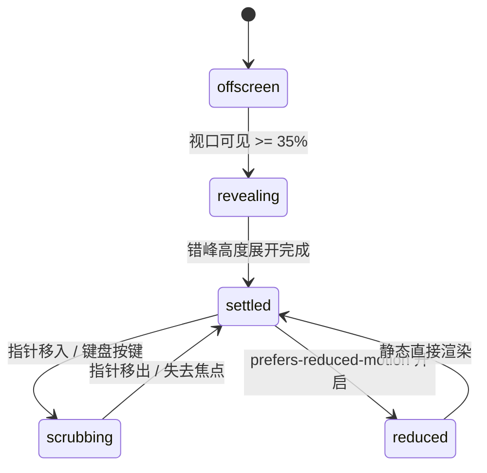

# Bar Chart · 柱状图

用于离散分类或连续时间序列对比的高性能 SVG 柱状图。包含入场高度错峰生长、均值辅助线平滑升降、光标/指针跟手 Scrubbing 实时探查与数值切换、零抖动 Ghost Sizer 标题指标数值联动，以及键盘全无障碍滑块映射。

## 原型清单

| 原型分组 | 原型元素 | 动效 / 状态变化 | 去向 |
| --- | --- | --- | --- |
| — | 图表外层图表卡片 `.arc-bar-figure` | 布局网格、状态承载与无障碍读屏容器 | 最小 DOM / CSS 宿主 |
| — | 指标汇总顶栏 `.arc-bar-header` | 类别标题、当前值/平均值数字滚轮、统计周期平滑淡入淡出 | 头部数值联动机制 |
| — | 滚轮数值 `.arc-bar-roll` / `.arc-bar-sizer` | 隐形 Ghost Sizer 锁定宽度，数字逐位升降与微模糊 | Ghost Sizer 数字轮盘 |
| — | 柱体路径 `.arc-bar-bar` | 带顶部圆角（4px）的 SVG Path，入场错峰高度拉伸与颜色高亮切换 | 柱体形变与错峰入场 |
| — | 均值参考虚线 `.arc-bar-mean` | `stroke-dasharray: 3 3` 虚线，动态随数据均值计算并垂直平移 | 均值线弹簧跟进 |
| — | 刻度网格线 `.arc-bar-grid` | 0 / 30 / 60 / 90 等水平参考发丝线，Y 轴坐标系自适应 | 背景刻度网格 |
| — | 探查标线 `.arc-bar-cursor` | 竖向发丝指示线，跟随指针/光标平滑贴附到当前柱中心 | 光标探查（Scrubbing） |
| — | Y 轴刻度槽 `.arc-bar-gutter` / `.arc-bar-tick` | 绝对定位数值标签与平均值高亮标签（Avg XX） | 纵轴动态标签 |
| — | X 轴分类标签 `.arc-bar-axis` / `.arc-bar-axisLabel` | 居中于柱体下方的分类文本（如 T/W/T/F/S/S/M） | 横轴错峰定位 |
| — | 交互层滑块 `.arc-bar-scrubber` | `role="slider"`，捕获指针滑动、触摸探索与键盘左右键 | 键盘与手势探查器 |
| — | 读屏表格 `.arc-bar-srOnly` | 结构化语义 `<table>` 与 `aria-live="polite"` 动态宣告 | 无障碍可访问性 |
| — | 周期切换按钮组 `.qf` / `.Cr` | 演示周/月视图切换 | 演示外壳，已删除 |
| — | 顶栏、主题切换按钮 `#themeBtn`、舞台卡片 | — | 演示外壳，已删除 |

## 适用

- 周期性业务数据（周活跃时长、月营收、日访问量、渠道分布）柱状对比。
- 需要平滑的柱体高度入场动画与连续数据切换过渡。
- 交互要求光标扫过柱面时无顿挫高亮，同时联动顶栏指标文本逐字/逐位切换。
- 需要完全适配键盘操作与屏幕阅读器无障碍表格。

## 不适用

- 极简单行趋势无坐标轴走势预览 → [sparkline](sparkline.md)
- 高密度连续时间序列折线或面积图 → [line-chart](line-chart.md)
- 两期对照斜率变化与排名跃迁 → [slope-chart](slope-chart.md)
- 多分类百分比紧凑网格点阵 → [waffle-chart](waffle-chart.md)

## 状态机

| 状态 | 进入条件 | 视觉表现 | 退出到 |
| --- | --- | --- | --- |
| offscreen | 初始挂载（尚未进入视口） | 柱高为 0，均值线透明度 0，光标隐藏 | revealing |
| revealing | 进入视口 >= 35% | 各柱自左向右错峰升起（`35ms` 步进），均值线 120ms 后淡入 | settled |
| settled | 入场动画结束或未交互静止态 | 柱体保持各自高度基准色，顶栏展示汇总均值，光标隐藏 | scrubbing |
| scrubbing | 指针在图表上滑动或键盘聚焦探索 | 目标柱激活高亮（`data-active`），其他柱变暗，光标线贴附，顶栏切到当前柱数据 | settled |
| reduced | 触发系统减少动态效果模式 | 柱体高度直接到位，跳过高度生长动画与光标位移过渡 | settled |



## 最小 DOM

```html
<figure class="arc-bar-figure" role="group" aria-labelledby="bar-title">
  <div class="arc-bar-header" aria-hidden="true">
    <span class="arc-bar-kind"><span class="arc-bar-swap"><span class="arc-bar-swapText">Daily average</span></span></span>
    <span class="arc-bar-value">
      <span class="arc-bar-roll"><span class="arc-bar-sizer">49</span><span class="arc-bar-digits"><span class="arc-bar-digit">49</span></span></span>
      <span class="arc-bar-unit">min</span>
    </span>
    <span class="arc-bar-when"><span class="arc-bar-swap"><span class="arc-bar-swapText">Sep 15–21</span></span></span>
  </div>

  <div class="arc-bar-chart">
    <div class="arc-bar-plot">
      <svg class="arc-bar-svg" width="100%" height="176" role="img" aria-label="Active minutes bar chart">
        <line class="arc-bar-grid" x1="0" x2="100%" y1="12" y2="12" />
        <line class="arc-bar-grid" x1="0" x2="100%" y1="68" y2="68" />
        <line class="arc-bar-grid" x1="0" x2="100%" y1="122" y2="122" />
        <line class="arc-bar-baseline" x1="0" x2="100%" y1="175.5" y2="175.5" />
        <line class="arc-bar-cursor" y1="12" y2="176" x1="0" x2="0" opacity="0" />
        <line class="arc-bar-mean" x1="0" x2="100%" y1="88" y2="88" />
        <g class="arc-bar-bars"></g>
      </svg>
    </div>
    <div class="arc-bar-gutter" aria-hidden="true"></div>
    <div class="arc-bar-axis" aria-hidden="true"></div>
    <div class="arc-bar-scrubber" role="slider" tabindex="0" aria-orientation="horizontal"></div>
  </div>

  <div class="arc-bar-srOnly">
    <table>
      <caption>Active minutes data table</caption>
      <thead><tr><th scope="col">Date</th><th scope="col">Value</th></tr></thead>
      <tbody></tbody>
    </table>
  </div>
  <p class="arc-bar-srOnly" aria-live="polite" aria-atomic="true"></p>
</figure>
```

- `.arc-bar-figure`：根语义容器。
- `.arc-bar-header`：顶栏状态面板，承载类别文案、动态滚轮数值与日期区间。
- `.arc-bar-plot` / `.arc-bar-svg`：SVG 核心绘图区，包含网格线、基准线、光标游标、平均值虚线和所有柱体。
- `.arc-bar-gutter`：Y 轴数值刻度标签挂载容器。
- `.arc-bar-axis`：X 轴分类日期标签挂载容器。
- `.arc-bar-scrubber`：全透明交互遮罩，充当无障碍滑块并捕获光标交互。
- `.arc-bar-srOnly`：屏幕阅读器隐藏的数据表格与状态通告。

## 参数

| 名称 | 值 | 用于 | 来源 |
| --- | --- | --- | --- |
| 绘图顶部内边距 | `12px` | 避免最高柱触顶裁切 | 原型 |
| 柱体槽位填充率 | `0.58` (58%) | 柱宽与单槽总宽之比 | 原型 |
| 柱体最大宽度 | `28px` | 防止宽屏下柱过粗 | 原型 |
| 柱体顶部圆角 | `4px` | SVG Path 顶部弧度 | 原型 |
| 默认图表高度 | `176px` | SVG 绘图区固定高度 | 原型 |
| 入场错峰步长 | `min(35, 360 / count)ms` | 柱体错峰拉伸延迟 | 原型 |
| 均值线入场延迟 | `120ms` | 柱展开后再显现均值 | 原型 |
| 物理弹簧时长 | `420ms` | 柱体高度收敛时长 | 原型 |
| 弹簧回弹系数 | `0.16` | 柱体轻微弹性过冲 | 原型 |
| 视口触发阈值 | `0.35` (35%) | IntersectionObserver | 原型 |

## CSS

```css
.arc-bar-figure {
  --bar-accent: #2563eb;
  --bar-surface: #ffffff;
  --bar-border: rgba(0, 0, 0, 0.08);
  --bar-border-strong: rgba(0, 0, 0, 0.18);
  --bar-muted: #737373;
  --bar-foreground: #111111;
  --bar-ease-spring: cubic-bezier(0.16, 1, 0.3, 1);
  --bar-duration: 420ms;

  display: grid;
  min-width: 0;
  gap: 1.25rem;
  margin: 0;
  color: var(--bar-foreground);
  font-family: system-ui, -apple-system, sans-serif;
}

.arc-bar-header {
  display: grid;
  min-width: 0;
  gap: 4px;
}

.arc-bar-kind, .arc-bar-when {
  display: block;
  font-size: 0.875rem;
  line-height: 1.4;
}

.arc-bar-kind { color: var(--bar-muted); }
.arc-bar-when { color: var(--bar-muted); font-size: 0.75rem; }

.arc-bar-value {
  display: flex;
  min-width: 0;
  align-items: baseline;
  gap: 6px;
  font-size: 2rem;
  font-weight: 600;
  line-height: 1.1;
  font-variant-numeric: tabular-nums;
}

.arc-bar-unit {
  color: var(--bar-muted);
  font-size: 1rem;
  font-weight: 400;
}

.arc-bar-roll {
  position: relative;
  display: inline-flex;
  justify-content: flex-end;
  overflow: hidden;
  white-space: pre;
}

.arc-bar-sizer {
  position: absolute;
  top: 0;
  left: 0;
  visibility: hidden;
  pointer-events: none;
}

.arc-bar-digits {
  position: relative;
  display: inline-flex;
}

.arc-bar-digit {
  position: relative;
  display: inline-block;
  transition: transform 240ms var(--bar-ease-spring), opacity 240ms ease;
}

.arc-bar-chart {
  position: relative;
  display: grid;
  grid-template-columns: minmax(0, 1fr) 52px;
  grid-template-rows: auto 26px;
  min-width: 0;
}

.arc-bar-plot {
  position: relative;
  grid-area: 1 / 1;
  min-width: 0;
}

.arc-bar-svg {
  display: block;
  overflow: hidden;
}

.arc-bar-grid {
  stroke: var(--bar-border);
  stroke-width: 1;
  shape-rendering: crispEdges;
}

.arc-bar-baseline {
  stroke: var(--bar-border-strong);
  stroke-width: 1;
  shape-rendering: crispEdges;
}

.arc-bar-cursor {
  stroke: var(--bar-border-strong);
  stroke-width: 1;
  shape-rendering: crispEdges;
  transition: opacity 160ms ease, transform 160ms var(--bar-ease-spring);
  pointer-events: none;
}

.arc-bar-mean {
  stroke: var(--bar-muted);
  stroke-width: 1;
  stroke-dasharray: 3 3;
  shape-rendering: crispEdges;
  transition: transform var(--bar-duration) var(--bar-ease-spring), opacity 240ms ease;
}

.arc-bar-bar {
  fill: color-mix(in srgb, var(--bar-accent) 65%, transparent);
  transition: fill 160ms ease, d var(--bar-duration) var(--bar-ease-spring);
  cursor: pointer;
}

.arc-bar-chart[data-scrubbing] .arc-bar-bar {
  fill: color-mix(in srgb, var(--bar-accent) 25%, transparent);
}

.arc-bar-chart .arc-bar-bar[data-active] {
  fill: var(--bar-accent) !important;
}

.arc-bar-gutter {
  position: relative;
  grid-area: 1 / 2;
  min-width: 0;
}

.arc-bar-tick, .arc-bar-meanLabel {
  position: absolute;
  left: 8px;
  display: block;
  white-space: nowrap;
  pointer-events: none;
  font-size: 0.75rem;
  color: var(--bar-muted);
  transform: translateY(-50%);
  font-variant-numeric: tabular-nums;
}

.arc-bar-meanLabel {
  color: var(--bar-foreground);
  font-weight: 600;
  transition: transform var(--bar-duration) var(--bar-ease-spring);
}

.arc-bar-axis {
  position: relative;
  grid-area: 2 / 1;
  min-width: 0;
  overflow: hidden;
}

.arc-bar-axisLabel {
  position: absolute;
  top: 8px;
  color: var(--bar-muted);
  font-size: 0.75rem;
  transform: translateX(-50%);
  font-variant-numeric: tabular-nums;
  white-space: nowrap;
}

.arc-bar-scrubber {
  position: absolute;
  inset: 0;
  outline: none;
  touch-action: pan-y;
  user-select: none;
  -webkit-tap-highlight-color: transparent;
  cursor: crosshair;
}

.arc-bar-srOnly {
  position: absolute;
  width: 1px;
  height: 1px;
  margin: -1px;
  padding: 0;
  border: 0;
  overflow: hidden;
  clip: rect(0, 0, 0, 0);
  white-space: nowrap;
}

@media (prefers-reduced-motion: reduce) {
  .arc-bar-bar,
  .arc-bar-mean,
  .arc-bar-cursor,
  .arc-bar-digit {
    transition: none !important;
  }
}
```

## JS

```js
/**
 * 构造带圆角的柱体 SVG 路径
 */
function makeBarPath(x, y, width, height, radius = 4) {
  const r = Math.min(radius, width / 2, height);
  const right = x + width;
  const bottom = y + height;
  return `M ${x} ${bottom} V ${y + r} Q ${x} ${y} ${x + r} ${y} H ${right - r} Q ${right} ${y} ${right} ${y + r} V ${bottom} Z`;
}

/**
 * 创建 BarChart 实例
 * @param {HTMLElement} el 宿主容器
 * @param {Object} options 配置项
 * @param {Array<{label: string, value: number, date?: string}>} [options.data] 数据项数组
 * @param {string} [options.unit='min'] 数值单位
 * @param {number} [options.height=176] 绘图区高度
 * @param {Function} [options.onChange] 选中项变更回调
 */
export function createBarChart(el, options = {}) {
  const defaultData = [
    { label: 'T', date: 'Tue, Sep 15', value: 46 },
    { label: 'W', date: 'Wed, Sep 16', value: 58 },
    { label: 'T', date: 'Thu, Sep 17', value: 24 },
    { label: 'F', date: 'Fri, Sep 18', value: 41 },
    { label: 'S', date: 'Sat, Sep 19', value: 86 },
    { label: 'S', date: 'Sun, Sep 20', value: 67 },
    { label: 'M', date: 'Today, Sep 21', value: 18 }
  ];

  let data = Array.isArray(options.data) && options.data.length > 0 ? options.data : defaultData;
  const unit = options.unit || 'min';
  const plotHeight = options.height || 176;
  const plotTop = 12;
  const availableHeight = plotHeight - plotTop;
  let activeIndex = -1;
  let disposed = false;

  const chartContainer = el.querySelector('.arc-bar-chart') || el;
  const svg = el.querySelector('.arc-bar-svg');
  const barsGroup = el.querySelector('.arc-bar-bars') || (svg ? svg.appendChild(document.createElementNS('http://www.w3.org/2000/svg', 'g')) : null);
  const cursor = el.querySelector('.arc-bar-cursor');
  const meanLine = el.querySelector('.arc-bar-mean');
  const gutter = el.querySelector('.arc-bar-gutter');
  const axis = el.querySelector('.arc-bar-axis');
  const scrubber = el.querySelector('.arc-bar-scrubber');
  const rollVal = el.querySelector('.arc-bar-digits') || el.querySelector('.arc-bar-roll');
  const whenEl = el.querySelector('.arc-bar-when .arc-bar-swapText');
  const kindEl = el.querySelector('.arc-bar-kind .arc-bar-swapText');
  const tableBody = el.querySelector('.arc-bar-srOnly tbody');

  // 计算均值与极值
  const maxVal = Math.max(...data.map(d => d.value), 10);
  const niceMax = Math.ceil(maxVal / 30) * 30;
  const avgVal = Math.round(data.reduce((acc, d) => acc + d.value, 0) / data.length);

  // 渲染 Y 轴刻度
  if (gutter) {
    gutter.innerHTML = '';
    const ticks = [0, niceMax / 3, (niceMax * 2) / 3, niceMax];
    ticks.forEach(tVal => {
      const y = plotHeight - (tVal / niceMax) * availableHeight;
      const tEl = document.createElement('span');
      tEl.className = 'arc-bar-tick';
      tEl.style.top = `${y}px`;
      tEl.textContent = String(Math.round(tVal));
      gutter.appendChild(tEl);
    });

    const avgY = plotHeight - (avgVal / niceMax) * availableHeight;
    const avgLabel = document.createElement('span');
    avgLabel.className = 'arc-bar-meanLabel';
    avgLabel.style.top = `${avgY}px`;
    avgLabel.textContent = `Avg ${avgVal}`;
    gutter.appendChild(avgLabel);
  }

  // 均值虚线
  if (meanLine) {
    const avgY = plotHeight - (avgVal / niceMax) * availableHeight;
    meanLine.setAttribute('y1', avgY);
    meanLine.setAttribute('y2', avgY);
  }

  // 计算几何尺寸与布局
  let slotWidth = 0;
  let barWidth = 0;
  let barPositions = [];

  function computeLayout(svgWidth) {
    const n = data.length;
    slotWidth = svgWidth / n;
    barWidth = Math.min(28, slotWidth * 0.58);
    barPositions = [];

    if (barsGroup) barsGroup.innerHTML = '';
    if (axis) axis.innerHTML = '';
    if (tableBody) tableBody.innerHTML = '';

    data.forEach((item, i) => {
      const cx = (i + 0.5) * slotWidth;
      const x = cx - barWidth / 2;
      const h = (item.value / niceMax) * availableHeight;
      const y = plotHeight - h;
      barPositions.push({ cx, x, y, w: barWidth, h, item, index: i });

      // SVG Path
      const path = document.createElementNS('http://www.w3.org/2000/svg', 'path');
      path.setAttribute('class', 'arc-bar-bar');
      path.setAttribute('data-index', String(i));
      path.setAttribute('d', makeBarPath(x, y, barWidth, h));
      path.style.transitionDelay = `${Math.min(i * 35, 250)}ms`;
      if (barsGroup) barsGroup.appendChild(path);

      // X Axis Label
      if (axis) {
        const aSpan = document.createElement('span');
        aSpan.className = 'arc-bar-axisLabel';
        aSpan.style.left = `${cx}px`;
        aSpan.textContent = item.label;
        axis.appendChild(aSpan);
      }

      // Accessible Table
      if (tableBody) {
        const tr = document.createElement('tr');
        tr.innerHTML = `<th scope="row">${item.date || item.label}</th><td>${item.value} ${unit}</td>`;
        tableBody.appendChild(tr);
      }
    });
  }

  const initialWidth = svg ? (svg.clientWidth || 400) : 400;
  computeLayout(initialWidth);

  // 更新指标展台
  function updateReadout(item) {
    if (item) {
      if (kindEl) kindEl.textContent = 'Selected value';
      if (rollVal) rollVal.textContent = String(item.value);
      if (whenEl) whenEl.textContent = item.date || item.label;
    } else {
      if (kindEl) kindEl.textContent = 'Daily average';
      if (rollVal) rollVal.textContent = String(avgVal);
      if (whenEl) whenEl.textContent = `${data[0]?.label || ''} – ${data[data.length - 1]?.label || ''}`;
    }
  }

  // 激活指定柱
  function setActive(index) {
    if (disposed || index === activeIndex) return;
    activeIndex = index;

    if (index >= 0 && index < barPositions.length) {
      chartContainer.setAttribute('data-scrubbing', 'true');
      const bp = barPositions[index];

      if (barsGroup) {
        barsGroup.querySelectorAll('.arc-bar-bar').forEach((p, idx) => {
          if (idx === index) p.setAttribute('data-active', '');
          else p.removeAttribute('data-active');
        });
      }

      if (cursor) {
        cursor.setAttribute('opacity', '1');
        cursor.setAttribute('x1', bp.cx);
        cursor.setAttribute('x2', bp.cx);
      }

      updateReadout(bp.item);
      if (scrubber) {
        scrubber.setAttribute('aria-valuenow', String(index + 1));
        scrubber.setAttribute('aria-valuetext', `${bp.item.date || bp.item.label}: ${bp.item.value} ${unit}`);
      }
      if (typeof options.onChange === 'function') options.onChange(bp.item);
    } else {
      chartContainer.removeAttribute('data-scrubbing');
      if (barsGroup) {
        barsGroup.querySelectorAll('.arc-bar-bar').forEach(p => p.removeAttribute('data-active'));
      }
      if (cursor) cursor.setAttribute('opacity', '0');
      updateReadout(null);
    }
  }

  // 指针滑动计算
  function handlePointer(clientX) {
    if (!svg) return;
    const rect = svg.getBoundingClientRect();
    const relX = clientX - rect.left;
    const clampedX = Math.max(0, Math.min(rect.width, relX));
    const idx = Math.floor(clampedX / slotWidth);
    setActive(Math.max(0, Math.min(data.length - 1, idx)));
  }

  // 事件监听
  const onPointerMove = (e) => handlePointer(e.clientX);
  const onPointerLeave = () => setActive(-1);
  const onTouchMove = (e) => {
    if (e.touches && e.touches[0]) handlePointer(e.touches[0].clientX);
  };

  const onKeyDown = (e) => {
    if (e.key === 'ArrowRight' || e.key === 'ArrowUp') {
      e.preventDefault();
      setActive(Math.min(data.length - 1, activeIndex < 0 ? 0 : activeIndex + 1));
    } else if (e.key === 'ArrowLeft' || e.key === 'ArrowDown') {
      e.preventDefault();
      setActive(Math.max(0, activeIndex < 0 ? 0 : activeIndex - 1));
    } else if (e.key === 'Home') {
      e.preventDefault();
      setActive(0);
    } else if (e.key === 'End') {
      e.preventDefault();
      setActive(data.length - 1);
    } else if (e.key === 'Escape') {
      setActive(-1);
    }
  };

  if (scrubber) {
    scrubber.addEventListener('pointermove', onPointerMove);
    scrubber.addEventListener('pointerleave', onPointerLeave);
    scrubber.addEventListener('touchmove', onTouchMove, { passive: true });
    scrubber.addEventListener('touchend', onPointerLeave);
    scrubber.addEventListener('keydown', onKeyDown);
  }

  // 点击触发
  el.addEventListener('click', () => {
    setActive((activeIndex + 1) % data.length);
  });

  return {
    setActive,
    update(newData) {
      if (disposed) return;
      if (Array.isArray(newData)) data = newData;
      computeLayout(svg ? svg.clientWidth || 400 : 400);
      setActive(-1);
    },
    destroy() {
      disposed = true;
      if (scrubber) {
        scrubber.removeEventListener('pointermove', onPointerMove);
        scrubber.removeEventListener('pointerleave', onPointerLeave);
        scrubber.removeEventListener('touchmove', onTouchMove);
        scrubber.removeEventListener('touchend', onPointerLeave);
        scrubber.removeEventListener('keydown', onKeyDown);
      }
    }
  };
}
```

## 接入目标项目

- 状态来源：
  - 由后端或视图层数据数组（`[{ label, value, date }]`）直接驱动。调用 `createBarChart(el, { data, unit })` 挂载。
- 尺寸策略：
  - SVG 宽度设为 100%，高度固定（默认 176px）。通过内部测量动态计算 `slotWidth` 与限制 `maxBarWidth: 28px`，容器在各类宽度下均自适应居中。
- 驱动方式：
  - 数据变更时直接调用实例的 `chart.update(newData)`。
  - 销毁时调用 `chart.destroy()` 释放所有监听器。

## 重入与清理

- 连续快速滑动指针时，基于瞬时位置直接索引柱体槽位，零定时器积累。
- 销毁时清理对透明滑块图层的所有指针和键盘监听。

## 减少动态效果

- 满足 `prefers-reduced-motion: reduce` 时：
  - 柱体高度路径变换停用 CSS transition，即时完成重绘。
  - 均值线与数值文字切换位移动效关闭，直接就位呈现。

## 焦点与键盘

- `.arc-bar-scrubber` 声明 `role="slider"`，挂载 `tabindex="0"` 并支持 `ArrowLeft` / `ArrowRight` / `Home` / `End` / `Escape` 键盘导航。
- 视觉装饰线与坐标轴均打上 `aria-hidden="true"`。
- 读屏器通过内嵌的标准数据表格（`<table>`）无障碍获取每个维度的确切数值。

## 兼容回退

| 特性 | 不支持时 |
| --- | --- |
| SVG 带圆角 Path | 回退为常规矩形 `<rect>` 绘制。 |
| CSS `color-mix` | 降级为预设静态十六进制与透明度颜色。 |

## 验收清单

- [ ] 初始加载渲染完整的网格线、柱体和横纵坐标轴，柱顶部带有 4px 圆角。
- [ ] 鼠标光标在柱状图上平滑移动，光标竖线跟随定位，当前柱体高亮并触发顶部数值联动。
- [ ] 鼠标移出图表后，高亮与光标平滑淡出，顶栏回归全量数据平均值展示。
- [ ] 键盘 Tab 聚焦滑块后，通过左右方向键平稳切换选中柱，支持读屏软件读取 `aria-valuetext`。
- [ ] 开启减少动态效果，柱体高度变换无过渡动画。
- [ ] 调用 `destroy()` 完整清理事件。
