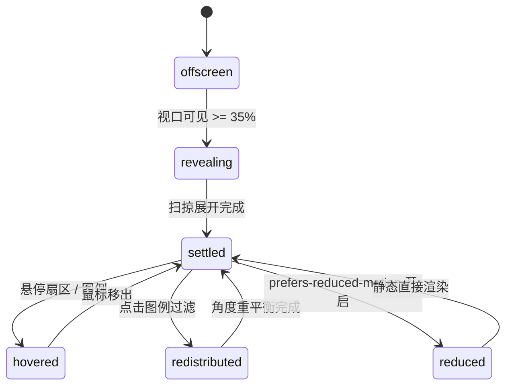

# Donut Chart · 环形图

用于分类份额、渠道占比和资源分配对比的高质感 SVG 环形图。包含入场弧形扫掠（Sweep）、动态角度重分布弹簧动画（Angle Redistribution）、悬停时扇区径向外凸微放大（Lift & Grow）、中心鼓（Center Drum）统计数值与占比平滑切换，以及图例联动过滤。

## 原型清单

| 原型分组 | 原型元素 | 动效 / 状态变化 | 去向 |
| --- | --- | --- | --- |
| — | 环形图外层容器 `.arc-donut-figure` | 弹性响应式排版（环与图例侧排/竖排自适应） | 最小 DOM / CSS 宿主 |
| — | 环形主绘图区 `.arc-donut-ring` / `.arc-donut-svg` | SVG 几何坐标系与内径 CSS 变量 `--inner` | 环形主绘制区 |
| — | 背景轨道圆 `.arc-donut-track` | 底层灰色导向轨道 | 底层参考轨道 |
| — | 扇区弧形路径 `.arc-donut-segment` | 带圆角（4px）与分段缝隙（3px）的 SVG 弧形路径；悬停径向微移（Lift 4px）与内外国界微膨胀 | 扇区弧形渲染与交互凸起 |
| — | 中心展台鼓 `.arc-donut-center` | 居中层叠多个 `.arc-donut-readout`，支持总计与单个分类读数错峰淡入淡出 | 中心鼓数据切换 |
| — | 交互式图例列表 `.arc-donut-legend` | 每项承载颜色圆点、分类名、具体数值与百分比，支持点击切换扇区显隐 | 交互图例联动 |
| — | 读屏表格 `.arc-donut-srOnly` | 结构化语义 `<table>` 与 `aria-live="polite"` 动态宣告 | 无障碍可访问性 |
| — | 时间范围选择器 `.qf` / `.Cr` | 演示周/月/年视图切换 | 演示外壳，已删除 |
| — | 顶栏、主题切换按钮 `#themeBtn`、舞台卡片 | — | 演示外壳，已删除 |

## 适用

- 流量来源分类（搜索、直接访问、社交媒体、推荐）、支出类别占比、资产配置等百分比数据。
- 鼠标或触控悬停在扇区上时，需要扇区向外径向凸起 4px 并联动中心展示详细指标。
- 图例项可点击独立折叠/展开扇区，其他扇区自动平滑重新分配圆周角度。
- 要求无障碍屏幕阅读器能够直接读取完整明细表格。

## 不适用

- 离散时序周期高度对比 → [bar-chart](bar-chart.md)
- 10×10 百分比离散方格矩阵 → [waffle-chart](waffle-chart.md)
- 连续时间走势与极值点标注 → [line-chart](line-chart.md)
- 阶段流失转化率漏斗 → [funnel-chart](funnel-chart.md)

## 状态机

| 状态 | 进入条件 | 视觉表现 | 退出到 |
| --- | --- | --- | --- |
| offscreen | 初始挂载（未进入视口） | 扇区角度归零收拢于顶部，中心展示空白 | revealing |
| revealing | 视口曝光达到 35% | 各扇区沿圆周平滑扫掠展开（720ms），中心显示总数值 | settled |
| settled | 扫掠完成或光标移出 | 所有激活扇区均匀就位，中心显示总数值（如 Visits 40,610） | hovered |
| hovered | 光标悬停扇区或图例项 | 对应扇区沿圆心角向外平移 4px 并加深饱和度，其他扇区轻微变暗；中心鼓平滑切换为当前分类数值与百分比 | settled |
| redistributed | 点击图例过滤项隐藏/显示某一分类 | 被隐藏扇区坍缩淡出，其余存留扇区沿圆周平滑重平衡填满 360° | settled |
| reduced | 触发系统减少动态效果模式 | 弧度与位移直接跳转，停用径向凸起与扫掠动效 | settled |



## 最小 DOM

```html
<figure class="arc-donut-figure" aria-label="Visits by source" data-legend="true">
  <div class="arc-donut-ring" style="width: 208px;">
    <svg class="arc-donut-svg" viewBox="0 0 208 208" aria-hidden="true" focusable="false">
      <circle class="arc-donut-track" cx="104" cy="104" r="85" stroke-width="24" />
      <g class="arc-donut-segments"></g>
    </svg>
    <div class="arc-donut-center" aria-hidden="true">
      <span class="arc-donut-readout is-active">
        <span class="arc-donut-centerLabel">Total</span>
        <span class="arc-donut-centerValue">100%</span>
        <span class="arc-donut-centerMeta">All categories</span>
      </span>
    </div>
  </div>

  <ul class="arc-donut-legend" role="list">
    <!-- 动态挂载分类图例项 -->
  </ul>

  <div class="arc-donut-srOnly">
    <table>
      <caption>Visits by source table</caption>
      <thead><tr><th scope="col">Category</th><th scope="col">Value</th><th scope="col">Share</th></tr></thead>
      <tbody></tbody>
    </table>
  </div>
</figure>
```

- `.arc-donut-figure`：根节点，自适应承载环形图与图例。
- `.arc-donut-ring`：包含 SVG 与中心鼓的相对定位容器。
- `.arc-donut-svg`：核心 SVG，208×208 视口。
- `.arc-donut-track`：背景导向环，厚度 24px。
- `.arc-donut-segments`：扇区 `<path>` 承载分组。
- `.arc-donut-center`：中心鼓浮层，负责绝对定位的指标说明。
- `.arc-donut-legend`：右侧或底部图例列表。
- `.arc-donut-srOnly`：隐藏数据表格与无障碍摘要。

## 参数

| 名称 | 值 | 用于 | 来源 |
| --- | --- | --- | --- |
| 默认外径尺寸 | `208px` | 环形外框正方形边长 | 原型 |
| 环形厚度 | `24px` | 扇区径向厚度 | 原型 |
| 悬停外凸位移 (Lift) | `4px` | 悬停扇区径向外移距离 | 原型 |
| 外径微增量 (Grow Outer) | `2px` | 悬停时外边缘扩张量 | 原型 |
| 内径微收缩 (Grow Inner) | `1px` | 悬停时内边缘向中心扩张量 | 原型 |
| 扇区缝隙 (Gap) | `3px` | 相邻扇区角向物理空隙 | 原型 |
| 弧形转角圆角 (Corner) | `4px` | 扇区四个角平滑半径 | 原型 |
| 首次展开弹簧时长 | `720ms` | 初次视口扫掠展开时长 | 原型 |
| 重平衡重分布时长 | `500ms` | 过滤某项后剩余项角度重新补位 | 原型 |
| 悬停过渡时长 | `260ms` | 径向位移与高亮过渡 | 原型 |
| 视口触发阈值 | `0.35` (35%) | IntersectionObserver | 原型 |

## CSS

```css
.arc-donut-figure {
  --donut-size: 208px;
  --donut-track: rgba(0, 0, 0, 0.06);
  --donut-muted: #737373;
  --donut-foreground: #111111;
  --donut-ease: cubic-bezier(0.16, 1, 0.3, 1);
  --donut-duration: 400ms;

  display: flex;
  flex-wrap: wrap;
  align-items: center;
  justify-content: center;
  gap: 2rem;
  margin: 0;
  color: var(--donut-foreground);
  font-family: system-ui, -apple-system, sans-serif;
}

.arc-donut-ring {
  position: relative;
  width: var(--donut-size);
  height: var(--donut-size);
  flex-shrink: 0;
}

.arc-donut-svg {
  display: block;
  width: 100%;
  height: 100%;
  overflow: visible;
}

.arc-donut-track {
  fill: none;
  stroke: var(--donut-track);
}

.arc-donut-segment {
  cursor: pointer;
  transition: transform 260ms var(--donut-ease),
              fill-opacity 200ms ease,
              d var(--donut-duration) var(--donut-ease);
  will-change: transform, d;
}

.arc-donut-figure[data-hovering] .arc-donut-segment {
  fill-opacity: 0.35;
}

.arc-donut-figure[data-hovering] .arc-donut-segment.is-active {
  fill-opacity: 1;
}

.arc-donut-center {
  position: absolute;
  inset: 0;
  display: flex;
  align-items: center;
  justify-content: center;
  pointer-events: none;
}

.arc-donut-readout {
  position: absolute;
  display: flex;
  flex-direction: column;
  align-items: center;
  text-align: center;
  opacity: 0;
  transform: translateY(6px);
  transition: opacity 240ms ease, transform 240ms var(--donut-ease);
}

.arc-donut-readout.is-active {
  opacity: 1;
  transform: translateY(0);
}

.arc-donut-centerLabel {
  font-size: 0.75rem;
  color: var(--donut-muted);
  font-weight: 500;
}

.arc-donut-centerValue {
  font-size: 1.375rem;
  font-weight: 600;
  line-height: 1.2;
  font-variant-numeric: tabular-nums;
}

.arc-donut-centerMeta {
  font-size: 0.6875rem;
  color: var(--donut-muted);
}

.arc-donut-legend {
  display: flex;
  flex-direction: column;
  gap: 0.5rem;
  list-style: none;
  padding: 0;
  margin: 0;
  min-width: 180px;
}

.arc-donut-row {
  display: flex;
  align-items: center;
  width: 100%;
  gap: 0.5rem;
  padding: 4px 8px;
  background: transparent;
  border: 1px solid transparent;
  border-radius: 6px;
  cursor: pointer;
  text-align: left;
  color: inherit;
  font: inherit;
  font-size: 0.8125rem;
  transition: background-color 150ms ease, opacity 200ms ease;
}

.arc-donut-row:hover {
  background: rgba(0, 0, 0, 0.04);
}

.arc-donut-row[aria-pressed="false"] {
  opacity: 0.4;
  text-decoration: line-through;
}

.arc-donut-dot {
  width: 8px;
  height: 8px;
  border-radius: 50%;
  flex-shrink: 0;
}

.arc-donut-rowText {
  flex: 1;
  overflow: hidden;
  text-overflow: ellipsis;
  white-space: nowrap;
}

.arc-donut-rowValue {
  font-weight: 500;
  font-variant-numeric: tabular-nums;
}

.arc-donut-rowShare {
  color: var(--donut-muted);
  font-variant-numeric: tabular-nums;
  min-width: 32px;
  text-align: right;
}

.arc-donut-srOnly {
  position: absolute;
  width: 1px;
  height: 1px;
  padding: 0;
  margin: -1px;
  overflow: hidden;
  clip: rect(0, 0, 0, 0);
  white-space: nowrap;
  border-width: 0;
}

@media (prefers-reduced-motion: reduce) {
  .arc-donut-segment,
  .arc-donut-readout,
  .arc-donut-row {
    transition: none !important;
  }
}
```

## JS

```js
/**
 * 辅助函数：根据起止角度与内外径计算 SVG 弧形路径
 */
function makeArcPath(cx, cy, innerR, outerR, startAngle, endAngle) {
  // 转换角度为弧度
  const startRad = (startAngle - 90) * (Math.PI / 180);
  const endRad = (endAngle - 90) * (Math.PI / 180);

  const x1 = cx + outerR * Math.cos(startRad);
  const y1 = cy + outerR * Math.sin(startRad);
  const x2 = cx + outerR * Math.cos(endRad);
  const y2 = cy + outerR * Math.sin(endRad);

  const x3 = cx + innerR * Math.cos(endRad);
  const y3 = cy + innerR * Math.sin(endRad);
  const x4 = cx + innerR * Math.cos(startRad);
  const y4 = cy + innerR * Math.sin(startRad);

  const largeArc = endAngle - startAngle > 180 ? 1 : 0;

  return `M ${x1} ${y1} A ${outerR} ${outerR} 0 ${largeArc} 1 ${x2} ${y2} L ${x3} ${y3} A ${innerR} ${innerR} 0 ${largeArc} 0 ${x4} ${y4} Z`;
}

/**
 * 创建 DonutChart 实例
 * @param {HTMLElement} el 宿主容器
 * @param {Object} options 配置项
 * @param {Array<{key: string, label: string, value: number, color?: string}>} [options.data] 数据项数组
 * @param {Function} [options.onSelect] 选中项回调
 */
export function createDonutChart(el, options = {}) {
  const defaultColors = ['#2563eb', '#16a34a', '#d97706', '#dc2626', '#8b5cf6', '#64748b'];
  const defaultData = [
    { key: 'search', label: 'Search', value: 16840 },
    { key: 'direct', label: 'Direct', value: 8120 },
    { key: 'referrals', label: 'Referrals', value: 6430 },
    { key: 'newsletter', label: 'Newsletter', value: 5260 },
    { key: 'social', label: 'Social', value: 2910 },
    { key: 'other', label: 'Other', value: 1050 }
  ];

  let rawData = Array.isArray(options.data) && options.data.length > 0 ? options.data : defaultData;
  let items = rawData.map((d, i) => ({
    ...d,
    color: d.color || defaultColors[i % defaultColors.length],
    visible: true
  }));

  const cx = 104;
  const cy = 104;
  const outerR = 97;
  const innerR = 73;
  const gapAngle = 1.2; // 扇区间隙度数
  let activeKey = null;
  let disposed = false;

  const figure = el.querySelector('.arc-donut-figure') || el;
  const segmentsGroup = el.querySelector('.arc-donut-segments');
  const centerEl = el.querySelector('.arc-donut-center');
  const legendEl = el.querySelector('.arc-donut-legend');
  const tableBody = el.querySelector('.arc-donut-srOnly tbody');

  function render() {
    if (disposed) return;
    const activeItems = items.filter(d => d.visible);
    const totalVal = activeItems.reduce((acc, d) => acc + d.value, 0) || 1;

    // 计算各段起止角度
    let currentAngle = 0;
    const slices = activeItems.map(item => {
      const share = item.value / totalVal;
      const sweep = share * 360;
      const start = currentAngle + gapAngle / 2;
      const end = currentAngle + sweep - gapAngle / 2;
      const mid = (start + end) / 2;
      currentAngle += sweep;
      return { item, start, end, mid, share };
    });

    // 渲染 SVG 扇区
    if (segmentsGroup) {
      segmentsGroup.innerHTML = '';
      slices.forEach(({ item, start, end, mid, share }) => {
        if (end <= start) return;
        const path = document.createElementNS('http://www.w3.org/2000/svg', 'path');
        path.setAttribute('class', 'arc-donut-segment');
        path.setAttribute('data-key', item.key);
        path.setAttribute('fill', item.color);
        path.setAttribute('d', makeArcPath(cx, cy, innerR, outerR, start, end));

        // 径向向外微位移 (4px)
        const rad = (mid - 90) * (Math.PI / 180);
        const dx = Math.cos(rad) * 4;
        const dy = Math.sin(rad) * 4;
        path.dataset.dx = String(dx.toFixed(2));
        path.dataset.dy = String(dy.toFixed(2));

        path.addEventListener('pointerenter', () => setActive(item.key));
        path.addEventListener('pointerleave', () => setActive(null));
        segmentsGroup.appendChild(path);
      });
    }

    // 渲染中心展台
    if (centerEl) {
      centerEl.innerHTML = '';

      // 总计默认卡片
      const totalReadout = document.createElement('span');
      totalReadout.className = `arc-donut-readout ${!activeKey ? 'is-active' : ''}`;
      totalReadout.setAttribute('data-key', '__total');
      totalReadout.innerHTML = `
        <span class="arc-donut-centerLabel">Total</span>
        <span class="arc-donut-centerValue">${totalVal.toLocaleString()}</span>
        <span class="arc-donut-centerMeta">All categories</span>
      `;
      centerEl.appendChild(totalReadout);

      // 每个分类对应卡片
      items.forEach(d => {
        const share = Math.round((d.value / totalVal) * 100);
        const rEl = document.createElement('span');
        rEl.className = `arc-donut-readout ${activeKey === d.key ? 'is-active' : ''}`;
        rEl.setAttribute('data-key', d.key);
        rEl.innerHTML = `
          <span class="arc-donut-centerLabel">${d.label}</span>
          <span class="arc-donut-centerValue">${d.value.toLocaleString()}</span>
          <span class="arc-donut-centerMeta">${share}% of total</span>
        `;
        centerEl.appendChild(rEl);
      });
    }

    // 渲染图例
    if (legendEl) {
      legendEl.innerHTML = '';
      items.forEach(d => {
        const share = Math.round((d.value / totalVal) * 100);
        const li = document.createElement('li');
        li.innerHTML = `
          <button type="button" class="arc-donut-row" aria-pressed="${d.visible}" data-key="${d.key}">
            <span class="arc-donut-dot" style="background-color: ${d.color};"></span>
            <span class="arc-donut-rowText">${d.label}</span>
            <span class="arc-donut-rowValue">${d.value.toLocaleString()}</span>
            <span class="arc-donut-rowShare">${share}%</span>
          </button>
        `;

        const btn = li.querySelector('.arc-donut-row');
        btn.addEventListener('pointerenter', () => setActive(d.key));
        btn.addEventListener('pointerleave', () => setActive(null));
        btn.addEventListener('click', (e) => {
          e.stopPropagation();
          d.visible = !d.visible;
          render();
        });
        legendEl.appendChild(li);
      });
    }

    // 渲染无障碍表格
    if (tableBody) {
      tableBody.innerHTML = '';
      items.forEach(d => {
        const share = Math.round((d.value / totalVal) * 100);
        const tr = document.createElement('tr');
        tr.innerHTML = `<th scope="row">${d.label}</th><td>${d.value.toLocaleString()}</td><td>${share}%</td>`;
        tableBody.appendChild(tr);
      });
    }
  }

  function setActive(key) {
    if (disposed) return;
    activeKey = key;

    if (key) {
      figure.setAttribute('data-hovering', 'true');
      if (segmentsGroup) {
        segmentsGroup.querySelectorAll('.arc-donut-segment').forEach(p => {
          if (p.getAttribute('data-key') === key) {
            p.classList.add('is-active');
            p.style.transform = `translate(${p.dataset.dx}px, ${p.dataset.dy}px)`;
          } else {
            p.classList.remove('is-active');
            p.style.transform = 'translate(0, 0)';
          }
        });
      }
    } else {
      figure.removeAttribute('data-hovering');
      if (segmentsGroup) {
        segmentsGroup.querySelectorAll('.arc-donut-segment').forEach(p => {
          p.classList.remove('is-active');
          p.style.transform = 'translate(0, 0)';
        });
      }
    }

    if (centerEl) {
      centerEl.querySelectorAll('.arc-donut-readout').forEach(r => {
        const rKey = r.getAttribute('data-key');
        if ((!key && rKey === '__total') || rKey === key) {
          r.classList.add('is-active');
        } else {
          r.classList.remove('is-active');
        }
      });
    }

    if (typeof options.onSelect === 'function') {
      const match = items.find(d => d.key === key);
      options.onSelect(match || null);
    }
  }

  render();

  // 模拟交互点击
  const handleClick = () => {
    const nextIdx = (items.findIndex(d => d.key === activeKey) + 1) % items.length;
    setActive(items[nextIdx].key);
  };
  el.addEventListener('click', handleClick);

  return {
    setActive,
    update(newData) {
      if (disposed) return;
      if (Array.isArray(newData)) {
        rawData = newData;
        items = rawData.map((d, i) => ({
          ...d,
          color: d.color || defaultColors[i % defaultColors.length],
          visible: true
        }));
      }
      render();
    },
    destroy() {
      disposed = true;
      el.removeEventListener('click', handleClick);
    }
  };
}
```

## 接入目标项目

- 状态来源：
  - 传入分类数组 `{ key, label, value, color? }`。
  - 通过 `chart.update(newData)` 或外部点击控制特定分类显隐。
- 尺寸策略：
  - 默认外径 208px，可通过修改 CSS 变量 `--donut-size` 缩放，内径比例自适应。
- 驱动方式：
  - `const donut = createDonutChart(container, { data, onSelect })`。
  - 卸载时调用 `donut.destroy()`。

## 重入与清理

- 连续悬停多个扇区时，通过修改当前激活类名 `is-active` 立即切换，无延迟定时器堆叠。
- `destroy()` 完整解绑点击与悬停事件。

## 减少动态效果

- 满足 `prefers-reduced-motion: reduce` 时：
  - 关闭扇区平移位移动画（`transform: none !important`）。
  - 中心鼓读数直接切换，无 translateY 升降。

## 焦点与键盘

- 图例中的每个分类均使用原生 `<button type="button">`，带有 `aria-pressed` 状态，支持键盘 Tab 聚焦与 Enter/Space 键触发显隐切换。
- SVG 扇区打上 `aria-hidden="true"`，屏幕阅读器通过无障碍表格读取精确分类与份额。

## 兼容回退

| 特性 | 不支持时 |
| --- | --- |
| SVG Arc 命令 | 回退为简单的环形进度条或百分比进度条。 |

## 验收清单

- [ ] 初始挂载渲染完整的彩色环形圆环与对应图例项，圆环厚度 24px。
- [ ] 悬停某个扇区时，该扇区向外径向凸起 4px，其他扇区轻微变暗，中心鼓同步显示该分类数值与百分比。
- [ ] 点击图例项可切换分类显隐，其余存活扇区平滑重平衡填满圆周。
- [ ] 开启减少动态效果，扇区无悬停平移动效。
- [ ] 调用 `destroy()` 后事件完整清理。
