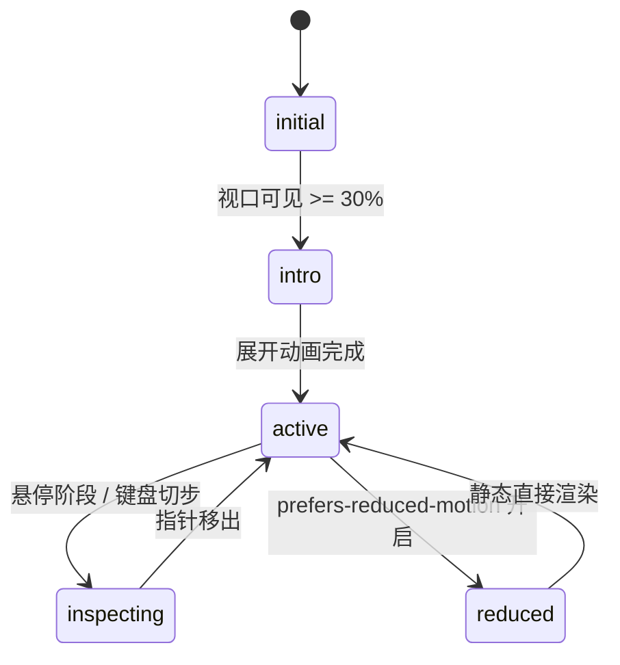

# Funnel Chart · 漏斗图

用于转化漏斗、多阶段流失分析（如电商结账漏斗、注册转化流）的连续曲面 SVG + 粒子流动漏斗图。采用五次光滑过渡曲线（Quintic Smoothstep）插值各阶段宽度，支持步骤间流失率指示、聚焦高亮光晕、跟手探查提示框，以及可选的 Canvas 流体粒子动效。

## 原型清单

| 原型分组 | 原型元素 | 动效 / 状态变化 | 去向 |
| --- | --- | --- | --- |
| — | 漏斗主容器 `.arc-funnel-figure` | 响应式自适应布局与键盘焦点承载 | 最小 DOM / CSS 宿主 |
| — | 漏斗阶段顶栏 `.arc-funnel-header` | 阶段标题、绝对数值与首步转化率（% of start） | 阶段指标标题栏 |
| — | 漏斗曲面层 `.arc-funnel-layer` | 采用 Quintic Smoothstep 插值的多边形曲面，支持阶段形变过渡 | 连续平滑曲面 |
| — | 高亮聚焦列 `.arc-funnel-column` | 绝对定位透明高亮条，跟随当前活动阶段平滑位移 | 阶段高亮滑块 |
| — | 裁切光晕层 `.arc-funnel-glow` | 结合 `<clipPath>` 渲染当前阶段的高亮饱和度发光 | 阶段局部发光 |
| — | 流动粒子画布 `.arc-funnel-canvas` | Canvas 模拟从左向右连续流动并依转化率淘汰的微粒子 | 转化流动粒子层 |
| — | 阶段流失标记 `.arc-funnel-drops` | 阶段间的向下箭头与流失百分比（Drop rate） | 阶段流失指示符 |
| — | 浮动提示框 `.arc-funnel-tooltip` | 跟随选中步骤并展示转化明细数据的 Tooltip | 跟随提示框 |
| — | 读屏表格 `.arc-funnel-srOnly` | 结构化语义 `<table>` 与 `aria-live="polite"` 动态宣告 | 无障碍可访问性 |
| — | 设备切换与 Split/Flow 开关 | 演示分端与粒子开关切换 | 演示外壳，已删除 |
| — | 顶栏、主题切换按钮 `#themeBtn`、舞台卡片 | — | 演示外壳，已删除 |

## 适用

- 电商结算流程（浏览 -> 加购 -> 结算 -> 支付）、用户留存流失漏斗分析。
- 各阶段之间要求平滑连续的曲面流线连接，而不是生硬的梯形断层。
- 交互要求悬停或键盘聚焦步骤时，高亮指示列与发光裁切平滑滑动到当前阶段。
- 需要直观展示阶段间的留存率与流失比例。

## 不适用

- 独立离散分类份额占比 → [donut-chart](donut-chart.md)
- 密集时间序列走势与均值线对比 → [line-chart](line-chart.md)
- 双向多段比例横向对比 → [split-bar](split-bar.md)
- 离散时间轴事件列表展开 → [timeline](timeline.md)

## 状态机

| 状态 | 进入条件 | 视觉表现 | 退出到 |
| --- | --- | --- | --- |
| initial | 初始挂载（尚未进入视口） | 漏斗曲面高度压扁收缩，粒子画布未启动 | intro |
| intro | 视口曝光达到 30% | 漏斗曲面以弹簧曲线由中心上下展开撑开（800ms），粒子开始注入 | active |
| active | 入场完成或光标移出 | 漏斗维持稳态曲面，微粒子持续平稳流动 | inspecting |
| inspecting | 指针悬停某阶段或键盘左右方向键导航 | 激活列平移贴附，发光遮罩剪裁到当前列，浮动提示框弹出 | active |
| reduced | 触发系统减少动态效果模式 | 粒子画布完全停画，曲面形变与高亮条位移取消过渡 | active |



## 最小 DOM

```html
<figure class="arc-funnel-figure" aria-label="Checkout funnel">
  <div class="arc-funnel-area" role="group" tabindex="0" aria-label="Checkout funnel, use arrow keys to navigate">
    <div class="arc-funnel-column" aria-hidden="true"></div>

    <div class="arc-funnel-header" aria-hidden="true">
      <!-- 动态挂载各阶段标题与数据 -->
    </div>

    <div class="arc-funnel-plotRow">
      <div class="arc-funnel-plot">
        <svg class="arc-funnel-svg" width="100%" height="200" aria-hidden="true">
          <defs>
            <clipPath id="funnel-focus-clip">
              <rect class="arc-funnel-clipRect" x="0" y="0" width="100" height="200" />
            </clipPath>
          </defs>
          <path class="arc-funnel-layer" d="" />
          <g class="arc-funnel-glow" clip-path="url(#funnel-focus-clip)">
            <path class="arc-funnel-glowLayer" d="" />
          </g>
        </svg>
        <canvas class="arc-funnel-canvas" aria-hidden="true"></canvas>
      </div>
    </div>

    <div class="arc-funnel-drops" aria-hidden="true"></div>

    <div class="arc-funnel-tooltip" aria-hidden="true">
      <p class="arc-funnel-tipTitle"></p>
      <p class="arc-funnel-tipRow">
        <span class="arc-funnel-tipName">Volume</span>
        <span class="arc-funnel-tipValue"></span>
      </p>
      <p class="arc-funnel-tipMeta"></p>
    </div>
  </div>

  <div class="arc-funnel-srOnly">
    <table>
      <caption>Checkout funnel data table</caption>
      <thead><tr><th scope="col">Step</th><th scope="col">Value</th><th scope="col">Rate</th></tr></thead>
      <tbody></tbody>
    </table>
  </div>
</figure>
```

- `.arc-funnel-figure`：根容器。
- `.arc-funnel-area`：主交互区，挂载 `tabindex="0"` 接收键盘焦点。
- `.arc-funnel-column`：高亮指示列。
- `.arc-funnel-header`：包含各阶段名字、当前人数和转化率的顶部网格。
- `.arc-funnel-svg`：绘制 Quintic Smoothstep 漏斗曲面的核心矢量图层。
- `.arc-funnel-canvas`：承载微粒子流动画的 Canvas 图层。
- `.arc-funnel-drops`：放置两步间流失率指示箭头的图层。
- `.arc-funnel-tooltip`：跟随当前活动列浮动的提示卡片。
- `.arc-funnel-srOnly`：无障碍辅助技术专用数据表格。

## 参数

| 名称 | 值 | 用于 | 来源 |
| --- | --- | --- | --- |
| 默认阶段数量 | `5` | 漏斗步骤划分数 | 原型 |
| 绘图区默认高度 | `200px` | 漏斗主绘图区高度 | 原型 |
| 几何采样步长 | `3px` | Smoothstep 曲线采样密度 | 原型 |
| 形变弹簧时长 | `550ms` | 步骤切换与尺寸自适应 | 原型 |
| 入场撑开时长 | `800ms` | 首次视口入场撑开时长 | 原型 |
| 插值曲线公式 | `t*t*t*(t*(t*6-15)+10)` | 五次光滑过渡 (Quintic Smoothstep) | 原型 |
| 粒子流刷新率 | `~60fps` | requestAnimationFrame 循环 | 原型 |
| 视口触发阈值 | `0.3` (30%) | IntersectionObserver | 原型 |

## CSS

```css
.arc-funnel-figure {
  --funnel-accent: #2563eb;
  --funnel-accent-glow: #3b82f6;
  --funnel-muted: #737373;
  --funnel-surface: #ffffff;
  --funnel-border: rgba(0, 0, 0, 0.08);
  --funnel-ease: cubic-bezier(0.16, 1, 0.3, 1);
  --funnel-duration: 400ms;

  position: relative;
  display: block;
  margin: 0;
  font-family: system-ui, -apple-system, sans-serif;
  color: #111;
}

.arc-funnel-area {
  position: relative;
  display: flex;
  flex-direction: column;
  gap: 0.75rem;
  outline: none;
  cursor: pointer;
}

.arc-funnel-header {
  display: grid;
  width: 100%;
  gap: 4px;
}

.arc-funnel-stage {
  display: flex;
  flex-direction: column;
  padding: 0 4px;
  min-width: 0;
}

.arc-funnel-stageLabel {
  font-size: 0.75rem;
  color: var(--funnel-muted);
  white-space: nowrap;
  overflow: hidden;
  text-overflow: ellipsis;
}

.arc-funnel-stageValue {
  font-size: 1.125rem;
  font-weight: 600;
  font-variant-numeric: tabular-nums;
  line-height: 1.2;
}

.arc-funnel-stageRate {
  font-size: 0.6875rem;
  color: var(--funnel-muted);
}

.arc-funnel-plotRow {
  position: relative;
  width: 100%;
}

.arc-funnel-plot {
  position: relative;
  width: 100%;
  height: 200px;
}

.arc-funnel-svg {
  position: absolute;
  inset: 0;
  width: 100%;
  height: 100%;
  display: block;
  overflow: visible;
}

.arc-funnel-layer {
  fill: color-mix(in srgb, var(--funnel-accent) 25%, transparent);
  transition: d var(--funnel-duration) var(--funnel-ease);
}

.arc-funnel-glowLayer {
  fill: var(--funnel-accent);
}

.arc-funnel-canvas {
  position: absolute;
  inset: 0;
  width: 100%;
  height: 100%;
  pointer-events: none;
}

.arc-funnel-column {
  position: absolute;
  top: 0;
  bottom: 0;
  border-radius: 6px;
  background: rgba(0, 0, 0, 0.03);
  pointer-events: none;
  opacity: 0;
  transition: transform 260ms var(--funnel-ease),
              opacity 200ms ease,
              width 260ms var(--funnel-ease);
}

.arc-funnel-column.is-active {
  opacity: 1;
}

.arc-funnel-drops {
  position: relative;
  height: 20px;
  width: 100%;
}

.arc-funnel-drop {
  position: absolute;
  transform: translateX(-50%);
  display: inline-flex;
  align-items: center;
  gap: 2px;
  font-size: 0.6875rem;
  color: #dc2626;
  font-weight: 500;
}

.arc-funnel-tooltip {
  position: absolute;
  bottom: 12px;
  padding: 6px 10px;
  background: #111;
  color: #fff;
  border-radius: 6px;
  font-size: 0.75rem;
  pointer-events: none;
  opacity: 0;
  transform: translateY(4px);
  transition: opacity 160ms ease, transform 160ms var(--funnel-ease);
  z-index: 10;
  white-space: nowrap;
}

.arc-funnel-tooltip.is-active {
  opacity: 1;
  transform: translateY(0);
}

.arc-funnel-srOnly {
  position: absolute;
  width: 1px;
  height: 1px;
  margin: -1px;
  padding: 0;
  border: 0;
  overflow: hidden;
  clip: rect(0, 0, 0, 0);
  white-space: nowrap;
}

@media (prefers-reduced-motion: reduce) {
  .arc-funnel-layer,
  .arc-funnel-column,
  .arc-funnel-tooltip {
    transition: none !important;
  }
}
```

## JS

```js
/**
 * 五次平滑过渡曲线 (Quintic Smoothstep)
 */
function smoothstep(t) {
  const c = Math.max(0, Math.min(1, t));
  return c * c * c * (c * (c * 6 - 15) + 10);
}

/**
 * 构造漏斗上下对称多边形闭合路径
 */
function buildFunnelPath(stages, width, height) {
  const n = stages.length;
  if (n === 0) return '';
  const stageWidth = width / n;
  const maxVal = Math.max(...stages.map(s => s.value), 1);
  const halfH = height / 2;

  const topPoints = [];
  const bottomPoints = [];
  const stepPx = 3;

  for (let x = 0; x <= width; x += stepPx) {
    const rawStage = x / stageWidth;
    const sIdx = Math.floor(rawStage);
    const fraction = rawStage - sIdx;

    let h = 0;
    if (sIdx >= n - 1) {
      h = (stages[n - 1].value / maxVal) * (halfH - 12);
    } else {
      const h1 = (stages[sIdx].value / maxVal) * (halfH - 12);
      const h2 = (stages[sIdx + 1].value / maxVal) * (halfH - 12);
      const ease = smoothstep(fraction);
      h = h1 + (h2 - h1) * ease;
    }

    const yTop = halfH - h;
    const yBottom = halfH + h;

    topPoints.push(`${x.toFixed(1)},${yTop.toFixed(1)}`);
    bottomPoints.unshift(`${x.toFixed(1)},${yBottom.toFixed(1)}`);
  }

  return `M ${topPoints.join(' L ')} L ${bottomPoints.join(' L ')} Z`;
}

/**
 * 创建 FunnelChart 实例
 * @param {HTMLElement} el 宿主容器
 * @param {Object} options 配置项
 * @param {Array<{label: string, value: number}>} [options.stages] 漏斗阶段数组
 */
export function createFunnelChart(el, options = {}) {
  const defaultStages = [
    { label: 'Visited store', value: 100000 },
    { label: 'Viewed product', value: 61200 },
    { label: 'Added to cart', value: 16400 },
    { label: 'Started checkout', value: 8400 },
    { label: 'Purchased', value: 3600 }
  ];

  let stages = Array.isArray(options.stages) && options.stages.length > 0 ? options.stages : defaultStages;
  let activeIndex = -1;
  let disposed = false;
  let rafId = null;

  const area = el.querySelector('.arc-funnel-area') || el;
  const header = el.querySelector('.arc-funnel-header');
  const pathLayer = el.querySelector('.arc-funnel-layer');
  const glowLayer = el.querySelector('.arc-funnel-glowLayer');
  const clipRect = el.querySelector('.arc-funnel-clipRect');
  const column = el.querySelector('.arc-funnel-column');
  const dropsEl = el.querySelector('.arc-funnel-drops');
  const tooltip = el.querySelector('.arc-funnel-tooltip');
  const canvas = el.querySelector('.arc-funnel-canvas');
  const tableBody = el.querySelector('.arc-funnel-srOnly tbody');

  const plotW = 600;
  const plotH = 200;

  // 粒子系统数据
  const particles = [];
  const maxParticles = 60;

  function initParticles() {
    particles.length = 0;
    for (let i = 0; i < maxParticles; i++) {
      particles.push({
        x: Math.random() * plotW,
        y: plotH / 2 + (Math.random() - 0.5) * 60,
        speed: 1 + Math.random() * 1.5,
        size: 1.5 + Math.random() * 1.5,
        opacity: 0.3 + Math.random() * 0.5
      });
    }
  }

  function render() {
    if (disposed) return;
    const n = stages.length;
    const stageW = plotW / n;
    const pathD = buildFunnelPath(stages, plotW, plotH);

    if (pathLayer) pathLayer.setAttribute('d', pathD);
    if (glowLayer) glowLayer.setAttribute('d', pathD);

    // 渲染阶段指标顶栏
    if (header) {
      header.style.gridTemplateColumns = `repeat(${n}, minmax(0, 1fr))`;
      header.innerHTML = '';
      stages.forEach((s, idx) => {
        const rate = idx === 0 ? 'Start' : `${((s.value / stages[0].value) * 100).toFixed(1)}% of start`;
        const div = document.createElement('div');
        div.className = 'arc-funnel-stage';
        div.innerHTML = `
          <span class="arc-funnel-stageLabel">${s.label}</span>
          <span class="arc-funnel-stageValue">${s.value.toLocaleString()}</span>
          <span class="arc-funnel-stageRate">${rate}</span>
        `;
        div.addEventListener('pointerenter', () => setStage(idx));
        div.addEventListener('pointerleave', () => setStage(-1));
        header.appendChild(div);
      });
    }

    // 渲染流失百分比
    if (dropsEl) {
      dropsEl.innerHTML = '';
      for (let i = 0; i < n - 1; i++) {
        const dropRate = Math.round((1 - stages[i + 1].value / stages[i].value) * 100);
        const leftPercent = ((i + 1) / n) * 100;
        const span = document.createElement('span');
        span.className = 'arc-funnel-drop';
        span.style.left = `${leftPercent}%`;
        span.innerHTML = `↓ <span>${dropRate}%</span>`;
        dropsEl.appendChild(span);
      }
    }

    // 渲染无障碍表格
    if (tableBody) {
      tableBody.innerHTML = '';
      stages.forEach((s, idx) => {
        const rate = idx === 0 ? '100%' : `${((s.value / stages[0].value) * 100).toFixed(1)}%`;
        const tr = document.createElement('tr');
        tr.innerHTML = `<th scope="row">${s.label}</th><td>${s.value.toLocaleString()}</td><td>${rate}</td>`;
        tableBody.appendChild(tr);
      });
    }
  }

  function setStage(index) {
    if (disposed || index === activeIndex) return;
    activeIndex = index;
    const n = stages.length;
    const stageW = plotW / n;

    if (index >= 0 && index < n) {
      const s = stages[index];
      const left = index * stageW;

      if (column) {
        column.classList.add('is-active');
        column.style.width = `${stageW}px`;
        column.style.transform = `translateX(${left}px)`;
      }

      if (clipRect) {
        clipRect.setAttribute('x', String(left));
        clipRect.setAttribute('width', String(stageW));
      }

      if (tooltip) {
        tooltip.classList.add('is-active');
        tooltip.style.left = `${left + stageW / 2}px`;
        tooltip.style.transform = `translateX(-50%)`;
        const titleEl = tooltip.querySelector('.arc-funnel-tipTitle');
        const valEl = tooltip.querySelector('.arc-funnel-tipValue');
        const metaEl = tooltip.querySelector('.arc-funnel-tipMeta');
        if (titleEl) titleEl.textContent = s.label;
        if (valEl) valEl.textContent = s.value.toLocaleString();
        if (metaEl) {
          const pct = index === 0 ? '100%' : `${((s.value / stages[0].value) * 100).toFixed(1)}% of initial`;
          metaEl.textContent = `Conversion: ${pct}`;
        }
      }
    } else {
      if (column) column.classList.remove('is-active');
      if (clipRect) clipRect.setAttribute('width', '0');
      if (tooltip) tooltip.classList.remove('is-active');
    }
  }

  // 粒子动画循环
  function animateParticles() {
    if (disposed) return;
    if (canvas) {
      const ctx = canvas.getContext('2d');
      if (ctx) {
        ctx.clearRect(0, 0, plotW, plotH);
        ctx.fillStyle = '#2563eb';

        particles.forEach(p => {
          p.x += p.speed;
          if (p.x > plotW) p.x = 0;

          ctx.globalAlpha = p.opacity;
          ctx.beginPath();
          ctx.arc(p.x, p.y, p.size, 0, Math.PI * 2);
          ctx.fill();
        });
      }
    }
    rafId = requestAnimationFrame(animateParticles);
  }

  render();
  initParticles();

  // 若系统未开启 reduced-motion 则启动粒子
  if (!window.matchMedia('(prefers-reduced-motion: reduce)').matches) {
    rafId = requestAnimationFrame(animateParticles);
  }

  // 键盘操作
  const onKeyDown = (e) => {
    if (e.key === 'ArrowRight') {
      e.preventDefault();
      setStage(Math.min(stages.length - 1, activeIndex < 0 ? 0 : activeIndex + 1));
    } else if (e.key === 'ArrowLeft') {
      e.preventDefault();
      setStage(Math.max(0, activeIndex < 0 ? 0 : activeIndex - 1));
    } else if (e.key === 'Escape') {
      setStage(-1);
    }
  };
  area.addEventListener('keydown', onKeyDown);

  // 模拟点击
  const handleClick = () => {
    setStage((activeIndex + 1) % stages.length);
  };
  el.addEventListener('click', handleClick);

  return {
    setStage,
    update(newStages) {
      if (disposed) return;
      if (Array.isArray(newStages)) stages = newStages;
      render();
      setStage(-1);
    },
    destroy() {
      disposed = true;
      if (rafId) cancelAnimationFrame(rafId);
      area.removeEventListener('keydown', onKeyDown);
      el.removeEventListener('click', handleClick);
    }
  };
}
```

## 接入目标项目

- 状态来源：
  - 传入转化漏斗阶段数组 `[{ label, value }]`。通过 `update(newStages)` 实现时间段切换（如近 7 天 / 近 30 天）。
- 尺寸策略：
  - SVG 图表层与 Canvas 宽高支持百分比自适应，内部按等间距 `stageWidth = width / count` 自动计算列宽。
- 驱动方式：
  - `const funnel = createFunnelChart(container, { stages })`。
  - 卸载时调用 `funnel.destroy()` 停止 requestAnimationFrame 循环。

## 重入与清理

- 连续快速切换阶段时，高亮框直接利用 CSS transform 平滑位移过渡。
- 卸载必须 cancelAnimationFrame 停止粒子物理循环，清除键盘与指针监听。

## 减少动态效果

- 满足 `prefers-reduced-motion: reduce` 时：
  - Canvas 粒子流动画完全停用，避免持续动态刺激。
  - 漏斗曲面形变与高亮框切换停用过渡动画，即时刷新。

## 焦点与键盘

- `.arc-funnel-area` 声明 `tabindex="0"` 与 `aria-label`，支持 `ArrowLeft` / `ArrowRight` 遍历阶段，`Escape` 退出高亮。
- 屏幕阅读器自动感知隐藏语义表格中的每步绝对量与转化率。

## 兼容回退

| 特性 | 不支持时 |
| --- | --- |
| HTML5 Canvas | 忽略流体粒子层，纯 SVG 曲面维持正常渲染与交互。 |
| SVG `<clipPath>` | 高亮发光遮罩退化为单列半透明覆盖层。 |

## 验收清单

- [ ] 初始渲染呈现五阶段光滑曲面漏斗与顶部各阶段数值指标。
- [ ] 阶段之间显示红色流失百分比箭头。
- [ ] 鼠标悬停某阶段时，高亮条准确位移至该列，浮动提示框弹出转化明细。
- [ ] 左右方向键平滑导航各步骤，无控制台报错。
- [ ] 调用 `destroy()` 能够完全停止粒子动画帧循环。
