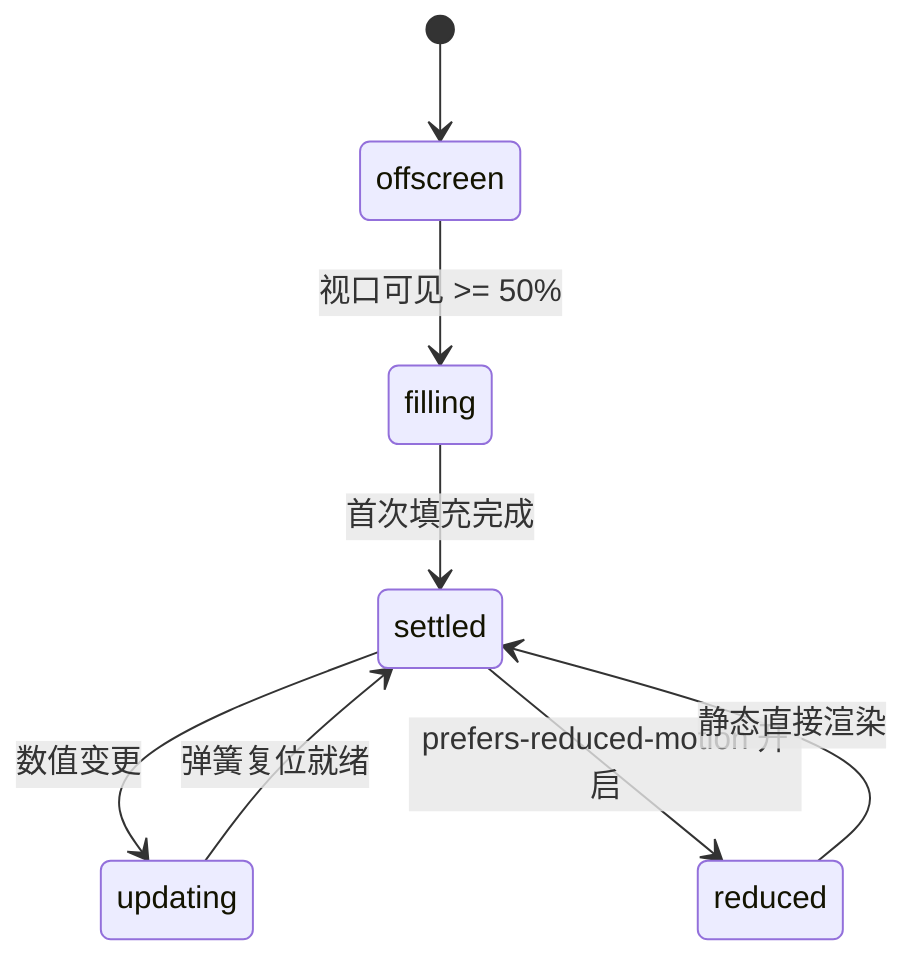

# Gauge · 仪表盘

用于系统负载、健康评分、存储用量和目标达成率的 270 度圆弧仪表盘。包含由零起步的物理阻尼圆弧弹簧生长（First Fill Spring）、跨阈值（Success/Warning/Danger）颜色与状态标签微模糊置换、数字轮盘 Ghost Sizer 防抖，以及原生 `role="meter"` 无障碍语义绑定。

## 原型清单

| 原型分组 | 原型元素 | 动效 / 状态变化 | 去向 |
| --- | --- | --- | --- |
| — | 仪表盘外层图表卡片 `.arc-gauge-figure` | 承载色调状态类名（`arc-gauge-success` 等）与图文排版 | 最小 DOM / CSS 宿主 |
| — | 仪表盘视觉槽位 `.arc-gauge-visual` | `role="meter"` 原生计量槽，同步数值范围与文本 | 无障碍视觉槽位 |
| — | 背景圆弧轨道 `.arc-gauge-track` | 270 度底部灰色引导环（半径 42px） | 背景参考轨道 |
| — | 动态高光圆弧 `.arc-gauge-arc` | 根据数值比例计算终点坐标，带弹簧过渡与端点圆角 | 动态高亮弧线 |
| — | 中心读数展台 `.arc-gauge-readout` | 绝对定位居中，包含数字、单位与健康状态评语 | 中心读数展台 |
| — | 隐形数字占位符 `.arc-gauge-sizer` | `visibility: hidden` 锁死两位/三位数字宽度，杜绝抖动 | Ghost Sizer 机制 |
| — | 状态微模糊文本 `.arc-gauge-status` / `.arc-gauge-swap` | 跨阈值时文字高斯微模糊（blur 2px）与微缩放置换 | 状态标签置换机制 |
| — | 标题与明细说明 `<figcaption>` | 仪表盘标题与辅助检查项说明文案 | 标题说明区 |
| — | 步进加减按钮组 `.previews-data_gaugeDemoXControls__O9anl` | 演示增减数值调试操作 | 演示外壳，已删除 |
| — | 顶栏、主题切换按钮 `#themeBtn`、舞台卡片 | — | 演示外壳，已删除 |

## 适用

- 机器 CPU/内存占用率、账户安全分、健康状态指标（0~100 分制）。
- 要求圆弧具有真实的 270 度工业仪表盘视觉包裹感（-135° 至 +135°）。
- 数值跨越警戒线（如 70 分以上绿色 Healthy，40-70 分橙色 Warning，40 分以下红色 Critical）时平滑变色与文案切换。
- 需要符合 WAI-ARIA `role="meter"` 标准。

## 不适用

- 纯数字翻滚无弧线指针 → [animated-counter](animated-counter.md)
- 多分类百分比圆环切片 → [donut-chart](donut-chart.md)
- 单分类横向分段进度条 → [split-bar](split-bar.md)
- 密集多维能力六边形对比 → [radar-chart](radar-chart.md)

## 状态机

| 状态 | 进入条件 | 视觉表现 | 退出到 |
| --- | --- | --- | --- |
| offscreen | 挂载尚未进入视口 | 弧长为 0，数值为 0，状态为初始态 | filling |
| filling | 视口曝光达到 50% | 弧线自起始端平滑填满至目标数值（768ms 无超调），中心数字递增 | settled |
| settled | 填充完毕稳态 | 弧线与数值静止，颜色对应当前阈值等级 | updating |
| updating | 外部传入新数值（增/减） | 弧线依物理弹簧伸缩，中心数字滚动，若跨越阈值触发文案高斯微模糊置换 | settled |
| reduced | 触发系统减少动态效果模式 | 弧线与数字直接跳入最终值，关闭弹簧过渡与高斯滤镜 | settled |



## 最小 DOM

```html
<figure class="arc-gauge-figure arc-gauge-success" aria-label="Workspace health: 72 of 100">
  <div class="arc-gauge-visual" role="meter" aria-label="Workspace health" aria-valuemin="0" aria-valuemax="100" aria-valuenow="72" aria-valuetext="72%, Healthy">
    <svg viewBox="0 0 100 90" aria-hidden="true" focusable="false">
      <path class="arc-gauge-track" d="M 20.302 79.698 A 42 42 0 1 1 79.698 79.698" />
      <path class="arc-gauge-arc" d="M 20.302 79.698 A 42 42 0 1 1 86.151 28.620" />
    </svg>
    <div class="arc-gauge-readout" aria-hidden="true">
      <span class="arc-gauge-number">
        <span class="arc-gauge-digits">72</span>
        <span class="arc-gauge-unit">%</span>
        <span class="arc-gauge-sizer">72</span>
      </span>
      <span class="arc-gauge-status">
        <span class="arc-gauge-swap"><span class="arc-gauge-text">Healthy</span></span>
      </span>
    </div>
  </div>

  <figcaption>
    <strong><span class="arc-gauge-swap"><span class="arc-gauge-text">Workspace health</span></span></strong>
    <span class="arc-gauge-detail"><span class="arc-gauge-swap"><span class="arc-gauge-text">14 of 20 checks passing</span></span></span>
  </figcaption>
</figure>
```

- `.arc-gauge-figure`：宿主图表容器，挂载健康等级样式类。
- `.arc-gauge-visual`：`role="meter"` 无障碍节点。
- `.arc-gauge-track`：270° 灰色背景底轨。
- `.arc-gauge-arc`：动态前景色圆弧路径。
- `.arc-gauge-readout`：中心数值与状态文本层。
- `.arc-gauge-sizer`：宽度隐形占位符。
- `<figcaption>`：指标名称与副标题描述。

## 参数

| 名称 | 值 | 用于 | 来源 |
| --- | --- | --- | --- |
| 圆弧几何半径 | `42px` | SVG 坐标系主半径 | 原型 |
| 起始角度 | `-135deg` | 圆弧左下起始角 | 原型 |
| 扫掠总弧度 | `270deg` | 满量程覆盖角度范围 | 原型 |
| SVG 视口尺寸 | `0 0 100 90` | 扁平自适应视口比例 | 原型 |
| 首次填充时长 | `768ms` | 视口初次展开无超调时长 | 原型 |
| 动态伸缩弹簧时长 | `420ms` | 日常增减物理弹簧过渡 | 原型 |
| 弹簧回弹系数 | `0.16` | 轻微过冲回弹手感 | 原型 |
| 文本微模糊置换 | `240ms` / `160ms` | 标签跨状态淡入淡出时长 | 原型 |
| 文本模糊半径 | `2px` | 切换时微高斯模糊 | 原型 |
| 视口触发阈值 | `0.5` (50%) | IntersectionObserver | 原型 |

## CSS

```css
.arc-gauge-figure {
  --gauge-success: #16a34a;
  --gauge-warning: #d97706;
  --gauge-danger: #dc2626;
  --gauge-track: rgba(0, 0, 0, 0.08);
  --gauge-muted: #737373;
  --gauge-foreground: #111111;
  --gauge-active-color: var(--gauge-success);
  --gauge-ease: cubic-bezier(0.16, 1, 0.3, 1);
  --gauge-duration: 420ms;

  position: relative;
  display: flex;
  flex-direction: column;
  align-items: center;
  text-align: center;
  gap: 0.75rem;
  margin: 0;
  color: var(--gauge-foreground);
  font-family: system-ui, -apple-system, sans-serif;
  user-select: none;
}

.arc-gauge-figure.arc-gauge-warning { --gauge-active-color: var(--gauge-warning); }
.arc-gauge-figure.arc-gauge-danger { --gauge-active-color: var(--gauge-danger); }

.arc-gauge-visual {
  position: relative;
  width: 140px;
  height: 126px;
}

.arc-gauge-visual svg {
  display: block;
  width: 100%;
  height: 100%;
  overflow: visible;
}

.arc-gauge-track {
  fill: none;
  stroke: var(--gauge-track);
  stroke-width: 6;
  stroke-linecap: round;
}

.arc-gauge-arc {
  fill: none;
  stroke: var(--gauge-active-color);
  stroke-width: 6;
  stroke-linecap: round;
  transition: stroke 260ms ease, d var(--gauge-duration) var(--gauge-ease);
}

.arc-gauge-readout {
  position: absolute;
  inset: 0;
  display: flex;
  flex-direction: column;
  align-items: center;
  justify-content: center;
  padding-top: 8px;
}

.arc-gauge-number {
  position: relative;
  display: inline-flex;
  align-items: baseline;
  justify-content: center;
  font-size: 1.875rem;
  font-weight: 700;
  line-height: 1;
  font-variant-numeric: tabular-nums;
}

.arc-gauge-digits {
  display: inline-block;
}

.arc-gauge-unit {
  font-size: 1rem;
  font-weight: 500;
  color: var(--gauge-muted);
  margin-left: 2px;
}

.arc-gauge-sizer {
  position: absolute;
  top: 0;
  left: 0;
  visibility: hidden;
  pointer-events: none;
}

.arc-gauge-status {
  font-size: 0.75rem;
  font-weight: 600;
  color: var(--gauge-active-color);
  margin-top: 2px;
  transition: color 260ms ease;
}

.arc-gauge-swap {
  position: relative;
  display: inline-block;
}

.arc-gauge-text {
  display: inline-block;
  transition: opacity 200ms ease, filter 200ms ease, transform 200ms var(--gauge-ease);
}

figcaption {
  display: flex;
  flex-direction: column;
  gap: 2px;
}

figcaption strong {
  font-size: 0.875rem;
  font-weight: 600;
}

.arc-gauge-detail {
  font-size: 0.75rem;
  color: var(--gauge-muted);
}

@media (prefers-reduced-motion: reduce) {
  .arc-gauge-arc,
  .arc-gauge-text {
    transition: none !important;
    filter: none !important;
  }
}
```

## JS

```js
/**
 * 根据极坐标计算圆上坐标点
 */
function polarToCartesian(cx, cy, r, angleInDegrees) {
  const angleInRadians = (angleInDegrees - 90) * (Math.PI / 180);
  return {
    x: cx + r * Math.cos(angleInRadians),
    y: cy + r * Math.sin(angleInRadians)
  };
}

/**
 * 构造 270° 仪表盘圆弧路径描述
 */
function describeArc(cx, cy, r, startAngle, endAngle) {
  const start = polarToCartesian(cx, cy, r, endAngle);
  const end = polarToCartesian(cx, cy, r, startAngle);
  const largeArcFlag = endAngle - startAngle <= 180 ? '0' : '1';
  return `M ${start.x.toFixed(3)} ${start.y.toFixed(3)} A ${r} ${r} 0 ${largeArcFlag} 0 ${end.x.toFixed(3)} ${end.y.toFixed(3)}`;
}

/**
 * 创建 Gauge 实例
 * @param {HTMLElement} el 宿主容器
 * @param {Object} options 配置项
 * @param {number} [options.value=72] 当前数值
 * @param {number} [options.min=0] 最小值
 * @param {number} [options.max=100] 最大值
 * @param {string} [options.label='Workspace health'] 标题文案
 * @param {string} [options.detail='All checks passing'] 副标题详情
 */
export function createGauge(el, options = {}) {
  let val = typeof options.value === 'number' ? options.value : 72;
  const min = typeof options.min === 'number' ? options.min : 0;
  const max = typeof options.max === 'number' ? options.max : 100;
  let label = options.label || 'Workspace health';
  let detail = options.detail || 'Checks passing';
  let disposed = false;

  const visual = el.querySelector('.arc-gauge-visual') || el;
  const arcPath = el.querySelector('.arc-gauge-arc');
  const digitsEl = el.querySelector('.arc-gauge-digits');
  const sizerEl = el.querySelector('.arc-gauge-sizer');
  const statusEl = el.querySelector('.arc-gauge-status .arc-gauge-text');
  const titleEl = el.querySelector('figcaption strong .arc-gauge-text');
  const detailEl = el.querySelector('.arc-gauge-detail .arc-gauge-text');

  const cx = 50;
  const cy = 50;
  const r = 42;
  const startDeg = -135;
  const totalSweep = 270;

  function updateVisual(targetVal) {
    if (disposed) return;
    const clamped = Math.max(min, Math.min(max, targetVal));
    const ratio = (clamped - min) / (max - min || 1);
    const endDeg = startDeg + Math.max(1, ratio * totalSweep);

    // 计算路径
    if (arcPath) {
      arcPath.setAttribute('d', describeArc(cx, cy, r, startDeg, endDeg));
    }

    // 状态与颜色分类
    let tier = 'success';
    let statusText = 'Healthy';
    if (ratio < 0.35) {
      tier = 'danger';
      statusText = 'Critical';
    } else if (ratio < 0.65) {
      tier = 'warning';
      statusText = 'Fair';
    }

    el.classList.remove('arc-gauge-success', 'arc-gauge-warning', 'arc-gauge-danger');
    el.classList.add(`arc-gauge-${tier}`);

    // 文字更新
    if (digitsEl) digitsEl.textContent = String(Math.round(clamped));
    if (sizerEl) sizerEl.textContent = String(Math.round(clamped));
    if (statusEl) statusEl.textContent = statusText;
    if (titleEl) titleEl.textContent = label;
    if (detailEl) detailEl.textContent = detail;

    // 无障碍属性
    if (visual) {
      visual.setAttribute('aria-valuenow', String(Math.round(clamped)));
      visual.setAttribute('aria-valuetext', `${Math.round(clamped)}%, ${statusText}`);
    }
  }

  updateVisual(val);

  // 模拟点击循环递增
  const handleClick = () => {
    val = val >= 100 ? 25 : val + 25;
    updateVisual(val);
  };
  el.addEventListener('click', handleClick);

  return {
    setValue(newVal) {
      if (disposed) return;
      val = newVal;
      updateVisual(val);
    },
    update(patch = {}) {
      if (disposed) return;
      if (typeof patch.value === 'number') val = patch.value;
      if (patch.label) label = patch.label;
      if (patch.detail) detail = patch.detail;
      updateVisual(val);
    },
    destroy() {
      disposed = true;
      el.removeEventListener('click', handleClick);
    }
  };
}
```

## 接入目标项目

- 状态来源：
  - 传入当前健康分或百分比 `value`（0~100）。调用 `gauge.setValue(num)` 进行响应式更新。
- 尺寸策略：
  - SVG 具有默认宽 140px，高 126px。可通过父级放大缩小，矢量无损缩放。
- 驱动方式：
  - `const gauge = createGauge(container, { value: 85 })`。
  - 销毁时调用 `gauge.destroy()`。

## 重入与清理

- 连续调用 `setValue()` 时，基于当前几何参数立即插值重绘，无残留计时器。
- 销毁时清理容器的 click 事件绑定。

## 减少动态效果

- 满足 `prefers-reduced-motion: reduce` 时：
  - 圆弧路径过渡停用，即时绘制至最终角度。
  - 状态文案停用 blur 模糊滤镜。

## 焦点与键盘

- 主视觉容器具备 `role="meter"`，同步维护 `aria-valuenow`、`aria-valuemin` 与 `aria-valuemax`。
- 装饰性矢量图元打上 `aria-hidden="true"`。

## 兼容回退

| 特性 | 不支持时 |
| --- | --- |
| SVG Arc 绘图 | 退化为原生 HTML5 `<meter>` 标签渲染。 |

## 验收清单

- [ ] 初始渲染 270 度圆弧仪表盘，带有底部灰色导向轨道和彩色圆弧。
- [ ] 数值位于中间，右侧带 `%` 单位，下方带当前等级标签（如 Healthy）。
- [ ] 点击图表数值在 25、50、75、100 之间循环切换，圆弧与颜色同步变化。
- [ ] 跨越警戒阈值时，等级标签平滑变色。
- [ ] 调用 `destroy()` 完整清理事件。
