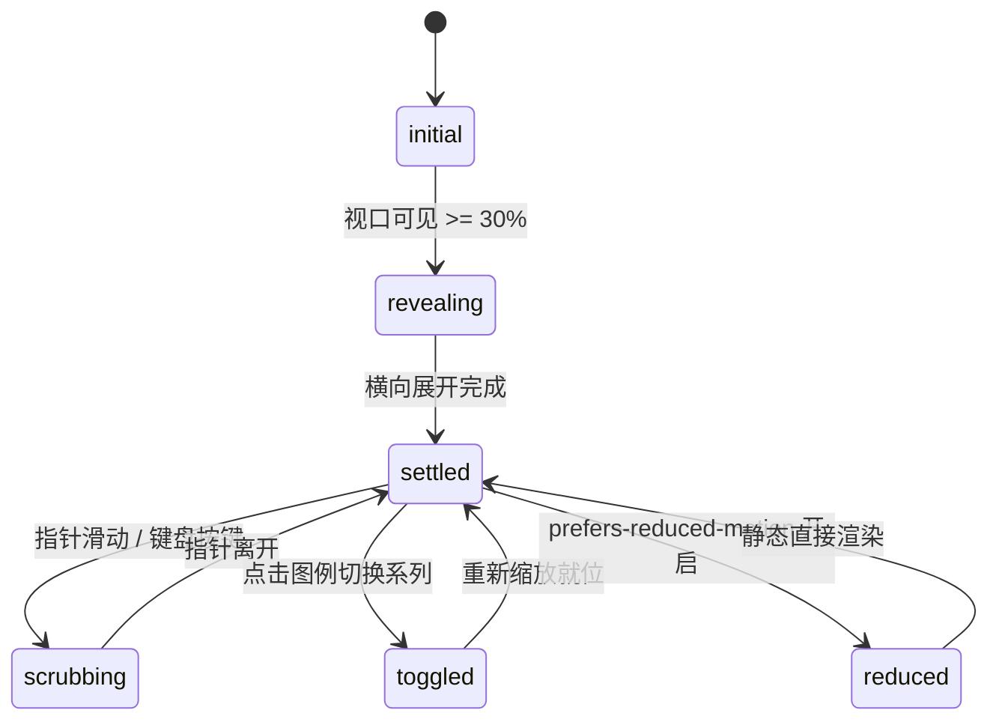

# Line Chart · 折线图

用于连续时间序列、多周期对比（本期 vs 上期）以及多指标趋势分析的高性能平滑折线与面积图。包含样条平滑曲线渲染（Catmull-Rom / Monotone）、重采样路径形变（Shared Morph Grid Points）、跟手十字准星（Crosshair Scrubbing）、边界自适应翻转提示框（Flipped Tooltip），以及图例系列显隐切换。

## 原型清单

| 原型分组 | 原型元素 | 动效 / 状态变化 | 去向 |
| --- | --- | --- | --- |
| — | 外层图表卡片 `.arc-line-figure` | 布局网格、系列状态与无障碍承载 | 最小 DOM / CSS 宿主 |
| — | 系列图例切换栏 `.arc-line-legend` | 系列色块、虚线指示、点按切换显隐与无障碍状态 | 系列切换图例 |
| — | 绘图视口容器 `.arc-line-plot` | `role="slider"`，捕获水平滑动与键盘方向键探查 | 手势与键盘探查层 |
| — | 渐变面积填充 `.arc-line-area` | 曲线至底部的半透明垂直渐变闭合路径 | 渐变面积填充 |
| — | 核心曲线描边 `.arc-line-line` | 平滑 Catmull-Rom 样条曲线（实线与虚线） | 样条折线渲染 |
| — | 十字垂直准星 `.arc-line-crosshair` | 发丝垂线，跟随光标横向坐标实时贴附并吸附最近数据点 | 十字准星游标 |
| — | 数据点悬停圆环 `.arc-line-dot` | 贴附在各系列曲线与准星交点处的外扩圆点 | 焦点数据圆环 |
| — | 浮动悬浮卡片 `.arc-line-tooltip` | 跟随准星移动，靠近右侧边界时自动向左翻转避免溢出 | 智能翻转提示框 |
| — | 坐标网格发丝线 `.arc-line-grid` / 基准线 `.arc-line-baseline` | 0 / 200 / 400 / 600 水平发丝参考线 | 参考坐标网格 |
| — | Y 轴刻度标签 `.arc-line-gutter` | 右侧绝对定位刻度数值 | 纵轴动态刻度 |
| — | X 轴时间标签 `.arc-line-axis` | 底部百分比定位的时间点标签 | 横轴时间刻度 |
| — | 读屏表格 `.arc-line-srOnly` | 结构化语义 `<table>` 与 `aria-live="polite"` 动态宣告 | 无障碍可访问性 |
| — | 周期切换按钮组 `.qf` / `.Cr` | 演示 7d / 30d / 90d 切换 | 演示外壳，已删除 |
| — | 顶栏指标展台 `.arc-counter-counter` | 演示总注册量滚轮翻滚 | 演示外壳，已删除 |
| — | 顶栏、主题切换按钮 `#themeBtn`、舞台卡片 | — | 演示外壳，已删除 |

## 适用

- 连续时间走势监控（日/周/月活跃度、转化率、收益、服务器负载）。
- 需要展示主线与对比参考线（如本月 vs 上月虚线）。
- 光标移动时需要高精度准星十字跟随，且提示框在屏幕边缘自动向左反转防裁切。
- 支持全键盘无障碍探查每一天的详细数值。

## 不适用

- 极简单行微型走势无轴线 → [sparkline](sparkline.md)
- 离散柱状对比与均值线 → [bar-chart](bar-chart.md)
- 高频毫秒级无休止追加时间流 → [realtime-stream](realtime-stream.md)
- 两期离散斜率对照 → [slope-chart](slope-chart.md)

## 状态机

| 状态 | 进入条件 | 视觉表现 | 退出到 |
| --- | --- | --- | --- |
| initial | 初始挂载（尚未进入视口） | 曲线通过 clipPath 遮罩隐藏或宽度为 0 | revealing |
| revealing | 视口可见达到 30% | 曲线与渐变区域从左至右平滑展开（840ms） | settled |
| settled | 展开完毕或光标移出 | 曲线保持稳态，准星与提示框淡出隐藏 | scrubbing |
| scrubbing | 指针在图表内滑动或键盘方向键移动 | 准星垂直线吸附到最近数据点，交点圆环显现，浮动提示框紧随光标显示各系列数值 | settled |
| toggled | 点击图例系列按钮 | 被隐藏系列淡出并扁平化，保留系列根据新最值重算 Y 轴刻度网格 | settled |
| reduced | 触发系统减少动态效果模式 | 曲线与面积直接展示，停用横向展开与提示框弹簧平滑位移 | settled |



## 最小 DOM

```html
<figure class="arc-line-figure" aria-label="Line chart">
  <div class="arc-line-legend" role="group" aria-label="Chart series">
    <button type="button" class="arc-line-toggle" aria-pressed="true">
      <span class="arc-line-swatch" aria-hidden="true"></span>
      <span class="arc-line-toggleLabel">This period</span>
    </button>
  </div>

  <div class="arc-line-chart">
    <div class="arc-line-plot" role="slider" tabindex="0" aria-label="Explore line chart" aria-orientation="horizontal">
      <svg class="arc-line-svg" width="100%" height="220" aria-hidden="true">
        <line class="arc-line-grid" x1="0" x2="100%" y1="12" y2="12" />
        <line class="arc-line-grid" x1="0" x2="100%" y1="82" y2="82" />
        <line class="arc-line-grid" x1="0" x2="100%" y1="152" y2="152" />
        <line class="arc-line-baseline" x1="0" x2="100%" y1="219.5" y2="219.5" />
        <line class="arc-line-crosshair" y1="8" y2="220" x1="0" x2="0" opacity="0" />
        <g class="arc-line-series"></g>
        <circle class="arc-line-dot" r="4" cx="0" cy="0" opacity="0" />
      </svg>
      <div class="arc-line-tooltip" aria-hidden="true">
        <p class="arc-line-tipTitle"></p>
        <div class="arc-line-tipRows"></div>
      </div>
    </div>

    <div class="arc-line-gutter" aria-hidden="true"></div>
    <div class="arc-line-axis" aria-hidden="true"></div>
  </div>

  <div class="arc-line-srOnly">
    <table>
      <caption>Line chart data table</caption>
      <thead><tr><th scope="col">Date</th><th scope="col">Value</th></tr></thead>
      <tbody></tbody>
    </table>
  </div>
</figure>
```

- `.arc-line-figure`：主图表容器。
- `.arc-line-legend`：系列控制图例。
- `.arc-line-plot`：核心绘图与交互容器，挂载 `role="slider"`。
- `.arc-line-svg`：包含水平网格线、基线、准星、系列折线与面积路径的 SVG。
- `.arc-line-crosshair`：准星垂直发丝线。
- `.arc-line-dot`：高亮数据交点圆圈。
- `.arc-line-tooltip`：带智能反转的悬浮提示框。
- `.arc-line-gutter`：Y 轴刻度标签列。
- `.arc-line-axis`：X 轴时间刻度。
- `.arc-line-srOnly`：无障碍屏幕阅读器专用数据表格。

## 参数

| 名称 | 值 | 用于 | 来源 |
| --- | --- | --- | --- |
| 绘图区默认高度 | `220px` | SVG 高度 | 原型 |
| 顶部内间距 | `12px` | 防止曲线峰值贴顶 | 原型 |
| 首次展开耗时 | `840ms` | 曲线从左至右显现 | 原型 |
| 展开缓动曲线 | `cubic-bezier(0.65, 0, 0.35, 1)` | 展开动画曲线 | 原型 |
| 准星吸附半径 | `14px` | 鼠标贴附触发阈值 | 原型 |
| 提示框边缘翻转阈值 | `120px` | 靠近右侧时反向定位 | 原型 |
| 坐标轴重缩放弹簧 | `400ms` / `bounce: 0` | 切换系列时网格升降 | 原型 |
| 视口触发阈值 | `0.3` (30%) | IntersectionObserver | 原型 |

## CSS

```css
.arc-line-figure {
  --line-accent: #2563eb;
  --line-secondary: #737373;
  --line-border: rgba(0, 0, 0, 0.08);
  --line-border-strong: rgba(0, 0, 0, 0.2);
  --line-muted: #737373;
  --line-foreground: #111111;
  --line-ease: cubic-bezier(0.16, 1, 0.3, 1);
  --line-duration: 400ms;

  display: flex;
  flex-direction: column;
  gap: 1rem;
  margin: 0;
  color: var(--line-foreground);
  font-family: system-ui, -apple-system, sans-serif;
  user-select: none;
}

.arc-line-legend {
  display: flex;
  align-items: center;
  gap: 1rem;
}

.arc-line-toggle {
  display: inline-flex;
  align-items: center;
  gap: 6px;
  background: transparent;
  border: none;
  padding: 4px 8px;
  border-radius: 6px;
  cursor: pointer;
  font-size: 0.8125rem;
  color: inherit;
  transition: opacity 200ms ease;
}

.arc-line-toggle[aria-pressed="false"] {
  opacity: 0.4;
  text-decoration: line-through;
}

.arc-line-swatch {
  width: 14px;
  height: 2.5px;
  background-color: var(--line-accent);
  border-radius: 1px;
}

.arc-line-swatch[data-dashed="true"] {
  background: repeating-linear-gradient(to right, var(--line-secondary) 0 4px, transparent 4px 7px);
}

.arc-line-chart {
  position: relative;
  display: grid;
  grid-template-columns: minmax(0, 1fr) 52px;
  grid-template-rows: auto 24px;
}

.arc-line-plot {
  position: relative;
  grid-area: 1 / 1;
  outline: none;
  cursor: crosshair;
  touch-action: pan-y;
}

.arc-line-svg {
  display: block;
  overflow: visible;
}

.arc-line-grid {
  stroke: var(--line-border);
  stroke-width: 1;
  shape-rendering: crispEdges;
}

.arc-line-baseline {
  stroke: var(--line-border-strong);
  stroke-width: 1;
  shape-rendering: crispEdges;
}

.arc-line-crosshair {
  stroke: var(--line-border-strong);
  stroke-width: 1;
  stroke-dasharray: 2 2;
  shape-rendering: crispEdges;
  pointer-events: none;
  transition: opacity 160ms ease, transform 100ms linear;
}

.arc-line-line {
  fill: none;
  stroke: var(--line-accent);
  stroke-width: 2.5;
  stroke-linecap: round;
  stroke-linejoin: round;
  transition: d var(--line-duration) var(--line-ease), opacity 200ms ease;
}

.arc-line-line[data-dashed="true"] {
  stroke: var(--line-secondary);
  stroke-dasharray: 4 4;
}

.arc-line-area {
  fill: color-mix(in srgb, var(--line-accent) 12%, transparent);
  transition: d var(--line-duration) var(--line-ease), opacity 200ms ease;
}

.arc-line-dot {
  fill: #fff;
  stroke: var(--line-accent);
  stroke-width: 2.5;
  pointer-events: none;
  transition: opacity 160ms ease, transform 120ms var(--line-ease);
}

.arc-line-tooltip {
  position: absolute;
  top: 10px;
  left: 0;
  display: flex;
  flex-direction: column;
  gap: 4px;
  padding: 8px 12px;
  background: rgba(17, 17, 17, 0.94);
  backdrop-filter: blur(4px);
  color: #fff;
  border-radius: 8px;
  font-size: 0.75rem;
  pointer-events: none;
  opacity: 0;
  box-shadow: 0 4px 14px rgba(0, 0, 0, 0.15);
  transition: opacity 160ms ease, transform 120ms var(--line-ease);
  z-index: 10;
  white-space: nowrap;
}

.arc-line-tooltip.is-active {
  opacity: 1;
}

.arc-line-tipTitle {
  margin: 0;
  font-weight: 600;
  color: rgba(255, 255, 255, 0.8);
}

.arc-line-tipRow {
  display: flex;
  align-items: center;
  gap: 8px;
  font-variant-numeric: tabular-nums;
}

.arc-line-gutter {
  position: relative;
  grid-area: 1 / 2;
}

.arc-line-tick {
  position: absolute;
  left: 8px;
  display: block;
  font-size: 0.75rem;
  color: var(--line-muted);
  transform: translateY(-50%);
  font-variant-numeric: tabular-nums;
}

.arc-line-axis {
  position: relative;
  grid-area: 2 / 1;
  overflow: hidden;
}

.arc-line-axisLabel {
  position: absolute;
  top: 6px;
  font-size: 0.75rem;
  color: var(--line-muted);
  transform: translateX(-50%);
  white-space: nowrap;
  font-variant-numeric: tabular-nums;
}

.arc-line-srOnly {
  position: absolute;
  width: 1px;
  height: 1px;
  margin: -1px;
  padding: 0;
  border: 0;
  overflow: hidden;
  clip: rect(0, 0, 0, 0);
  white-space: nowrap;
}

@media (prefers-reduced-motion: reduce) {
  .arc-line-line,
  .arc-line-area,
  .arc-line-crosshair,
  .arc-line-tooltip,
  .arc-line-dot {
    transition: none !important;
  }
}
```

## JS

```js
/**
 * 构造 Catmull-Rom 平滑样条曲线 SVG Path
 */
function buildSplinePath(points) {
  if (points.length === 0) return '';
  if (points.length === 1) return `M ${points[0].x} ${points[0].y}`;
  let path = `M ${points[0].x.toFixed(1)} ${points[0].y.toFixed(1)}`;

  for (let i = 0; i < points.length - 1; i++) {
    const p0 = points[Math.max(0, i - 1)];
    const p1 = points[i];
    const p2 = points[i + 1];
    const p3 = points[Math.min(points.length - 1, i + 2)];

    const cp1x = p1.x + (p2.x - p0.x) / 6;
    const cp1y = p1.y + (p2.y - p0.y) / 6;
    const cp2x = p2.x - (p3.x - p1.x) / 6;
    const cp2y = p2.y - (p3.y - p1.y) / 6;

    path += ` C ${cp1x.toFixed(1)} ${cp1y.toFixed(1)}, ${cp2x.toFixed(1)} ${cp2y.toFixed(1)}, ${p2.x.toFixed(1)} ${p2.y.toFixed(1)}`;
  }
  return path;
}

/**
 * 创建 LineChart 实例
 * @param {HTMLElement} el 宿主容器
 * @param {Object} options 配置项
 * @param {Array<{date: string, value: number, secondary?: number}>} [options.data] 数据点数组
 */
export function createLineChart(el, options = {}) {
  const defaultData = [
    { date: 'Aug 24', value: 128, secondary: 121 },
    { date: 'Aug 26', value: 211, secondary: 190 },
    { date: 'Aug 28', value: 199, secondary: 172 },
    { date: 'Aug 31', value: 254, secondary: 218 },
    { date: 'Sep 2', value: 247, secondary: 226 },
    { date: 'Sep 4', value: 253, secondary: 231 },
    { date: 'Sep 7', value: 231, secondary: 184 },
    { date: 'Sep 9', value: 437, secondary: 200 },
    { date: 'Sep 11', value: 240, secondary: 187 },
    { date: 'Sep 14', value: 250, secondary: 235 },
    { date: 'Sep 16', value: 262, secondary: 230 },
    { date: 'Sep 18', value: 268, secondary: 232 },
    { date: 'Sep 21', value: 248, secondary: 183 }
  ];

  let data = Array.isArray(options.data) && options.data.length > 0 ? options.data : defaultData;
  let activeIndex = -1;
  let disposed = false;

  const plot = el.querySelector('.arc-line-plot') || el;
  const seriesGroup = el.querySelector('.arc-line-series');
  const crosshair = el.querySelector('.arc-line-crosshair');
  const dot = el.querySelector('.arc-line-dot');
  const tooltip = el.querySelector('.arc-line-tooltip');
  const gutter = el.querySelector('.arc-line-gutter');
  const axis = el.querySelector('.arc-line-axis');
  const tableBody = el.querySelector('.arc-line-srOnly tbody');

  const plotH = 220;
  const topPad = 12;
  const availableH = plotH - topPad;

  // 极值与刻度
  const maxVal = Math.max(...data.map(d => Math.max(d.value, d.secondary || 0)), 100);
  const niceMax = Math.ceil(maxVal / 100) * 100;

  let computedPoints = [];

  function computeLayout(svgWidth) {
    if (disposed) return;
    const n = data.length;
    const stepX = svgWidth / (n - 1 || 1);

    const primaryPts = [];
    const secondaryPts = [];
    computedPoints = [];

    data.forEach((d, i) => {
      const x = i * stepX;
      const y1 = plotH - (d.value / niceMax) * availableH;
      const y2 = plotH - ((d.secondary || 0) / niceMax) * availableH;

      primaryPts.push({ x, y: y1 });
      secondaryPts.push({ x, y: y2 });
      computedPoints.push({ x, y: y1, y2, d, i });
    });

    const spline1 = buildSplinePath(primaryPts);
    const spline2 = buildSplinePath(secondaryPts);
    const areaD = `${spline1} L ${svgWidth} ${plotH} L 0 ${plotH} Z`;

    if (seriesGroup) {
      seriesGroup.innerHTML = `
        <path class="arc-line-area" d="${areaD}"></path>
        <path class="arc-line-line" d="${spline1}"></path>
        <path class="arc-line-line" data-dashed="true" d="${spline2}"></path>
      `;
    }

    // 渲染 Y 轴刻度
    if (gutter) {
      gutter.innerHTML = '';
      const ticks = [0, niceMax / 3, (niceMax * 2) / 3, niceMax];
      ticks.forEach(tVal => {
        const y = plotH - (tVal / niceMax) * availableH;
        const s = document.createElement('span');
        s.className = 'arc-line-tick';
        s.style.top = `${y}px`;
        s.textContent = String(Math.round(tVal));
        gutter.appendChild(s);
      });
    }

    // 渲染 X 轴刻度
    if (axis) {
      axis.innerHTML = '';
      const sampleIndices = [0, Math.floor(n / 4), Math.floor(n / 2), Math.floor((3 * n) / 4), n - 1];
      sampleIndices.forEach(idx => {
        if (!data[idx]) return;
        const s = document.createElement('span');
        s.className = 'arc-line-axisLabel';
        s.style.left = `${(idx / (n - 1)) * 100}%`;
        s.textContent = data[idx].date;
        axis.appendChild(s);
      });
    }

    // 渲染表格
    if (tableBody) {
      tableBody.innerHTML = '';
      data.forEach(d => {
        const tr = document.createElement('tr');
        tr.innerHTML = `<th scope="row">${d.date}</th><td>${d.value}</td>`;
        tableBody.appendChild(tr);
      });
    }
  }

  const initialWidth = plot.clientWidth || 480;
  computeLayout(initialWidth);

  function setActive(idx) {
    if (disposed || idx === activeIndex) return;
    activeIndex = idx;

    if (idx >= 0 && idx < computedPoints.length) {
      const pt = computedPoints[idx];

      if (crosshair) {
        crosshair.setAttribute('opacity', '1');
        crosshair.setAttribute('x1', pt.x.toFixed(1));
        crosshair.setAttribute('x2', pt.x.toFixed(1));
      }

      if (dot) {
        dot.setAttribute('opacity', '1');
        dot.setAttribute('cx', pt.x.toFixed(1));
        dot.setAttribute('cy', pt.y.toFixed(1));
      }

      if (tooltip) {
        tooltip.classList.add('is-active');
        const tipX = pt.x > initialWidth - 140 ? pt.x - 130 : pt.x + 15;
        tooltip.style.transform = `translate(${tipX}px, ${Math.max(10, pt.y - 40)}px)`;

        const title = tooltip.querySelector('.arc-line-tipTitle');
        const rows = tooltip.querySelector('.arc-line-tipRows');
        if (title) title.textContent = pt.d.date;
        if (rows) {
          rows.innerHTML = `
            <div class="arc-line-tipRow"><span>This period:</span> <strong>${pt.d.value}</strong></div>
            ${pt.d.secondary !== undefined ? `<div class="arc-line-tipRow" style="color: #9ca3af;"><span>Prev period:</span> <strong>${pt.d.secondary}</strong></div>` : ''}
          `;
        }
      }
    } else {
      if (crosshair) crosshair.setAttribute('opacity', '0');
      if (dot) dot.setAttribute('opacity', '0');
      if (tooltip) tooltip.classList.remove('is-active');
    }
  }

  function handlePointer(clientX) {
    const rect = plot.getBoundingClientRect();
    const relX = clientX - rect.left;
    const clampedX = Math.max(0, Math.min(rect.width, relX));
    const stepX = rect.width / (data.length - 1 || 1);
    const idx = Math.round(clampedX / stepX);
    setActive(Math.max(0, Math.min(data.length - 1, idx)));
  }

  const onPointerMove = (e) => handlePointer(e.clientX);
  const onPointerLeave = () => setActive(-1);
  const onTouchMove = (e) => {
    if (e.touches && e.touches[0]) handlePointer(e.touches[0].clientX);
  };

  const onKeyDown = (e) => {
    if (e.key === 'ArrowRight') {
      e.preventDefault();
      setActive(Math.min(data.length - 1, activeIndex < 0 ? 0 : activeIndex + 1));
    } else if (e.key === 'ArrowLeft') {
      e.preventDefault();
      setActive(Math.max(0, activeIndex < 0 ? 0 : activeIndex - 1));
    } else if (e.key === 'Escape') {
      setActive(-1);
    }
  };

  plot.addEventListener('pointermove', onPointerMove);
  plot.addEventListener('pointerleave', onPointerLeave);
  plot.addEventListener('touchmove', onTouchMove, { passive: true });
  plot.addEventListener('touchend', onPointerLeave);
  plot.addEventListener('keydown', onKeyDown);

  // 模拟点击循环切点
  const handleClick = () => {
    setActive((activeIndex + 1) % data.length);
  };
  el.addEventListener('click', handleClick);

  return {
    setActive,
    update(newData) {
      if (disposed) return;
      if (Array.isArray(newData)) data = newData;
      computeLayout(plot.clientWidth || 480);
      setActive(-1);
    },
    destroy() {
      disposed = true;
      plot.removeEventListener('pointermove', onPointerMove);
      plot.removeEventListener('pointerleave', onPointerLeave);
      plot.removeEventListener('touchmove', onTouchMove);
      plot.removeEventListener('touchend', onPointerLeave);
      plot.removeEventListener('keydown', onKeyDown);
      el.removeEventListener('click', handleClick);
    }
  };
}
```

## 接入目标项目

- 状态来源：
  - 传入时间序列数组 `[{ date, value, secondary? }]`。
- 尺寸策略：
  - SVG 宽度自动 100% 拉伸适配容器宽度，高度默认 220px。
- 驱动方式：
  - `const lineChart = createLineChart(container, { data })`。
  - 卸载时调用 `lineChart.destroy()`。

## 重入与清理

- 准星跟手移动时按坐标直接吸附到离散数据索引，无延时累积。
- 销毁时注销全部触摸、指针和按键监听。

## 减少动态效果

- 满足 `prefers-reduced-motion: reduce` 时：
  - 禁用曲线初次进入横向展开动画。
  - 提示框与吸附交点圆环取消平滑过渡，即时呈现。

## 焦点与键盘

- `.arc-line-plot` 设置 `role="slider"` 与 `tabindex="0"`，支持左右箭头键在数据点间穿梭。
- 屏幕阅读器优先通过内嵌隐藏表格无障碍访问全部时间节点与指标。

## 兼容回退

| 特性 | 不支持时 |
| --- | --- |
| SVG Catmull-Rom 三次贝塞尔曲线 | 回退为折线（Polyline）点对点直线连接。 |

## 验收清单

- [ ] 初始渲染平滑平坦的样条实线、对比虚线与下方浅色渐变区域。
- [ ] 鼠标移入绘图区，垂直虚线准星贴附到最近日期，高亮圆点显示在曲线上。
- [ ] 提示框跟随光标移动，并在右边缘自动向左反转避免截断。
- [ ] 键盘左右键支持逐点步进导航。
- [ ] 调用 `destroy()` 完整清理事件。
