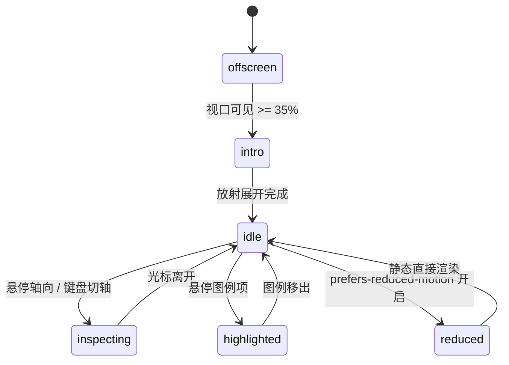

# Radar Chart · 雷达图

用于多维属性评估（如城市对比、候选人技能、产品特性分析）的蜘蛛网多边形雷达图。包含多同心多边形环与径向辐条（Spoke）、多系列多边形归一化平滑形变（Morphing）、辐条焦点悬停吸附（Active Spoke）、系列交点圆环与排序对比提示框，以及全键盘轴点轮转。

## 原型清单

| 原型分组 | 原型元素 | 动效 / 状态变化 | 去向 |
| --- | --- | --- | --- |
| — | 雷达图外层卡片 `.arc-radar-figure` | 布局对齐、响应式边距与无障碍描述容器 | 最小 DOM / CSS 宿主 |
| — | 舞台交互区 `.arc-radar-stage` | `role="group"` 接收键盘焦点，控制提示框与轴高亮 | 键盘与交互舞台 |
| — | 同心网格环 `.arc-radar-ring` | 4 层等距正多边形发丝线（25%、50%、75%、100%） | 网格同心环 |
| — | 径向辐射轴 `.arc-radar-spoke` | 从圆心指向各维度的参考轴线 | 径向辐条 |
| — | 系列多边形路径 `.arc-radar-shape` | 对应系列的闭合半透明多边形，带平滑插值形变动效 | 核心数据多边形 |
| — | 轴交点标记点 `.arc-radar-marker` | 悬停某轴时吸附在各系列多边形顶点处的聚焦圆点 | 焦点标记圆圈 |
| — | 轴向标签 `.arc-radar-axisLabel` | 围绕圆周精准锚定排版的文字标签（Talent pool 等） | 维度名称标签 |
| — | 浮动对比提示框 `.arc-radar-tooltip` | 跟随当前轴显示各系列分值大小排序 | 动态多系列 Tooltip |
| — | 系列图例按钮 `.arc-radar-key` | 系列色块与标题，支持鼠标悬停突出该系列并暗化其他系列 | 交互图例高亮 |
| — | 读屏表格 `.arc-radar-srOnly` | 结构化语义 `<table>` 与 `aria-live="polite"` 动态宣告 | 无障碍可访问性 |
| — | 对比城市切换单选组 `.bu` / `.ur` | 演示多候选城市切换 | 演示外壳，已删除 |
| — | 顶栏、主题切换按钮 `#themeBtn`、舞台卡片 | — | 演示外壳，已删除 |

## 适用

- 多维综合能力评估（如敏捷性、成本、人才储备、生活质量，满分 100 分）。
- 2~3 个对比实体（如城市 A vs 城市 B）在多个维度上的直观覆盖面积重叠分析。
- 鼠标扫过某个轴向时，需要准确定位该轴并在各系列上产生微标记，同时弹出数值对比浮窗。
- 支持全键盘方向键循环探查各个维度。

## 不适用

- 离散时序柱体高低比较 → [bar-chart](bar-chart.md)
- 密集连续时间序列走势图 → [line-chart](line-chart.md)
- 单百分比份额圆周占比 → [donut-chart](donut-chart.md)
- 阶段递减漏斗模型 → [funnel-chart](funnel-chart.md)

## 状态机

| 状态 | 进入条件 | 视觉表现 | 退出到 |
| --- | --- | --- | --- |
| offscreen | 挂载尚未进入视口 | 系列多边形缩放为 0 汇聚于圆心 | intro |
| intro | 视口可见达到 35% | 多边形自圆心以物理弹簧曲线向外放射展开（900ms，回弹 0.12） | idle |
| idle | 展开完毕或光标移出 | 多边形保持稳定填充与描边，标记点与提示框隐藏 | inspecting |
| inspecting | 光标靠近某辐条或键盘方向键切换 | 当前辐条与标签高亮加粗，标记点吸附在各系列顶点，提示框浮现并列出排序数值 | idle |
| highlighted | 悬停图例中某一实体 | 目标实体多边形描边高亮加粗，其他实体透明度降至 20% | idle |
| reduced | 触发系统减少动态效果模式 | 多边形直接到位，停用向外缩放展开与标记位移动效 | idle |



## 最小 DOM

```html
<figure class="arc-radar-figure" aria-label="Radar chart">
  <div class="arc-radar-stage" role="group" tabindex="0" aria-label="Radar chart, use arrow keys to navigate measures">
    <svg class="arc-radar-svg" width="360" height="360" viewBox="0 0 360 360" aria-hidden="true">
      <g class="arc-radar-web"></g>
      <g class="arc-radar-shapes"></g>
      <circle class="arc-radar-marker" data-slot="0" r="4.5" cx="0" cy="0" opacity="0" />
      <circle class="arc-radar-marker" data-slot="1" r="4.5" cx="0" cy="0" opacity="0" />
    </svg>

    <div class="arc-radar-labels" aria-hidden="true"></div>

    <div class="arc-radar-tooltip" aria-hidden="true">
      <p class="arc-radar-tipTitle"></p>
      <div class="arc-radar-tipRows"></div>
    </div>
  </div>

  <div class="arc-radar-legend" role="group" aria-label="Profiles">
    <!-- 图例项 -->
  </div>

  <div class="arc-radar-srOnly">
    <table>
      <caption>Radar chart data table</caption>
      <thead><tr><th scope="col">Measure</th></tr></thead>
      <tbody></tbody>
    </table>
  </div>
</figure>
```

- `.arc-radar-figure`：宿主图表容器。
- `.arc-radar-stage`：带有 `tabindex="0"` 的交互舞台。
- `.arc-radar-svg`：包含同心环、辐条线、多边形面和吸附圆点的核心 SVG。
- `.arc-radar-labels`：圆周绝对定位的轴标签文字。
- `.arc-radar-tooltip`：跟随当前轴浮动的对比卡片。
- `.arc-radar-legend`：底部实体图例切换栏。
- `.arc-radar-srOnly`：无障碍辅助技术专用数据表格。

## 参数

| 名称 | 值 | 用于 | 来源 |
| --- | --- | --- | --- |
| 默认维度轴数 | `6` | 默认正六边形雷达网格 | 原型 |
| 对比实体数 | `2` | 默认比较两组数据 | 原型 |
| 满分上限 | `100` | 归一化评分上限 | 原型 |
| 同心环分段 | `[0.25, 0.5, 0.75, 1.0]` | 四层等距同心环 | 原型 |
| 默认图表直径 | `360px` | 舞台宽高与 SVG 视口 | 原型 |
| 形变弹簧时长 | `600ms` / `bounce: 0.16` | 数据切换时多边形形变 | 原型 |
| 初始放射展开时长 | `900ms` / `bounce: 0.12` | 首次视口入场展开时长 | 原型 |
| 标记点半径 | `4.5px` | 顶点聚焦圆点 | 原型 |
| 视口触发阈值 | `0.35` (35%) | IntersectionObserver | 原型 |

## CSS

```css
.arc-radar-figure {
  --radar-primary: #2563eb;
  --radar-secondary: #16a34a;
  --radar-border: rgba(0, 0, 0, 0.1);
  --radar-border-strong: rgba(0, 0, 0, 0.25);
  --radar-muted: #737373;
  --radar-foreground: #111111;
  --radar-ease: cubic-bezier(0.16, 1, 0.3, 1);
  --radar-duration: 400ms;

  position: relative;
  display: flex;
  flex-direction: column;
  align-items: center;
  gap: 1.5rem;
  margin: 0;
  color: var(--radar-foreground);
  font-family: system-ui, -apple-system, sans-serif;
  user-select: none;
}

.arc-radar-stage {
  position: relative;
  width: 360px;
  height: 360px;
  outline: none;
  cursor: pointer;
}

.arc-radar-svg {
  display: block;
  width: 100%;
  height: 100%;
  overflow: visible;
}

.arc-radar-ring {
  fill: none;
  stroke: var(--radar-border);
  stroke-width: 1;
}

.arc-radar-spoke {
  stroke: var(--radar-border);
  stroke-width: 1;
  transition: stroke 200ms ease;
}

.arc-radar-spoke.is-active {
  stroke: var(--radar-border-strong);
  stroke-width: 1.5;
}

.arc-radar-shape {
  transition: d var(--radar-duration) var(--radar-ease), opacity 200ms ease;
  stroke-width: 2;
  stroke-linejoin: round;
}

.arc-radar-shape[data-slot="0"] {
  fill: color-mix(in srgb, var(--radar-primary) 18%, transparent);
  stroke: var(--radar-primary);
}

.arc-radar-shape[data-slot="1"] {
  fill: color-mix(in srgb, var(--radar-secondary) 18%, transparent);
  stroke: var(--radar-secondary);
}

.arc-radar-marker {
  fill: #fff;
  stroke-width: 2;
  pointer-events: none;
  transition: opacity 160ms ease, cx 160ms var(--radar-ease), cy 160ms var(--radar-ease);
}

.arc-radar-marker[data-slot="0"] { stroke: var(--radar-primary); }
.arc-radar-marker[data-slot="1"] { stroke: var(--radar-secondary); }

.arc-radar-axisLabel {
  position: absolute;
  font-size: 0.75rem;
  color: var(--radar-muted);
  transform: translate(-50%, -50%);
  pointer-events: none;
  white-space: nowrap;
  transition: color 160ms ease, font-weight 160ms ease;
}

.arc-radar-axisLabel.is-active {
  color: var(--radar-foreground);
  font-weight: 600;
}

.arc-radar-tooltip {
  position: absolute;
  padding: 8px 12px;
  background: rgba(17, 17, 17, 0.94);
  backdrop-filter: blur(4px);
  color: #fff;
  border-radius: 8px;
  font-size: 0.75rem;
  pointer-events: none;
  opacity: 0;
  box-shadow: 0 4px 14px rgba(0, 0, 0, 0.15);
  transform: translate(-50%, -120%);
  transition: opacity 160ms ease, transform 160ms var(--radar-ease);
  z-index: 10;
  white-space: nowrap;
}

.arc-radar-tooltip.is-active {
  opacity: 1;
}

.arc-radar-tipTitle {
  margin: 0 0 4px;
  font-weight: 600;
  color: rgba(255, 255, 255, 0.85);
}

.arc-radar-tipRow {
  display: flex;
  align-items: center;
  justify-content: space-between;
  gap: 12px;
  font-variant-numeric: tabular-nums;
}

.arc-radar-legend {
  display: flex;
  gap: 1rem;
}

.arc-radar-key {
  display: inline-flex;
  align-items: center;
  gap: 6px;
  background: transparent;
  border: none;
  padding: 4px 8px;
  border-radius: 6px;
  cursor: pointer;
  font-size: 0.8125rem;
  color: inherit;
}

.arc-radar-keyLine {
  width: 14px;
  height: 3px;
  border-radius: 2px;
}

.arc-radar-key[data-slot="0"] .arc-radar-keyLine { background-color: var(--radar-primary); }
.arc-radar-key[data-slot="1"] .arc-radar-keyLine { background-color: var(--radar-secondary); }

.arc-radar-srOnly {
  position: absolute;
  width: 1px;
  height: 1px;
  margin: -1px;
  padding: 0;
  border: 0;
  overflow: hidden;
  clip: rect(0, 0, 0, 0);
  white-space: nowrap;
}

@media (prefers-reduced-motion: reduce) {
  .arc-radar-shape,
  .arc-radar-marker,
  .arc-radar-tooltip {
    transition: none !important;
  }
}
```

## JS

```js
/**
 * 角度转极坐标
 */
function getAxisPoint(cx, cy, r, angleRad) {
  return {
    x: cx + r * Math.sin(angleRad),
    y: cy - r * Math.cos(angleRad)
  };
}

/**
 * 创建 RadarChart 实例
 * @param {HTMLElement} el 宿主容器
 * @param {Object} options 配置项
 * @param {Array<string>} [options.axes] 维度名称列表
 * @param {Array<{name: string, values: number[]}>} [options.series] 数据系列列表
 */
export function createRadarChart(el, options = {}) {
  const defaultAxes = ['Talent pool', 'Affordability', 'Transit', 'Time zone fit', 'Quality of life', 'Tax climate'];
  const defaultSeries = [
    { name: 'Lisbon', values: [64, 78, 71, 88, 86, 66] },
    { name: 'Berlin', values: [86, 58, 92, 80, 78, 46] }
  ];

  let axes = Array.isArray(options.axes) && options.axes.length > 0 ? options.axes : defaultAxes;
  let series = Array.isArray(options.series) && options.series.length > 0 ? options.series : defaultSeries;
  let activeAxis = -1;
  let disposed = false;

  const stage = el.querySelector('.arc-radar-stage') || el;
  const webGroup = el.querySelector('.arc-radar-web');
  const shapesGroup = el.querySelector('.arc-radar-shapes');
  const labelsContainer = el.querySelector('.arc-radar-labels');
  const tooltip = el.querySelector('.arc-radar-tooltip');
  const legend = el.querySelector('.arc-radar-legend');
  const markers = el.querySelectorAll('.arc-radar-marker');
  const tableBody = el.querySelector('.arc-radar-srOnly tbody');

  const cx = 180;
  const cy = 180;
  const maxR = 130;
  const numAxes = axes.length;
  const angleStep = (Math.PI * 2) / numAxes;

  function render() {
    if (disposed) return;

    // 1. 绘制背景多边形同心环与辐条
    if (webGroup) {
      webGroup.innerHTML = '';
      const ringLevels = [0.25, 0.5, 0.75, 1.0];
      ringLevels.forEach(lvl => {
        const r = maxR * lvl;
        const pts = [];
        for (let i = 0; i < numAxes; i++) {
          const pt = getAxisPoint(cx, cy, r, i * angleStep);
          pts.push(`${pt.x.toFixed(1)},${pt.y.toFixed(1)}`);
        }
        const path = document.createElementNS('http://www.w3.org/2000/svg', 'path');
        path.setAttribute('class', 'arc-radar-ring');
        path.setAttribute('d', `M ${pts.join(' L ')} Z`);
        webGroup.appendChild(path);
      });

      for (let i = 0; i < numAxes; i++) {
        const pt = getAxisPoint(cx, cy, maxR, i * angleStep);
        const line = document.createElementNS('http://www.w3.org/2000/svg', 'line');
        line.setAttribute('class', 'arc-radar-spoke');
        line.setAttribute('data-axis', String(i));
        line.setAttribute('x1', String(cx));
        line.setAttribute('y1', String(cy));
        line.setAttribute('x2', pt.x.toFixed(1));
        line.setAttribute('y2', pt.y.toFixed(1));
        webGroup.appendChild(line);
      }
    }

    // 2. 绘制系列数据多边形
    if (shapesGroup) {
      shapesGroup.innerHTML = '';
      series.forEach((s, sIdx) => {
        const pts = [];
        s.values.forEach((val, i) => {
          const ratio = Math.max(0, Math.min(100, val)) / 100;
          const pt = getAxisPoint(cx, cy, maxR * ratio, i * angleStep);
          pts.push(`${pt.x.toFixed(1)},${pt.y.toFixed(1)}`);
        });

        const shape = document.createElementNS('http://www.w3.org/2000/svg', 'path');
        shape.setAttribute('class', 'arc-radar-shape');
        shape.setAttribute('data-slot', String(sIdx));
        shape.setAttribute('d', `M ${pts.join(' L ')} Z`);
        shapesGroup.appendChild(shape);
      });
    }

    // 3. 布局周边标签
    if (labelsContainer) {
      labelsContainer.innerHTML = '';
      axes.forEach((label, i) => {
        const pt = getAxisPoint(cx, cy, maxR + 24, i * angleStep);
        const span = document.createElement('span');
        span.className = 'arc-radar-axisLabel';
        span.style.left = `${pt.x}px`;
        span.style.top = `${pt.y}px`;
        span.textContent = label;
        labelsContainer.appendChild(span);
      });
    }

    // 4. 渲染图例
    if (legend) {
      legend.innerHTML = '';
      series.forEach((s, sIdx) => {
        const btn = document.createElement('button');
        btn.type = 'button';
        btn.className = 'arc-radar-key';
        btn.setAttribute('data-slot', String(sIdx));
        btn.innerHTML = `<span class="arc-radar-keyLine"></span><span class="arc-radar-keyLabel">${s.name}</span>`;
        legend.appendChild(btn);
      });
    }

    // 5. 渲染表格
    if (tableBody) {
      tableBody.innerHTML = '';
      axes.forEach((axisName, aIdx) => {
        const tr = document.createElement('tr');
        const vals = series.map(s => `<td>${s.values[aIdx] ?? 0}</td>`).join('');
        tr.innerHTML = `<th scope="row">${axisName}</th>${vals}`;
        tableBody.appendChild(tr);
      });
    }
  }

  function setActiveAxis(idx) {
    if (disposed || idx === activeAxis) return;
    activeAxis = idx;

    if (idx >= 0 && idx < numAxes) {
      // 高亮对应辐条与标签
      if (webGroup) {
        webGroup.querySelectorAll('.arc-radar-spoke').forEach((line, i) => {
          if (i === idx) line.classList.add('is-active');
          else line.classList.remove('is-active');
        });
      }
      if (labelsContainer) {
        labelsContainer.querySelectorAll('.arc-radar-axisLabel').forEach((lbl, i) => {
          if (i === idx) lbl.classList.add('is-active');
          else lbl.classList.remove('is-active');
        });
      }

      // 移动标记点
      series.forEach((s, sIdx) => {
        const m = markers[sIdx];
        if (m) {
          const val = s.values[idx] || 0;
          const ratio = Math.max(0, Math.min(100, val)) / 100;
          const pt = getAxisPoint(cx, cy, maxR * ratio, idx * angleStep);
          m.setAttribute('opacity', '1');
          m.setAttribute('cx', pt.x.toFixed(1));
          m.setAttribute('cy', pt.y.toFixed(1));
        }
      });

      // 显示提示框
      if (tooltip) {
        const axisPt = getAxisPoint(cx, cy, maxR, idx * angleStep);
        tooltip.classList.add('is-active');
        tooltip.style.left = `${axisPt.x}px`;
        tooltip.style.top = `${axisPt.y}px`;

        const title = tooltip.querySelector('.arc-radar-tipTitle');
        const rows = tooltip.querySelector('.arc-radar-tipRows');
        if (title) title.textContent = axes[idx];
        if (rows) {
          rows.innerHTML = series
            .map(s => `<div class="arc-radar-tipRow"><span>${s.name}</span><strong>${s.values[idx] || 0}</strong></div>`)
            .join('');
        }
      }
    } else {
      if (webGroup) webGroup.querySelectorAll('.arc-radar-spoke').forEach(l => l.classList.remove('is-active'));
      if (labelsContainer) labelsContainer.querySelectorAll('.arc-radar-axisLabel').forEach(l => l.classList.remove('is-active'));
      markers.forEach(m => m.setAttribute('opacity', '0'));
      if (tooltip) tooltip.classList.remove('is-active');
    }
  }

  // 角度探测
  function handlePointer(clientX, clientY) {
    const rect = stage.getBoundingClientRect();
    const x = clientX - (rect.left + rect.width / 2);
    const y = clientY - (rect.top + rect.height / 2);

    let angle = Math.atan2(x, -y);
    if (angle < 0) angle += Math.PI * 2;

    const closestAxis = Math.round(angle / angleStep) % numAxes;
    setActiveAxis(closestAxis);
  }

  const onPointerMove = (e) => handlePointer(e.clientX, e.clientY);
  const onPointerLeave = () => setActiveAxis(-1);

  const onKeyDown = (e) => {
    if (e.key === 'ArrowRight' || e.key === 'ArrowDown') {
      e.preventDefault();
      setActiveAxis((activeAxis + 1) % numAxes);
    } else if (e.key === 'ArrowLeft' || e.key === 'ArrowUp') {
      e.preventDefault();
      setActiveAxis((activeAxis - 1 + numAxes) % numAxes);
    } else if (e.key === 'Escape') {
      setActiveAxis(-1);
    }
  };

  stage.addEventListener('pointermove', onPointerMove);
  stage.addEventListener('pointerleave', onPointerLeave);
  stage.addEventListener('keydown', onKeyDown);

  // 模拟点击切轴
  const handleClick = () => {
    setActiveAxis((activeAxis + 1) % numAxes);
  };
  el.addEventListener('click', handleClick);

  render();

  return {
    setActiveAxis,
    update(newOptions = {}) {
      if (disposed) return;
      if (Array.isArray(newOptions.axes)) axes = newOptions.axes;
      if (Array.isArray(newOptions.series)) series = newOptions.series;
      render();
      setActiveAxis(-1);
    },
    destroy() {
      disposed = true;
      stage.removeEventListener('pointermove', onPointerMove);
      stage.removeEventListener('pointerleave', onPointerLeave);
      stage.removeEventListener('keydown', onKeyDown);
      el.removeEventListener('click', handleClick);
    }
  };
}
```

## 接入目标项目

- 状态来源：
  - 传入多维属性名称数组 `axes` 与系列数据数组 `series: [{ name, values }]`。
- 尺寸策略：
  - SVG 正方形 360×360 视口，圆周标签通过绝对定位与 translate(-50%, -50%) 居中向外辐射排布。
- 驱动方式：
  - `const radar = createRadarChart(container, { axes, series })`。
  - 卸载时调用 `radar.destroy()`。

## 重入与清理

- 围绕中心快速移动光标时，利用 `Math.atan2` 实时计算最邻近轴角并立即更新，无状态堆积。
- 销毁时清理对舞台的指针、键盘和点击事件。

## 减少动态效果

- 满足 `prefers-reduced-motion: reduce` 时：
  - 多边形形变过渡停用，即时绘制最新顶点。
  - 标记圆点与提示框取消平移位移动画。

## 焦点与键盘

- `.arc-radar-stage` 挂载 `tabindex="0"`，支持上下左右方向键在各轴之间顺时针/逆时针循环跳转。
- 屏幕阅读器自动读取内部隐藏表格中的各维度分值。

## 兼容回退

| 特性 | 不支持时 |
| --- | --- |
| SVG Polygon Path | 降级为规则水平对比柱状图展示各维度指标。 |

## 验收清单

- [ ] 初始渲染正六边形蜘蛛网网格、6 条径向辐射线与重叠的对比多边形。
- [ ] 鼠标光标靠近某辐条时，该轴线与标签高亮加粗，标记点吸附在各实体多边形对应顶点上。
- [ ] 浮动提示框在当前轴端点弹出，准确显示该轴在两实体的评分。
- [ ] 键盘方向键可在 6 个轴向间循环聚焦。
- [ ] 调用 `destroy()` 完整清理事件。
