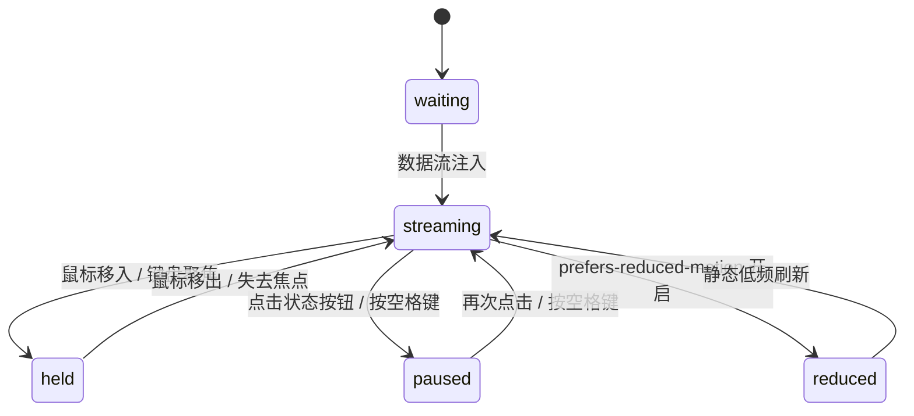

# Realtime Stream · 实时流图

用于高频时间序列实时监控（如 API p95 响应延迟、QPS、网络吞吐量、传感器遥测数据）的 Canvas 连续动态流图。支持固定时间滑动窗口（Rolling Window）、无抖动平滑时间插值、最新数值呼吸脉冲、指针或焦点移入时自动锁定画面（Hold View）供历史探查，以及空格键暂停/恢复。

## 原型清单

| 原型分组 | 原型元素 | 动效 / 状态变化 | 去向 |
| --- | --- | --- | --- |
| — | 实时流主卡片 `.arc-realtime-figure` | 布局结构、数据承载与无障碍 live 容器 | 最小 DOM / CSS 宿主 |
| — | 实时顶栏数值 `.arc-realtime-now` | 最新接收采样点的数值与单位实时更新 | 顶栏实时指标 |
| — | 运行状态切换按钮 `.arc-realtime-status` | 呼吸绿点（Live）与静态灰色（Paused）平滑切换 | 运行/暂停控制项 |
| — | 绘图主视口 `.arc-realtime-plot` | 挂载 `role="group"`，捕获鼠标悬停与键盘焦点（触发 Hold） | 探查视口 |
| — | 流水线绘图画布 `.arc-realtime-canvas` | 高性能 Canvas 2D，每秒 60fps 连续从右向左推进折线与填充 | Canvas 流水线核心 |
| — | 探查游标标尺 `.arc-realtime-probe` | 指针探索历史点时的垂直竖线与交点高亮 | 历史探查游标 |
| — | 历史点详情提示框 `.arc-realtime-tooltip` | 悬停某点时展示时间戳、延迟毫秒与异常标记（Spike） | 动态浮动 Tooltip |
| — | 读屏表格与 Live Region `.arc-realtime-srOnly` | 捕获数值突增告警并提供最新 20 条结构化数据 | 无障碍读屏通告 |
| — | 顶栏、主题切换按钮 `#themeBtn`、舞台卡片 | — | 演示外壳，已删除 |

## 适用

- 服务器监控大盘、实时交易流水、IoT 物联网设备数据流（如 500ms 一次推送）。
- 要求曲线像心电图一样平滑匀速由右向左滚动，没有明显的断点与跳帧。
- 用户光标移入或 Tab 键聚焦图表时，需要自动临时定格画面（Hold），供细致检查具体某一个时间点的数值。
- 支持点击状态胶囊或按空格键随时暂停/恢复数据接收。

## 不适用

- 静态离散分类柱状对比 → [bar-chart](bar-chart.md)
- 固定日历周/月跨度折线对比 → [line-chart](line-chart.md)
- 紧凑极简无坐标单行小走势 → [sparkline](sparkline.md)
- 堆叠多层密度山脊分布 → [ridgeline](ridgeline.md)

## 状态机

| 状态 | 进入条件 | 视觉表现 | 退出到 |
| --- | --- | --- | --- |
| waiting | 初始挂载尚未有数据输入 | 画布展示平直水平基线，顶栏显示等待就绪 | streaming |
| streaming | 正常接收流数据且未暂停 | 画布持续匀速左移，绿点以 1.2s 周期呼吸，顶栏数值实时变动 | held |
| held | 鼠标移入画布或键盘获得焦点 | 时间窗口冻结移动，游标吸附在光标位置，显示该点详细浮层 | streaming |
| paused | 点击状态按钮或按下空格键 | 显式暂停流刷新，状态胶囊变为灰色 Paused，保留当前画面 | streaming |
| reduced | 触发系统减少动态效果模式 | 停用平滑 60fps 连续插值，降为仅在数据到达时更新关键点 | streaming |



## 最小 DOM

```html
<figure class="arc-realtime-figure" aria-label="Realtime stream">
  <div class="arc-realtime-head">
    <p class="arc-realtime-now" aria-label="Latency">
      <span class="arc-realtime-value">128</span>
      <span class="arc-realtime-unit">ms</span>
    </p>
    <button type="button" class="arc-realtime-status" aria-pressed="false" aria-label="Toggle pause">
      <span class="arc-realtime-statusDot" aria-hidden="true"></span>
      <span class="arc-realtime-statusText">Live</span>
    </button>
  </div>

  <div class="arc-realtime-plot" role="group" tabindex="0" aria-label="Realtime stream, space to pause">
    <canvas class="arc-realtime-canvas" width="600" height="200" aria-hidden="true"></canvas>
    <div class="arc-realtime-probe" aria-hidden="true"></div>
    <div class="arc-realtime-tooltip" aria-hidden="true">
      <p class="arc-realtime-tipValue"></p>
      <p class="arc-realtime-tipMeta"></p>
    </div>
  </div>

  <p class="arc-realtime-srOnly" aria-live="polite" aria-atomic="true"></p>
  <div class="arc-realtime-srOnly">
    <table>
      <caption>Latest readings</caption>
      <thead><tr><th scope="col">Time</th><th scope="col">Value</th></tr></thead>
      <tbody></tbody>
    </table>
  </div>
</figure>
```

- `.arc-realtime-figure`：主容器。
- `.arc-realtime-head`：顶栏指标与状态胶囊。
- `.arc-realtime-now`：当前数值与单位。
- `.arc-realtime-status`：Live / Paused 切换按钮。
- `.arc-realtime-plot`：主交互舞台，`tabindex="0"` 接收焦点。
- `.arc-realtime-canvas`：600×200 Canvas 绘图表面。
- `.arc-realtime-tooltip`：探查历史点时浮现的数值卡片。
- `.arc-realtime-srOnly`：无障碍 Live Region 与读屏表格。

## 参数

| 名称 | 值 | 用于 | 来源 |
| --- | --- | --- | --- |
| 时间窗口宽度 | `30000ms` (30s) | 画布显示的连续时长 | 原型 |
| 采样步进间隔 | `500ms` | 默认流数据推入频率 | 原型 |
| 绘图区默认高度 | `200px` | Canvas 默认高度 | 原型 |
| 呼吸绿点动画周期 | `1.2s` infinite | 正常流转状态指示 | 原型 |
| 缓冲区最大保留点数 | `160` | 防止无限累积导致内存溢出 | 原型 |
| 异常值阈值 (Spike) | `300ms` | 超过该值触发警告与突出颜色 | 原型 |
| 视口触发阈值 | `0.3` (30%) | IntersectionObserver | 原型 |

## CSS

```css
.arc-realtime-figure {
  --realtime-accent: #2563eb;
  --realtime-live: #16a34a;
  --realtime-paused: #737373;
  --realtime-spike: #dc2626;
  --realtime-border: rgba(0, 0, 0, 0.08);
  --realtime-foreground: #111111;
  --realtime-muted: #737373;
  --realtime-ease: cubic-bezier(0.16, 1, 0.3, 1);

  display: flex;
  flex-direction: column;
  gap: 0.75rem;
  margin: 0;
  color: var(--realtime-foreground);
  font-family: system-ui, -apple-system, sans-serif;
  user-select: none;
}

.arc-realtime-head {
  display: flex;
  align-items: center;
  justify-content: space-between;
}

.arc-realtime-now {
  margin: 0;
  font-size: 2rem;
  font-weight: 700;
  line-height: 1;
  font-variant-numeric: tabular-nums;
  display: flex;
  align-items: baseline;
  gap: 4px;
}

.arc-realtime-unit {
  font-size: 1rem;
  font-weight: 400;
  color: var(--realtime-muted);
}

.arc-realtime-status {
  display: inline-flex;
  align-items: center;
  gap: 6px;
  padding: 4px 10px;
  border-radius: 99px;
  background: rgba(0, 0, 0, 0.04);
  border: 1px solid var(--realtime-border);
  font-size: 0.75rem;
  font-weight: 500;
  cursor: pointer;
  color: inherit;
  transition: background-color 150ms ease;
}

.arc-realtime-status:hover {
  background: rgba(0, 0, 0, 0.08);
}

.arc-realtime-statusDot {
  width: 7px;
  height: 7px;
  border-radius: 50%;
  background-color: var(--realtime-live);
  box-shadow: 0 0 0 0 rgba(22, 163, 74, 0.5);
  animation: arc-live-pulse 1.4s infinite;
}

.arc-realtime-status[aria-pressed="true"] .arc-realtime-statusDot {
  background-color: var(--realtime-paused);
  box-shadow: none;
  animation: none;
}

@keyframes arc-live-pulse {
  0% { box-shadow: 0 0 0 0 rgba(22, 163, 74, 0.5); }
  70% { box-shadow: 0 0 0 6px rgba(22, 163, 74, 0); }
  100% { box-shadow: 0 0 0 0 rgba(22, 163, 74, 0); }
}

.arc-realtime-plot {
  position: relative;
  width: 100%;
  height: 200px;
  outline: none;
  cursor: crosshair;
  background: rgba(0, 0, 0, 0.015);
  border-radius: 8px;
  border: 1px solid var(--realtime-border);
  overflow: hidden;
}

.arc-realtime-canvas {
  display: block;
  width: 100%;
  height: 100%;
}

.arc-realtime-probe {
  position: absolute;
  top: 0;
  bottom: 0;
  width: 1px;
  background: var(--realtime-foreground);
  opacity: 0;
  pointer-events: none;
  transition: opacity 120ms ease;
}

.arc-realtime-tooltip {
  position: absolute;
  top: 12px;
  padding: 6px 10px;
  background: #111;
  color: #fff;
  border-radius: 6px;
  font-size: 0.75rem;
  pointer-events: none;
  opacity: 0;
  transition: opacity 120ms ease, transform 100ms ease;
  white-space: nowrap;
  z-index: 10;
}

.arc-realtime-tooltip.is-active {
  opacity: 1;
}

.arc-realtime-tipValue {
  margin: 0;
  font-weight: 600;
  font-variant-numeric: tabular-nums;
}

.arc-realtime-tipMeta {
  margin: 2px 0 0;
  font-size: 0.6875rem;
  color: #9ca3af;
}

.arc-realtime-srOnly {
  position: absolute;
  width: 1px;
  height: 1px;
  margin: -1px;
  padding: 0;
  border: 0;
  overflow: hidden;
  clip: rect(0, 0, 0, 0);
  white-space: nowrap;
}

@media (prefers-reduced-motion: reduce) {
  .arc-realtime-statusDot {
    animation: none !important;
  }
}
```

## JS

```js
/**
 * 创建 RealtimeStream 实例
 * @param {HTMLElement} el 宿主容器
 * @param {Object} options 配置项
 * @param {number} [options.windowMs=30000] 时间视窗毫秒
 * @param {number} [options.intervalMs=500] 模拟采样间隔
 */
export function createRealtimeStream(el, options = {}) {
  const windowMs = options.windowMs || 30000;
  const intervalMs = options.intervalMs || 500;
  let isPaused = false;
  let isHeld = false;
  let disposed = false;
  let rafId = null;
  let simTimer = null;

  const canvas = el.querySelector('.arc-realtime-canvas');
  const nowValEl = el.querySelector('.arc-realtime-value');
  const statusBtn = el.querySelector('.arc-realtime-status');
  const statusText = el.querySelector('.arc-realtime-statusText');
  const plot = el.querySelector('.arc-realtime-plot') || el;
  const probe = el.querySelector('.arc-realtime-probe');
  const tooltip = el.querySelector('.arc-realtime-tooltip');
  const tableBody = el.querySelector('.arc-realtime-srOnly tbody');

  const width = canvas ? canvas.width : 600;
  const height = canvas ? canvas.height : 200;

  // 数据队列（FIFO）
  const samples = [];
  const maxSamples = 160;
  let lastVal = 120;

  // 初始化填充 40 个基础点
  const now = Date.now();
  for (let i = 40; i >= 0; i--) {
    const t = now - i * intervalMs;
    lastVal = Math.max(80, Math.min(350, lastVal + (Math.random() - 0.48) * 20));
    samples.push({ time: t, value: Math.round(lastVal) });
  }

  function pushSample(val) {
    if (disposed) return;
    const t = Date.now();
    samples.push({ time: t, value: val });
    if (samples.length > maxSamples) samples.shift();

    if (nowValEl) nowValEl.textContent = String(val);

    // 结构化表格更新
    if (tableBody) {
      const tr = document.createElement('tr');
      const timeStr = new Date(t).toTimeString().split(' ')[0];
      tr.innerHTML = `<th scope="row">${timeStr}</th><td>${val} ms</td>`;
      tableBody.prepend(tr);
      while (tableBody.children.length > 20) tableBody.lastElementChild.remove();
    }
  }

  // Canvas 绘制循环
  function draw() {
    if (disposed) return;
    if (canvas) {
      const ctx = canvas.getContext('2d');
      if (ctx) {
        ctx.clearRect(0, 0, width, height);

        const curTime = isHeld || isPaused ? (samples[samples.length - 1]?.time || Date.now()) : Date.now();
        const startTime = curTime - windowMs;

        // 计算 Y 轴最大值
        const visibleSamples = samples.filter(s => s.time >= startTime - intervalMs);
        const maxV = Math.max(300, ...visibleSamples.map(s => s.value));

        // 绘制背景水平网格
        ctx.strokeStyle = 'rgba(0, 0, 0, 0.05)';
        ctx.lineWidth = 1;
        for (let gridY = 50; gridY < height; gridY += 50) {
          ctx.beginPath();
          ctx.moveTo(0, gridY);
          ctx.lineTo(width, gridY);
          ctx.stroke();
        }

        // 绘制折线与面积
        if (visibleSamples.length > 1) {
          ctx.beginPath();
          visibleSamples.forEach((s, idx) => {
            const x = ((s.time - startTime) / windowMs) * width;
            const y = height - (s.value / maxV) * (height - 24) - 12;
            if (idx === 0) ctx.moveTo(x, y);
            else ctx.lineTo(x, y);
          });

          // 折线描边
          ctx.strokeStyle = '#2563eb';
          ctx.lineWidth = 2;
          ctx.stroke();

          // 面积闭合
          const lastVisible = visibleSamples[visibleSamples.length - 1];
          const lastX = ((lastVisible.time - startTime) / windowMs) * width;
          ctx.lineTo(lastX, height);
          ctx.lineTo(((visibleSamples[0].time - startTime) / windowMs) * width, height);
          ctx.closePath();
          ctx.fillStyle = 'rgba(37, 99, 235, 0.08)';
          ctx.fill();

          // 最新数据点圆圈
          const tipY = height - (lastVisible.value / maxV) * (height - 24) - 12;
          ctx.fillStyle = '#2563eb';
          ctx.beginPath();
          ctx.arc(lastX, tipY, 4, 0, Math.PI * 2);
          ctx.fill();
        }
      }
    }

    rafId = requestAnimationFrame(draw);
  }

  // 模拟数据流推送定时器
  function startFeed() {
    if (simTimer) clearInterval(simTimer);
    simTimer = setInterval(() => {
      if (!isPaused && !isHeld) {
        // 5% 概率出现 Spike 尖峰
        const isSpike = Math.random() < 0.05;
        const delta = isSpike ? (150 + Math.random() * 100) : (Math.random() - 0.5) * 25;
        lastVal = Math.max(90, Math.min(420, Math.round(lastVal + delta)));
        pushSample(lastVal);
      }
    }, intervalMs);
  }

  function setPaused(pause) {
    isPaused = pause;
    if (statusBtn) {
      statusBtn.setAttribute('aria-pressed', String(pause));
    }
    if (statusText) {
      statusText.textContent = pause ? 'Paused' : 'Live';
    }
  }

  // 探查光标
  function handlePointer(clientX) {
    if (!plot) return;
    const rect = plot.getBoundingClientRect();
    const x = Math.max(0, Math.min(width, clientX - rect.left));

    if (probe) {
      probe.style.opacity = '1';
      probe.style.transform = `translateX(${x}px)`;
    }

    const curTime = samples[samples.length - 1]?.time || Date.now();
    const startTime = curTime - windowMs;
    const hoverTime = startTime + (x / width) * windowMs;

    // 寻找最近点
    let nearest = null;
    let minDist = Infinity;
    samples.forEach(s => {
      const dist = Math.abs(s.time - hoverTime);
      if (dist < minDist) {
        minDist = dist;
        nearest = s;
      }
    });

    if (nearest && tooltip) {
      tooltip.classList.add('is-active');
      const tipX = Math.max(10, Math.min(width - 110, x - 50));
      tooltip.style.transform = `translateX(${tipX}px)`;

      const vEl = tooltip.querySelector('.arc-realtime-tipValue');
      const mEl = tooltip.querySelector('.arc-realtime-tipMeta');
      if (vEl) vEl.textContent = `${nearest.value} ms`;
      if (mEl) mEl.textContent = new Date(nearest.time).toTimeString().split(' ')[0];
    }
  }

  const onPointerEnter = () => { isHeld = true; };
  const onPointerLeave = () => {
    isHeld = false;
    if (probe) probe.style.opacity = '0';
    if (tooltip) tooltip.classList.remove('is-active');
  };
  const onPointerMove = (e) => handlePointer(e.clientX);

  plot.addEventListener('pointerenter', onPointerEnter);
  plot.addEventListener('pointerleave', onPointerLeave);
  plot.addEventListener('pointermove', onPointerMove);

  const onKeyDown = (e) => {
    if (e.code === 'Space') {
      e.preventDefault();
      setPaused(!isPaused);
    }
  };
  plot.addEventListener('keydown', onKeyDown);

  if (statusBtn) {
    statusBtn.addEventListener('click', (e) => {
      e.stopPropagation();
      setPaused(!isPaused);
    });
  }

  // 模拟点击切换暂停/恢复
  const handleClick = () => {
    setPaused(!isPaused);
  };
  el.addEventListener('click', handleClick);

  draw();
  startFeed();

  return {
    pause: () => setPaused(true),
    resume: () => setPaused(false),
    push: (val) => pushSample(val),
    destroy() {
      disposed = true;
      if (rafId) cancelAnimationFrame(rafId);
      if (simTimer) clearInterval(simTimer);
      plot.removeEventListener('pointerenter', onPointerEnter);
      plot.removeEventListener('pointerleave', onPointerLeave);
      plot.removeEventListener('pointermove', onPointerMove);
      plot.removeEventListener('keydown', onKeyDown);
      el.removeEventListener('click', handleClick);
    }
  };
}
```

## 接入目标项目

- 状态来源：
  - 由后端 WebSocket 或 SSE（Server-Sent Events）推送实时时序数据点。直接调用 `chart.push(val)` 灌入。
- 尺寸策略：
  - Canvas 宽度默认 600px，高度 200px。支持响应式自适应容器宽度重设 `canvas.width`。
- 驱动方式：
  - `const stream = createRealtimeStream(container, { intervalMs: 500 })`。
  - 组件销毁时调用 `stream.destroy()`。

## 重入与清理

- 队列维护在固定数组大小（160 长度以内），超过时先进先出（`shift()`），防止长时间运行内存泄露。
- 销毁时清理定时器 `clearInterval` 与动画帧 `cancelAnimationFrame`。

## 减少动态效果

- 满足 `prefers-reduced-motion: reduce` 时：
  - 关闭 Live 绿点的持续脉冲发光动画。
  - Canvas 从 60fps 插值退化为仅在推入新数据时重绘一次。

## 焦点与键盘

- `.arc-realtime-plot` 具备 `tabindex="0"`，聚焦时自动激活 Hold 模式，按空格键切换暂停/运行。
- 数据突增 Spike 时自动通过隐藏的 `aria-live="polite"` 标签通告读屏器。

## 兼容回退

| 特性 | 不支持时 |
| --- | --- |
| HTML5 Canvas | 回退为固定定时器刷新单行数值看板。 |

## 验收清单

- [ ] 初始渲染实时流画布，折线连续平滑由右向左流动滚动。
- [ ] 顶栏 Live 绿色指示点呈周期性呼吸光晕状态，最新毫秒数值随之变动。
- [ ] 鼠标悬停进入画布时，画面自动定格（Hold），准星跟随鼠标显示历史采样点数值。
- [ ] 点击 Live 胶囊或按空格键，流转暂停并变更为 Paused 状态。
- [ ] 调用 `destroy()` 停止所有后台定时器与动画循环。
