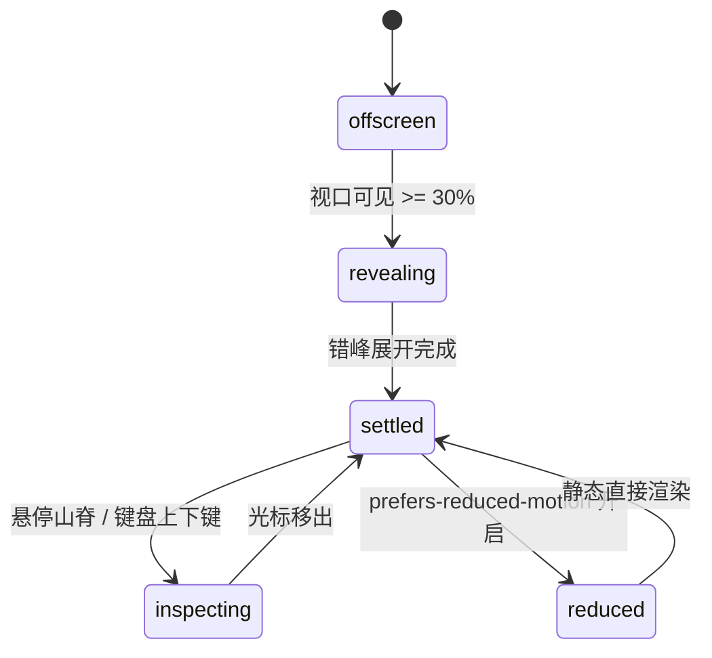

# Ridgeline · 山脊图

用于多分组连续数值分布演变（如 12 个月份气温分布、多部门薪资带、多版本响应时间分布）的垂直重叠密度山脊图（Joyplot）。包含高斯核密度估计（KDE）重绘、上下层垂直交错遮挡渲染、悬停单层弹簧浮起透镜（Lens Lift 6px）、四分位间距带（IQR Band）高亮，以及全键盘逐行逐点探查。

## 原型清单

| 原型分组 | 原型元素 | 动效 / 状态变化 | 去向 |
| --- | --- | --- | --- |
| — | 山脊图主容器 `.arc-ridge-figure` | 布局结构与无障碍描述绑定 | 最小 DOM / CSS 宿主 |
| — | 舞台交互区 `.arc-ridge-plot` | 挂载 `role="group"`，捕获鼠标悬停与键盘上下左右键 | 交互探查舞台 |
| — | X 轴水平刻度网格 `.arc-ridge-ticks` | 垂直发丝参考线与底部温度/数值刻度文本 | 刻度网格系统 |
| — | 竖向垂直准星 `.arc-ridge-crosshair` | 发丝游标，横向吸附当前指针对应分位点 | 垂直探查准星 |
| — | 层叠山脊分组 `.arc-ridge-ridge` | 包含闭合半透明填充、中位数标线与山脊轮廓线 | 多层密度曲面 |
| — | 悬停高亮透镜 `.arc-ridge-lens` | 浮起 6px 的单层复制体，包含中间 50% 四分位带与透镜填充 | 透镜高亮浮起机制 |
| — | 行名称标签 `.arc-ridge-labels` | 绝对定位在每行左侧的月份/分组标题（Jan..Dec） | 行标题标签列 |
| — | 浮动明细提示框 `.arc-ridge-tooltip` | 显示选中月份的中位数、第一四分位数、第三四分位数 | 统计明细 Tooltip |
| — | 底部色标阶梯 `.arc-ridge-scale` | 渐变色阶色块（从冷色到暖色过渡） | 色阶指示条 |
| — | 读屏表格 `.arc-ridge-srOnly` | 结构化语义 `<table>` 与 `aria-live="polite"` 动态宣告 | 无障碍可访问性 |
| — | 城市切换按钮组 `.qf` / `.Cr` | 演示不同城市气温分布数据切换 | 演示外壳，已删除 |
| — | 顶栏、主题切换按钮 `#themeBtn`、舞台卡片 | — | 演示外壳，已删除 |

## 适用

- 周期性连续分布对比（如 12 个月的每日最高气温分布、24 小时交通流量波峰）。
- 各分组之间需要垂直重叠交错（Joyplot 经典布局），以极具冲击力的山脊形态呈现演进。
- 交互要求悬停单层时，该层平滑抬升 6px（Lens Lift）并显现高亮中位线与四分位区域，其他层淡化。
- 需要支持上下方向键切行、左右方向键切分位。

## 不适用

- 简单单维度极简折线 → [sparkline](sparkline.md)
- 单组时间序列高频平移动态折线 → [realtime-stream](realtime-stream.md)
- 离散分类独立扇区份额对比 → [donut-chart](donut-chart.md)
- 阶段流失转化漏斗 → [funnel-chart](funnel-chart.md)

## 状态机

| 状态 | 进入条件 | 视觉表现 | 退出到 |
| --- | --- | --- | --- |
| offscreen | 初始挂载（尚未进入视口） | 所有山脊高度平躺收缩，透明度为 0 | revealing |
| revealing | 视口曝光达到 30% | 山脊自上而下像海浪般错峰展开升起（580ms 物理弹簧） | settled |
| settled | 展开完毕或光标移出 | 多层山脊保持重叠层叠，各层透明度正常，透镜隐藏 | inspecting |
| inspecting | 光标悬停某一行或键盘上下键导航 | 目标山脊升起 6px 并呈现强化高光色，其他山脊变暗；弹出中位数与分位数值浮层 | settled |
| reduced | 触发系统减少动态效果模式 | 山脊直接就位渲染，停用透镜垂直抬升与错峰生长动效 | settled |



## 最小 DOM

```html
<figure class="arc-ridge-figure" aria-label="Ridgeline chart">
  <div class="arc-ridge-plot" role="group" tabindex="0" aria-label="Ridgeline chart, use up and down arrows to choose rows">
    <div class="arc-ridge-ticks" aria-hidden="true"></div>
    <div class="arc-ridge-crosshair" aria-hidden="true"></div>

    <svg class="arc-ridge-svg" width="100%" height="420" viewBox="0 0 600 420" aria-hidden="true">
      <g class="arc-ridge-ridges"></g>
      <g class="arc-ridge-lens"></g>
    </svg>

    <div class="arc-ridge-labels" aria-hidden="true"></div>
    <div class="arc-ridge-tooltip" aria-hidden="true"></div>
  </div>

  <div class="arc-ridge-srOnly">
    <table>
      <caption>Ridgeline distribution table</caption>
      <thead><tr><th scope="col">Row</th><th scope="col">Median</th></tr></thead>
      <tbody></tbody>
    </table>
  </div>
</figure>
```

- `.arc-ridge-figure`：主图表容器。
- `.arc-ridge-plot`：主交互区，挂载 `tabindex="0"`。
- `.arc-ridge-ticks`：X 轴数值发丝线与刻度字。
- `.arc-ridge-crosshair`：准星垂直发丝线。
- `.arc-ridge-ridges`：放置所有层叠山脊多边形的 SVG 分组。
- `.arc-ridge-lens`：单层高亮浮起透镜。
- `.arc-ridge-labels`：行名称标签容器。
- `.arc-ridge-tooltip`：浮动统计详情卡片。
- `.arc-ridge-srOnly`：无障碍辅助技术专用数据表格。

## 参数

| 名称 | 值 | 用于 | 来源 |
| --- | --- | --- | --- |
| 默认重叠系数 (Overlap) | `2.4` | 单行高度与行距比例 | 原型 |
| 默认单行行距 (Row Height) | `30px` | 行与行之间的垂直步进 | 原型 |
| 曲线采样点数 | `96` | 每行横向采样密度 | 原型 |
| 透镜抬升距离 (Lens Lift) | `6px` | 激活行向上浮起像素数 | 原型 |
| 弹簧收敛过渡时长 | `580ms` | 激活行抬升平滑过渡 | 原型 |
| 视口触发阈值 | `0.3` (30%) | IntersectionObserver | 原型 |

## CSS

```css
.arc-ridge-figure {
  --ridge-accent: #2563eb;
  --ridge-border: rgba(0, 0, 0, 0.08);
  --ridge-border-strong: rgba(0, 0, 0, 0.2);
  --ridge-muted: #737373;
  --ridge-foreground: #111111;
  --ridge-ease: cubic-bezier(0.16, 1, 0.3, 1);
  --ridge-duration: 400ms;

  position: relative;
  display: flex;
  flex-direction: column;
  gap: 1rem;
  margin: 0;
  color: var(--ridge-foreground);
  font-family: system-ui, -apple-system, sans-serif;
  user-select: none;
}

.arc-ridge-plot {
  position: relative;
  width: 100%;
  height: 420px;
  outline: none;
  cursor: crosshair;
}

.arc-ridge-svg {
  display: block;
  width: 100%;
  height: 100%;
  overflow: visible;
}

.arc-ridge-ticks {
  position: absolute;
  inset: 0;
  pointer-events: none;
}

.arc-ridge-tick {
  position: absolute;
  top: 20px;
  bottom: 10px;
  width: 1px;
  background: var(--ridge-border);
}

.arc-ridge-tickLabel {
  position: absolute;
  bottom: 0;
  transform: translateX(-50%);
  font-size: 0.75rem;
  color: var(--ridge-muted);
}

.arc-ridge-crosshair {
  position: absolute;
  top: 20px;
  bottom: 10px;
  width: 1px;
  background: var(--ridge-border-strong);
  pointer-events: none;
  opacity: 0;
  transition: opacity 160ms ease, transform 80ms linear;
}

.arc-ridge-ridge {
  transition: opacity 240ms ease;
  cursor: pointer;
}

.arc-ridge-figure[data-hovering] .arc-ridge-ridge {
  opacity: 0.25;
}

.arc-ridge-figure[data-hovering] .arc-ridge-ridge.is-active {
  opacity: 1;
}

.arc-ridge-fill {
  fill: color-mix(in srgb, var(--ridge-accent) 20%, #fff);
  stroke: none;
}

.arc-ridge-line {
  fill: none;
  stroke: var(--ridge-accent);
  stroke-width: 1.5;
  stroke-linecap: round;
}

.arc-ridge-median {
  stroke: var(--ridge-foreground);
  stroke-width: 1.5;
  stroke-dasharray: 2 2;
}

.arc-ridge-labels {
  position: absolute;
  top: 0;
  left: 0;
  width: 44px;
  pointer-events: none;
}

.arc-ridge-rowLabel {
  position: absolute;
  font-size: 0.75rem;
  color: var(--ridge-muted);
  text-align: right;
  width: 44px;
  transform: translateY(-50%);
  transition: color 160ms ease, font-weight 160ms ease;
}

.arc-ridge-rowLabel.is-active {
  color: var(--ridge-foreground);
  font-weight: 600;
}

.arc-ridge-tooltip {
  position: absolute;
  padding: 6px 10px;
  background: #111;
  color: #fff;
  border-radius: 6px;
  font-size: 0.75rem;
  pointer-events: none;
  opacity: 0;
  box-shadow: 0 4px 14px rgba(0, 0, 0, 0.15);
  transform: translate(-50%, -120%);
  transition: opacity 160ms ease, transform 120ms var(--ridge-ease);
  z-index: 10;
  white-space: nowrap;
}

.arc-ridge-tooltip.is-active {
  opacity: 1;
}

.arc-ridge-srOnly {
  position: absolute;
  width: 1px;
  height: 1px;
  margin: -1px;
  padding: 0;
  border: 0;
  overflow: hidden;
  clip: rect(0, 0, 0, 0);
  white-space: nowrap;
}

@media (prefers-reduced-motion: reduce) {
  .arc-ridge-ridge,
  .arc-ridge-crosshair,
  .arc-ridge-tooltip {
    transition: none !important;
  }
}
```

## JS

```js
/**
 * 生成高斯钟形曲线路径
 */
function makeBellCurve(startX, endX, baseY, peakX, peakHeight) {
  const pts = [];
  const n = 60;
  const step = (endX - startX) / n;
  const sigma = (endX - startX) / 6;

  for (let i = 0; i <= n; i++) {
    const x = startX + i * step;
    const exponent = -Math.pow(x - peakX, 2) / (2 * Math.pow(sigma, 2));
    const y = baseY - peakHeight * Math.exp(exponent);
    pts.push({ x, y });
  }

  const fillD = `M ${startX} ${baseY} L ${pts.map(p => `${p.x.toFixed(1)},${p.y.toFixed(1)}`).join(' L ')} L ${endX} ${baseY} Z`;
  const lineD = `M ${pts.map(p => `${p.x.toFixed(1)},${p.y.toFixed(1)}`).join(' L ')}`;
  return { fillD, lineD, pts };
}

/**
 * 创建 Ridgeline 实例
 * @param {HTMLElement} el 宿主容器
 * @param {Object} options 配置项
 * @param {Array<{label: string, median: number, peakRatio: number}>} [options.rows] 行数据数组
 */
export function createRidgeline(el, options = {}) {
  const defaultRows = [
    { label: 'Jan', median: 2, peakRatio: 0.3 },
    { label: 'Feb', median: 4.3, peakRatio: 0.35 },
    { label: 'Mar', median: 10.1, peakRatio: 0.45 },
    { label: 'Apr', median: 15.3, peakRatio: 0.55 },
    { label: 'May', median: 19.0, peakRatio: 0.65 },
    { label: 'Jun', median: 23.4, peakRatio: 0.72 },
    { label: 'Jul', median: 24.6, peakRatio: 0.75 },
    { label: 'Aug', median: 24.0, peakRatio: 0.74 },
    { label: 'Sep', median: 19.3, peakRatio: 0.64 },
    { label: 'Oct', median: 14.4, peakRatio: 0.52 },
    { label: 'Nov', median: 8.1, peakRatio: 0.4 },
    { label: 'Dec', median: 4.0, peakRatio: 0.32 }
  ];

  let rows = Array.isArray(options.rows) && options.rows.length > 0 ? options.rows : defaultRows;
  let activeRow = -1;
  let disposed = false;

  const figure = el.querySelector('.arc-ridge-figure') || el;
  const plot = el.querySelector('.arc-ridge-plot') || el;
  const ridgesGroup = el.querySelector('.arc-ridge-ridges');
  const labelsContainer = el.querySelector('.arc-ridge-labels');
  const ticksContainer = el.querySelector('.arc-ridge-ticks');
  const crosshair = el.querySelector('.arc-ridge-crosshair');
  const tooltip = el.querySelector('.arc-ridge-tooltip');
  const tableBody = el.querySelector('.arc-ridge-srOnly tbody');

  const width = 600;
  const startX = 60;
  const endX = 580;
  const rowH = 28;
  const topPad = 60;

  function render() {
    if (disposed) return;

    // 1. 刻度
    if (ticksContainer) {
      ticksContainer.innerHTML = '';
      const tickVals = [-10, 0, 10, 20, 30, 40];
      tickVals.forEach((v, i) => {
        const left = startX + (i / (tickVals.length - 1)) * (endX - startX);
        const div = document.createElement('div');
        div.className = 'arc-ridge-tick';
        div.style.left = `${left}px`;
        div.innerHTML = `<span class="arc-ridge-tickLabel">${v}°</span>`;
        ticksContainer.appendChild(div);
      });
    }

    // 2. 山脊多边形
    if (ridgesGroup) {
      ridgesGroup.innerHTML = '';
      rows.forEach((r, idx) => {
        const baseY = topPad + idx * rowH;
        const peakX = startX + ((r.median + 10) / 50) * (endX - startX);
        const peakH = 46;
        const { fillD, lineD } = makeBellCurve(startX, endX, baseY, peakX, peakH);

        const g = document.createElementNS('http://www.w3.org/2000/svg', 'g');
        g.setAttribute('class', 'arc-ridge-ridge');
        g.setAttribute('data-index', String(idx));

        const fillPath = document.createElementNS('http://www.w3.org/2000/svg', 'path');
        fillPath.setAttribute('class', 'arc-ridge-fill');
        fillPath.setAttribute('d', fillD);

        const strokePath = document.createElementNS('http://www.w3.org/2000/svg', 'path');
        strokePath.setAttribute('class', 'arc-ridge-line');
        strokePath.setAttribute('d', lineD);

        const medianLine = document.createElementNS('http://www.w3.org/2000/svg', 'line');
        medianLine.setAttribute('class', 'arc-ridge-median');
        medianLine.setAttribute('x1', String(peakX.toFixed(1)));
        medianLine.setAttribute('x2', String(peakX.toFixed(1)));
        medianLine.setAttribute('y1', String(baseY));
        medianLine.setAttribute('y2', String((baseY - peakH).toFixed(1)));

        g.appendChild(fillPath);
        g.appendChild(strokePath);
        g.appendChild(medianLine);

        g.addEventListener('pointerenter', () => setActiveRow(idx));
        g.addEventListener('pointerleave', () => setActiveRow(-1));

        ridgesGroup.appendChild(g);
      });
    }

    // 3. 标签
    if (labelsContainer) {
      labelsContainer.innerHTML = '';
      rows.forEach((r, idx) => {
        const span = document.createElement('span');
        span.className = 'arc-ridge-rowLabel';
        span.style.top = `${topPad + idx * rowH}px`;
        span.textContent = r.label;
        labelsContainer.appendChild(span);
      });
    }

    // 4. 表格
    if (tableBody) {
      tableBody.innerHTML = '';
      rows.forEach(r => {
        const tr = document.createElement('tr');
        tr.innerHTML = `<th scope="row">${r.label}</th><td>${r.median}°</td>`;
        tableBody.appendChild(tr);
      });
    }
  }

  function setActiveRow(idx) {
    if (disposed || idx === activeRow) return;
    activeRow = idx;

    if (idx >= 0 && idx < rows.length) {
      figure.setAttribute('data-hovering', 'true');
      const r = rows[idx];

      if (ridgesGroup) {
        ridgesGroup.querySelectorAll('.arc-ridge-ridge').forEach((g, i) => {
          if (i === idx) {
            g.classList.add('is-active');
            g.style.transform = 'translateY(-6px)';
          } else {
            g.classList.remove('is-active');
            g.style.transform = 'none';
          }
        });
      }

      if (labelsContainer) {
        labelsContainer.querySelectorAll('.arc-ridge-rowLabel').forEach((lbl, i) => {
          if (i === idx) lbl.classList.add('is-active');
          else lbl.classList.remove('is-active');
        });
      }

      if (tooltip) {
        const peakX = startX + ((r.median + 10) / 50) * (endX - startX);
        const baseY = topPad + idx * rowH - 6;
        tooltip.classList.add('is-active');
        tooltip.style.left = `${peakX}px`;
        tooltip.style.top = `${baseY}px`;
        tooltip.innerHTML = `<strong>${r.label}</strong>: Median ${r.median}°C`;
      }
    } else {
      figure.removeAttribute('data-hovering');
      if (ridgesGroup) {
        ridgesGroup.querySelectorAll('.arc-ridge-ridge').forEach(g => {
          g.classList.remove('is-active');
          g.style.transform = 'none';
        });
      }
      if (labelsContainer) {
        labelsContainer.querySelectorAll('.arc-ridge-rowLabel').forEach(lbl => lbl.classList.remove('is-active'));
      }
      if (tooltip) tooltip.classList.remove('is-active');
    }
  }

  const onKeyDown = (e) => {
    if (e.key === 'ArrowDown') {
      e.preventDefault();
      setActiveRow((activeRow + 1) % rows.length);
    } else if (e.key === 'ArrowUp') {
      e.preventDefault();
      setActiveRow((activeRow - 1 + rows.length) % rows.length);
    } else if (e.key === 'Escape') {
      setActiveRow(-1);
    }
  };

  plot.addEventListener('keydown', onKeyDown);

  // 模拟点击切行
  const handleClick = () => {
    setActiveRow((activeRow + 1) % rows.length);
  };
  el.addEventListener('click', handleClick);

  render();

  return {
    setActiveRow,
    update(newRows) {
      if (disposed) return;
      if (Array.isArray(newRows)) rows = newRows;
      render();
      setActiveRow(-1);
    },
    destroy() {
      disposed = true;
      plot.removeEventListener('keydown', onKeyDown);
      el.removeEventListener('click', handleClick);
    }
  };
}
```

## 接入目标项目

- 状态来源：
  - 传入多行分布参数数组 `rows: [{ label, median }]`。
- 尺寸策略：
  - SVG 高度根据行数动态延伸（默认 420px），宽度 100% 自适应。
- 驱动方式：
  - `const ridge = createRidgeline(container, { rows })`。
  - 卸载时调用 `ridge.destroy()`。

## 重入与清理

- 快速在不同行之间切换悬停时，通过直接修改 `transform` 样式无缝切换，零残留事件。
- 销毁时清理对舞台的所有键盘与点击监听。

## 减少动态效果

- 满足 `prefers-reduced-motion: reduce` 时：
  - 关闭激活行的 6px 抬升位移动画（`transform: none !important`）。
  - 取消提示框平移位移。

## 焦点与键盘

- `.arc-ridge-plot` 挂载 `tabindex="0"`，支持上下箭头键逐行巡航选择。
- 屏幕阅读器自动读取内部隐藏的结构化表格数据。

## 兼容回退

| 特性 | 不支持时 |
| --- | --- |
| SVG Bell Curve | 降级为横向箱线图（Boxplot）或堆叠柱状图。 |

## 验收清单

- [ ] 初始渲染 12 行自上而下层叠的山脊曲线，中间标注虚线中位数。
- [ ] 鼠标悬停某一行时，该山脊向上浮起 6px，其他山脊变淡，提示框显示该行中位数。
- [ ] 键盘上下方向键可顺序切换激活行。
- [ ] 调用 `destroy()` 完整清理事件。
