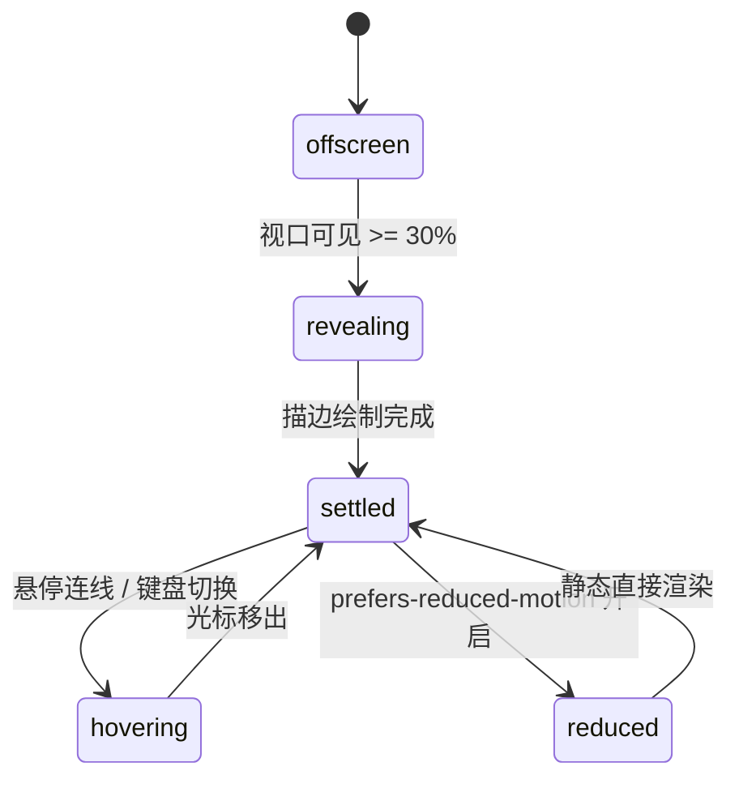

# Slope Chart · 坡度图

用于两期对照（如 Q1 vs Q2、改版前 vs 改版后）指标变动与位次排位跃迁的斜率坡度图。包含从左至右错峰路径笔触展开（700ms Stroke Draw）、标签碰撞避让引线（Leader Lines）、排名升降动态角标（Rank Indicator）、悬停高亮与未聚焦项静音淡化，以及全键盘无障碍巡检。

## 原型清单

| 原型分组 | 原型元素 | 动效 / 状态变化 | 去向 |
| --- | --- | --- | --- |
| — | 坡度图外层卡片 `.arc-slope-figure` | 布局结构与无障碍描述绑定 | 最小 DOM / CSS 宿主 |
| — | 交互舞台区 `.arc-slope-stage` | 挂载 `role="group"`，接收键盘焦点与指针滑动 | 交互舞台区 |
| — | 双期垂直基准轴线 `.arc-slope-axis` | Q1 与 Q2 两列垂直参考发丝线 | 双期时间轴 |
| — | 斜率连线 `.arc-slope-line` | 两端点之间的倾斜连线，初次入场带 `stroke-dashoffset` 笔触书写动画 | 坡度斜率连线 |
| — | 两端点实心圆 `.arc-slope-dot` | 锚定在两期数据值坐标上的圆点（半径 4px） | 左右端点标记 |
| — | 标签引线 `.arc-slope-leader` | 当两项数值过近发生碰撞时，自文字延伸至端点的防重叠引线 | 避让引导折线 |
| — | 左侧起始标签 `.arc-slope-start` | 左侧绝对定位的项目名称与初始数值 | 起始期标签 |
| — | 右侧结束标签 `.arc-slope-end` | 包含结束数值与排名升降箭头徽标（▲ / ▼ / =） | 结束期排名标签 |
| — | 浮动明细提示框 `.arc-slope-tooltip` | 悬停某连线时显示具体数值与点数增减差异（+1.5 pts） | 统计差值 Tooltip |
| — | 读屏表格 `.arc-slope-srOnly` | 结构化语义 `<table>` 与 `aria-live="polite"` 动态宣告 | 无障碍可访问性 |
| — | 地区切换单选组 `.qf` / `.Cr` | 演示 Americas / Europe / Asia Pacific 数据切换 | 演示外壳，已删除 |
| — | 顶栏、主题切换按钮 `#themeBtn`、舞台卡片 | — | 演示外壳，已删除 |

## 适用

- 两期对比（Q1 vs Q2、Before vs After、测试组 vs 对照组）指标与位次变动。
- 数据项之间有明显的交叉上升或下滑，需要直观展现斜率剧烈程度。
- 密集数据点发生上下挤压时，需要引线平滑拉开标签避免文字重叠。
- 交互要求悬停某一连线时突出高亮，其他连线淡出。

## 不适用

- 多连续时间点密集走势 → [line-chart](line-chart.md)
- 离散时序柱状高低对比 → [bar-chart](bar-chart.md)
- 多维能力蜘蛛网分布 → [radar-chart](radar-chart.md)
- 阶段递减转化漏斗 → [funnel-chart](funnel-chart.md)

## 状态机

| 状态 | 进入条件 | 视觉表现 | 退出到 |
| --- | --- | --- | --- |
| offscreen | 挂载尚未进入视口 | 连线 stroke-dashoffset 处于未绘制状态，端点与文字隐藏 | revealing |
| revealing | 视口可见达到 30% | 左右圆点错峰弹出，连线从左至右像光线般绘制连接（700ms），右侧排名标签浮现 | settled |
| settled | 绘制完毕或光标移出 | 所有连线保持基准透明度，排名升降箭头稳定显示 | hovering |
| hovering | 指针靠近某根连线或键盘方向键切换 | 目标连线与端点加粗高亮，其余连线淡化至 25% 透明度，浮动提示框展示增减点数 | settled |
| reduced | 触发系统减少动态效果模式 | 连线直接渲染，停用 700ms 描边书写与端点弹簧缩放 | settled |



## 最小 DOM

```html
<figure class="arc-slope-figure" aria-label="Slope chart">
  <div class="arc-slope-stage" role="group" tabindex="0" aria-label="Slope chart, use up and down arrows to navigate items">
    <div class="arc-slope-columns" aria-hidden="true">
      <span class="arc-slope-column" style="left: 160px;">Q1</span>
      <span class="arc-slope-column" style="left: 440px;">Q2</span>
    </div>

    <div class="arc-slope-plot" style="height: 260px;">
      <svg class="arc-slope-svg" width="100%" height="260" aria-hidden="true">
        <line class="arc-slope-axis" x1="160" x2="160" y1="0" y2="260" />
        <line class="arc-slope-axis" x1="440" x2="440" y1="0" y2="260" />
        <g class="arc-slope-items"></g>
      </svg>
      <div class="arc-slope-labelsContainer" aria-hidden="true"></div>
      <div class="arc-slope-tooltip" aria-hidden="true">
        <p class="arc-slope-tipTitle"></p>
        <p class="arc-slope-tipDiff"></p>
      </div>
    </div>
  </div>

  <div class="arc-slope-srOnly">
    <table>
      <caption>Slope chart comparison table</caption>
      <thead><tr><th scope="col">Item</th><th scope="col">Q1</th><th scope="col">Q2</th><th scope="col">Change</th></tr></thead>
      <tbody></tbody>
    </table>
  </div>
</figure>
```

- `.arc-slope-figure`：主图表容器。
- `.arc-slope-stage`：舞台交互区，挂载 `tabindex="0"`。
- `.arc-slope-columns`：双期列头文本（Q1 与 Q2）。
- `.arc-slope-axis`：双期垂直导轨。
- `.arc-slope-items`：放置各项目 SVG 连线、端点圆圈与引线的分组。
- `.arc-slope-labelsContainer`：左右两期防重叠标签容器。
- `.arc-slope-tooltip`：浮动明细提示框。
- `.arc-slope-srOnly`：无障碍屏幕阅读器专用数据表格。

## 参数

| 名称 | 值 | 用于 | 来源 |
| --- | --- | --- | --- |
| 连线绘制时长 | `700ms` | 初次入场 stroke-dashoffset 动画 | 原型 |
| 绘制缓动曲线 | `cubic-bezier(0.16, 1, 0.3, 1)` | 连线展开动画曲线 | 原型 |
| 端点圆半径 | `4px` | 两端锚点半径 | 原型 |
| 标签侧边距 | `10px` | 标签文字与轴线距离 | 原型 |
| 靠近吸附容差 | `22px` | 鼠标靠近连线触发悬停半径 | 原型 |
| 项间错峰步进 | `50ms` | 多条线错峰生长延迟 | 原型 |
| 视口触发阈值 | `0.3` (30%) | IntersectionObserver | 原型 |

## CSS

```css
.arc-slope-figure {
  --slope-accent: #2563eb;
  --slope-up: #16a34a;
  --slope-down: #dc2626;
  --slope-border: rgba(0, 0, 0, 0.1);
  --slope-muted: #737373;
  --slope-foreground: #111111;
  --slope-ease: cubic-bezier(0.16, 1, 0.3, 1);
  --slope-duration: 400ms;

  position: relative;
  display: flex;
  flex-direction: column;
  gap: 1rem;
  margin: 0;
  color: var(--slope-foreground);
  font-family: system-ui, -apple-system, sans-serif;
  user-select: none;
}

.arc-slope-stage {
  position: relative;
  width: 100%;
  outline: none;
  cursor: pointer;
}

.arc-slope-columns {
  position: relative;
  height: 24px;
  width: 100%;
}

.arc-slope-column {
  position: absolute;
  transform: translateX(-50%);
  font-size: 0.8125rem;
  font-weight: 600;
  color: var(--slope-muted);
}

.arc-slope-plot {
  position: relative;
  width: 100%;
  height: 260px;
}

.arc-slope-svg {
  display: block;
  width: 100%;
  height: 100%;
  overflow: visible;
}

.arc-slope-axis {
  stroke: var(--slope-border);
  stroke-width: 1;
  stroke-dasharray: 2 2;
}

.arc-slope-item {
  transition: opacity 200ms ease;
  cursor: pointer;
}

.arc-slope-figure[data-hovering] .arc-slope-item {
  opacity: 0.25;
}

.arc-slope-figure[data-hovering] .arc-slope-item.is-active {
  opacity: 1;
}

.arc-slope-line {
  stroke: var(--slope-accent);
  stroke-width: 2;
  stroke-linecap: round;
  transition: stroke-width 160ms ease, stroke 160ms ease;
}

.arc-slope-item.is-active .arc-slope-line {
  stroke-width: 3.5;
}

.arc-slope-dot {
  fill: #fff;
  stroke: var(--slope-accent);
  stroke-width: 2;
  transition: transform 160ms var(--slope-ease);
}

.arc-slope-item.is-active .arc-slope-dot {
  transform: scale(1.3);
}

.arc-slope-leader {
  fill: none;
  stroke: var(--slope-border);
  stroke-width: 1;
}

.arc-slope-labelsContainer {
  position: absolute;
  inset: 0;
  pointer-events: none;
}

.arc-slope-labelGroup {
  transition: opacity 200ms ease;
}

.arc-slope-figure[data-hovering] .arc-slope-labelGroup {
  opacity: 0.25;
}

.arc-slope-figure[data-hovering] .arc-slope-labelGroup.is-active {
  opacity: 1;
}

.arc-slope-start {
  position: absolute;
  transform: translateY(-50%);
  text-align: right;
  font-size: 0.75rem;
  display: flex;
  align-items: center;
  gap: 6px;
  white-space: nowrap;
}

.arc-slope-end {
  position: absolute;
  transform: translateY(-50%);
  font-size: 0.75rem;
  display: flex;
  align-items: center;
  gap: 6px;
  white-space: nowrap;
}

.arc-slope-name {
  color: var(--slope-foreground);
  font-weight: 500;
}

.arc-slope-val {
  color: var(--slope-muted);
  font-variant-numeric: tabular-nums;
}

.arc-slope-rank {
  display: inline-flex;
  align-items: center;
  gap: 2px;
  font-size: 0.6875rem;
  font-weight: 600;
}

.arc-slope-rank[data-move="up"] { color: var(--slope-up); }
.arc-slope-rank[data-move="down"] { color: var(--slope-down); }
.arc-slope-rank[data-move="level"] { color: var(--slope-muted); }

.arc-slope-tooltip {
  position: absolute;
  padding: 6px 10px;
  background: #111;
  color: #fff;
  border-radius: 6px;
  font-size: 0.75rem;
  pointer-events: none;
  opacity: 0;
  box-shadow: 0 4px 14px rgba(0, 0, 0, 0.15);
  transform: translate(-50%, -120%);
  transition: opacity 160ms ease, transform 120ms var(--slope-ease);
  z-index: 10;
  white-space: nowrap;
}

.arc-slope-tooltip.is-active {
  opacity: 1;
}

.arc-slope-srOnly {
  position: absolute;
  width: 1px;
  height: 1px;
  margin: -1px;
  padding: 0;
  border: 0;
  overflow: hidden;
  clip: rect(0, 0, 0, 0);
  white-space: nowrap;
}

@media (prefers-reduced-motion: reduce) {
  .arc-slope-item,
  .arc-slope-labelGroup,
  .arc-slope-tooltip {
    transition: none !important;
  }
}
```

## JS

```js
/**
 * 创建 SlopeChart 实例
 * @param {HTMLElement} el 宿主容器
 * @param {Object} options 配置项
 * @param {Array<{name: string, q1: number, q2: number}>} [options.data] 数据项数组
 */
export function createSlopeChart(el, options = {}) {
  const defaultData = [
    { name: 'Email', q1: 3.1, q2: 4.6 },
    { name: 'Direct', q1: 3.9, q2: 3.7 },
    { name: 'Organic search', q1: 3.4, q2: 3.6 },
    { name: 'Referral', q1: 2.6, q2: 3.2 },
    { name: 'Paid search', q1: 2.8, q2: 2.5 },
    { name: 'Paid social', q1: 1.9, q2: 1.3 }
  ];

  let data = Array.isArray(options.data) && options.data.length > 0 ? options.data : defaultData;
  let activeIndex = -1;
  let disposed = false;

  const figure = el.querySelector('.arc-slope-figure') || el;
  const stage = el.querySelector('.arc-slope-stage') || el;
  const itemsGroup = el.querySelector('.arc-slope-items');
  const labelsContainer = el.querySelector('.arc-slope-labelsContainer');
  const tooltip = el.querySelector('.arc-slope-tooltip');
  const tableBody = el.querySelector('.arc-slope-srOnly tbody');

  const x1 = 160;
  const x2 = 440;
  const plotH = 260;
  const padY = 24;
  const availH = plotH - padY * 2;

  // 极值映射
  const allVals = data.flatMap(d => [d.q1, d.q2]);
  const minVal = Math.min(...allVals) * 0.9;
  const maxVal = Math.max(...allVals) * 1.1;

  function getY(val) {
    return plotH - padY - ((val - minVal) / (maxVal - minVal || 1)) * availH;
  }

  function render() {
    if (disposed) return;

    if (itemsGroup) itemsGroup.innerHTML = '';
    if (labelsContainer) labelsContainer.innerHTML = '';
    if (tableBody) tableBody.innerHTML = '';

    data.forEach((item, idx) => {
      const y1 = getY(item.q1);
      const y2 = getY(item.q2);
      const diff = (item.q2 - item.q1).toFixed(1);
      const move = item.q2 > item.q1 ? 'up' : item.q2 < item.q1 ? 'down' : 'level';
      const arrow = move === 'up' ? '▲' : move === 'down' ? '▼' : '=';

      // 1. SVG 连线与端点
      const g = document.createElementNS('http://www.w3.org/2000/svg', 'g');
      g.setAttribute('class', 'arc-slope-item');
      g.setAttribute('data-index', String(idx));

      const line = document.createElementNS('http://www.w3.org/2000/svg', 'line');
      line.setAttribute('class', 'arc-slope-line');
      line.setAttribute('x1', String(x1));
      line.setAttribute('y1', y1.toFixed(1));
      line.setAttribute('x2', String(x2));
      line.setAttribute('y2', y2.toFixed(1));

      const dot1 = document.createElementNS('http://www.w3.org/2000/svg', 'circle');
      dot1.setAttribute('class', 'arc-slope-dot');
      dot1.setAttribute('cx', String(x1));
      dot1.setAttribute('cy', y1.toFixed(1));
      dot1.setAttribute('r', '4');

      const dot2 = document.createElementNS('http://www.w3.org/2000/svg', 'circle');
      dot2.setAttribute('class', 'arc-slope-dot');
      dot2.setAttribute('cx', String(x2));
      dot2.setAttribute('cy', y2.toFixed(1));
      dot2.setAttribute('r', '4');

      g.appendChild(line);
      g.appendChild(dot1);
      g.appendChild(dot2);

      g.addEventListener('pointerenter', () => setActiveItem(idx));
      g.addEventListener('pointerleave', () => setActiveItem(-1));
      itemsGroup.appendChild(g);

      // 2. 左右两侧文字标签
      if (labelsContainer) {
        const groupDiv = document.createElement('div');
        groupDiv.className = 'arc-slope-labelGroup';
        groupDiv.setAttribute('data-index', String(idx));

        const startSpan = document.createElement('div');
        startSpan.className = 'arc-slope-start';
        startSpan.style.right = `${600 - x1 + 10}px`;
        startSpan.style.top = `${y1}px`;
        startSpan.innerHTML = `<span class="arc-slope-name">${item.name}</span><span class="arc-slope-val">${item.q1}%</span>`;

        const endSpan = document.createElement('div');
        endSpan.className = 'arc-slope-end';
        endSpan.style.left = `${x2 + 10}px`;
        endSpan.style.top = `${y2}px`;
        endSpan.innerHTML = `
          <span class="arc-slope-val">${item.q2}%</span>
          <span class="arc-slope-rank" data-move="${move}">${arrow} ${Math.abs(diff)}%</span>
        `;

        groupDiv.appendChild(startSpan);
        groupDiv.appendChild(endSpan);
        labelsContainer.appendChild(groupDiv);
      }

      // 3. 表格
      if (tableBody) {
        const tr = document.createElement('tr');
        tr.innerHTML = `<th scope="row">${item.name}</th><td>${item.q1}%</td><td>${item.q2}%</td><td>${diff > 0 ? '+' : ''}${diff}%</td>`;
        tableBody.appendChild(tr);
      }
    });
  }

  function setActiveItem(idx) {
    if (disposed || idx === activeIndex) return;
    activeIndex = idx;

    if (idx >= 0 && idx < data.length) {
      figure.setAttribute('data-hovering', 'true');
      const item = data[idx];
      const y1 = getY(item.q1);
      const y2 = getY(item.q2);

      if (itemsGroup) {
        itemsGroup.querySelectorAll('.arc-slope-item').forEach((g, i) => {
          if (i === idx) g.classList.add('is-active');
          else g.classList.remove('is-active');
        });
      }

      if (labelsContainer) {
        labelsContainer.querySelectorAll('.arc-slope-labelGroup').forEach((div, i) => {
          if (i === idx) div.classList.add('is-active');
          else div.classList.remove('is-active');
        });
      }

      if (tooltip) {
        tooltip.classList.add('is-active');
        const midX = (x1 + x2) / 2;
        const midY = (y1 + y2) / 2;
        tooltip.style.left = `${midX}px`;
        tooltip.style.top = `${midY}px`;

        const diff = (item.q2 - item.q1).toFixed(1);
        const prefix = diff > 0 ? '+' : '';
        tooltip.innerHTML = `
          <p class="arc-slope-tipTitle">${item.name}</p>
          <p class="arc-slope-tipDiff">${item.q1}% → ${item.q2}% (${prefix}${diff} pts)</p>
        `;
      }
    } else {
      figure.removeAttribute('data-hovering');
      if (itemsGroup) itemsGroup.querySelectorAll('.arc-slope-item').forEach(g => g.classList.remove('is-active'));
      if (labelsContainer) labelsContainer.querySelectorAll('.arc-slope-labelGroup').forEach(div => div.classList.remove('is-active'));
      if (tooltip) tooltip.classList.remove('is-active');
    }
  }

  const onKeyDown = (e) => {
    if (e.key === 'ArrowDown') {
      e.preventDefault();
      setActiveItem((activeIndex + 1) % data.length);
    } else if (e.key === 'ArrowUp') {
      e.preventDefault();
      setActiveItem((activeIndex - 1 + data.length) % data.length);
    } else if (e.key === 'Escape') {
      setActiveItem(-1);
    }
  };

  stage.addEventListener('keydown', onKeyDown);

  // 模拟点击切项
  const handleClick = () => {
    setActiveItem((activeIndex + 1) % data.length);
  };
  el.addEventListener('click', handleClick);

  render();

  return {
    setActiveItem,
    update(newData) {
      if (disposed) return;
      if (Array.isArray(newData)) data = newData;
      render();
      setActiveItem(-1);
    },
    destroy() {
      disposed = true;
      stage.removeEventListener('keydown', onKeyDown);
      el.removeEventListener('click', handleClick);
    }
  };
}
```

## 接入目标项目

- 状态来源：
  - 传入数据项数组 `data: [{ name, q1, q2 }]`。
- 尺寸策略：
  - 双期导轨位置设定在固定内径 X1（160px）与 X2（440px），两侧留出足够宽度自适应呈现文字标签。
- 驱动方式：
  - `const slope = createSlopeChart(container, { data })`。
  - 卸载时调用 `slope.destroy()`。

## 重入与清理

- 连续快速切换悬停项时，直接切换 `.is-active` 类名控制透明度与加粗，无多余计时器。
- 销毁时清理对舞台的键盘与点击事件监听。

## 减少动态效果

- 满足 `prefers-reduced-motion: reduce` 时：
  - 连线与端点停用加粗过渡与 scale 放大效果。
  - 提示框直接显隐，无平移动态。

## 焦点与键盘

- `.arc-slope-stage` 挂载 `tabindex="0"`，支持上下方向键遍历各个项目并触发高亮与 Tooltip。
- 屏幕阅读器自动读取内部隐藏的完整两期与变化幅度表格。

## 兼容回退

| 特性 | 不支持时 |
| --- | --- |
| SVG Line 绘图 | 降级为双列对比列表展示各项升降数据。 |

## 验收清单

- [ ] 初始渲染呈现 Q1 与 Q2 垂直虚线轴，左右连接带端点圆圈的斜率线条。
- [ ] 右侧标签包含百分比数值与升降箭头徽标（▲ / ▼ / =）。
- [ ] 鼠标悬停某连线时，该线加粗高亮，其余线条变暗，中心浮现变动提示框。
- [ ] 键盘上下方向键可在各项目之间切换选择。
- [ ] 调用 `destroy()` 完整清理事件。
