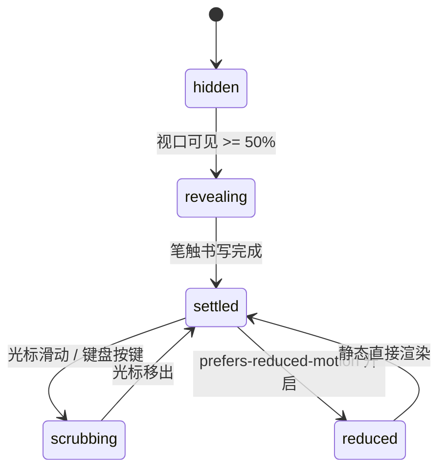

# Sparkline · 迷你折线图

用于紧凑数据看板、表格行内指标与资产卡片内的极简微型走势图。无冗余坐标网格，采用自适应样条曲线、笔触书写展开（840ms Stroke Reveal）、最新值着陆端点脉冲（Landed End Dot）、零抖动 Ghost Sizer 标题指标数值联动，以及光标掠过时的过去亮起与未来暗化探查（Scrubbing）。

## 原型清单

| 原型分组 | 原型元素 | 动效 / 状态变化 | 去向 |
| --- | --- | --- | --- |
| — | 迷你走势卡片 `.arc-spark-figure` | 极简无边框或卡片式容器 | 最小 DOM / CSS 宿主 |
| — | 标题与实时统计展台 `.arc-spark-caption` | 指标名、大号当前值、增减百分比标签（如 `+7.2%`） | 标题展台 |
| — | 滚轮指标数值 `.arc-spark-roll` / `.arc-spark-sizer` | 隐形 Ghost Sizer 锁定物理宽度，数值变动不抖动 | Ghost Sizer 机制 |
| — | 绘图主视口 `.arc-spark-plot` | 挂载 `role="slider"`，捕获左右滑动与键盘探查 | 交互视口 |
| — | 渐变面积填充 `.arc-spark-area` | 曲线至底部的微弱半透明填充，随趋势颜色（涨绿/跌红）映射 | 面积填充 |
| — | 迷你折线路径 `.arc-spark-line` | 2.5px 平滑样条曲线，带 `pathLength="1"` 笔触入场动画 | 核心走势折线 |
| — | 最新点着陆圆点 `.arc-spark-end` | 位于序列末端的着陆圆点，初次展开后轻微弹簧着陆 | 端点高亮标记 |
| — | 光标探查垂直指示线 `.arc-spark-cursor` | 鼠标滑过时跟随光标位置的细发丝线 | 探查标尺 |
| — | 读屏表格 `.arc-spark-srOnly` | 结构化语义 `<table>` 与 `aria-live="polite"` 动态宣告 | 无障碍可访问性 |
| — | 时间范围单选组 `.qf` / `.Cr` | 演示 1W / 1M / 1Y 切换 | 演示外壳，已删除 |
| — | 顶栏、主题切换按钮 `#themeBtn`、舞台卡片 | — | 演示外壳，已删除 |

## 适用

- 股票/加密货币行情走势卡片、表格行内微型 Sparkline 趋势预览。
- 极度紧凑空间内展示 7 天至 30 天走势，强调大趋势而非精确刻度。
- 鼠标或手指在微图上扫过时，顶部指标数值随当前点动态联动刷新，移出时自动回弹恢复最新值。
- 支持全键盘方向键无障碍探索。

## 不适用

- 带有精确横纵轴网格刻度的复杂折线图 → [line-chart](line-chart.md)
- 离散时序柱状高低对比 → [bar-chart](bar-chart.md)
- 实时无止境高频数据流 → [realtime-stream](realtime-stream.md)
- 两期对照斜率对比 → [slope-chart](slope-chart.md)

## 状态机

| 状态 | 进入条件 | 视觉表现 | 退出到 |
| --- | --- | --- | --- |
| hidden | 挂载尚未进入视口 | 曲线 stroke-dashoffset 为 1（完全隐蔽），端点透明度 0 | revealing |
| revealing | 视口曝光达到 50% | 曲线从左至右以 840ms 平滑展开，端点圆圈微弹性落定 | settled |
| settled | 展开完毕或光标移出 | 曲线保持主色调，端点静止，顶部显示最新数值与区间总涨跌幅 | scrubbing |
| scrubbing | 指针在图表上滑动或键盘方向键移动 | 竖向光标线显现，光标左侧曲线高亮、右侧变暗，顶栏数值切为当前点 | settled |
| reduced | 触发系统减少动态效果模式 | 曲线即时绘制成型，停用笔触书写动画与端点过冲弹性 | settled |



## 最小 DOM

```html
<figure class="arc-spark-figure" aria-label="Daily active users">
  <figcaption class="arc-spark-caption">
    <span class="arc-spark-label">Daily active users</span>
    <strong>
      <span class="arc-spark-roll">
        <span class="arc-spark-sizer">2,486</span>
        <span class="arc-spark-val">2,486</span>
      </span>
    </strong>
    <small class="arc-spark-badge arc-spark-success">+7.2%</small>
  </figcaption>

  <div class="arc-spark-plot" role="slider" tabindex="0" aria-label="Explore values" aria-orientation="horizontal">
    <svg class="arc-spark-chart" viewBox="0 0 360 80" aria-hidden="true">
      <path class="arc-spark-area" d="" />
      <path class="arc-spark-line" d="" />
      <line class="arc-spark-cursor" y1="0" y2="80" x1="0" x2="0" opacity="0" />
      <circle class="arc-spark-end" r="3.5" cx="0" cy="0" />
    </svg>
  </div>

  <div class="arc-spark-srOnly">
    <table>
      <caption>Sparkline values table</caption>
      <thead><tr><th scope="col">Point</th><th scope="col">Value</th></tr></thead>
      <tbody></tbody>
    </table>
  </div>
</figure>
```

- `.arc-spark-figure`：根容器。
- `.arc-spark-caption`：顶栏状态区，包含标签、数值与涨跌徽标。
- `.arc-spark-sizer`：宽度隐形占位符。
- `.arc-spark-plot`：`role="slider"` 交互视口。
- `.arc-spark-svg`：包含面积、平滑曲线、游标和端点圆的轻量 SVG。
- `.arc-spark-srOnly`：屏幕阅读器结构化明细表。

## 参数

| 名称 | 值 | 用于 | 来源 |
| --- | --- | --- | --- |
| 默认宽度 / 高度 | `360px` / `80px` | SVG 宽高规格 | 原型 |
| 笔触书写时长 | `840ms` | 初始入场 stroke-dashoffset | 原型 |
| 书写缓动曲线 | `cubic-bezier(0.65, 0, 0.35, 1)` | 笔触加速度 | 原型 |
| 折线描边宽度 | `2.5px` | 主曲线粗细 | 原型 |
| 端点圆点半径 | `3.5px` | 最新数据点圆点大小 | 原型 |
| 光标平滑弹簧 | `260ms` / `bounce: 0.12` | 游标贴附过渡 | 原型 |
| 视口触发阈值 | `0.5` (50%) | IntersectionObserver | 原型 |

## CSS

```css
.arc-spark-figure {
  --spark-success: #16a34a;
  --spark-danger: #dc2626;
  --spark-color: var(--spark-success);
  --spark-muted: #737373;
  --spark-foreground: #111111;
  --spark-ease: cubic-bezier(0.16, 1, 0.3, 1);
  --spark-duration: 400ms;

  display: flex;
  flex-direction: column;
  gap: 0.5rem;
  margin: 0;
  color: var(--spark-foreground);
  font-family: system-ui, -apple-system, sans-serif;
  user-select: none;
  width: 100%;
  max-width: 360px;
}

.arc-spark-figure.is-danger {
  --spark-color: var(--spark-danger);
}

.arc-spark-caption {
  display: flex;
  align-items: baseline;
  justify-content: space-between;
  gap: 8px;
}

.arc-spark-label {
  font-size: 0.75rem;
  color: var(--spark-muted);
}

.arc-spark-caption strong {
  font-size: 1.25rem;
  font-weight: 700;
  font-variant-numeric: tabular-nums;
  margin-left: auto;
}

.arc-spark-roll {
  position: relative;
  display: inline-flex;
}

.arc-spark-sizer {
  visibility: hidden;
  position: absolute;
  pointer-events: none;
}

.arc-spark-badge {
  font-size: 0.75rem;
  font-weight: 600;
  color: var(--spark-color);
  font-variant-numeric: tabular-nums;
}

.arc-spark-plot {
  position: relative;
  width: 100%;
  height: 80px;
  outline: none;
  cursor: crosshair;
}

.arc-spark-chart {
  display: block;
  width: 100%;
  height: 100%;
  overflow: visible;
}

.arc-spark-area {
  fill: color-mix(in srgb, var(--spark-color) 12%, transparent);
  transition: d var(--spark-duration) var(--spark-ease);
}

.arc-spark-line {
  fill: none;
  stroke: var(--spark-color);
  stroke-width: 2.5;
  stroke-linecap: round;
  stroke-linejoin: round;
  transition: d var(--spark-duration) var(--spark-ease);
}

.arc-spark-cursor {
  stroke: var(--spark-foreground);
  stroke-width: 1;
  stroke-dasharray: 2 2;
  pointer-events: none;
  transition: opacity 120ms ease, transform 80ms linear;
}

.arc-spark-end {
  fill: #fff;
  stroke: var(--spark-color);
  stroke-width: 2.5;
  transition: transform 160ms var(--spark-ease);
}

.arc-spark-srOnly {
  position: absolute;
  width: 1px;
  height: 1px;
  margin: -1px;
  padding: 0;
  border: 0;
  overflow: hidden;
  clip: rect(0, 0, 0, 0);
  white-space: nowrap;
}

@media (prefers-reduced-motion: reduce) {
  .arc-spark-line,
  .arc-spark-area,
  .arc-spark-cursor,
  .arc-spark-end {
    transition: none !important;
  }
}
```

## JS

```js
/**
 * 构造平滑样条曲线
 */
function buildSpline(points) {
  if (points.length === 0) return '';
  if (points.length === 1) return `M ${points[0].x} ${points[0].y}`;
  let path = `M ${points[0].x.toFixed(1)} ${points[0].y.toFixed(1)}`;

  for (let i = 0; i < points.length - 1; i++) {
    const p0 = points[Math.max(0, i - 1)];
    const p1 = points[i];
    const p2 = points[i + 1];
    const p3 = points[Math.min(points.length - 1, i + 2)];

    const cp1x = p1.x + (p2.x - p0.x) / 6;
    const cp1y = p1.y + (p2.y - p0.y) / 6;
    const cp2x = p2.x - (p3.x - p1.x) / 6;
    const cp2y = p2.y - (p3.y - p1.y) / 6;

    path += ` C ${cp1x.toFixed(1)} ${cp1y.toFixed(1)}, ${cp2x.toFixed(1)} ${cp2y.toFixed(1)}, ${p2.x.toFixed(1)} ${p2.y.toFixed(1)}`;
  }
  return path;
}

/**
 * 创建 Sparkline 实例
 * @param {HTMLElement} el 宿主容器
 * @param {Object} options 配置项
 * @param {number[]} [options.data] 数值点数组
 * @param {string} [options.label='Daily active users'] 指标名称
 * @param {string} [options.badge='+7.2%'] 涨跌幅文本
 */
export function createSparkline(el, options = {}) {
  const defaultData = [1800, 1920, 1850, 2100, 2040, 2350, 2486];
  let data = Array.isArray(options.data) && options.data.length > 0 ? options.data : defaultData;
  let label = options.label || 'Daily active users';
  let badge = options.badge || '+7.2%';
  let activeIndex = -1;
  let disposed = false;

  const plot = el.querySelector('.arc-spark-plot') || el;
  const linePath = el.querySelector('.arc-spark-line');
  const areaPath = el.querySelector('.arc-spark-area');
  const endDot = el.querySelector('.arc-spark-end');
  const cursor = el.querySelector('.arc-spark-cursor');
  const valText = el.querySelector('.arc-spark-val');
  const sizer = el.querySelector('.arc-spark-sizer');
  const badgeEl = el.querySelector('.arc-spark-badge');
  const labelEl = el.querySelector('.arc-spark-label');
  const tableBody = el.querySelector('.arc-spark-srOnly tbody');

  const width = 360;
  const height = 80;
  const padY = 8;
  const availH = height - padY * 2;

  let computedPoints = [];

  function computeLayout() {
    if (disposed) return;
    const minVal = Math.min(...data);
    const maxVal = Math.max(...data);
    const range = maxVal - minVal || 1;
    const stepX = width / (data.length - 1 || 1);

    computedPoints = data.map((v, i) => {
      const x = i * stepX;
      const y = height - padY - ((v - minVal) / range) * availH;
      return { x, y, v, i };
    });

    const splineD = buildSpline(computedPoints);
    const areaD = `${splineD} L ${width} ${height} L 0 ${height} Z`;

    if (linePath) linePath.setAttribute('d', splineD);
    if (areaPath) areaPath.setAttribute('d', areaD);

    const lastPt = computedPoints[computedPoints.length - 1];
    if (endDot && lastPt) {
      endDot.setAttribute('cx', lastPt.x.toFixed(1));
      endDot.setAttribute('cy', lastPt.y.toFixed(1));
    }

    // 默认展示最新值
    if (valText && lastPt) valText.textContent = lastPt.v.toLocaleString();
    if (sizer && lastPt) sizer.textContent = lastPt.v.toLocaleString();
    if (badgeEl) badgeEl.textContent = badge;
    if (labelEl) labelEl.textContent = label;

    // 涨跌判断
    const isUp = data[data.length - 1] >= data[0];
    if (isUp) {
      el.classList.remove('is-danger');
    } else {
      el.classList.add('is-danger');
    }

    // 表格
    if (tableBody) {
      tableBody.innerHTML = '';
      data.forEach((v, i) => {
        const tr = document.createElement('tr');
        tr.innerHTML = `<th scope="row">Point ${i + 1}</th><td>${v}</td>`;
        tableBody.appendChild(tr);
      });
    }
  }

  function setActive(idx) {
    if (disposed || idx === activeIndex) return;
    activeIndex = idx;

    if (idx >= 0 && idx < computedPoints.length) {
      const pt = computedPoints[idx];
      if (cursor) {
        cursor.setAttribute('opacity', '1');
        cursor.setAttribute('x1', pt.x.toFixed(1));
        cursor.setAttribute('x2', pt.x.toFixed(1));
      }
      if (valText) valText.textContent = pt.v.toLocaleString();
      if (badgeEl) {
        const diff = pt.v - data[0];
        const pct = ((diff / data[0]) * 100).toFixed(1);
        badgeEl.textContent = `${diff >= 0 ? '+' : ''}${pct}%`;
      }
    } else {
      if (cursor) cursor.setAttribute('opacity', '0');
      const lastPt = computedPoints[computedPoints.length - 1];
      if (valText && lastPt) valText.textContent = lastPt.v.toLocaleString();
      if (badgeEl) badgeEl.textContent = badge;
    }
  }

  function handlePointer(clientX) {
    const rect = plot.getBoundingClientRect();
    const x = Math.max(0, Math.min(width, clientX - rect.left));
    const stepX = width / (data.length - 1 || 1);
    const idx = Math.round(x / stepX);
    setActive(Math.max(0, Math.min(data.length - 1, idx)));
  }

  const onPointerMove = (e) => handlePointer(e.clientX);
  const onPointerLeave = () => setActive(-1);

  const onKeyDown = (e) => {
    if (e.key === 'ArrowRight') {
      e.preventDefault();
      setActive(Math.min(data.length - 1, activeIndex < 0 ? 0 : activeIndex + 1));
    } else if (e.key === 'ArrowLeft') {
      e.preventDefault();
      setActive(Math.max(0, activeIndex < 0 ? 0 : activeIndex - 1));
    } else if (e.key === 'Escape') {
      setActive(-1);
    }
  };

  plot.addEventListener('pointermove', onPointerMove);
  plot.addEventListener('pointerleave', onPointerLeave);
  plot.addEventListener('keydown', onKeyDown);

  // 模拟点击切点
  const handleClick = () => {
    setActive((activeIndex + 1) % data.length);
  };
  el.addEventListener('click', handleClick);

  computeLayout();

  return {
    setActive,
    update(newData) {
      if (disposed) return;
      if (Array.isArray(newData)) data = newData;
      computeLayout();
      setActive(-1);
    },
    destroy() {
      disposed = true;
      plot.removeEventListener('pointermove', onPointerMove);
      plot.removeEventListener('pointerleave', onPointerLeave);
      plot.removeEventListener('keydown', onKeyDown);
      el.removeEventListener('click', handleClick);
    }
  };
}
```

## 接入目标项目

- 状态来源：
  - 传入纯数值一维数组 `data: [120, 140, 160, ...]`。
- 尺寸策略：
  - SVG viewBox 0 0 360 80，支持父级容器等比响应式伸缩。
- 驱动方式：
  - `const spark = createSparkline(container, { data, badge })`。
  - 销毁时调用 `spark.destroy()`。

## 重入与清理

- 连续快速滑动时，光标坐标直接按离散点吸附，无累积定时器。
- 销毁时清理对舞台的指针、键盘和点击监听。

## 减少动态效果

- 满足 `prefers-reduced-motion: reduce` 时：
  - 曲线停用平滑插值形变，即时完成重绘。
  - 端点圆取消 scale 过冲动效。

## 焦点与键盘

- `.arc-spark-plot` 挂载 `tabindex="0"` 与 `role="slider"`，支持左右方向键在数据点间穿梭。
- 屏幕阅读器自动读取内部隐藏的结构化表格数据。

## 兼容回退

| 特性 | 不支持时 |
| --- | --- |
| SVG Catmull-Rom | 回退为点对点折线 polyline 绘制。 |

## 验收清单

- [ ] 初始渲染平滑微型折线与下方浅色半透明渐变区域，末端显示着陆圆点。
- [ ] 顶栏展示大号指标数值与百分比变化徽标（绿色或红色）。
- [ ] 鼠标光标在图表上滑过时，垂直虚线跟随，顶栏数值实时联动显示该点取值。
- [ ] 鼠标移出后自动平滑恢复展示最新末端数值。
- [ ] 调用 `destroy()` 完整清理事件。
