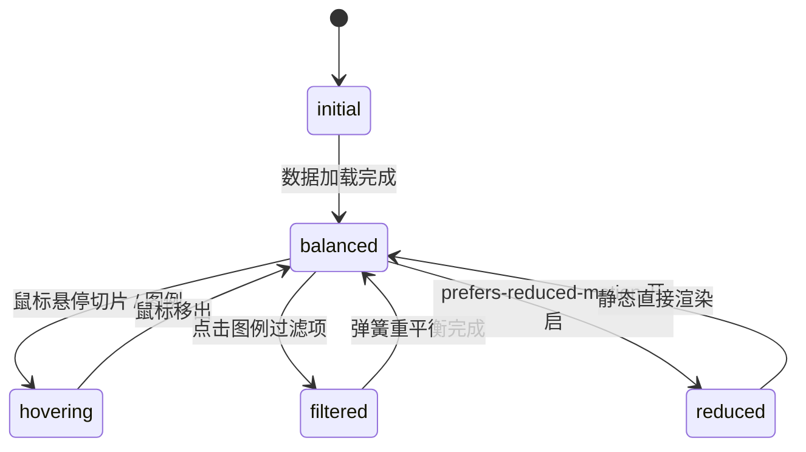

# Split Bar · 分割条形图

用于单维度多分类占比与份额重平衡（如流量渠道分布、存储配额占用、预算开销比例）的比例水平分割条形图。包含横向分段弹性重平衡（Slice Spring）、空间不足自动溢出引导折线（Leader Lines & Outside Labels）、零抖动 Ghost Sizer 标题指标数值联动，以及图例点击过滤重排。

## 原型清单

| 原型分组 | 原型元素 | 动效 / 状态变化 | 去向 |
| --- | --- | --- | --- |
| — | 分割条主卡片 `.arc-split-figure` | 布局结构与无障碍描述绑定 | 最小 DOM / CSS 宿主 |
| — | 顶栏汇总数据 `.arc-split-head` | 标题与选定分类/总和数字滚轮（带 Ghost Sizer） | 顶栏数值展台 |
| — | 分割条主轨道 `.arc-split-bar` | 挂载 `role="group"`，承载全部横向彩条切片 | 核心比例切片条 |
| — | 单个分段切片 `.arc-split-segment` | 依百分比定位与圆角裁切（`round 4px`），悬停高亮与加宽 | 分段切片交互 |
| — | 分段内嵌文案 `.arc-split-inside` | 宽度充足时在彩条内部显示的名称与百分比 | 条内文本挂载 |
| — | 引导折线泳道 `.arc-split-lane` | 宽度狭窄切片（< 40px）引线向下引出到外部车道 | 狭窄分段引线 |
| — | 外部溢出标签 `.arc-split-outside` | 放置在条外下方的分类名与百分比 | 条外溢出标签 |
| — | 交互图例列表 `.arc-split-legend` | 每项承载色块、分类名与百分比，支持点击显隐过滤 | 交互图例项 |
| — | 读屏表格 `.arc-split-srOnly` | 结构化语义 `<table>` 与 `aria-live="polite"` 动态宣告 | 无障碍可访问性 |
| — | 周期切换按钮组 `.bu` / `.ur` | 演示 7d / 30d / 90d 数据切换 | 演示外壳，已删除 |
| — | 顶栏、主题切换按钮 `#themeBtn`、舞台卡片 | — | 演示外壳，已删除 |

## 适用

- 资源总览占比展示（如存储已用/可用/系统占用、流量各来源百分比）。
- 某些切片占比极小（如 1.5%），直接塞入条内会导致字体重叠，需要引导线引到条外下方排版。
- 点击图例项可隐藏特定分类，剩余分类宽度平滑重分配填满 100%。
- 支持鼠标悬停高亮某一分段并联动顶栏显示该分类绝对数量。

## 不适用

- 独立圆弧与圆心鼓读数 → [donut-chart](donut-chart.md)
- 离散时序多柱对比 → [bar-chart](bar-chart.md)
- 10×10 规整百分比点阵网格 → [waffle-chart](waffle-chart.md)
- 连续时间走势图 → [line-chart](line-chart.md)

## 状态机

| 状态 | 进入条件 | 视觉表现 | 退出到 |
| --- | --- | --- | --- |
| initial | 初始挂载（尚未进入视口） | 切片宽度收缩在左侧，透明度为 0 | balanced |
| balanced | 挂载就位或无交互稳态 | 各分类切片按比例填满 100%，顶栏显示总数，过窄切片引线引出 | hovering |
| hovering | 指针悬停某一切片或图例项 | 目标切片高亮加粗，其他切片变暗；顶栏显示该切片名称与绝对值 | balanced |
| filtered | 点击图例隐藏/显示某一分类 | 被隐藏切片收缩至 0，剩余切片以 400ms 物理弹簧重新铺满 100% | balanced |
| reduced | 触发系统减少动态效果模式 | 切片宽度直接变更，停用横向伸缩弹簧过渡与数字滚轮 | balanced |



## 最小 DOM

```html
<figure class="arc-split-figure" aria-label="Traffic by source">
  <div class="arc-split-head">
    <div class="arc-split-heading">
      <p class="arc-split-title">Traffic by source</p>
      <p class="arc-split-description">Sessions summary</p>
    </div>
    <div class="arc-split-readout" aria-hidden="true">
      <span class="arc-split-readoutName">Total</span>
      <span class="arc-split-readoutValue">99,300 sessions</span>
    </div>
  </div>

  <div class="arc-split-bar" tabindex="0" role="group" aria-label="Split bar representation">
    <!-- 动态切片 -->
  </div>

  <div class="arc-split-lane" aria-hidden="true">
    <svg class="arc-split-leaders" width="100%" height="36"></svg>
    <div class="arc-split-outsides"></div>
  </div>

  <ul class="arc-split-legend"></ul>

  <div class="arc-split-srOnly">
    <table>
      <caption>Traffic by source table</caption>
      <thead><tr><th scope="col">Source</th><th scope="col">Share</th></tr></thead>
      <tbody></tbody>
    </table>
  </div>
</figure>
```

- `.arc-split-figure`：主图表容器。
- `.arc-split-head`：顶栏标题与指标展台。
- `.arc-split-bar`：承载所有彩色切片的主水平条（高度 40px）。
- `.arc-split-lane`：下方的引导折线与外部溢出文本层。
- `.arc-split-legend`：底部图例项。
- `.arc-split-srOnly`：屏幕阅读器专用数据表格。

## 参数

| 名称 | 值 | 用于 | 来源 |
| --- | --- | --- | --- |
| 条形高度 | `40px` | 主分割条垂直高度 | 原型 |
| 切片圆角 | `4px` | 两端外边缘圆角 | 原型 |
| 缝隙宽度 | `1px` | 相邻切片之间的物理缝隙 | 原型 |
| 内部文本最小容纳宽度 | `70px` | 低于此宽度文本移到外部泳道 | 原型 |
| 切片重平衡弹簧时长 | `400ms` / `bounce: 0` | 显隐或比例切换平滑过渡 | 原型 |
| 视口触发阈值 | `0.3` (30%) | IntersectionObserver | 原型 |

## CSS

```css
.arc-split-figure {
  --split-height: 40px;
  --split-radius: 4px;
  --split-border: rgba(0, 0, 0, 0.08);
  --split-muted: #737373;
  --split-foreground: #111111;
  --split-ease: cubic-bezier(0.16, 1, 0.3, 1);
  --split-duration: 400ms;

  display: flex;
  flex-direction: column;
  gap: 0.75rem;
  margin: 0;
  color: var(--split-foreground);
  font-family: system-ui, -apple-system, sans-serif;
  user-select: none;
  width: 100%;
}

.arc-split-head {
  display: flex;
  align-items: baseline;
  justify-content: space-between;
}

.arc-split-title {
  margin: 0;
  font-size: 1.125rem;
  font-weight: 600;
}

.arc-split-description {
  margin: 2px 0 0;
  font-size: 0.75rem;
  color: var(--split-muted);
}

.arc-split-readout {
  font-size: 0.875rem;
  font-weight: 600;
  font-variant-numeric: tabular-nums;
  display: flex;
  gap: 6px;
}

.arc-split-readoutName {
  color: var(--split-muted);
  font-weight: 400;
}

.arc-split-bar {
  position: relative;
  display: flex;
  height: var(--split-height);
  width: 100%;
  border-radius: var(--split-radius);
  overflow: hidden;
  background: rgba(0, 0, 0, 0.04);
  outline: none;
}

.arc-split-segment {
  position: relative;
  height: 100%;
  display: flex;
  align-items: center;
  overflow: hidden;
  cursor: pointer;
  transition: width var(--split-duration) var(--split-ease),
              opacity 200ms ease;
  box-sizing: border-box;
  border-right: 1px solid #fff;
}

.arc-split-figure[data-hovering] .arc-split-segment {
  opacity: 0.35;
}

.arc-split-figure[data-hovering] .arc-split-segment.is-active {
  opacity: 1;
}

.arc-split-inside {
  position: absolute;
  left: 8px;
  right: 8px;
  display: flex;
  align-items: center;
  justify-content: space-between;
  color: #fff;
  font-size: 0.75rem;
  font-weight: 500;
  white-space: nowrap;
  pointer-events: none;
}

.arc-split-lane {
  position: relative;
  height: 36px;
  width: 100%;
}

.arc-split-leaders {
  position: absolute;
  inset: 0;
  pointer-events: none;
}

.arc-split-leader {
  fill: none;
  stroke: var(--split-muted);
  stroke-width: 1;
}

.arc-split-outsides {
  position: absolute;
  inset: 0;
  pointer-events: none;
}

.arc-split-outside {
  position: absolute;
  top: 16px;
  transform: translateX(-50%);
  display: flex;
  align-items: center;
  gap: 4px;
  font-size: 0.6875rem;
  color: var(--split-muted);
  white-space: nowrap;
}

.arc-split-legend {
  display: flex;
  flex-wrap: wrap;
  gap: 0.75rem 1.25rem;
  padding: 0;
  margin: 0;
  list-style: none;
}

.arc-split-legendItem {
  display: inline-flex;
  align-items: center;
  gap: 6px;
  background: transparent;
  border: none;
  padding: 2px 4px;
  cursor: pointer;
  font: inherit;
  font-size: 0.8125rem;
  color: inherit;
}

.arc-split-legendItem[aria-pressed="false"] {
  opacity: 0.35;
  text-decoration: line-through;
}

.arc-split-swatch {
  width: 8px;
  height: 8px;
  border-radius: 50%;
  flex-shrink: 0;
}

.arc-split-srOnly {
  position: absolute;
  width: 1px;
  height: 1px;
  margin: -1px;
  padding: 0;
  border: 0;
  overflow: hidden;
  clip: rect(0, 0, 0, 0);
  white-space: nowrap;
}

@media (prefers-reduced-motion: reduce) {
  .arc-split-segment {
    transition: none !important;
  }
}
```

## JS

```js
/**
 * 创建 SplitBar 实例
 * @param {HTMLElement} el 宿主容器
 * @param {Object} options 配置项
 * @param {Array<{key: string, label: string, value: number, color: string}>} [options.items] 数据分段
 */
export function createSplitBar(el, options = {}) {
  const defaultColors = ['#2563eb', '#16a34a', '#d97706', '#dc2626', '#8b5cf6', '#64748b'];
  const defaultItems = [
    { key: 'organic', label: 'Organic search', value: 41600 },
    { key: 'direct', label: 'Direct', value: 24800 },
    { key: 'paid', label: 'Paid search', value: 19100 },
    { key: 'social', label: 'Social', value: 9900 },
    { key: 'referral', label: 'Referral', value: 3100 },
    { key: 'other', label: 'Other', value: 1500 }
  ];

  let rawItems = Array.isArray(options.items) && options.items.length > 0 ? options.items : defaultItems;
  let items = rawItems.map((d, i) => ({
    ...d,
    color: d.color || defaultColors[i % defaultColors.length],
    visible: true
  }));

  let activeIndex = -1;
  let disposed = false;

  const figure = el.querySelector('.arc-split-figure') || el;
  const barContainer = el.querySelector('.arc-split-bar');
  const outsidesContainer = el.querySelector('.arc-split-outsides');
  const leadersSvg = el.querySelector('.arc-split-leaders');
  const legend = el.querySelector('.arc-split-legend');
  const readoutName = el.querySelector('.arc-split-readoutName');
  const readoutVal = el.querySelector('.arc-split-readoutValue');
  const tableBody = el.querySelector('.arc-split-srOnly tbody');

  function render() {
    if (disposed) return;
    const activeList = items.filter(d => d.visible);
    const totalVal = activeList.reduce((acc, d) => acc + d.value, 0) || 1;

    // 默认展示总览
    if (readoutName) readoutName.textContent = 'Total';
    if (readoutVal) readoutVal.textContent = `${totalVal.toLocaleString()} sessions`;

    if (barContainer) barContainer.innerHTML = '';
    if (outsidesContainer) outsidesContainer.innerHTML = '';
    if (leadersSvg) leadersSvg.innerHTML = '';

    const barWidth = barContainer ? barContainer.clientWidth || 500 : 500;
    let accumulatedLeft = 0;

    activeList.forEach((item, idx) => {
      const share = item.value / totalVal;
      const segWidth = share * barWidth;
      const segPct = (share * 100).toFixed(1);

      // 1. 彩条切片
      const seg = document.createElement('div');
      seg.className = 'arc-split-segment';
      seg.setAttribute('data-index', String(idx));
      seg.style.width = `${segWidth}px`;
      seg.style.backgroundColor = item.color;

      // 宽于 70px 时在内部显示文本，否则移到外部
      if (segWidth >= 70) {
        seg.innerHTML = `
          <div class="arc-split-inside">
            <span>${item.label}</span>
            <span>${segPct}%</span>
          </div>
        `;
      } else if (segWidth >= 15 && outsidesContainer) {
        const centerPos = accumulatedLeft + segWidth / 2;
        const outDiv = document.createElement('div');
        outDiv.className = 'arc-split-outside';
        outDiv.style.left = `${centerPos}px`;
        outDiv.innerHTML = `<span>${item.label}</span> <strong>${segPct}%</strong>`;
        outsidesContainer.appendChild(outDiv);

        if (leadersSvg) {
          const path = document.createElementNS('http://www.w3.org/2000/svg', 'path');
          path.setAttribute('class', 'arc-split-leader');
          path.setAttribute('d', `M ${centerPos} 0 L ${centerPos} 14`);
          leadersSvg.appendChild(path);
        }
      }

      accumulatedLeft += segWidth;

      seg.addEventListener('pointerenter', () => setActiveSegment(idx));
      seg.addEventListener('pointerleave', () => setActiveSegment(-1));
      if (barContainer) barContainer.appendChild(seg);
    });

    // 2. 渲染图例
    if (legend) {
      legend.innerHTML = '';
      items.forEach((item, i) => {
        const share = Math.round((item.value / totalVal) * 100);
        const li = document.createElement('li');
        li.innerHTML = `
          <button type="button" class="arc-split-legendItem" aria-pressed="${item.visible}">
            <span class="arc-split-swatch" style="background-color: ${item.color};"></span>
            <span>${item.label}</span>
            <strong style="color: #737373;">${share}%</strong>
          </button>
        `;

        const btn = li.querySelector('.arc-split-legendItem');
        btn.addEventListener('pointerenter', () => setActiveSegment(i));
        btn.addEventListener('pointerleave', () => setActiveSegment(-1));
        btn.addEventListener('click', (e) => {
          e.stopPropagation();
          item.visible = !item.visible;
          render();
        });
        legend.appendChild(li);
      });
    }

    // 3. 表格
    if (tableBody) {
      tableBody.innerHTML = '';
      items.forEach(d => {
        const tr = document.createElement('tr');
        tr.innerHTML = `<th scope="row">${d.label}</th><td>${d.value.toLocaleString()}</td>`;
        tableBody.appendChild(tr);
      });
    }
  }

  function setActiveSegment(idx) {
    if (disposed || idx === activeIndex) return;
    activeIndex = idx;

    const activeList = items.filter(d => d.visible);
    if (idx >= 0 && idx < activeList.length) {
      figure.setAttribute('data-hovering', 'true');
      const item = activeList[idx];

      if (barContainer) {
        barContainer.querySelectorAll('.arc-split-segment').forEach((s, i) => {
          if (i === idx) s.classList.add('is-active');
          else s.classList.remove('is-active');
        });
      }

      if (readoutName) readoutName.textContent = item.label;
      if (readoutVal) readoutVal.textContent = `${item.value.toLocaleString()} sessions`;
    } else {
      figure.removeAttribute('data-hovering');
      if (barContainer) barContainer.querySelectorAll('.arc-split-segment').forEach(s => s.classList.remove('is-active'));
      const totalVal = activeList.reduce((acc, d) => acc + d.value, 0);
      if (readoutName) readoutName.textContent = 'Total';
      if (readoutVal) readoutVal.textContent = `${totalVal.toLocaleString()} sessions`;
    }
  }

  const onKeyDown = (e) => {
    const activeList = items.filter(d => d.visible);
    if (e.key === 'ArrowRight') {
      e.preventDefault();
      setActiveSegment((activeIndex + 1) % activeList.length);
    } else if (e.key === 'ArrowLeft') {
      e.preventDefault();
      setActiveSegment((activeIndex - 1 + activeList.length) % activeList.length);
    } else if (e.key === 'Escape') {
      setActiveSegment(-1);
    }
  };

  if (barContainer) barContainer.addEventListener('keydown', onKeyDown);

  // 模拟点击切分段
  const handleClick = () => {
    const activeList = items.filter(d => d.visible);
    setActiveSegment((activeIndex + 1) % activeList.length);
  };
  el.addEventListener('click', handleClick);

  render();

  return {
    setActiveSegment,
    update(newItems) {
      if (disposed) return;
      if (Array.isArray(newItems)) {
        rawItems = newItems;
        items = rawItems.map((d, i) => ({
          ...d,
          color: d.color || defaultColors[i % defaultColors.length],
          visible: true
        }));
      }
      render();
      setActiveSegment(-1);
    },
    destroy() {
      disposed = true;
      if (barContainer) barContainer.removeEventListener('keydown', onKeyDown);
      el.removeEventListener('click', handleClick);
    }
  };
}
```

## 接入目标项目

- 状态来源：
  - 传入分类份额数组 `items: [{ key, label, value, color }]`。
- 尺寸策略：
  - 容器宽度百分比自适应，内部依据真实物理宽度智能分配条内文字与条外引线排版。
- 驱动方式：
  - `const split = createSplitBar(container, { items })`。
  - 卸载时调用 `split.destroy()`。

## 重入与清理

- 连续多次悬停与过滤时，切片利用 CSS width 与 opacity 自然过渡，无残留定时器。
- 销毁时清理键盘与指针事件。

## 减少动态效果

- 满足 `prefers-reduced-motion: reduce` 时：
  - 切片宽度过渡停用（`transition: none !important`）。
  - 数值直接跳变。

## 焦点与键盘

- `.arc-split-bar` 声明 `role="group"` 与 `tabindex="0"`，支持左右方向键在相邻切片之间切换。
- 屏幕阅读器自动读取内部隐藏的结构化表格。

## 兼容回退

| 特性 | 不支持时 |
| --- | --- |
| SVG Leader 折线 | 降级为外部文字平铺展示，无连接引线。 |

## 验收清单

- [ ] 初始渲染完整的彩色比例切片条，宽切片内部带有文字，过窄切片引线指向条外。
- [ ] 鼠标悬停某一切片，该切片高亮，顶栏联动显示其分类名称与绝对数值。
- [ ] 点击图例项可切换分类显隐，其余切片宽度平滑重新铺满整条。
- [ ] 键盘左右键支持逐个切片聚焦。
- [ ] 调用 `destroy()` 完整清理事件。
