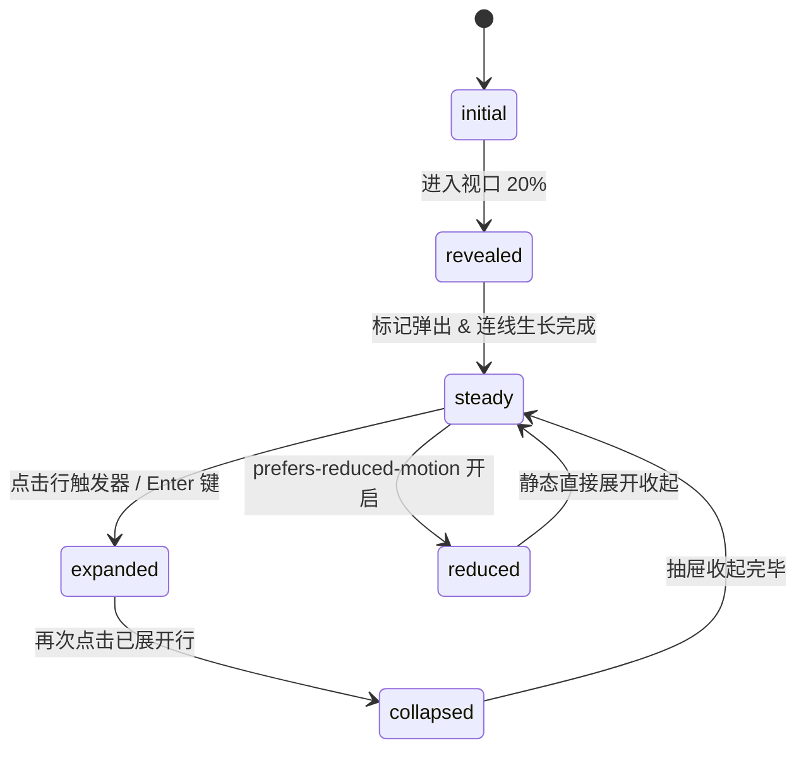

# Timeline · 时间线

用于按日历时间分组展示离散事件活动流（如项目动态、审计日志、发布历史、工单生命周期）的分组交互时间线。包含视口交叉驱动的连线垂直生长动画（Downward Segment Scale）、小圆点弹性弹出（Marker Pop Spring）、可折叠详情手风琴（Detail Accordion）、相对时间动态计算与键盘上下箭头巡航。

## 原型清单

| 原型分组 | 原型元素 | 动效 / 状态变化 | 去向 |
| --- | --- | --- | --- |
| — | 时间线主卡片 `.arc-timeline-card` | 布局结构与外层容器绑定 | 最小 DOM / CSS 宿主 |
| — | 滚动视口容器 `.arc-timeline-scroller` | 带有纵向平滑滚动与底部渐隐羽化边缘（Feather Mask） | 视口滚动容器 |
| — | 日期分组 `.arc-timeline-group` | 依日期（Today, Yesterday, Date）将事件聚合 | 日期分组层 |
| — | 吸顶日期头部 `.arc-timeline-day` | 纵向滚动时吸顶（Sticky），右侧承载事件计数器 | 吸顶头部 |
| — | 计数滚动数字 `.arc-timeline-count` | 事件数量变动时单个数字上下翻滚 | 分组计数器 |
| — | 事件条目列表 `.arc-timeline-list` | 无序语义列表 `role="list"` 承载单日全部事件 | 列表容器 |
| — | 单个事件行 `.arc-timeline-item` | 承载标记点、垂直引线与内容交互区 | 单个事件节点 |
| — | 事件标记点 `.arc-timeline-marker` | 头像或状态图标，从 `scale(0.4)` 弹簧放大并淡入至 `scale(1)` | 标记点微动效 |
| — | 垂直连接段 `.arc-timeline-segment` | 从上方标记点向下延伸，`scaleY(0 -> 1)` 垂向生长 | 垂直连接引线 |
| — | 行触发器 `.arc-timeline-trigger` | 交互按钮，悬停高亮底色，点击展开/收起详情 | 展开折叠交互 |
| — | 相对时间戳 `.arc-timeline-time` | 动态计算 `just now`、`Xm ago`、`Xh ago` 并平滑换行过渡 | 相对时间展台 |
| — | 旋转折叠箭头 `.arc-timeline-chevron` | 点击展开时顺时针旋转 180° | 箭头图标过渡 |
| — | 详情抽屉 `.arc-timeline-detail` | `grid-template-rows: 0fr -> 1fr` 物理手风琴平滑展开 | 详情折叠抽屉 |
| — | 读屏状态宣告 `.arc-timeline-srOnly` | `aria-live="polite"` 动态宣告最新加入或展开的事件 | 无障碍可访问性 |
| — | 顶部操作栏与添加更新按钮 `.timeline_add` | 演示动态追加一条事件并自动滚动置顶 | 演示外壳，已删除 |
| — | 主题切换按钮 `#themeBtn` | 切换深色/浅色外观 | 演示外壳，已删除 |

## 适用

- 审计日志、代码提交历史、协作工单时间流等具有明确时序因果的记录展示。
- 需要按日期跨度（今天、昨天、过去几天）自动聚合并吸顶展示分组头部的场景。
- 列表中每一项包含可选展开的详细数据（如提交差异统计、评审引用回复、详细堆栈）。
- 支持新事件动态插入时自动展开并引导视口平滑置顶。

## 不适用

- 连续时间数值走势趋势图 → [line-chart](line-chart.md)
- 离散时序高频柱状对比 → [bar-chart](bar-chart.md)
- 高吞吐 60fps 实时高频滚动流数据 → [realtime-stream](realtime-stream.md)
- 紧凑微型趋势火花线 → [sparkline](sparkline.md)

## 状态机

| 状态 | 进入条件 | 视觉表现 | 退出到 |
| --- | --- | --- | --- |
| initial | 初始挂载（尚未进入视口） | 标记点 `scale(0.4)` 且透明，垂直引线 `scaleY(0)` | revealed |
| revealed | 元素进入视口 20% | 标记点弹性弹出（bounce: 0.32），引线以 100ms 延迟向下绘制拉伸 | steady |
| steady | 入场动画完成，静止状态 | 标记点与引线全部显示，折叠抽屉收起，箭头朝下 | expanded |
| expanded | 点击行触发器展开详情 | 抽屉 `grid-template-rows: 1fr` 展开，箭头翻转 180°，内容淡入 | collapsed |
| collapsed | 再次点击已展开的触发器 | 抽屉收缩至 `0fr`，箭头翻转回 0°，内容淡出 | steady |
| reduced | 触发系统减少动态效果模式 | 停用弹簧形变、引线拉伸与抽屉过渡，内容瞬间显隐 | steady |



## 最小 DOM

```html
<section class="arc-timeline-card" aria-label="Activity timeline">
  <div class="arc-timeline-root" role="region" aria-label="Project activity feed">
    <div class="arc-timeline-scroller" data-scrolls="true">
      <div class="arc-timeline-track">
        <!-- 日期分组容器 -->
        <div class="arc-timeline-group">
          <header class="arc-timeline-day">
            <span class="arc-timeline-dayTitle">Today</span>
            <span class="arc-timeline-count" aria-label="3 events">3</span>
          </header>

          <ul class="arc-timeline-list" role="list">
            <li class="arc-timeline-item" data-id="evt-1">
              <span class="arc-timeline-marker" data-tone="success">
                <svg width="14" height="14" viewBox="0 0 24 24" fill="none" stroke="currentColor" stroke-width="2" stroke-linecap="round" stroke-linejoin="round"><path d="M20 6 9 17l-5-5"/></svg>
              </span>
              <span class="arc-timeline-segment" aria-hidden="true"></span>
              <div class="arc-timeline-content">
                <button type="button" class="arc-timeline-trigger" aria-expanded="false" data-timeline-trigger="true">
                  <div class="arc-timeline-text">
                    <span class="arc-timeline-title"><strong class="arc-timeline-actor">Emma Collins</strong> merged Checkout redesign</span>
                    <span class="arc-timeline-meta">Pull request #482</span>
                  </div>
                  <time class="arc-timeline-time" datetime="2026-10-24T00:00:00Z">just now</time>
                  <span class="arc-timeline-chevron" aria-hidden="true">
                    <svg width="16" height="16" viewBox="0 0 24 24" fill="none" stroke="currentColor" stroke-width="2" stroke-linecap="round" stroke-linejoin="round"><path d="m6 9 6 6 6-6"/></svg>
                  </span>
                </button>
                <div class="arc-timeline-detail" aria-hidden="true">
                  <div class="arc-timeline-detailInner">
                    <p>All tests passed and code review approved.</p>
                  </div>
                </div>
              </div>
            </li>
          </ul>
        </div>
      </div>
    </div>
    <span class="arc-timeline-srOnly" role="status" aria-live="polite"></span>
  </div>
</section>
```

- `.arc-timeline-card`：主时间线卡片外壳。
- `.arc-timeline-root`：带有 `role="region"` 的核心宿主。
- `.arc-timeline-scroller`：内部带滚动与羽化渐隐遮罩的滚动容器。
- `.arc-timeline-group`：单日事件分组。
- `.arc-timeline-day`：吸顶日历标题与计数指示。
- `.arc-timeline-item`：单个时序记录行。
- `.arc-timeline-marker`：绝对定位的时间轴小圆点或头像徽标。
- `.arc-timeline-segment`：向下的垂直连接线。
- `.arc-timeline-trigger`：无障碍交互按钮，触发展开/折叠。
- `.arc-timeline-detail`：采用 CSS Grid 0fr/1fr 实现的零抖动手风琴。

## 参数

| 参数名 | 类型 | 默认值 | 物理含义与取值说明 |
| --- | --- | --- | --- |
| `markerPx` | `number` | `28` | 圆点标记物理直径（像素）。 |
| `markerTopPx` | `number` | `8` | 标记相对行内容顶部偏移量。 |
| `lineGapPx` | `number` | `4` | 标记点与引线顶/底端的呼吸空隙（像素）。 |
| `rowStaggerMs` | `number` | `90` | 相邻行初次入场弹出的错峰级联延迟（毫秒）。 |
| `markerPopDuration` | `number` | `0.36` | 标记点弹性弹出的视觉周期（秒，Visual Duration）。 |
| `markerPopBounce` | `number` | `0.32` | 标记点弹性弹出的阻尼振幅（Bounce 系数）。 |
| `segmentDuration` | `number` | `0.34` | 垂直引线垂直生长的动画时长（秒）。 |
| `segmentDelayMs` | `number` | `100` | 引线相比标记点弹出的延迟滞后时间（毫秒）。 |
| `detailDuration` | `number` | `0.28` | 详情抽屉展开与收起的过渡时长（秒）。 |
| `featherPx` | `number` | `36` | 滚动容器触底时的渐变羽化高度（像素）。 |
| `scrollToNew` | `boolean` | `true` | 当有更新事件注入时是否平滑置顶滚动。 |

## CSS

```css
:root {
  --timeline-marker: 28px;
  --timeline-marker-top: 8px;
  --timeline-line-gap: 4px;
  --timeline-feather: 0px;
  --timeline-border: rgba(0, 0, 0, 0.08);
  --timeline-border-strong: rgba(0, 0, 0, 0.22);
  --timeline-surface: #ffffff;
  --timeline-surface-muted: #f4f4f5;
  --timeline-foreground: #18181b;
  --timeline-text-secondary: #52525b;
  --timeline-text-muted: #71717a;
  --timeline-success: #16a34a;
  --timeline-danger: #dc2626;
  --timeline-ease-spring: cubic-bezier(0.34, 1.56, 0.64, 1);
  --timeline-ease-standard: cubic-bezier(0.22, 1, 0.36, 1);
  --timeline-ease-out: cubic-bezier(0, 0, 0.2, 1);
}

.arc-timeline-card {
  width: min(100%, 540px);
  margin-inline: auto;
  border: 1px solid var(--timeline-border);
  border-radius: 20px;
  background: var(--timeline-surface);
  color: var(--timeline-foreground);
  box-shadow: 0 4px 16px rgba(0, 0, 0, 0.03);
  overflow: hidden;
  font-family: system-ui, -apple-system, sans-serif;
  box-sizing: border-box;
}

.arc-timeline-root {
  position: relative;
  display: grid;
  min-width: 0;
}

.arc-timeline-scroller {
  min-width: 0;
  max-height: 480px;
  overflow-y: auto;
  overscroll-behavior: contain;
  scrollbar-width: thin;
  scrollbar-color: var(--timeline-border-strong) transparent;
  mask-image: linear-gradient(to bottom, #000 calc(100% - var(--timeline-feather)), transparent);
  -webkit-mask-image: linear-gradient(to bottom, #000 calc(100% - var(--timeline-feather)), transparent);
  transition: --timeline-feather 0.24s var(--timeline-ease-standard);
}

.arc-timeline-scroller[data-more="true"] {
  --timeline-feather: 36px;
}

.arc-timeline-track {
  display: flex;
  flex-direction: column;
  padding: 12px 16px;
}

.arc-timeline-group {
  position: relative;
}

.arc-timeline-day {
  position: sticky;
  top: 0;
  z-index: 3;
  display: flex;
  align-items: baseline;
  justify-content: space-between;
  padding: 8px 12px;
  background: var(--timeline-surface);
  color: var(--timeline-foreground);
  font-size: 0.875rem;
  font-weight: 600;
  border-bottom: 1px solid var(--timeline-border);
}

.arc-timeline-count {
  color: var(--timeline-text-muted);
  font-size: 0.75rem;
  font-weight: 500;
  font-variant-numeric: tabular-nums;
}

.arc-timeline-list {
  margin: 0;
  padding: 4px 0 12px;
  list-style: none;
}

.arc-timeline-item {
  position: relative;
  padding-left: calc(var(--timeline-marker) + 12px);
  margin-bottom: 4px;
}

/* 标记点微交互与弹出 */
.arc-timeline-marker {
  position: absolute;
  top: var(--timeline-marker-top);
  left: 0;
  z-index: 2;
  display: grid;
  place-items: center;
  width: var(--timeline-marker);
  height: var(--timeline-marker);
  border-radius: 9999px;
  background: var(--timeline-surface-muted);
  color: var(--timeline-text-secondary);
  box-shadow: 0 0 0 1px var(--timeline-border);
  transform: scale(0.4);
  opacity: 0;
  transition: transform 0.36s var(--timeline-ease-spring), opacity 0.2s var(--timeline-ease-out);
}

.arc-timeline-item.is-revealed .arc-timeline-marker {
  transform: scale(1);
  opacity: 1;
}

.arc-timeline-marker[data-tone="success"] {
  background: color-mix(in srgb, var(--timeline-success) 12%, var(--timeline-surface));
  color: var(--timeline-success);
}

.arc-timeline-marker[data-tone="danger"] {
  background: color-mix(in srgb, var(--timeline-danger) 12%, var(--timeline-surface));
  color: var(--timeline-danger);
}

.arc-timeline-marker img {
  width: 100%;
  height: 100%;
  border-radius: inherit;
  object-fit: cover;
}

/* 垂直连线生长 */
.arc-timeline-segment {
  position: absolute;
  top: calc(var(--timeline-marker-top) + var(--timeline-marker) + var(--timeline-line-gap));
  bottom: calc(-1 * var(--timeline-marker-top));
  left: calc(var(--timeline-marker) / 2 - 0.5px);
  width: 1px;
  background: var(--timeline-border-strong);
  transform-origin: 50% 0;
  transform: scaleY(0);
  transition: transform 0.34s var(--timeline-ease-standard);
  transition-delay: 100ms;
}

.arc-timeline-item:last-child .arc-timeline-segment {
  display: none;
}

.arc-timeline-item.is-revealed .arc-timeline-segment {
  transform: scaleY(1);
}

/* 触发器与内容 */
.arc-timeline-content {
  min-width: 0;
}

.arc-timeline-trigger {
  display: grid;
  width: 100%;
  grid-template-columns: minmax(0, 1fr) auto 20px;
  align-items: center;
  column-gap: 8px;
  margin: 0;
  padding: 8px 10px;
  border: 0;
  border-radius: 10px;
  background: transparent;
  color: inherit;
  font: inherit;
  text-align: left;
  cursor: pointer;
  outline: none;
  transition: background-color 0.16s var(--timeline-ease-standard);
}

.arc-timeline-trigger:hover {
  background: var(--timeline-surface-muted);
}

.arc-timeline-text {
  display: grid;
  gap: 2px;
  min-width: 0;
}

.arc-timeline-title {
  font-size: 0.875rem;
  line-height: 1.35;
  color: var(--timeline-foreground);
}

.arc-timeline-actor {
  font-weight: 600;
}

.arc-timeline-meta {
  font-size: 0.75rem;
  color: var(--timeline-text-muted);
}

.arc-timeline-time {
  font-size: 0.75rem;
  color: var(--timeline-text-muted);
  font-variant-numeric: tabular-nums;
  white-space: nowrap;
}

.arc-timeline-chevron {
  display: grid;
  place-items: center;
  color: var(--timeline-text-muted);
  transform-origin: center center;
  transition: transform 0.26s var(--timeline-ease-spring);
}

.arc-timeline-trigger[aria-expanded="true"] .arc-timeline-chevron {
  transform: rotate(180deg);
}

/* 抽屉手风琴展开 */
.arc-timeline-detail {
  display: grid;
  grid-template-rows: 0fr;
  transition: grid-template-rows 0.28s var(--timeline-ease-standard);
  overflow: hidden;
}

.arc-timeline-trigger[aria-expanded="true"] + .arc-timeline-detail {
  grid-template-rows: 1fr;
}

.arc-timeline-detailInner {
  min-height: 0;
  padding: 6px 10px 10px;
  color: var(--timeline-text-secondary);
  font-size: 0.8125rem;
  line-height: 1.45;
  opacity: 0;
  transform: translateY(-4px);
  transition: opacity 0.22s var(--timeline-ease-standard), transform 0.22s var(--timeline-ease-standard);
}

.arc-timeline-trigger[aria-expanded="true"] + .arc-timeline-detail .arc-timeline-detailInner {
  opacity: 1;
  transform: translateY(0);
  transition-delay: 40ms;
}

.arc-timeline-srOnly {
  position: absolute;
  width: 1px;
  height: 1px;
  padding: 0;
  margin: -1px;
  overflow: hidden;
  clip: rect(0, 0, 0, 0);
  white-space: nowrap;
  border: 0;
}
```

## JS

```js
/**
 * Timeline · 动效时间线
 * @param {HTMLElement} el 宿主容器
 * @param {Object} options 配置参数
 * @returns {{ toggle: (id: string) => void, update: (patch: Object) => void, getState: () => Object, destroy: () => void }}
 */
export function createTimeline(el, options = {}) {
  const defaults = {
    events: [
      {
        id: 'evt-1',
        at: Date.now() - 60000,
        actor: 'Emma Collins',
        title: 'merged Checkout redesign into main',
        meta: 'Pull request #482',
        tone: 'success',
        detail: 'Reviewed by Marcus Johnson and Ava Mitchell. Ships behind the new checkout flag.'
      },
      {
        id: 'evt-2',
        at: Date.now() - 3600000,
        actor: 'Marcus Johnson',
        title: 'commented on Billing settings',
        meta: 'Design review',
        detail: 'Support needs a week to update the customer help articles before releasing.'
      },
      {
        id: 'evt-3',
        at: Date.now() - 86400000,
        actor: 'Sofia Ramirez',
        title: 'updated release notes for v2.8',
        meta: 'v2.8 draft',
        detail: 'Added the new payment methods and wallet card persistence specification.'
      }
    ],
    timeZone: 'UTC',
    locale: 'en-US',
    scrollToNew: true,
    defaultExpanded: []
  };

  let cfg = {
    ...defaults,
    ...options,
    events: (Array.isArray(options.events) && options.events.length > 0) ? options.events : defaults.events
  };

  let disposed = false;
  const expandedSet = new Set(cfg.defaultExpanded);

  // 节点查找
  const root = el.querySelector('.arc-timeline-root') || el;
  const scroller = el.querySelector('.arc-timeline-scroller');
  const track = el.querySelector('.arc-timeline-track');
  const liveStatus = el.querySelector('.arc-timeline-srOnly');

  // 相对时间格式化辅助
  function getRelativeTime(timestamp) {
    const diff = Math.max(0, Math.floor((Date.now() - timestamp) / 1000));
    if (diff < 60) return 'just now';
    const mins = Math.floor(diff / 60);
    if (mins < 60) return `${mins}m ago`;
    const hours = Math.floor(mins / 60);
    if (hours < 24) return `${hours}h ago`;
    const days = Math.floor(hours / 24);
    return `${days}d ago`;
  }

  // 日期分组 Key
  function getDayKey(timestamp) {
    const d = new Date(timestamp);
    const now = new Date();
    const isToday = d.toDateString() === now.toDateString();
    if (isToday) return 'Today';
    const yesterday = new Date(now);
    yesterday.setDate(now.getDate() - 1);
    if (d.toDateString() === yesterday.toDateString()) return 'Yesterday';
    return d.toLocaleDateString(cfg.locale, { month: 'short', day: 'numeric' });
  }

  // 渲染所有事件
  function render() {
    if (!track) return;
    track.innerHTML = '';

    // 按日分组
    const groups = new Map();
    cfg.events.forEach(evt => {
      const day = getDayKey(evt.at);
      if (!groups.has(day)) groups.set(day, []);
      groups.get(day).push(evt);
    });

    let globalIndex = 0;
    groups.forEach((items, day) => {
      const groupEl = document.createElement('div');
      groupEl.className = 'arc-timeline-group';

      const header = document.createElement('header');
      header.className = 'arc-timeline-day';
      header.innerHTML = `
        <span class="arc-timeline-dayTitle">${day}</span>
        <span class="arc-timeline-count" aria-label="${items.length} events">${items.length}</span>
      `;
      groupEl.appendChild(header);

      const list = document.createElement('ul');
      list.className = 'arc-timeline-list';
      list.setAttribute('role', 'list');

      items.forEach((item, itemIdx) => {
        const isLastInGroup = itemIdx === items.length - 1;
        const isExpanded = expandedSet.has(item.id);

        const li = document.createElement('li');
        li.className = 'arc-timeline-item';
        li.setAttribute('data-id', item.id);

        // 错峰延迟标记
        const delayMs = Math.min(globalIndex * 90, 450);
        globalIndex++;

        const iconSvg = item.tone === 'success'
          ? '<svg width="14" height="14" viewBox="0 0 24 24" fill="none" stroke="currentColor" stroke-width="2" stroke-linecap="round" stroke-linejoin="round"><path d="M20 6 9 17l-5-5"/></svg>'
          : (item.avatar ? `` : '<svg width="14" height="14" viewBox="0 0 24 24" fill="none" stroke="currentColor" stroke-width="2"><circle cx="12" cy="12" r="5"/></svg>');

        li.innerHTML = `
          <span class="arc-timeline-marker" ${item.tone ? `data-tone="${item.tone}"` : ''}>
            ${iconSvg}
          </span>
          ${!isLastInGroup ? '<span class="arc-timeline-segment" aria-hidden="true"></span>' : ''}
          <div class="arc-timeline-content">
            <button type="button" class="arc-timeline-trigger" aria-expanded="${isExpanded}" data-timeline-trigger="true">
              <div class="arc-timeline-text">
                <span class="arc-timeline-title">
                  ${item.actor ? `<strong class="arc-timeline-actor">${item.actor}</strong> ` : ''}${item.title}
                </span>
                ${item.meta ? `<span class="arc-timeline-meta">${item.meta}</span>` : ''}
              </div>
              <time class="arc-timeline-time" datetime="${new Date(item.at).toISOString()}">${getRelativeTime(item.at)}</time>
              <span class="arc-timeline-chevron" aria-hidden="true">
                <svg width="16" height="16" viewBox="0 0 24 24" fill="none" stroke="currentColor" stroke-width="2" stroke-linecap="round" stroke-linejoin="round"><path d="m6 9 6 6 6-6"/></svg>
              </span>
            </button>
            <div class="arc-timeline-detail" aria-hidden="${!isExpanded}">
              <div class="arc-timeline-detailInner">
                <p>${item.detail || 'No further details available.'}</p>
              </div>
            </div>
          </div>
        `;

        // 视口入场延时弹出
        setTimeout(() => {
          if (!disposed) li.classList.add('is-revealed');
        }, delayMs);

        // 展开/收起点击事件
        const trigger = li.querySelector('.arc-timeline-trigger');
        if (trigger) {
          trigger.addEventListener('click', (e) => {
            e.stopPropagation();
            toggle(item.id);
          });
        }

        list.appendChild(li);
      });

      groupEl.appendChild(list);
      track.appendChild(groupEl);
    });

    updateScrollFeather();
  }

  function toggle(id) {
    if (disposed) return;
    if (expandedSet.has(id)) {
      expandedSet.delete(id);
    } else {
      expandedSet.add(id);
    }

    const itemEl = track?.querySelector(`[data-id="${id}"]`);
    if (itemEl) {
      const trigger = itemEl.querySelector('.arc-timeline-trigger');
      const detail = itemEl.querySelector('.arc-timeline-detail');
      const isNowExpanded = expandedSet.has(id);
      if (trigger) trigger.setAttribute('aria-expanded', String(isNowExpanded));
      if (detail) detail.setAttribute('aria-hidden', String(!isNowExpanded));
      if (liveStatus && isNowExpanded) {
        liveStatus.textContent = `Expanded details for event ${id}`;
      }
    }
  }

  function updateScrollFeather() {
    if (!scroller) return;
    const canScroll = scroller.scrollHeight > scroller.clientHeight;
    const atBottom = scroller.scrollHeight - scroller.scrollTop - scroller.clientHeight < 4;
    scroller.setAttribute('data-more', String(canScroll && !atBottom));
  }

  // 键盘导航
  const onKeyDown = (e) => {
    if (!['ArrowDown', 'ArrowUp', 'Home', 'End'].includes(e.key)) return;
    const triggers = [...el.querySelectorAll('[data-timeline-trigger="true"]')];
    const currentIndex = triggers.indexOf(document.activeElement);
    if (currentIndex < 0) return;

    e.preventDefault();
    let nextIndex = currentIndex;
    if (e.key === 'ArrowDown') nextIndex = Math.min(currentIndex + 1, triggers.length - 1);
    else if (e.key === 'ArrowUp') nextIndex = Math.max(currentIndex - 1, 0);
    else if (e.key === 'Home') nextIndex = 0;
    else if (e.key === 'End') nextIndex = triggers.length - 1;

    triggers[nextIndex]?.focus();
  };

  el.addEventListener('keydown', onKeyDown);

  // 滚动羽化监听
  const onScroll = () => updateScrollFeather();
  if (scroller) scroller.addEventListener('scroll', onScroll, { passive: true });

  // 宿主直接点击时展开第一项
  const handleClick = (e) => {
    if (!e.target.closest('.arc-timeline-trigger') && cfg.events.length > 0) {
      toggle(cfg.events[0].id);
    }
  };
  el.addEventListener('click', handleClick);

  // 初始渲染
  render();

  return {
    toggle,
    update(patch) {
      if (disposed) return;
      cfg = { ...cfg, ...patch };
      render();
    },
    getState() {
      return {
        expanded: [...expandedSet],
        count: cfg.events.length,
        disposed
      };
    },
    destroy() {
      disposed = true;
      el.removeEventListener('keydown', onKeyDown);
      el.removeEventListener('click', handleClick);
      if (scroller) scroller.removeEventListener('scroll', onScroll);
    }
  };
}
```

## 接入目标项目

- 状态来源：
  - 调用 `createTimeline(container, { events, scrollToNew: true })` 挂载实例。
- 尺寸策略：
  - 容器宽度百分比自适应（推荐 `max-width: 540px`），高度由内部记录内容自然撑开或在 `.arc-timeline-scroller` 上指定 `max-height` 开启内部纵向滚动。
- 驱动方式：
  - 外部添加新事件时调用 `timeline.update({ events: [newEvent, ...existingEvents] })`，新事件将自动触发首位入场弹出与吸顶日期更新。
  - 组件卸载时调用 `timeline.destroy()`。

## 重入与清理

- 连续触发 `toggle(id)` 时，详情抽屉基于 CSS Grid `grid-template-rows` 平滑往返插值，无中间高度抖动与硬切。
- 销毁时同步移除全局键盘监听器、滚动事件与内部延迟定时器。

## 减少动态效果

- 满足 `prefers-reduced-motion: reduce` 时：
  - 标记点弹出动画与垂直连线延时拉伸全部降级为静态瞬现。
  - 抽屉折叠与箭头翻转过渡时长降为 0ms，避免引起晕动症。

## 焦点与键盘

- 每个事件触发器均为标准 `<button>`，支持 `Tab` 键聚焦。
- 聚焦后支持 `ArrowDown` / `ArrowUp` 在相邻事件触发器间快速切换。
- `Home` 键直达第一条事件，`End` 键直达末尾事件。
- `Enter` 或 `Space` 切换对应事件的详情抽屉展开状态。

## 兼容回退

| 特性 | 不支持时 |
| --- | --- |
| CSS Grid 0fr/1fr 抽屉展开 | 降级为 `display: none / block` 瞬时切换。 |
| CSS Feather 遮罩蒙版 | 降级为无羽化渐隐的普通滚动条。 |

## 验收清单

- [ ] 初始渲染按日期分组的事件流，标记点与向下引线错峰生长弹出。
- [ ] 点击任意事件标题，对应折叠抽屉展开且右侧小箭头旋转 180°。
- [ ] 键盘上下方向键可在全部事件项之间平滑巡航。
- [ ] 容器滚动到底部时，羽化渐隐遮罩自动淡出。
- [ ] 调用 `destroy()` 完整解绑监听器并释放资源。
