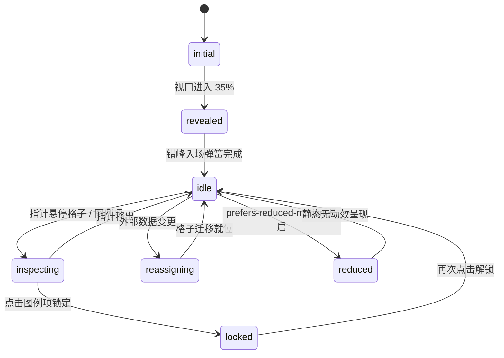

# Waffle Chart · 华夫饼图

用于展示多分类构成与绝对/相对份额占比（如国家电力能源来源结构、人群分布画像、产品开销构成）的 10×10 百分比单元格网格华夫饼图。包含最大余数法（Largest Remainder Method）全量 100 格无缝分配、最少位移重平衡迁移、插槽错峰入场缩放（Slot-staggered Reveal）、光标聚焦环与分类半透明遮罩暗化（Dim Opacity 0.26）、浮动跟随提示框及键盘箭头网格巡航。

## 原型清单

| 原型分组 | 原型元素 | 动效 / 状态变化 | 去向 |
| --- | --- | --- | --- |
| — | 华夫饼图卡片容器 `.arc-waffle-figure` | 整体布局与容器查询基准 | 最小 DOM / CSS 宿主 |
| — | 顶栏信息区 `.arc-waffle-heading` | 标题与副标题元数据 | 顶栏展台 |
| — | 华夫饼 10×10 单元格网格 `.arc-waffle-grid` | 承载 100 个物理单元格的二维正方形阵列 | 核心网格容器 |
| — | 独立格子 `.arc-waffle-cell` | 根据分类色彩与形态着色，具备缩放弹出、位置位移与聚焦高亮环 | 单元格粒子 |
| — | 浮动跟随提示框 `.arc-waffle-tooltip` | 跟随指针或键盘光标浮动，展示分类名称、数值与百分比 | 浮动提示框 |
| — | 交互图例列表 `.arc-waffle-legend` | 展示各分类色块、名称与占比数值，支持悬停高亮与点击锁定 | 交互图例项 |
| — | 读屏摘要 `.arc-waffle-srOnly` | 结构化语义表格与 `aria-live="polite"` 动态宣告 | 无障碍可访问性 |
| — | 国家切换胶囊组 `.qf` / `.At` / `.Cr` | 演示不同国家数据切换 | 演示外壳，已删除 |
| — | 页面背景与主题切换按钮 `#themeBtn` | 切换深色/浅色模式 | 演示外壳，已删除 |

## 适用

- 强调总体 100% 构成，且每个格子代表恰好 1% 份额的直观量化展示。
- 各分类百分比可能包含小数，需要使用最大余数算法精确凑整至整 100 个格子。
- 鼠标悬停某分类或单个格子时，需要高亮对应分类全部格子并压暗其余无关格子。
- 数据集切换（如从德国能源结构切换至法国能源结构）时，格子平滑移动重新分配归属。

## 不适用

- 连续时间走势或平滑趋势对比 → [line-chart](line-chart.md)
- 离散条形长度对比 → [bar-chart](bar-chart.md)
- 单维度连续比例条 → [split-bar](split-bar.md)
- 环状圆弧与圆心鼓读数 → [donut-chart](donut-chart.md)

## 状态机

| 状态 | 进入条件 | 视觉表现 | 退出到 |
| --- | --- | --- | --- |
| initial | 初始挂载（尚未进入视口） | 100 个格子 `scale(0.4)` 且透明度为 0 | revealed |
| revealed | 视口滚动进入 35% | 格子依行列插槽以 320ms 总错峰周期弹性弹出至 `scale(1)` | idle |
| idle | 入场完成，无活动焦点 | 100 个格子色彩均匀显示，图例与提示框处于静止 | inspecting |
| inspecting | 鼠标悬停或键盘聚焦某一格子或图例 | 当前分类格子保持 100% 不透明，其余分类格子压暗至 26% 透明度，提示框出现 | idle / locked |
| locked | 点击图例项锁定当前分类 | 提示框收起，当前分类保持常驻高亮，再次点击解锁 | idle |
| reassigning | 外部传入新数据更新 | 原有格子计算最少位移路径，平滑迁移到新插槽并色彩渐变 | idle |
| reduced | 触发系统减少动态效果模式 | 停用错峰缩放与移动过渡，格子色彩与透明度瞬间切换 | idle |



## 最小 DOM

```html
<figure class="arc-waffle-figure" aria-label="Energy sources waffle chart">
  <div class="arc-waffle-body">
    <div class="arc-waffle-board">
      <div class="arc-waffle-grid" role="group" aria-roledescription="waffle chart" tabindex="0">
        <!-- 动态生成的 100 个单元格 -->
      </div>
      <div class="arc-waffle-tooltip" role="tooltip" aria-hidden="true">
        <div class="arc-waffle-tipRow">
          <span class="arc-waffle-tipSwatch"></span>
          <span class="arc-waffle-tipName">Wind and solar</span>
          <span class="arc-waffle-tipValue">43%</span>
        </div>
        <p class="arc-waffle-tipMeta">218 TWh · 43 cells</p>
      </div>
    </div>

    <ul class="arc-waffle-legend" role="list">
      <!-- 动态分类图例项 -->
    </ul>
  </div>

  <div class="arc-waffle-srOnly">
    <p role="status" aria-live="polite"></p>
    <table>
      <caption>Energy sources breakdown table</caption>
      <thead><tr><th scope="col">Source</th><th scope="col">Share</th><th scope="col">Cells</th></tr></thead>
      <tbody></tbody>
    </table>
  </div>
</figure>
```

- `.arc-waffle-figure`：华夫饼图主容器。
- `.arc-waffle-body`：响应式布局结构，支持横向或纵向并排。
- `.arc-waffle-grid`：10×10 单元格网格宿主。
- `.arc-waffle-cell`：绝对定位物理单元格。
- `.arc-waffle-tooltip`：跟随指针/焦点的悬浮卡片。
- `.arc-waffle-legend`：交互式分类图例列表。
- `.arc-waffle-srOnly`：无障碍屏幕阅读器辅助表格。

## 参数

| 参数名 | 类型 | 默认值 | 物理含义与取值说明 |
| --- | --- | --- | --- |
| `rows` | `number` | `10` | 华夫饼网格行数。 |
| `columns` | `number` | `10` | 华夫饼网格列数。 |
| `gapPx` | `number` | `3` | 格子间的物理间隙（像素）。 |
| `staggerTotalMs` | `number` | `320` | 首批格子错峰入场的总耗时周期（毫秒）。 |
| `initialScale` | `number` | `0.4` | 格子入场前的初始缩放比例。 |
| `positionSpring` | `object` | `{ duration: 0.42, bounce: 0.16 }` | 格子重新分配位置时的弹簧动力学参数。 |
| `dimOpacity` | `number` | `0.26` | 聚焦单分类时，非活动格子的压暗透明度。 |
| `legendDimOpacity` | `number` | `0.5` | 非活动图例项的透明度。 |
| `defaultActiveKey` | `string \| null` | `null` | 初始默认锁定的分类 Key。 |
| `unit` | `string` | `''` | 数值单位后缀（如 `TWh`）。 |

## CSS

```css
:root {
  --waffle-gap: 3px;
  --waffle-border: rgba(0, 0, 0, 0.08);
  --waffle-surface: #ffffff;
  --waffle-surface-raised: #ffffff;
  --waffle-surface-muted: #f4f4f5;
  --waffle-foreground: #18181b;
  --waffle-text-secondary: #52525b;
  --waffle-text-muted: #71717a;
  --waffle-ease-spring: cubic-bezier(0.34, 1.56, 0.64, 1);
  --waffle-ease-standard: cubic-bezier(0.22, 1, 0.36, 1);
  --waffle-ease-fast: cubic-bezier(0, 0, 0.2, 1);
}

.arc-waffle-figure {
  position: relative;
  min-width: 0;
  margin: 0;
  color: var(--waffle-foreground);
  font-family: system-ui, -apple-system, sans-serif;
  box-sizing: border-box;
}

.arc-waffle-body {
  display: grid;
  grid-template-columns: minmax(0, 1fr);
  align-items: center;
  gap: 24px;
}

@media (min-width: 480px) {
  .arc-waffle-body {
    grid-template-columns: 240px minmax(0, 1fr);
  }
}

.arc-waffle-board {
  position: relative;
  min-width: 0;
}

.arc-waffle-grid {
  position: relative;
  width: 100%;
  max-width: 280px;
  aspect-ratio: 1 / 1;
  margin-inline: auto;
  outline: none;
  touch-action: pan-y;
  user-select: none;
  cursor: pointer;
}

/* 单元格粒子 */
.arc-waffle-cell {
  position: absolute;
  top: 0;
  left: 0;
  border-radius: 22%;
  background-color: var(--cell-color, #a1a1aa);
  transform-origin: center center;
  transform: scale(0.4);
  opacity: 0;
  will-change: transform, opacity;
  transition: transform 0.42s var(--waffle-ease-spring),
              opacity 0.24s var(--waffle-ease-fast),
              background-color 0.36s var(--waffle-ease-standard);
}

.arc-waffle-grid.is-revealed .arc-waffle-cell {
  transform: scale(1);
  opacity: 1;
}

/* 压暗非目标分类 */
.arc-waffle-grid[data-active] .arc-waffle-cell:not([data-on]) {
  opacity: 0.26 !important;
  transition: opacity 0.24s var(--waffle-ease-standard);
}

/* 光标焦点环 */
.arc-waffle-cell[data-cursor] {
  box-shadow: 0 0 0 2px var(--waffle-surface),
              0 0 0 4px color-mix(in srgb, var(--waffle-foreground) 50%, transparent);
  z-index: 2;
}

/* 跟随提示框 */
.arc-waffle-tooltip {
  position: absolute;
  top: 0;
  left: 0;
  z-index: 10;
  display: grid;
  min-width: 140px;
  max-width: 220px;
  gap: 4px;
  padding: 8px 12px;
  border: 1px solid var(--waffle-border);
  border-radius: 12px;
  background: var(--waffle-surface-raised);
  box-shadow: 0 8px 24px rgba(0, 0, 0, 0.12);
  opacity: 0;
  scale: 0.96;
  pointer-events: none;
  transition: opacity 0.16s var(--waffle-ease-standard),
              scale 0.16s var(--waffle-ease-standard);
}

.arc-waffle-tooltip[data-shown="true"] {
  opacity: 1;
  scale: 1;
}

.arc-waffle-tipRow {
  display: flex;
  align-items: center;
  gap: 8px;
  font-size: 0.875rem;
}

.arc-waffle-tipSwatch {
  width: 10px;
  height: 10px;
  flex: none;
  border-radius: 3px;
  background-color: var(--cell-color, #18181b);
}

.arc-waffle-tipName {
  flex: 1;
  overflow: hidden;
  text-overflow: ellipsis;
  white-space: nowrap;
  color: var(--waffle-text-secondary);
}

.arc-waffle-tipValue {
  font-weight: 600;
  font-variant-numeric: tabular-nums;
  color: var(--waffle-foreground);
}

.arc-waffle-tipMeta {
  margin: 0;
  padding-left: 18px;
  color: var(--waffle-text-muted);
  font-size: 0.75rem;
  font-variant-numeric: tabular-nums;
}

/* 图例列表 */
.arc-waffle-legend {
  display: grid;
  grid-template-columns: minmax(0, 1fr);
  gap: 4px;
  margin: 0;
  padding: 0;
  list-style: none;
}

.arc-waffle-item {
  display: grid;
  grid-template-columns: 12px minmax(0, 1fr) auto;
  align-items: center;
  gap: 10px;
  padding: 6px 10px;
  border: 0;
  border-radius: 8px;
  background: transparent;
  color: var(--waffle-text-secondary);
  cursor: pointer;
  font: inherit;
  font-size: 0.875rem;
  text-align: left;
  transition: background-color 0.16s var(--waffle-ease-standard),
              color 0.16s var(--waffle-ease-standard),
              opacity 0.16s var(--waffle-ease-standard);
}

.arc-waffle-item:hover,
.arc-waffle-item[data-on="true"] {
  background: var(--waffle-surface-muted);
  color: var(--waffle-foreground);
}

.arc-waffle-item[data-dim="true"] {
  opacity: 0.5;
}

.arc-waffle-swatch {
  width: 10px;
  height: 10px;
  border-radius: 3px;
  background-color: var(--cell-color, #18181b);
}

.arc-waffle-itemLabel {
  overflow: hidden;
  text-overflow: ellipsis;
  white-space: nowrap;
}

.arc-waffle-itemShare {
  font-weight: 600;
  font-variant-numeric: tabular-nums;
  color: var(--waffle-foreground);
}

.arc-waffle-srOnly {
  position: absolute;
  width: 1px;
  height: 1px;
  padding: 0;
  margin: -1px;
  overflow: hidden;
  clip: rect(0, 0, 0, 0);
  white-space: nowrap;
  border: 0;
}
```

## JS

```js
/**
 * Waffle Chart · 华夫饼图
 * @param {HTMLElement} el 宿主容器
 * @param {Object} options 配置参数
 * @returns {{ setActiveKey: (key: string | null) => void, update: (patch: Object) => void, getState: () => Object, destroy: () => void }}
 */
export function createWaffleChart(el, options = {}) {
  const defaultColors = [
    '#2563eb', // 蓝
    '#059669', // 绿
    '#d97706', // 琥珀
    '#dc2626', // 红
    '#7c3aed', // 紫
    '#64748b'  // 灰
  ];

  const defaults = {
    data: [
      { key: 'wind-solar', label: 'Wind & Solar', value: 218 },
      { key: 'nuclear', label: 'Nuclear', value: 132 },
      { key: 'coal', label: 'Coal', value: 76 },
      { key: 'gas', label: 'Natural Gas', value: 50 },
      { key: 'hydro', label: 'Hydroelectric', value: 20 },
      { key: 'other', label: 'Other Sources', value: 11 }
    ],
    rows: 10,
    columns: 10,
    unit: 'TWh',
    defaultActiveKey: null
  };

  let cfg = {
    ...defaults,
    ...options,
    data: (Array.isArray(options.data) && options.data.length > 0) ? options.data : defaults.data
  };

  let disposed = false;
  let activeKey = cfg.defaultActiveKey;
  let cursorSlot = -1;

  const totalCells = cfg.rows * cfg.columns;
  const grid = el.querySelector('.arc-waffle-grid');
  const tooltip = el.querySelector('.arc-waffle-tooltip');
  const tipSwatch = el.querySelector('.arc-waffle-tipSwatch');
  const tipName = el.querySelector('.arc-waffle-tipName');
  const tipValue = el.querySelector('.arc-waffle-tipValue');
  const tipMeta = el.querySelector('.arc-waffle-tipMeta');
  const legend = el.querySelector('.arc-waffle-legend');
  const srTable = el.querySelector('.arc-waffle-srOnly tbody');

  // 最大余数法计算 100 格归属
  function allocateCells(dataList) {
    const totalVal = dataList.reduce((sum, d) => sum + Math.max(0, d.value), 0);
    if (totalVal <= 0) return dataList.map(() => 0);

    const exact = dataList.map(d => (Math.max(0, d.value) / totalVal) * totalCells);
    const counts = exact.map(Math.floor);
    let remainder = totalCells - counts.reduce((a, b) => a + b, 0);

    const order = exact
      .map((val, idx) => ({ idx, rest: val - Math.floor(val) }))
      .sort((a, b) => b.rest - a.rest);

    for (let i = 0; remainder > 0 && i < order.length; i++, remainder--) {
      counts[order[i].idx]++;
    }

    return counts;
  }

  // 构建插槽映射
  let slotAssignments = [];
  function computeAssignments() {
    const counts = allocateCells(cfg.data);
    slotAssignments = [];

    cfg.data.forEach((item, catIdx) => {
      const color = item.color || defaultColors[catIdx % defaultColors.length];
      const count = counts[catIdx];
      for (let c = 0; c < count; c++) {
        slotAssignments.push({
          key: item.key,
          label: item.label,
          value: item.value,
          color,
          share: Math.round((count / totalCells) * 100)
        });
      }
    });

    while (slotAssignments.length < totalCells) {
      slotAssignments.push(null);
    }
  }

  // 渲染网格与图例
  function render() {
    if (!grid) return;
    computeAssignments();

    grid.innerHTML = '';
    const rect = grid.getBoundingClientRect();
    const gridWidth = rect.width || 280;
    const gap = 3;
    const cellSize = (gridWidth - gap * (cfg.columns - 1)) / cfg.columns;

    // 创建 100 个格子
    for (let slot = 0; slot < totalCells; slot++) {
      const col = slot % cfg.columns;
      const row = Math.floor(slot / cfg.columns);
      const x = col * (cellSize + gap);
      const y = row * (cellSize + gap);

      const cell = document.createElement('div');
      cell.className = 'arc-waffle-cell';
      cell.style.width = `${cellSize}px`;
      cell.style.height = `${cellSize}px`;
      cell.style.left = `${x}px`;
      cell.style.top = `${y}px`;
      cell.setAttribute('data-slot', String(slot));

      const assign = slotAssignments[slot];
      if (assign) {
        cell.style.setProperty('--cell-color', assign.color);
        cell.setAttribute('data-key', assign.key);
      }

      // 入场错峰延迟
      const delayMs = Math.min(slot * 3.2, 320);
      cell.style.transitionDelay = `${delayMs}ms`;

      grid.appendChild(cell);
    }

    // 触发入场
    requestAnimationFrame(() => {
      if (!disposed && grid) grid.classList.add('is-revealed');
    });

    // 渲染图例
    if (legend) {
      legend.innerHTML = '';
      const counts = allocateCells(cfg.data);
      cfg.data.forEach((item, idx) => {
        const count = counts[idx];
        const share = Math.round((count / totalCells) * 100);
        const color = item.color || defaultColors[idx % defaultColors.length];

        const li = document.createElement('li');
        const btn = document.createElement('button');
        btn.type = 'button';
        btn.className = 'arc-waffle-item';
        btn.setAttribute('data-key', item.key);
        btn.innerHTML = `
          <span class="arc-waffle-swatch" style="--cell-color: ${color}"></span>
          <span class="arc-waffle-itemLabel">${item.label}</span>
          <span class="arc-waffle-itemShare">${share}%</span>
        `;

        btn.addEventListener('mouseenter', () => setActiveKey(item.key));
        btn.addEventListener('mouseleave', () => setActiveKey(null));
        btn.addEventListener('click', () => {
          setActiveKey(activeKey === item.key ? null : item.key);
        });

        li.appendChild(btn);
        legend.appendChild(li);
      });
    }

    // 渲染无障碍表格
    if (srTable) {
      srTable.innerHTML = '';
      const counts = allocateCells(cfg.data);
      cfg.data.forEach((item, idx) => {
        const count = counts[idx];
        const share = Math.round((count / totalCells) * 100);
        const tr = document.createElement('tr');
        tr.innerHTML = `<th scope="row">${item.label}</th><td>${share}%</td><td>${count}</td>`;
        srTable.appendChild(tr);
      });
    }

    syncHighlight();
  }

  // 状态高亮与压暗同步
  function syncHighlight() {
    if (!grid) return;
    const cells = grid.querySelectorAll('.arc-waffle-cell');

    if (activeKey) {
      grid.setAttribute('data-active', 'true');
      cells.forEach(c => {
        if (c.getAttribute('data-key') === activeKey) {
          c.setAttribute('data-on', 'true');
        } else {
          c.removeAttribute('data-on');
        }
      });

      if (legend) {
        legend.querySelectorAll('.arc-waffle-item').forEach(it => {
          if (it.getAttribute('data-key') === activeKey) {
            it.setAttribute('data-on', 'true');
            it.removeAttribute('data-dim');
          } else {
            it.removeAttribute('data-on');
            it.setAttribute('data-dim', 'true');
          }
        });
      }
    } else {
      grid.removeAttribute('data-active');
      cells.forEach(c => c.removeAttribute('data-on'));
      if (legend) {
        legend.querySelectorAll('.arc-waffle-item').forEach(it => {
          it.removeAttribute('data-on');
          it.removeAttribute('data-dim');
        });
      }
    }
  }

  function setActiveKey(key) {
    if (disposed) return;
    activeKey = key;
    syncHighlight();

    if (!key && tooltip) {
      tooltip.removeAttribute('data-shown');
    }
  }

  // 指针滑动与提示框联动
  function onPointerMove(e) {
    if (disposed || !grid) return;
    const targetCell = e.target.closest('.arc-waffle-cell');
    if (!targetCell) {
      if (!activeKey && tooltip) tooltip.removeAttribute('data-shown');
      return;
    }

    const slot = parseInt(targetCell.getAttribute('data-slot') || '-1', 10);
    const assign = slotAssignments[slot];
    if (!assign) return;

    cursorSlot = slot;
    setActiveKey(assign.key);

    // 聚焦光标环
    grid.querySelectorAll('.arc-waffle-cell').forEach(c => c.removeAttribute('data-cursor'));
    targetCell.setAttribute('data-cursor', 'true');

    // 提示框定位
    if (tooltip && tipSwatch && tipName && tipValue && tipMeta) {
      tipSwatch.style.setProperty('--cell-color', assign.color);
      tipName.textContent = assign.label;
      tipValue.textContent = `${assign.share}%`;
      tipMeta.textContent = `${assign.value} ${cfg.unit} · ${assign.share} cells`;

      const cellRect = targetCell.getBoundingClientRect();
      const boardRect = grid.getBoundingClientRect();
      const tipX = Math.min(Math.max(cellRect.left - boardRect.left + 15, 0), boardRect.width - 120);
      const tipY = Math.max(cellRect.top - boardRect.top - 55, 0);

      tooltip.style.transform = `translate(${tipX}px, ${tipY}px)`;
      tooltip.setAttribute('data-shown', 'true');
    }
  }

  function onPointerLeave() {
    if (disposed || !grid) return;
    grid.querySelectorAll('.arc-waffle-cell').forEach(c => c.removeAttribute('data-cursor'));
    setActiveKey(null);
  }

  // 键盘操作
  function onKeyDown(e) {
    if (disposed) return;
    if (!['ArrowLeft', 'ArrowRight', 'ArrowUp', 'ArrowDown', 'Escape'].includes(e.key)) return;

    e.preventDefault();
    if (e.key === 'Escape') {
      setActiveKey(null);
      if (grid) grid.querySelectorAll('.arc-waffle-cell').forEach(c => c.removeAttribute('data-cursor'));
      return;
    }

    let nextSlot = cursorSlot < 0 ? 0 : cursorSlot;
    if (e.key === 'ArrowRight') nextSlot = Math.min(nextSlot + 1, totalCells - 1);
    else if (e.key === 'ArrowLeft') nextSlot = Math.max(nextSlot - 1, 0);
    else if (e.key === 'ArrowDown') nextSlot = Math.min(nextSlot + cfg.columns, totalCells - 1);
    else if (e.key === 'ArrowUp') nextSlot = Math.max(nextSlot - cfg.columns, 0);

    cursorSlot = nextSlot;
    const targetCell = grid?.querySelector(`[data-slot="${cursorSlot}"]`);
    if (targetCell) {
      grid.querySelectorAll('.arc-waffle-cell').forEach(c => c.removeAttribute('data-cursor'));
      targetCell.setAttribute('data-cursor', 'true');
      const assign = slotAssignments[cursorSlot];
      if (assign) setActiveKey(assign.key);
    }
  }

  // 事件监听绑定
  if (grid) {
    grid.addEventListener('pointermove', onPointerMove);
    grid.addEventListener('pointerleave', onPointerLeave);
    grid.addEventListener('keydown', onKeyDown);
  }

  // 初始点击切换激活状态
  const handleClick = () => {
    if (cfg.data.length > 0) {
      const nextKey = activeKey === cfg.data[0].key ? null : cfg.data[0].key;
      setActiveKey(nextKey);
    }
  };
  el.addEventListener('click', handleClick);

  // 初始渲染
  render();

  return {
    setActiveKey,
    update(patch) {
      if (disposed) return;
      cfg = { ...cfg, ...patch };
      render();
    },
    getState() {
      return {
        activeKey,
        cursorSlot,
        totalCells,
        disposed
      };
    },
    destroy() {
      disposed = true;
      if (grid) {
        grid.removeEventListener('pointermove', onPointerMove);
        grid.removeEventListener('pointerleave', onPointerLeave);
        grid.removeEventListener('keydown', onKeyDown);
      }
      el.removeEventListener('click', handleClick);
    }
  };
}
```

## 接入目标项目

- 状态来源：
  - 传入分类数据集 `data: [{ key, label, value, color }]`。
- 尺寸策略：
  - 华夫饼网格具备 `aspect-ratio: 1 / 1` 正方形约束，外层支持响应式容器查询（在宽度 >= 480px 时网格与图例横向并列）。
- 驱动方式：
  - `const waffle = createWaffleChart(container, { data, unit: 'TWh' })`。
  - 数据变更时调用 `waffle.update({ data: newData })`。
  - 卸载组件时调用 `waffle.destroy()`。

## 重入与清理

- 连续快速悬停与键盘导航时，光标聚焦环与分类压暗通过 CSS transitions 平滑过渡。
- 销毁时清理指针移动、键盘事件与图例侦听器。

## 减少动态效果

- 满足 `prefers-reduced-motion: reduce` 时：
  - 单元格入场弹簧过渡完全停用（`transition: none !important`）。
  - 分类聚焦与压暗切换直接跳变，避免引起眩晕。

## 焦点与键盘

- 网格 `.arc-waffle-grid` 声明 `role="group"` 并设置 `tabindex="0"`。
- 支持四向箭头键（`ArrowLeft`, `ArrowRight`, `ArrowUp`, `ArrowDown`）在 10×10 单元格之间平滑巡航。
- `Escape` 键快速清除当前高亮与聚焦环。

## 兼容回退

| 特性 | 不支持时 |
| --- | --- |
| CSS Container Queries | 降级为纵向单列平铺布局。 |
| CSS `aspect-ratio` | 降级为固定宽高正方形尺寸。 |

## 验收清单

- [ ] 初始渲染完整的 10×10 单元格网格，最大余数法分配总和严格为 100 格。
- [ ] 鼠标悬停任意格子或图例项，对应分类高亮，其余无关格子压暗至 26% 透明度。
- [ ] 浮动跟随提示框准确展示当前分类名称、数值与百分比。
- [ ] 键盘四向箭头键可在 100 个格子间巡航并带有高亮光标环。
- [ ] 调用 `destroy()` 完整释放资源并解绑监听器。
