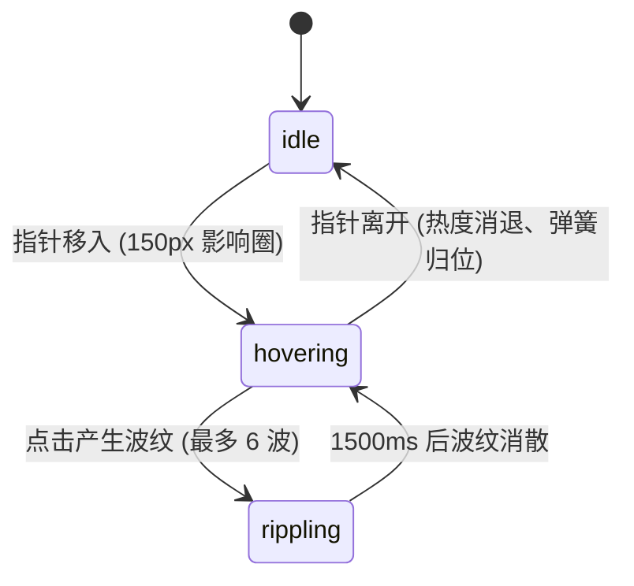

# Dot Grid · 交互式光标排斥点阵

基于 Canvas 2D 物理动力学的网格点阵排斥与波纹交互组件。包含三大核心机制：

1. **光标力场排斥与热度衰减（Force Field & Heat）**：以光标为中心 150px 半径范围内计算排斥力 `6.75 * q * (1 - q)^2 * 16 * power`（`q = dist / 150`）；受扰动点阵点亮高光热度（Heat），移开时光标热度以 `0.75^dt` 指数消退。
2. **多层水波扩散脉冲（Wave Ripples）**：鼠标或触摸点击产生向外扩散的物理波纹（最多叠加 6 个独立波），波速为 0.62px/ms，脉冲带宽 46px，持续 1500ms，为掠过的点阵注入最大 11px 的瞬时径向推力。
3. **点阵弹性回归与多密度自适应**：偏离基准点的点阵通过恢复系数 0.16 与阻尼衰减 `0.74^dt` 平滑弹回平衡位置；支持 Dense（14px）、Default（22px）、Loose（32px）三种网格密度切换与居中对齐。

## 原型清单

| 原型分组 | 原型元素 | 动效 / 状态变化 | 去向 |
| --- | --- | --- | --- |
| — | 点阵画布 `canvas.dot-grid_canvas__QmHJf` | 网格排斥力场、点击波纹、热度变色、弹性回归 | `.dot-grid-canvas` |
| — | 密度控制滑块 `.dot-grid_segment__Y7_uO` | 切换 Dense / Default / Loose 间距，滑块高光跟随 | `.dot-grid-density` |
| — | 边缘遮罩 `.dot-grid_root__tnG4H` | 周边边缘透明羽化遮罩 | `.dot-grid-root` |
| — | 顶栏、外观切换 `#themeBtn`、舞台外壳 | — | 演示外壳，已删除 |

## 适用

- 科技感、设计感产品首页背景（Hero Background）。
- 交互式背景板、创意实验室（Labs）或设计系统演示展台。
- 鼠标滑过产生轻盈跟随粒子、点击产生水波涟漪的沉浸式场景。

## 不适用

- 图片网格向光标向心聚拢与引力波脉冲 → [gravity-well](gravity-well.md)
- 粒子吹散重组为特定文本词汇 → [sand-text](../special-type/sand-text.md)
- 双同心圆轨道漫游集成图标 → [orbit-logos](../playful/orbit-logos.md)

## 状态机

| 状态 | 进入条件 | 视觉表现 | 退出到 |
| --- | --- | --- | --- |
| idle | 初始；指针离开且所有波纹消退 | 点阵静止排列于平衡网格，保持低透明度，停止 RAF 循环 | hovering |
| hovering | 指针进入画布并在 150px 内移动 | 光标周围点阵被推斥分散，点阵热度增加、颜色变亮 | idle / rippling |
| rippling | 点击画布任意位置 | 产生向外扩散的高能圆形水波纹，沿途点阵剧烈位移并染色 | hovering / idle |



## 最小 DOM

```html
<div class="dot-grid-root" role="region" aria-label="Interactive dot grid background">
  <div class="dot-grid-canvas-wrap">
    <canvas class="dot-grid-canvas" aria-hidden="true"></canvas>
  </div>
  <div class="dot-grid-density" role="group" aria-label="Grid density">
    <button type="button" class="density-btn" aria-pressed="false" data-density="0">Dense</button>
    <button type="button" class="density-btn" aria-pressed="true" data-density="1">Default</button>
    <button type="button" class="density-btn" aria-pressed="false" data-density="2">Loose</button>
  </div>
</div>
```

- `.dot-grid-root`：宿主容器，承载遮罩与手势捕获。
- `.dot-grid-canvas-wrap`：画布包裹层，具有边缘径向或线性透明渐变。
- `.dot-grid-canvas`：负责高性能 2D 点阵与波形绘制的 Canvas 元素。
- `.dot-grid-density`：密度切换工具栏。

## 参数

| 名称 | 值 | 用于 | 来源 |
| --- | --- | --- | --- |
| gapsPx | `[14px, 22px, 32px]` | Dense / Default / Loose 对应格点间距 | 原型 |
| radiusPx | `1.4px` | 单个点阵小圆点半径 | 原型 |
| pointer.radiusPx | `150px` | 光标排斥影响范围 | 原型 |
| pointer.force | `6.75 * q * (1 - q)^2 * 16 * power` | 排斥力场公式 | 原型 |
| wave.speedPxPerMs | `0.62px/ms` | 点击波纹扩散速度 | 原型 |
| wave.lifeMs | `1500ms` | 单个波纹最大存活生命周期 | 原型 |
| wave.max | `6` | 最大允许并发叠加的水波数量 | 原型 |
| spring.restore | `0.16` | 回归平衡位置的弹簧刚度系数 | 原型 |
| spring.velocityDecay | `0.74` | 速度逐帧阻尼衰减系数 | 原型 |

## CSS

```css
.dot-grid-root {
  --grid-bg: #f9f9f9;
  --grid-border: rgba(0, 0, 0, 0.08);
  --dot-color: #a3a3a3;
  --dot-heat: #2563eb;
  position: relative;
  display: flex;
  flex-direction: column;
  align-items: center;
  justify-content: center;
  width: 100%;
  max-width: 680px;
  height: 420px;
  margin-inline: auto;
  border-radius: 16px;
  background: var(--grid-bg);
  border: 1px solid var(--grid-border);
  overflow: hidden;
  font-family: system-ui, -apple-system, sans-serif;
  user-select: none;
}

@media (prefers-color-scheme: dark) {
  .dot-grid-root {
    --grid-bg: #111827;
    --grid-border: rgba(255, 255, 255, 0.1);
    --dot-color: #4b5563;
    --dot-heat: #60a5fa;
  }
}

.dot-grid-canvas-wrap {
  position: absolute;
  inset: 0;
  -webkit-mask-image: radial-gradient(circle at center, black 65%, transparent 100%);
  mask-image: radial-gradient(circle at center, black 65%, transparent 100%);
}

.dot-grid-canvas {
  display: block;
  width: 100%;
  height: 100%;
}

.dot-grid-density {
  position: absolute;
  bottom: 16px;
  display: inline-flex;
  gap: 4px;
  padding: 4px;
  border-radius: 9999px;
  background: rgba(255, 255, 255, 0.85);
  backdrop-filter: blur(8px);
  border: 1px solid var(--grid-border);
  box-shadow: 0 2px 8px rgba(0, 0, 0, 0.06);
  z-index: 10;
}

@media (prefers-color-scheme: dark) {
  .dot-grid-density {
    background: rgba(31, 41, 55, 0.85);
  }
}

.density-btn {
  padding: 5px 12px;
  border: 0;
  border-radius: 9999px;
  background: transparent;
  color: #6b7280;
  font-size: 12px;
  font-weight: 500;
  cursor: pointer;
  transition: background-color 0.15s ease, color 0.15s ease, border-color 0.15s ease, transform 0.15s ease, opacity 0.15s ease, box-shadow 0.15s ease;
}

.density-btn[aria-pressed="true"] {
  background: #ffffff;
  color: #111827;
  box-shadow: 0 1px 3px rgba(0, 0, 0, 0.1);
}

@media (prefers-color-scheme: dark) {
  .density-btn[aria-pressed="true"] {
    background: #374151;
    color: #f9fafb;
  }
}
```

## JS

```js
export function createDotGrid(el, options = {}) {
  const canvas = el.querySelector('.dot-grid-canvas');
  const densityBtns = Array.from(el.querySelectorAll('.density-btn'));
  if (!canvas) return { destroy: () => {} };

  const ctx = canvas.getContext('2d');
  const GAPS = [14, 22, 32];
  let currentDensity = options.initialDensity ?? 1; // 0, 1, 2
  let gap = GAPS[currentDensity];
  let dots = [];
  let waves = [];
  let animId = null;
  let disposed = false;

  const pointer = { x: -1000, y: -1000, inside: false, power: 0 };
  const isReduced = window.matchMedia('(prefers-reduced-motion: reduce)').matches;

  function initGrid() {
    const rect = canvas.getBoundingClientRect();
    const dpr = Math.min(window.devicePixelRatio || 1, 2);
    canvas.width = Math.floor(rect.width * dpr);
    canvas.height = Math.floor(rect.height * dpr);

    const effectiveGap = gap * dpr;
    const cols = Math.floor(canvas.width / effectiveGap);
    const rows = Math.floor(canvas.height / effectiveGap);
    const offsetX = (canvas.width - cols * effectiveGap) / 2;
    const offsetY = (canvas.height - rows * effectiveGap) / 2;

    dots = [];
    for (let r = 0; r <= rows; r++) {
      for (let c = 0; c <= cols; c++) {
        const ox = offsetX + c * effectiveGap;
        const oy = offsetY + r * effectiveGap;
        dots.push({
          ox,
          oy,
          x: ox,
          y: oy,
          vx: 0,
          vy: 0,
          heat: 0
        });
      }
    }
    requestFrame();
  }

  function loop() {
    if (disposed) return;
    ctx.clearRect(0, 0, canvas.width, canvas.height);

    const now = performance.now();
    let hasMotion = false;

    // 清理过期波纹
    waves = waves.filter((w) => now - w.start < 1500);

    const dpr = Math.min(window.devicePixelRatio || 1, 2);
    const radius = 1.4 * dpr;
    const maxRadius = 150 * dpr;

    for (const dot of dots) {
      if (!isReduced) {
        // 1. 光标力场排斥
        if (pointer.inside) {
          const dx = dot.x - pointer.x;
          const dy = dot.y - pointer.y;
          const dist = Math.hypot(dx, dy);
          if (dist < maxRadius && dist > 0) {
            const q = dist / maxRadius;
            const force = 6.75 * q * (1 - q) ** 2 * 16;
            dot.vx += (dx / dist) * force * 0.2;
            dot.vy += (dy / dist) * force * 0.2;
            dot.heat = Math.min(1, dot.heat + (1 - q) * 0.1);
            hasMotion = true;
          }
        }

        // 2. 波纹脉冲
        for (const w of waves) {
          const elapsed = now - w.start;
          const waveR = elapsed * 0.62 * dpr;
          const dist = Math.hypot(dot.x - w.x, dot.y - w.y);
          const diff = Math.abs(dist - waveR);
          if (diff < 46 * dpr) {
            const push = (1 - diff / (46 * dpr)) * 1.5;
            dot.vx += ((dot.x - w.x) / (dist || 1)) * push;
            dot.vy += ((dot.y - w.y) / (dist || 1)) * push;
            dot.heat = Math.min(1, dot.heat + push * 0.4);
            hasMotion = true;
          }
        }

        // 3. 弹簧回位
        dot.vx += (dot.ox - dot.x) * 0.16;
        dot.vy += (dot.oy - dot.y) * 0.16;
        dot.vx *= 0.74;
        dot.vy *= 0.74;
        dot.x += dot.vx;
        dot.y += dot.vy;

        if (Math.hypot(dot.vx, dot.vy) > 0.05 || Math.abs(dot.x - dot.ox) > 0.1) {
          hasMotion = true;
        }
      }

      // 4. 热度衰减
      dot.heat *= 0.75;
      if (dot.heat > 0.02) hasMotion = true;

      // 5. 渲染
      const baseAlpha = 0.3 + dot.heat * 0.7;
      ctx.fillStyle = dot.heat > 0.2 ? '#2563eb' : '#9ca3af';
      ctx.globalAlpha = baseAlpha;
      ctx.beginPath();
      ctx.arc(dot.x, dot.y, radius + dot.heat * 1.2, 0, Math.PI * 2);
      ctx.fill();
    }

    ctx.globalAlpha = 1;

    if (hasMotion || pointer.inside || waves.length > 0) {
      animId = requestAnimationFrame(loop);
    } else {
      animId = null;
    }
  }

  function requestFrame() {
    if (!animId && !disposed) {
      animId = requestAnimationFrame(loop);
    }
  }

  function onPointerMove(e) {
    const rect = canvas.getBoundingClientRect();
    const dpr = Math.min(window.devicePixelRatio || 1, 2);
    pointer.x = (e.clientX - rect.left) * dpr;
    pointer.y = (e.clientY - rect.top) * dpr;
    pointer.inside = true;
    requestFrame();
  }

  function onPointerLeave() {
    pointer.inside = false;
    requestFrame();
  }

  function onClick(e) {
    if (waves.length >= 6) return;
    const rect = canvas.getBoundingClientRect();
    const dpr = Math.min(window.devicePixelRatio || 1, 2);
    waves.push({
      x: (e.clientX - rect.left) * dpr,
      y: (e.clientY - rect.top) * dpr,
      start: performance.now()
    });
    requestFrame();
  }

  function setDensity(idx) {
    currentDensity = idx;
    gap = GAPS[currentDensity];
    densityBtns.forEach((btn, i) => {
      btn.setAttribute('aria-pressed', String(i === idx));
    });
    initGrid();
  }

  densityBtns.forEach((btn, i) => {
    btn.addEventListener('click', () => setDensity(i));
  });

  canvas.addEventListener('pointermove', onPointerMove);
  canvas.addEventListener('pointerleave', onPointerLeave);
  canvas.addEventListener('click', onClick);

  const resizeObserver = new ResizeObserver(() => {
    if (!disposed) initGrid();
  });
  resizeObserver.observe(canvas);

  initGrid();

  return {
    setDensity,
    destroy() {
      disposed = true;
      if (animId) cancelAnimationFrame(animId);
      resizeObserver.disconnect();
      canvas.removeEventListener('pointermove', onPointerMove);
      canvas.removeEventListener('pointerleave', onPointerLeave);
      canvas.removeEventListener('click', onClick);
    }
  };
}
```

## 接入目标项目

- 状态来源：网格密度由控制栏或用户配置直接驱动，光标事件监听挂载在组件容器上。
- 尺寸策略：画布随宿主容器自动填充，支持 `devicePixelRatio` 物理像素对齐。
- 驱动方式：`const grid = createDotGrid(rootEl);`，离开页面时调用 `grid.destroy()`。

## 重入与清理

- 连续点击水波自动由数组生命周期队列（`now - start < 1500`）管理，上限 6 个并发，防止内存爆炸。
- 静止无动作后自动停止 `requestAnimationFrame` 循环，保持零 CPU 占用。

## 减少动态效果

- 在 `prefers-reduced-motion: reduce` 设置下，取消点阵排斥与点击水波位移，仅保留微弱热度明度反馈。

## 焦点与键盘

- 画布标记 `aria-hidden="true"`，不产生辅助读屏噪音。
- 密度选择器由标准可访问按钮组承载，支持键盘 Tab 与 Enter / Space 激活。

## 兼容回退

| 特性 | 不支持时 |
| --- | --- |
| CSS 遮罩 `mask-image` | 移除径向边缘虚化渐变，全屏平铺 |
| `ResizeObserver` | 回退使用窗口 resize 事件更新网格 |

## 验收清单

- [ ] 鼠标移入画布并在点阵上方移动时，周围点阵被自然推开并点亮为高光色。
- [ ] 鼠标离开画布后，受扰动的点阵平滑弹回原位，高光渐灭，动画停止。
- [ ] 点击画布产生向外扩散的同心圆波纹，经过的点阵产生明显径向推力。
- [ ] 点击 Dense / Default / Loose 按钮，点阵瞬时重构为对应间距。
- [ ] 开启系统的“减少动态效果”时，点阵无排斥位移，点击无波纹。
